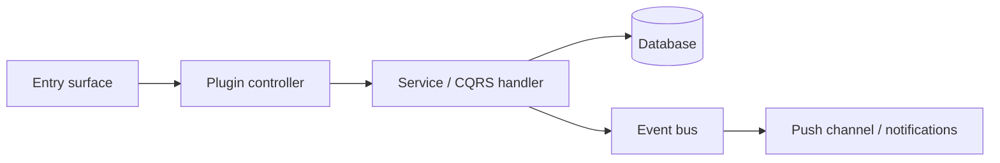

# Implementation Plan: [FEATURE NAME]

> Translates an approved `spec.md` into architecture and tech choices. The plan owns
> implementation details; the spec owns behaviour.

**Feature ID**: `[short-slug]`
**Spec**: `./spec.md`
**Tasks**: `./tasks.md`
**Status**: `Draft` | `In Review` | `Approved` | `In Progress` | `Done`
**Last updated**: YYYY-MM-DD

---

## 1. Architecture Summary

Mermaid diagram of the request/data flow from each entry surface (REST endpoint,
Angular page, React UI plugin, MCP tool, scheduled job, webhook) to persisted state,
events and external side effects.



## 2. Tech Choices

| Concern | Choice | Rationale |
| ------- | ------ | --------- |
| Package | `packages/plugins/<id>` (new / existing) | Principle I |
| Persistence | MultiORM entities + migrations (PG, SQLite, MySQL) | Principle III |
| Background work | BullMQ queue / scheduler / event handler | … |
| Push | event bus → WebSocket gateway | Principle VII |
| UI | Angular plugin (`<id>-ui`) / React plugin (`<id>-react-ui`) | … |

## 3. Data Model

### New or changed entities

```ts
@MultiORMEntity('table_name')
export class EntityName extends TenantOrganizationBaseEntity {
    // fields, relations, indexes
}
```

### Migrations

- `migrations/<timestamp>-<Name>.ts` — additive, forward-only; PostgreSQL, SQLite and
  MySQL branches; registered for both ORMs.
- Backfill strategy for any `NOT NULL` column: …

### Contracts

`@gauzy/contracts` additions (interfaces, enums, DTO shapes) — these reach the SDKs and
Ever Teams.

## 4. API Surface

| Method | Endpoint | Permission | Description | Status |
| ------ | -------- | ---------- | ----------- | ------ |
| `POST` | `/api/<resource>` | `PermissionsEnum.X` | … | New |

For each endpoint: request DTO (class-validator), response shape, auth and permissions,
pagination/filtering, error responses, rate limits, Swagger decorators.

## 5. Events, Real-Time and Notifications

| Event | Emitted when | Consumers (push channel, notifications, inbox, integrations, activity log) |
| ----- | ------------ | --------------------------------------------------------------------------- |

## 6. UI Surface

- Angular: routes, pages, components, menu entries, feature toggle, permissions, i18n keys.
- React UI plugin (if any): components, hooks, bridge services used.
- Ever Teams: which endpoints it consumes (its own spec lives in the Ever Teams repository).

## 7. MCP Tools, SDKs and Integrations

- New MCP tools under `packages/mcp-server/src/lib/tools/`.
- OpenAPI/SDK impact (regenerate the Kiota SDKs after merge).
- Integration hooks (webhooks in/out, sync jobs).

## 8. Background Jobs

| Trigger | When | What it does | Idempotency |
| ------- | ---- | ------------ | ----------- |

## 9. Security & Permissions

- Permissions per endpoint; new `PermissionsEnum` values and default role grants.
- Secrets and credentials (`IntegrationSetting`, env); webhook signature checks.
- Input validation and content sanitisation.

## 10. Observability

- Activity-log / audit events, metrics, Sentry breadcrumbs.

## 11. Phased Rollout

1. **Phase 1 — Contracts, entities, migrations** (flag off, no behaviour change).
2. **Phase 2 — Services, endpoints, events, tests** (flag off).
3. **Phase 3 — UI surfaces and MCP tools** (flag on per tenant/environment).
4. **Phase 4 — Default-on** after soak, owner's decision.

## 12. Constitution Reconciliation

- I Plugin-first: …
- II Tenant/organization scoping: …
- III Both ORMs, additive migrations: …
- IV Default-off flag; nothing removed: …
- V Contracts and API first: …
- VI Permissions, privacy, security: …
- VII Real-time through the event bus: …
- VIII i18n and accessibility: …
- IX Tests: …
- X Behaviour-first spec: …
- XI Documentation describes our platform only: …

## 13. Risks & Mitigations

| Risk | Likelihood | Impact | Mitigation |
| ---- | ---------- | ------ | ---------- |

## 14. References

- Spec: `./spec.md` · Tasks: `./tasks.md` · ADRs: …
