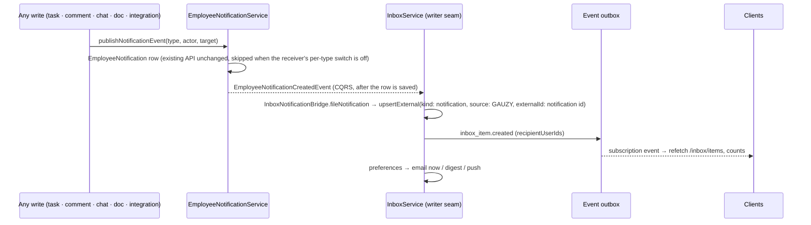

# Collaboration suite — architecture

**Status**: Accepted (2026-11-07) · **Owner**: platform maintainers · **ADR**: [001](../decisions/001-collaboration-api-lives-in-plugins.md)

How Tasks, Chat, Docs, Inbox, notifications, the real-time channel and the new
integrations fit together across the API, the Angular app, Ever Teams, the desktop
apps, the MCP server and the SDKs — and, above all, **what is reused**. Every feature
spec under [`../features/`](../features/) builds on this document.

## 1. Principle: one platform, many clients

```mermaid
flowchart TB
    subgraph clients [Clients]
        NG[Angular app<br/>plugin-ui pages]
        ET[Ever Teams<br/>web · mobile · desktop]
        DT[Desktop timer apps]
        MCP[MCP server]
        SDK[Kiota SDKs]
    end
    subgraph api [Platform API]
        TASKS[core: tasks · comments · mentions<br/>subscriptions · notifications<br/>activity log · reactions · favorites]
        CHAT[plugin: chat]
        DOCS[plugin: docs (+ collaboration)]
        INBOX[plugin: inbox]
        RT[plugin: realtime<br/>presence · typing · catalogue]
        INT[plugins: integration-asana<br/>integration-linear · integration-trello]
        OUTBOX[core: event outbox<br/>GraphQL subscriptions · webhooks]
        SEARCH[plugin: search]
        FILES[core: file storage · image assets]
        EMAIL[core: email send · templates]
    end
    clients -->|REST · GraphQL| api
    clients -.->|graphql-ws subscriptions| OUTBOX
    CHAT --> TASKS
    CHAT --> INBOX
    CHAT --> OUTBOX
    CHAT --> FILES
    DOCS --> INBOX
    DOCS --> OUTBOX
    TASKS --> INBOX
    TASKS --> OUTBOX
    INBOX --> EMAIL
    INBOX --> OUTBOX
    INT --> TASKS
    INT --> INBOX
    RT --> OUTBOX
    CHAT --> SEARCH
    DOCS --> SEARCH
```

Every capability is an API in this repository, built once; each client builds a UI on it.
Ever Teams holds no data of its own.

## 2. What already exists and is reused (do not rebuild)

| Capability | Where | Reused by |
| --- | --- | --- |
| Tasks with statuses, priorities, sizes, labels, versions, issue types, sub-tasks, linked issues, estimates, sprints, daily plans, **saved views with advanced filters** | `packages/core/src/lib/tasks/*` (`tasks/views/`, `ITaskAdvancedFilter`) | task-views-and-bulk-actions extends `TaskView`; chat task cards; docs task links |
| Polymorphic **comments** (threads, resolve, images) on any `BaseEntityEnum` | `packages/core/src/lib/comment/` | docs page comments (already), inbox fan-out |
| **Mentions** (`mentionEmployeeIds` from the client, `MentionService.publishMention`, `parentEntityType` for follow) | `packages/core/src/lib/mention/` | chat, docs, comments |
| **Followers** (`EntitySubscription`: manual, mention, assignment, comment, created) | `packages/core/src/lib/entity-subscription/` | inbox fan-out (today recorded but never consumed) |
| **Employee notifications** + per-type settings (`preferences.email/inApp` JSON already stored) | `packages/core/src/lib/employee-notification*/` | inbox files every notification as an item; preferences extend the settings entity |
| **Inbox plugin**: `InboxItem` (kinds question/approval/escalation/notice/email, source, status, priority, links), `InboxItemRecipient` (read, archived, `snoozedUntil`), writer seam `INBOX_ITEM_WRITER`, source-handler registry, item feed, `inbox_item.created` outbox event, header bell, page with tabs | `packages/plugins/inbox/`, `packages/plugins/inbox-ui/` (`GAUZY_INBOX_ENABLED`) | the unified inbox; chat and docs file items through the writer seam |
| **Activity log** (tasks, projects, docs, …) | `packages/core/src/lib/activity-log/` | bulk actions, chat channel management, integration sync entries |
| **Reactions** (`ReactionEntityEnum`: Task, Comment, Document, Broadcast — API only) | `packages/core/src/lib/reaction/` | chat message reactions (`ChatMessage` added to the enum) |
| **Favorites** (sidebar section) | `packages/core/src/lib/favorite/` | favourite conversations and pages |
| **Broadcasts** (announcements with audiences — API only) | `packages/core/src/lib/broadcast/` | optional "announcement" channel posts (later) |
| **Docs**: `Document` (folder/page/file, TipTap JSON + HTML + CRDT state column), versions, shares (employee/team: view/comment/edit), `DocumentLink` to any record, categories, tree ops, review, AI knowledge, inbound email, saved views; `docs-ui` TipTap v3 editor with block comments and mentions | `packages/plugins/docs/`, `packages/plugins/docs-ui/` (`FEATURE_DOCUMENTS`) | docs-collaboration extends it; Ever Teams builds its Docs UI on `/plugins/docs/*`; chat attachments are `Document{kind: FILE, source: CHAT}` linked by `DocumentLink` |
| **Event outbox** (`eventId`, `aggregateType/Id`, `payload`, `partitionKey`, `sequence`, `recipientUserIds` addressing) + dispatcher + consumers + REST `GET /events/outbox` | `packages/core/src/lib/event-outbox/` | the replayable event stream of the real-time channel |
| **GraphQL subscriptions** over graphql-ws: `Subscription.events(names, aggregateId, channelId)`, `declareStreamedEvents()`, pluggable pub/sub engine (`GRAPHQL_PUBSUB_ENGINE` for multi-replica), re-auth interval | `packages/core/src/lib/graphql/subscriptions/` | the push transport for every client |
| **Outgoing webhooks** (HMAC, retries, deliveries) subscribed to outbox event names | `packages/core/src/lib/webhook/` | chat/task/doc events become webhook-able once they are in the outbox |
| **Scheduler / BullMQ / worker app** (API enqueues, worker runs) | `packages/scheduler/`, `apps/worker/` | digests, sync jobs, link previews, compaction |
| **Integration framework**: catalogue, `IntegrationTenant`, encrypted `IntegrationSetting`, `IntegrationEntitySetting`, `IntegrationMap`, permissions, Angular `integrations-sections` | `packages/core/src/lib/integration*/` | Asana, Linear, Trello plugins |
| **Two-way sync engine** (connection with encrypted keys, mappings, change feed + webhooks, outbound queue + task event listener, three-way merge, conflicts, sync runs/log) | `packages/plugins/integration-ever-works/src/lib/sync/` | copied per new integration |
| **Automation task upsert** | `packages/core/src/lib/tasks/commands/automation-task.sync.command.ts` | inbound sync of issues/cards |
| **GitHub plugin** (App + OAuth, issues/labels both ways, Probot webhooks) | `packages/plugins/integration-github/` | reference for webhook signature handling; gains comment/PR events later |
| **Presence** (`PUT /employee/me/presence`, `lastSeenAt`, `isIdle`) | `packages/core/src/lib/employee/` | online/idle indicators; realtime publishes changes |
| **Files**: storage providers (local, S3, Wasabi, DigitalOcean, Cloudinary), `ImageAsset` upload, upload security | `packages/core/src/lib/core/file-storage/`, `image-asset/` | all attachments |
| **Search plugin** (kernel tables, definitions for tasks and documents, FTS per database) | `packages/plugins/search/` | chat messages register a search definition; Ever Teams palette uses `GET /search` |
| **Email send + templates** (Handlebars/MJML, per-tenant, provider transports), unused `task-update` template | `packages/core/src/lib/email-send/`, `email-template/` | inbox email delivery and digests |
| **Plugin system** (`@GauzyCorePlugin` with entities, migrations, permissions, features, settings contributions; `PluginUiDefinition` with routes, nav, header actions, tabs, widgets, i18n) | `packages/plugin/`, `packages/plugin-ui/` | every new package below |
| **MCP server** (323 tools; tasks, comments, activity logs) | `packages/mcp-server/` | gains chat, docs and inbox tool groups |
| **AI chat plugin** (user ↔ assistant, tools registry, docs tools) | `packages/plugins/ai-chat/` | stays separate from people chat; gains "post to conversation" later |

## 3. New packages and the shape of each

| Package | Kind | Holds | Template |
| --- | --- | --- | --- |
| `packages/plugins/realtime` | API plugin (flag `GAUZY_REALTIME_ENABLED`) | collaboration event catalogue (`task.*`, `comment.*`, `mention.*`, `notification.*`, `document.*`, `chat.*`), presence state and signals (`presence.changed`, `typing`), connection limits and re-auth; nothing persisted but presence | `packages/plugins/inbox/src/lib/realtime/` |
| `packages/plugins/chat` (+ `chat-ui`) | API plugin (flag `GAUZY_CHAT_ENABLED`, feature `FEATURE_CHAT`) | `chat_conversation`, `chat_category`, `chat_member`, `chat_message`, `chat_thread_follow`, `chat_task_reference`, `chat_webhook`, `link_preview`; permissions `CHAT_VIEW/SEND/MANAGE`; outbox events; inbox items; search definition | `packages/plugins/inbox/` |
| `packages/plugins/docs` (extended) | existing plugin | `document_space`, `document.spaceId`, page follows, live editing session server, Markdown merge, export | — |
| `packages/plugins/inbox` (extended) | existing plugin | kind `notification`, bridge from `EmployeeNotificationCreatedEvent` (published after the row is saved), follower fan-out, preferences per kind/channel, push subscriptions, digest job, done state | — |
| `packages/core` tasks (extended) | core | `TaskView` visibility/version/manual order, bulk action command, project keys + reference resolver, shortcut overrides in `User.uiPreferences` | — |
| `packages/plugins/integration-asana`, `-linear`, `-trello` (+ `-ui`) | API plugins (flags `ASANA_ENABLED`, `LINEAR_ENABLED`, `TRELLO_ENABLED`) | connection, mappings, import job, sync runs, conflicts, webhooks | `packages/plugins/integration-ever-works/` |
| `packages/mcp-server` tool groups | existing | `chat`, `docs`, `inbox` tools with scopes | existing groups |

Naming: the core `channel` module is the **commerce** sales channel; chat entities are
`chat_conversation` (kind `channel` | `direct` | `group`) and never reuse that word for a
table. `Document` is the docs entity; new code imports it under an alias where the DOM
type is in scope.

## 4. Real-time: one stream, three kinds of events

1. **Durable, replayable events** are appended to the **event outbox** right after the
   write commits, by the plugin that owns the fact (`RealtimeHintsService.appendHint` for
   task / comment / mention / notification / document hints, `ChatRealtime.publish` for
   chat, the Inbox for `inbox_item.*`), with `recipientUserIds` when addressed. The append
   is best effort and not part of the write's transaction: a crash in between loses the
   event, never the write (realtime plan §15.1). Clients subscribe with graphql-ws to
   **`Subscription.collaborationEvents(names, aggregateId)`** (permission
   `REALTIME_SUBSCRIBE`; the kernel's `Subscription.events` stays reserved to
   `EVENT_OUTBOX_VIEW` holders). After a reconnect they catch up with
   **`GET /api/realtime/events?after=<epoch ms>&afterId=<eventId>`**: the same outbox rows,
   walked by an exact (`createdAt`, `eventId`) cursor, answering `cursor` / `cursorId` to
   continue from, `hasMore`, and `resync: true` when the cursor predates the oldest
   retained row; then they refetch through normal HTTP. The outbox `sequence` is numbered
   per partition (`partitionKey` defaults to `<aggregateType>:<aggregateId>`), so it
   orders one aggregate's events and is never used as a cursor. (`GET /events/outbox` is
   the operators' diagnostic listing, paged with `take` / `skip`.) Known limitation: the
   cursor is time-based, so a row whose insert commits after a later-stamped row was
   already read can fall behind a client's cursor and is then neither replayed nor
   answered with `resync`; catch-up is therefore not a complete replay under concurrent
   appends (realtime plan §15.6). Clients treat it as best effort and refetch the views
   they show after a long disconnect.
2. **Ephemeral signals** (`presence.changed` from `POST /api/realtime/presence`,
   `typing.signalled` from `POST /api/realtime/typing`) are published to the same pub/sub
   without an outbox row; they are lost on disconnect by design and never replayed. After
   a reconnect a client re-reads presence through the employee reads (`lastSeenAt`,
   `isIdle`).
3. **CRDT sync** for docs co-editing is a separate, binary session per page (the
   documented exception), authenticated the same way.

Multi-replica deployments set `GRAPHQL_PUBSUB_ENGINE` (Redis-backed); single-instance
and SQLite deployments use the in-process engine. Every client keeps a documented
polling fallback.

## 5. Inbox as the one attention feed



- Followers: the core follower fan-out (`entity-subscription/fan-out/`, behind
  `GAUZY_NOTIFICATION_FANOUT_ENABLED`) turns `EntitySubscription` rows into notifications on
  task updates and comments, so the subscriptions that already exist finally reach people.
- Filing is best effort after the notification row exists: a crash between the two, and a
  receiver whose per-type notification switch is off, leave no Inbox entry (inbox plan,
  Known limitations).
- Read state is mirrored: reading an inbox item marks the notification read and the
  reverse, so the existing bell/panel clients and the new inbox page agree.
- Decisions (questions, approvals, escalations) keep their reply flow through the
  source-handler registry.

## 6. Chat on top of what exists

- Messages are their own entity (not comments) because of counters, threads and
  audiences; **reactions**, **favorites**, **mentions**, **activity log**, **search** and
  **files** are the platform's.
- Attachments are `Document{kind: FILE, source: CHAT}` linked by `DocumentLink` to the
  message: stored through the file-storage providers, searchable, AI-indexable, listable
  in a conversation's Files pane with one query.
- Task cards: the client renders a card for any `KEY-number` or task link the platform
  resolved for that reader (`chat_task_reference`); card actions call the task endpoints.
- Presence comes from the employee presence endpoint, published as realtime signals.
- Incoming webhooks post app messages into channels; outgoing automation uses the core
  webhook subscriptions on chat outbox events.

## 7. Docs for both products

- The Angular app keeps `docs-ui`; Ever Teams builds its Docs pages on
  `/plugins/docs/documents*` (tree, content JSON — both products use TipTap v3 —
  versions, shares, links, comments through `/comment` with `Document`).
- Live co-editing runs in the docs plugin's session server (Yjs over an authenticated
  WebSocket; `Document.contentBinary` is the persisted state; projection to JSON/HTML
  keeps search, history and the REST API truthful). Single-writer autosave stays as the
  fallback.
- Spaces are a new scope on `Document`; existing visibility and shares keep working.

## 8. Tasks for both products

- Saved views, bulk actions, project keys and shortcut overrides are core task API
  additions; the Angular app and Ever Teams consume the same endpoints.
- Kanban-by-status exists in Ever Teams; the Angular app may adopt a board layout later
  (not in this program).

## 9. Flags and rollout

| Flag | Scope | Default |
| --- | --- | --- |
| `GAUZY_REALTIME_ENABLED` | deployment | off |
| `GAUZY_CHAT_ENABLED` + `FEATURE_CHAT` | deployment + tenant | off |
| `GAUZY_CHAT_WEBHOOKS_ENABLED` | deployment | off |
| `GAUZY_INBOX_ENABLED` (exists) | deployment | off (on in stage/prod) |
| `GAUZY_NOTIFICATION_FANOUT_ENABLED` (follower notifications: comments on followed tasks and pages, followed-task updates) | deployment | off |
| `GAUZY_DOCS_COLLAB_ENABLED` + `FEATURE_DOCUMENTS` (exists) | deployment + tenant | off |
| `GAUZY_TASK_VIEWS_ENABLED` | deployment | off |
| `GAUZY_TASK_TRASH_ENABLED` (the task trash list and its Delete forever; trashing and restoring work either way) | deployment | off |
| `ASANA_ENABLED`, `LINEAR_ENABLED`, `TRELLO_ENABLED` (as `EVER_WORKS_ENABLED`) | deployment | off |
| MCP tool groups `GAUZY_MCP_TOOLS_{CHAT,DOCS,INBOX}` | MCP server | off |

Flags accept the exact string `true` (the Inbox convention). Plugins not enabled add no
tables, routes or permissions. Order of delivery: realtime → inbox → chat → docs
collaboration → task views → integrations → MCP tools → webhooks.

## 10. Cross-cutting rules for every lane

- Entities use `@MultiORM*` decorators and ship a MikroORM repository; migrations are
  idempotent, tri-dialect (PostgreSQL / MySQL / SQLite), additive, numbered
  `1791000005xxx+`, and plugin-owned where the plugin owns the table.
- Any GraphQL SDL change regenerates `packages/core/src/lib/graphql/schema/schema.graphql`.
- Run `tsc --noEmit` both strict and with `strictNullChecks` off on new plugins.
- Permissions and features are declared through plugin contributions and seeded for
  default roles by migration.
- Worker-run jobs are listed in `apps/worker/src/plugins.ts` as well as the API list.
- Contracts first: `@gauzy/contracts` additions land in the first PR of each lane.
