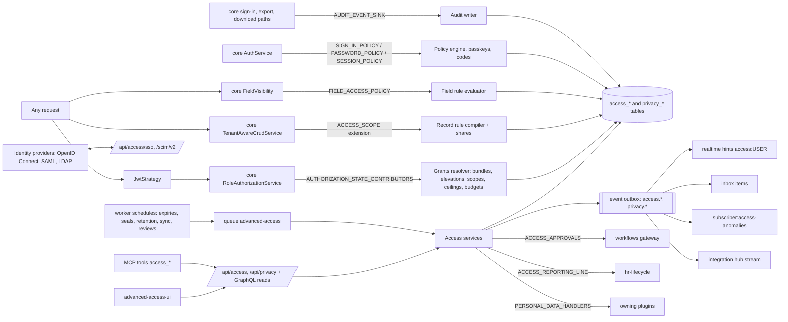

# Implementation Plan: Access control and security

> Translates an approved `spec.md` into architecture and tech choices. The plan owns
> implementation details; the spec owns behaviour.

**Feature ID**: `access-control-and-security`
**Spec**: `./spec.md`
**Tasks**: `./tasks.md`
**Status**: `Draft`
**Last updated**: 2026-11-23

---

## 1. Architecture Summary

A new plugin pair: `@gauzy/plugin-advanced-access` (`packages/plugins/advanced-access`) and `advanced-access-ui` (Angular: Settings → Security, share dialog, audit tab, my security, simulator), loaded by `apps/api/src/plugins.ts` only when `GAUZY_ADVANCED_ACCESS_ENABLED` is exactly `true`, gated per tenant by `FEATURE_ADVANCED_ACCESS` and its sub-features. The core role and permission model stays the only one: a user keeps `user.roleId`, roles keep `role_permission` rows, guards keep reading the permissions pinned on the request. The plugin plugs into six **optional core slots** (unbound = today's behaviour) and keeps everything else in its own tables:

1. **Authorization state** — `RoleAuthorizationService.attachAuthorizationState` calls the multi-port `AUTHORIZATION_STATE_CONTRIBUTORS` after it pins the role's permissions: bundles and elevations add keys; credential scopes, user type ceilings, agent principals and impersonation narrow them. `PermissionGuard` already decides from that attached state.
2. **Record scope** — a CRUD list-query extension hook in `packages/core/src/lib/core/crud/` (`registerListQueryExtension`, built by this spec) with the kind `ACCESS_SCOPE`, applied by `TenantAwareCrudService` on every read (`find*`, `paginate`, `count`, `findOneBy*`) and on the lookups of `update` and `delete`; hand-built queries call the exported `RecordAccessFilter.apply(qb, recordType, viewer)`. Shares join the same predicate.
3. **Field policy** — core `api/field-visibility.service.ts` consults an optional `FIELD_ACCESS_POLICY` port after `@VisibleWith`; the custom fields' `CustomFieldVisibility` consults the same port.
4. **Sign-in policy** — `AuthService` and the two-factor challenge (`auth/two-factor/two-factor-challenge.ts`) consult optional `SIGN_IN_POLICY`, `PASSWORD_POLICY` and `SESSION_POLICY` ports (allow, challenge with factor kinds, deny with reason).
5. **Upload policy** — `core/file-storage/helpers/upload-security.ts` consults an optional `UPLOAD_POLICY` port that can only narrow its lists.
6. **Audit sink** — a core `AUDIT_EVENT_SINK` token (no-op unbound) that core sign-in, export, file download and account deletion paths call; plugins call it too. Logs of runs, exports, prints and deliveries stay with their owners (`report_run`, `data_export_run`, `print_output`, `communication`, `ai_run`): each owner writes one sink event per entry (category, actor, record, `sourceKind` and `sourceRef` pointing at its own row) and the audit explorer reads the details from the owner's log through `ACCESS_AUDIT_SOURCES`, never copying them.

**Built on what exists (no second store).** Public links to records are core `shared_entity` rows (`packages/core/src/lib/shared-entity/`), extended with a hashed token, expiry, revocation, view count and an optional code (§3). Data-change history is core `activity_log` (`packages/core/src/lib/activity-log/`): a generic subscriber of the plugin writes it, for tenants with the feature on, for registered types that do not write it yet; `access_audit_event` keeps sign-in, access-change, export, download, sensitive-read and sink events, and the record's audit tab reads both. Personal API keys are core `user_api_token` rows (`auth/user-api-token/`), created by every user without a permission and with today's expiry choices (90 days, one year, never) unless the tenant setting `access.keys.requireExpiry` is on; the keys page is a view over the three existing credential kinds (personal tokens, tenant key pairs of `tenant-api-key/`, OAuth clients of `auth/oauth-client/`), each kept by its own service. Identities from tenant providers are core `social_account` rows (`auth/social-account/`) with the provider they came from. Lockout counting stays in `LoginAttemptService` (`auth/login-attempt.service.ts`, Redis counters per scope); policies only set its parameters. Per-credential rates go through the core throttler storage (`packages/core/src/lib/throttler/redis-throttler.storage.ts`, tracker keyed by credential); daily counts go to the platform's one usage meter (core `stats` module, `platform-administration`). The request log per credential is core `api_call_log` (`packages/core/src/lib/api-call-log/`) with a credential reference and a no-bodies mode. Last sign-in and deactivation read `user.lastLoginAt` and `user.isActive`; second-factor enforcement keeps `organization.requireTwoFactor` (`organization.entity.ts`) as a floor. An agent principal is the user of an agent employee (`employee.kind = 'agent'`, `packages/core/src/lib/employee/agent-employee.ts`), and its sponsor is the manager on its existing profile (`employee_agent_profile.reportsToEmployeeId`); agent budgets belong to `ai-agents-and-assistants`. Account deletion requests (`account-deletion/`) appear in the privacy request queue and keep today's confirm-and-delete flow; they become erasure requests only when the tenant setting `access.privacy.accountDeletionAsErasure` (false) is on. On deployments where tenants sign in through Ever ID (the `ever-connect` sign-in), a company's own identity provider is configured once in Ever Platform's company sign-in and Gauzy only maps the identity it receives; per-tenant providers of this plugin serve self-hosted installations without Ever ID, and the identity provider wizard says which applies.

**Models this plugin owns for the whole platform.**

- **Sharing**: `access_record_share` is the one share model of records and reports. Report definitions and dashboards of `report-builder-and-dashboards` are record types shared through it (`RECORD_SHARES` port), like any registered type.
- **Retention**: `privacy_retention_policy` is the one retention model. Owners declare their record types and log kinds through the multi-port `RETENTION_SOURCES` (recycle bin and archive rules of `data-import-export`, report runs and results, job, error and health logs of `platform-administration`, communication bodies and events, AI runs, this plugin's audit categories); one daily runner applies the tenant's policy or the declared default and skips records under legal hold. Kinds whose data exists today (soft-deleted records, `activity_log`, `api_call_log`) are declared with the default `KEEP`: the runner touches them only under a policy the tenant sets. While this plugin is not loaded or the tenant's privacy feature is off, each owner applies its declared default in its own cleanup job only to the kinds it introduces, never to data kept today.
- **Connected outside clients**: one list (`/me/security` and `/applications/granted`, `CONNECTED_CLIENTS` port) built from OAuth grants and the MCP server's live sessions; revoking ends the grant or the session. No other plugin keeps a registry of outside clients.
- **Page gates**: this plugin decides which areas and pages an audience may reach (`access_page_gate`, profile gates); menu order, grouping, home and landing routes are arranged by `platform-administration`'s navigation layout, which can never show a gated page.



## 2. Tech Choices

| Concern | Choice | Rationale |
| ------- | ------ | --------- |
| Package | new plugin pair `advanced-access`, `-ui` | Principle I; [platform architecture](../../architecture/business-suite.md) §2.1 |
| Permission model | core roles and permissions plus additive contributions; no second permission store | spec FR-2 |
| Permissions, features, settings | `PluginContributions` on `@GauzyCorePlugin` (`packages/plugin/src/lib/plugin-contributions.ts`): the 24 permissions with `defaultFor`, the four features and the settings, unioned at boot by `packages/core/src/lib/plugin-contributions/plugin-contribution.registry.ts`; tenant custom permissions are served through the same catalogue path as `PluginPermissionRegistry`; role bundle templates of plugins and packs are a `roleBundleTemplates` member of `PluginContributions` (`registerRoleBundleTemplates` builds the entries) | no seed migration; the permission reload adds missing grants for existing tenants; one contributions report |
| Grants cache | per user `{ grantsVersion, keys }` in the cache manager for 5 s; `access_user_state.grantsVersion` bumped on every change | spec FR-12 (effective in 5 s) |
| Record rules | rules compiled to one SQL predicate per (type, viewer) with TypeORM and MikroORM builders from the registry's access paths; conditions in the rule-kernel row shape evaluated by the `@gauzy/utils` evaluator when in memory | exact pages and counts (spec FR-31) |
| Conditions | rows of the core `rule` table (`packages/core/src/lib/rule/`, `attribute`, `operator`, `value`, `groupIndex`) with new owner types `ACCESS_FIELD_RULE` and `ACCESS_RECORD_RULE` (the column is `varchar(32)`, no migration), evaluated by `rule.evaluator.ts` in memory and translated to SQL for record rules | one condition language and store |
| Directory sync and privacy runs | core operations (`packages/core/src/lib/operation/`, `OperationRegistry`): `advanced-access.directory.sync` with counts and errors in the operation result (aggregate = the provider), `advanced-access.privacy.run` with one step per handler | resumable, listed in `/api/operations`; no run table |
| Passkeys | `@simplewebauthn/server` (MIT) in the API, the browser API in the clients | standard verification, attestation none |
| SAML | `@node-saml/node-saml` (MIT); signed assertions required; replay cache of assertion ids for 10 min | spec FR-57 |
| OpenID Connect | the existing OpenID Connect code (`packages/auth/src/lib/oidc`, `auth-oidc` plugin, `jose` for tokens), configured per tenant instead of per deployment | build on what exists |
| LDAP | `ldapts` (MIT), TLS required unless the deployment allows plain | spec FR-60 |
| SCIM | own controller for SCIM 2.0 users, groups, patch and bulk | small surface, no extra library |
| Codes and tokens | HMAC-SHA-256 with the server signing secret; constant-time compare | spec FR-64 |
| Provider secrets | core `EncryptionService` (`common/encryption`, AES-256-GCM) | Principle VI |
| Audit seals | daily Merkle root over event hashes chained to the previous seal | tamper evidence without serialising writes |
| Background work | `@ScheduledJob` + `@QueueWorker`, outbox consumers, in-process timers without a queue root | task automations layout |
| Feature gate | `advanced-access.features.ts`: `FEATURE_ADVANCED_ACCESS`, `FEATURE_ACCESS_RECORD_RULES`, `FEATURE_ACCESS_DIRECTORY`, `FEATURE_ACCESS_PRIVACY`; `FeatureFlagGuard` + `@FeatureFlag` | [platform architecture](../../architecture/business-suite.md) §6 |

## 3. Data Model

All tables extend `TenantOrganizationBaseEntity` (soft delete, `isActive`, `isArchived`) with `organizationId` nullable where a row is tenant-wide, except where marked "append-only" (no soft delete, no update route). JSON is `text` on every dialect; user, role and record ids carry no foreign key outside the plugin.

### New entities

| Table | Columns (beyond the base) | Indexes and uniqueness |
| --- | --- | --- |
| `access_user_state` | `userId`, `userType` varchar(8) (`INTERNAL`, `PORTAL`; a user whose employee has `kind = 'agent'` is of type agent without a stored value), `profileId` null, `partyType` varchar(16) null, `partyId` null, `expiresAt` null, `forcePasswordChange` bool, `passwordChangedAt` null, `grantsVersion` int, `isBreakGlass` bool (last sign-in and deactivation stay in `user.lastLoginAt` and `user.isActive`; an agent's sponsor is `employee_agent_profile.reportsToEmployeeId`) | unique `(tenantId, userId)` |
| `access_role_bundle` | `name` varchar(120), `labels` text, `roleIds` text, `permissions` text, `isDisabled`, `isEligibleOnly` bool, `maxElevationMinutes` int default 240, `ownerUserId` null, `source` varchar(8) (`USER`, `PLUGIN`, `PACK`), `sourceRef` varchar(128) null | unique `(tenantId, name)` |
| `access_bundle_assignment` | `userId`, `bundleId` fk cascade, `scopeOrganizationId` null, `validFrom`, `validUntil` null, `source` varchar(10) (`MANUAL`, `PROFILE`, `DIRECTORY`, `ELEVATION`), `sourceRef` null, `grantedByUserId` | unique `(tenantId, userId, bundleId, scopeKey, source)`; idx `(tenantId, userId)` |
| `access_profile` | `name`, `labels`, `userType`, `roleId` null, `bundleIds`, `organizationIds`, `teamIds`, `pageGates`, `signInPolicyId` null, `defaults` text, `grantable` text (roles, bundles, profiles holders may grant), `version` int (a profile's landing page and menu arrangement are the `PROFILE` layer of `platform-administration`'s navigation layout) | unique `(tenantId, name)` |
| `access_custom_permission` | `key` varchar(96) (`custom:` prefix), `labels`, `descriptions`; listed in the permission catalogue through the same path `PluginPermissionRegistry` serves | unique `(tenantId, key)` |
| `access_page_gate` | `areaKey` varchar(96), `audience` text, `mode` varchar(6) (`HIDE`) | idx `(tenantId, areaKey)` |
| `access_field_rule` | `recordType` varchar(64), `fieldPath` varchar(128), `audience` text, `mode` varchar(10) (`HIDDEN`, `MASKED`, `READ_ONLY`, `EDITABLE`), `maskKeep` varchar(16) null, `isSensitive` bool, `version` int, `policyVersion` int; conditions are core `rule` rows of owner type `ACCESS_FIELD_RULE` | idx `(tenantId, recordType)` |
| `access_record_rule` | `recordType`, `name`, `audience` text, `rights` varchar(64), `scope` varchar(12) (`OWN`, `ASSIGNED`, `TEAM`, `REPORTS`, `ORGANIZATION`, `VALUES`, `CONDITION`, `ALL`, `SELECT`), `config` text (values and paths; a `CONDITION` scope keeps its conditions as core `rule` rows of owner type `ACCESS_RECORD_RULE`), `appliesToAdmins` bool, `version` int, `policyVersion` int | idx `(tenantId, recordType)` |
| `access_user_restriction` | `userId`, `masterType` varchar(64), `valueIds` text, `appliesTo` text (`*` or types), `includeDescendants`, `showEmpty`, `isDefault` bool | idx `(tenantId, userId)` |
| `access_record_share` | `recordType`, `recordId`, `audienceType` varchar(6) (`USER`, `TEAM`, `ROLE`), `audienceId`, `rights` varchar(16), `expiresAt` null, `sharedByUserId`, `message` text null; the platform's one share table (report definitions and dashboards included) | unique `(tenantId, recordType, recordId, audienceType, audienceId)`; idx `(tenantId, audienceType, audienceId, recordType)` |
| `access_sign_in_policy` | `name`, `targets` text (organizations, profiles, roles, user types), `priority` int, `methods` text, `secondFactor` varchar(8) (`OFF`, `OPTIONAL`, `REQUIRED`; `organization.requireTwoFactor` stays a floor: a policy can require a factor where the switch is off, never relax it where it is on), `graceDays` int, `factors` text, `trustedDeviceDays` int, `password` text (minimum length 8 and every other rule off unless set), `lockout` text (failures, window and block time passed to `LoginAttemptService`; no counter of its own), `session` text, `networks` text, `networkMode` varchar(8) (`DENY`, `STEP_UP`), `hours` text, `stepUp` bool default false (FR-48), `stepUpExportRows` int, `version` int | idx `(tenantId, priority)` |
| `access_passkey` | `userId`, `credentialId` varchar(512), `publicKey` text, `signCount` bigint, `transports` text, `name` varchar(120), `aaguid` varchar(36), `backedUp` bool, `lastUsedAt` | unique `(credentialId)`; idx `(tenantId, userId)` |
| `access_trusted_device` | `userId`, `deviceHash` varchar(64), `expiresAt`, `lastSeenAt` | unique `(tenantId, userId, deviceHash)` |
| `access_password_history` (append-only) | `userId`, `hash` varchar(255) | idx `(tenantId, userId, createdAt)` |
| `access_identity_provider` | `kind` varchar(6) (`OIDC`, `SAML`, `LDAP`), `name`, `domains` text, `config` text (secrets encrypted), `enforce`, `createUsers` bool, `defaultProfileId` null, `groupMappings` text, `status` varchar(10), `lastSyncAt` null | idx `(tenantId, kind)` |
| `access_scim_token` | `providerId` fk cascade, `tokenHash`, `tokenPrefix`, `expiresAt` null, `revokedAt` null, `lastUsedAt` | unique `(tokenHash)` |
| `access_one_time_code` | `purpose` varchar(32), `channel` varchar(8), `recipientHash` varchar(64), `codeHash` varchar(64), `expiresAt`, `consumedAt`, `invalidatedAt` null, `addressHash` varchar(64), `contextRef` varchar(128) null (wrong attempts are counted by `LoginAttemptService` under the scope `one-time-code:<purpose>`, which invalidates the code at the limit) | idx `(tenantId, purpose, recipientHash, createdAt)`, `(tenantId, createdAt)` |
| `access_credential_policy` | `credentialKind` varchar(16) (`USER_API_TOKEN`, `TENANT_API_KEY`, `OAUTH_CLIENT`; personal keys are `user_api_token` rows), `credentialId`, `scopes` text, `organizationIds` text, `networks` text, `ratePerMinute` int (enforced by the core throttler storage), `expiresAt` null, `rotatedFromId` null, `overlapUntil` null, `allowedUserTypes`, `allowedRoleIds` text, `consent` varchar(8), `lastUsedAt` (kinds without their own; personal tokens keep `user_api_token.lastUsedAt`), `lastAddressHash`, `useCount` bigint, `requestLogUntil` null, `requestLogSample` int (switches `api_call_log` for the credential) | unique `(tenantId, credentialKind, credentialId)` |
| `access_elevation` | `userId`, `bundleId`, `reason` text, `ticketRef` varchar(128) null, `minutes` int, `state` varchar(10) (`REQUESTED`, `ACTIVE`, `ENDED`, `EXPIRED`, `REJECTED`, `WITHDRAWN`), `approvalId` null, `decidedByUserId` null, `startsAt`, `endsAt`, `endedAt` null | idx `(tenantId, state, endsAt)`, `(tenantId, userId)` |
| `access_impersonation` | `actorUserId`, `targetUserId`, `reason`, `mode` varchar(5), `approvalId` null, `startedAt`, `endsAt`, `endedAt` null | idx `(tenantId, actorUserId)` |
| `access_audit_event` (append-only; sign-in, access-change, export, download, sensitive-read and sink events; data changes stay in `activity_log`) | `category` varchar(16), `action` varchar(48), `outcome` varchar(8), `actorType`, `actorUserId` null, `onBehalfOfUserId` null, `elevationId` null, `credentialRef` varchar(64) null, `recordType`, `recordId` null, `sourceKind` varchar(32) null, `sourceRef` varchar(64) null (the owner's log row the details are read from), `address` varchar(45) null, `country` varchar(2) null, `userAgent` varchar(255) null, `summary` varchar(255), `before`, `after`, `details` text null, `hash` varchar(64), `day` date | idx `(tenantId, createdAt)`, `(tenantId, recordType, recordId, createdAt)`, `(tenantId, actorUserId, createdAt)`, `(tenantId, category, createdAt)` |
| `access_audit_seal` (append-only) | `day` date, `count` int, `root` varchar(64), `previousSealHash` varchar(64), `sealHash` varchar(64) | unique `(tenantId, day)` |
| `access_alert` | `kind` varchar(24), `severity` varchar(8), `userId` null, `details` text, `state` varchar(14), `actionTaken` varchar(24) null, `resolvedByUserId` null | idx `(tenantId, state, createdAt)` |
| `access_behaviour_profile` | `userId`, `countries` text, `devices` text, `exportRowsP95` int, `downloadsP95` int | unique `(tenantId, userId)` |
| `access_review_campaign` / `_item` | campaign: `name`, `scope`, `reviewerMode`, `dueAt`, `revokeUnanswered`, `state`, `reportFileId` null; item: `campaignId` fk cascade, `subjectUserId`, `itemKind` varchar(10), `itemRef`, `reviewerUserId`, `decision` varchar(8), `comment`, `decidedAt`, `appliedAt` | item: unique `(campaignId, subjectUserId, itemKind, itemRef)`; idx `(reviewerUserId, decision)` |
| `access_policy_version` (append-only) | `version` int, `document` text, `checksum`, `note`, `diff` text, `impact` text, `source` varchar(8) (`UI`, `FILE`, `ROLLBACK`), `appliedByUserId` | unique `(tenantId, version)` |
| `privacy_request` | `kind` varchar(8) (`EXPORT`, `ERASURE`), `subjectKind` varchar(16), `subjectRef` text, `subjectEmailHash`, `requestedBy` varchar(8), `state` varchar(10), `dueAt`, `verifiedAt`, `approvalId` null, `accountDeletionRequestId` null (the core `account_deletion_request` it came from), `operationId` null, `preview` text, `resultFileId` null, `fileExpiresAt` null, `handlerUserId` null, `completedAt` null | idx `(tenantId, state, dueAt)` |
| `privacy_request_step` | `requestId` fk cascade, `handlerKey`, `recordType`, `recordRef`, `action` varchar(12), `reason`, `state`, `error`, `at` (the per-record erasure log kept with the request as its legal record; the run itself is a core operation) | idx `(requestId)` |
| `privacy_retention_policy` | `kind` varchar(96) (a record type or a log kind declared through `RETENTION_SOURCES`), `keepFor` varchar(16) (ISO period), `anchor` varchar(64), `action` varchar(10) (`DELETE`, `ANONYMISE`, `ARCHIVE`, `PURGE`), `lastRunAt`, `lastCounts` text; the platform's one retention table | unique `(tenantId, organizationKey, kind)` |
| `privacy_legal_hold` | `recordType`, `recordId` null, `reason`, `until` null, `placedByUserId`, `releasedAt` null | idx `(tenantId, recordType, recordId)` |
| `privacy_residency_policy` | `recordType`, `storageProviderKey` varchar(32) null, `allowedRegions` text, `mode` varchar(6) (`REFUSE`, `REDUCE`), `permittedFields` text | unique `(tenantId, recordType)` |

Settings (`advanced-access.settings.ts`, setting contributions stored in `tenant_setting`, tenant scope): `access.upload.*` (extensions, max size, strip metadata, guest types, public files, private by default, protected attachments; every key defaults to today's behaviour: no narrowing, no stripping, files and deletion as today), `access.security.contact`, `access.impersonation.notifyTarget` (true), `access.sharing.enabled` (true), `access.links.maxDays` (null: no maximum, as today), `access.roles.refuseDeactivateInUse` (false: deactivating a role still held lists its holders and goes through; the existing role routes are unchanged either way), `access.keys.requireExpiry` (false), `access.keys.maxDays` (null), `access.privacy.accountDeletionAsErasure` (false). Audit retention per category is a set of retention kinds (`audit.sign-in`, `audit.request-log` for the `api_call_log` rows this plugin switched on per credential, `audit.data-read`, `audit.access`, …) of `privacy_retention_policy` with the FR-87 defaults, not a setting; `activity_log` rows and the `api_call_log` rows written today are kinds with the default `KEEP`.

### Existing tables extended (core, additive)

| Table | Change | Why |
| --- | --- | --- |
| `shared_entity` | + `tokenHash` varchar(64) (unique), `tokenPrefix` varchar(12), `expiresAt` null, `revokedAt` null, `viewCount` int default 0, `lastViewedAt` null, `requireCode` bool default false, `recipientEmailHash` varchar(64) null, `createdByUserId` null, `tokenEncrypted` text null (a sealed copy of the token, excluded from JSON and exports, for link types introduced by new features that store only the hash); `token` becomes nullable for those new link types only | the record web-view link of FR-38 and every other public link of a record (documents, quotations, receipts, deliveries, meeting clips); `tokenHash` is written only for links created while the feature is on; the migration changes no existing row, so a link created before keeps its `token`, gets no hash and resolves by `token` as today; lookups go by hash where a row has one, otherwise by `token`; every link type that exists today keeps storing its `token`, so its author and the organization's managers copy the link again as today (`withTokenForManager`); `expiresAt` stays null unless the creator sets an expiry |
| `social_account` | + `identityProviderId` null (a tenant's `access_identity_provider`), `email` varchar(255) null, `groups` text null, `lastSignInAt` null; unique `(identityProviderId, providerAccountId)` where set | identities from tenant providers; a user linked through a social provider and a tenant provider has two rows for one user |
| `api_call_log` | + `credentialRef` varchar(64) null, `bodiesLogged` bool default true | per-credential request log without bodies (FR-86) |

### Migrations

**Migration timestamps**: `packages/plugins/advanced-access` `1791000039100` to `1791000039199`; `packages/core` `1791000039900` to `1791000039999`.

In `packages/plugins/advanced-access/src/lib/database/migrations/`, helpers copied from the inbox plugin; additive, idempotent, PostgreSQL, MySQL and SQLite, both ORMs: `1791000039100-CreateAccessGrantTables` (user state, bundles, assignments, profiles, custom permissions, gates), `1791000039110-CreateAccessRuleTables` (field rules, record rules, restrictions, shares), `1791000039120-CreateAccessSignInTables` (policies, passkeys, devices, password history, providers, SCIM tokens, codes), `1791000039130-CreateAccessCredentialTables` (credential policy, elevation, impersonation), `1791000039140-CreateAccessAuditTables` (events, seals, alerts, behaviour, reviews, policy versions), `1791000039150-CreatePrivacyTables`, core `1791000039900-ExtendSharedEntitySocialAccountAndApiCallLog` (the three extensions above: nullable columns only; no existing row is changed). Permissions and default grants are contributions, so no seed migration. A lazy backfill creates `access_user_state` rows (`INTERNAL`) on a user's first request.

### Contracts

`packages/contracts/src/lib/advanced-access.model.ts` and `privacy.model.ts` (exported from `index.ts`): enums `UserTypeEnum`, `FieldAccessMode`, `RecordRuleScope`, `RecordRight`, `SecondFactorMode`, `AuditCategory`, `PrivacyRequestKind`, `PrivacyAction`; entity interfaces; the ports of §4.1; `record-type.model.ts` gains an optional `access` part (`ownerPaths`, `assigneePaths`, `teamPaths`, `organizationPath`, `masterRefs`, `supportsRules`, `publicFields`, `rightPermissions`).

## 4. API Surface

### 4.1 In-process contracts

```ts
interface IAuthorizationStateContributor {          // multi-port AUTHORIZATION_STATE_CONTRIBUTORS (core)
    contribute(user: IAuthenticatedUser, base: { roleId: ID; permissions: string[] }, ctx: { credential?: ICredentialRef; tenantId: ID }):
        Promise<{ add?: string[]; restrictTo?: string[]; flags?: Record<string, unknown> }>;
}
interface IRecordAccessFilter {                    // RECORD_ACCESS_FILTER; also registered as ACCESS_SCOPE list-query extension
    apply(qb: TypeOrmQb | MikroQb, recordType: string, viewer: IViewer, right: RecordRight): void;
    can(recordType: string, recordId: ID, viewer: IViewer, right: RecordRight): Promise<boolean>;
    explain(recordType: string, recordId: ID | null, viewer: IViewer): Promise<IAccessExplanation>;
}
interface IFieldAccessPolicy {                     // FIELD_ACCESS_POLICY (core slot)
    decide(recordType: string, fieldPaths: string[], viewer: IViewer, record?: object): Promise<Record<string, FieldAccessMode>>;
}
interface ISignInPolicy {                          // SIGN_IN_POLICY, PASSWORD_POLICY, SESSION_POLICY (core slots)
    beforePrimary(ctx: ISignInContext): Promise<ISignInDecision>;          // methods, networks, hours, lockout
    afterPrimary(ctx: ISignInContext): Promise<ISignInDecision>;           // { allow } | { challenge: factors[] } | { deny, reason }
    onRefresh(ctx: ISessionContext): Promise<ISignInDecision>;
}
interface IOneTimeCodeService {                    // ACCESS_ONE_TIME_CODES
    issue(i: { purpose: string; recipient: string; channel: 'EMAIL' | 'TEXT'; language?: string; contextRef?: string }): Promise<{ expiresAt: Date }>;
    verify(i: { purpose: string; recipient: string; code: string; contextRef?: string }): Promise<boolean>;
}
interface IPersonalDataHandler {                   // registerPersonalDataHandlers([...]) / PERSONAL_DATA_HANDLERS
    key: string; subjectKinds: SubjectKind[]; recordType: string;
    find(s: ISubjectRef): Promise<IRecordRef[]>; export(s: ISubjectRef, w: IPackageWriter): Promise<void>;
    erase(s: ISubjectRef, refs: IRecordRef[], m: Manager): Promise<IErasureResult[]>;   // DELETE | ANONYMISE | PSEUDONYMISE | KEEP
    retention?: { keepReason: string; until(ref): Promise<Date | null> };
}
interface IAuditSink { record(e: IAuditEventInput): Promise<void> }          // core AUDIT_EVENT_SINK, bound to the audit writer
interface IRecordShares {                          // RECORD_SHARES: the one share model
    list(recordType: string, recordId: ID): Promise<IRecordShare[]>;
    sharedWith(recordType: string, viewer: IViewer, right: RecordRight): Promise<ID[]>;   // ids shared with the viewer
    grant(i: IShareInput, actor: IViewer): Promise<IRecordShare>; revoke(shareId: ID, actor: IViewer): Promise<void>;
}
interface IRetentionSource {                       // multi-port RETENTION_SOURCES, declared by owners
    kind: string; labels: Record<string, string>; category: 'RECORD' | 'LOG' | 'BIN';
    defaultKeepFor: string; anchors: string[]; actions: RetentionAction[];
    count(c: IRetentionContext): Promise<number>; apply(c: IRetentionContext, slice: number): Promise<IRetentionResult>;  // skips held records
}
```

Rule evaluation: `OWN` → `ownerPaths = :userId`; `ASSIGNED` → semi-join on assignee paths; `TEAM` → owner or assignee in the user's team and project members (one sub-select on membership tables); `REPORTS` → ids from `ACCESS_REPORTING_LINE` (cached 60 s; fallback: members of teams the user manages); `VALUES` → field in values (tree descendants by `path LIKE` where the master is a tree); `CONDITION` → the rule's core `rule` rows (owner type `ACCESS_RECORD_RULE`) translated to SQL for supported operators (others refused at save); shares → `OR id IN (SELECT recordId FROM access_record_share …)`. Rights resolve per rule; `SELECT` gives picker visibility only. Restricted types are computed per (tenant, type, audience) and cached until a rule version changes. Custom record types keep their per-role access rows (`custom_record_type_access` of `custom-fields-and-forms`) as their baseline scope; rules of this plugin narrow inside it and shares add to it, so the two never contradict. The hard-coded scopes of today (`CHANGE_SELECTED_EMPLOYEE`, `ACCESS_PRIVATE_PROJECTS`, team and project manager flags) keep applying first; record rules only narrow inside them and never replace them.

**Ports offered** (bound in `plugin-composition.ts`): the four core slots above and `AUDIT_EVENT_SINK`; `RECORD_ACCESS_FILTER` (report builder FR-55, record views read scope, print data, data exchange); `RECORD_SHARES` (the one share model: report definitions and dashboards, any registered type); `ACCESS_ONE_TIME_CODES` (portal sign-in, privacy, protected links, print agent pairing when present); `PRINT_PUBLIC_LINKS` (print templates' "copy web link", served by the extended `shared_entity` service); `CONNECTED_CLIENTS` (the one list of outside clients, read by the MCP settings of `ai-agents-and-assistants`); `REGIONAL_ROLE_BUNDLES` and `registerRoleBundleTemplates` (packs and plugins); `PORTAL_ACCESS` (`provisionPortalUser(party, profile)`, `ceilingOf(user)`) for `customer-and-supplier-portal`; `ACCOUNT_DELETION_HANDOFF` (core account deletion → privacy request); `RECORD_TIMELINE_SOURCES` entry (shares, links, sensitive reads).

**Ports consumed** (optional): `ACCESS_APPROVALS` (`WorkflowApprovalGateway`, record types `access.elevation`, `access.impersonation`, `privacy.erasure`; fallback permission-based), `ACCESS_REPORTING_LINE` (`HR_REPORTING_LINE`), `ACCESS_TEXT_CHANNEL` (communications text messages), `ACCESS_AUDIT_SOURCES` (multi: `activity_log`, custom field value history, and the owners' logs behind sink events: report runs, data exports, print outputs, communications, AI runs), `ACCESS_AUDIT_STREAM` (integration hub target), `PERSONAL_DATA_HANDLERS` (multi), `RETENTION_SOURCES` (multi, see §1), `AGENT_BUDGETS` (`ai-agents-and-assistants`: an agent's limits; unbound → agent principals have no budget), `USAGE_METER` (core usage meter of `platform-administration`: daily counts per principal), `ACCESS_PROCESSORS` (multi: AI providers, email providers, integrations and webhooks declare `{ key, regions, fieldsPolicy }`), `CUSTOM_FIELD_METADATA` (field catalogue for rules).

### 4.2 REST

All under `/api/access` or `/api/privacy`, `@FeatureFlag(…)`, `TenantPermissionGuard`, class-validator DTOs, Swagger, `If-Match` on rules, policies and profiles, `Idempotency-Key` on creating routes; step-up (`STEP_UP_REQUIRED`, `401`) where spec FR-48 says.

| Method | Endpoint | Permission | Description | Status |
| ------ | -------- | ---------- | ----------- | ------ |
| `GET` | `/me/effective`, `/me/security` (sessions, passkeys, factors, sign-ins, applications) | signed in | effective access; own security page | New |
| `GET` `PUT` | `/roles/:id/usage`, `/roles/matrix?recordType=`, `/roles/:id/reset/preview`, `POST /roles/:id/reset`, `POST /roles/:id/deactivate` | `CHANGE_ROLES_PERMISSIONS` | usage, matrix read and cell switch, reset | New |
| CRUD | `/custom-permissions`, `/bundles`, `/bundles/:id/assignments`, `/profiles`, `POST /profiles/:id/apply` (`preview`) | `ACCESS_BUNDLES_MANAGE` / `ACCESS_PROFILES_MANAGE` | | New |
| CRUD | `/page-gates`, `/delegation` | `ACCESS_PROFILES_MANAGE` | gates; grantable sets | New |
| CRUD | `/field-rules`, `/record-rules`, `/restrictions` | `ACCESS_FIELD_RULES_MANAGE` / `ACCESS_RECORD_RULES_MANAGE` | with `preview` impact | New |
| `GET` `POST` `DELETE` | `/shares?recordType&recordId`, `/shares/:id` | share right / owner / `ACCESS_PROFILES_MANAGE` | shares of any registered type, report definitions and dashboards included | New |
| `POST` `PUT` | existing `/api/shared-entities` (create gains optional expiry, recipient and code), `PUT /api/shared-entities/:id/revoke` | today's checks for a plain link; `ACCESS_PUBLIC_LINKS_CREATE` for the new options and the record share dialog | web-view links on `shared_entity` | Changed (additive) |
| `GET` `POST` | existing public `GET /api/shared-entities/token/:token` (looked up by hash, token as fallback; expiry and revocation when set, view count), `POST /api/shared-entities/token/:token/code` | public, rate limited | web-view link and its emailed code | Changed (additive) |
| `GET` | `/links` | `ACCESS_PUBLIC_LINKS_CREATE` (own) / `ACCESS_AUDIT_VIEW` | link register over `shared_entity`, saved-report links and invoice public links | New |
| `PUT` | `/users/:id/type`, `/users/:id/state` (deactivate, force password change, defaults) | `ACCESS_USER_TYPES_MANAGE` / `ORG_USERS_EDIT` | | New |
| CRUD | `/sign-in-policies`; `POST /sign-in-policies/:id/preview` | `ACCESS_SIGN_IN_POLICIES_MANAGE` | | New |
| `GET` | public `/api/public/access/sign-in-options?email=&tenant=` | public, rate limited | methods and provider redirect | New |
| `POST` | `/passkeys/register/options`, `/passkeys/register`, `/passkeys/authenticate/options`, `/passkeys/authenticate`; `DELETE /passkeys/:id` | signed in / public for sign-in | passkeys | New |
| `POST` | `/step-up`, `/factors/email`, `/factors/text` | signed in | fresh factor | New |
| CRUD, `POST` | `/identity-providers`, `/:id/test`, `/:id/sync`, `/:id/scim-tokens`; `GET /:id/sync-runs` (core operations of the provider) | `ACCESS_IDENTITY_PROVIDERS_MANAGE` | providers | New |
| `GET` `POST` | `/api/access/sso/:providerId/{login,callback,metadata}` | public | OpenID Connect and SAML flows | New |
| SCIM | `/api/access/scim/v2/:providerId/{Users,Groups,Bulk,ServiceProviderConfig,Schemas}` | SCIM token | provisioning | New |
| `POST` | `/codes/issue`, `/codes/verify` (public purposes under `/api/public/access/codes`) | caller of the purpose | one-time codes | New |
| CRUD, `POST` | `/keys`, `/keys/:id/rotate`, `/keys/:id/revoke`, `/credentials/:kind/:id/policy` | signed in for one's own keys as on the existing `/user-api-tokens` routes; `ACCESS_API_KEYS_OWN` for policies on them / `_MANAGE` for others' | a view over personal tokens (`user_api_token`, created through its service), tenant key pairs and OAuth clients, with their policies | New |
| `GET` `POST` | `/applications/granted`, `POST /applications/granted/:id/revoke`; `POST /applications/mcp-sessions` (MCP server credential) | signed in (own) / `ACCESS_API_KEYS_MANAGE`; server | the one list of connected outside clients: OAuth grants plus the MCP server's live sessions (reported on start and end, kept in the cache manager, no table) | New |
| CRUD, `POST` | `/agents`, `/agents/:id/{suspend,resume}` | `ACCESS_AGENTS_MANAGE` (suspend also the sponsor) | agent principals (users of agent employees); suspension sets `user.isActive` false and ends keys and sessions; budgets read from `ai-agents-and-assistants` | New |
| `POST` `GET` | `/elevations`, `/elevations/:id/{approve,reject,end}` | `ACCESS_ELEVATION_REQUEST` / `_APPROVE` | | New |
| `POST` | `/impersonation/start`, `/impersonation/end` | `ACCESS_IMPERSONATE` + step-up | | New |
| `GET` | `/audit`, `/audit/records/:type/:id`, `/audit/records/:type/:id/compare?at1&at2`, `/audit/seals/verify`, `/audit/export.csv` | `ACCESS_AUDIT_VIEW` / `_EXPORT` | explorer, record tab, compare, seal check | New |
| `PUT` | `/audit/request-log/:credential` | `ACCESS_AUDIT_VIEW` | switches `api_call_log` for the credential (no bodies), sampled or full, at most 30 days | New |
| `GET` `PATCH` | `/alerts`, `/alerts/:id` | `ACCESS_SECURITY_ALERTS_VIEW` | alerts | New |
| CRUD, `POST` | `/reviews`, `/reviews/:id/{open,close}`, `/reviews/items/:id/decide`, `GET /reviews/mine` | `ACCESS_REVIEWS_MANAGE` / reviewer | campaigns | New |
| `GET` `POST` | `/policies/versions`, `/policies/export`, `/policies/import` (`dryRun`), `/policies/versions/:v/apply` | `ACCESS_POLICIES_MANAGE` + step-up | policies as code | New |
| `POST` | `/simulate`, `/explain` | `ACCESS_SIMULATE` (self-explain: signed in) | simulator, refusal explanation | New |
| `GET` | `/reports/{permitted-records,rights-matrix,privileged,sharing,sign-ins,dormant,privacy}` | `ACCESS_AUDIT_VIEW` | FR-108 datasets | New |
| CRUD, `POST` | `/api/privacy/requests`, `/:id/{verify,approve,reject,run}`, `/api/privacy/me/requests`, public `/api/public/privacy/requests` | `PRIVACY_REQUESTS_MANAGE` / self / public with code | requests; the list includes core account deletion requests | New |
| CRUD, `POST` | `/api/privacy/retention` (kinds from `RETENTION_SOURCES`), `/retention/:id/dry-run`, `/holds`, `/residency` | `PRIVACY_POLICIES_MANAGE` | | New |
| `GET` `PUT` | `/security-settings` (uploads, contact); public `GET /.well-known/security.txt` | `ACCESS_SECURITY_SETTINGS_MANAGE` | | New |

GraphQL reads: `myAccess`, `accessBundles`, `recordShares(recordType, recordId)`, `auditEvents(filter)`. Errors: `ACCESS_RECORD_NOT_FOUND` (404 for excluded records), `ACCESS_RIGHT_DENIED`, `ACCESS_FIELD_FORBIDDEN` (field named), `ACCESS_LAST_ADMIN`, `ACCESS_STEP_UP_REQUIRED`, `ACCESS_BUDGET_EXCEEDED` (429), `ACCESS_RATE_LIMITED` (429), `ACCESS_SIGN_IN_DENIED` (reason code), `ACCESS_RULE_UNSUPPORTED_TYPE`, `ACCESS_STALE` (409).

**Consumer tokens answered** (bound in `apps/api/src/plugin-composition.ts` to the hold register, record and field rules, credential policy, guest provisioning and grant services; each consumer plan states the shape it calls and its fallback): `ACCESS_REPORTING_LINE_SOURCES`, `AGENT_RUN_CREDENTIALS`, `DATA_EXCHANGE_ACCESS_RULES`, `DISCUSSIONS_GUESTS`, `DOCS_LEGAL_HOLDS`, `MARKETPLACE_REMOTE_APP_GRANTS`, `MEETINGS_LEGAL_HOLDS`, `REPORT_ACCESS_RULES`.

## 5. Events, Real-Time and Notifications

| Event | Emitted when | Consumers |
| ----- | ------------ | --------- |
| `access.grants.changed` `{ userIds, reason }` | bundle, profile, role, elevation, type or rule change touching users | realtime hint `access:<userId>` (clients re-read `/me/effective`), grants cache bump |
| `access.rules.changed` `{ recordType }` | record or field rule saved | restricted-type cache, realtime hint to open lists of the type |
| `access.policy.applied` `{ version }` | policy version applied or rolled back | inbox to administrators, audit |
| `access.elevation.requested` / `.approved` / `.rejected` / `.started` / `.ended` | elevation lifecycle | inbox to approvers and requester, realtime banner |
| `access.impersonation.started` / `.ended` | impersonation | inbox to target (setting), alert to administrators for break-glass |
| `access.alert.raised` | anomaly detector | inbox and realtime to security administrators and the user |
| `access.user.deprovisioned` | directory, SCIM or administrator deactivation | sessions and keys revoked; owners' consumers (assignments) |
| `access.review.opened` / `.item_due` / `.closed` | campaign lifecycle | inbox to reviewers; report file |
| `privacy.request.received` / `.verified` / `.approved` / `.completed` / `.overdue` | request lifecycle | inbox to handlers and requester email |
| `access.audit.event` (outbox, partition `audit:<tenantId>`) | every audit write | anomaly detector, integration hub stream |

Real-time through `RealtimeHintsService.appendHint`; inbox items through `INBOX_ITEM_WRITER`; email to external subjects through the platform email service with templates per language.

## 6. UI Surface

- **Angular `advanced-access-ui`** (lazy; menu entries carry the features and permissions): Settings → Security with pages `bundles`, `profiles`, `custom-permissions`, `page-gates`, `field-rules`, `record-rules` (builder with impact preview), `sharing`, `user-types`, `sign-in-policies`, `identity-providers` (wizard, test, sync runs), `agents`, `elevations`, `audit` (explorer), `alerts`, `reviews`, `policies` (versions, diff, import dry run), `simulator`, `privacy` (requests with account deletions, retention for every declared kind, holds, residency), `uploads`, `security-contact`. Keys have no page of their own: the existing `settings/api-tokens` and `settings/oauth-clients` pages gain policy panels, rotation, and (with `ACCESS_API_KEYS_MANAGE`) other users' and agents' keys; tenant key pairs show there as a section. The existing `settings/roles-permissions` page gains a "Matrix" tab and a "Usage" panel; the existing users page (`apps/gauzy/src/app/pages/users`) gains type, state, bundles and elevation columns. Record pages get a share action and an "Access" tab (shares, links, audit) through `PageTabRegistryService`; the same share dialog serves report definitions and dashboards. Landing pages are set on `platform-administration`'s navigation page; the gates page here only hides. "My security" (sessions, passkeys, factors, sign-ins, connected applications and MCP clients, elevation requests) in the user menu. Sign-in pages (`packages/ui-auth`) gain domain discovery, passkey sign-in, provider buttons per tenant and the enrolment step. Strings under `ADVANCED_ACCESS.*` in every locale.
- The existing personal security pages keep using the core sessions routes unchanged.

## 7. MCP Tools, SDKs and Integrations

`packages/mcp-server/src/lib/tools/access.ts`: `access_my_permissions`, `access_simulate`, `access_explain_denial`, `access_request_elevation`, `access_review_items`, `access_record_audit`, `privacy_request_status` (inputs: user, record type, record, right; outputs: decisions with reasons, events). `access_record_audit` reads audit events and the record's activity log; the twelve activity-log tools of `tools/activity-logs.ts` stay as they are. Every tool call of an agent principal is counted in the usage meter against the budget `ai-agents-and-assistants` keeps for it and audited with the principal and sponsor. SDK: additive OpenAPI (SCIM routes documented); regenerate after merge. Formats: the policy file (JSON, schema-validated, checksummed), the privacy package (ZIP of JSON and CSV per type with a summary), audit CSV with seal proofs. Integrations: tenants' identity providers and directories; audit streaming through the integration hub.

## 8. Background Jobs

| Trigger | When | What it does | Idempotency |
| ------- | ---- | ------------ | ----------- |
| `advanced-access.expiry` | every minute | ends elevations, impersonations and bundle assignments past their end; expires shares, `shared_entity` links and codes | state transitions |
| `advanced-access.audit.seal` | daily 00:30 UTC per tenant | Merkle root of yesterday's events chained to the previous seal; verifies the last 7 seals | unique `(tenantId, day)` |
| `subscriber:access-anomalies` (outbox) | `access.audit.event` | compares with the behaviour profile, raises alerts, applies policy action | one alert per (user, kind, hour) |
| `advanced-access.behaviour.refresh` | nightly | recomputes behaviour profiles over 30 days | per user upsert |
| operation `advanced-access.directory.sync` (queue) | hourly per LDAP provider, on demand | create, update, deactivate in slices of 200; counts and errors in the operation result | operation per provider and hour; per entry by external subject |
| `advanced-access.credentials.notify` | daily 08:00 | expiry warnings for keys and SCIM tokens; dormant flags | one notice per key and threshold |
| `advanced-access.reviews` | daily | reminders, escalation and revocation at due dates, report file | per item decision |
| operation `advanced-access.privacy.run` (queue) | approved request | find, export or erase per handler, one operation step per handler; package to file storage; per-record log in `privacy_request_step` | operation steps |
| `advanced-access.privacy.reminders` | daily | 7- and 2-day reminders, overdue events | one per request and threshold |
| `advanced-access.retention` | daily 03:00 tenant time | the platform's one retention runner: for every kind of `RETENTION_SOURCES` (audit categories included) applies the tenant's policy or the declared default in slices of 500, skipping records under legal hold | per record action |

The worker loads `AdvancedAccessSchedulePlugin` (schedules only); the API loads queue workers and consumers. Without a queue root the API runs them on in-process timers under a per-tenant lock. Jobs run in `RequestContext.runWithRequest` as a system actor of the tenant; privacy runs as the approving handler.

## 9. Security & Permissions

`advanced-access.permissions.ts`, declared as permission contributions with `defaultFor` (the grants below; the permission reload adds them for existing tenants): `ACCESS_BUNDLES_MANAGE`, `ACCESS_PROFILES_MANAGE`, `ACCESS_FIELD_RULES_MANAGE`, `ACCESS_RECORD_RULES_MANAGE`, `ACCESS_RECORD_SHARE`, `ACCESS_PUBLIC_LINKS_CREATE`, `ACCESS_USER_TYPES_MANAGE`, `ACCESS_SIGN_IN_POLICIES_MANAGE`, `ACCESS_IDENTITY_PROVIDERS_MANAGE`, `ACCESS_API_KEYS_OWN`, `ACCESS_API_KEYS_MANAGE`, `ACCESS_AGENTS_MANAGE`, `ACCESS_ELEVATION_REQUEST`, `ACCESS_ELEVATION_APPROVE`, `ACCESS_IMPERSONATE`, `ACCESS_AUDIT_VIEW`, `ACCESS_AUDIT_EXPORT`, `ACCESS_SECURITY_ALERTS_VIEW`, `ACCESS_REVIEWS_MANAGE`, `ACCESS_POLICIES_MANAGE`, `ACCESS_SIMULATE`, `ACCESS_SECURITY_SETTINGS_MANAGE`, `PRIVACY_REQUESTS_MANAGE`, `PRIVACY_POLICIES_MANAGE` (24). Grants: super admin all; admin all but `ACCESS_IMPERSONATE`; manager `ACCESS_RECORD_SHARE`, `ACCESS_PUBLIC_LINKS_CREATE`, `ACCESS_API_KEYS_OWN`, `ACCESS_ELEVATION_REQUEST`; employee and data entry `ACCESS_RECORD_SHARE`, `ACCESS_API_KEYS_OWN`, `ACCESS_ELEVATION_REQUEST`; viewer, candidate and interviewer none. The new keys are added to `OAUTH_APP_RESERVED_PERMISSIONS` so no third-party application scope reaches them.

Safety rails: the last-admin check runs inside the transaction of every grant change made through the plugin (core role, permission and user routes keep today's checks); break-glass accounts need a passkey and alert on use; step-up tokens last 10 minutes and bind to the session; rule and policy changes need `If-Match`; impact previews run read-only. Secrets: provider client secrets, LDAP bind passwords and SAML signing keys encrypted with `EncryptionService`, never returned; SCIM tokens, link tokens, agent and API key secrets hashed (SHA-256) with prefixes shown; codes HMAC-hashed. Protocol checks: SAML signatures, audience, recipient, time window and replay cache; OpenID Connect state, nonce and PKCE; passkey origin, relying party and counter checks; metadata URLs fetched through the webhook module's endpoint policy (no private networks on cloud). Audit rows record the network address (personal data, retention FR-87). Public routes (links, codes, sign-in options, privacy form) are rate limited per address and tenant and answer uniformly whether or not the subject exists.

## 10. Observability

Audit events are the record of every access change and refusal; metrics: grants resolution time and cache hit rate, rule predicate time per type, refusals by reason, sign-in outcomes by method and factor, codes issued, verified and rate limited, provisioning results, alerts by kind, seal verification results, privacy requests by state and lateness. Failures of jobs raise inbox items to administrators; scheduler executions and dead letters through the scheduler package.

## 11. Phased Rollout

1. **Phase 1 — Surface what exists, grants and audit.** Contracts, plugin, user state, core slots 1, 2, 3 and 6, the
   core retention and personal-data contracts and the core link extension of `shared_entity`, bundles, profiles, custom permissions, delegation, page gates, effective access route, matrix and reset on the existing roles page, policies on existing personal tokens, key pairs and OAuth applications, granted applications, audit writer with sign-in, access-change, export and file events, explorer and record tab, security contact. Usable: bundles and profiles on real users, a complete access audit.
2. **Phase 2 — Depth.** Field rules, record rules, restrictions, sharing and the link register, user types and portal ceilings, sign-in policies with enforcement, passwords, lockout parameters, sessions, networks and hours (core slot 4), one-time codes, per-tenant OpenID Connect and SAML, SCIM, LDAP, impersonation, `activity_log` history for types without it, privacy requests with account deletions, the platform retention runner and its policies, upload policy (core slot 5).
3. **Phase 3 — Advanced capabilities.** Passkeys, simulator and impact previews, review campaigns, policies as code, just-in-time elevation, agent principals and budgets, anomaly alerts, audit seals, residency, real-time access refresh, MCP tools.
4. **Phase 4 — General availability**: the feature is off by default; after the trial period it may be switched on by default for new tenants only; existing tenants keep their setting until an administrator changes it.

## 12. Constitution Reconciliation

- I Plugin-first: new plugin pair; core gains optional slots, each a no-op when unbound, and nullable columns on `shared_entity`, `social_account` and `api_call_log`.
- II Tenant/organization scoping: every table scoped; record rules narrow inside the tenant and organization filters.
- III Both ORMs, additive migrations: MultiORM entities, MikroORM repositories, six plugin and one core tri-dialect migrations, rule predicates built for both query builders.
- IV Default-off flag; nothing removed: deploy switch plus four tenant features; roles, permissions, sign-in and existing credentials unchanged.
- V Contracts and API first: contracts, REST, SCIM and in-process ports before UI; OpenAPI additive.
- VI Permissions, privacy, security: 24 keys, reserved from third-party scopes, step-up, hashing and encryption, audit.
- VII Real-time through the event bus: outbox events, realtime hints for access refresh and alerts.
- VIII i18n and accessibility: keys in every locale, code and email templates per language, keyboard builders.
- IX Tests: unit, dialect, ORM parity of rule predicates, protocol conformance suites, e2e per surface, lockout safety tests.
- X Behaviour-first spec: details stay here.
- XI Documentation describes our platform only.

## 13. Risks & Mitigations

| Risk | Likelihood | Impact | Mitigation |
| ---- | ---------- | ------ | ---------- |
| A policy locks administrators out | Medium | High | last-admin check in the transaction, break-glass accounts, feature off restores today's behaviour |
| Record rules slow lists | Medium | High | predicates on indexed owner and assignee paths, restricted types only, benchmark at one million records per dialect |
| A read path bypasses the CRUD service | Medium | High | registry `supportsRules` only for types whose reads are covered; `RecordAccessFilter` for hand-built queries; e2e per type with a restricted reader |
| Two ORMs build predicates differently | Medium | High | one predicate model, two builders, parity specs |
| Identity protocol mistakes | Low | High | maintained libraries, conformance tests, signed assertions only, replay cache |
| Audit volume | High | Medium | category retention, partition-friendly indexes, request logs off by default and time-boxed |
| Erasure removes what law requires to keep | Low | High | handlers declare retention, preview and approval, legal holds, pseudonymisation of kept records |

## 14. References

- Spec: `./spec.md` · Tasks: `./tasks.md`
- Siblings: `../custom-fields-and-forms/plan.md` (record type registry, `CustomFieldVisibility`), `../record-views-and-search/plan.md` (list source read scope), `../approval-workflows/plan.md` (`WorkflowApprovalGateway`), `../hr-core-lifecycle/plan.md` (`HR_REPORTING_LINE`, sensitive-read events through `AUDIT_EVENT_SINK`), `../regional-compliance-packs/plan.md` (`REGIONAL_ROLE_BUNDLES`), `../print-and-pdf-designer/plan.md` (`PRINT_PUBLIC_LINKS`, print outputs), `../report-builder-and-dashboards/spec.md` (FR-55, FR-56; definitions and dashboards shared through `RECORD_SHARES`), `../platform-administration/plan.md` (navigation layout, usage meter), `../ai-agents-and-assistants/plan.md` (`AGENT_BUDGETS`, MCP settings), `../data-import-export/plan.md` (recycle bin and archive retention kinds)
- Code: `packages/core/src/lib/role/role-authorization.service.ts`, `shared/guards/permission.guard.ts`, `role-permission/default-role-permissions.ts`, `api/{visible-with.decorator.ts,field-visibility.service.ts}`, `core/crud/tenant-aware-crud.service.ts`, `auth/{auth.service.ts,oauth-app-scope.ts,login-attempt.service.ts}`, `auth/two-factor/`, `auth/user-session/`, `auth/user-api-token/`, `auth/oauth-client/`, `auth/social-account/`, `tenant-api-key/`, `shared-entity/`, `activity-log/`, `api-call-log/`, `throttler/`, `rule/`, `operation/`, `account-deletion/`, `employee-agent-profile/`, `invite/invite.service.ts`, `common/encryption/encryption.service.ts`, `core/file-storage/helpers/upload-security.ts`, `packages/plugin/src/lib/plugin-contributions.ts`, `packages/plugins/auth-oidc`, `packages/plugins/inbox/src/lib/database/migration-helpers.ts`, `packages/mcp-server/src/lib/session/`, `apps/api/src/plugin-composition.ts`
