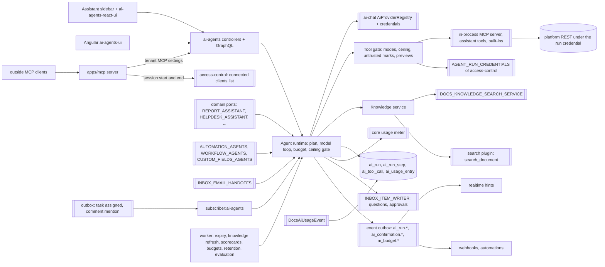

# Implementation Plan: AI agents and assistants

> Translates an approved `spec.md` into architecture and tech choices. The plan owns
> implementation details; the spec owns behaviour.

**Feature ID**: `ai-agents-and-assistants`
**Spec**: `./spec.md`
**Tasks**: `./tasks.md`
**Status**: `Draft`
**Last updated**: 2026-11-23

---

## 1. Architecture Summary

A new plugin triple, `@gauzy/plugin-ai-agents` (`packages/plugins/ai-agents`), `ai-agents-ui` (Angular) and
`ai-agents-react-ui` (React, mounted by the `ai-chat-react-ui` assistant sidebar), loaded by `apps/api/src/plugins.ts` only when
`GAUZY_AI_AGENTS_ENABLED` is exactly `true` (listed after `AiChatPlugin`) and gated per tenant by `FEATURE_AI_AGENTS`.
It is a layer over what exists, never a copy:

- **Models** come from `ai-chat`'s `AiProviderRegistry` and `AiProviderCredentialService` (tenant keys, base URLs, model
  lists, `createModel`, `createEmbeddingModel`); the runtime uses the same model library (`ai`) as `ai-chat.service.ts`.
- **Tools** come from three catalogues: the MCP tools (`registerAllMcpTools` of `packages/mcp-server`, hosted in process
  per run on the protocol SDK's in-memory transport, every call inside `runWithAuthKey(run.authKey)` so the MCP API client
  uses the run's credential), the assistant's tools (`buildGauzyTools`, `buildClientTools`, `AiChatToolRegistry`
  contributions such as `docs_search`), and the plugin's built-ins.
- **Knowledge** reuses the Documents pipeline (`DOCS_KNOWLEDGE_SEARCH_SERVICE`, review status, chunks and vector stores) for
  document, text, file and web sources (typed text, uploads and fetched pages are stored as documents of a knowledge
  folder), and the platform's record index for record sources: core `search_document` and `search_index_definition`
  (`packages/core/src/lib/search/`) kept by the `search` plugin's definitions, indexer, reindex and outbox consumer
  (`packages/plugins/search/src/lib/`). A record type without a search definition gets one contributed to the `search`
  plugin; meaning search over records embeds the search documents' texts into the Documents vector store where it is
  available, keyed by `search_document` id. This plugin keeps no passage table.
- **People and audit**: every agent is an agent employee (`employee.kind = 'agent'`, `employee_agent_profile` with
  `source = 'gauzy'`), created with the agent. The profile is the one master of the agent's identity: name (`title`),
  `slug`, avatar (`avatarUrl`), status, model, `lastRunAt` and its manager, `reportsToEmployeeId`, who is the agent's
  sponsor for `access-control-and-security` too; `ai_agent` keeps only the definition (instructions, tools, knowledge,
  limits, versions) and links to the profile. Agents synchronised from Ever Works (`managedExternally`) are agent
  employees without an `ai_agent` row: they appear among agent employees and can be assigned tasks, act only through
  their own keys, and are not offered in the picker. `ActorTypeEnum.Agent` in the activity log, agent principals and
  credential scopes of `access-control-and-security`, inbox questions and approvals (`INBOX_ITEM_WRITER`,
  `INBOX_SOURCE_HANDLER_REGISTRY`), mailbox hand-off (`INBOX_EMAIL_HANDOFFS`).
- **Declarations as plugin contributions**: purposes, agent templates and skills are a member `ai` of `PluginContributions`
  (`packages/plugin/src/lib/plugin-contributions.ts`) on `@GauzyCorePlugin`, unioned at boot by the core
  `plugin-contributions/` registry next to permissions, features and settings, so domain plugins declare without
  importing this plugin and the plugin contributions report lists them; `registerAssistantPurposes`,
  `registerAgentTemplates` and `registerAgentSkills` are typed helpers that build those entries.
- **Usage, budgets and outside clients**: usage per model call is this plugin's `ai_usage_entry`; totals per agent,
  purpose, user and organization and month are metrics (`ai.tokens`, `ai.cost`) of the platform's one usage meter
  (core `stats` module, `platform-administration`), incremented in the transaction that writes each usage entry, so
  the admission check of the next run reads a total that includes every finished call of the agents and purposes of
  this plugin; the Documents AI usage events (`DocsAiUsageEvent` of
  `packages/plugins/docs/src/lib/knowledge/ai/docs-ai-usage.event.ts`: tokens per embedding, classification and OCR
  call) are recorded in the same ledger, so caps cover every AI call. A Documents call counts from the moment its
  listener writes the usage entry, which follows the call on the in-process event bus without holding it (the
  Documents plugin never lets accounting fail a job): a run admitted in that interval starts before the call counts,
  so a month's total can pass the cap by the Documents calls still being recorded, as it can by the calls of runs
  already admitted (FR-51 refuses new runs at 100 %), and every admission check after the entry is written counts
  it. Budgets, AI cost caps and the request and write
  budgets of agent principals are `ai_budget` rows (`AGENT_BUDGETS` port for `access-control-and-security`). Connected
  MCP clients are listed and revoked in the one list of `access-control-and-security`.



## 2. Tech Choices

| Concern | Choice | Rationale |
| ------- | ------ | --------- |
| Package | new `packages/plugins/ai-agents`, `-ui`, `-react-ui` (assistant sidebar only); declarations as a `PluginContributions` member | Principle I; domains register without a dependency |
| Permissions and settings | `PluginContributions`: permissions with `defaultFor`, `FEATURE_AI_AGENTS`, and the scalar settings (`ai.maskedFields`, `ai.webToolsEnabled`, `ai.confirmationExpiryHours`, `ai.mcp.enabled`, `ai.mcp.serverName`, `ai.mcp.instructions`, `ai.mcp.groups`, `ai.mcp.previewByDefault` (false), `ai.mcp.hideFailingTools` (false)) at tenant and organization scope in `tenant_setting`; an unset MCP setting means today's behaviour | no seed migration, no settings table |
| Model loop | the `generateText` / `streamText` loop of the `ai` library already used by `ai-chat`, with a step hook for budget and ceiling | one provider surface; streaming to the sidebar |
| MCP tools in process | `McpServer` + linked in-memory transport per run, `registerAllMcpTools`, `runWithAuthKey` | every MCP tool available to agents without a network hop |
| Ceiling | run credential from `AGENT_RUN_CREDENTIALS` (subject = invoker, actor = agent principal, scopes = tool permissions); fallback: invoker's bearer plus the runtime gate | rights checked by the platform's own guards on every call |
| Previews | tools declare `preview`; legacy writing tools get a generic preview (route, body, current record, version hash), used when the caller passes `preview: true` or the tenant set `ai.mcp.previewByDefault`; called without it they commit as today. The tool metadata marks a legacy tool whose route derives further records on the server (postings, generated lines, open items, sends) `derivedEffects: true`; its generic preview says the derived effects are not shown, and a dry-run plan never executes such a call from its token: plan execution stops before it and asks a person to confirm it live, until the owning domain gives the tool a domain preview that lists those effects | spec FR-70 for 324 existing tools without rewriting them or changing their answer |
| Preview token | HMAC-SHA256 over tool, normalised inputs, effects hash, record versions and expiry, keyed by the platform secret | stale commits refused without storing previews |
| Knowledge | Documents pipeline for files, text, web; record sources from the `search` plugin's index (`search_document`, word search on every dialect), their texts embedded into the Documents vector store (`pgvector` where available) | no second extraction stack, no second record index |
| Untrusted content | helper extracted from `packages/plugins/docs/src/lib/knowledge/security/untrusted-content.ts` into `@gauzy/utils` (`ai/untrusted-content.ts`), re-exported by docs | one marking rule |
| Outbound requests | request tools and web fetch go through core `webhook/webhook-endpoint-policy.ts`; the `ai-chat` guard (`ssrf/outbound-url-guard.ts`, `ssrf-safe-fetch.ts`) keeps its own checks for the assistant's fetches | one outbound policy for every new call; the assistant's fetches checked as today |
| Usage totals | `ai_usage_entry` per model call (this plugin and Documents AI); totals in the core usage meter | one counter store |
| Money | usage cost as exact decimal strings (`numeric(28,9)`), price table per model | spec FR-50 |
| Background work | `@QueueWorker` queue `ai-agents` in the API, `@ScheduledJob` in the worker (`AiAgentsSchedulePlugin`), in-process fallback without a queue root | task automations layout |
| Push | outbox → `RealtimeHintsService.appendHint` (`run:<id>`, `ai-agent:<id>`); answers stream on the chat response as today | Principle VII |
| UI | Angular plugin pages; React components for the assistant sidebar | assistant stays one surface |

## 3. Data Model

All tables extend `TenantOrganizationBaseEntity` (soft delete, `isActive`, `isArchived`); JSON is `text` on every dialect;
keys `varchar(96)`; money `numeric(28,9)` with `currency varchar(3)`; ids into other plugins carry no foreign key.

| Table | Columns (besides base) | Indexes and uniqueness |
| --- | --- | --- |
| `ai_agent` | `key`, `agentEmployeeId` (its agent employee; name, avatar, status and manager live on `employee_agent_profile`), `description` text, `draft` text (instructions, model, fallback, preset, limits, tools with modes and routes, knowledge, skills, sub-agents), `draftVersion` int, `publishedVersion` int, `templateKey`, `templateVersion` int, `ownerUserId`, `identityMode` (`INVOKER`, `PRINCIPAL`; the principal is the agent employee's user), `runAsUserId`, `audience` text, `placements` text, `workingHours` text, `timeZone` varchar(64), `memoryEnabled` bool, `evaluationGate` numeric(5,2) default 90, `scorecardRules` text | unique `(tenantId, organizationId, key)`, unique `(agentEmployeeId)` |
| `ai_agent_version` | `agentId` FK cascade, `version` int, `document` text, `publishedByUserId`, `evaluationRunId`, `overrideReason` text | unique `(agentId, version)` |
| `ai_skill` | `key`, `name`, `description` text, `instructions` text, `tools` text, `knowledgeBaseIds` text, `templateKey`, `version` int | unique `(tenantId, organizationId, key)` |
| `ai_request_tool` | `key`, `name`, `description` text, `method` varchar(8), `urlTemplate` text, `parameters` text, `responseFields` text, `connectedAccountId`, `writes` bool | unique `(tenantId, organizationId, key)` |
| `ai_agent_trigger` | `agentId` FK cascade, `kind` (`AUTOMATION_RULE`, `MAILBOX`), `ref` varchar(64), `mode` (`DRAFT_ONLY`, `ACTIONS`), `allowedActions` text, `urgent` bool | unique `(agentId, kind, ref)` |
| `ai_conversation_agent` | `conversationId` (core `ai_chat_conversation`), `agentId`, `agentVersion` int | unique `(conversationId)` |
| `ai_memory_note` | `agentId`, `userId`, `content` text, `runId` | idx `(tenantId, agentId, userId)` |
| `ai_knowledge_base` | `name`, `description` text, `audience` text, `chunkSize` int, `chunkOverlap` int, `reviewNewContent` bool, `documentFolderId` | idx `(tenantId, organizationId)` |
| `ai_knowledge_source` | `knowledgeBaseId` FK cascade, `kind` (`DOCS_SCOPE`, `HELP_CENTRE`, `RECORD_TYPE`, `TEXT`, `FILE`, `WEB`), `config` text (a record source names its search definition, saved-view filter and fields), `refresh` (`ON_CHANGE`, `HOURLY`, `DAILY`, `WEEKLY`, `MANUAL`), `publishedToAudience` bool, `status` (`PENDING`, `PROCESSING`, `READY`, `FAILED`, `PAUSED`), `passageCount` int, `lastRefreshAt`, `nextRefreshAt`, `lastError` text, `errorLog` text | idx `(status, nextRefreshAt)` |
| `ai_knowledge_gap` | `knowledgeBaseId`, `questionHash` varchar(64), `question` text, `count` int, `lastAskedAt` | unique `(knowledgeBaseId, questionHash)` |
| `ai_run` | `agentId`, `agentVersion` int, `purposeKey` varchar(96), `conversationId`, `parentRunId`, `batchId`, `origin` varchar(16), `mode` (`NORMAL`, `DRY_RUN`, `PLAN_EXECUTION`, `REPLAY`, `EVALUATION`), `invokerUserId`, `actorUserId`, `agentEmployeeId`, `contextRecordType`, `contextRecordId`, `projectId`, `status` varchar(24), `statusReason` varchar(255), `steps` int, `toolCalls` int, `inputTokens`, `outputTokens`, `cachedTokens` bigint, `cost`, `currency`, `providerId` varchar(64), `model` varchar(128), `fallbackUsed` bool, `untrustedSinceStep` int null (first step whose context held untrusted content, FR-24; set once, never cleared during the run), `notBefore`, `startedAt`, `finishedAt`, `idempotencyKey` varchar(128) | unique `(tenantId, idempotencyKey)`; idx `(tenantId, agentId, createdAt)`, `(tenantId, invokerUserId, createdAt)`, `(status, notBefore)`, `(tenantId, purposeKey, createdAt)`, `(contextRecordType, contextRecordId)` |
| `ai_run_step` | `runId` FK cascade, `index` int, `kind` (`MODEL`, `TOOL`, `DELEGATE`, `QUESTION`, `CONFIRMATION`), `input` text (masked, ≤ 256 KB), `output` text, `evidence` text (record versions, passage ids), `usage` text, `startedAt`, `finishedAt`, `error` text | unique `(runId, index)` |
| `ai_tool_call` | `runId` FK cascade, `stepIndex` int, `toolName` varchar(128), `toolGroup` varchar(48), `mode` varchar(16), `writes` bool, `preview` bool, `previewToken` varchar(160), `inputs` text, `outputDigest` varchar(64), `recordedOutput` text, `outcome` (`DONE`, `PREVIEWED`, `AWAITING`, `REFUSED`, `FAILED`), `refusalReason` varchar(48), `recordType`, `recordId`, `durationMs` int | idx `(runId)`, `(tenantId, toolName, createdAt)`, `(tenantId, outcome, createdAt)` |
| `ai_confirmation` | `runId` FK cascade, `toolCallId`, `kind` (`CONFIRMATION`, `QUESTION`, `HAND_OVER`), `route` text, `inboxItemId`, `status` (`PENDING`, `APPROVED`, `REJECTED`, `ANSWERED`, `EXPIRED`), `decidedByUserId`, `decidedAt`, `note` text, `answer` text, `expiresAt` | idx `(status, expiresAt)`, `(tenantId, decidedByUserId)` |
| `ai_answer_rating` | `runId`, `userId`, `value` smallint, `comment` text | unique `(runId, userId)` |
| `ai_dry_run_plan` | `runId`, `calls` text (tool, inputs, preview token, effects hash), `status` (`OPEN`, `EXECUTED`, `STALE`, `EXPIRED`), `executionRunId`, `expiresAt` | unique `(runId)` |
| `ai_purpose_setting` | `purposeKey`, `enabled` bool, `providerId`, `model`, `extraInstructions` text, `knowledgeBaseIds` text | unique `(tenantId, organizationId, purposeKey)` |
| `ai_model_price` | `providerId`, `modelId`, `inputPerMillion`, `outputPerMillion`, `cachedPerMillion`, `currency`, `validFrom` date | unique `(tenantId, providerId, modelId, validFrom)` |
| `ai_budget` | `scopeKind` (`ORGANIZATION`, `AGENT`, `PURPOSE`, `USER`), `scopeKey` varchar(96), `metric` varchar(16) (`COST`, `TOKENS`; for agent principals also `REQUESTS`, `WRITES`, `BULK_RECORDS`, `EXPORT_ROWS`, `CONFIRMATIONS`), `window` varchar(6) (`MINUTE`, `DAY`, `MONTH`, `ACTION`; each window is checked against its own counter: `MINUTE` by the core throttler storage keyed by principal and metric, `ACTION` against the size of the current action (records in the bulk action, rows in the export), `DAY` and `MONTH` against the core usage meter), `cap` numeric(28,9), `currency` null, `warnedPeriod` varchar(10), `reachedPeriod` varchar(10) | unique `(tenantId, organizationId, scopeKind, scopeKey, metric, window)` |
| `ai_usage_entry` (append-only) | `runId` null (null for Documents AI calls), `stepIndex`, `source` varchar(16) (`AGENT_RUN`, `DOCS_AI`), `providerId`, `model`, `inputTokens`, `outputTokens`, `cachedTokens`, `cost`, `currency`, `priced` bool, `agentId`, `purposeKey`, `userId`, `agentEmployeeId`, `projectId`, `period` varchar(7) | idx `(tenantId, period, agentId)`, `(tenantId, period, purposeKey)`, `(tenantId, period, agentEmployeeId, projectId)` |
| `ai_evaluation_suite` / `ai_evaluation_case` | suite: `agentId`, `name`, `gate`; case: `suiteId` FK cascade, `sourceRunId`, `input` text, `recordedTools` text, `criteria` text, `status` (`PROPOSED`, `ACTIVE`, `RETIRED`) | case idx `(suiteId, status)` |
| `ai_evaluation_run` | `suiteId`, `agentVersion` int, `model`, `mode` (`REPLAY`, `LIVE_READ`), `status`, `passRate` numeric(5,2), `results` text, `regressions` int, `startedByUserId` | idx `(suiteId, createdAt)` |
| `ai_scorecard_week` | `agentId`, `weekStart` date, `measures` text | unique `(agentId, weekStart)` |

**Core and shared changes (additive, no core schema change):**

- `packages/contracts/src/lib/ai-agents.model.ts`: agent document, tool modes, run, step, confirmation, purpose, template,
  skill, budget, usage, evaluation, port interfaces and error codes; export from `index.ts`.
- `packages/plugin/src/lib/plugin-contributions.ts`: `PluginContributions.ai` (`purposes`, `agentTemplates`, `skills`);
  `packages/core/src/lib/plugin-contributions/`: `PluginAiRegistry` beside the permission, feature and setting registries
  (duplicate keys refused at bootstrap, listed in the plugin contributions report); helpers `registerAssistantPurposes`,
  `registerAgentTemplates`, `registerAgentSkills` build the entries.
- `packages/plugins/search`: definitions for record types offered as knowledge sources that have none yet.
- `ai-chat` `ssrf/outbound-url-guard.ts` stays as it is; this plugin's request tools and web fetch use core
  `webhook-endpoint-policy.ts`.
- `EmployeeAgentSourceEnum` gains `GAUZY = 'gauzy'` (the column is already a string).
- `packages/mcp-server/src/lib/tools/tool-metadata.ts`: per tool `{ group, writes, permissions, feature, route, preview,
  derivedEffects }` declared next to each registration; `tool-conventions.ts` (`registerWriteTool` with `preview`, idempotency key, preview
  token, assisted mark; for existing tools the preview default and the assisted mark apply only for tenants with
  `FEATURE_AI_AGENTS` on, the preview default only with `ai.mcp.previewByDefault`); group switches generalized from
  `collaboration/scopes.ts` (`GAUZY_MCP_TOOLS_<GROUP>`, existing groups on and collaboration groups off by default, as
  today; a session whose token names no group scope keeps every tool of the existing groups).

**Migration timestamps**: `packages/plugins/ai-agents` `1791000081100` to `1791000081199`.

**Migrations** (the shared core migration helpers of `@gauzy/core`; PostgreSQL, SQLite, MySQL;
idempotent, forward-only, both ORMs):

1. `1791000081100-CreateAiAgentTables` — agent, version, skill, request tool, trigger, conversation link, memory.
2. `1791000081110-CreateAiKnowledgeTables` — base, source, gap.
3. `1791000081120-CreateAiRunTables` — run, step, tool call, confirmation, rating, dry-run plan.
4. `1791000081130-CreateAiUsageTables` — purpose setting, price, budget, usage entry.
5. `1791000081140-CreateAiEvaluationTables` — suite, case, evaluation run, scorecard week.
6. `1791000081160-SeedAiReportCatalogue` — category "AI" and the spec FR-80 rows in core `report`; the category is
   keyed `FEATURE_AI_AGENTS` in the shared catalogue feature filter of `report-builder-and-dashboards`, so a tenant
   with the feature off lists exactly today's reports.

### 3.1 Consumers of this layer

| Consumer | Assumes | Met by |
| --- | --- | --- |
| `helpdesk-tickets` | `HELPDESK_ASSISTANT` drafts with sources, other customers masked, never sent; AI responders as agent employees, draft-only by default, threshold, budget, hand-over, recorded runs with cost, pause all | purposes `helpdesk.*` with masking (FR-66, FR-7); template `helpdesk.responder` (FR-14); runs and costs (FR-34, FR-50); hand-over (FR-38); pause (FR-13) |
| `crm-leads-and-deals` | every writing tool takes `preview: true`; agent changes recorded "by agent for user"; next best action and briefs write nothing | FR-70, FR-40, ceiling FR-22; purposes `crm.*` |
| `platform-administration` | administrator assistant read-only plus confirmed operations, `byAgent` on runs, audit marks | purpose `admin.explain` with read tools and confirm-mode operations; FR-18, FR-40 |
| `approval-workflows` | `WORKFLOW_AGENTS` decide within stored limits or advise; agents never approve their own records; human fallback when no runtime | port binding (FR-49); runs record reasoning and facts as evidence (FR-60); unbound port when the plugin is off |
| `automation-and-notifications` | `AUTOMATION_AGENTS` agent step with tool set, budget (tokens, cost, calls, minutes), previews on writes, usage per step, organization cap; plain-language drafts | port binding with a per-call budget checked before every step (FR-50, FR-51 of `ai-agents-and-assistants`; FR-74 and FR-75 of `automation-and-notifications`); purpose `automation.flow-draft` |
| `access-control-and-security` | agent principals with sponsor and request budgets; definitions, tools, knowledge and AI cost limits owned here | `AGENT_RUN_CREDENTIALS` consumed; identity mode PRINCIPAL (FR-12); the sponsor is the agent profile's manager; AI caps (FR-51) and the principal's request and write budgets offered through `AGENT_BUDGETS` |
| `report-builder-and-dashboards`, `record-views-and-search`, `data-import-export`, `email-and-communications`, `integration-hub`, `spreadsheets`, `presentations`, `meetings`, `learning-management`, `recruitment`, `performance-management`, `commerce-connectors`, `payment-gateways` | a `<DOMAIN>_ASSISTANT` port bound here, fallback `AiProviderRegistry` | adapters over `AGENT_RUNTIME.complete` with purposes per domain; payload rules of each spec kept as the purpose's masking |
| `hr-core-lifecycle`, `payroll-setup`, `payroll-processing` | usage cost of agent employees per period, allocated to projects | `AGENT_USAGE` bound to `PAYROLL_AGENT_USAGE` (FR-52) |
| `custom-fields-and-forms` | `CUSTOM_FIELDS_AGENTS` for "ask an agent" form actions and drafting | FR-47 |

### 3.2 Contracts

`packages/contracts/src/lib/ai-agents.model.ts` and the other additive `@gauzy/contracts` changes listed under "Core and shared changes" above; they reach the SDKs through the OpenAPI document.

## 4. API Surface

| Method | Endpoint | Permission | Description | Status |
| ------ | -------- | ---------- | ----------- | ------ |
| `GET` `POST` | `/api/ai-agents/agents` | `AI_AGENT_USE` (list usable) / `AI_AGENT_MANAGE` | list; create (idempotency key) | New |
| `GET` `PUT` `DELETE` | `/api/ai-agents/agents/:id` | use / manage | read; update draft with `If-Match`; archive | New |
| `POST` | `/api/ai-agents/agents/:id/{publish,rollback,pause,resume,clone,export}` | `AI_AGENT_PUBLISH` (clone, export: manage) | lifecycle; publish runs the evaluation gate | New |
| `POST` | `/api/ai-agents/agents/import` | `AI_AGENT_MANAGE` | package with `preview` | New |
| `GET` | `/api/ai-agents/agents/:id/{versions,scorecard,usage}` | manage / owner / manager of its employee | history, weekly measures, cost | New |
| `PUT` | `/api/ai-agents/agents/:id/{worker,triggers}` | `AI_AGENT_PUBLISH` / manage | employee binding, hours; triggers | New |
| `GET` | `/api/ai-agents/tools` | `AI_AGENT_MANAGE` | catalogue with metadata and availability | New |
| CRUD | `/api/ai-agents/{skills,request-tools}[/:id]` | `AI_AGENT_MANAGE` | skills, request tools | New |
| CRUD | `/api/ai-agents/knowledge-bases[/:id]`, `…/:id/sources[/:sid]`, `POST …/sources/:sid/{refresh,pause}` | `AI_KNOWLEDGE_MANAGE` | bases and sources | New |
| `POST` | `/api/ai-agents/knowledge-bases/:id/search` | audience of the base | passages with citations | New |
| `POST` | `/api/ai-agents/runs` | `AI_AGENT_USE` | `{ agentKey, input, context, dryRun, conversationId }` → stream or `202` | New |
| `POST` | `/api/ai-agents/runs/bulk` | `AI_AGENT_USE` | saved view + instruction → batch | New |
| `GET` | `/api/ai-agents/runs[/:id]`, `…/:id/trace` | invoker / `AI_RUN_AUDIT` | runs, full trace | New |
| `POST` | `/api/ai-agents/runs/:id/{cancel,rate,execute-plan,replay}` | invoker / audit / manage (replay) | actions | New |
| `POST` | `/api/ai-agents/confirmations/:id/{approve,reject,answer}` | route recipient | decisions (also through inbox replies) | New |
| `GET` `PUT` | `/api/ai-agents/purposes[/:key]` | `AI_CHAT_SETTINGS` | registered purposes and their settings | New |
| CRUD | `/api/ai-agents/{prices,budgets}[/:id]` | `AI_BUDGET_MANAGE` | price table, caps | New |
| `GET` | `/api/ai-agents/usage` | `AI_BUDGET_MANAGE` / own | usage by scope and month | New |
| CRUD | `/api/ai-agents/evaluation/suites[/:id]`, `…/cases`, `POST …/:id/run` | `AI_EVALUATION_MANAGE` | suites, cases, runs | New |
| `GET` `PUT` | `/api/ai-agents/settings` | `AI_CHAT_SETTINGS` (MCP part: `AI_MCP_SETTINGS_MANAGE`) | masking, web, expiry, MCP (setting contributions in `tenant_setting`); run retention is a kind of the platform retention model | New |
| `GET` | `/api/ai-agents/mcp/settings` | session user | the MCP server reads the tenant's MCP settings; connected clients are listed and revoked through `CONNECTED_CLIENTS` of `access-control-and-security` | New |
| `GET` | `/api/ai-agents/memory`, `DELETE …/:id` | self | own memory notes | New |
| `*` | `/api/ai-chat/**` | unchanged | the assistant; with the feature on its turn also writes a run | Unchanged |

Controllers carry `@FeatureFlag(FEATURE_AI_AGENTS)`, `TenantPermissionGuard`, `@Permissions()`, class-validator DTOs,
Swagger, idempotency keys and cursor pagination. Errors: `AI_AGENT_STALE` (409), `AI_AGENT_PAUSED`, `AI_TOOL_REFUSED`
(403 with the reason), `AI_BUDGET_EXCEEDED` (429), `AI_PREVIEW_STALE` (409), `AI_CONFIRMATION_EXPIRED` (410),
`AI_EVALUATION_GATE` (409 with the report), `AI_PROVIDER_UNAVAILABLE` (503). GraphQL reads: `aiAgents`, `aiAgent`, `aiRuns`,
`aiRun`, `aiKnowledgeBases`, `aiUsage`.

**Ports offered** (contracts tokens, bound in `apps/api/src/plugin-composition.ts`):

```ts
interface IAgentRuntime {                                  // AGENT_RUNTIME
    complete<T>(req: { purpose: string; input: string | object; context?: IRecordRef; viewer: IViewer;
        schema?: object; tools?: string[]; knowledgeBaseIds?: ID[]; budget?: IRunBudget;
        idempotencyKey?: string }): Promise<IAgentResult<T>>;  // { output, citations, usage, runId, status }
    run(req: { agentKey: string; input: string; context?: IRecordRef; viewer: IViewer; origin: AgentRunOrigin;
        dryRun?: boolean; wait?: boolean; budget?: IRunBudget }): Promise<IAgentRunRef | IAgentResult>;
    status(runId: ID): Promise<IAgentRunRef>;
    cancel(runId: ID, reason: string): Promise<void>;
    purge(runIds: ID[], reason: string): Promise<void>;  // erases inputs, outputs and tool payloads; keeps the run row and usage
}
```

Bindings: `AUTOMATION_AGENTS`, `WORKFLOW_AGENTS` (`decide`, `advise` adapters over `run`), `CUSTOM_FIELDS_AGENTS`, and the
domain assistant tokens (`REPORT_ASSISTANT`, `HELPDESK_ASSISTANT`, `RECORD_VIEWS_ASSISTANT`, `PAYROLL_ASSISTANT`,
`COMMUNICATIONS_ASSISTANT`, and the others of §3.1) through small adapters in `plugin-composition.ts`; `AGENT_USAGE`
(`usage(agentEmployeeIds, period)` → cost by project) also bound as `PAYROLL_AGENT_USAGE`; `AI_KNOWLEDGE_SEARCH` for
other plugins (help centre answers); `AGENT_BUDGETS` (an agent's request, write, bulk, export and confirmation limits,
for `access-control-and-security`); `RETENTION_SOURCES` entries (`ai.runs` 180 days, `ai.knowledge-gaps` 90 days).

**Ports consumed** (unbound → the capability is not offered): `AGENT_RUN_CREDENTIALS` (access-control; fallback described
in §9), `AUTOMATION_FLOWS` (flow tools), `AUTOMATION_RULES` (store triggers; else email and on-demand only), `CONNECTED_ACCOUNTS`
and `INTEGRATION_HTTP` (request tools), `RECORD_VIEWS_QUERY` and `RECORD_VIEWS_SELECTION` (record sources, bulk runs),
`RECORD_ACCESS_FILTER` and `FIELD_ACCESS_POLICY` (passage reads), `REPORT_RUNS` (built-in report tool),
`HELP_CENTRE_ARTICLES` (help centre sources), `NOTIFICATION_DISPATCHER` (else `INBOX_ITEM_WRITER`), `USAGE_METER` (core),
`CONNECTED_CLIENTS` (`access-control-and-security`; unbound → the MCP settings page lists no clients), the `search`
plugin's index services (record sources; unbound → record sources are not offered).

**Consumer tokens answered** (bound in `apps/api/src/plugin-composition.ts` to purpose adapters over `AGENT_RUNTIME` (runs, usage and budgets recorded here); each consumer plan states the shape it calls and its fallback): `BANKING_DOCUMENT_EXTRACTION`, `COMMERCE_ASSISTANT`, `COMMUNICATIONS_ASSISTANT`, `CUSTOM_FIELDS_AGENTS`, `DATA_EXCHANGE_ASSISTANT`, `DISCUSSIONS_ASSISTANT`, `EXPENSE_RECEIPT_READER`, `GATEWAY_ASSISTANT`, `HELP_CENTER_ASSISTANT`, `HR_ASSISTANT`, `INTEGRATION_ASSISTANT`, `LEARNING_ASSISTANT`, `MAIL_TEXT_GENERATION`, `MARKETING_ASSISTANT`, `MEETINGS_SPEECH`, `MEETINGS_TEXT_GENERATION`, `PERFORMANCE_ASSISTANT`, `PORTAL_ASSISTANT`, `PRINT_ASSISTANT`, `PROJECT_ASSISTANT`, `RECRUITMENT_ASSISTANT`, `REPORT_ASSISTANT`, `SHEETS_ASSISTANT`, `SLIDES_ASSISTANT`, `TELEPHONY_SPEECH`, `TELEPHONY_TEXT_GENERATION`, `WORKFLOW_AGENTS`.

## 5. Events, Real-Time and Notifications

| Event | Emitted when | Consumers |
| ----- | ------------ | --------- |
| `ai_agent.published` / `.paused` / `.archived` | lifecycle | realtime hint to the audience (picker refresh), activity log, webhooks |
| `ai_run.started` / `.waiting` / `.completed` / `.failed` / `.handed_over` | run changes | realtime `run:<id>`, automations (agent step result), requester notice for background runs |
| `ai_confirmation.requested` / `.decided` / `.expired` | confirmations | inbox approval or question item, realtime to the run |
| `ai_budget.warning` / `.reached` | 80 % / 100 % of a cap | notice to the budget owner and sponsor |
| `ai_knowledge_source.ready` / `.failed` | indexing ends | notice to the base owner |
| In: `task.updated` (assignee is an agent employee), `comment.created` (agent mentioned) | `subscriber:ai-agents` | assignment and mention runs (record sources stay current through the `search` plugin's own consumer, document sources through the Documents pipeline) |
| In: `DocsAiUsageEvent` | usage recorder | a usage entry per Documents AI call |

Notification categories (`registerNotificationCategories`): `ai.confirmation`, `ai.question`, `ai.budget`,
`ai.knowledge`, `ai.scorecard`. Inbox source `AI_AGENTS` registered with `INBOX_SOURCE_HANDLER_REGISTRY` routes replies to
confirmations and questions. Events carry ids only.

## 6. UI Surface

- **Angular `packages/plugins/ai-agents-ui`** (lazy, hidden on `404`), menu "AI": `/pages/ai/agents` (list),
  `/pages/ai/agents/:id` (tabs: profile and instructions with placeholder preview, model and limits, tools with modes and
  routes, knowledge, skills and sub-agents, audience and identity, triggers, worker with employee, manager and hours,
  versions with diff, evaluation, scorecard), `/pages/ai/knowledge[/:id]`, `/pages/ai/runs[/:id]` (trace with steps,
  evidence, replay comparison), `/pages/ai/purposes`, `/pages/ai/usage` (budgets, prices), `/pages/ai/skills`,
  `/pages/ai/request-tools`, `/pages/ai/settings` (masking, web tools, MCP; connected clients from the list of
  `access-control-and-security`). The existing `settings/ai` provider page stays and links here; the agent's worker tab
  edits its agent employee profile (name, avatar, manager).
- **React `packages/plugins/ai-agents-react-ui`**: `AgentPicker`, `ConfirmationCard`, `QuestionCard`, `RunTrace`,
  `RatingBar`, `DryRunPlan`, hooks `useAgentRun`, `useAgents`; mounted by the `ai-chat-react-ui` sidebar when the routes
  answer.
- Record pages: an "Ask an agent" action contributed through the record shell of `record-views-and-search`.
- i18n keys `AI_AGENTS.*` in every locale of `packages/ui-core/i18n`.

## 7. MCP Tools, SDKs and Integrations

New `packages/mcp-server/src/lib/tools/ai-agents.ts`: `agents_list`, `agents_run` (input, context, `preview` default
`true` = dry run), `agent_runs_get`, `agent_confirmations_decide`, `agent_questions_answer`, `knowledge_search`,
`ai_usage_get`. Shared conventions (FR-69 to FR-75) land in `tool-metadata.ts` and `tool-conventions.ts`; the build check
`tools/scripts/mcp-tool-route-check.mjs` reads the OpenAPI document and every tool's declared route and permissions,
fails on a new tool with a missing route and reports existing tools that fail; `TOOLS_REGISTRY` gains availability, read
by the agent tool catalogue only and only where the tenant setting `ai.mcp.hideFailingTools` is on (false by default), so
an existing tool is reported but stays offered to agents by default, and MCP clients keep every tool they are offered today. The MCP server reads tenant
settings at session start (cached 60 s; a `404` or an unset value means today's behaviour) and reports session start and
end to the connected clients list of `access-control-and-security`; a revoked client is refused on its next call. OpenAPI additive; Kiota
SDKs regenerated. Agent packages: JSON with a schema version, signed by the exporting tenant's key for integrity.

## 8. Background Jobs

| Trigger | When | What it does | Idempotency |
| ------- | ---- | ------------ | ----------- |
| queue `ai-agents` job `run` | background, triggered, bulk and delegated runs | runtime loop; resumes from the last finished step with a newly issued run credential after rechecking current access (§9) | run id + step index |
| `ai-agents.confirmation-expiry` | every 5 minutes | expires confirmations and runs past `expiresAt` | status check |
| `ai-agents.working-window` | every minute | releases queued runs whose `notBefore` has come | status check |
| `ai-agents.knowledge-refresh` | per source schedule | web crawl through the core outbound policy into the knowledge folder; record sources ask the `search` plugin to reindex their type when stale | per source and content hash |
| `ai-agents.usage-close` | hourly | checks caps against the core usage meter (each usage entry increments the meter in the transaction that writes it, so admission never waits for this pass), sends 80 % and 100 % notices | `warnedPeriod`, `reachedPeriod` |
| `ai-agents.scorecard` | daily (partial) and Monday 02:00 | computes weekly measures, checks manager rules | unique `(agentId, weekStart)` |
| queue `ai-agents` job `evaluate` | publish, on demand | replays cases with recorded outputs, judges, writes the report | evaluation run id |
| retention kinds `ai.runs`, `ai.knowledge-gaps` | daily, by the platform retention runner of `access-control-and-security` (this plugin's own cleanup only while that plugin is not loaded) | prunes runs, steps and tool calls past retention, knowledge gaps after 90 days | date checks |
| outbox `subscriber:ai-agents` | task and comment events | assignment and mention runs | delivery record per event |

Queue jobs run in the API; schedules in the worker (`AiAgentsSchedulePlugin` in `apps/worker/src/plugins.ts`); without a
queue root the API runs them on in-process timers under a database lock.

## 9. Security & Permissions

`ai-agents.permissions.ts`: `AI_AGENT_USE`, `AI_AGENT_MANAGE`, `AI_AGENT_PUBLISH`, `AI_KNOWLEDGE_MANAGE`, `AI_RUN_AUDIT`,
`AI_EVALUATION_MANAGE`, `AI_BUDGET_MANAGE`, `AI_MCP_SETTINGS_MANAGE`; `AI_CHAT_ACCESS` and `AI_CHAT_SETTINGS` are reused.
Declared as permission contributions with `defaultFor`: all to `SUPER_ADMIN` and `ADMIN`; `USE`, `MANAGE`,
`KNOWLEDGE_MANAGE` to `MANAGER`; `USE` to `EMPLOYEE`.

**Ceiling.** Each run gets a credential: with `access-control-and-security`, `AGENT_RUN_CREDENTIALS.issue({ subject:
invoker, actor: principal, scopes: permissions of the enabled tools, ttl })`, so its authorization contributors narrow the
invoker's permissions to the scopes and the principal's grants, and record and field rules apply as for the invoker.
Without it, the run uses the invoker's bearer (as the assistant does today) or a short-lived token of the run-as user, and
the tool gate checks the agent's modes and the invoker's permissions before each call. Every call passes the gate: mode,
ceiling, budget, untrusted-content rule, preview handling; refusals are tool calls with `outcome = REFUSED`. The
untrusted-content rule reads `ai_run.untrustedSinceStep`: once set, every later write of the run, in that step or any
later one and after a resume, needs confirmation; a run of the same conversation whose context carries an untrusted
result of an earlier run starts with the column set at step 0. A sub-run (`parentRunId` set) started while its parent's
column is set starts with its own set at step 0, and a delegate step that returns the summary of a sub-run whose column
is set sets the parent's column at that step, if not already set.

**Data to providers.** Masking from the `ai.maskedFields` setting, field rules and purpose masks is applied to tool
results, passages and context before the model call of agents and purposes; record ids stay, values go. The agent
"Assistant" masks only what a user set for it, so the existing assistant's turns send what they send today. No tool executes code; request tools go
through `INTEGRATION_HTTP` and the core endpoint policy (`webhook-endpoint-policy.ts`: no private networks, timeouts,
logs). Run credentials live in memory only, for one execution of the run (never stored); a run that resumes (after
waiting for a confirmation, a question or its working window, or after an API restart) gets a new credential before
its next tool call: the runtime first rechecks current access (the invoker or run-as user still active and holding the
permissions of the enabled tools, the agent published and not paused, an agent principal not suspended), then calls
`AGENT_RUN_CREDENTIALS.issue` again with the same subject, actor and scopes, or, without `access-control-and-security`,
mints a new short-lived token of the invoker or run-as user; when the recheck fails, the run ends with `statusReason`
`AI_ACCESS_CHANGED` and makes no further call. Preview tokens are HMACs, never stored secrets. Mailbox runs see only messages of handed mailboxes.
Agents never decide confirmations or approvals of their own runs.

## 10. Observability

Run traces and the usage ledger; activity entries for publishes, overrides, budget and price changes and MCP settings;
one audit event per run through `AUDIT_EVENT_SINK` when access-control is loaded, referencing the `ai_run` row rather
than copying it. Metrics
`ai_run_duration_seconds{agent,origin}`, `ai_run_steps`, `ai_tool_refusals_total{reason}`, `ai_provider_errors_total`,
`ai_fallbacks_total`, `ai_cost_total{scope}`, `ai_queue_depth`, `ai_knowledge_index_lag_seconds`.

## 11. Phased Rollout

1. **Phase 1 — Surface what exists** (flag off): contracts and the `ai` contribution member, plugin scaffold and tables,
   agents as agent employees, the assistant as agent "Assistant" with runs and usage for its turns (Documents AI usage
   included), agents over the existing tool catalogues with modes and inbox confirmations, prices and usage reports, MCP
   conventions (metadata, preview helper, route check, group switches, tenant MCP settings), the Angular agent, run and
   usage pages.
2. **Phase 2 — Depth**: knowledge bases and sources (records through the `search` plugin), purposes and `AGENT_RUNTIME`
   bindings, budgets and caps (`AGENT_BUDGETS` included), triggers through automation and mailbox hand-off, bulk runs,
   workflow and custom-field ports, skills, sub-agents, request and flow tools, templates, export and import, memory,
   ratings, React components for the assistant sidebar.
3. **Phase 3 — Advanced capabilities**: run credentials and the ceiling, dry runs and plan execution, evidence and replay,
   evaluation suites and the publish gate, agent employees with managers, hours, assignments, scorecards and the usage
   cost of agent employees.
4. **Phase 4 — General availability**: the feature is off by default; after the trial period it may be switched on by default for new tenants only; existing tenants keep their setting until an administrator changes it.

## 12. Constitution Reconciliation

- I Plugin-first: plugin triple; `ai-chat`, providers, docs, inbox and the MCP server extended through their seams.
- II Tenant/organization scoping: every table on the tenant-organization base; runs carry the invoker's scope.
- III Both ORMs, additive migrations: six plugin migrations on three dialects; no core table changes.
- IV Default-off flag; nothing removed: deploy switch and `FEATURE_AI_AGENTS`; assistant and MCP behave as today.
- V Contracts and API first: `AGENT_RUNTIME` and REST, GraphQL reads, OpenAPI and SDKs before UI.
- VI Permissions, privacy, security: eight new permission keys (two reused), ceiling, masking, one outbound policy, no code execution.
- VII Real-time through the event bus: outbox events → realtime hints; streamed answers on the existing response.
- VIII i18n and accessibility: keys in every locale; accessible designer, traces and cards.
- IX Tests: unit, ORM parity, dialect and e2e per route; payload, ceiling, preview-token and replay tests.
- X Behaviour-first spec: implementation stays in this plan.
- XI Documentation describes our platform only.

## 13. Risks & Mitigations

| Risk | Likelihood | Impact | Mitigation |
| ---- | ---------- | ---------- | ---------- |
| Prompt injection drives a harmful write | Medium | High | untrusted marks, forced confirmation after untrusted content, ceiling, previews |
| In-process MCP tools share process-wide auth state | Medium | High | `runWithAuthKey` per run, tests that two concurrent runs never share a token |
| Legacy writing tools lack real previews | High | Medium | generic request preview with record version hash; domain specs replace it tool by tool |
| Runaway cost | Medium | Medium | per-step budget check, monthly caps, unpriced flag, notices at 80 % |
| Knowledge leaks across readers | Low | High | access re-check per passage, publish only for document sources, e2e with a restricted reader |
| Evaluation judge disagrees with people | Medium | Low | criteria first, rubric second, override with reason, cases from real outcomes |

## 14. References

- Spec: `./spec.md` · Tasks: `./tasks.md` · Related: `../access-control-and-security/plan.md`,
  `../automation-and-notifications/plan.md`, `../approval-workflows/plan.md`, `../report-builder-and-dashboards/plan.md`
- Code: `packages/plugins/ai-chat/src/lib/` (`provider-registry.ts`, `provider.types.ts`, `tools/tool-registry.ts`,
  `credentials/`, `conversations/`), `packages/mcp-server/src/lib/` (`tools/register-all-tools.ts`,
  `tools/collaboration/scopes.ts`, `common/auth-context.ts`, `config/tools-registry.ts`),
  `packages/plugins/docs/src/lib/knowledge/` (`ai/docs-ai-usage.event.ts`, `security/untrusted-content.ts`),
  `packages/plugins/inbox/src/lib/email/handoff/`, `packages/contracts/src/lib/inbox.model.ts`,
  `packages/core/src/lib/employee-agent-profile/`, `packages/core/src/lib/search/`, `packages/plugins/search/src/lib/`,
  `packages/core/src/lib/webhook/webhook-endpoint-policy.ts`, `packages/plugins/ai-chat/src/lib/ssrf/`,
  `packages/plugin/src/lib/plugin-contributions.ts`
