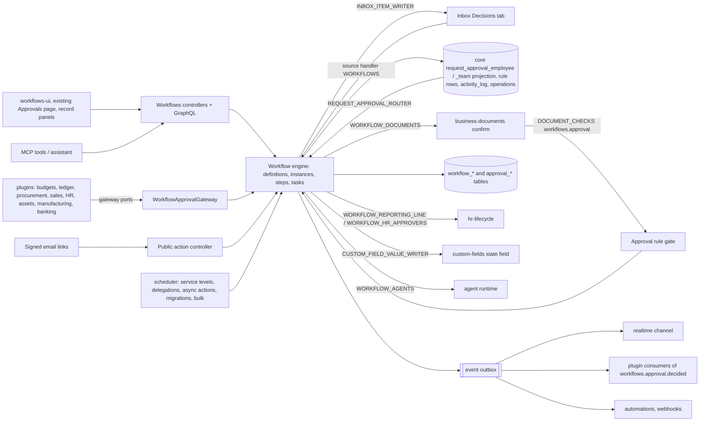

# Implementation Plan: Approval workflows

> Translates an approved `spec.md` into architecture and tech choices. The plan owns
> implementation details; the spec owns behaviour.

**Feature ID**: `approval-workflows`
**Spec**: `./spec.md`
**Tasks**: `./tasks.md`
**Status**: `Draft`
**Last updated**: 2026-11-23

---

## 1. Architecture Summary

A new plugin pair, `@gauzy/plugin-workflows` (`packages/plugins/workflows`) and `workflows-ui` (Angular), loaded by
`apps/api/src/plugins.ts` only when `GAUZY_WORKFLOWS_ENABLED` is exactly `true`, gated per tenant by
`FEATURE_WORKFLOWS`. The core approval kernel stays the
public face of approvals: `request_approval`, its slots, its routes, its GraphQL, the Approvals and Approval policies
pages. Core gains one optional port, `REQUEST_APPROVAL_ROUTER`, that `RequestApprovalService` calls when a request is
answered or settled elsewhere; unbound (plugin absent or flag off) nothing changes. Bound, the router hands governed
requests to the engine, which keeps the multi-step state in its own tables and settles the request row through a new
core method that runs today's settlement path (time off and equipment sharing move exactly as today). For a governed
request the engine keeps `request_approval_employee` and `request_approval_team` as the projection of the current
step's tasks, written in the same transaction as the tasks (one row per assignee, its status mirrored from the task),
and `request_approval.min_count` as the step's required count, so the existing Approvals page, its record view and
`request-approval-decision.ts` read the same approvers the engine holds; `workflow_task` stays the source (delegation,
channel, record version) and the two never diverge.

Every other plugin reaches the engine through the **approval gateway**: its own optional port (`BUDGET_APPROVALS`,
`LEDGER_APPROVALS`, `FIXED_ASSETS_APPROVALS`, `PURCHASING_WORKFLOW`, `DOCUMENT_APPROVALS`, the HR event approvals, …)
is bound in `apps/api/src/plugin-composition.ts` to `WorkflowApprovalGateway`, through a thin
adapter where the port's shape differs. Outcomes go out on the event outbox. The document engine's confirmation passes
through a `DOCUMENT_CHECKS` entry the plugin contributes, and the engine confirms documents through `WORKFLOW_DOCUMENTS`.



## 2. Tech Choices

| Concern | Choice | Rationale |
| ------- | ------ | --------- |
| Package | new `packages/plugins/workflows`, `-ui`; no React package (decisions on phones go through the installable Gauzy web app) | Principle I |
| Existing approvals | core `request-approval` kept; optional `REQUEST_APPROVAL_ROUTER`; new `RequestApprovalService.settleByWorkflow` | build on what exists, no parallel approval table for the classic types |
| Definition storage | versioned JSON document per version (`text`), validated by a schema in contracts | immutable versions, diffable, portable as a file |
| Conditions | rows of the core `rule` table with new `RuleOwnerType` values `WORKFLOW_START`, `WORKFLOW_TRANSITION`, `WORKFLOW_STEP`, `WORKFLOW_SKIP` (`ownerId` = the element's uuid in the version document; the definition file inlines them on export and import writes them back), evaluated by the isomorphic evaluator of `@gauzy/utils` (`custom-fields-and-forms`) plus formulas; no condition column on plugin tables | one condition store with pricing, ledger and field rules |
| Record access | core record type registry (`custom-fields-and-forms`), document engine snapshots for document types | any record type, no per-type code in the engine |
| Timers | `@ScheduledJob` + `@QueueWorker` (`@gauzy/scheduler`); in-process fallback under a database lock | task automations layout |
| Bulk and migration runs | core operations `WORKFLOW_BULK_DECIDE` and `WORKFLOW_MIGRATE` registered with `OperationRegistry`, per-task results through `api/bulk-executor.service.ts`, `@AcceptedOperation` `202` above 50 tasks | one runtime for bulk work |
| Reminders | reminder points of a task are rows of the generic reminder table of `automation-and-notifications` through the optional port `WORKFLOW_REMINDERS` (subject = the task, cancelled when it is decided); unbound, the service-level sweep sends them | one reminder table |
| Working calendar | `WORKFLOW_WORKING_CALENDAR` when bound; else the organization's `defaultStartTime`, `defaultEndTime`, `standardWorkHoursPerDay` and `startWeekOn` with the core `official_holiday` rows of its country (`OfficialHolidayService`) | the organization's own hours |
| Thresholds of sales orders | `approval_rule` reads, for `sales_order`, the buyer's `contact_buyer.approvalThreshold` (with its group, channel and organization fallbacks), `spendingLimit` and `periodSpendingLimit` (bases `BUYER_THRESHOLD`, `BUYER_SPENDING_LIMIT`, `BUYER_PERIOD_LIMIT`) and the order setting `order.requireApprovalAboveAmount` (`order.features.ts`) as the organization-level `TOTAL` rule, only when the organization setting `workflows.approvalRules.useOrderThresholds` (default `false`) is on; the spending limits keep their existing `BUYER_LIMIT_EXCEEDED` refusal either way; saved rules add to them, never copy them | one threshold model per B2B order; enabling the feature refuses nothing accepted today |
| Status models of tasks, deals and orders | lifecycle definitions are refused for `Task` (`task_status` per project or team), deals (`pipeline_stage`) and orders (`order-state-machine.ts`); their workflow state field shows the owner's status read-only; approval definitions still govern them | no second status model |
| Audit | definition, rule, limit and delegation changes are `activity_log` rows; `workflow_event` keeps the engine's per-instance step, task and decision events, a table of its own because each event carries a per-step structure (states, transition, step run, task, channel) that the instance history and its export read in instance order, while `activity_log` records field changes of a record | record timeline from the activity log |
| Agent approvers | an agent approver is an agent employee profile acting through `ai-agents-and-assistants` (`WORKFLOW_AGENTS`), recorded with `ActorTypeEnum.Agent`; no agent, run or budget table here | one agent identity |
| Delivery | event outbox and consumer registry; `INBOX_ITEM_WRITER`; inbox source handler | Principle VII; Decisions tab reused |
| Links | random 32-byte tokens, SHA-256 at rest, single use, generated, hashed and compared by the core helper `packages/core/src/lib/core/util/hashed-token.ts` of `automation-and-notifications` (its T58; `saved-report-token.ts` re-exports it); the public page follows the estimate answer page (`public-share/invoice`, `invoice/estimate-answer/`, `public-layout-ui`): same layout, rate limit and expiry handling | one token helper, one public decision pattern |
| Permissions | plugin permission contributions with `defaultFor` in `workflows.permissions.ts`; no seeding migration | grants declared once, not seeded |

## 3. Data Model

All tables extend `TenantOrganizationBaseEntity` (soft delete, `isActive`, `isArchived`); JSON is `text` on every
dialect; ids into other plugins carry no foreign key; money is `numeric(20,6)` with a currency.

### 3.1 New entities

| Table | Columns (besides base) | Indexes and uniqueness |
| --- | --- | --- |
| `workflow_definition` | `key` varchar(64), `name`, `description`, `kind` (`APPROVAL`, `LIFECYCLE`), `recordType` varchar(64) null, `requestType` varchar(64) null, `approvalPolicyId` null, `organizationIds` text, `priority` int, `templateKey` varchar(64), `isDefault` bool, `status` (`DRAFT`, `ACTIVE`, `RETIRED`), `activeVersionId`, `draftVersionId`, `activatedAt` | unique `(tenantId, key)`; index `(tenantId, recordType, status, priority)`, `(tenantId, requestType, status)` |
| `workflow_definition_version` | `definitionId` FK, `version` int, `document` text (states, transitions, steps with uuids, actions, timers, layout positions; conditions are core `rule` rows owned by those uuids), `checksum` varchar(64), `publishedAt`, `publishedByUserId`, `migration` text (state mapping, choice, counts) | unique `(definitionId, version)` |
| `workflow_instance` | `definitionId`, `versionId`, `recordType`, `recordId`, `requestApprovalId` null, `state` varchar(64), `status` (`RUNNING`, `COMPLETED`, `CANCELLED`, `FAILED`), `outcome` (`APPROVED`, `REJECTED`, `WITHDRAWN`, `DONE`, `OUTSIDE`) null, `source` (`GATEWAY`, `REQUEST`, `RECORD`, `ACTION`, `DOCUMENT_CHECK`), `sourceKey` varchar(160), `runningKey` varchar(200) null, `requestedByUserId`, `requestedForEmployeeIds` text, `amount`, `currency`, `organizationAmount`, `facts` text, `approvedSnapshot` text, `approvedAt`, `lapsesAt`, `flags` text, `version` int, `startedAt`, `completedAt` | unique `(tenantId, sourceKey)` (idempotency); unique `(tenantId, runningKey)` (`<definitionId>:<recordType>:<recordId>` while running, null after: one running instance on every dialect); index `(tenantId, recordType, recordId)`, `(organizationId, status, updatedAt)` |
| `workflow_step_run` | `instanceId` FK, `stateKey`, `stepKey`, `groupKey`, `run` int, `rule` (`ALL`, `ANY`, `N_OF_M`, `SHARE`), `required` int, `status` (`OPEN`, `APPROVED`, `REJECTED`, `RETURNED`, `SKIPPED`, `CANCELLED`), `resolution` text (approvers with the source that chose each), `dueAt`, `escalationLevel` int, `decidedAt` | index `(instanceId)`, `(tenantId, status, dueAt)` |
| `workflow_task` | `stepRunId` FK, `instanceId`, `assigneeKind` (`USER`, `AGENT`), `assigneeUserId`, `assigneeEmployeeId`, `originalAssigneeUserId`, `delegationId`, `status` (`OPEN`, `APPROVED`, `REJECTED`, `RETURNED`, `SKIPPED`, `CANCELLED`, `EXPIRED`), `decision` varchar(64), `decidedByUserId`, `decidedAt`, `comment` text, `channel` (`WEB`, `INBOX`, `EMAIL`, `CHAT`, `MOBILE`, `MCP`, `API`, `BULK`), `recordVersion` varchar(64), `factsShown` text, `isOverride` bool, `agentReasoning` text, `inboxItemId`, `dueAt`, `remindedAt`, `reminders` int | unique `(stepRunId, assigneeUserId)`; index `(tenantId, assigneeUserId, status, dueAt)` |
| `workflow_event` | `instanceId`, `type` varchar(32), `fromState`, `toState`, `transitionKey`, `stepRunId`, `taskId`, `actorUserId`, `actorType` (`ActorTypeEnum`), `channel`, `payload` text | append-only; index `(instanceId, createdAt)`, `(tenantId, type, createdAt)` |
| `workflow_delegation` | `fromUserId`, `toUserId`, `startsAt`, `endsAt`, `scope` text (definition ids, record types), `reason`, `source` (`MANUAL`, `TIME_OFF`), `sourceRef` | index `(tenantId, fromUserId, startsAt, endsAt)`; unique `(tenantId, source, sourceRef)` for time-off delegations |
| `workflow_action_token` | `taskId`, `decision`, `tokenHash` varchar(64), `recipientUserId`, `recordVersion`, `expiresAt`, `usedAt`, `channel` | unique `tokenHash`; index `(taskId)` |
| `approval_rule` | `recordType`, `basis` (`TOTAL`, `AVERAGE_DISCOUNT`, `MAX_LINE_DISCOUNT`, `ITEM_DISCOUNT`, `ITEM_GROUP_DISCOUNT`, `PARTY_TOTAL`, `FIELD`), `basisPath` varchar(128), `formula` text, `appliesToKind` (`EVERYONE`, `ROLE`, `USER`, `EMPLOYEE`, `POSITION`, `DEPARTMENT`), `appliesToId`, `itemId`, `itemGroupId`, `partyType`, `partyId`, `threshold`, `currency`, `action` (`REQUIRE_APPROVAL`, `REFUSE`), `approverKind`, `approverId`, `priority`, `ruleKey` varchar(255) | unique `(tenantId, ruleKey)` (organization and identifying columns: duplicate check on every dialect); index `(tenantId, recordType, isActive)` |
| `approval_limit` | `recordType`, `holderKind` (`ROLE`, `USER`, `EMPLOYEE`, `POSITION`), `holderId`, `limitAmount`, `currency` | unique `(tenantId, organizationId, recordType, holderKind, holderId)` |

### 3.2 Changed code (additive)

- `packages/contracts/src/lib/approval-policy.model.ts`: `ApprovalPolicyTypesStringEnum.WORKFLOW = 'WORKFLOW'` (requests
  the gateway files; `requestId` is the instance id). No column changes: `requestType` is a varchar.
- `packages/contracts/src/lib/request-approval.model.ts`: `IRequestApprovalRouter` and token `REQUEST_APPROVAL_ROUTER`:
  `route(request, verdict, actor, tx) → { handled, request? }`, `onSettledOutside(request, status, actor, tx)`.
- `packages/core/src/lib/request-approval/request-approval.service.ts`: `answer()` asks the bound router first;
  `updateStatusRequestApprovalByAdmin`, `updateStatusRequestApprovalByEmployeeOrTeam` and the time-off and
  equipment-sharing status handlers call `onSettledOutside`; new `settleByWorkflow(id, status, decidedByUserId)` runs the
  existing settlement (`settleLinkedDocument`) in a system context. Specs: the existing request-approval suites stay
  green unbound, plus router specs.
- `packages/core/src/lib/request-approval/request-approval-settler.registry.ts` (new, core, independent of this plugin
  and its flag): the **settler registry** `registerRequestApprovalSettler(type, settle)` with
  `settle(request, status, actor, tx)`, one settler per request type (a second registration fails at boot).
  `RequestApprovalStatusHandler.settleLinkedDocument` calls the registered settler on the answer's transaction for every
  type other than time off and equipment sharing, which keep their code paths; `settleByWorkflow` goes through the same
  call, so a decision from the Approvals page, a classic route or a completed instance settles the record once. Its
  decision gates stay in `linked-document-decision.gate.ts`. Plugins that file core request approvals of their own
  types register here (pay runs, hiring requests and offers, bonus proposals, timesheet portions, project budget
  versions, HR events, attendance, overtime and shift requests, expense claims and advances, business trips,
  compensatory time off, structure changes); none of them builds a registry of its own.
- `packages/contracts/src/lib/workflow.model.ts` (new): enums above, definition document schema, `IApprovalGateway`,
  `IWorkflowGate`, `IWorkflowStateReader`, events, errors; exported from `index.ts`.

### 3.3 Migrations

**Migration timestamps**: `packages/plugins/workflows` `1791000031100` to `1791000031199`.

In `packages/plugins/workflows/src/lib/database/migrations/` with the shared core migration helpers of `@gauzy/core`; PostgreSQL, SQLite and MySQL branches; idempotent, forward-only, registered for both ORMs:
`1791000031100-CreateWorkflowDefinitionTables`, `1791000031110-CreateWorkflowInstanceTables` (instance, step run, task,
event), `1791000031120-CreateWorkflowDelegationTables` (delegation, action token), `1791000031130-CreateApprovalRuleTables`
(rule, limit). Role grants come from the permission contributions' `defaultFor`. Default definitions are not
migrations: they are seeded per tenant, idempotently by `templateKey`, when the feature is first enabled and on tenant
creation.

### 3.4 Contracts

`packages/contracts/src/lib/workflow.model.ts` (new) and the additive `approval-policy.model.ts` and `request-approval.model.ts` changes listed in §3.2; they reach the SDKs through the OpenAPI document.

## 4. API Surface

| Method | Endpoint | Permission | Description | Status |
| ------ | -------- | ---------- | ----------- | ------ |
| `GET` | `/api/workflows/definitions[/:id]`, `/templates` | `WORKFLOWS_VIEW` | definitions with versions; templates | New |
| `POST` `PATCH` | `/api/workflows/definitions[/:id]` | `WORKFLOWS_MANAGE` | create, edit header | New |
| `POST` `PUT` | `/api/workflows/definitions/:id/versions[/:version]` | `WORKFLOWS_MANAGE` | new draft from published, edit draft | New |
| `POST` | `…/versions/:version/validate`, `GET …/versions/:version/migration-preview` | `WORKFLOWS_MANAGE` | problems; in-flight by state | New |
| `POST` | `…/versions/:version/publish`, `/definitions/:id/{activate,retire}` | `WORKFLOWS_PUBLISH` | publish with migration choice; overlap check | New |
| `POST` | `/api/workflows/simulate` | `WORKFLOWS_VIEW` | definition or active, record or sample, what-if values; writes nothing | New |
| `POST` | `/api/workflows/records/:recordType/:recordId/{submit,request-approval}` | edit of the record | start an instance (idempotency key) | New |
| `GET` | `/api/workflows/records/:recordType/:recordId` | view of the record | instance, state, available transitions, progress | New |
| `POST` | `/api/workflows/instances/:id/transitions/:key` | per transition | perform with inputs; `If-Match` record version | New |
| `GET` | `/api/workflows/instances[/:id[/history]]` | view of the record / `WORKFLOW_INSTANCES_ADMIN` | instances and history | New |
| `POST` | `/api/workflows/instances/:id/{withdraw,comment,cancel}` | requester / participant / `WORKFLOW_INSTANCES_ADMIN` | | New |
| `GET` | `/api/workflows/tasks`, `/tasks/counts` | the caller (admin: all) | queue of the Approvals page tabs with filters, cursor | New |
| `POST` | `/api/workflows/tasks/:id/decide` | assignee or delegate; override needs admin | `{ decision, comment, recordVersion, preview }` | New |
| `POST` | `/api/workflows/tasks/decide-bulk` | per task | ≤ 500, per-task results; above 50 `202` with the core operation handle | New |
| `POST` | `/api/workflows/tasks/:id/reassign`, `/tasks/reassign-bulk` | `WORKFLOW_INSTANCES_ADMIN` | with reason | New |
| `GET` `POST` `PATCH` `DELETE` | `/api/workflows/delegations[/:id]` | own; others `WORKFLOW_DELEGATIONS_MANAGE` | | New |
| `GET` `POST` `PATCH` `DELETE` | `/api/approval-rules[/:id]`, `/api/approval-limits[/:id]` | `APPROVAL_RULES_MANAGE` | | New |
| `GET` | `/api/approval-rules/matrix`, `POST /api/approval-rules/check` | `WORKFLOWS_VIEW` / edit of the record | authority matrix; required approvals for a record | New |
| `GET` `POST` | `/api/workflows/actions/:token` | public, token, rate-limited 10/min per token | summary; decide with comment | New |
| `GET` | `/api/workflows/reports/{cycle-time,pending,service-levels,decisions,load,rejections,authority}` | `WORKFLOW_REPORTS_VIEW` | FR-67 datasets, registered in the core reports catalogue in a category keyed `FEATURE_WORKFLOWS` (shared catalogue feature filter of `report-builder-and-dashboards`) | New |
| `*` | `/api/request-approval/*`, `/api/approval-policy/*` | unchanged | routed through the engine when governed | Unchanged contract |

Every new route carries `@FeatureFlag(FEATURE_WORKFLOWS)`, class-validator DTOs and Swagger decorators, and every new
route except `/api/workflows/actions/:token` carries `TenantPermissionGuard`. The action route is marked `@Public()`
(a recipient follows the emailed link without a session): it validates its token first, takes the tenant, task and
assignee from the token row, checks `FEATURE_WORKFLOWS` for that tenant, and decides as that assignee. Errors: `WORKFLOW_APPROVAL_REQUIRED` (422 finding), `WORKFLOW_NOT_ASSIGNEE` (403), `WORKFLOW_SELF_APPROVAL`
(403), `WORKFLOW_RECORD_LOCKED` (403), `WORKFLOW_TRANSITIONS_ONLY` (409), `WORKFLOW_ALREADY_DECIDED` (409),
`WORKFLOW_RECORD_CHANGED` (409), `WORKFLOW_VERSION_PUBLISHED`, `WORKFLOW_DEFINITION_OVERLAP`, `WORKFLOW_INVALID`
(with problems), `APPROVAL_RULE_DUPLICATE`, `WORKFLOW_LINK_INVALID`. GraphQL: `workflowDefinitions`, `workflowInstance`
(record), `myWorkflowTasks`, mutations `decideWorkflowTask`, `performWorkflowTransition`.

### 4.1 Contract for other plugins (the approval gateway)

```ts
interface IApprovalGateway {                                   // bound to WorkflowApprovalGateway
    requestApproval(input: {
        recordType: string; recordId: ID; organizationId: ID; title: string;
        amount?: DecimalString; currency?: CurrencyCode; facts?: { label: string; value: string }[]; summary?: string;
        requestedByUserId?: ID; requestedForEmployeeIds?: ID[]; definitionKey?: string; kind?: string;
        idempotencyKey: string;                                // same key → same instance
    }): Promise<IApprovalHandle>;                              // never auto-approves
    status(ref: { recordType: string; recordId: ID }): Promise<IApprovalHandle | null>;
    withdraw(ref: { recordType: string; recordId: ID }, reason: string): Promise<void>;
    invalidate(ref: { recordType: string; recordId: ID }, reason: string): Promise<IApprovalHandle | null>;
}
interface IApprovalHandle {
    instanceId: ID; approvalId: ID;                            // approvalId = request_approval row (type WORKFLOW)
    state: 'PENDING' | 'APPROVED' | 'REJECTED' | 'WITHDRAWN';
    approvers: { userId: ID; name: string; stepKey: string }[]; dueAt?: string;
}
interface IWorkflowGate {                                      // contributed to DOCUMENT_CHECKS as 'workflows.approval'
    check(m: Manager, ref: { recordType: string; recordId: ID }, action: 'CONFIRM' | 'CANCEL' | 'SUBMIT',
          snapshot: object, actor: { userId: ID; type: ActorTypeEnum }): Promise<IDocumentFinding[]>;
}
```

The outcome event `workflows.approval.decided` (outbox, partition `workflow:<recordType>:<recordId>`) carries
`{ instanceId, approvalId, recordType, recordId, outcome, decidedByUserId, decidedAt, comment, idempotencyKey }`;
consumers filter by `recordType` (for example `accounting.budget_version`, `business_document.change_set`). Bindings
in `plugin-composition.ts`: `BUDGET_APPROVALS`, `LEDGER_APPROVALS`, `FIXED_ASSETS_APPROVALS`, `PURCHASING_WORKFLOW`,
`DOCUMENT_APPROVALS` and the HR event approvals → the gateway (adapters where shapes differ); `PURCHASING_APPROVAL` and
`ORDER_APPROVAL` keep their core adapters, whose requests the router governs, and so do the core request approvals that
plugins file with their own types and settlers (for example manufacturing's `STRUCTURE_CHANGE`, payroll's `PAY_RUN`). Approvals that decide outside `request_approval` today keep their own
statuses, routes and permissions and change nothing by default: timesheets (`timesheet-update-status.handler.ts`),
timesheet project change requests, payroll runs (`payroll-run`, `PENDING_APPROVAL`), docs review
(`document-review.service.ts`), team join requests and adjustments with `adjustment_reason.requiresApproval`; each can
become a gateway user through its own port when its spec binds one. The MCP tools `approve_time_off_request` and
`deny_time_off_request` (`tools/time-off.ts`) keep deciding through the classic routes, which the router governs when
bound; `workflows_decide` is documented beside them. `IWorkflowStateReader.stateOf(recordType, ids)` serves record views and
reports. Plugins ship their own default definitions (for example banking's second-person approval of changed bank
details) with `registerWorkflowTemplates([...])`, seeded per tenant like the platform's and editable afterwards.

**Ports consumed** (optional, unbound → the capability is absent): `WORKFLOW_DOCUMENTS` (`BusinessDocumentEngine`:
snapshot, confirm, cancel), `WORKFLOW_REPORTING_LINE` (`IHrReportingLine`; fallback: managers of the requester's
teams), `WORKFLOW_HR_APPROVERS` (`IHrApproverResolver`), `WORKFLOW_WORKING_CALENDAR` (working days and holidays;
fallback the organization's default start and end times, work hours and week start with the official holidays of its
country), `WORKFLOW_REMINDERS` (the generic reminder table), `WORKFLOW_AGENTS` (decide within limits, advise), `WORKFLOW_CHAT` (post a card; used only for tenants with `FEATURE_CHAT_RECORD_CARDS` on), `WORKFLOW_FLOWS` (automation flows), `WORKFLOW_WEBHOOKS` (integration hub),
`CUSTOM_FIELD_VALUE_WRITER` and `CUSTOM_FIELD_METADATA` (state field, transition forms).

**Consumer tokens answered** (bound in `apps/api/src/plugin-composition.ts` to `WorkflowApprovalGateway` (request, status, withdraw) and the workflow state reader; each consumer plan states the shape it calls and its fallback): `ACCESS_APPROVALS`, `APPROVAL_REQUESTS`, `ATTENDANCE_APPROVALS`, `AUTOMATION_APPROVALS`, `EXPENSE_APPROVALS`, `HELPDESK_APPROVALS`, `HR_APPROVALS`, `MARKETING_APPROVALS`, `PAYROLL_APPROVALS`, `PERFORMANCE_APPROVALS`, `PORTAL_APPROVALS`, `PROJECT_APPROVALS`, `RECRUITMENT_APPROVALS`, `SHIFTS_APPROVALS`, `CUSTOM_FIELDS_WORKFLOW`, `RECORD_VIEWS_WORKFLOW_STATE`.

## 5. Events, Real-Time and Notifications

| Event | Emitted when | Consumers |
| ----- | ------------ | --------- |
| `workflows.instance.started` / `.transitioned` / `.completed` / `.cancelled` / `.migrated` | instance changes | realtime `record:<type>:<id>`, automations, webhooks, state field writer |
| `workflows.task.created` / `.decided` / `.delegated` / `.reminded` / `.escalated` / `.reassigned` | task changes | Inbox items, email and push, realtime `workflows:<userId>` counts |
| `workflows.approval.decided` | an instance's final approval outcome | the plugin that asked (gateway), core settlement for classic requests |
| `workflows.definition.published` / `.activated` / `.retired` | definition lifecycle | audit, realtime hint to designers |
| In: `document.<type>.*`, `custom_fields.values.changed`, `custom_record.<type>.*`, record entity changes | records change | `subscriber:workflows-records`: start lifecycle instances, invalidate approvals, cancel on delete |
| In: time-off status changes, employee end of work | people facts | delegation sweep, reassignment to fallback |

Inbox items: kind `APPROVAL`, source `WORKFLOWS` (registered with `INBOX_SOURCE_HANDLER_REGISTRY`; `onReply` decides the
task), `externalSource` `workflow-task`, `externalId` the task id, options = allowed decisions, `requireReason` from the
step, `dueAt`, `entity` / `entityId` the record, the facts and adviser summary in the Markdown body; other recipients'
items close when a step is decided. Emails use the email-template system (`workflow-task`, `workflow-reminder`,
`workflow-outcome`) in the recipient's language.

## 6. UI Surface

- **Angular `packages/plugins/workflows-ui`** (lazy, `@gauzy/plugin-ui`): Settings → Workflows
  `/pages/settings/workflows` (list, templates), designer `/pages/settings/workflows/:id` (canvas, keyboard list
  editor, properties panel, simulation pane with what-if, versions and migration dialog); `/pages/settings/approval-rules`
  (rules, limits, authority matrix); `/pages/workflows/delegations`; public page `/workflow-action/:token` through
  `public-layout-ui`, built like the estimate answer page. The queue is the existing Approvals page
  (`apps/gauzy/src/app/pages/approvals`), which keeps its existing list, filters and actions as they are and gains the
  tabs "My tasks", "Delegated", "My requests" and "All" (admins) with bulk decide beside them; there is no second
  approvals list besides the Inbox. Reports appear in the Reports menu through the
  core reports catalogue for tenants with the feature on (shared catalogue feature filter).
- **Embeddables `packages/ui-core/shared/src/lib/workflows/`**: `ngx-workflow-panel` (badge, transition buttons,
  progress, history) and `ngx-approval-card` (facts, summary, decisions), placed on record pages, on the existing
  Approvals page (`apps/gauzy/src/app/pages/approvals`, progress of governed requests) and on the approval policy page
  (bound definition); hidden when the routes answer 404.
- **Phones**: the Approvals page tabs and `ngx-approval-card` render at phone width in the installable Gauzy web app,
  with an offline decision queue re-validated on sync.
- i18n keys `WORKFLOWS.*` in every locale of `packages/ui-core/i18n`; state and transition labels from definitions.

## 7. MCP Tools, SDKs and Integrations

New file `packages/mcp-server/src/lib/tools/workflows.ts`, registered in `register-all-tools.ts`:

| Tool | Input | Output |
| --- | --- | --- |
| `workflows_my_tasks` | filters | open tasks with facts |
| `workflows_decide` / `workflows_bulk_decide` | task(s), decision, comment, `preview` (default true) | outcome or preview |
| `workflows_request_approval` | record type, id, title, facts | handle |
| `workflows_record_status` / `workflows_instance_history` | record / instance | state, progress / history |
| `workflows_simulate` | definition, record or values | path with approvers |
| `workflows_delegate` | delegate, period, scope | delegation |
| `workflows_draft_definition` | sentence, record type | draft definition with validation (never published) |
| `approval_rules_check` | record | required approvals and who may approve |

OpenAPI additive; SDKs regenerated after merge. Definitions export and import as files (FR-55). Webhooks receive the
events above through the integration hub.

## 8. Background Jobs

| Trigger | When | What it does | Idempotency |
| ------- | ---- | ------------ | ----------- |
| `workflows.service-levels.sweep` (queue `workflows-maintenance`) | every 5 minutes | reminders, escalations, lapses, auto-decisions where allowed | per task and point; per step run and level |
| `workflows.delegations.sweep` | hourly and on time-off events | starts and ends time-off delegations, moves open tasks | unique `(source, sourceRef)` |
| `workflows.async-actions` | after a transition commits | flows, webhooks, notices, chat posts; retries with backoff | per instance event and action |
| core operations `WORKFLOW_BULK_DECIDE`, `WORKFLOW_MIGRATE` | above 50 tasks; on publication | decides per task through `BulkExecutor`; moves in-flight instances in steps of 200; lease, retry and cancel from the runtime | per task; per instance and version |
| outbox consumers `subscriber:workflows-records`, `subscriber:workflows-agents` | record and task events | starts, invalidations, cancellations; agent decisions and adviser summaries | delivery record; `sourceKey` |

Schedules in a `WorkflowsSchedulePlugin` loaded by `apps/worker/src/plugins.ts`; queue jobs run in the API; without a
queue root the API runs them on in-process timers under a database lock (task automations layout).

## 9. Security & Permissions

`workflows.permissions.ts`: `WORKFLOWS_VIEW`, `WORKFLOWS_MANAGE`, `WORKFLOWS_PUBLISH`, `APPROVAL_RULES_MANAGE`,
`WORKFLOW_DELEGATIONS_MANAGE`, `WORKFLOW_INSTANCES_ADMIN`, `WORKFLOW_REPORTS_VIEW` (contributions with `defaultFor`):
all to `SUPER_ADMIN` and `ADMIN`; `WORKFLOWS_VIEW` and `WORKFLOW_REPORTS_VIEW` to `MANAGER`. Deciding needs no permission: it needs an open
task assigned to the caller or delegated to them, and the self-approval and segregation checks of `decision-policy.ts`
(pure, unit-tested on plain objects like `request-approval-decision.ts`). Approvers read the facts the definition
exposes; the full record needs its own view permission. Action tokens: 32 random bytes, SHA-256 stored, single use,
bound to task, decision and record version, expiry 72 hours, rate-limited; the public page shows title, amount and
facts only. Agents decide only within stored limits, in a system context marked `Agent`, never on records they created.
Definition files are schema-validated; formulas run in the `@gauzy/utils` evaluator with its step budget.

## 10. Observability

`workflow_event` per instance; `activity_log` entries for definitions, rules, limits and delegations; bulk and
migration runs in the core operations list; metrics: open tasks,
decision latency, overdue tasks, escalations, failed after-commit actions, sweep duration; logs for refused links.

## 11. Phased Rollout

1. **Phase 1 — Engine and surface what exists** (flag off): contracts, router port in core, plugin, tables, default
   definitions reproducing today's approvals, engine with sequential steps from the request's approvers, Inbox items,
   approvals queue, progress on the existing Approvals page, the gateway with its event, MCP task tools, history.
2. **Phase 2 — Depth**: designer, conditions, every approver source, parallel and N-of-M steps, transition actions,
   lifecycle definitions with state field and edit locks, document engine coupling and gate, approval rules and limits,
   signed email links, bulk decisions, delegation, reminders, escalation, reports.
3. **Phase 3 — Advanced capabilities**: simulation with what-if, versions with in-flight migration, automatic delegation from
   time off, agent approver and adviser, chat cards, segregation of duties, re-approval and lapse, working-hour timers
   with automatic actions, one-tap and offline decisions on phones in the installable web app.
4. **Phase 4 — General availability**: the feature is off by default; after the trial period it may be switched on by default for new tenants only; existing tenants keep their setting until an administrator changes it.

## 12. Constitution Reconciliation

- I Plugin-first: plugin pair; core gets one optional port, one enum value, one settlement method, new rule owner types
  and the settler registry; it uses the core hashed-token helper.
- II Tenant/organization scoping: every table on the tenant-organization base; definitions for all organizations carry
  an allow-list; the public action route resolves the tenant from the token's task.
- III Both ORMs, additive migrations: four plugin migrations on three dialects; running-instance uniqueness through a
  nullable unique key on every dialect.
- IV Default-off flag; nothing removed: deploy switch and tenant feature; default definitions keep today's behaviour;
  existing routes and pages unchanged.
- V Contracts and API first: gateway, events and routes in contracts before the UI; OpenAPI and SDKs.
- VI Permissions, privacy, security: seven permissions, assignment-based decisions, segregation, signed links, audit.
- VII Real-time through the event bus: outbox events, realtime channel, Inbox items; no private channel.
- VIII i18n and accessibility: labels per language, keyboard designer, labelled decision controls, localized emails.
- IX Tests: engine units, contract suite for existing approvals, dialect, e2e and UI specs.
- X Behaviour-first spec: implementation stays in this plan.
- XI Documentation describes our platform only.

## 13. Risks & Mitigations

| Risk | Likelihood | Impact | Mitigation |
| ---- | ---------- | ------ | ---------- |
| Existing approvals change behaviour | Low | High | router unbound by default; default definitions; contract test suite over every request-approval route and page |
| Double decision paths disagree (classic route and engine) | Medium | High | one transaction: router decides under the request's row lock; `settleByWorkflow` reuses the settlement code |
| Stuck instances (no approver, lost timers) | Medium | Medium | fallback approvers, flags, sweep catch-up after downtime, admin reassign |
| Version migration moves records wrongly | Low | High | preview counts, explicit mapping, default "keep on version", history per instance |
| Signed links forwarded or leaked | Medium | Medium | single use, short expiry, bound to record version, tenant can require sign-in |
| Agent over-approves | Low | High | stored limits checked by the engine, not the agent; hand-over to humans; review list |
| Load from sweeps on large tenants | Medium | Medium | due-time index, batch sizes, per-tenant concurrency of one |

## 14. References

- Spec: `./spec.md` · Tasks: `./tasks.md` · Related: `../business-document-engine/plan.md`,
  `../custom-fields-and-forms/plan.md`, `../hr-core-lifecycle/plan.md`, `../procurement/plan.md`
- Code: `packages/core/src/lib/request-approval/` (`request-approval-decision.ts`, `linked-document-decision.gate.ts`,
  `commands/handlers/request-approval.status.handler.ts`), `packages/core/src/lib/approval-policy/`,
  `packages/contracts/src/lib/inbox.model.ts`, `packages/plugins/purchasing/src/lib/purchase-approval/`,
  `packages/plugins/order/src/lib/order-approval/`, `order.features.ts`, `packages/core/src/lib/contact-buyer/`,
  `packages/core/src/lib/saved-report/saved-report-token.ts`, `packages/core/src/lib/invoice/estimate-answer/`,
  `packages/core/src/lib/official-holiday/`, `packages/core/src/lib/tasks/statuses/`, `apps/gauzy/src/app/pages/approvals/`,
  `apps/api/src/plugin-composition.ts`
