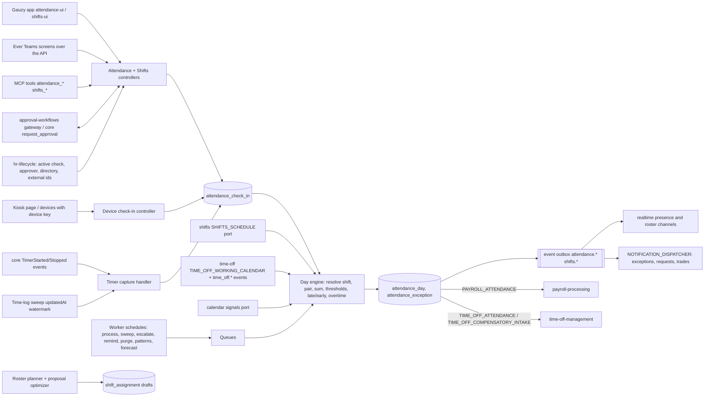

# Implementation Plan: Attendance and shifts

> Translates an approved `spec.md` into architecture and tech choices. The plan owns
> implementation details; the spec owns behaviour.

**Feature ID**: `attendance-and-shifts`
**Spec**: `./spec.md`
**Tasks**: `./tasks.md`
**Status**: `Draft`
**Last updated**: 2026-11-23

---

## 1. Architecture Summary

Two new plugin pairs, each switched on per tenant and each usable alone:

- `@gauzy/plugin-attendance` (`packages/plugins/attendance`, `attendance-ui`), tenant feature
  `FEATURE_ATTENDANCE`: work locations, devices, check-ins, attendance days, exceptions, requests and
  corrections, overtime types, requests and statements, presence, reports, the kiosk page.
- `@gauzy/plugin-shifts` (`packages/plugins/shifts`, `shifts-ui`), tenant feature `FEATURE_SHIFTS`:
  templates (versioned), patterns, assignments, shift requests, open shifts and trades, working-time rules, coverage
  targets, demand forecast, roster proposals, roster planner.

Ever Teams shows check-in, attendance and shifts on phones and desktops in its own screens (the Ever Teams spec `people-self-service`)
over this API, which is their contract; no React package is shipped for it.

Core is not changed beyond additive enum values (an address owner type, approval types). The timer's existing CQRS
events (`TimerStartedEvent`, `TimerStoppedEvent`) are read by a handler in the attendance plugin, and other time-log
changes are followed by a sweep over `time_log.updatedAt`. The two plugins talk only through ports declared in
`@gauzy/contracts` and bound in `apps/api/src/plugin-composition.ts`; unbound, each falls back as stated in §7.

**Built on what exists.** A work location's postal address and coordinates are a core `address` row (owner type
`WORK_LOCATION`). Badge numbers are `hr-core-lifecycle` external identifiers of system `BADGE` (hashed there). The
expected day without a shift and the full-day threshold default from `organization.standardWorkHoursPerDay`, and a
weekly-hours rule without a value uses `employee.reWeeklyLimit`, so the limit reports and attendance agree on a day's
and a week's length. Breaks reuse the timer's `TimeLogType.BREAK` logs and `time-log/break-rules.ts`. Availability on the
roster and in proposals is read from core `employee_availability` and `availability_slots`. Raw-coordinate reads are
audit events of `access-control-and-security` (`AUDIT_EVENT_SINK`) and the coordinate fields carry `@VisibleWith`.
Settings are in the platform settings store, permissions are plugin contributions, notices de-duplicate through the
notification dispatcher, approvals fall back to core `request_approval` on the existing Approvals page, runs and the
time-log watermark are core `job_execution` / `operation` rows, change history is `activity_log`, and shift feeds are
the personal calendar feeds of `calendar-and-scheduling`. Coverage targets are the one minimum-staffing model when
shifts is on (time off reads them), and approved overtime taken as time off credits compensatory time when attendance
is on, beside the existing compensatory time-off policies (`LeaveTypeEnum.COMPENSATORY` with their accrual), which
keep crediting as today. The presence board shows the existing timer states (`isTrackingTime`, `isAway`, `lastSeenAt`,
`GET /employee/working` unchanged) beside check-in states; the desktop clients' `time_slot.location` is not read.

## 2. Tech Choices

| Concern | Choice | Rationale |
| ------- | ------ | --------- |
| Packages | new `packages/plugins/attendance`, `attendance-ui`, `shifts`, `shifts-ui`; Ever Teams uses the API | Principle I; [platform architecture](../../architecture/business-suite.md) §2.5 names both plugins |
| Flags | tenant features `FEATURE_ATTENDANCE` (`attendance.features.ts`), `FEATURE_SHIFTS` (`shifts.features.ts`), `defaultEnabled: false`; `FEATURE_TEAMS_PEOPLE_SELF_SERVICE` (`attendance.features.ts`, `defaultEnabled: false`) is the tenant switch the Ever Teams time, attendance and leave screens read from `GET /user/me` and gates no route of these plugins; `@FeatureFlag` + `FeatureFlagGuard` on every controller and resolver; menus read the same codes | default off, pattern of `subscription.features.ts` |
| Permissions | contributions `attendance.permissions.ts`, `shifts.permissions.ts` with `defaultFor` | pattern of `subscription.permissions.ts`; no seed migration |
| Settings | `attendance.settings.ts`, `shifts.settings.ts` setting contributions in `tenant_setting` at `ORGANIZATION` scope (the organization level of `organization-setup`); branch overrides are one `attendance.branchOverrides` value (branch id → overridden keys) | no settings table |
| Runs | scheduled passes are core `job_execution` rows; on-demand processing, roster proposals and demand forecasts are core operations (`ATTENDANCE_PROCESS`, `SHIFTS_ROSTER_PROPOSAL`, `SHIFTS_DEMAND_FORECAST`) with progress; the plugins keep only their results keyed by `operationId` | one run ledger |
| Notices | `NOTIFICATION_DISPATCHER.notify({ …, dedupeKey })` (keys `attendance:reminder:<employee>:<assignment>:<date>:<kind>`, `…:exception:<exceptionKey>:<stage>`); without `automation-and-notifications`, `INBOX_ITEM_WRITER` with the key as `externalId` | no notice store |
| Persistence | MultiORM entities on `TenantOrganizationBaseEntity`; the shared core migration helpers of `@gauzy/core`; tri-dialect migrations; JSON as `text` | Principle III |
| Day engine | pure functions in `attendance/src/lib/engine/` (pairing, summing, thresholds, lateness, overtime split, night minutes, merge of intervals), golden-case tested; breaks: recorded breaks (timer `BREAK` logs as judged by `break-rules.ts`, break check-ins) count first, and a template's unpaid break is deducted only for the part no recorded break covers | one rule set for jobs, previews and MCP |
| Timer capture | CQRS `@EventsHandler(TimerStartedEvent, TimerStoppedEvent)` + sweep of `time_log` by `updatedAt` (with deleted rows); the sweep's watermark is the start of the organization's last succeeded `job_execution` of the sweep (5-minute overlap, harmless through `sourceKey`) | no core change; manual edits and offline uploads covered |
| Events | `EventOutboxService.append` in the writing transaction; consumers `subscriber:attendance`, `subscriber:shifts` in `EventConsumerRegistry` | at-least-once, deduplicated |
| Background work | `@ScheduledJob` + `@QueueWorker` (`@gauzy/scheduler`); schedule-only plugins in the worker; in-process timers without a queue root; advisory lock per organization and job (Postgres advisory, MySQL `GET_LOCK`, in-process on SQLite) | pattern of `task-automations` |
| Push | realtime plugin channels | Principle VII |
| Device and kiosk secrets | 32 random bytes, stored as SHA-256 hash + last 4; PINs with the platform password hasher | Principle VI |
| Location | distance computed on receipt (haversine) against the location's `address` row coordinates, coordinates dropped unless kept by setting; raw fields `@VisibleWith(ATTENDANCE_LOCATION_VIEW)`, each raw read one `AUDIT_EVENT_SINK` event, and no raw read at all while no audit sink is bound (§7, ports); purge job | spec FR-49 |
| Optimizer | deterministic greedy fill + bounded local search (swap moves) with a fixed seed per request; explanations built from the constraint ledger of each placement | reproducible, testable, explainable |
| Reports | report definitions registered with `report-builder-and-dashboards` over `attendance_day`, `overtime_statement_line`, `shift_assignment`, `coverage_target` | no hand-built report pages |

## 3. Data Model

All tables extend `TenantOrganizationBaseEntity` (tenant, organization, timestamps, soft delete). References into
other plugins or core employee carry no foreign key across plugins (`employeeId` keeps the core FK). Minutes are `int`,
amounts `numeric(20,6)`, rates `numeric(8,4)`, coordinates `numeric(10,7)`.

### Attendance plugin

| Table | Columns (type) | Indexes and uniqueness |
| --- | --- | --- |
| `work_location` | `name`, `branchId` uuid null, `radiusMeters` int, `networks` text, `timeZone` varchar(64), `isActive`; postal address and coordinates in a core `address` row (owner type `WORK_LOCATION`) | idx `(organizationId, branchId)` |
| `employee_attendance_profile` | `employeeId` fk unique, `defaultLocationId`, `pinHash` varchar(255), `pinFailures` int, `pinLockedUntil`, `phoneCodeSecret` text (encrypted), `channels` text null (badges are `hr-core-lifecycle` external ids of system `BADGE`) | — |
| `attendance_device` | `name`, `kind` varchar(12) (`KIOSK`/`TERMINAL`/`INTEGRATION`), `locationId`, `secretHash` varchar(64), `secretLast4`, `lastSeenAt`, `completeThrough` timestamp, `clockOffsetMs` int, `revokedAt` | unique `(secretHash)`; idx `(organizationId, locationId)` |
| `attendance_check_in` | `employeeId` fk, `occurredAt` timestamp (UTC), `clientTime`, `receivedAt`, `localDate` date, `direction` varchar(12) (`IN`/`OUT`/`BREAK_START`/`BREAK_END`/`UNSPECIFIED`), `resolvedDirection`, `channel` varchar(12) (`WEB`/`PHONE`/`KIOSK`/`DEVICE`/`TIMER`/`IMPORT`/`CORRECTION`/`CALENDAR`), `deviceId`, `timeLogId`, `locationId`, `distanceMeters` int, `inside` bool, `latitude`/`longitude`/`accuracyMeters` null, `networkMatch` bool, `shiftAssignmentId`, `offShift` bool, `excluded` bool, `notes` text (JSON reasons), `attendanceDayId`, `state` varchar(8) (`ACTIVE`/`VOID`), `clockSkewMs` int, `dedupeKey` varchar(120), `clientKey` varchar(160) null, `sourceKey` varchar(120) null | unique `(tenantId, dedupeKey)` (`<employee>:<epochSecond>:<direction>` while active); unique `(tenantId, clientKey)`; unique `(tenantId, sourceKey)` (`timer:<timeLogId>:<IN\|OUT>`); idx `(organizationId, employeeId, occurredAt)`, `(organizationId, localDate)`, `(attendanceDayId)` |
| `attendance_day` | `employeeId` fk, `date` date, `shiftAssignmentId` null, `shiftTemplateVersionId` null, `dayKey` varchar(120) (`<employee>:<date>:<assignment or ->`), `locationId`, `dayKind` varchar(12), `firstHalf`, `secondHalf` varchar(12) (`PRESENT`/`ABSENT`/`TIME_OFF`/`HOLIDAY`/`REST_DAY`/`PENDING`), `workMode` varchar(8) (`ON_SITE`/`REMOTE`/`OFF_SITE`), `firstIn`, `lastOut`, `workedMinutes`, `breakMinutes`, `expectedMinutes`, `lateMinutes`, `earlyMinutes`, `overtimeMinutes`, `nightMinutes` int, `holidayWork` bool, `sources` text, `origin` varchar(8) (`AUTO`/`MANUAL`/`REQUEST`), `overridden` bool, `state` varchar(8) (`PENDING`/`FINAL`/`LOCKED`/`VOID`), `timeOffRequestIds` text, `attendanceRequestId`, `lockRef` varchar(80), `computedAt`, `version` int | unique `(tenantId, dayKey)` while not void; idx `(organizationId, date, state)`, `(employeeId, date)` |
| `attendance_exception` | `employeeId`, `dayId`, `kind` varchar(32), `facts`, `proposal` text, `state` varchar(16) (`OPEN`/`RESOLVED`/`DISMISSED`/`AUTO_ACCEPTED`/`AUTO_CLOSED`), `stage` varchar(10) (`EMPLOYEE`/`APPROVER`), `escalateAt`, `resolvedById`, `resolution` varchar(24), `inboxRef`, `exceptionKey` varchar(160) | unique `(tenantId, exceptionKey)`; idx `(organizationId, state, kind)`, `(employeeId, state)` |
| `attendance_request` | `number`, `employeeId`, `kind` varchar(12) (`REMOTE`/`OFF_SITE`/`CORRECTION`), `fromDate`, `toDate`, `halfDate`, `halfPortion` varchar(12), `shiftTemplateId`, `includeHolidays` bool, `reason`, `corrections` text, `fileIds` text, `state` varchar(12) (`DRAFT`/`PENDING`/`APPROVED`/`REJECTED`/`CANCELLED`), `approverEmployeeId`, `approvalRef` (workflow instance or core `request_approval`), `decidedById`, `decidedAt`, `filedById`, `version` | unique `(organizationId, number)`; idx `(employeeId, fromDate, toDate)` |
| `overtime_type` | `name`, `code`, `multiplierWorkday`, `multiplierRestDay`, `multiplierHoliday`, `multiplierNight`, `dailyMaxMinutes`, `weeklyMaxMinutes`, `rateBasis` varchar(16) (`PAY_ELEMENT`/`EMPLOYEE_RATE`/`FIXED`), `payElementId`, `fixedRate`, `currency` char(3), `requiresPreApproval`, `allowsTimeOff`, `isDefault` | unique `(organizationId, code)` |
| `overtime_request` | `employeeId`, `date`, `minutes`, `reason`, `projectId`, `taskId`, `state`, `approvalRef`, `approvedMinutes`, `usedMinutes`, `version` | idx `(employeeId, date)` |
| `overtime_statement` | `number`, `employeeId`, `payPeriodRef`, `periodStart`, `periodEnd`, `kind` (`REGULAR`/`CORRECTION`), `correctsId`, `state` (`DRAFT`/`SUBMITTED`/`APPROVED`/`HANDED_OFF`/`PAID`/`CANCELLED`), `estimatedAmount`, `currency`, `approvalRef`, `liveKey` varchar(120) null, `version` | unique `(organizationId, number)`; unique `(tenantId, liveKey)` (`<employee>:<periodStart>` while regular and not cancelled) |
| `overtime_statement_line` | `statementId` fk cascade, `dayId`, `date`, `overtimeTypeId`, `dayKind`, `minutes`, `cappedMinutes`, `multiplier`, `projectId`, `projectKey` varchar(36) not null (the `projectId`, or `*` without a project), `settlement` (`PAY`/`TIME_OFF`), `estimatedAmount`, `factKey` varchar(120), `payslipRef`, `compensatoryRef` (the time-off claim day it credited; the time-off lines of one work day credit one claim day together) | unique `(tenantId, factKey)`; unique `(statementId, date, overtimeTypeId, dayKind, multiplier, projectKey)` |

Day changes (who, when, cause, before, after, reason) are core `activity_log` rows (entity `AttendanceDay`,
`data.cause`), read by the day's history; raw coordinates on `attendance_check_in` carry
`@VisibleWith(ATTENDANCE_LOCATION_VIEW)`.

Settings (`attendance.settings.ts`, `ORGANIZATION` scope, `attendance.branchOverrides` for branches):
`attendance.sources`, `.manualTimeMode`, `.dayBoundaryHour`, `.defaultStart` / `.defaultEnd` /
`.defaultBreakMinutes`, `.fullDayMinutes` (unset = `organization.standardWorkHoursPerDay` × 60, followed when it
changes), `.halfDayMinutes` (unset = half of the full day), `.absentDelayDays`, `.channels`, `.locationMode`
(`OFF`/`FLAG`/`REFUSE`), `.keepCoordinates`, `.coordinateRetentionDays`, `.deviceMaxWaitMinutes`,
`.offlineMaxAgeDays`, `.conflictToleranceMinutes`, `.exceptionRules`, `.escalationHours`, `.presenceVisibility`,
`.reminderMinutes`, `.allowSeveralShiftsPerDay`.

### Shifts plugin

| Table | Columns (type) | Indexes and uniqueness |
| --- | --- | --- |
| `shift_template` | `name`, `code`, `color` varchar(16), `isDefault`, `isActive` | unique `(organizationId, code)` |
| `shift_template_version` | `templateId` fk cascade, `effectiveFrom` date, `startTime`/`endTime` varchar(5), `unpaidBreakMinutes`, `earlyWindowMinutes`, `lateWindowMinutes`, `lateGraceMinutes`, `earlyGraceMinutes` int, `directionRequired` bool, `pairing` (`ALTERNATE`/`BY_DIRECTION`), `summing` (`FIRST_LAST`/`PAIRS`), `fullDayMinutes`, `halfDayMinutes`, `overtimeAllowed`, `overtimeTypeId`, `nightStart`/`nightEnd`, `holidayProcessing` bool, `requiredSkillIds` text, `locationId`, `holidayCalendarId` | unique `(templateId, effectiveFrom)` |
| `employee_shift_profile` | `employeeId` fk unique, `defaultTemplateId`, `preferences` text (likes only: preferred templates and locations; availability is read from core `employee_availability` and `availability_slots`) | — |
| `shift_pattern`, `shift_pattern_assignment` | pattern: `name`, `weeks` int, `days` text; assignment: `employeeId`, `patternId`, `startDate`, `endDate`, `startWeek` int, `generatedThrough` date, `state` | idx `(organizationId, state, generatedThrough)` |
| `shift_assignment` | `employeeId` fk, `templateId`, `startDate`, `endDate` null, `status` (`ACTIVE`/`INACTIVE`), `locationId`, `overtimeTypeId`, `source` (`MANUAL`/`PATTERN`/`REQUEST`/`OPEN_SHIFT`/`TRADE`/`PROPOSAL`/`IMPORT`/`ATTENDANCE_REQUEST`), `sourceRef`, `generationKey` varchar(120) null, `publishState` (`DRAFT`/`PUBLISHED`), `publishedAt`, `version` | unique `(tenantId, generationKey)`; idx `(organizationId, employeeId, startDate)`, `(organizationId, startDate, endDate)`, `(locationId, startDate)` |
| `shift_request` | `number`, `employeeId`, `templateId`, `fromDate`, `toDate`, `reason`, `state`, `approverEmployeeId`, `approvalRef`, `createdAssignmentIds` text, `version` | unique `(organizationId, number)` |
| `open_shift` | `templateId`, `date`, `locationId`, `requiredSkillIds`, `headcount`, `filled` int, `eligibleGroupId`, `closesAt`, `pickMode` (`FIRST_COME`/`MANAGER_PICKS`), `state` (`OPEN`/`FILLED`/`CLOSED`/`CANCELLED`), `version` | idx `(organizationId, state, date)` |
| `shift_trade` | `kind` (`PICKUP`/`OFFER`/`SWAP`), `openShiftId`, `fromAssignmentId`, `toAssignmentId`, `fromEmployeeId`, `toEmployeeId`, `targetEmployeeIds` text, `state` (`PROPOSED`/`ACCEPTED`/`PENDING_APPROVAL`/`APPROVED`/`REJECTED`/`WITHDRAWN`/`EXPIRED`), `checks` text, `approvalRef`, `decidedById`, `liveKey` varchar(120) null | unique `(tenantId, liveKey)` (one live trade per assignment); idx `(organizationId, state)` |
| `working_time_rule` | `scope` (`ORGANIZATION`/`BRANCH`/`GROUP`), `scopeId`, `kind` varchar(32), `value` int null (a weekly-hours rule without a value uses each employee's `employee.reWeeklyLimit`), `referenceWeeks` int, `enforcement` (`WARN`/`BLOCK`) | idx `(organizationId, scope, scopeId)` |
| `shift_rule_override` | `assignmentId`, `ruleId`, `reason`, `overriddenById` | idx `(assignmentId)` |
| `coverage_target` (the minimum-staffing model while shifts is on; time off reads it through `SHIFTS_COVERAGE`) | `locationId`, `skillId` null, `weekday` int null, `date` null, `slotStart`/`slotEnd` varchar(5), `headcount` numeric(6,2), `source` (`MANUAL`/`FORECAST`) | idx `(organizationId, locationId, date, weekday)` |
| `demand_forecast`, `demand_forecast_slot` | forecast: `locationId`, `fromDate`, `toDate`, `operationId` (core operation of the run), `sources` text; slot: `forecastId` fk cascade, `date`, `slotStart`, `skillId`, `headcount`, `confidence` numeric(5,4), `contributions` text | unique `(forecastId, date, slotStart, skillId)` |
| `roster_proposal`, `roster_proposal_row` | proposal: `fromDate`, `toDate`, `locationIds` text, `operationId` (running and failed states are the operation's), `state` (`READY`/`PARTLY_ACCEPTED`/`ACCEPTED`/`DISCARDED`), `metrics` text, `seed` int, `requestedById`, `actorType`; row: `proposalId` fk cascade, `employeeId`, `date`, `templateId`, `locationId`, `explanation`, `alternatives` text, `cost`, `state` | idx `(proposalId, employeeId, date)` |
| `roster_action` | `userId`, `action` varchar(16), `payload`, `inverse` text, `undoneAt` | idx `(organizationId, userId, createdAt)` |

### Migrations

**Migration timestamps**: `packages/plugins/attendance` `1791000096100` to `1791000096199`; `packages/plugins/shifts` `1791000096200` to `1791000096299`.

- Attendance: `1791000096100-CreateAttendanceCoreTables` (locations, profiles, devices, check-ins, days),
  `1791000096110-CreateAttendanceExceptionAndRequestTables`, `1791000096120-CreateOvertimeTables`.
- Shifts: `1791000096200-CreateShiftTemplateTables` (templates, versions, profiles, patterns, assignments, requests),
  `1791000096210-CreateShiftMarketplaceTables` (open shifts, trades, rules, overrides), `1791000096220-CreateShiftPlanningTables`
  (targets, forecasts, proposals, actions).
- Core: none; `AddressOwnerType.WORK_LOCATION` and `ApprovalPolicyTypesStringEnum.ATTENDANCE_REQUEST`,
  `OVERTIME_REQUEST`, `OVERTIME_STATEMENT`, `SHIFT_REQUEST`, `SHIFT_TRADE` are varchar values.
- Idempotent and additive with the plugin helpers on PostgreSQL, MySQL and SQLite; partial uniqueness through nullable
  key columns (`dedupeKey`, `liveKey`, `generationKey`); registered with tenant export and import and factory reset.
  Feature, permissions, role grants and settings are contributions; no seed migration.

### Contracts

`packages/contracts/src/lib/attendance.model.ts` and `shifts.model.ts`: interfaces, enums (`CheckInDirectionEnum`,
`CheckInChannelEnum`, `AttendanceHalfStatusEnum`, `WorkModeEnum`, `AttendanceDayStateEnum`,
`AttendanceExceptionKindEnum`, `OvertimeRateBasisEnum`, `ShiftPairingEnum`, `ShiftSummingEnum`,
`WorkingTimeRuleKindEnum`, `ShiftTradeKindEnum`, …), DTO shapes, preview shapes, event payloads, port tokens and
interfaces of §7.

## 4. API Surface

Guards: `TenantPermissionGuard`, `PermissionGuard`, `FeatureFlagGuard`; cursor pagination; `Idempotency-Key`
(`@Idempotent()` of core `idempotency`) on creating and deciding routes; `version` on updates; `400` with stable codes
(`ATTENDANCE_EMPLOYEE_INACTIVE`, `ATTENDANCE_AGENT_EMPLOYEE`, `ATTENDANCE_CHANNEL_DISABLED`, `ATTENDANCE_OUTSIDE_LOCATION`,
`ATTENDANCE_DAY_LOCKED`, `ATTENDANCE_TIME_OFF_REQUIRED`, `ATTENDANCE_OVERLAP`, `SHIFT_TEMPLATE_INVALID`,
`SHIFT_OVERLAP`, `SHIFT_RULE_BLOCKED`, `SHIFT_LINKED_ATTENDANCE`, `OVERTIME_STATEMENT_EXISTS`), `403`, `404`, `409`.

| Method | Endpoint | Permission | Description (request → response) | Status |
| ------ | -------- | ---------- | -------------------------------- | ------ |
| `GET/PUT` | `/attendance/settings` (`?branchId=`) | `ATTENDANCE_VIEW` / `ATTENDANCE_SETTINGS_EDIT` | the `attendance.*` keys of the settings store (branch overrides in `attendance.branchOverrides`) | New |
| CRUD | `/attendance/locations` | `ATTENDANCE_VIEW` / `ATTENDANCE_SETTINGS_EDIT` | `WorkLocationDTO` with its `address` row | New |
| CRUD, `POST` | `/attendance/devices` (+ `/:id/rotate`, `/:id/revoke`) | `ATTENDANCE_DEVICES_MANAGE` | device; secret once | New |
| `POST` | `/attendance/device/check-ins` | device key header `X-Attendance-Device-Key` | `DeviceCheckInBatchDTO` (≤ 500) → per-item results; also reports `completeThrough` | New |
| `POST` | `/attendance/kiosk/identify`, `/attendance/kiosk/check-in` | device key (kiosk) | badge, phone code or number + PIN → name, direction, time | New |
| `GET/POST` | `/attendance/me/status`, `/attendance/me/check-ins` | `ATTENDANCE_CHECK_IN_OWN` | `CheckInDTO` (direction, coordinates, network hint, client id) → state | New |
| `POST` | `/attendance/me/offline-batch` | `ATTENDANCE_CHECK_IN_OWN` | queued phone check-ins with sequence and device time | New |
| `GET` | `/attendance/me/phone-code` | `ATTENDANCE_CHECK_IN_OWN` | rotating kiosk code (30 s) | New |
| `GET/PUT` | `/attendance/check-ins` (+ `/:id/exclude`, `/:id/location` raw read) | `ATTENDANCE_VIEW`, `ATTENDANCE_EDIT`; raw `ATTENDANCE_LOCATION_VIEW` | log; exclusion; raw read written to the access audit | New |
| `POST` | `/attendance/check-ins/import` (`preview`) | `ATTENDANCE_EDIT` | mapped rows → per-row results | New |
| `GET` | `/attendance/days`, `/attendance/days/:id` (+ `/changes`), `/attendance/me/days`, `/attendance/calendar` | `ATTENDANCE_VIEW`, self, manager | days, history, month calendar | New |
| `POST/PUT` | `/attendance/days/mark` (one employee, many dates), `/attendance/days/bulk-mark` (`preview`), `/attendance/days/:id` (override), `/attendance/days/:id/void` | `ATTENDANCE_EDIT` | per-employee results | New |
| `POST/GET` | `/attendance/runs` (run now for employees and dates), `/attendance/runs/:id` | `ATTENDANCE_EDIT` / `ATTENDANCE_VIEW` | starts core operation `ATTENDANCE_PROCESS`; read in the `OperationView` shape with progress | New |
| `GET/POST` | `/attendance/exceptions`, `/attendance/me/exceptions`, `/attendance/exceptions/:id/resolve` | `ATTENDANCE_EDIT`, self, approver | queue; `ResolveExceptionDTO` | New |
| `GET/POST/PUT` | `/attendance/requests` (+ `/:id/submit`, `/:id/decision`, `/:id/cancel`), `POST /attendance/requests/preview` | self, manager, approver or `ATTENDANCE_REQUESTS_APPROVE` | remote, off-site, correction | New |
| `POST` | `/attendance/periods/lock`, `/attendance/periods/unlock` | `ATTENDANCE_EDIT` | lock days of a period | New |
| `GET` | `/attendance/presence` (`?locationId&teamId`) | `ATTENDANCE_VIEW` or manager | board snapshot; live through realtime | New |
| CRUD | `/attendance/overtime-types` | `ATTENDANCE_SETTINGS_EDIT` | types | New |
| `GET/POST` | `/attendance/overtime-requests` (+ `/:id/decision`) | self, manager, approver | pre-approval | New |
| `GET/POST` | `/attendance/overtime-statements` (+ `/build` with `preview`, `/:id/submit`, `/:id/approve`, `/:id/cancel`, `/:id/lines/:lineId/settlement`) | `ATTENDANCE_OVERTIME_APPROVE`; settlement self | statements, bulk results | New |
| `GET` | `/attendance/reports/*` | `ATTENDANCE_REPORTS_VIEW` | report sources (also registered definitions) | New |
| CRUD | `/shifts/templates` (+ `/:id/versions`), `/shifts/patterns`, `/shifts/pattern-assignments` | `SHIFTS_VIEW` / `SHIFTS_TEMPLATES_EDIT`, `SHIFTS_ROSTER_EDIT` | templates, versions, patterns | New |
| `GET` | `/shifts/resolve` (`employeeId`, `at` or `from`/`to`) | `SHIFTS_VIEW` or self | resolved shifts with windows | New |
| CRUD, `POST` | `/shifts/assignments` (+ `/bulk` with `preview`, `/:id/end`), `/shifts/roster` (read grid), `/shifts/roster/actions` (move, swap, copy, split, insert, undo), `/shifts/roster/publish` (`preview`), `/shifts/roster/copy` (`preview`) | `SHIFTS_VIEW`, `SHIFTS_ROSTER_EDIT`, `SHIFTS_ROSTER_PUBLISH` | grid with coverage and cost; action results with violations | New |
| `GET/POST/PUT` | `/shifts/requests` (+ `/:id/decision`, `/bulk-decision`) | self; approver or `SHIFTS_REQUESTS_APPROVE` | shift requests | New |
| `GET/POST` | `/shifts/open-shifts` (+ `/:id/volunteer`, `/:id/pick`, `/:id/assign`), `/shifts/trades` (+ `/:id/accept`, `/:id/decline`, `/:id/decision`, `/:id/withdraw`) | `SHIFTS_MARKETPLACE_USE`; manager `SHIFTS_ROSTER_EDIT` | marketplace | New |
| CRUD | `/shifts/rules`, `POST /shifts/rules/check` | `SHIFTS_TEMPLATES_EDIT`; check `SHIFTS_VIEW` | rules; violations for a candidate change | New |
| CRUD, `POST` | `/shifts/coverage-targets`, `/shifts/forecasts` (+ `/:id/accept`) | `SHIFTS_DEMAND_EDIT` | targets; forecasts | New |
| `POST/GET` | `/shifts/proposals` (+ `/:id`, `/:id/accept` rows or all, `/:id/discard`) | `SHIFTS_ROSTER_EDIT` | proposal with metrics and explanations | New |
| `GET` | `/shifts/me/roster` | self | own shifts (outside calendar apps get them through the personal feed of `calendar-and-scheduling`, where shifts are a registered layer) | New |
| `*` | `/request-approval/*` | as today | requests, overtime requests and statements, shift requests and trades appear as request approvals when `approval-workflows` is off | Changed (additive) |
| GraphQL | `attendanceDays`, `shiftAssignments` (reads, behind the existing GraphQL switch) | as the REST reads | — | New |

**Consumer tokens answered** (bound in `apps/api/src/plugin-composition.ts` to the attendance facts and overtime services; each consumer plan states the shape it calls and its fallback): `PROJECT_OVERTIME_FACTS`.

## 5. Events, Real-Time and Notifications

| Event | Emitted when | Consumers |
| ----- | ------------ | --------- |
| `attendance.check_in.recorded` | check-in stored | presence channel, day engine (late arrivals), webhooks |
| `attendance.day.marked` / `.changed` / `.locked` / `.voided` | day built, overridden, locked, voided | `time-off-management` (present-day warning), `payroll-processing` (stale payslips, arrears), automations, real-time |
| `attendance.exception.raised` / `.resolved` | exception lifecycle | inbox items, push, automations |
| `attendance.request.submitted` / `.decided` / `.cancelled`; `attendance.correction.approved` | requests and corrections | inbox, payroll arrears (locked days) |
| `attendance.overtime_statement.approved` / `.cancelled` / `.corrected` | statement lifecycle | `payroll-processing`; time-off lines credited to `time-off-management` through `TIME_OFF_COMPENSATORY_INTAKE` (one claim day per employee and work day) |
| `shifts.assignment.published` / `.changed` / `.removed`, `shifts.roster.published` | roster | employee notices, attendance (expected days), the shift layer of `calendar-and-scheduling`, real-time |
| `shifts.open_shift.published` / `.filled`, `shifts.trade.proposed` / `.decided`, `shifts.request.decided`, `shifts.proposal.ready` | marketplace and planning | inbox, push, real-time |
| consumed `time_off.request.approved` / `.withdrawn` / `.shortened`, `time_off.calendar.changed` | time off | day portions, rebuilds |
| consumed `payroll.pay_period.closed` / `.reopened` | payroll | lock and unlock days, statements paid status |
| consumed `workflows.approval.decided` (record types `attendance.request`, `attendance.overtime_request`, `attendance.overtime_statement`, `shifts.request`, `shifts.trade`), settlers of core request approvals (types `ATTENDANCE_REQUEST`, `OVERTIME_REQUEST`, `OVERTIME_STATEMENT`, `SHIFT_REQUEST`, `SHIFT_TRADE`) | approvals | decisions |
| consumed `hr.employee.hired`, `hr.event.applied`, `hr.separation.completed` | HR | default location, end of pattern assignments |

Real-time channels: `attendance:presence:<locationId>`, `attendance:employee:<employeeId>` (own state and days),
`shifts:roster:<organizationId>` (cell changes with versions). Notices through `NOTIFICATION_DISPATCHER` with
`dedupeKey` (else `INBOX_ITEM_WRITER` with the same key): exceptions (employee, then approver), requests, overtime
requests and statements, trades, publish notices. Push and email through the platform notification channels with
templates `attendance-exception`, `attendance-reminder`, `attendance-request-decided`, `shift-published`, `shift-trade`,
`open-shift`.

## 6. UI Surface

- **Angular `attendance-ui`** (registered in `apps/gauzy/src/plugin-ui.config.ts`): menu Attendance → My attendance
  (check-in card, calendar, requests, exceptions), Presence board (check-in states beside the existing timer states),
  Days (list and bulk marking), Check-ins, Exceptions queue, Requests, Overtime (requests, statements), Reports, Settings
  (general, locations with map picker over the address book, devices, overtime types). Kiosk page `/kiosk/:deviceId`
  through `public-layout-ui` (full screen, no menu, device key in a device cookie). Keys `ATTENDANCE.*`. Decisions also
  appear on the existing Approvals page when `approval-workflows` is off.
- **Angular `shifts-ui`**: menu Shifts → Roster (planner grid with drag and drop, keyboard mode, palette, coverage and
  cost rows, draft and publish bar, live presence of other planners), Templates, Patterns, Open shifts, Requests and
  trades, Rules, Demand (targets and forecasts), Proposals (metrics and per-row explanations), My shifts. Keys
  `SHIFTS.*`. Cells labelled for screen readers; colour paired with text and patterns.
- **Ever Teams** (the Ever Teams spec `people-self-service`): its check-in card with the offline queue, own calendar, presence, own
  roster, open shifts and trades are its own screens over `/attendance/me/*`, `/attendance/me/offline-batch`,
  `/attendance/requests`, `/attendance/me/exceptions`, `/shifts/me/roster`, `/shifts/open-shifts`, `/shifts/trades` and
  the realtime channels; the API is the contract and no React package is shipped. The desktop timer reaches attendance
  through its time logs (FR-13).

## 7. MCP Tools, SDKs and Integrations

New `packages/mcp-server/src/lib/tools/attendance.ts` and `shifts.ts`:

| Tool | Input | Output |
| --- | --- | --- |
| `attendance_my_status`, `attendance_check_in` | direction, note | state; check-in |
| `attendance_presence` | location or team | board snapshot |
| `attendance_days_list`, `attendance_day_explain` | filters; day | days; sources, pairing and rules applied |
| `attendance_exceptions_list`, `attendance_exception_resolve` | filters; id, resolution, `preview` (default true) | queue; effect then result |
| `attendance_request_submit` | kind, dates, portions, `preview` | duration, warnings, approver; then request |
| `attendance_overtime_statements_build` | pay group or employees, period, `preview` | per-employee drafts |
| `shifts_roster_get`, `shifts_rules_check` | range, filters; candidate change | grid; violations |
| `shifts_roster_propose`, `shifts_roster_accept` | period, locations; proposal, rows | proposal with explanations; accepted drafts |
| `shifts_open_shifts_list`, `shifts_trade_propose` | filters; trade, `preview` | eligible shifts; checks then trade |
| `shifts_demand_forecast` | location, weeks | forecast slots with sources |

Ports (tokens in contracts; all optional, bound in `apps/api/src/plugin-composition.ts`):

| Port | Direction | Bound to | Fallback when unbound |
| --- | --- | --- | --- |
| `SHIFTS_SCHEDULE` | provided by shifts, consumed by attendance | `ShiftResolutionService` | expected day from attendance settings |
| `SHIFTS_ATTENDANCE_ACTUALS`, `SHIFTS_LOCATIONS` | provided by attendance, consumed by shifts | `AttendanceActualsService`, `WorkLocationService` | no actuals; branches of `hr-lifecycle` as locations, else none |
| `SHIFTS_COVERAGE` | provided by shifts | `CoverageCheckService` (`headcountAfter(employeeId, range)` against the coverage targets of the employee's assignments) | time off uses its team or department minimum |
| `MANUFACTURING_BADGES` (`shop-floor-and-work-orders`) | provided | `AttendanceBadgeService` (identify a badge through the `BADGE` external id and check a PIN on `employee_attendance_profile` with its failure count and lockout; check the key of a `TERMINAL` device) | operator stations are unavailable; the console runs signed in as the operator's own user |
| `PAYROLL_ATTENDANCE` (`IPayrollAttendanceFacts` of `payroll-processing`) | provided | `AttendancePayrollFactsProvider` | payroll uses approved hours above standard |
| `TIME_OFF_ATTENDANCE` (time-off plan) | provided | `AttendanceTimeOffProvider` (present marks, shift hours, holiday work) | time off counts standard hours |
| `TIME_OFF_COMPENSATORY_INTAKE` | consumed | time-off-policies (`credit({ employeeId, workDate, hours, sourceKey })`) | the "time off instead of pay" choice is hidden |
| `TIME_OFF_WORKING_CALENDAR` | consumed | time-off-policies | core `official-holiday` + Saturday and Sunday |
| `HR_ACTIVE_EMPLOYEE_CHECK`, `HR_APPROVER_RESOLVER` (kind attendance and shifts), `HR_DIRECTORY` (external ids incl. `BADGE`, groups, branches, skills) | consumed | hr-lifecycle | core start and end of work; `ATTENDANCE_REQUESTS_APPROVE` holders; devices identify by employee id only |
| `ATTENDANCE_APPROVALS`, `SHIFTS_APPROVALS` | consumed | `WorkflowApprovalGateway` (default definitions shipped) | a core `request_approval` (types `ATTENDANCE_REQUEST`, `OVERTIME_REQUEST`, `OVERTIME_STATEMENT`, `SHIFT_REQUEST`, `SHIFT_TRADE`) naming the resolved approver, gate registered in `linked-document-decision.gate.ts`, decided on the existing Approvals page; outcome through its settler on the core settler registry of `approval-workflows` (`registerRequestApprovalSettler`) |
| `ATTENDANCE_CALENDAR_SIGNALS` | consumed | `calendar-and-scheduling` events | core `employee-appointment` rows flagged off-site |
| `registerCalendarLayers`, `CALENDAR_SHIFTS` → `SHIFTS_SCHEDULE` | provided to `calendar-and-scheduling` | the shift layer (personal feed, calendar views) | no shift feed |
| `FIELD_ACCESS_POLICY`, `AUDIT_EVENT_SINK` | consumed (core slots) | `access-control-and-security` | field access by `@VisibleWith` alone; raw coordinates are never read without an audit sink: the raw read endpoint answers `403` (`ATTENDANCE_LOCATION_AUDIT_UNAVAILABLE`), raw fields are left out of every response, and the "keep raw coordinates" setting cannot be turned on (coordinates are dropped at receipt, the default); coordinates kept earlier stay unread and are purged at their retention |
| `SHIFTS_LABOUR_COST` | consumed | `payroll-setup` cost rate | employee pay rate over organization standard hours |
| `SHIFTS_DEMAND_SOURCE` (multi) | consumed | adapters for deliveries due, helpdesk queues, work-order operations, appointments | built-in sources: targets, appointments, tracked-time history |

Report definitions for spec §3.12; import templates (templates, assignments, check-ins, days) for `data-import-export`;
OpenAPI grows additively; Kiota SDKs regenerated after merge. Device integrations use the documented device API only.

## 8. Background Jobs

| Trigger | When | What it does | Idempotency |
| ------- | ---- | ------------ | ----------- |
| `attendance.timer-capture` | CQRS timer events (API) | writes `TIMER` check-ins | `sourceKey` `timer:<timeLogId>:<IN\|OUT>` |
| `attendance.time-log-sweep` | every 5 min per organization | reads `time_log` changed after the watermark (with soft-deleted rows), upserts or voids timer check-ins, queues days | watermark = start of the last succeeded `job_execution` of the sweep for the organization; `sourceKey` |
| `attendance.process` | every 15 min + on late arrivals; on demand as core operation `ATTENDANCE_PROCESS` | builds pending and reopened days, absences, exceptions; failures written on the check-ins and days (FR-8) | advisory lock per organization; `dayKey`; `exceptionKey` |
| `attendance.exception-escalation` | hourly | moves exceptions to the approver stage | `stage` transition once |
| `attendance.reminders` | every 5 min | missing check-in and check-out reminders | dispatcher `dedupeKey` `attendance:reminder:<employee>:<assignment>:<date>:<kind>` |
| `attendance.location-purge` | daily | clears raw coordinates past retention | idempotent update |
| `attendance.device-silence` | every 15 min | silent-device exceptions | `exceptionKey` |
| `shifts.pattern-generation` | daily | generates assignments to the horizon | `generationKey` `<patternAssignment>:<date>` |
| `shifts.assignment-expiry` | daily | sets ended assignments inactive | status transition |
| `shifts.open-shift-close` | every 15 min | closes open shifts past `closesAt`, expires trades | state transition |
| `shifts.forecast` | nightly + on demand: core operation `SHIFTS_DEMAND_FORECAST` | demand forecast per location | one live operation per location (aggregate = the location) |
| `shifts.proposal` | core operation `SHIFTS_ROSTER_PROPOSAL` | optimizer run with progress | one live operation per requester and period |

The worker loads `AttendanceSchedulePlugin` and `ShiftsSchedulePlugin` (schedules only); the API loads the full plugins
and the queue workers. Without a queue root the API runs the schedules on in-process timers under the same locks. Every
scheduled pass is a core `job_execution` row.
Batches of 500 employees per transaction; one writer per day row (`SELECT … FOR UPDATE` where supported).

## 9. Security & Permissions

- Attendance keys: `ATTENDANCE_CHECK_IN_OWN`, `ATTENDANCE_VIEW`, `ATTENDANCE_EDIT`, `ATTENDANCE_REQUESTS_APPROVE`,
  `ATTENDANCE_OVERTIME_APPROVE`, `ATTENDANCE_SETTINGS_EDIT`, `ATTENDANCE_DEVICES_MANAGE`, `ATTENDANCE_LOCATION_VIEW`,
  `ATTENDANCE_REPORTS_VIEW`. Shifts keys: `SHIFTS_VIEW`, `SHIFTS_TEMPLATES_EDIT`, `SHIFTS_ROSTER_EDIT`,
  `SHIFTS_ROSTER_PUBLISH`, `SHIFTS_REQUESTS_APPROVE`, `SHIFTS_MARKETPLACE_USE`, `SHIFTS_DEMAND_EDIT`.
- Default grants through the contributions' `defaultFor`: super admin and admin all keys except
  `ATTENDANCE_LOCATION_VIEW` (admin only, explicit); manager
  `ATTENDANCE_VIEW`, `ATTENDANCE_REQUESTS_APPROVE`, `ATTENDANCE_REPORTS_VIEW`, `SHIFTS_VIEW`, `SHIFTS_ROSTER_EDIT`,
  `SHIFTS_REQUESTS_APPROVE` (scoped to their reports or teams); employee `ATTENDANCE_CHECK_IN_OWN`,
  `SHIFTS_MARKETPLACE_USE`. Being the resolved approver authorises that decision without a key.
- Scope: managers read and plan employees of their reporting line (`hr-lifecycle`) or teams they manage; roster filters
  are applied server side; pay-based cost is stripped unless the caller may read pay rates.
- Device API: key hashed, rate-limited per device, bound to its organization and location; employee resolution only
  inside that organization. Kiosk PINs hashed, three failures lock five minutes.
- Location: coordinates dropped at receipt unless kept; raw fields behind `@VisibleWith(ATTENDANCE_LOCATION_VIEW)`;
  every raw read one `AUDIT_EVENT_SINK` event (record = check-in); purge job.
- Agents act with the caller's permissions; MCP writes default to `preview: true`; changes carry `actorType`.

## 10. Observability

- Runs as `job_execution` and operation rows; metrics: check-in latency, device duplicates, days per run, exceptions
  raised and auto-accepted, time to resolve, roster action latency, proposal duration and coverage. Audit:
  `activity_log` entries for day changes, settings, locations, devices, templates, rules, assignments, overrides,
  statements; logs never carry coordinates; Sentry breadcrumbs on job batches.

## 11. Phased Rollout

1. **Phase 1 — Foundation** (flags off by default; usable when on): contracts, both plugin scaffolds and flags,
   settings, locations, web, phone and timer check-ins, time-log sweep, days with manual and bulk marking, time-off
   and holiday signals, shift templates, assignments and the read-only roster, monthly grid report, read MCP tools.
2. **Phase 2 — Depth**: automatic processing (pairing, thresholds, lateness, absences, holiday work), device API and
   import, geofencing, requests and corrections, patterns and bulk assignment, shift requests, roster drag and drop
   with drafts and publish, working-time rules, overtime types and statements, payroll and time-off ports, remaining
   reports, reminders.
3. **Phase 3 — Advanced capabilities**: exceptions queue with escalation and auto-accept, calendar signals,
   kiosk and offline, location privacy controls, presence board, overtime pre-approval, marketplace, coverage targets,
   demand forecast, roster proposals, write MCP tools, analytic reports.
4. **Phase 4 — General availability**: the feature is off by default; after the trial period it may be switched on by default for new tenants only; existing tenants keep their setting until an administrator changes it.
   No existing employee is marked, reminded or sent an exception unasked (spec FR-112).

## 12. Constitution Reconciliation

- I Plugin-first: two plugin pairs; core untouched apart from enum values (timer events and `time_log` read only).
- II Tenant/organization scoping: every table tenant-organization based; device and kiosk calls bound to one organization.
- III Both ORMs, additive migrations: new tables only; helpers for three dialects; repositories for both ORMs.
- IV Default-off flag; nothing removed: `FEATURE_ATTENDANCE`, `FEATURE_SHIFTS`; timer and availability unchanged.
- V Contracts and API first: contracts and REST before UI; ports in contracts.
- VI Permissions, privacy, security: 16 keys; location minimisation, purge and reads in the platform access audit;
  hashed secrets.
- VII Real-time through the event bus: outbox events; presence and roster channels.
- VIII i18n and accessibility: `ATTENDANCE.*`, `SHIFTS.*` keys; keyboard roster and kiosk.
- IX Tests: engine golden cases, resolution across midnight, idempotency, rules, optimizer determinism, ORM parity.
- X Behaviour-first spec: implementation details live here.
- XI Documentation describes our platform only.

## 13. Risks & Mitigations

| Risk | Likelihood | Impact | Mitigation |
| ---- | ---------- | ------ | ---------- |
| Wrong absences from late or silent sources | Medium | High | days close only when sources are complete; silent devices raise exceptions, never absences |
| Timer capture misses edits | Medium | Medium | sweep by `updatedAt` with soft-deleted rows; nightly reconciliation of days with time logs |
| Check-in volume | Medium | Medium | narrow rows, indexes on `(organizationId, localDate)`, reports from day rows only |
| Shift resolution errors around midnight and time-zone changes | Medium | High | per-location time zone, golden cases for crossing midnight, back-to-back and daylight-saving days |
| Optimizer slow or unfair | Medium | Medium | bounded search and time budget; fairness metric visible; nothing applied without acceptance |
| Location data misuse | Low | High | minimized by default, purge, read log, separate permission |
| Contracts of other plugins (payroll, time off, HR) change | Medium | Medium | optional ports with fallbacks; tolerant consumers |

## 14. References

- Spec: `./spec.md` · Tasks: `./tasks.md`
- [platform architecture](../../architecture/business-suite.md) §2.5, §3.6, §3.9, §3.11, §3.12, §6
- Code: `packages/core/src/lib/time-tracking/timer/events/` (`timer-started.event.ts`, `timer-stopped.event.ts`),
  `time-tracking/time-log/time-log.entity.ts`, `time-log/break-rules.ts`, `time-log/time-log-history.writer.ts`,
  `availability-slots/`, `employee-availability/`, `employee-appointment/`, `official-holiday/`, `address/`,
  `request-approval/linked-document-decision.gate.ts`, `job-execution/`, `operation/`, `api/visible-with.decorator.ts`,
  `organization/organization.entity.ts` (`standardWorkHoursPerDay`), `employee/employee.entity.ts` (`reWeeklyLimit`),
  `employee/employee.controller.ts` (`GET /employee/working`),
  `idempotency/idempotent.decorator.ts`, `event-outbox/event-outbox.service.ts`, `contracts/src/lib/inbox.model.ts`,
  `packages/plugins/task-automations` (schedule split, locks), `packages/plugins/subscription` (`*.features.ts`,
  `*.permissions.ts`), `packages/plugins/inbox/src/lib/database/migration-helpers.ts`, `apps/api/src/plugin-composition.ts`
