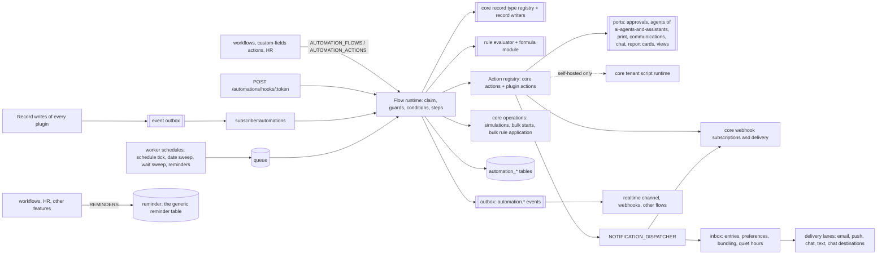

# Implementation Plan: Automation and notifications

> Translates an approved `spec.md` into architecture and tech choices. The plan owns
> implementation details; the spec owns behaviour.

**Feature ID**: `automation-and-notifications`
**Spec**: `./spec.md`
**Tasks**: `./tasks.md`
**Status**: `Draft`
**Last updated**: 2026-11-23

---

## 1. Architecture Summary

No new plugin: the existing `@gauzy/plugin-task-automations` (`packages/plugins/task-automations`) becomes the platform's
automation engine, and the existing `@gauzy/plugin-inbox` (`packages/plugins/inbox`) becomes the notification delivery
home. `apps/api/src/plugins.ts` lists `TaskAutomationsPlugin` when `GAUZY_TASK_AUTOMATIONS_ENABLED` **or**
`GAUZY_AUTOMATIONS_ENABLED` is exactly `true` (new helper `isAutomationsEnabled` beside `isTaskAutomationsEnabled`); the
task rule module, its routes and tables load under the first switch exactly as today, the new flow modules and tables
under the second. Every new route carries `@FeatureFlag(FEATURE_AUTOMATIONS)`.

The task runner's core (idempotent claim, loop guard, rate limit, per-record lock, system-actor context, attribution) is
lifted into a record-type-agnostic **flow runtime**; task rules are compiled into one-step flow versions in memory
(`TaskRuleFlowAdapter`) and run on that runtime while keeping their own run store (`task_automation_run`), so there is
one engine and no behaviour change for task rules. Records are read and written through the core record type registry
(`packages/core/src/lib/record-type/`, from `custom-fields-and-forms`) and its record writers; conditions use the core
rule evaluator and the `@gauzy/utils` formula module, with conditions stored as core `rule` rows. Notifications go
through one dispatcher: the Inbox's when loaded (categories, preferences, outside channels, bundling, quiet hours,
digests), else core `EmployeeNotificationService`. Categories are the existing notification types plus declared ones,
and their channel choices extend the existing per-type preference maps and team defaults with an organization level
held in the settings store. Outbound destinations are core webhook subscriptions. This feature owns the platform's
**one generic reminder table** (`reminder`), which other features schedule through the `REMINDERS` port. The table,
its service, the `REMINDERS` port and the `automations.reminders` job form a second plugin class of the same package,
`RemindersPlugin` (`ta/reminders/reminders.plugin.ts`), which `apps/api/src/plugins.ts` and `apps/worker/src/plugins.ts`
list whatever the two switches, so other features' reminders are scheduled and delivered on every installation; the
`/api/reminders` routes, buttons and flow steps load with the engine and carry `@FeatureFlag(FEATURE_AUTOMATIONS)`. Agent steps
run only through `ai-agents-and-assistants`. Bounded background work (simulations, bulk starts, bulk rule application)
runs as core operations; flow runs keep their own run, step and wait tables for the reasons given in §3.1. On
self-hosted installations only, a script step runs in the core tenant script runtime behind a deployment switch the
cloud deployment refuses.

## 2. Tech Choices

| Concern | Choice | Rationale |
| ------- | ------ | --------- |
| Package | extend `task-automations` (+ `-ui`) and `inbox` (+ `inbox-ui`); no new plugin | hard rule: build on what exists |
| Engine | flow runtime lifted from the task runner; task rules compiled to flows | one engine ([platform architecture](../../architecture/business-suite.md) §3.9) |
| Conditions | rows of the core `rule` table with new `RuleOwnerType` values `AUTOMATION_TRIGGER`, `AUTOMATION_STEP`, `ASSIGNMENT_RULE_ASSIGN`, `ASSIGNMENT_RULE_UNASSIGN`, `ASSIGNMENT_RULE_CLOSE` (`ownerId` = the trigger or step uuid of the version document, or the assignment rule), evaluated by `rule.evaluator.ts`; expressions through `@gauzy/utils` formula; no condition column on plugin tables | one condition store with custom fields, pricing, workflows |
| Records | core record type registry, `IRecordWriter` per type, `CUSTOM_FIELD_VALUE_*` ports | each owner keeps its write path |
| Triggers in | event outbox consumer registry; scheduler jobs; inbound hook route | durable, ordered per partition |
| Schedules | `@ScheduledJob` in the worker (`TaskAutomationsSchedulePlugin` for the engine, `RemindersPlugin` for `automations.reminders`), `@QueueWorker` in the API, in-process timers without a queue root | existing split of the plugin |
| Bounded background work | core operations `AUTOMATION_SIMULATION`, `AUTOMATION_BULK_START` (manual start of up to 500 records), `ASSIGNMENT_RULE_APPLY` (up to 500 records) registered with `OperationRegistry`, per-record results through `BulkExecutor`, `@AcceptedOperation` `202`; simulation counts and samples in the operation `result` | one runtime for bulk work |
| Settings | setting contributions in `task-automations.settings.ts` stored in `tenant_setting` (`TENANT` and `ORGANIZATION` scopes through the organization level of `organization-setup`): `automations.killSwitch`, `automations.maxDepth` (default 3), `automations.defaultLimits` (JSON), `automations.retentionDays` (90), `automations.failureRetentionDays` (180), `recognition.monthlyAllowance` (100), `recognition.totalsEnabled` (true); kill-switch changes are `activity_log` rows | platform settings store |
| Locks | advisory lock (PostgreSQL), `GET_LOCK` (MySQL), in-process (SQLite), as `task-automation-task-lock.ts` | one writer per record |
| Rate counters | Redis when configured, else `automation_rate_counter` rows | works without a queue |
| Outbound | call-webhook steps through core `WebhookTransport`, `webhook-endpoint-policy.ts`, `signWebhookPayload`; outbound notification destinations are core `webhook_subscription` rows whose `events` name the categories (`notification.<category>`), delivered, retried and auto-disabled by the core webhook module (`webhook_delivery`, retry worker, `AUTO_DISABLE_FAILURE_COUNT`); `integration-hub` port when bound | one outbound policy, one subscription store |
| Inbound hooks | token hash and sealed signing secret through core helpers lifted from the chat plugin (`webhookTokenHash` in `chat-webhook.service.ts`, `ChatWebhookSecretBox` in `chat-webhook-secret-box.ts`) into `packages/core/src/lib/core/util/hashed-token.ts` (shared with workflow action links, lead intake and shared links) and `secret-box.ts`; the chat plugin re-exports them; signature check with core `verifyWebhookSignature` | one inbound-hook pattern |
| Notification categories | the existing `EmployeeNotificationTypeEnum` values are the platform's category keys; `registerNotificationCategories` adds plugin keys and `notification_category` holds labels and flags of declared and user-defined ones; channel choices per category are the existing `emailByType` / `pushByType` maps plus additive `inAppByType`, `chatByType`, `smsByType` in `IEmployeeNotificationPreferences`, resolved member → team (`team-notification-defaults.rules.ts`, `withTeamNotificationDefaults`) → organization (`notifications.defaults` setting, same shape as the team defaults) → platform | one per-kind preference map, one layering |
| Reminders | `reminder` is the one generic reminder table of the platform: people's reminders, flow reminders and reminders other features schedule through the `REMINDERS` port (`schedule({ recipient, record?, remindAt, title, category, sourceKey })`, `cancel(sourceKeyPrefix)`); the send markers of task due, timer, meeting and invoice reminders stay with their features and show as categories | one reminder table |
| Email | core `EmailSendService` + `EmailTemplateRenderService`; `email-and-communications` port when bound | templates per language |
| Agents | agent steps only through `AUTOMATION_AGENTS` bound to `ai-agents-and-assistants`: the agent is an agent employee profile, and its run, tool calls, usage and budget are recorded there (the step keeps the agent run id); unbound → the agent step is not offered | one place for agents, runs, usage and budgets |
| Scripts (self-hosted only) | script step through the core tenant script runtime of `custom-fields-and-forms` (`packages/core/src/lib/tenant-script/`): `GAUZY_TENANT_SCRIPTS_ENABLED` exactly `true`, refused at start-up when `GAUZY_DEPLOYMENT` is `cloud`; separate worker process without network, files, environment or credentials; time and memory limits; every run in `tenant_script_run` (`scriptKind` `FLOW_STEP`); script changes in `activity_log`; permission `AUTOMATION_SCRIPTS_MANAGE` | scripts never on the cloud; isolated and bounded where allowed |
| Designer | Angular SVG canvas on `@angular/cdk` drag and drop plus a keyboard list editor | no new dependency |
| Push | outbox → realtime channel (`RealtimeHintsService`) | Principle VII |

## 3. Data Model

All tables extend `TenantOrganizationBaseEntity` (soft delete, `isActive`, `isArchived`); JSON is `text` on every
dialect; ids into other plugins carry no foreign key; `organizationId` is null only on tenant-level settings rows.

### 3.1 Flow tables (`task-automations`, loaded with `GAUZY_AUTOMATIONS_ENABLED`)

| Table | Columns (besides base) | Indexes and uniqueness |
| --- | --- | --- |
| `automation_flow` | `name` varchar(120), `description` text, `recordType` varchar(64) null, `status` varchar(16) (`DRAFT`, `ACTIVE`, `PAUSED`, `ARCHIVED`), `activeVersionId`, `draftVersionId` uuid null, `ownerUserId` uuid, `templateKey` varchar(64) null, `triggerKind` varchar(24), `limits` text (overrides of `automations.defaultLimits`), `consecutiveFailures` int default 0, `pausedReason` varchar(32) null, `pausedAt`, `lastRunAt` timestamp null, `signingSecretSealed` text null, `position` int | unique `(organizationId, name)`; idx `(tenantId, organizationId, status)`, `(organizationId, recordType, status)` |
| `automation_flow_version` | `flowId` FK cascade, `version` int, `document` text (trigger, inputs, steps graph with uuids, designer positions; conditions are core `rule` rows owned by those uuids), `checksum` varchar(64), `status` (`DRAFT`, `PUBLISHED`, `SUPERSEDED`), `source` (`USER`, `TEMPLATE`, `ASSISTANT`, `TASK_RULE`, `RESTORE`), `dataLeaving` text, `publishedAt`, `publishedByUserId` | unique `(flowId, version)` |
| `automation_trigger_index` | `flowId`, `versionId`, `kind` varchar(16), `eventName` varchar(96) null, `recordType` varchar(64) null, `fieldPath` varchar(128) null, `offsetMinutes` int null, `allDayOffsets` text null, `schedule` text null, `timeZone` varchar(64), `nextFireAt`, `lastFiredAt` timestamp null | idx `(tenantId, eventName, isActive)`, `(isActive, nextFireAt)`, `(organizationId, kind, recordType)`; rebuilt on publish, activate, pause |
| `automation_run` | `flowId`, `versionId`, `triggerKind`, `eventKey` varchar(200), `eventId` uuid null, `recordType`, `recordId` null, `status` varchar(16) (`QUEUED`, `RUNNING`, `WAITING`, `SUCCEEDED`, `FAILED`, `HALTED`, `CANCELLED`, `SKIPPED`), `skipReason` varchar(24) null, `depth` int, `chain` text, `isTrial` bool, `replayOfRunId`, `replayFromStepKey` null, `triggeredByUserId` null, `context` text (≤ 256 KB), `leaseUntil`, `startedAt`, `finishedAt` timestamp, `durationMs` int, `error` text | unique `(flowId, eventKey)` (idempotency); idx `(flowId, createdAt)`, `(tenantId, recordType, recordId, createdAt)`, `(status, leaseUntil)` |
| `automation_run_step` | `runId` FK cascade, `stepKey` varchar(64), `stepType` varchar(32), `attempt` int, `status` varchar(16), `input`, `output` text (≤ 64 KB), `error` text, `externalEffect` bool, `agentRunId` uuid null (the agent run of `ai-agents-and-assistants`), `scriptRunId` uuid null (`tenant_script_run`), `startedAt`, `finishedAt` | idx `(runId, startedAt)` |
| `automation_wait` | `runId` FK cascade, `flowId`, `stepKey`, `kind` (`DURATION`, `UNTIL`, `EVENT`), `resumeAt` null, `eventName` varchar(96) null, `correlationKey` varchar(200) null, `expiresAt`, `status` (`OPEN`, `RESUMED`, `EXPIRED`, `CANCELLED`, `HELD`) | idx `(status, resumeAt)`, `(tenantId, eventName, correlationKey, status)`, `(status, expiresAt)` |
| `automation_held_event` | `flowId`, `eventId`, `eventName`, `recordType`, `recordId`, `reason` (`STORM`, `KILL_SWITCH`, `PAUSED`), `source` varchar(24), `decision` (`PENDING`, `PROCESSED`, `DISCARDED`), `decidedByUserId`, `decidedAt` | unique `(flowId, eventId)`; idx `(flowId, decision)` |
| `automation_rate_counter` | `flowId`, `windowStart` timestamp (minute), `count` int | unique `(flowId, windowStart)`; pruned after 8 days |
| `automation_inbound_hook` | `flowId` unique, `tokenHash` varchar(64) unique (core `hashed-token.ts`), `signingSecretSealed` text null (core `secret-box.ts`), `lastReceivedAt`, `receivedCount`, `rejectedCount` int | delivery ids deduplicated by the run key `hook:<deliveryId>` |
| `automation_usage` | `flowId`, `period` varchar(7), `outcome` varchar(16), `runs` int (monthly counts kept after runs are pruned) | unique `(flowId, period, outcome)` |
| `assignment_rule` | `recordType`, `name`, `position` (assign, unassign and close conditions are core `rule` rows owned by the rule), `distribution` varchar(16) (`IN_TURN`, `FEWEST_OPEN`, `FROM_FIELD`, `WEIGHTED`, `CAPACITY`), `pool` text (people, teams, roles, weights, caps), `fieldPath` null, `requiredSkillIds` text, `respectTimeOff`, `respectWorkingHours` bool, `maxOpenPerPerson` int null, `weekdays` varchar(16), `activeFrom`, `activeTo` varchar(5), `dueFieldPath`, `dueOffsetMinutes`, `descriptionTemplate` text, `turnCursor` int, `ownerUserId` | idx `(organizationId, recordType, isActive, position)` |
| `assignment_decision` | `ruleId`, `recordType`, `recordId`, `chosenUserId` null, `skipped` text (person, reason), `outcome` varchar(24) | idx `(ruleId, createdAt)`, `(recordType, recordId)` |
| `record_assignment` | `recordType`, `recordId`, `assigneeUserId`, `assigneeEmployeeId` null, `assignedByUserId` null, `ruleId` null, `source` (`MANUAL`, `RULE`, `FLOW`, `AGENT`), `status` (`OPEN`, `DONE`, `CANCELLED`), `priority` varchar(16), `dueAt` null, `note` text, `openKey` varchar(200) null, `closedAt`, `closedByUserId` | unique `(tenantId, openKey)` (one open per person and record; null when closed); idx `(tenantId, assigneeUserId, status, dueAt)`, `(tenantId, recordType, recordId, status)` |
| `reminder` | the platform's one generic reminder table, registered by `RemindersPlugin` and created whatever the deployment switches: `ownerUserId` null (null = a feature), `recipientUserId`, `recipientEmployeeId` null, `recordType`, `recordId` null, `remindAt`, `title` varchar(255), `note` text, `category` varchar(64), `status` (`PENDING`, `SENT`, `DISMISSED`, `CANCELLED`), `sentAt`, `source` (`USER`, `FLOW`, `FEATURE`), `sourceKey` varchar(160) null (e.g. `workflow-task:<id>:50`), `runId` null | unique `(tenantId, sourceKey)` (nulls allowed); idx `(status, remindAt)`, `(tenantId, recipientUserId, status)`, `(tenantId, recordType, recordId)` |
| `recognition_entry` | shown beside the existing `employee_award` rows on the employee profile; `giverEmployeeId` null (flows), `receiverEmployeeId`, `message` text, `points` int, `recordType`, `recordId` null, `isPrivate` bool, `source` (`PERSON`, `FLOW`), `flowId` null, `period` varchar(7) | idx `(tenantId, receiverEmployeeId, createdAt)`, `(giverEmployeeId, period)`, `(organizationId, period)` |

### 3.2 Notification tables (`inbox`, loaded with `GAUZY_INBOX_ENABLED`)

| Table | Columns (besides base) | Indexes and uniqueness |
| --- | --- | --- |
| `notification_category` | labels and flags of plugin and user-defined categories (platform categories are the `EmployeeNotificationTypeEnum` values, labelled in code): `key` varchar(64), `labels` text, `description` text, `source` (`PLUGIN`, `FLOW`), `isMandatory` bool, `mayBreakQuietHours` bool, `ownerFlowId` null; default channels are the organization's `notifications.defaults` setting | unique `(tenantId, organizationId, key)` |
| `notification_destination` | chat-channel destinations only (outbound addresses are core webhook subscriptions): `name`, `conversationId`, `createdByUserId` | idx `(organizationId, isActive)` |
| `notification_digest` | `name`, `frequency` (`DAILY`, `WEEKLY`, `MONTHLY`), `sendTime` varchar(5), `dayOfWeek`, `dayOfMonth` int null, `timeZone`, `recipients`, `cards` text, `nextSendAt`, `lastSentAt`, `createdByUserId` | idx `(isActive, nextSendAt)` |
| `notification_digest_send` | `digestId` FK, `recipientUserId`, `periodKey` varchar(16), `status` (`SENT`, `SKIPPED`, `FAILED`), `error` text, `sentAt` | unique `(digestId, recipientUserId, periodKey)` |
| `inbox_delivery` (changed) | + `category` varchar(64) null, `bundleKey` varchar(160) null, `destinationId` uuid null; channel values `chat`, `sms`, `destination` (chat destinations; outbound ones go through the core webhook outbox consumer) | + idx `(tenantId, status, bundleKey)` |

**Why flow runs keep their own tables** (`automation_run`, `automation_run_step`, `automation_wait`) beside core
`operation` / `operation_step`: (1) many runs of one flow, and of several flows, stay live on one record at once, some
waiting for days, while `UQ_operation_aggregate_live` allows one live operation per aggregate, so a run could not use
the record as its aggregate and the per-record and per-flow history (`(tenantId, recordType, recordId, createdAt)`,
`(flowId, createdAt)`) would be unindexed; (2) a million open waits per organization are resumed by time and by
`(eventName, correlationKey)`, an index the operation table does not carry; (3) runs are pruned after 90 days into
`automation_usage` counts, a retention the runtime does not have. The load test (T53) measures step writes per second
and wait resumption on both stores at the §4 volumes and its figures are recorded here before the tables ship. The
tables stay in step with the runtime: steps use the runtime's `IStepRetryPolicy` and its lease and stalled-run recovery
helpers, runs are read through the `OperationView` shape of `api/async-operation.ts`, and every bounded batch of this
feature is a core operation. Task rules keep `task_automation_run` unchanged.

### 3.3 Core changes (additive)

- `EmployeeNotificationTypeEnum`: `AUTOMATION` (13), `REMINDER` (14), `RECOGNITION` (15), mapped in
  `employee-notification-type-transform.ts`; `employee_notification.category` varchar(64) null with an index
  `(tenantId, receiverEmployeeId, category, isRead)`.
- `IEmployeeNotificationPreferences`: the existing `emailByType` and `pushByType` maps accept every category key;
  additive `inAppByType`, `chatByType`, `smsByType` in the same shape, `quietHours` (windows with weekdays; the
  existing `dnd` is read as one window), `bundleMinutes` (absent or 0 = off, the default), `followDigest` (`off`,
  `hourly`, `daily`, `weekly`), `chat`,
  `sms`; existing keys keep their meaning. `ITeamNotificationDefaults` gains the same keys, and an organization layer
  (`notifications.defaults` setting) sits between the team and the platform in `withTeamNotificationDefaults`.
- `EventOutboxService.append` stamps `metadata.automation = { depth, chain }` from the active automation run context, so
  any plugin's event carries the loop-guard facts without knowing about automations.
- Entity subscriptions (followers) and fan-out accept registry record type keys (validation widened by
  `record-views-and-search`); no schema change.
- Inbox digest (`packages/plugins/inbox`, `inbox-delivery-mailer.ts`): a digest section registry
  (`registerDigestSections({ key, title, collect(userId, period) })`) so that features add a section to the person's one
  digest email at their digest hour (`digestHour`, with the additive `digestFrequency` and `digestDay` of the
  notification preferences) instead of sending digests of their own; discussions, space summaries of
  `documents-and-wiki` and follow digests use it. No schema change.

### 3.4 Migrations

**Migration timestamps**: `packages/plugins/task-automations` `1791000032100` to `1791000032199`; `packages/plugins/inbox` `1791000032200` to `1791000032299`; `packages/core` `1791000032300` to `1791000032399`.

Plugin migrations with the plugin's existing `database/migration-helpers.ts`; PostgreSQL, SQLite and MySQL branches;
idempotent, forward-only, registered for both ORMs; flow migrations are listed only when `GAUZY_AUTOMATIONS_ENABLED`,
except migration 4, which `RemindersPlugin` lists on every installation (its recognition table stays empty until the
engine loads):

1. `1791000032100-CreateAutomationFlowTables` — flow, version, trigger index, usage.
2. `1791000032110-CreateAutomationRunTables` — run, run step, wait, held event, rate counter, inbound hook.
3. `1791000032120-CreateAssignmentTables` — assignment rule, decision, record assignment.
4. `1791000032130-CreateReminderAndRecognitionTables` — `reminder`, recognition entry.
5. (no migration: role grants come from the permission contributions' `defaultFor`).
6. Inbox: `1791000032200-CreateNotificationCategoryAndDestinationTables`, `1791000032210-CreateNotificationDigestTables`,
   `1791000032220-AddBundlingColumnsToInboxDelivery`.
7. Core: `1791000032300-AddCategoryToEmployeeNotification` (nullable column, index; no backfill). The tenant script
   runtime's `tenant_script_run` comes with `custom-fields-and-forms`.

### 3.5 Contracts

`packages/contracts/src/lib/automation.model.ts` (flow document schema, trigger kinds, step and action descriptors, run
and step outcomes, settings, ports `IAutomationFlows`, `IAutomationActions`, `IAutomationTriggerDeclaration`,
`IAutomationActionDeclaration`, errors), `notification-category.model.ts` (`INotificationDispatcher`, category,
destination, digest), `record-assignment.model.ts`, `reminder.model.ts` (`IReminder`, `IReminderScheduler` of the
`REMINDERS` port), `recognition.model.ts`; exported from `index.ts`.

## 4. API Surface

| Method | Endpoint | Permission | Description | Status |
| ------ | -------- | ---------- | ----------- | ------ |
| `GET` | `/api/automations/catalogue` | `AUTOMATION_FLOW_VIEW` | triggers, actions, record types, categories of loaded plugins | New |
| `GET` `POST` | `/api/automations/flows` | view / `AUTOMATION_FLOW_EDIT` | list (filters), create (idempotency key) | New |
| `GET` `PATCH` | `/api/automations/flows/:id` | view / edit | header | New |
| `GET` `PUT` | `/api/automations/flows/:id/draft` | view / edit | draft document; `If-Match` version | New |
| `POST` | `/api/automations/flows/:id/{publish,activate,pause,archive}` | `AUTOMATION_FLOW_PUBLISH` | lifecycle; publish returns validation errors | New |
| `GET` `POST` | `/api/automations/flows/:id/versions[/:v/restore]` | view / edit | versions, restore as draft | New |
| `POST` | `/api/automations/flows/:id/trial` | edit | `{ recordId \| payload }` → planned effects | New |
| `POST` | `/api/automations/flows/:id/simulations` | edit | `202` with the core operation handle; progress and result at `/api/operations/:id` | New |
| `POST` | `/api/automations/flows/:id/start` | view of each record | manual start `{ recordIds ≤ 500, inputs }`; above one record `202` with the core operation handle | New |
| `POST` | `/api/automations/what-would-run` | view of the record | `{ recordType, recordId, change }` | New |
| `GET` | `/api/automations/runs`, `/api/automations/runs/:id` | view (record runs: view of the record) | history, step timeline | New |
| `POST` | `/api/automations/runs/:id/replay` | `AUTOMATION_FLOW_PUBLISH` | `{ fromStepKey, onVersion, repeatExternal[], preview }` | New |
| `GET` `POST` | `/api/automations/templates`, `/api/automations/flows/from-template` | edit | templates of loaded plugins | New |
| `POST` | `/api/automations/drafts/from-text` | edit | assistant draft `{ text, recordType? }` | New |
| `GET` `PUT` | `/api/automations/settings`, `POST /api/automations/kill-switch` | `AUTOMATION_ADMIN` | the `automations.*` and `recognition.*` settings in the settings store; kill switch | New |
| `GET` `POST` | `/api/automations/held-events`, `/api/automations/held-events/decide` | `AUTOMATION_FLOW_PUBLISH` | `{ flowId, decision: process \| sample \| discard }` | New |
| `POST` `DELETE` | `/api/automations/flows/:id/hook` | `AUTOMATION_FLOW_PUBLISH` | create or rotate, remove the inbound hook | New |
| `POST` | `/api/automations/hooks/:token` | public, token + signature, throttled | inbound webhook trigger | New |
| `GET` `POST` `PATCH` | `/api/automations/assignment-rules[/:id]`, `POST …/:id/apply`, `GET …/:id/decisions` | `ASSIGNMENT_RULE_MANAGE` | rules, bulk apply ≤ 500 as a core operation, decisions | New |
| `GET` `POST` `PATCH` | `/api/record-assignments[/:id]` | view / edit of the record; own for status | assignments, mine, by record | New |
| `GET` `POST` `PATCH` `DELETE` | `/api/reminders[/:id]` | own; edit of the record for others | reminders of every source, snooze, dismiss | New |
| `GET` `POST` | `/api/automations/scripts/test`, `/api/automations/scripts/runs` | `AUTOMATION_SCRIPTS_MANAGE`; self-hosted with the switch on, else `403` | test a script step on a record (writes nothing); run audit | New |
| `GET` `POST` | `/api/recognitions`, `GET /api/recognitions/{ledger,totals}` | `RECOGNITION_GIVE` / employee self / managers | give, list, ledger, team totals | New |
| `GET` `PUT` | `/api/inbox/notification-categories[/:key]` | `INBOX_VIEW` / `AUTOMATION_ADMIN` | categories with my choices; defaults, mandatory | New |
| `GET` `POST` `PATCH` | `/api/inbox/destinations[/:id]`, `POST …/:id/test` | `NOTIFICATION_DESTINATION_MANAGE` | chat-channel destinations; outbound addresses through the core `/api/webhooks/subscriptions` and `/api/webhooks/deliveries` | New |
| `GET` `POST` `PATCH` | `/api/inbox/digests[/:id]`, `POST …/:id/{preview,send-test}` | `NOTIFICATION_DIGEST_MANAGE` | summary digests | New |
| `GET` | `/api/inbox/deliveries?notificationId=` | recipient / `AUTOMATION_ADMIN` | delivery states | New |
| `PUT` | `/api/employee-notification-setting/:id` | unchanged | accepts the additive preference keys | Changed (additive) |
| `*` | `/api/task-automations/**` | unchanged | task rules | Unchanged |

All new controllers: `TenantPermissionGuard`, `@Permissions()`, class-validator DTOs, Swagger decorators, cursor
pagination, idempotency keys on creating routes. GraphQL reads (`automationFlows`, `automationFlow`, `automationRuns`,
`automationRun`, `recordAssignments`, `reminders`, `notificationCategories`) in `graphql/` as the task rules do.

**Ports offered** (contracts tokens, provided when loaded, injected `@Optional()` by consumers, bound in
`apps/api/src/plugin-composition.ts`):

| Port | Bound to | Contract |
| --- | --- | --- |
| `AUTOMATION_FLOWS` | `WORKFLOW_FLOWS` (approval-workflows), `CUSTOM_FIELDS_FLOWS` (custom-fields) | `listStartable(recordType, viewer)`, `start({ flow, recordType, recordId, inputs, actor, idempotencyKey })` |
| `AUTOMATION_ACTIONS` | `HR_AUTOMATION_ACTIONS` (hr-core-lifecycle) | `catalogue(recordType?)`, `run({ actionKey, ref, params, runKey, actor })` |
| `NOTIFICATION_DISPATCHER` | HR reminders, time-off, workflows notices | `notify({ category, recipients, record, title, body, priority, link, dedupeKey })` honouring preferences |
| `REMINDERS` | `WORKFLOW_REMINDERS` (approval-workflows), HR and other features' reminders | `schedule({ recipient, record?, remindAt, title, category, sourceKey })`, `cancel(sourceKeyPrefix)`; rows of `reminder` |
| `registerAutomationTriggers`, `registerAutomationActions`, `registerNotificationCategories` | every plugin (code registries, as `registerRecordTypes`) | declarations read at bootstrap |

**Ports consumed** (unbound → the capability is not offered): `AUTOMATION_APPROVALS` (workflows gateway: request and
await a decision), `AUTOMATION_AGENTS` (`ai-agents-and-assistants`: agent runs with tools, usage and budget),
`AUTOMATION_PRINT` (record PDF),
`AUTOMATION_COMMUNICATIONS` (email from accounts, text messages), `AUTOMATION_CHAT` (post to a channel, direct message),
`AUTOMATION_WEBHOOKS` (integration-hub transport), `AUTOMATION_REPORT_CARDS` (card rendering for digests; unbound,
cards come from core `saved_report` definitions),
`AUTOMATION_VIEWS` (`RECORD_VIEWS_SELECTION` of record-views: iterate a saved view, counts), `AUTOMATION_AVAILABILITY`
(working calendar and approved time off of time-off-management; fallback: core time-off requests and employee
availability slots), `CUSTOM_FIELD_METADATA`, `CUSTOM_FIELD_VALUE_READER`, `CUSTOM_FIELD_VALUE_WRITER`.

**Consumer tokens answered** (bound in `apps/api/src/plugin-composition.ts` to the reminder, recognition, preference, digest-section and trigger services; each consumer plan states the shape it calls and its fallback): `AUTOMATION_RULES`, `COMMUNICATIONS_PREFERENCES`, `INBOX_DIGEST_SECTIONS`, `LEARNING_RECOGNITIONS`, `PERFORMANCE_RECOGNITIONS`, `RECORD_REMINDERS`.

## 5. Events, Real-Time and Notifications

| Event | Emitted when | Consumers |
| ----- | ------------ | --------- |
| In: every name of the trigger catalogue (`<domain>.<entity>.<verb>`, `task.*`, `custom_record.*`, `custom_fields.values.changed`, `workflows.instance.transitioned`, `inbox_item.created` of kind email, `chat_message.created`) | records and messages change | `subscriber:automations` (one consumer, events list rebuilt at bootstrap) |
| `automation.run.started` / `.waiting` / `.completed` / `.failed` | run lifecycle (partition `automation:<recordType>:<recordId>`) | realtime hint to flow viewers and record readers, webhooks, other flows |
| `automation.flow.published` / `.paused` / `.auto_paused` / `.storm_held` | flow lifecycle | inbox notice to owner and admins, audit, realtime |
| `automation.kill_switch.changed` | switch flipped | audit, inbox notice to admins |
| `record_assignment.created` / `.closed`, `reminder.due`, `recognition.given` | as named | notifications, timeline contributors, realtime |
| `notification.<category>` | a notice of a category a webhook subscription names | core webhook outbox consumer (outbound destinations) |

Notifications: categories `automation.flow-health`, `automation.notice` (user-defined, one key per flow category),
`assignment`, `reminder`, `recognition`; in-app entries through `INBOX_ITEM_WRITER` (kind `NOTIFICATION`) mirrored from
the employee notification as today. Outbox events carry ids only; titles and bodies never ride the outbox.

## 6. UI Surface

- **Angular `packages/plugins/task-automations-ui`** (existing; lazy; hidden on `404`): Settings → Automations gains a
  hub around the existing page: the `automations` path keeps opening the task rules page as today (the hub's first tab
  while the feature is on, the page alone while it is off), and the new tabs live under it: **Flows** (`automations/flows`:
  list, templates, "describe a flow" box), designer `flows/:id`
  (canvas, keyboard list editor, step inspector, token picker, trial pane, simulation pane, versions, data-leaving
  summary), **Task rules** (the existing page unchanged), **Assignment rules**, **Runs** (`runs`, `runs/:id` live step
  timeline, replay dialog), **Held events**, **Settings** (limits, depth, kill switch).
- **Angular `packages/plugins/inbox-ui`** (existing): Settings → Notifications gains the category × channel matrix,
  quiet-hour windows, bundling, follow digests and the list of followed records; Settings → Destinations (chat channels,
  and outbound addresses created as core webhook subscriptions); Settings → Summary digests (card picker, preview as a
  recipient); Inbox tabs "Assigned to me" and "Reminders" with filters by type, due date and status; delivery states on
  an entry.
- **Embeddables `packages/ui-core/shared/src/lib/automations/`**: `ngx-record-automation-panel` (runs and waits of a
  record, manual start), `ngx-reminder-button`, `ngx-assign-button`, `ngx-recognition-button`, placed by the record
  sidebar of `record-views-and-search` and on existing record pages; `/pages/recognition` (give, feed, team totals);
  received recognitions also show beside the awards on the employee profile.
- i18n keys `AUTOMATIONS.*`, `NOTIFICATIONS.*`, `RECOGNITION.*` in every locale of `packages/ui-core/i18n`.
- The task-rule routes and the employee notification setting routes keep their contracts, so existing clients of
  them keep working; the preference keys added here are optional.

## 7. MCP Tools, SDKs and Integrations

New `packages/mcp-server/src/lib/tools/automations.ts` and `notifications.ts`, registered in `register-all-tools.ts`:

| Tool | Input | Output |
| --- | --- | --- |
| `automations_list_flows` / `automations_get_flow` | filters / id | flows / document, status, limits |
| `automations_draft_flow` | text, record type | draft id, document, explanation, defaults chosen |
| `automations_trial_run` / `automations_simulate` | flow, record or window | planned effects / counts and samples |
| `automations_set_flow_state` | flow, `publish` \| `activate` \| `pause` | new state (permission required) |
| `automations_list_runs` / `automations_replay_run` | flow or record / run, step, `preview` | runs / replay plan or new run |
| `notifications_send` | category, recipients, title, body, record, `preview` | per-recipient result |
| `reminders_create`, `assignments_list_mine`, `recognition_give` | as named | created item / list |

OpenAPI additive; Kiota SDKs regenerated after merge. Webhooks: `automation.*`, `record_assignment.*`,
`recognition.given` declared with `SubscriptionCatalogue` so tenants can subscribe.

## 8. Background Jobs

| Trigger | When | What it does | Idempotency |
| ------- | ---- | ------------ | ----------- |
| `subscriber:automations` (outbox) | each event | matches trigger index, applies limits and storm check, enqueues runs | run unique `(flowId, eventKey)` with `eventKey = <eventId>:<recordId>` |
| `automations.schedule-tick` (queue `automation-maintenance`) | every minute | fires due schedule triggers; iterates a view in pages of 500 | `schedule:<flowId>:<fireAt>[:<recordId>]` |
| `automations.date-sweep` | every minute | date-relative triggers in `(lastSweep − 24 h catch-up, now]` per active flow | `date:<flowId>:<recordId>:<value>:<offset>` |
| `automations.wait-sweep` | every minute | resumes due waits, expires event waits | wait status transition under row lock |
| `automations.runs` (queue) | per enqueued run | executes steps under the record lock, retries with back-off | step attempt rows; lease 5 minutes |
| core operation `AUTOMATION_SIMULATION` | on request | evaluates past events in steps of 1,000 with progress; counts and samples in the result | step checkpoint |
| core operations `AUTOMATION_BULK_START`, `ASSIGNMENT_RULE_APPLY` | on request above one record | starts or applies per record through `BulkExecutor` | per record run key |
| `automations.reminders` (`RemindersPlugin`, every installation) | every minute | sends due rows of `reminder` (every source) through the notification dispatcher, and the daily agenda while the engine is loaded | reminder status `PENDING → SENT` |
| `automations.retention` | daily 02:30 | prunes runs past retention into monthly counts; prunes rate counters | per day watermark |
| `inbox-delivery-sweep` (existing, extended) | every minute | bundles, quiet hours, chat, text and destination channels | `inbox_delivery` unique per entry, person, channel |
| `inbox.digests` | every 15 minutes | summary digests and hourly or weekly follow digests due | `notification_digest_send` unique |

The worker's `TaskAutomationsSchedulePlugin` registers the engine's schedules (under either switch, each job only for
its part); `RemindersPlugin` registers the `automations.reminders` schedule itself, on every installation whatever the
two switches, so other features' reminders are delivered with both switches off; queue jobs run in the API, which hosts
the record services; without a queue root the API runs the same jobs on in-process timers under the owning plugin's
sweep lock.

## 9. Security & Permissions

`task-automations.permissions.ts` (plugin permission contributions with `defaultFor`): `AUTOMATION_FLOW_VIEW`,
`AUTOMATION_FLOW_EDIT`, `AUTOMATION_FLOW_PUBLISH`, `AUTOMATION_ADMIN`, `ASSIGNMENT_RULE_MANAGE`,
`NOTIFICATION_DESTINATION_MANAGE`, `NOTIFICATION_DIGEST_MANAGE`, `RECOGNITION_GIVE`, `AUTOMATION_SCRIPTS_MANAGE`.
`defaultFor`: all but the script permission to `SUPER_ADMIN` and `ADMIN`; `AUTOMATION_FLOW_VIEW`,
`AUTOMATION_FLOW_EDIT`, `ASSIGNMENT_RULE_MANAGE`, `NOTIFICATION_DIGEST_MANAGE`, `RECOGNITION_GIVE` to `MANAGER`;
`RECOGNITION_GIVE` to `EMPLOYEE`; `AUTOMATION_SCRIPTS_MANAGE` to `SUPER_ADMIN` only, granting nothing where the
switch is off. Tenant feature `FEATURE_AUTOMATIONS` (`defaultEnabled: false`) in
`task-automations.features.ts`.

Run-as: `AutomationRunContext` (generalized `task-automation-context.ts`) runs steps inside `RequestContext` of a
synthetic user of the flow's tenant and organization whose permissions are the intersection of the owner's current
permissions and the action's needs, recomputed per run; activity rows get `actorType = System` and "by automation
`<name>`", agent steps `Agent`. Secrets (flow signing secret, hook secret) are sealed with the core `secret-box.ts`;
outbound destination secrets and headers are the core webhook subscription's; never returned after creation. Inbound hooks: token hash lookup,
optional `signWebhookPayload` verification within 300 s tolerance, 1 MB body cap, throttled per token. Outbound calls:
`refusalForResolvedEndpoint` before each call. Tokens are rendered as text (HTML-escaped in email). Tenant code runs
only as a script step on a self-hosted installation with the switch on, in the core tenant script runtime (separate
process, no network, files or credentials, time and memory limits, every run audited); the cloud deployment refuses
the switch at start-up and a test spec proves script steps and routes answer `403` there.

## 10. Observability

Run and step rows; `automation_usage` monthly counts; core operations for simulations and bulk starts; audit rows
(activity log) for flow publish, activation, pause, owner change, kill switch, settings, script changes and held-event
decisions; `tenant_script_run` where scripts are on; metrics: trigger-to-start lag, step duration, failures by action,
skips by reason, storms, waits open, delivery outcomes by channel; agent usage is read from `ai-agents-and-assistants`.

## 11. Phased Rollout

1. **Phase 1 — Engine and surface what exists** (flag off): contracts, the core token and secret helpers, the core
   notification contract with its fallback, the reminder service, routes, port and sweep, generalized runtime with
   task rules on it (parity suite green), flow tables, record triggers and field changes, update, assign, tags, comment and notify actions, trial
   run, run history, the Automations hub with designer, categories and the extended Settings → Notifications for the
   existing reminders and types, MCP read tools.
2. **Phase 2 — Depth**: schedules, date triggers, waits, branches, create, copy, find and loop, email, text, chat,
   webhook, approval and start-flow actions, incoming message and webhook triggers, assignment rules and record
   assignments, reminders in the app and agenda, follow and summary digests, destinations, recognition, templates, reports.
3. **Phase 3 — Advanced capabilities**: plain-language drafts, agent steps through the agent feature, simulation, storm
   protection and held events, replay, quiet-hour windows and bundling, capacity- and availability-aware assignment;
   script steps on self-hosted installations.
4. **Phase 4 — General availability**: the feature is off by default; after the trial period it may be switched on by default for new tenants only; existing tenants keep their setting until an administrator changes it.

## 12. Constitution Reconciliation

- I Plugin-first: extends `task-automations` and `inbox` (+ UI plugins); core gets enum values, a nullable column, an
  outbox metadata stamp, an organization level of notification defaults and the hashed-token and secret-box helpers.
- II Tenant/organization scoping: every table on the tenant-organization base; every query filters by tenant.
- III Both ORMs, additive migrations: eight migrations, three dialects, both ORMs; no existing column changed.
- IV Default-off flag; nothing removed: deploy switch plus tenant feature; task rules, reminders and delivery unchanged.
- V Contracts and API first: contracts, REST, GraphQL reads, SDK regeneration before UI.
- VI Permissions, privacy, security: nine permissions, bounded run-as, sealed secrets, endpoint policy, signed hooks;
  scripts never on the cloud.
- VII Real-time through the event bus: outbox in and out, hints for runs and notices; no private channel.
- VIII i18n and accessibility: keys in every locale; keyboard list editor for the designer.
- IX Tests: unit specs per action, trigger and guard; SQLite end-to-end per trigger; ORM parity; UI rendering tests.
- X Behaviour-first spec: implementation stays in this plan.
- XI Documentation describes our platform only.

## 13. Risks & Mitigations

| Risk | Likelihood | Impact | Mitigation |
| ---- | ---------- | ------ | ---------- |
| Task rules change behaviour when moved onto the runtime | Medium | High | adapter keeps their run store; the existing spec suite must pass unchanged before merge |
| Automation storms from imports or integrations | Medium | High | rate counters, storm detector, held events, kill switch, per-flow limits |
| Runaway agent spend | Medium | Medium | the agent's budget in `ai-agents-and-assistants` stops the step; per-step limits; preview on write tools |
| A script step escapes or exhausts the host (self-hosted) | Low | High | separate process without network, files or credentials; time and memory limits; switch off by default and refused on the cloud deployment |
| Leaking data to outside endpoints | Low | High | run-time recipient resolution, publish permission for fixed addresses, endpoint policy, data-leaving summary |
| Date sweeps slow on large tables | Medium | Medium | per-flow windows on indexed date columns; custom fields through their indexed value table; batches of 500 |
| Waits piling up | Low | Medium | mandatory expiry, index on `(status, resumeAt)`, retention |
| Notification fatigue | Medium | Medium | simulation's notices per person per day, bundling, quiet hours, follow digests |

## 14. References

- Spec: `./spec.md` · Tasks: `./tasks.md` · Related: `../approval-workflows/plan.md`, `../custom-fields-and-forms/plan.md`,
  `../record-views-and-search/plan.md`, `../hr-core-lifecycle/plan.md`
- Code: `packages/plugins/task-automations/src/lib/{services,engine,events,schedule}/`, `packages/plugins/inbox/src/lib/{delivery,notifications}/`,
  `packages/core/src/lib/{rule,event-outbox,webhook,employee-notification,employee-notification-setting,entity-subscription}/`,
  `packages/core/src/lib/tasks/due-reminder/`, `packages/core/src/lib/time-tracking/timer-reminder/`,
  `packages/core/src/lib/operation/`, `packages/core/src/lib/api/bulk-executor.service.ts`,
  `packages/core/src/lib/tenant/tenant-setting/`, `packages/core/src/lib/saved-report/`,
  `packages/plugins/chat/src/lib/webhooks/`, `packages/core/src/lib/employee-award/`, `apps/api/src/plugin-composition.ts`
