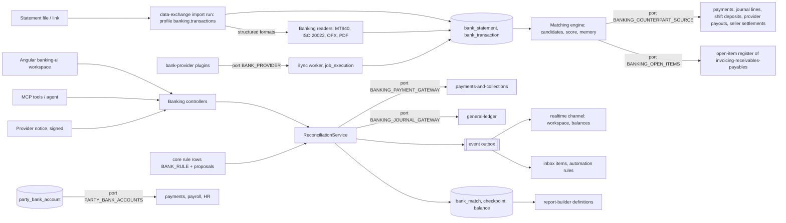

# Implementation Plan: Banking and reconciliation

> Translates an approved `spec.md` into architecture and tech choices. The plan owns
> implementation details; the spec owns behaviour.

**Feature ID**: `banking-and-reconciliation`
**Spec**: `./spec.md`
**Tasks**: `./tasks.md`
**Status**: `Draft`
**Last updated**: 2026-11-23

---

## 1. Architecture Summary

A new plugin `@gauzy/plugin-banking` (`packages/plugins/banking`) owns banks, bank accounts, statements, bank
transactions, matches, rules, checkpoints, balances, connections and guarantees, and is the **one store of the bank
details of customers, suppliers and employees** (`party_bank_account`, §3.1), which payments, payroll and HR read
through a port. It never writes a payment or a ledger line: creating a payment, a journal or a cancellation goes
through ports answered by the payment and accounting packages, and the candidates it matches against are read through
a multi-provider port. It builds on what exists:

- **Imports**: delimited and spreadsheet statements import through `data-exchange` (`data-import-export`) as the
  import profile `banking.transactions` (detection, mapping templates, rejected-row file, undo, schedules); this
  plugin adds the readers of structured formats (MT940, ISO 20022, OFX, PDF) and the statement facts.
- **Connections**: a bank connection references a core `integration_tenant` (as `payment_provider.integrationId`
  points at an integration); credentials are `integration_setting` rows, account links are `integration_map` rows,
  and each sync pass is a core `job_execution` row. Bank providers appear in the Integrations catalogue.
- **Rules**: the conditions of a bank rule are core `rule` rows (owner type `BANK_RULE`) evaluated by
  `evaluateRuleSet` with the pattern-safety helper (`packages/core/src/lib/rule`).
- **Open items** come from the one open-item register owned by `invoicing-receivables-payables`; anomalies go to the
  one finding store owned by `general-ledger`; notes on a line are core `comment` rows; reminders are
  `reminder` rows of `automation-and-notifications`.

Bank providers are separate plugins (`packages/plugins/bank-provider-<key>`) that implement one provider interface; a
sandbox provider ships for tests and demos. The layout follows the commerce plugins (`purchasing`: `*.features.ts`,
`*.permissions.ts`, `database/migrations`, repositories for both ORMs).

## 2. Tech Choices

| Concern | Choice | Rationale |
| ------- | ------ | --------- |
| Package | new `packages/plugins/banking`, `banking-ui`; providers `bank-provider-<key>`; `bank-provider-sandbox` | Principle I |
| Persistence | MultiORM entities, plugin migrations (PostgreSQL, SQLite, MySQL), both ORMs | Principle III |
| Money | `Money` and exact decimals of `packages/core/src/lib/money`; signed `numeric(20,6)` amounts | one arithmetic |
| Account numbers | core `EncryptionService` (`packages/core/src/lib/common/encryption/encryption.service.ts`, AES-256-GCM with the platform key); stored as cipher text + mask (last 4) + keyed hash for equality search; `@ExportRedacted` on every number column | never plain at rest; searchable by hash; §3.1 |
| Imports | delimited and spreadsheet files through the `data-exchange` engine (`DATA_IMPORT_ENGINE`, import profile `banking.transactions`, `data_mapping_template` per bank account and bank, `data_import_run` / `data_import_row`, `data_schedule` for link imports); structured formats read by this plugin's readers (`IStatementParser`: MT940, ISO 20022 camt.052/053, OFX, PDF text), pure and fixture-tested, supplied to the same profile | one import engine; formats added without touching the flow |
| Scanned PDFs | the platform AI provider port already used by the AI plugins, through `BANKING_DOCUMENT_EXTRACTION` | optional, off when no provider |
| Conditions | core `rule` rows of owner type `BANK_RULE` (scope `ITEM`: description, counterparty, reference, amount, code, currency, account, direction), evaluated by `evaluateRuleSet`; patterns checked by `rule.pattern-safety.ts`; compiled once per rule set | one rule engine, bounded evaluation |
| Matching | deterministic scorer (pure) + per-organization memory table; subset-sum search bounded to 12 open items and 200 ms | explainable, no model hosting |
| Background work | `@ScheduledJob` + `@QueueWorker` (`@gauzy/scheduler`), in-process fallback without a queue; sync passes and sweeps recorded in core `job_execution` | house idiom; one run ledger |
| Connections | core `integration_tenant` per connection, `integration_setting` for credentials, `integration_map` (`IntegrationEntity.BANK_ACCOUNT`) for account links | the integrations framework |
| Events and push | event outbox + consumer registry; realtime channel for workspace presence and line changes | Principle VII |
| Settings | `banking.settings.ts` (`PluginSettingContribution`, scope `ORGANIZATION`): bank-detail change window, name similarity, transfer window, default automation level | platform settings store |
| Permissions | `banking.permissions.ts` contributions with `defaultFor` | no seed migration |
| Reports | report definitions registered with `report-builder` | no hand-built report pages |

## 3. Data Model

All tables extend `TenantOrganizationBaseEntity` (soft delete). `bank` allows `organizationId = NULL`, meaning
shared by all organizations of the tenant. References into other plugins (`ledgerAccountId`, `counterpartId`,
`paymentOrderId`) carry no foreign key. JSON is `text` on every dialect.

### New or changed entities

| Table | Columns (besides base) | Indexes and uniqueness |
| --- | --- | --- |
| `bank` | `name`, `bic` varchar(11), `countryCode`, `address` text, `website`, `defaultMappingTemplateId` (a `data_mapping_template` of `data-exchange`), `facilityLimit`, `facilityCurrency` | unique `(tenantId, bic)` live where `bic` set |
| `bank_account` | `name`, `bankId` FK, `branch`, `kind` varchar(16), `currency`, `numberType` (`IBAN`, `LOCAL`), `numberCipher` text, `numberMask` varchar(8), `numberHash` varchar(64), `bic`, `ledgerAccountId`, `isDefault`, `isEnabled`, `openingBalance`, `openingDate`, `automationLevel` (`SUGGEST`, `AUTO_EXACT`, `AUTO_RULES`), `autoMatchConfidence` int, `mappingTemplateId`, `statementSecretRef`, `feedCursor` text, `lowBalanceThreshold`, `bankBalance`, `bankBalanceAt`, `lastStatementDate` | unique `(organizationId, numberHash)` live; unique partial `(organizationId, currency)` where `isDefault`; unique `(organizationId, ledgerAccountId)` live |
| `party_bank_account` | `partyType` (`CONTACT`, `VENDOR`, `EMPLOYEE`), `partyId`, `holderName`, number triple as above, `bic`, `bankId`, `bankName`, `countryCode`, `currency`, `isDefault`, `isEnabled`, `source` (`MANUAL`, `LEARNED`), `verificationStatus` (core `PaymentAccountVerificationStatus`), `verifiedBy` (`MATCH`, `USER`), `verifiedById`, `verifiedAt`, `paymentMethodTokenId` null (the provider instrument, when the same account is also saved at a payment provider), `numberChangedAt`, `numberChangedById` | index `(tenantId, numberHash)`; `(partyType, partyId)` |
| `bank_statement` | `bankAccountId` FK, `source` (`FILE`, `LINK`, `FEED`, `MANUAL`), `dataImportRunId` null (the `data-exchange` run: counts, rejected-row file, mapping used, undo), `fileId`, `fileName`, `fileHash` varchar(64), `format`, `statementNumber`, `periodStart`, `periodEnd`, `openingBalance`, `closingBalance`, `totalIn`, `totalOut`, `status`, `balanceGap` | unique `(bankAccountId, fileHash)` live; index `(bankAccountId, periodEnd)` |
| `bank_transaction` | `bankAccountId` FK, `statementId`, `source`, `externalId`, `fingerprint` varchar(64), `bookingDate`, `valueDate`, `amount` (signed), `currency`, `feeAmount`, `description` text, `reference`, `endToEndReference`, `counterpartyName`, `counterpartyNumberHash`, `counterpartyNumberMask`, `counterpartyBankCode`, `transactionCode`, `runningBalance`, `state`, `matchedAmount`, `partyType`, `partyId`, `partyRecognition` varchar(16), `excludedReason`, `isManual`, `parentTransactionId`, `checkpointId`, `claimedById`, `claimedUntil`, `version` int | unique `(bankAccountId, fingerprint)` live; indexes `(organizationId, bankAccountId, state, bookingDate)`, `(bankAccountId, externalId)`, `(tenantId, counterpartyNumberHash)`, `(endToEndReference)` |
| `bank_match` | `bankTransactionId` FK, `counterpartType` (`PAYMENT`, `JOURNAL_LINE`, `BANK_TRANSACTION`, `SHIFT_DEPOSIT`, `PROVIDER_PAYOUT`, `FEE`, `EXCHANGE_DIFFERENCE`), `counterpartId`, `amount`, `counterpartAmount`, `counterpartCurrency`, `exchangeRate`, `origin` (`USER`, `AUTO_EXACT`, `RULE`, `AGENT`), `ruleId`, `confidence`, `reasons` text, `createdCounterpart` boolean, `clearedDate`, `matchedById`, `matchedAt`, `reversedAt`, `reversedById` | unique `(bankTransactionId, counterpartType, counterpartId)` where not reversed; index `(counterpartType, counterpartId)` |
| `bank_rule` | `name`, `priority`, `isEnabled`, `mode` (`PROPOSE`, `AUTO`), `outcome` (`JOURNAL`, `PAYMENT`, `TRANSFER`, `ANNOTATE`, `EXCLUDE`), `outcomeConfig` text, `source` (`USER`, `PROPOSED`), `hitCount`, `acceptedCount`, `lastHitAt`; conditions are core `rule` rows (`ownerType = BANK_RULE`, `ownerId` = this row) | unique `(organizationId, priority)` live; at most 500 rules per organization |
| `bank_rule_run` | `ruleId` FK, `bankTransactionId`, `outcome` (`PROPOSED`, `APPLIED`, `SKIPPED`, `FAILED`, `UNDONE`), `details` text | unique `(ruleId, bankTransactionId)` |
| `bank_match_memory` | `keyType` (`ACCOUNT`, `NAME`, `REFERENCE_SHAPE`, `WORDS`), `keyHash`, `partyType`, `partyId`, `ledgerAccountId`, `counterpartKind`, `confirmations`, `rejections`, `lastSeenAt` | unique `(organizationId, keyType, keyHash, partyType, partyId, ledgerAccountId, counterpartKind)` |
| `bank_match_proposal` | `batchId`, `bankTransactionId`, `kind` (`MATCH`, `RULE`), `payload` text, `confidence`, `reasons` text, `origin` (`ENGINE`, `AGENT`), `status` (`OPEN`, `ACCEPTED`, `REJECTED`, `EXPIRED`), `dismissedUntil` | index `(organizationId, status, batchId)` |
| `bank_reconciliation_checkpoint` | `bankAccountId` FK, `statementDate`, `statementBalance`, `bookBalance`, `clearedBalance`, `difference`, `differenceReason`, `status` (`CLOSED`, `REOPENED`), `closedById`, `closedAt`, `reopenedById`, `reopenedAt`, `reopenReason`, `reportFileId` | unique `(bankAccountId, statementDate)` live |
| `bank_balance` | `bankAccountId` FK, `date`, `bankBalance`, `bookBalance`, `source` (`STATEMENT`, `FEED`, `COMPUTED`) | unique `(bankAccountId, date)` |
| `bank_connection` | `integrationTenantId` (core `integration_tenant`: last sync time, credentials as `integration_setting` rows, account links as `integration_map` rows), `providerKey`, `environment` (`TEST`, `LIVE`), `status`, `institutionName`, `externalConnectionId`, `consentExpiresAt`, `capabilities` text, `syncIntervalMinutes`, `failureCount`, `lastError`, `responsibleUserId` | unique `(integrationTenantId)`; index `(status)` |
| `bank_payment_initiation` | `connectionId`, `bankAccountId`, `paymentOrderId`, `externalId`, `status`, `itemCount`, `totalAmount`, `currency`, `lastStatusAt`, `error`, `items` text (end-to-end references) | unique `(connectionId, externalId)`; index `(paymentOrderId)` |
| `bank_guarantee` | `number`, `direction` (`RECEIVED`, `GIVEN`), `partyType`, `partyId`, `linkedType`, `linkedId`, `projectId`, `bankId`, `bankAccountId`, `guaranteeNumber`, `beneficiaryName`, `amount`, `currency`, `validFrom`, `validTo`, `marginAmount`, `marginLedgerAccountId`, `chargesAmount`, `chargesLedgerAccountId`, `terms` text, `status`, `reminderDaysBefore`, `ownerId` | unique `(organizationId, number)`; index `(status, validTo)` |

**Existing tables used, not copied:**

| Existing | Use here |
| --- | --- |
| core `rule` | conditions of bank rules; new `RuleOwnerType.BANK_RULE` with its context mapping (the bank line) |
| core `integration_tenant`, `integration_setting`, `integration_map` | one connection per bank connection; credentials; `integration_map` rows with new `IntegrationEntity.BANK_ACCOUNT` (`sourceId` = provider account id, `gauzyId` = bank account id) replace a connection-account table; discovered accounts not yet linked are read live from the provider in the link wizard |
| core `job_execution` | one row per sync pass, job id `banking.sync.<connectionId>` (so `beginRun` also guarantees one running sync per connection), counters `added`, `updated`, `voided` in `metadata`; retention by `purgeExpiredRuns` |
| `data-exchange` `data_import_run`, `data_import_row`, `data_mapping_template`, `data_schedule` | statement file bookkeeping, remembered layouts, link imports on a schedule |
| `general-ledger` `ledger_integrity_finding` | anomalies (`source = BANKING`), written through `BANKING_FINDINGS`; without `general-ledger` an anomaly is an inbox item and an event only |
| core `comment` | notes and discussion on a bank line (new `BaseEntityEnum.BankTransaction`) |
| `automation-and-notifications` `reminder` | guarantee expiry and consent expiry reminders, written when the date or the reminder days change |
| core `payment_account_holder`, `payment_method_token` | untouched; `PaymentAccountVerificationStatus` is reused for party bank accounts and a party bank account may name the provider instrument of the same account |

### 3.1 Party bank details: the single store

The bank details of customers, suppliers and employees are stored once, here, in `party_bank_account`. Nothing else
in the platform keeps an account number: payments (payee details, direct-debit sources), payroll (salary bank
files) and HR (employee pay accounts) read and change them only through the port `PARTY_BANK_ACCOUNTS`.

- **Encryption at rest**: `numberCipher` is written and read only through the core `EncryptionService`; the keyed
  `numberHash` (key derived from the platform encryption key) answers equality searches (party recognition, change
  control) without decrypting; `numberMask` keeps the last four characters.
- **Masking and permission**: every API answer, list, export and port read returns the mask; the full number is
  returned only by `POST /party-bank-accounts/:id/reveal` and `POST /bank-accounts/:id/reveal` to a holder of
  `BANK_ACCOUNT_NUMBERS_VIEW`, and to a port caller that states a purpose (`PAYMENT_FILE`, `PAYROLL_FILE`,
  `PAYMENT_INITIATION`) and acts with that permission or a service identity granted it.
- **Access log**: every read of a full number (reveal or port read with a purpose) is written as a `sensitive-read`
  event to the access log of `access-control-and-security` (`AUDIT_EVENT_SINK`, `access_audit_event`) with
  actor, record, purpose and outcome; changes are activity-log entries with the number masked.
- **Redaction in exports**: `numberCipher`, `numberHash`, `counterpartyNumberHash` and `statementSecretRef` carry
  `@ExportRedacted({ blank: true })`; this plugin adds the option `unlessPermission` to the core decorator
  (`packages/core/src/lib/export-import/export-redact.decorator.ts`), so a tenant export requested by a holder of
  `BANK_ACCOUNT_NUMBERS_EXPORT` keeps the cipher text (re-encrypted on import), any other export blanks it.
- **Change control**: a new or changed number sets `verificationStatus = PENDING`, stamps `numberChangedAt`, notifies
  the party's owner and needs a second person's verification (`VERIFIED`) before a payment order uses it (spec
  FR-11); a match from a bank line can verify with `verifiedBy = MATCH`.
- **Code rule**: the comments that say "never a bank account number, an IBAN" on
  `packages/contracts/src/lib/payment-account-holder.model.ts` (line 94),
  `packages/core/src/lib/payment-account-holder/payment-account-holder.entity.ts` (line 142) and
  `packages/plugins/marketplace/src/lib/seller/seller.entity.ts` (line 249) are updated to name this single
  exception: provider references stay provider references, and account numbers live only in `party_bank_account`.

### Migrations

**Migration timestamps**: `packages/plugins/banking` `1791000077100` to `1791000077199`.

In `packages/plugins/banking/src/lib/database/migrations/`, with the shared core migration helpers of `@gauzy/core`, three dialect branches, idempotent, registered for both ORMs:

1. `1791000077100-CreateBankingMasterTables` — `bank`, `bank_account`, `party_bank_account`.
2. `1791000077110-CreateBankStatementTables` — `bank_statement`, `bank_transaction`, `bank_match`, `bank_balance`.
3. `1791000077120-CreateBankRuleTables` — `bank_rule`, `bank_rule_run`, `bank_match_memory`, `bank_match_proposal`.
4. `1791000077130-CreateBankCheckpointAndGuaranteeTables` — `bank_reconciliation_checkpoint`, `bank_guarantee`.
5. `1791000077140-CreateBankConnectionTables` — `bank_connection`, `bank_payment_initiation`.

Default role grants are permission contributions (`defaultFor`), not a migration. No existing table gains a column;
enum values are added to `RuleOwnerType`, `IntegrationEntity` and `BaseEntityEnum`; no backfill is needed.

### Contracts

`packages/contracts/src/lib/banking.model.ts`: enums for kinds, states, origins, outcomes, automation levels and
connection states; `IBank`, `IBankAccount`, `IPartyBankAccount`, `IBankStatement`, `IBankTransaction`, `IBankMatch`,
`IBankSuggestion`, `IBankRule`, `IBankRuleRun`, `IBankMatchProposal`, `IBankReconciliationCheckpoint`,
`IBankBalance`, `IBankConnection`, `IBankPaymentInitiation`, `IBankGuarantee`, `ICashForecast`; port shapes
`IBankProvider`, `IBankCounterpartSource`, `IBankPaymentGateway`, `IBankJournalGateway`, `IBankOpenItemSearch`,
`IPartyBankAccounts` (list masked, get default per party and currency, read full number with purpose, create,
change, verify). Events in `banking.events.ts`.

## 4. API Surface

All routes: `TenantPermissionGuard`, `PermissionGuard`, `FeatureFlagGuard` with `@FeatureFlag(FEATURE_BANKING)`;
cursor pagination; `Idempotency-Key` on creating and matching routes; bulk routes answer per-row results; write
routes on a transaction take its `version` and answer `409 BANK_LINE_CHANGED` when stale.

| Method | Endpoint | Permission | Description | Status |
| ------ | -------- | ---------- | ----------- | ------ |
| `GET` `POST` `PUT` `DELETE` | `/banks` | `BANK_ACCOUNTS_VIEW` / `_EDIT` | bank master | New |
| `GET` `POST` `PUT` `DELETE` | `/bank-accounts` (+ `POST /:id/reveal`, `PUT /:id/default`, `PUT /:id/automation`) | `BANK_ACCOUNTS_VIEW` / `_EDIT`, `BANK_ACCOUNT_NUMBERS_VIEW` | accounts; reveal goes to the access log | New |
| `GET` `POST` `PUT` `DELETE` | `/party-bank-accounts` (+ `POST /:id/verify`, `POST /:id/reveal`) | `PARTY_BANK_ACCOUNTS_VIEW` / `_EDIT`, `BANK_ACCOUNT_NUMBERS_VIEW` | party accounts (the single store); reveal goes to the access log | New |
| `POST` | `/bank-statements/detect` | `BANK_STATEMENTS_IMPORT` | file id → detected format; a delimited or spreadsheet file answers with the draft `data-exchange` run (headers, formats, suggested mapping, preview rows) | New |
| `POST` | `/bank-statements` | `BANK_STATEMENTS_IMPORT` | start an import (file or link, mapping template, mode) → `IBankStatement` (background, with its `dataImportRunId`) | New |
| `GET` | `/bank-statements`, `/:id`, `/:id/errors` | `BANK_TRANSACTIONS_VIEW` | import records; the rejected-row file of the run | New |
| `POST` | `/bank-statements/:id/undo` | `BANK_STATEMENTS_IMPORT` | undo of the run when nothing is matched | New |
| `GET` `POST` `PUT` | `/bank-transactions` (+ `/:id/exclude`, `/:id/include`, `/:id/split`, `/:id/claim`, `/:id/void`) | `BANK_TRANSACTIONS_VIEW` / `_EDIT`, `BANK_RECONCILE` | lines, hand entry; notes through core `/comments` | New |
| `GET` | `/bank-transactions/:id/suggestions` | `BANK_RECONCILE` | ranked `IBankSuggestion[]` with reasons and confidence | New |
| `POST` | `/bank-transactions/:id/match` · `/unmatch` | `BANK_RECONCILE` | `MatchDTO { parts, preview }` → matches or effects preview | New |
| `POST` | `/bank-transactions/:id/create-payment` · `/create-journal` · `/create-transfer` | `BANK_RECONCILE` + target create permission | create and match in one transaction, with `preview` | New |
| `POST` | `/bank-reconciliation/bulk` | `BANK_RECONCILE` | accept suggestions, apply rule, or create payments for many lines | New |
| `POST` | `/bank-reconciliation/clear` | `BANK_RECONCILE` | mark entries cleared with a date (no statement) | New |
| `GET` | `/bank-reconciliation/:bankAccountId/summary` | `BANK_TRANSACTIONS_VIEW` | bank, book, cleared balances, counts | New |
| `GET` `POST` | `/bank-checkpoints` (+ `/:id/reopen`, `GET /:id/statement`) | `BANK_TRANSACTIONS_VIEW` / `BANK_RECONCILE_CLOSE` | checkpoints, printable statement | New |
| `GET` `POST` `PUT` `DELETE` | `/bank-rules` (+ `PUT /order`, `POST /preview`, `POST /:id/run`, `GET /:id/runs`, `POST /runs/:runId/undo`) | `BANK_RULES_VIEW` / `_EDIT` | rules with their `rule` rows, preview on history, log | New |
| `GET` `POST` | `/bank-proposals` (+ `POST /accept`, `/reject`), `DELETE /bank-match-memory` | `BANK_RECONCILE` / `BANK_RULES_EDIT` | proposals; reset of what was learned | New |
| `GET` | `/bank-providers` | `BANK_FEEDS_MANAGE` | installed providers with countries and capabilities (also listed in the Integrations catalogue) | New |
| `GET` `POST` `DELETE` | `/bank-connections` (+ `POST /:id/consent`, `/:id/accounts/link`, `/:id/sync`, `GET /:id/runs`) | `BANK_FEEDS_MANAGE` | connect, link (`integration_map`), sync, log (`job_execution` rows of the connection) | New |
| `POST` | `/public/bank-providers/:providerKey/notices` | signature of the provider | inbound notice → sync or status update | New |
| `POST` `GET` | `/bank-payment-initiations` (+ `GET /:id`) | `BANK_PAYMENTS_INITIATE` | submit a payment order, authorisation link, status | New |
| `GET` | `/bank-balances`, `/bank-balances/forecast` | `BANK_TRANSACTIONS_VIEW` | daily history, live totals, projection | New |
| `GET` `POST` `PUT` | `/bank-guarantees` (+ `/:id/activate`, `/release`, `/claim`, `/cancel`) | `BANK_GUARANTEES_VIEW` / `_EDIT` | guarantees | New |
| `GET` `PUT` | `/bank-anomalies` | `BANK_TRANSACTIONS_VIEW` / `BANK_RECONCILE` | banking findings of the shared finding store and their dismissal | New |

Mapping templates are kept through `/api/data-exchange/mapping-templates` (target `banking.transactions`); no banking
route duplicates them.

**Ports** (optional injection tokens; bound in `apps/api/src/plugin-composition.ts`):

| Port | Declared by | Answered by | Purpose |
| --- | --- | --- | --- |
| `BANK_PROVIDER` (multi) | banking | provider plugins | consent, accounts, transactions, balances, initiation, notice verification |
| `BANKING_COUNTERPART_SOURCE` (multi) | banking | payments, `accounting` journal lines, point of sale, the payment plugin (captures, and every settlement payout, provider or sales channel, whose lines it reads through `SETTLEMENT_LINE_SOURCES` of `payment-gateways` in the one `ISettlementLine` shape), marketplace (`seller_settlement`: the net a provider transferred) | list and reserve unmatched entries of a bank account; stamp cleared date; settlement reports reconcile through `bank_match` |
| `BANKING_OPEN_ITEMS` | banking | `invoicing-receivables-payables` (`OPEN_ITEM_REGISTER.find`) | search open items by party, amount, reference in the one open-item register |
| `BANKING_PAYMENT_GATEWAY` | banking | `payments-and-collections` | preview, create with allocations, cancel a payment |
| `BANKING_JOURNAL_GATEWAY` | banking | `general-ledger` | preview, post, reverse a journal; period-lock answer |
| `BANKING_LEDGER_ACCOUNTS` | banking | `accounting` | validate account kind, book balance at a date |
| `BANKING_PAYMENT_ORDERS` | banking | `payments-and-collections` | read a confirmed order's items; write back its status |
| `BANKING_DOCUMENT_EXTRACTION` | banking | AI plugin | lines from scanned statements |
| `BANKING_IMPORT_ENGINE` | banking | `data-exchange` (`DATA_IMPORT_ENGINE`) | run the `banking.transactions` profile; unbound → file import hidden, feeds and hand entry still work |
| `BANKING_FINDINGS` | banking | `general-ledger` finding service | write and dismiss anomalies (`source = BANKING`) |
| `BANKING_AUDIT_SINK` | banking | `access-control-and-security` (`AUDIT_EVENT_SINK`) | sensitive-read events of full account numbers |
| `PARTY_BANK_ACCOUNTS` | banking (contracts) | `PartyBankAccountService` | the one store of party bank details: read by `payments-and-collections` (bound also as `PAYMENT_BANK_ACCOUNTS`), `payroll-processing` (bound also as `PAYROLL_PAY_ACCOUNTS`) and `hr-core-lifecycle` (employee pay accounts are `partyType = EMPLOYEE` rows) |

With a port unbound the matching capability reports itself unavailable (for example, no journal actions without
`accounting`); the plugin still boots.

## 5. Events, Real-Time and Notifications

| Event | Emitted when | Consumers |
| ----- | ------------ | --------- |
| `banking.statement.imported` | an import or sync batch ends | matching run (queue), realtime, automation rules |
| `banking.transaction.created` / `.updated` | a line arrives or changes state | realtime workspace and balance tiles; anomaly detector |
| `banking.transaction.matched` / `.unmatched` | a match is written or reversed | counterpart owners (cleared date), memory updater, realtime |
| `banking.checkpoint.closed` / `.reopened` | checkpoint status change | activity log, automation rules, `financial-reports` |
| `banking.connection.needs_attention` | consent expiring or sync failing | inbox item to the responsible user |
| `banking.guarantee.expiring` / `.expired` | reminder day or end date reached | inbox item to the owner, automation rules |
| `banking.anomaly.detected` | detector found one | inbox item, automation rules, webhooks |
| `banking.proposals.ready` | a batch of proposals is stored | inbox item "N matches and M rules proposed" |
| `banking.party_bank_account.changed` / `.verified` | a party number is added, changed or verified | inbox item to the party's owner and to verifiers, payments (order guard) |
| `payments.*`, `accounting.journal.posted` (in) | counterpart created or cancelled elsewhere | candidate cache invalidation; unmatch on cancellation |

Realtime: channel `banking:account:<id>` carries presence, claims and line versions; after a reconnect the client
asks for lines changed since its last version. Inbox items through `INBOX_ITEM_WRITER`.

## 6. UI Surface

- **Angular `packages/plugins/banking-ui`** (lazy; routes registered through the `accounting-sections` page location
  of `pages.routes.ts`, menu "Banking" under Accounting, gated by `FEATURE_BANKING` and permissions):
  `/pages/accounting/banking/accounts` (tiles with balances, sparkline, open lines), `/accounts/:id/reconcile` (the
  workspace: virtual-scrolled line list, candidate panel, effects preview drawer, keyboard map, presence avatars,
  comments), `/statements` (imports; the mapping step is the `data-exchange` import wizard component), `/rules` (list,
  editor with preview), `/proposals`, `/checkpoints`, `/guarantees`, `/forecast`, `/settings` (banks, thresholds).
  Bank providers are connected from the existing Integrations page (`integrations-sections`: catalogue entry,
  connect wizard, sync log); the bank account page shows its connection state. Party bank accounts appear as a
  panel on contact, vendor and employee pages through the plugin UI slot registry. Lists are saved-view lists;
  forms honour custom fields.
- **Dashboard cards**: `BankBalancesCard` and `CashForecastCard` are Angular widgets registered by `banking-ui` in the
  existing dashboard widget registry (`@gauzy/ui-core/core`).
- i18n keys `BANKING.*` in every locale of `packages/ui-core/i18n`.

## 7. MCP Tools, SDKs and Integrations

New file `packages/mcp-server/src/lib/tools/banking.ts`:

| Tool | Input | Output |
| --- | --- | --- |
| `bank_list_accounts` | organization | accounts with masked numbers, balances, open-line counts |
| `bank_list_transactions` | account, state, dates, text | lines |
| `bank_suggest_matches` | line id | ranked suggestions with reasons and confidence |
| `bank_match_transaction` | line id, parts, `preview` (default true) | effects or matches |
| `bank_unmatch_transaction` | line id, `preview` | effects or result |
| `bank_create_from_transaction` | line id, kind (payment, journal, transfer), fields, `preview` | effects or created document |
| `bank_propose_batch` | account, proposals | stored proposals (agent path; posts nothing) |
| `bank_preview_rule` / `bank_save_rule` | rule definition | history preview / saved rule |
| `bank_import_statement` | file id, account, mapping template | import record |
| `bank_sync_connection` | connection id | sync run (`job_execution` id) |
| `bank_reconciliation_status` | account, date | balances, difference, open counts |
| `bank_get_cash_forecast` | accounts, horizon | projection with lowest day |
| `bank_get_report` | report key, filters | rows with drill-down keys |

No MCP tool returns a full account number. OpenAPI additive; SDKs regenerated after merge. Import and export of
masters and rules through `data-import-export`. File formats in: CSV, XLSX, MT940, camt.052, camt.053, OFX, PDF.

## 8. Background Jobs

| Trigger | When | What it does | Idempotency |
| ------- | ---- | ------------ | ----------- |
| `data-exchange` import run, profile `banking.transactions` | import started | read in chunks of 1,000 (engine for delimited and spreadsheet, banking readers for structured formats), validate, dedupe by fingerprint, statement facts, continuity check | file hash and line fingerprint |
| `banking.sync.sweep` (schedule, every 5 min) | due connections | enqueues one sync per connection | `job_execution` live run per `banking.sync.<connectionId>` |
| `banking.sync` worker | sweep, manual, notice | provider read from `bank_account.feedCursor`, upsert by `externalId`, balances, `job_execution` row with counters | cursor and `externalId` |
| `banking.match` worker | after import or sync; hourly sweep | exact auto-matches, rules, proposals | `bank_rule_run` unique key; match unique key |
| `banking.balances.daily` | daily 01:00 organization time | writes `bank_balance` rows, flags gaps | `(account, date)` |
| `banking.guarantees.daily` | daily | marks guarantees expired on their end date (reminders are `reminder` rows) | per guarantee and day |
| `banking.connections.daily` | daily | moves expired consents to "expired" (reminders are `reminder` rows) | per connection and day |
| `banking.proposals.mine` | daily | rule proposals from memory | per pattern |
| `banking.initiation.poll` | every 10 min until final | status of submitted orders | `externalId` |
| Outbox consumer `subscriber:banking-memory` | match events | updates `bank_match_memory`, anomaly detection into the finding store | delivery record |

Every scheduled pass writes its `job_execution` row. Schedules load in the worker through a `BankingSchedulePlugin`;
workers run in the API, which hosts the payment and ledger services; without a queue root the API runs the sweeps on
timers under a database lock.

## 9. Security & Permissions

Permission contributions in `banking.permissions.ts`: `BANK_ACCOUNTS_VIEW`, `BANK_ACCOUNTS_EDIT`,
`BANK_ACCOUNT_NUMBERS_VIEW`, `BANK_ACCOUNT_NUMBERS_EXPORT`, `PARTY_BANK_ACCOUNTS_VIEW`, `PARTY_BANK_ACCOUNTS_EDIT`,
`BANK_STATEMENTS_IMPORT`, `BANK_TRANSACTIONS_VIEW`, `BANK_TRANSACTIONS_EDIT`, `BANK_RECONCILE`,
`BANK_RECONCILE_CLOSE`, `BANK_RULES_VIEW`, `BANK_RULES_EDIT`, `BANK_FEEDS_MANAGE`, `BANK_PAYMENTS_INITIATE`,
`BANK_GUARANTEES_VIEW`, `BANK_GUARANTEES_EDIT`, `BANK_REPORTS_VIEW`. `defaultFor`: all to `SUPER_ADMIN` and `ADMIN`;
view, import and reconcile to accountant-type roles; number reveal, number export, close, feeds and initiation to
administrators only. Numbers: §3.1. Provider notices verify the provider's signature before any work. Link imports
fetch only from an allow-list of hosts, with size and time limits (enforced on the `data-exchange` schedule). Files
are scanned by size and type before parsing; PDF passwords live in memory for the import unless stored as a secret.
Agents act with the caller's permissions or, for scheduled reviews, as the agent's employee profile of
`ai-agents-and-assistants`; every match records its origin.

## 10. Observability

Activity-log entries for matches, unmatches, exclusions, rule changes, checkpoints, connection changes and party
bank detail changes (numbers masked); access-log entries for every full-number read; metrics
`banking_import_duration`, `banking_lines_imported`, `banking_auto_match_ratio`, `banking_sync_failures`,
`banking_suggestion_latency`, `banking_open_lines`; a daily integrity check asserts that `matchedAmount` equals the
sum of live matches and that no counterpart is matched above its amount, recorded in `job_execution`.

## 11. Phased Rollout

1. **Phase 1 — Accounts and files**: contracts, masters with the party bank detail store, import (delimited,
   spreadsheet, MT940, ISO 20022, OFX), transactions, workspace with matching to existing payments, balances.
   Usable: reconcile a statement by hand.
2. **Phase 2 — Depth**: suggestions and party recognition, create payment, journal and transfer from a line,
   rules, checkpoints and clearing, PDF import, guarantees, reports, MCP read tools.
3. **Phase 3 — Feeds**: provider port, sandbox provider, connections on the integrations framework, sync, consent.
4. **Phase 4 — Advanced capabilities**: memory and confidence, rule proposals, agent batches and write tools, live
   collaboration, forecast, anomalies and bank-detail change control, payment initiation, scanned statements.
5. **Phase 5 — General availability**: the feature is off by default; after the trial period it may be switched on by default for new tenants only; existing tenants keep their setting until an administrator changes it.
   No menu, panel or card appears for an existing tenant unasked (spec FR-84).

## 12. Constitution Reconciliation

- I Plugin-first: one new plugin pair; providers as separate plugins; core changes are enum values and one option on the export redaction decorator.
- II Tenant/organization scoping: all tables on the tenant-organization base; `bank` shared inside a tenant only; workers set the scope from the job payload.
- III Both ORMs, additive migrations: five create-only migrations, three dialects, both ORMs.
- IV Default-off flag; nothing removed: `FEATURE_BANKING` off; no existing table or route changes.
- V Contracts and API first: contracts and routes before UI; additive OpenAPI.
- VI Permissions, privacy, security: 18 keys; one encrypted store of bank details with masking, access log and export redaction; signed notices; allow-listed fetches.
- VII Real-time through the event bus: outbox events and the realtime channel; no private socket.
- VIII i18n and accessibility: every string keyed in all locales; keyboard-first workspace with live regions.
- IX Tests: parser fixtures, scorer properties, consumer idempotency, e2e with the sandbox provider.
- X Behaviour-first spec: implementation lives here only.
- XI Documentation describes our platform only.

## 13. Risks & Mitigations

| Risk | Likelihood | Impact | Mitigation |
| ---- | ---------- | ---- | ---------- |
| A match and the payment it creates diverge on failure | Medium | High | one transaction across the port call where the same database is used; otherwise create, then match with an idempotency key and a compensating cancel |
| Ports of other plugins (`payments-and-collections`, `general-ledger`, `data-exchange`) differ from the shapes assumed here | Medium | Medium | port shapes live in contracts; adapters in the composition module; capability reported unavailable when unbound |
| Wrong automatic matches | Medium | High | default "suggest only"; exact-only automation; origin marked; undo; checkpoints as proof |
| File layouts in the wild defeat detection | High | Low | detection only proposes; preview and manual mapping always available; mapping templates remembered |
| Provider outages and consent expiry | High | Medium | retries, state machine, reminders, file import as fallback |
| Storing account numbers of parties | Low | High | one store, core encryption, masking, reveal permission, access log, export redaction; provider instruments unchanged |
| Subset-sum search cost | Medium | Low | bounded items and time; falls back to single-item suggestions |
| Learning leaks across tenants | Low | High | memory keyed by tenant and organization; no shared model |

## 14. References

- Spec: `./spec.md` · Tasks: `./tasks.md`
- Code: `packages/plugins/purchasing/src/lib` (plugin layout, feature guard, permissions),
  `packages/plugins/inbox/src/lib/database/migration-helpers.ts`, `packages/core/src/lib/event-outbox`,
  `packages/core/src/lib/payment/payment.entity.ts`, `packages/core/src/lib/rule` (`rule.evaluator.ts`,
  `rule.pattern-safety.ts`), `packages/core/src/lib/common/encryption/encryption.service.ts`,
  `packages/core/src/lib/export-import/export-redact.decorator.ts`, `packages/core/src/lib/integration-tenant`,
  `packages/core/src/lib/integration-map`, `packages/core/src/lib/integration-setting`,
  `packages/core/src/lib/job-execution/job-execution.entity.ts`, `packages/core/src/lib/comment`,
  `packages/contracts/src/lib/payment-account-holder.model.ts`,
  `packages/plugins/marketplace/src/lib/seller-settlement`, `packages/plugin/src/lib/plugin-contributions.ts`,
  `apps/gauzy/src/app/pages/pages.routes.ts` (`accounting-sections`), `apps/api/src/plugin-composition.ts`,
  `apps/worker/src/plugins.ts`
- Related plans: `../payments-and-collections/plan.md`, `../general-ledger/plan.md`,
  `../invoicing-receivables-payables/plan.md`, `../data-import-export/plan.md`,
  `../access-control-and-security/plan.md`, `../report-builder-and-dashboards/plan.md`,
  `../integration-hub/plan.md`
