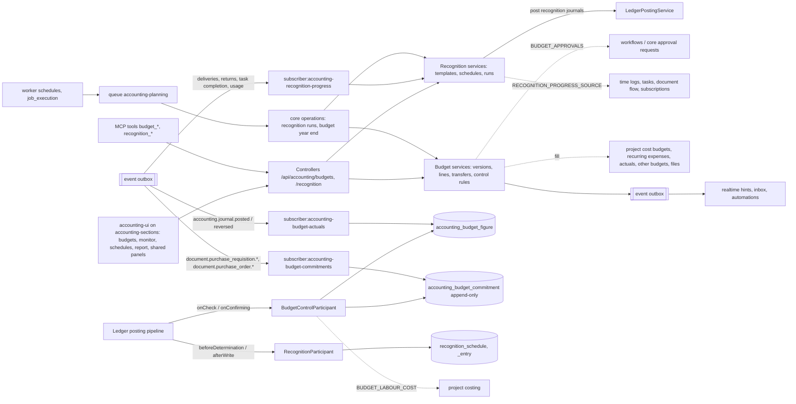

# Implementation Plan: Budgets and revenue schedules

> Translates an approved `spec.md` into architecture and tech choices. The plan owns
> implementation details; the spec owns behaviour.

**Feature ID**: `budgets-and-revenue-schedules`
**Spec**: `./spec.md`
**Tasks**: `./tasks.md`
**Status**: `Draft`
**Last updated**: 2026-11-23

---

## 1. Architecture Summary

Two modules of the existing `packages/plugins/accounting` plugin: `budget/` and `recognition/`. Both are internal
participants of the ledger's posting pipeline (`general-ledger` plan §4.1), so budget control runs inside the
posting check and the confirm hook, and a schedule is created in the same transaction as the journal that defers
its amount. Neither module writes ledger lines: recognition posts through `LedgerPostingService.post`. Purchasing,
invoicing, subscriptions and time tracking are reached through document events and optional ports.

The plan builds on what exists. Project and client budgets (`organization_project.budget` / `budgetType`,
`organization_contact.budget` / `budgetType`, the `project-budgets` and `client-budgets` reports) stay the hours and
cost caps owned by `project-costing-and-billing`; an accounting budget line on a project axis can be filled from a
project's cost budget and shows it as a reference in the monitor. The organization's and employees' recurring
expenses (`organization_recurring_expense`, `employee_recurring_expense`) are a fill source. Recognition and budget
runs are core operations (`packages/core/src/lib/operation`), not a run table of this plugin. Campaign spend caps of
the promotion plugin are a different concept and stay apart.



## 2. Tech Choices

| Concern | Choice | Rationale |
| ------- | ------ | --------- |
| Package | existing `packages/plugins/accounting` (+ `accounting-ui`, routes on the page location `accounting-sections`) | [platform architecture](../../architecture/business-suite.md) §2.2: budgets and revenue schedules belong to `accounting` |
| Feature codes | `AccountingFeatures.BUDGETS = 'FEATURE_BUDGETS'`, `AccountingFeatures.REVENUE_SCHEDULES = 'FEATURE_REVENUE_SCHEDULES'` added to `accounting.features.ts` (`defaultEnabled: false`); `@FeatureFlag` per controller; participants and consumers return at once when the code is off for the tenant or the profile is not live | two sub-features of one plugin |
| Budget lines | a line is identified across versions by `lineKey` = hash of target and axis values; amounts per fiscal period | stable identity for differences, transfers and figures |
| Figures | `accounting_budget_figure` maintained per line and period; `onConfirming` locks the figure rows it touches in key order (`FOR UPDATE` on PostgreSQL and MySQL, the database write lock on SQLite) inside the confirming transaction, then recalculates availability from the locked rows and applies the line's action (block, warn, require approval) to that result before it writes anything; the `onCheck` result is the preview only | spec FR-24, FR-32 |
| Reservation | at confirmation the control participant appends a `RESERVATION` commitment for the document; it becomes actual when the journal posts and is released if the document is cancelled (`document.<type>.cancelled`, consumed by `subscriber:accounting-budget-commitments`) | closes the gap between check and asynchronous posting |
| Billed order lines | a bill line with `purchaseOrderLineId` consumes the open commitment of that order line first: under the same figure lock the check counts only the part of the line above that commitment's open amount (at the order's rate, FR-27), and the same transaction appends the commitment's `CONSUME` record for the billed part (idempotency key `bill:<billLineId>`) beside the bill's `RESERVATION`; the release on posting (T21) finds that record and appends nothing more; when the bill is cancelled, before or after it posts, the transaction that handles its `document.<type>.cancelled` releases what is left of its `RESERVATION` and appends for each such line a `CONSUME` record of the opposite sign (idempotency key `bill-cancel:<billLineId>`), so the order line's open commitment again equals its open amount, while the reversal of a posted bill's journal gives the actual back (T16) | spec FR-18, FR-26: a fully committed order's bill is not counted twice |
| Commitments | append-only table (triggers as on `stock_movement`), one idempotency key per source event and line | spec FR-31 |
| Account of a commitment | `LedgerPostingService.preview` of the bill the order would become, through the order type's registered facts | same determination as the real posting |
| Recognition postings | `LedgerPostingService.post` with kind `RECOGNITION`, idempotency key `recognition:<entryId>` | single writer of the ledger |
| Runs | core `operation` rows of the types `ACCOUNTING_RECOGNITION_RUN` and `ACCOUNTING_BUDGET_YEAR_END` (`packages/core/src/lib/operation`, the runtime `general-ledger` uses for its procedures), steps in slices; per-entry results stay on `recognition_schedule_entry` (state, error, `operationId`) | no run table, no second run engine |
| Fill sources | another budget, ledger actuals (`LedgerBalanceService`), a file, the cost budgets of projects (`organization_project.budget` where `budgetType` is cost, onto lines on a project axis) and recurring expenses (`organization_recurring_expense`, `employee_recurring_expense`: monthly value times the periods it covers, by category, each category mapped once to an account and remembered) | build on the plans the platform already holds |
| Project budgets | read only, as a reference column beside lines on a project axis in the monitor; they remain the caps of `project-costing-and-billing` | one owner per budget concept |
| Approvals | port `BUDGET_APPROVALS` to the `workflows` engine; until it exists, core approval requests (`packages/core/src/lib/request-approval`, as `PurchaseApprovalService` uses them) | [platform architecture](../../architecture/business-suite.md) §3.6 |
| Progress | registry `RECOGNITION_PROGRESS_SOURCE`; shipped sources read core time logs, tasks and project modules, document-flow quantities and subscription usage | spec FR-53 to FR-58 |
| Money | `Money`, rounding and precision from `packages/core/src/lib/money`; amounts `numeric(20,6)` | money kernel |

## 3. Data Model

### New or changed entities

All tables extend the tenant and organization base. Amounts are `numeric(20,6)` in organization currency unless
named otherwise. No existing table changes; project and client budget fields stay untouched.

```ts
@MultiORMEntity('accounting_budget', { mikroOrmRepository: () => MikroOrmAccountingBudgetRepository })
export class AccountingBudget extends TenantOrganizationBaseEntity implements IAccountingBudget { /* columns below */ }
```

| Table | Columns (beyond the base) | Indexes and uniqueness |
| --- | --- | --- |
| `accounting_budget` | `name` varchar(160), `type` varchar(12) (`OPERATING`, `CAPITAL`), `scenario` varchar(64), `isControl` bool, `ledgerBookId` uuid null, `grain` varchar(8) (`PERIOD`, `QUARTER`, `YEAR`), `axisDimensionIds` text (JSON, at most four), `ownerUserId` uuid, `state` varchar(12) (`DRAFT`, `SUBMITTED`, `APPROVED`, `CLOSED`), `currentVersionId` uuid null, `tolerancePercent` numeric(9,4) null, `toleranceAmount` null, `unbudgetedAction` varchar(8), `yearEndPolicy` varchar(8) (`LAPSE`, `CARRY`), `thresholds` text (JSON, default `[80,100]`), `version` int | unique (live) `(organizationId, name, scenario)`; idx `(organizationId, state, isControl)` |
| `accounting_budget_year` | `budgetId` fk cascade, `fiscalYearId` fk restrict | unique `(budgetId, fiscalYearId)` |
| `accounting_budget_version` | `budgetId` fk cascade, `number` int, `state` varchar(12) (`DRAFT`, `SUBMITTED`, `APPROVED`, `SUPERSEDED`, `REJECTED`), `reason` text null, `effectiveFromPeriodId` uuid null, `approvalRequestId` uuid null, `approvedAt`, `approvedByUserId`, `totals` text (JSON) | unique `(budgetId, number)` |
| `accounting_budget_line` | `budgetId`, `versionId` fk cascade, `lineKey` char(64), `targetKind` varchar(8) (`ACCOUNT`, `GROUP`, `CATEGORY`), `targetId` uuid, `axisValues` text (JSON dimension to value or null), `specificity` int, `quantityUnit` varchar(16) null, `ownerUserId` uuid null, `note` varchar(512) null | unique `(versionId, lineKey)`; idx `(organizationId, targetKind, targetId)` |
| `accounting_budget_line_amount` | `lineId` fk cascade, `fiscalPeriodId` fk, `amount`, `quantity` null, `rate` null | unique `(lineId, fiscalPeriodId)` |
| `accounting_budget_transfer` | `budgetId`, `fromLineKey`, `fromPeriodId`, `toLineKey`, `toPeriodId`, `amount`, `reason`, `state` varchar(10) (`REQUESTED`, `APPROVED`, `REJECTED`), `approvalRequestId` null, `resultVersionId` null | idx `(budgetId, state)` |
| `accounting_budget_control_rule` | `budgetId` fk cascade, `lineKey` char(64) null (null = whole budget), `controlPoint` varchar(16) (`REQUISITION`, `PURCHASE_ORDER`, `ACTUAL`), `basis` varchar(8) (`PERIOD`, `YTD`, `YEAR`), `action` varchar(16) (`ALLOW`, `WARN`, `BLOCK`, `REQUIRE_APPROVAL`), `countCommitments` bool, `countPreCommitments` bool | unique `(budgetId, lineKey, controlPoint)` |
| `accounting_budget_commitment` (append-only) | `kind` varchar(16) (`PRE_COMMITMENT`, `COMMITMENT`, `RESERVATION`), `movement` varchar(8) (`RESERVE`, `ADJUST`, `CONSUME`, `RELEASE`, `CARRY`), `sourceType` varchar(64), `sourceId` uuid, `sourceLineId` uuid null, `accountId`, `dimensionSetId` null, `fiscalPeriodId`, `ledgerBookId` null, `amount` (signed), `documentCurrency`, `documentAmount`, `rate` numeric(20,10), `budgetId` null, `lineKey` null, `idempotencyKey` varchar(160) | unique `(organizationId, idempotencyKey)`; idx `(organizationId, sourceType, sourceId)`, `(organizationId, accountId, fiscalPeriodId)`, `(budgetId, lineKey, fiscalPeriodId)` |
| `accounting_budget_figure` | `budgetId`, `lineKey`, `fiscalPeriodId`, `budget`, `actual`, `committed`, `preCommitted`, `reserved`, `pendingLabour`, `pendingHours` numeric(20,6), `notifiedThresholds` text (JSON) | unique `(budgetId, lineKey, fiscalPeriodId)` |
| `accounting_budget_override` | `budgetId`, `lineKey`, `sourceType`, `sourceId`, `amount`, `reason`, `grantedByUserId`, `approvalRequestId` null, `consumedAt` null | unique `(sourceType, sourceId, budgetId, lineKey)` |
| `recognition_template` | `name` varchar(120), `direction` varchar(8) (`REVENUE`, `EXPENSE`), `method` varchar(16) (`DAYS`, `PERIODS`, `MANUAL`, `MILESTONE`, `DELIVERY`, `USAGE`, `TRACKED_TIME`), `termCount` int null, `termUnit` varchar(8) null, `startRule` varchar(16), `partPeriod` varchar(8) (`DAYS`, `FULL`, `HALF`), `deferralRole` varchar(64), `minimumAmount` null, `autoPost` bool null | unique (live) `(organizationId, name)` |
| `recognition_item_default` | `itemId` uuid, `variantId` uuid null, `direction` varchar(8), `templateId` fk restrict | unique (live) `(organizationId, itemId, variantId, direction)` |
| `recognition_schedule` | `direction`, `templateId` null, `method`, `state` varchar(10) (`ACTIVE`, `PAUSED`, `COMPLETED`, `CANCELLED`), `sourceType`, `sourceId`, `sourceLineId` null, `sourceNumber`, `sourceJournalId` null, `partyType` null, `partyId` null, `itemId` null, `projectId` null, `currency`, `amount` (document currency), `orgAmount`, `rate` numeric(20,10), `recognisedAmount`, `recognisedOrgAmount`, `deferralAccountId`, `targetAccountId`, `dimensionSetId` null, `ledgerBookId` null, `serviceStart` date, `serviceEnd` date null, `partPeriod`, `progressSource` varchar(32) null, `progressRef` text (JSON) null, `autoPost` bool, `version` int | unique (live) `(organizationId, sourceType, sourceLineId, direction)`; idx `(organizationId, state, direction)`, `(organizationId, deferralAccountId)`, `(organizationId, partyType, partyId)` |
| `recognition_schedule_entry` | `scheduleId` fk cascade, `sequence` int, `fiscalPeriodId`, `kind` varchar(10) (`PLANNED`, `EVENT`, `CATCH_UP`, `ADJUSTMENT`, `REVERSAL`), `dueDate` date, `amount`, `orgAmount`, `state` varchar(8) (`PLANNED`, `PROPOSED`, `POSTED`, `VOID`, `FAILED`), `journalId` null, `operationId` uuid null (the run that last handled it), `postedOn` date null, `evidence` text (JSON) null, `error` varchar(512) null | unique `(scheduleId, sequence)`; idx `(organizationId, state, dueDate)`, `(organizationId, fiscalPeriodId, state)`, `(operationId)` |
| `recognition_period_total` | `direction`, `deferralAccountId`, `ledgerBookId` null, `bookKey` varchar(36) not null (the `ledgerBookId`, or `*` for lines without a book; written with it, so the unique key holds on every dialect), `fiscalPeriodId`, `additions`, `recognised`, `adjustments`, `planned` | unique `(organizationId, direction, deferralAccountId, bookKey, fiscalPeriodId)` |

Settings (`accounting.settings.ts`): `budget.defaultAction` (`WARN`), `budget.defaultBasis` (`YTD`),
`budget.pendingLabourEnabled` (true), `budget.recurringExpenseAccountMap` (JSON category to account, filled by the
fill dialog), `recognition.autoPost` (false), `recognition.journalGrouping` (`RUN_AND_ACCOUNTS`),
`recognition.runOffsetDays` (0). Every table joins the core tenant export; none holds a secret.

### Migrations

**Migration timestamps**: `packages/plugins/accounting` `1791000074100` to `1791000074199`.

In `packages/plugins/accounting/src/lib/database/migrations/`, additive, idempotent, three dialects, both ORMs:
`1791000074100-CreateAccountingBudgetTables` (budget, year, version, line, amount, transfer, control rule),
`1791000074110-CreateAccountingBudgetCommitmentTables` (commitment with append-only triggers, figure, override),
`1791000074120-CreateRecognitionTables` (template, item default, schedule, entry, period total). No backfill; no column is
added to an existing table; default grants are `defaultFor` on the permission contributions (§9), not a seed.

### Contracts

`packages/contracts/src/lib/accounting-budget.model.ts` (`IAccountingBudget`, `IAccountingBudgetVersion`,
`IAccountingBudgetLine`, `IBudgetControlRule`, `BudgetControlPoint`, `BudgetControlAction`, `IBudgetCommitment`,
`IBudgetAvailability`, `IBudgetImpact`, `IBudgetTransfer`, `IBudgetOverride`) and `recognition.model.ts`
(`IRecognitionTemplate`, `RecognitionMethod`, `IRecognitionSchedule`, `IRecognitionEntry`, `IRecognitionProgress`,
`IRecognitionProgressSource`, `IDeferredBalanceReportRow`), exported from `index.ts`. `ILedgerPostingCheck` gains an
optional `budget?: IBudgetImpact[]`, and `ILedgerFactAmount.keys` documents the optional keys
`recognitionTemplateId`, `serviceStart`, `serviceEnd`, `orderLineId`, `purchaseOrderLineId` (additive).

## 4. API Surface

All under `/api/accounting`; guards as in `accounting-foundation` plan §1 with the sub-feature code; cursor
pagination; `Idempotency-Key` on creating, approving, posting and run-starting calls.

| Method | Endpoint | Permission | Description | Status |
| ------ | -------- | ---------- | ----------- | ------ |
| CRUD | `/budgets` | `ACCOUNTING_BUDGET_VIEW` / `ACCOUNTING_BUDGET_EDIT` | budgets (`If-Match` version on drafts) | New |
| `GET` `PUT` | `/budgets/:id/lines` (bulk grid upsert, per-row results) | view / edit | lines and period amounts of the draft version | New |
| `POST` | `/budgets/:id/fill` | `ACCOUNTING_BUDGET_EDIT` | `{ from: 'BUDGET' \| 'ACTUALS' \| 'FILE' \| 'PROJECT_BUDGETS' \| 'RECURRING_EXPENSES', sourceId?, percent?, distributionId?, categoryAccounts? }` | New |
| `POST` | `/budgets/:id/submit`, `/close` | `ACCOUNTING_BUDGET_EDIT` | lifecycle; submit opens the approval | New |
| `POST` | `/budgets/:id/approve`, `/reject` | `ACCOUNTING_BUDGET_APPROVE` | used by the approval inbox | New |
| `GET` `POST` | `/budgets/:id/versions`, `/versions/:n/diff`, `/revisions` | view / edit | history, difference, new revision | New |
| `GET` `POST` | `/budgets/:id/transfers`, `/transfers/:id/approve` | edit / approve | transfers (`preview` supported) | New |
| `GET` `PUT` | `/budgets/:id/control-rules` | view / `ACCOUNTING_BUDGET_CONTROL_EDIT` | rule matrix | New |
| `GET` | `/budgets/availability?accountId&dimensionSetId&date` | `ACCOUNTING_BUDGET_VIEW` | `IBudgetAvailability` | New |
| `GET` | `/budgets/:id/monitor`, `/budgets/:id/forecast` | `ACCOUNTING_BUDGET_VIEW` | grid figures (with the project's own budget as a reference on project-axis lines); run-rate forecast | New |
| `GET` | `/budget-commitments` (`?budgetId&lineKey&sourceType&sourceId`), `/budget-commitments/reconciliation` | `ACCOUNTING_BUDGET_VIEW` | records; difference to open orders | New |
| `GET` `POST` | `/budget-overrides` | view / `ACCOUNTING_BUDGET_OVERRIDE` | one-time overrides | New |
| `POST` | `/assist/budget-proposal`, `/assist/explain-variance` | edit / view | draft budget; drivers of a variance | New |
| CRUD | `/recognition/templates`, `/recognition/item-defaults` | `ACCOUNTING_SCHEDULE_VIEW` / `ACCOUNTING_SCHEDULE_TEMPLATE_EDIT` | templates and item defaults | New |
| `GET` `POST` | `/recognition/schedules`, `/recognition/schedules/:id` | view / `ACCOUNTING_SCHEDULE_EDIT` | list, detail, manual schedule | New |
| `POST` | `/recognition/schedules/:id/pause`, `/resume`, `/end`, `/reschedule` | `ACCOUNTING_SCHEDULE_EDIT` | changes (`preview` supported) | New |
| `POST` | `/recognition/runs` | `ACCOUNTING_SCHEDULE_RUN` (post: `ACCOUNTING_SCHEDULE_POST`) | `{ from, to, direction?, accountIds?, party?, preview, post }` → `202` with the operation; pause, resume and cancel through the core `/operations` routes | New |
| `GET` | `/recognition/integrity`, `/recognition/report`, `/recognition/forecast` | `ACCOUNTING_SCHEDULE_VIEW` | deferral account check; deferred balance report; forecast | New |

Report query (`/recognition/report`): `direction`, `from`, `to` (periods or fiscal years), `columns`
(`MONTH`, `QUARTER`, `YEAR`), `groupBy` (`ACCOUNT`, `PARTY`, `ITEM`, `PROJECT`, `DIMENSION:<id>`, `SCHEDULE`), `bookId`
→ rows of opening, additions, recognised, adjustments, closing per column plus `upcoming[]` per future period.

Internal participants of the posting pipeline (same plugin, no port): `BudgetControlParticipant`
(`onCheck(facts, lines)` → `IBudgetImpact[]` and findings `BUDGET_EXCEEDED`, `BUDGET_APPROVAL_REQUIRED`,
`BUDGET_WARNING`, a preview; `onConfirming(manager, facts, lines)` → takes the figure locks in key order, recalculates
availability from the locked rows with the billed part of order lines netted against their open commitments, applies
the line's action to that result (refuses, records the warning or raises the approval request), and only then writes
the reservation and the billed commitments' `CONSUME` records) and
`RecognitionParticipant` (`beforeDetermination(facts)` → swaps the role of a deferred amount to the template's
deferral role; `afterWrite(manager, journal, lines)` → creates or adjusts schedules).

Ports declared (optional, bound in `apps/api/src/plugin-composition.ts`): `BUDGET_APPROVALS` (workflow engine or
core approval requests), `BUDGET_COMMITMENT_SOURCE` (multi: `{ sourceType, describe(event) }` for sources beyond
purchasing), `BUDGET_LABOUR_COST` (`costOf({ employeeId, projectId, date, hours })`, answered by
`project-costing-and-billing`), `RECOGNITION_PROGRESS_SOURCE` (multi: `{ key, progress(ref, asOf) }` →
`{ done, total, records[] }`). Offered to other plugins: `BudgetAvailabilityService.availability(query)` (the query may carry `pendingLines`,
`{ sourceType, sourceLineId, amount }` lines a consumer has approved, `amount` being the line's current approved amount:
each one counts as an open commitment by the difference between that amount and what the commitment records of its
`sourceLineId` reserved (`RESERVE` and `ADJUST` records), which is its whole amount while no record exists, so a line
approved or amended a moment ago counts with its current amount before its event is projected and once after) and
`RecognitionPlanService.plan(template, amount, serviceStart, serviceEnd)` (for a preview on a document line).

**Consumer tokens answered** (bound in `apps/api/src/plugin-composition.ts` to `BudgetAvailabilityService`; each consumer plan states the shape it calls and its fallback): `PROJECT_ACCOUNTING_BUDGETS`, `PURCHASING_BUDGET_CHECK`.

## 5. Events, Real-Time and Notifications

| Event | Emitted when | Consumers (push channel, notifications, inbox, integrations, activity log) |
| ----- | ------------ | --------------------------------------------------------------------------- |
| consumed `document.purchase_requisition.confirmed` / `.amended` / `.cancelled` / `.closed` | `procurement` | `subscriber:accounting-budget-commitments`: pre-commitment records |
| consumed `document.purchase_order.confirmed` / `.amended` / `.cancelled` / `.closed` | `procurement` (existing `purchasing` plugin) | commitment records; conversion of pre-commitments through document links |
| consumed `accounting.journal.posted` / `.reversed` / `.edited` | `general-ledger` | `subscriber:accounting-budget-actuals`: actual figures (an edit moves them by its difference), reservation to actual, release of commitments for billed order lines (`keys.purchaseOrderLineId`) |
| consumed `document.<type>.cancelled` of a document holding a `RESERVATION` | document-owning plugins | `subscriber:accounting-budget-commitments`: release of the reservation and, for a bill, the opposite-sign `CONSUME` of its billed order lines |
| consumed `document.delivery.confirmed` / `.cancelled`, `document.sales_return.confirmed`; task and project-module completion (`ActivityLogEvent`); `subscription.usage.recorded` | delivery, core tasks, subscriptions | `subscriber:accounting-recognition-progress`: recompute event-driven schedules |
| consumed `accounting.fiscal_year.closed` | `general-ledger` | year-end handling of open commitments |
| `accounting.budget.submitted` / `.approved` / `.rejected` / `.revised` / `.closed` | lifecycle change | approvers and owner (inbox), activity log, realtime |
| `accounting.budget.transfer_approved` | transfer applied | owners of both lines |
| `accounting.budget.control_decided` `{ source, budgetId, lineKey, action, basis, budget, consumed, amount }` | a check warns, blocks or asks for approval | document owner (inbox on block), budget owner (approval request), automations |
| `accounting.budget.threshold_crossed`, `accounting.budget.breach_forecast` | figure passes a threshold; forecast predicts a breach | line owner (inbox once per threshold), automations |
| `accounting.budget.commitment_recorded` | commitment record appended | realtime availability |
| `accounting.recognition.schedule_created` / `.changed` / `.completed` / `.cancelled` | schedule lifecycle | realtime, subscription billing (link), activity log |
| `accounting.recognition.entry_posted` / `.entry_failed`, `accounting.recognition.run_finished` | run results | requester (inbox on failures), close checks |
| `accounting.recognition.integrity_failed` | deferral account differs from schedules | accounting administrators, close checklist |

Real-time hints: `accounting.budget_figures` (budget id), `accounting.recognition` (schedule id, run id). Inbox
items through `INBOX_ITEM_WRITER`; approval requests appear in the approval inbox of the workflow engine.

## 6. UI Surface

- Angular `accounting-ui`, routes on the page location `accounting-sections` (children of `/pages/accounting`):
  `budgets` (saved-view list), `budgets/:id` (grid of lines by period with paste, fill dialog with the project-budget
  and recurring-expense sources, seasonal distribution picker, versions and difference, transfers, control rules,
  approval panel), `budgets/:id/monitor` (figures, project budget reference, drill-down, scenario comparison,
  forecast), `budget-commitments`, `recognition/templates`, `recognition/schedules` and `recognition/schedules/:id`
  (plan, postings, evidence, change actions), `recognition/runs` (the plugin's operations), `recognition/report`
  (deferred balance report with upcoming columns). The existing project and client budget reports stay where they
  are. `ACCOUNTING.BUDGETS.*` and `ACCOUNTING.RECOGNITION.*` keys in 14 locales.
- Shared Angular components exported by `accounting-ui`: `ga-budget-impact-panel` (section of the accounting effects
  panel), `ga-budget-availability-chip` (purchase order, requisition and expense lines), `ga-recognition-fields`
  (template and service period on a document line with the planned entries as a preview).

## 7. MCP Tools, SDKs and Integrations

`packages/mcp-server/src/lib/tools/accounting-planning.ts`, registered in `register-all-tools.ts`:

| Tool | Input | Output |
| --- | --- | --- |
| `budget_list` / `budget_get` / `budget_monitor` | filters / id, scenario | budgets, lines, figures |
| `budget_draft_upsert`, `budget_submit`, `budget_revise` | budget and lines, `preview` | draft, version, difference |
| `budget_transfer_request` | from, to, amount, reason, `preview` | transfer |
| `budget_availability` | account, dimension set or references, date | availability |
| `budget_commitments` | budget or document | commitment records |
| `budget_override_grant` | document, line, amount, reason, `preview` | override |
| `budget_forecast`, `budget_variance_explain`, `budget_propose` | budget or line, period / year, growth | forecast, drivers, draft |
| `recognition_template_list`, `recognition_schedule_list` / `_get` | filters | templates, schedules with entries |
| `recognition_schedule_change` | id, action, parameters, `preview` | re-planned entries |
| `recognition_run` | range, filters, `preview`, `post` | entries and journals |
| `recognition_report`, `recognition_forecast`, `recognition_integrity_check` | report query | rows, forecast, differences |

SDK impact: additive OpenAPI paths; SDKs regenerated after merge. Import: budget lines from CSV or spreadsheet
(target code, axis value codes, twelve period columns or annual amount and distribution). Export: monitor and
report as CSV or spreadsheet. Report definitions registered with the report builder: `accounting.deferred_balance`
(spec FR-64), datasets `accounting.budget_figures`, `accounting.budget_commitments`,
`accounting.recognition_entries`. Close checks registered through `LEDGER_CLOSE_CHECK`: `recognition.due_posted`,
`recognition.deferral_agrees`, `budget.commitments_agree`.

## 8. Background Jobs

| Trigger | When | What it does | Idempotency |
| ------- | ---- | ------------ | ----------- |
| outbox consumers of §5 | on dispatch | commitments, actuals, progress | delivery record; commitment idempotency key `<eventId>:<lineId>:<movement>` |
| `accounting.budget.pending-labour` | every 15 minutes | sums time logs per project and team for open periods, values them through `BUDGET_LABOUR_COST`, upserts figures | upsert per figure row |
| `accounting.budget.figures-reconcile` | nightly | recomputes figures from `ledger_balance` and commitments; reports drift | upsert; finding per drifted row |
| `accounting.budget.forecast` | nightly | run-rate forecast, threshold and breach notices | `notifiedThresholds` per figure |
| `accounting.recognition.period-end` | daily tick | starts an `ACCOUNTING_RECOGNITION_RUN` operation for periods that ended (`recognition.runOffsetDays`) | operation idempotency key per organization and period; entry key |
| `accounting.recognition.progress` | daily and after progress events (debounced) | recomputes event-driven schedules, creates `EVENT` entries | entry unique `(scheduleId, sequence)`; cumulative rule |
| `accounting.recognition.integrity` | nightly | deferral accounts against schedules | finding per account and book |
| operation steps of `ACCOUNTING_RECOGNITION_RUN`, `ACCOUNTING_BUDGET_YEAR_END` | run start and resume | posts entries in slices; lapses or carries open commitments | `recognition:<entryId>` posting key; commitment idempotency key |

Worker hosts schedules only; the API hosts consumers, queue workers of `accounting-planning` and the registered
operation types; in-process timers without a queue. Every scheduled pass is a `job_execution` row. Jobs and steps run
in `RequestContext.runWithRequest` with a system actor of the organization.

## 9. Security & Permissions

New keys in `accounting.permissions.ts` (plugin contributions with `defaultFor` `SUPER_ADMIN` and `ADMIN`):
`ACCOUNTING_BUDGET_VIEW` (`defaultFor` also `MANAGER`), `ACCOUNTING_BUDGET_EDIT`, `ACCOUNTING_BUDGET_APPROVE`, `ACCOUNTING_BUDGET_CONTROL_EDIT`,
`ACCOUNTING_BUDGET_OVERRIDE`, `ACCOUNTING_SCHEDULE_VIEW`, `ACCOUNTING_SCHEDULE_EDIT`,
`ACCOUNTING_SCHEDULE_TEMPLATE_EDIT`, `ACCOUNTING_SCHEDULE_RUN`, `ACCOUNTING_SCHEDULE_POST`. Edit and approve are
separate keys, and an approver cannot approve a version they submitted (the self-approval rule of core approval
requests). The budget impact shown in a document's effects preview needs only read access to the document and
shows amounts of the matched line, not the whole budget. Pending labour is aggregated per line; per-employee
detail requires the existing time-tracking permissions. No secrets; nothing leaves the platform.

## 10. Observability

- Activity log: budget lifecycle, versions, transfers, overrides, control decisions (with figures), schedule
  changes, run start and end.
- Metrics: control check latency, figure lock wait, commitment lag after order events, pending-labour job
  duration, recognition entries posted and failed per run, integrity differences, forecast breaches.
- Scheduler job execution log and dead-letter list; failures raise inbox items.

## 11. Phased Rollout

1. **Phase 1 — Budgets.** Budgets, lines, distributions, versions, approval, revisions, monitor with actuals
   from the ledger, availability, import and export. Usable: plan and compare against actuals.
2. **Phase 2 — Control and commitments.** Control rules, posting-check participant, reservation, purchase order
   and requisition commitments, overrides, thresholds.
3. **Phase 3 — Recognition schedules.** Templates, item defaults, schedules from invoices and bills, time-based
   methods, runs, catch-up, credit note and cancellation handling, integrity, close checks, deferred balance report.
4. **Phase 4 — Advanced capabilities.** Scenarios, transfers, require-approval, pending labour, forecast, variance
   explanation, budget proposal, event-driven recognition (milestone, delivery, usage, tracked time), forecast of
   recognition, live figures.
5. **Phase 5 — General availability**: the feature is off by default; after the trial period it may be switched on by default for new tenants only; existing tenants keep their setting until an administrator changes it.

## 12. Constitution Reconciliation

- I Plugin-first: modules of `accounting`; other plugins reached through events and ports; runs are core
  operations; project budgets and recurring expenses are read, not copied.
- II Tenant/organization scoping: every table on the tenant and organization base.
- III Both ORMs, additive migrations: MultiORM entities, MikroORM repositories, tri-dialect migrations, triggers.
- IV Default-off flag; nothing removed: two codes off by default; existing project, client and campaign budgets
  untouched.
- V Contracts and API first: `accounting-budget.model.ts`, `recognition.model.ts`; additive change to the posting
  contract.
- VI Permissions, privacy, security: ten keys with contributed default grants, separation of edit and approve,
  aggregated labour.
- VII Real-time through the event bus: outbox consumers and events, realtime hints.
- VIII i18n and accessibility: keys in 14 locales; keyboard grid.
- IX Tests: unit, database, ORM parity, concurrency and method fixtures, e2e.
- X Behaviour-first spec: details live here.
- XI Documentation describes our platform only.

## 13. Risks & Mitigations

| Risk | Likelihood | Impact | Mitigation |
| ---- | ---------- | ------ | ---------- |
| Figure rows become a lock hotspot at high document volume | Medium | Medium | lock only the matched rows, in key order; checks are short; budgets with action `ALLOW` skip the lock |
| Figures drift from ledger and commitments | Medium | High | nightly reconcile with findings; figures are derived and rebuildable |
| Commitment account differs from the account the bill finally uses | Medium | Low | release is by source line, not by account; reclassification moves actuals only |
| Purchase order events not published by the purchasing plugin | High (without `procurement`) | Medium | phase 2 depends on those events; phase 1 and 3 do not |
| Cost rate for pending labour unavailable | High (without project costing) | Low | hours shown without amount; port left unbound |
| Event-driven recognition posts on wrong progress data | Low | High | cumulative rule, cap at schedule amount, evidence stored, proposals by default, reversal on correction |
| Deferral account used manually | Medium | Medium | integrity check, close check, offer to create a schedule |

## 14. References

- Spec: `./spec.md` · Tasks: `./tasks.md`
- Ledger contract: `../general-ledger/plan.md` §4.1 (posting service, pipeline participants, close checks) and §5
- Foundation: `../accounting-foundation/plan.md` (accounts, periods, dimension sets, seasonal distributions)
- Existing code used: `packages/plugins/purchasing/src/lib/purchasing.types.ts` (`PurchaseOrderStatus`),
  `packages/plugins/purchasing/src/lib/purchase-approval/purchase-approval.service.ts`,
  `packages/core/src/lib/request-approval`, `packages/core/src/lib/time-tracking/time-log/time-log.entity.ts`,
  `packages/core/src/lib/invoice-item` (`purchaseOrderLineId`), `packages/core/src/lib/event-outbox`,
  `packages/core/src/lib/organization-project` (`budget`, `budgetType`), `organization-recurring-expense`,
  `employee-recurring-expense`, `operation`, `job-execution`, `packages/scheduler`
- Related plans: `../procurement/plan.md`, `../invoicing-receivables-payables/plan.md`,
  `../subscription-billing/plan.md`, `../project-costing-and-billing/plan.md`, `../approval-workflows/plan.md`
