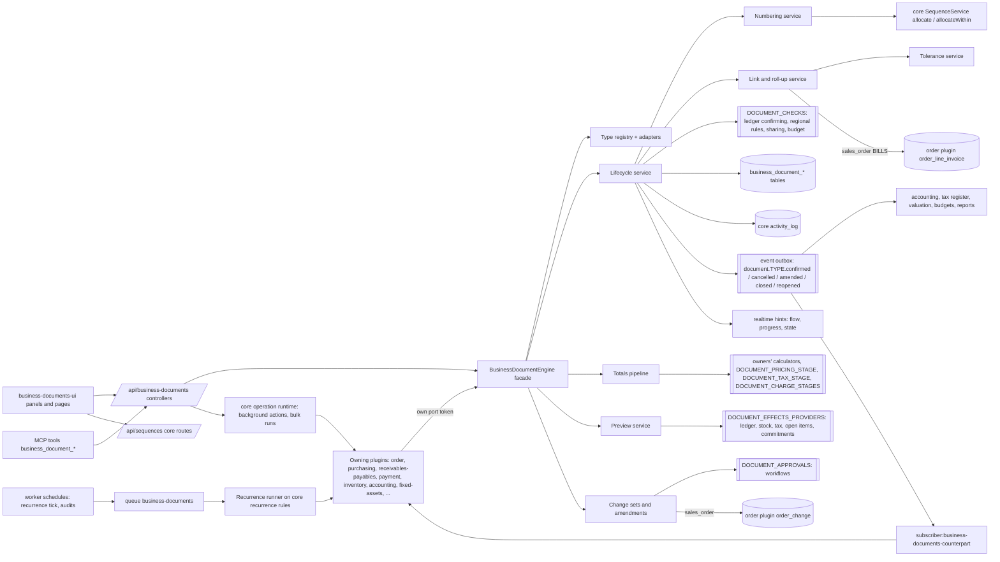

# Implementation Plan: Business document engine

> Translates an approved `spec.md` into architecture and tech choices. The plan owns
> implementation details; the spec owns behaviour.

**Feature ID**: `business-document-engine`
**Spec**: `./spec.md`
**Tasks**: `./tasks.md`
**Status**: `Draft`
**Last updated**: 2026-11-23

---

## 1. Architecture Summary

A new plugin `@gauzy/plugin-business-documents` (`packages/plugins/business-documents`, with `business-documents-ui`). Owning plugins keep their documents in their own tables and never import this plugin: each binds its own port token (`SALES_DOCUMENTS`, `PURCHASING_DOCUMENTS`, `LEDGER_DOCUMENTS`, `BUSINESS_DOCUMENT_ENGINE`, …) to the engine facade in `apps/api/src/plugin-composition.ts`, registers its types at bootstrap with an adapter, and calls the engine **inside its own transaction** (the `EntityManager` argument idiom of `EventOutboxService.append`). The engine keeps an index of every registered document and line, owns links, roll-ups, tolerances, numbering series, change sets, totals snapshots and recurrences, and publishes `document.<type>.<verb>` to the event outbox. It builds on what the platform already has: counters are core `sequence` rows under the core `/sequences` routes and permissions; background confirmations and bulk runs are core operations (`packages/core/src/lib/operation/`); lifecycle history is the core activity log; an order's change requests are the order plugin's `order_change` and its billed lines are `order_line_invoice`; the recurrence rules are the core recurrence module this feature lifts out of `invoice-schedule`. §4.1 is the contract every owning plugin builds against.



## 2. Tech Choices

| Concern | Choice | Rationale |
| ------- | ------ | --------- |
| Package | new plugin pair `business-documents`, `business-documents-ui`; no React package (document screens are the Gauzy web app) | Principle I; [platform architecture](../../architecture/business-suite.md) §3.1 |
| Coupling | owners bind their tokens to `BusinessDocumentEngine`; the engine reaches owners only through their registered adapter and its own optional ports | no plugin imports another |
| Transactions | every engine write takes the caller's manager (TypeORM `EntityManager` or MikroORM manager) and joins its transaction | spec FR-10, all or nothing |
| Numbering | core `SequenceService`: `ensure` per resolved prefix (key `<seriesKeyBase>@<prefix>`), `allocate` for ordinary series, new additive `allocateWithin(manager, key, options)` for gap-free series (also replaces the locking code of the inventory plugin's `InventorySequenceService`); counters are read, moved forward and restarted through the core `/sequences` routes (`GET ?keyPrefix=`, new `POST /:id/advance`, `POST /:id/reset`) under the core `SEQUENCES_VIEW` / `SEQUENCES_EDIT`, which also guard the series routes; `business_document_series` holds only what `sequence` lacks (pattern tokens, selector, validity, gap-free, chronology) | one numbering kernel, one counter route, one permission pair |
| Background work | core operation runtime: operation types `BUSINESS_DOCUMENT_CONFIRM`, `BUSINESS_DOCUMENT_CANCEL`, `BUSINESS_DOCUMENT_CANCEL_CHAIN` and `BUSINESS_DOCUMENT_BULK` registered with `OperationRegistry` at module init; `@AcceptedOperation` answers `202` with the core handle (`Location: /api/operations/:id`); step retry policy, lease, stalled-run recovery, cancel and `UQ_operation_aggregate_live` replace any own run table, heartbeat or sweep; per-item outcomes of a bulk run through `api/bulk-executor.service.ts` into `business_document_bulk_item` | one runtime for long and bulk work |
| Schedules | `@ScheduledJob` in the worker (`BusinessDocumentsSchedulePlugin`), `@QueueWorker` in the API, in-process timers without a queue root | task-automations layout |
| Recurrence | core `packages/core/src/lib/recurrence/` lifted from `invoice-schedule.rules.ts` (day-key periods in the organization's time zone, extended with daily, quarterly, half-yearly and yearly cadences, intervals, last-day rules, skip dates, holiday shift through `OfficialHolidayService`, catch-up) plus the run idioms of `invoice_schedule_run` (occurrence claimed before creating, author permission re-read per run, pause with reason); `invoice-schedule` computes its periods through it unchanged; the engine's document recurrences are the second user | one recurrence implementation |
| History | lifecycle entries (confirm, cancel, hold, close, change set, amendment, override, void) are core `activity_log` rows (`entity` = the type's record type, `entityId` = the owner's id, `updatedFields` / `previousValues` / `updatedValues` for state and version, `actorType` `User` / `Agent` / `System`, reason and change-set id in `data`); the history tab merges the owner's own log where one exists (`order_history`, `invoice_estimate_history`) through `adapter.history` | no third per-document log |
| Order changes and order-invoice links | for `sales_order`, a change set is the order plugin's `order_change` (+ `order_change_action`): the order adapter's `proposeChangeSet` / `applyChangeSet` create and drive it, and `order.changeTtlMinutes` decides its expiry; an order line billed by an invoice is the order plugin's `order_line_invoice` row, written through the order adapter's `link`, with `business_document_link` as its index entry in the same transaction | one change model and one link store per order |
| Tolerances | `business_document_tolerance` for subjects the owners do not hold; for `RECEIVED` the chain also reads, through the purchasing adapter, the per-delivery allowance, the supplier's term for the item (`vendor_product_term.overReceiptTolerancePercent`) and the purchase order's own allowance, the levels `GoodsReceiptService.resolveOverReceiptTolerance` reads today, and the setting `purchasing.overReceiptTolerancePercent` as the organization level until a receipt tolerance is saved | one tolerance answer per receipt |
| Totals | the pipeline orders the stages and freezes the snapshot; each stage is answered by the owner's existing calculator through the adapter where one exists (orders: `order-totals.service.ts` with `order_summary`; carts: `cart/src/lib/totals/`; invoices: the invoice totals with the organization's `discountAfterTax`) or by a stage port; tax breakdown rows are core `tax_line` rows written by the tax stage | no parallel totals implementation |
| Quantities and money | core decimal helpers `STORAGE_SCALE`, `toUnitsAtScale`, `normalizeDecimalString`, `formatDecimalUnits` (`packages/core/src/lib/money/decimal.ts`) for roll-ups, tolerances and line close; amounts `numeric(20,6)`, rates `numeric(20,10)`, percents `numeric(9,4)` | money kernel |
| Conditions | core rule evaluator (`rule.evaluator.ts`) with new owner types `DOCUMENT_SERIES`, `DOCUMENT_RECURRENCE_SKIP` (column is `varchar(32)`, no migration) | no second expression language |
| Settings | plugin setting contributions in `business-documents.settings.ts` stored in `tenant_setting` at `ORGANIZATION` scope: default change-set expiry, price tolerance action and percent, series pick, and the per-type policies (`businessDocuments.typePolicies`, JSON keyed by type; for a `preexisting` type it also holds the engine rules of spec FR-113 — `lockConfirmed`, `refuseCancelWithDependents`, `refuseDelete`, `requireNumberOverride`, `refuseSourceState`, `returnChecks`, `mergeChecks`, `createFromChecks` (`WARN` or `REFUSE`), `backgroundRecalculation` — every one off or `WARN` by default) | platform settings store |
| Idempotency | core `idempotency` (`@Idempotent` on create routes; series allocation keys); `UQ_operation_tenant_idem` for background starts; unique keys on links and occurrences | API convention |
| Events | `EventOutboxService.append` in the action's transaction; `EventConsumerRegistry` for the counterpart consumer | Principle VII |
| Real time | `RealtimeHintsService.appendHint` (realtime plugin) on channel `business_document:<rootId>`; bulk progress from the core operation events | no private channel |
| Text search | the `search` plugin's provider (`search.service.ts`, `database-search.provider.ts`, existing definitions for invoices, orders, contacts and products) through the optional port `DOCUMENT_TEXT_SEARCH` for `q` and lookup text; the index serves structured filters | one search path |
| Reports | report definitions registered in the core reports catalogue (`report`, `report_category`, `report_organization`, `showInMenu`) so they appear in the Reports menu of tenants with the feature on (their category keyed `FEATURE_BUSINESS_DOCUMENTS` in the shared catalogue feature filter of `report-builder-and-dashboards`); data from `/api/business-documents/reports/:key` | one Reports menu |
| Permissions | plugin permission contributions with `defaultFor` in `business-documents.permissions.ts`; no seeding migration | grants declared once, not seeded |
| Preview token | stateless HMAC over document id, version, content fingerprint, actor and expiry with the API's signing secret | spec FR-82, no table |
| Existing schedules | the recurrences page lists core invoice schedules read-only through `InvoiceScheduleService` | spec FR-92; nothing migrated |
| Feature gate | `FEATURE_BUSINESS_DOCUMENTS` contribution (default off), `FeatureFlagGuard` + `@FeatureFlag` on every controller and resolver | [platform architecture](../../architecture/business-suite.md) §6 |
| Tests | Jest unit specs, `*.db.spec.ts` on SQLite, ORM parity specs, a contract-test kit (test document type and adapter) exported for owners | Principle IX |

Existing behaviour the engine delegates to rather than repeats: core estimates (`invoice` with `isEstimate`, accepted by public link through `estimate-email` and `public-share/invoice`, converted by `convertAcceptedEstimates`) are the `quotation` type of invoicing, and that conversion is its `QUOTES` link; `invoice.vendorId` and `invoice.fromOrganizationId` are the fields a counterpart bill or an inter-organization invoice carries; `order-state-machine.ts` and `purchasing.immutable.ts` stay the owners' own "no change after confirmation" rules, which the `DOCUMENT_CONFIRMED` refusal of the engine reports for those types. Every type that exists before the engine registers with `preexisting: true`: the lifecycle service skips each engine-added refusal of spec FR-113 unless the organization's type policy turns it on, keeps the owner's numbering moment and typed numbers, and the owners' existing routes keep their DTOs (an `If-Match` or version is honoured when sent, never required there).

## 3. Data Model

### New or changed entities

All tables extend `TenantOrganizationBaseEntity` (soft delete, `isActive`, `isArchived`); JSON is `text` on every dialect; ids of other plugins' rows carry no foreign key. Prefix `business_document_` omitted in the first column.

| Table | Columns (beyond the base) | Indexes and uniqueness |
| --- | --- | --- |
| `business_document` | `type` varchar(64), `sourceId` uuid, `number` varchar(64) null, `seriesId` uuid null, `state` varchar(12) (`DRAFT`, `CONFIRMED`, `CANCELLED`, `AMENDED`, `CLOSED`), `ownerStatus` varchar(32) null, `version` int, `rootId` uuid, `amendmentNo` int default 0, `amendedById` uuid null, `title` varchar(255) null, `partyType` varchar(16) null, `partyId` uuid null, `documentDate` date, `postingDate` date null, `currency` varchar(3) null, `rate` null, `netAmount`, `taxAmount`, `grandTotal`, `orgGrandTotal` null, `isOnHold` bool, `holdReason` varchar(255) null, `progress` text, `isOutOfDate` bool, `confirmedAt`, `confirmedByUserId`, `actorKind` varchar(8), `cancelledAt`, `closedAt` null | unique `(tenantId, type, sourceId)`; unique live `(organizationId, type, number)`; idx `(organizationId, type, state, documentDate)`, `(organizationId, partyType, partyId, documentDate)`, `(rootId)` |
| `business_document` `_line` | `documentId` fk cascade, `sourceLineId` uuid, `lineNo` int, `itemId`, `variantId` uuid null, `description` varchar(512) null, `quantity` null, `unitCode` varchar(16) null, `isWholeUnit` bool, `unitPrice`, `netAmount`, `orgNetAmount` null, `state` varchar(10) (`OPEN`, `COMPLETED`, `CLOSED`), `completedWithinTolerance` bool, `closedAt`, `closedByUserId`, `closeReason` varchar(255) null, `amendedFromLineId` uuid null | unique `(documentId, sourceLineId)`; idx `(organizationId, itemId)` |
| `_line_rollup` | `lineId` fk cascade, `rollUp` varchar(12), `quantity`, `amount`, `pendingQuantity` | unique `(lineId, rollUp)` |
| `_link` | `kind` varchar(12), `rollUp` varchar(12) null, `sourceDocumentId` fk restrict, `sourceLineId` null, `targetDocumentId` fk cascade, `targetLineId` null, `sourceLineKey`, `targetLineKey` varchar(36) (null-safe), `quantity`, `amount` null, `currency` varchar(3) null, `state` varchar(10) (`PENDING`, `ACTIVE`, `RELEASED`), `override` text null, `ownerLinkId` uuid null (the owner's own link row, e.g. `order_line_invoice.id`) | unique `(sourceDocumentId, sourceLineKey, targetDocumentId, targetLineKey, kind)`; idx `(targetDocumentId)`, `(sourceLineId, state)` |
| `_series` | `documentType` varchar(64), `name` varchar(120), `pattern` varchar(120), `sequenceKeyBase` varchar(96) (its counters are the core `sequence` rows keyed `<sequenceKeyBase>@<prefix>`), `isDefault` bool, `position` int, `selector` text null, `numberOn` varchar(8), `dateBasis` varchar(16), `isGapFree` bool, `isChronological` bool, `amendmentNaming` varchar(8) (`SUFFIX`, `FRESH`), `validFrom`, `validUntil` date null, `lastNumberedDate` date null, `lastNumberedDocumentId` uuid null | unique live `(organizationId, documentType, name)`; idx `(organizationId, documentType, position)` |
| `_number` | `seriesId` fk, `sequenceKey` varchar(160), `value` bigint, `number` varchar(64), `documentId` uuid null, `state` varchar(8) (`RESERVED`, `USED`, `VOIDED`), `documentDate` date null, `allocatedAt`, `allocatedByUserId`, `voidReason` varchar(255), `voidedByUserId`, `voidedAt` null | unique `(organizationId, seriesId, number)`; idx `(seriesId, value)`, `(organizationId, state)` |
| `_tolerance` | `rollUp` varchar(12), `subjectType` varchar(12) (`ORGANIZATION`, `ITEM_GROUP`, `ITEM`, `PARTY`), `subjectId` uuid null, `subjectKey` varchar(36), `overPercent`, `overQuantity`, `underPercent`, `underQuantity` null | unique live `(organizationId, rollUp, subjectType, subjectKey)` |
| `_change_set` | `documentId` fk cascade, `fromVersion`, `toVersion` int null, `state` varchar(10) (`DRAFT`, `SUBMITTED`, `APPROVED`, `APPLIED`, `REJECTED`, `WITHDRAWN`, `EXPIRED`, `FAILED`), `openKey` uuid null (= documentId while open), `reason` text, `changes`, `diff`, `effects` text, `approvalRequestId` null, `externalRef` varchar(128) null, `requestedByUserId`, `decidedByUserId` null, `decidedAt`, `decisionNote` text, `appliedAt`, `expiresAt` | unique `(openKey)` (one open per document on every dialect); idx `(organizationId, state)` |
| `_totals` | `documentId` fk cascade, `version`, `currency`, `rate`, `stages` text, `netAmount`, `discountAmount`, `taxAmount`, `chargesAmount`, `roundingAdjustment`, `grandTotal`, `advanceAmount`, `amountDue`, `orgGrandTotal`, `amountInWords` varchar(512), `netWeight` null, `weightUnit` varchar(8) null | unique `(documentId, version)` |
| `_recurrence` | `originDocumentId` fk restrict, `documentType`, the core recurrence rule columns (`frequency` varchar(12), `interval` int, `dayOfMonth` int null (−1 = last), `weekday`, `month` int null, `startOn`, `endOn` date null, `maxOccurrences` int null, `timeZone` varchar(64), `skipDates` text, `holidayPolicy` varchar(16) (`NONE`, `SKIP`, `NEXT_WORKING_DAY`), `catchUp` varchar(8) (`ALL`, `LATEST`, `NONE`)), `occurrenceCount` int, `nextOn` date null, `mode` varchar(12) (`DRAFT`, `CONFIRM`, `CONFIRM_SEND`), `state` varchar(8) (`ACTIVE`, `PAUSED`, `ENDED`), `pausedUntil` date null, `pauseReason` varchar(255), `ownerUserId`, `notifyUserIds` text, `lastRunAt`, `failureCount` int | idx `(state, nextOn)`, `(organizationId, documentType)` |
| `_recurrence_run` | `recurrenceId` fk cascade, `occurrenceOn` date, `outcome` varchar(10) (`CREATED`, `CONFIRMED`, `SENT`, `SKIPPED`, `PAUSED`, `CAUGHT_UP`, `FAILED`), `documentId` null, `reason` varchar(64) null, `error` text null, `attempts` int (same claim-before-create idiom as `invoice_schedule_run`) | unique `(recurrenceId, occurrenceOn)` |
| `_bulk_item` | `operationId` uuid (the core `operation` of type `BUSINESS_DOCUMENT_BULK`), `position` int, `sourceDocumentId` uuid, `sourceNumber` varchar(64), `groupKey` varchar(160) null, `status` varchar(14) (`PENDING`, `RUNNING`, `CREATED`, `SKIPPED`, `FAILED`, `NOT_PROCESSED`), `targetDocumentId` null, `targetNumber` null, `reason` varchar(64), `error` text, `attempts` int | unique `(operationId, sourceDocumentId)`; idx `(operationId, status, position)` |

Not tables of this plugin, by design: a bulk run's state, counts, requester, idempotency key and heartbeat are the core `operation` row (type `BUSINESS_DOCUMENT_BULK`, `input` = conversion, mode, grouping and selection, `state` = counts, one step per slice of 50 sources); a background confirm or cancel is a core operation (`aggregateType` = the document type, `aggregateId` = the owner's document id, so `UQ_operation_aggregate_live` keeps one open per document); lifecycle history is `activity_log`; per-type policies are settings; an order's change set is its `order_change`.

Owner counters that become projections written by `adapter.apply` from the roll-ups (the owners keep the columns and their readers): `order_line.deliveredQuantity`, `fulfilledQuantity` and `shippedQuantity` (`order-line-fulfillment.service.ts`), `order_line.invoicedQuantity` and `creditedQuantity` (from `order_line_invoice`), `order_line.returnReceivedQuantity` (`returns.quantity.ts`), `purchase_order_line.receivedQuantity` and `billedQuantity` (`purchasing.quantity.ts`), and the picked and packed counts of `fulfillment.quantity.ts`.

Changed in core (additive): `SequenceService` gains `allocateWithin(manager, key, { at?, channelId? })` (row lock where the dialect has one, compare-and-swap otherwise, on the caller's transaction) and `advanceSeries(id, nextValue)` (forward only, refused at or below the current next value, and refused for keys an optional `SEQUENCE_COUNTER_GUARD` port claims, which the engine binds for gap-free series); `SequenceController` gains `POST /sequences/:id/advance` (`SEQUENCES_EDIT`) and a `keyPrefix` filter on `GET /sequences`; the `sequence` table is unchanged. New core module `packages/core/src/lib/recurrence/` (rule functions and run helper lifted from `invoice-schedule.rules.ts`, which keeps its exports as re-exports). Contracts: `RuleOwnerType` gains `DOCUMENT_SERIES`, `DOCUMENT_RECURRENCE_SKIP`; `recurrence.model.ts` gains `IRecurrenceRule`, `RecurrenceFrequency`, `RecurrenceHolidayPolicy`, `RecurrenceCatchUp`.

### Migrations

**Migration timestamps**: `packages/plugins/business-documents` `1791000070100` to `1791000070199`.

In `packages/plugins/business-documents/src/lib/database/migrations/`, with the shared core migration helpers of `@gauzy/core`; additive, idempotent, PostgreSQL, MySQL and SQLite, registered for both ORMs: `1791000070100-CreateBusinessDocumentIndexTables` (document, line, roll-up, link), `1791000070110-CreateBusinessDocumentNumberingTables` (series, number), `1791000070120-CreateBusinessDocumentControlTables` (tolerance, change set, totals), `1791000070130-CreateBusinessDocumentAutomationTables` (recurrence, recurrence run, bulk item). No existing table changes, so no backfill; the first-enable index run fills `business_document*` from owners (§8). Role grants come from the permission contributions' `defaultFor`, not from a migration.

### Contracts

`packages/contracts/src/lib/business-document.model.ts` (exported from `index.ts`): enums `BusinessDocumentState`, `DocumentLinkKind` (`QUOTES`, `FULFILS`, `RECEIVES`, `BILLS`, `RETURNS`, `REQUESTS`, `CALLS_OFF`, `PAYS`, `COPIES`, `RECURS`, `AMENDS`, `COUNTERPART`), `DocumentRollUp` (`ORDERED`, `REQUESTED`, `DELIVERED`, `RECEIVED`, `BILLED`, `RETURNED`, `PICKED`, `PACKED`, `INSTALLED`, `PAID`), `DocumentEffectArea` (`LEDGER`, `STOCK`, `TAX`, `OPEN_ITEMS`, `COMMITMENTS`), `TotalsStage`, `DocumentAction`, `BusinessDocumentOperationType`; interfaces of §4.1; `IBusinessDocument`, `IBusinessDocumentLine`, `IDocumentLink`, `INumberingSeries`, `INumberRecord`, `ITolerance`, `IDocumentTypePolicy`, `IChangeSet`, `IChangeSetDiff`, `ITotalsSnapshot`, `IDocumentRecurrence` (extends the core `IRecurrenceRule`), `IRecurrenceRun`, `IBulkItem`, `IDocumentFlow`, `IDocumentEffects`, `IBusinessDocumentEvent`.

## 4. API Surface

### 4.1 Engine contract (in-process)

```ts
interface IBusinessDocumentTypeRegistration {
    type: string; owner: string;                 // `<type>` of document.<type>.<verb>; owning package
    preexisting?: boolean;                       // a type that exists before the engine: engine-added rules are policies, off by default (FR-113)
    labelKey: string; route: string;             // i18n key; UI route template, e.g. '/pages/sales/orders/:id'
    permissions: { view: string; create: string; confirm: string; cancel?: string; amend?: string; close?: string };
    numbering: { seriesKeyBase: string; defaultPattern: string; numberOn: 'CREATE' | 'CONFIRM';
                 naming: 'SERIES' | 'FIELD' | 'PROMPT'; gapFreeAllowed: boolean };
    states?: { key: string; labelKey: string; lifecycle: BusinessDocumentState }[];   // owner statuses on top
    partyTypes?: ('CONTACT' | 'VENDOR' | 'EMPLOYEE' | string)[]; hasLines: boolean; postingType?: boolean;
    sources?: { from: string; kind: DocumentLinkKind; rollUp?: DocumentRollUp; lineLevel: boolean;
                tolerance?: 'APPLY' | 'EXEMPT'; merge?: 'NEVER' | 'BY_PARTY_CURRENCY'; bulk?: boolean;
                copy?: ('TERMS' | 'NOTES' | 'REFERENCES' | 'ATTACHMENTS')[];
                checks?: { sameParty?: boolean; sameCurrency?: boolean; priceTolerance?: boolean; notBeforeSource?: boolean } }[];
    returns?: { of: string[]; standalone: boolean };
    changeSet?: { fields: { path: string; labelKey: string; kind: 'FREE' | 'CONTROLLED'; accounting?: boolean }[];
                  lineFields: string[]; addLines: boolean; removeLines: boolean;
                  store?: 'ENGINE' | 'OWNER' };       // OWNER: the owner's change records are the change sets (sales_order: order_change)
    linkStores?: { from: string; kind: DocumentLinkKind }[];  // links the owner stores itself (sales_order BILLS: order_line_invoice)
    amendable: boolean; closable: boolean; holdable: boolean;
    totals?: { stages: TotalsStage[] };          // LINES, PRICING, DOCUMENT_DISCOUNT, TAXES, CHARGES, ROUNDING, TOTALS
    effects?: DocumentEffectArea[];
    recurrence?: { dateFields: string[]; periodFields?: [from: string, to: string][] };
    counterpart?: { type: string };              // e.g. customer_invoice -> supplier_bill
    background?: { confirm?: 'ALWAYS' | { aboveLines: number }; cancel?: 'ALWAYS' | { aboveLines: number } };
    referenceFields?: string[];                  // dependent-draft lookup beyond links
    adapter: IBusinessDocumentAdapter;
}
interface IBusinessDocumentAdapter {             // implemented by the owner; every call joins the manager's transaction
    snapshot(m: Manager, ref: IDocumentRef): Promise<IBusinessDocumentSnapshot>;   // header, lines, party, dates, totals inputs
    apply(m: Manager, ref: IDocumentRef, t: { state: BusinessDocumentState; version: number; number?: string;
          totals?: ITotalsSnapshot; progress?: IDocumentProgress }): Promise<void>;  // owner writes its own columns and status
    perform(m: Manager, action: DocumentAction, ref: IDocumentRef, input: object): Promise<IDocumentActionResult>; // owner's full path, joins the manager's transaction
    check?(m: Manager, ref: IDocumentRef, action: DocumentAction): Promise<IDocumentFinding[]>;
    createFrom?(m: Manager, req: ICreateFromRequest): Promise<IDocumentRef>;         // bulk, counterpart, "create from"
    copy?(m: Manager, ref: IDocumentRef, o: ICopyOptions): Promise<IDocumentRef>;    // recurrence, amendment
    applyChangeSet?(m: Manager, ref: IDocumentRef, changes: IChangeSetChanges): Promise<void>;
    proposeChangeSet?(m: Manager, ref: IDocumentRef, changes: IChangeSetChanges, reason: string): Promise<IOwnerChangeRef>; // store OWNER
    link?(m: Manager, link: ILinkRequest): Promise<{ ownerLinkId: ID }>;                // linkStores: writes the owner's link row
    toleranceLevels?(m: Manager, line: IDocumentLineRef, rollUp: DocumentRollUp): Promise<IToleranceLevel[]>; // owner-held allowances
    totalsStage?(m: Manager, stage: TotalsStage, input: ITotalsInput): Promise<ITotalsStageResult | null>;    // owner's calculator
    history?(ref: IDocumentRef): Promise<IDocumentHistoryEntry[]>;                     // owner's own log (order_history, ...)
    canCloseLine?(m: Manager, line: IDocumentLineRef): Promise<IDocumentFinding | null>;
    eventData?(m: Manager, ref: IDocumentRef, verb: string): Promise<{ data?: JsonData; posting?: ILedgerPostingFacts }>;
    deleteDraft?(m: Manager, ref: IDocumentRef): Promise<void>;
    enumerate?(organizationId: ID, cursor?: string): Promise<IIndexPage>;           // first-enable: snapshots, links, roll-ups
}
interface IBusinessDocumentEngine {              // the facade every owner port binds to
    register(r: IBusinessDocumentTypeRegistration): void;
    track(m: Manager, s: IBusinessDocumentSnapshot, links?: ILinkRequest[]): Promise<IBusinessDocument>; // drafts
    numberNow(m: Manager, ref: IDocumentRef): Promise<IAllocatedNumber>;              // types numbered at creation
    confirm(m: Manager, ref: IDocumentRef, o: { version: number; overrideReason?: string; previewToken?: string }): Promise<IDocumentActionResult>;
    cancel(m: Manager, ref: IDocumentRef, o: { version: number; reason: string }): Promise<IDocumentActionResult>;
    hold / release / close / reopen(m, ref, o): Promise<IDocumentActionResult>;
    closeLines / reopenLines(m: Manager, ref: IDocumentRef, lineIds: ID[], reason: string): Promise<IDocumentActionResult>;
    remaining(line: IDocumentLineRef, rollUp: DocumentRollUp): Promise<{ base: string; rolled: string; remaining: string; allowedMax: string }>;
    totals(input: ITotalsInput): Promise<ITotalsSnapshot>;                            // pure; preview and confirm share it
    preview(ref: IDocumentRef, action: DocumentAction, payload?: object): Promise<IDocumentEffects>;
    proposeChangeSet / applyChangeSet / amend(...): Promise<...>;
    dependents(ref: IDocumentRef, o?: { draftsOnly?: boolean }): Promise<IDocumentRefSummary[]>;
    flow(ref: IDocumentRef): Promise<IDocumentFlow>;
    allocate(m: Manager, o: { documentType: string; organizationId: ID; date: string; selector?: object }): Promise<IAllocatedNumber>;
}
```

`IDocumentActionResult` = `{ document, number?, version, findings: IDocumentFinding[], warnings, eventId? }`; `IDocumentFinding` = `{ code, severity: 'BLOCK' | 'WARN', source, lineId?, message, details? }`. Codes: `DOCUMENT_CONFIRMED`, `DOCUMENT_VERSION_STALE`, `DOCUMENT_SOURCE_NOT_OPEN`, `DOCUMENT_SOURCE_ON_HOLD`, `DOCUMENT_TOLERANCE_EXCEEDED`, `DOCUMENT_RETURN_EXCEEDS`, `DOCUMENT_RETURN_PRICE`, `DOCUMENT_PARTY_MISMATCH`, `DOCUMENT_CURRENCY_MISMATCH`, `DOCUMENT_PRICE_TOLERANCE`, `DOCUMENT_DATE_BEFORE_SOURCE`, `DOCUMENT_WHOLE_UNIT`, `DOCUMENT_HAS_CONFIRMED_DEPENDENTS`, `DOCUMENT_CHANGE_SET_OPEN`, `DOCUMENT_CHANGE_BELOW_ROLLED`, `NUMBER_SERIES_MISSING`, `NUMBER_CHRONOLOGY`, `NUMBER_DUPLICATE`, `PREVIEW_TOKEN_REQUIRED`, `PREVIEW_TOKEN_STALE`; owners and checks add their own.

**Confirm order** (one transaction, the owner's): load index with version check → `adapter.check` → `DOCUMENT_CHECKS`
(`onConfirm`) → totals pipeline → series selection and number (`allocateWithin` when gap-free, then chronology) → link activation (owner-stored links through `adapter.link`), tolerance check under a row lock on each source line, roll-ups and progress → `adapter.apply` (number, state, totals, owners' progress counters) → totals snapshot, `activity_log` entry, `business_document_number` → outbox append. A blocking finding throws `DocumentActionRefusedException` (`422`) with every finding; nothing is written. Quantities are compared as scaled integers with `toUnitsAtScale` at `STORAGE_SCALE`; the 0.01 % epsilon and the 100 % snap use the same helpers.

**Tolerance chain** (most specific first): the allowance stated for this delivery (owner-held) → `ITEM` with `PARTY` (owner-held: for `RECEIVED`, the supplier's term `vendor_product_term.overReceiptTolerancePercent` read through the purchasing adapter's `toleranceLevels`) → `ITEM` → `ITEM_GROUP` → `PARTY` → `ORGANIZATION` (a saved row, else for `RECEIVED` the setting `purchasing.overReceiptTolerancePercent`) → the document's own allowance (owner-held: the purchase order's) → zero for types registered by new features, no limit for roll-ups of a type registered with `preexisting: true` (spec FR-46, FR-113). With the flag on, purchasing's `GoodsReceiptService.resolveOverReceiptTolerance` asks the engine's `remaining` through its `PURCHASING_DOCUMENTS` port, so a receipt has one answer.

**Totals stages** delegate: `LINES` and `DOCUMENT_DISCOUNT` go to `adapter.totalsStage` when the owner has a calculator (order: `OrderTotalsService` and `order_summary`; cart: `cart/src/lib/totals/`; invoice: the invoice totals with `discountAfterTax` and `separateInvoiceItemTaxAndDiscount`), else to the engine's distribution; `PRICING`, `TAXES` and `CHARGES` go to their ports; tax breakdown rows are core `tax_line` rows written by the tax stage and referenced from the snapshot; `ROUNDING` and `TOTALS` are the engine's. The golden set of AC-7 replays each owner's calculator through the pipeline.

**Change sets of owners with their own mechanism** (`changeSet.store = 'OWNER'`): for `sales_order`, proposing a change set calls the order adapter's `proposeChangeSet`, which creates an `order_change` with its `order_change_action` rows (one non-terminal change per order stays the order plugin's partial unique index); submitting, approving, declining and applying drive that change; its expiry is `order.changeTtlMinutes` and `order-change-staleness.scheduler.ts`, not the engine's default; the engine writes no `_change_set` row and shows the diff and history from the order change. Other types use `business_document_change_set`, which keeps the same shape (one open per document, produced version, typed changes) because the order plugin's table cannot be shared without other owners depending on the order plugin.

**Change approval thresholds**: when `DOCUMENT_APPROVALS` is bound (approval workflows on), its approval rules for the record type alone decide and the type policy's `changeApproval` and thresholds are ignored and hidden for that type; when unbound, the type policy (settings) is the only source. The two never apply to the same type at once.

**Ports this plugin declares** (optional tokens in `business-documents.types.ts`; unbound = stage or area absent):
`DOCUMENT_PRICING_STAGE` (pricing `PricingQuoteService`), `DOCUMENT_TAX_STAGE` (tax `TaxDocumentService`: calculate, validate, breakdown), `DOCUMENT_CHARGE_STAGES` (multi: delivery charges), `DOCUMENT_CHECKS` (multi: `{ key, actions, check(m, ctx) }` — accounting binds `LedgerPostingService.confirming`, regional packs their document checks, organization-structure its allow-list check, budgets their reservations), `DOCUMENT_EFFECTS_PROVIDERS` (multi: `{ area, preview(snapshot, action) }` — accounting `LedgerPostingService.preview`, inventory stock preview, tax register preview, receivables open items, budgets commitments), `DOCUMENT_APPROVALS` (workflows; unbound → permission approval), `DOCUMENT_FISCAL_CALENDAR` (accounting-foundation; unbound → organization `fiscalStartDate`), `DOCUMENT_ORGANIZATION_PROFILE` (organization-structure: short code, internal party → organization, relationship policy), `DOCUMENT_UNITS` (item-catalogue: whole-number units, conversions), `DOCUMENT_LOT_BUNDLES` (lot-serial-tracking), `DOCUMENT_TEXT_SEARCH` (the `search` plugin's provider; unbound → prefix match on number and title), `DOCUMENT_REPORTS` (report builder: also offers the definitions there; the core reports catalogue lists them either way). Holidays come from core `OfficialHolidayService` through the core recurrence module (no port).

**Core sequence guard** the engine binds: `SEQUENCE_COUNTER_GUARD` (core, optional) refuses `advanceSeries` and `resetSeries` on the keys of a gap-free series.

**Services other plugins bind to**: `BusinessDocumentEngine` (owner tokens above, plus `FIXED_ASSETS_DOCUMENTS`,
`WAREHOUSE_DOCUMENTS`, `PAYMENT_DOCUMENTS`, `POS_DOCUMENTS` as their plans name them), `BusinessDocumentReader` (`TAX_DOCUMENT_READER`: enumerate drafts, open orders and recurring documents), `DocumentFlowService` (`REPORT_DOCUMENT_FLOW`: open quantities per roll-up), `DocumentPreviewService` (`REPORT_EFFECTS_PREVIEW`), and the close check `business-documents.drafts-in-period` contributed to `LEDGER_CLOSE_CHECK`.

### 4.2 REST

All under `/api/business-documents`, `@FeatureFlag(FEATURE_BUSINESS_DOCUMENTS)`, cursor pagination, `If-Match` on document actions, `Idempotency-Key` on creating routes. Document routes check the registered type permission.

| Method | Endpoint | Permission | Description | Status |
| ------ | -------- | ---------- | ----------- | ------ |
| `GET` | `/types`, `/conversions` | `BUSINESS_DOCUMENTS_VIEW` | registered types (states, sources, change-set fields, effects); bulk conversions | New |
| `GET` `POST` `PUT` | `/series`, `/series/:id` | core `SEQUENCES_VIEW` / `SEQUENCES_EDIT` | series per type with pattern validation; each series lists its per-prefix counters from core `GET /api/sequences?keyPrefix=<sequenceKeyBase>@` | New |
| `POST` `GET` | `/series/:id/preview`, `/series/:id/audit?from&to` | core `SEQUENCES_VIEW` | next numbers for a date; audit (used, voided, gaps, date breaks) | New |
| `POST` | core `/api/sequences/:id/advance`, `/api/sequences/:id/reset` | core `SEQUENCES_EDIT` | move a counter forward (refused at or below the highest used number and, through `SEQUENCE_COUNTER_GUARD`, for gap-free series); restart | Extended (core) |
| `POST` | `/numbers/:id/void` | `BUSINESS_DOCUMENTS_NUMBER_VOID` | void a reserved number with a reason | New |
| `GET` | `/documents?type&state&partyId&q`, `/documents/:type/:id` | type view | index list (`q` through `DOCUMENT_TEXT_SEARCH`) and entry with lines and progress | New |
| `GET` | `/documents/:type/:id/flow`, `/history`, `/dependents` | type view | flow graph, history (activity log merged with the owner's log), dependent drafts | New |
| `POST` | `/documents/:type/:id/dependents/resolve` | type create | `{ items: [{ ref, action: UNLINK \| DELETE }] }`, result per draft | New |
| `POST` | `/documents/:type/:id/preview` | type view | `{ action, payload? }` → `IDocumentEffects` + `previewToken` | New |
| `POST` | `/documents/:type/:id/confirm`, `/cancel`, `/close`, `/reopen`, `/hold`, `/release`, `/amend` | type permission | delegate to `adapter.perform` (identical to the owner's route); a background type answers `202` with the core operation handle (`@AcceptedOperation`); the outcome is read at `GET /api/operations/:id`, and a document's background actions at `GET /api/operations?aggregateType=<type>&aggregateId=<id>` | New |
| `POST` | `/documents/:type/:id/cancel` with `{ withDependents, preview }` | type cancel permission on every member of the chain | chain preview and all-or-nothing cancel (up to 100): the engine opens one transaction for the chain and passes its manager to every member's `adapter.perform`, so a refusal of any member rolls back the cancellations before it; run as operation `BUSINESS_DOCUMENT_CANCEL_CHAIN` when above the background threshold | New |
| `POST` | `/documents/:type/:id/lines/close`, `/lines/reopen` | `BUSINESS_DOCUMENTS_LINE_CLOSE` | `{ lineIds, reason }` | New |
| `GET` | `/documents/:type/:id/lines/:lineId/remaining` | type view | remaining per roll-up and allowed maximum | New |
| `GET` `POST` | `/documents/:type/:id/change-sets`, `/change-sets/:id` | type view / type amend or `_CHANGE_REQUEST` | list (for `sales_order`, its order changes); propose (diff returned) | New |
| `POST` | `/change-sets/:id/submit`, `/approve`, `/reject`, `/withdraw`, `/apply` | `_CHANGE_REQUEST` / `_CHANGE_APPROVE` | workflow of a change set (for `sales_order`, drives the order change) | New |
| `POST` | `/totals/preview` | type create | unsaved draft → `ITotalsSnapshot` | New |
| `GET` `POST` `PUT` `DELETE` | `/tolerances` | `BUSINESS_DOCUMENTS_TOLERANCE_EDIT` | tolerances | New |
| `GET` `PUT` | `/policies/:type` | `_POLICY_EDIT` | the type's policy, read from and written to the settings store (`businessDocuments.typePolicies`, `ORGANIZATION` scope) | New |
| `GET` `POST` `PUT` | `/recurrences`, `/recurrences/:id`, `/recurrences/preview` | `_RECURRENCE_MANAGE` + type create | CRUD; next occurrences through the core recurrence rules | New |
| `POST` `GET` | `/recurrences/:id/pause`, `/resume`, `/skip`, `/run-now`, `/runs` | `_RECURRENCE_MANAGE` | control and history | New |
| `POST` | `/bulk-runs` | `BUSINESS_DOCUMENTS_BULK_RUN` | start: `202` with the core operation handle (`preview: true` lists planned outcomes synchronously); progress, cancel and retry of the run are the core `/api/operations/:id`, `/cancel`, `/retry` | New |
| `GET` `POST` | `/bulk-runs/:operationId/items`, `/items.csv`, `/bulk-runs/:operationId/retry-failed` | `BUSINESS_DOCUMENTS_BULK_RUN` | per-item log; CSV; a child operation over the failed items | New |
| `GET` | `/lookups/:field?documentType&context` | type create | context-aware record lookup; text part through `DOCUMENT_TEXT_SEARCH` | New |
| `GET` | `/reports/:key` | `BUSINESS_DOCUMENTS_VIEW` + type view | data of the catalogue's report definitions: trends, number audit, overrides, closed lines, change sets, bulk results | New |

GraphQL (behind `FEATURE_GRAPHQL`): read fields `businessDocument`, `businessDocumentFlow`, `numberingSeries` in the plugin's schema extension. Errors as `422` with findings, `409` for stale versions and open change sets.

**Consumer tokens answered** (bound in `apps/api/src/plugin-composition.ts` to the `BusinessDocumentEngine` facade and its document reader; each consumer plan states the shape it calls and its fallback): `CUSTOM_FIELDS_NUMBERING`, `DATA_EXCHANGE_DOCUMENTS`, `MANUFACTURING_DOCUMENTS`, `MARKETING_DOCUMENT_FLOW`, `ORGANIZATION_DOCUMENTS`, `PAYROLL_DOCUMENTS`, `PRINT_DOCUMENTS`, `SUBCONTRACTING_DOCUMENTS`, `WORKFLOW_DOCUMENTS`.

## 5. Events, Real-Time and Notifications

Appended in the action's transaction; `name` `document.<type>.<verb>`, `aggregateType` `<type>`, `aggregateId` the owner's id, `partitionKey` `document:<rootId>` (root of the amendment chain), so a chain is consumed in order.

```ts
interface IBusinessDocumentEvent {
    document: { type: string; id: ID; indexId: ID; number?: string; version: number; state: BusinessDocumentState;
                tenantId: ID; organizationId: ID; documentDate: string; postingDate?: string; currency?: string;
                rate?: string; party?: { type: string; id: ID }; totals?: ITotalsSnapshot; rootId: ID };
    previousVersion?: number; previous?: { id: ID; number?: string; version: number };  // amended
    changeSetId?: ID; changedFields?: string[]; accountingFieldsChanged?: boolean;
    links: { kind: DocumentLinkKind; sourceType: string; sourceId: ID; sourceLineId?: ID; targetLineId?: ID;
             quantity?: string; amount?: string }[];
    reason?: string; actor: { kind: 'USER' | 'AGENT' | 'SYSTEM'; userId?: ID };
    posting?: ILedgerPostingFacts; data?: JsonData;                                      // from adapter.eventData
}
```

| Event | Emitted when | Consumers |
| ----- | ------------ | --------- |
| `document.<type>.confirmed` | confirmation | accounting posting, tax register, valuation, budgets, counterpart consumer, reports, webhooks |
| `document.<type>.cancelled` | cancellation | reversals in every engine; counterpart consumer |
| `document.<type>.amended` | change set applied (same id, `previousVersion`) or amendment confirmed (`previous`) | correction pairs, tax register, valuation |
| `document.<type>.closed` / `.reopened` | document closed or reopened | acknowledged by posting engines; owners' projections |
| `business_document.progress_changed` | a source's roll-ups changed | realtime, owners' lists, automations |
| `business_document.change_set.submitted` / `.approved` / `.rejected` / `.applied` / `.expired` | change-set workflow (engine change sets; order changes keep the order plugin's own events) | inbox to approvers and author |
| `business_document.number_voided` / `.number_gap_detected` | void; audit found a gap | inbox to series administrators |
| `business_document.tolerance_overridden` | confirmation above tolerance | automations, reports |
| `business_document.recurrence.occurred` / `.skipped` / `.paused` / `.failed` / `.ended` | recurrence tick | inbox to owner and notified users |
| core `operation.completed` of the types `BUSINESS_DOCUMENT_BULK`, `_CONFIRM`, `_CANCEL`, `_CANCEL_CHAIN` | a bulk run or background action ended (done or failed) | the plugin's consumer posts the inbox item to the requester and the realtime document state |

Every lifecycle action, change-set decision, override, void and configuration change also writes one `activity_log` row in the same transaction (the record's history; no separate log). Consumer `subscriber:business-documents-counterpart` reads `document.<type>.confirmed|cancelled` of types with a counterpart, resolves the party through `DOCUMENT_ORGANIZATION_PROFILE`, and calls the counterpart owner's `createFrom` inside `RequestContext.runWithRequest` with a system actor of the counterpart organization; the unique `COUNTERPART` link makes it once. Real-time hints: `business_document` (state), `business_document_flow` (root id); bulk progress through the core operation step events. Inbox items through `INBOX_ITEM_WRITER`.

## 6. UI Surface

- Angular `business-documents-ui` (lazy; menu entries carry permissions and `FEATURE_BUSINESS_DOCUMENTS`, so with the flag off the Settings menu stays as today): `/pages/settings/numbering` is the one numbering screen of the platform (none exists today): it lists every core `sequence` row of the organization (key, prefix, padding, next value, reset policy, channel) under `SEQUENCES_VIEW` through the core `/sequences` routes, moves a counter forward or restarts it under `SEQUENCES_EDIT`, and, with the flag on, groups the rows under their document series with the pattern editor (token help, live next-number preview) and the audit; `/pages/settings/numbering/tolerances` and `/policies`; `/pages/business-documents/recurrences` (list, editor with occurrence preview, runs, and the core invoice schedules read-only); `/pages/business-documents/bulk-runs` (the core operations of type `BUSINESS_DOCUMENT_BULK` with live progress, the item log, retry of failed items and CSV).
- Exported components for owners' pages, registered as tabs through `PageTabRegistryService`: `DocumentFlowComponent` (SVG graph with a list view), `DocumentHistoryComponent` (the record's activity log, merged with `order_history` or `invoice_estimate_history` where the owner has one), `EffectsPreviewPanelComponent`, `ChangeSetDialogComponent` and `ChangeSetDiffComponent`, `DependentDraftsDialogComponent`, `LineCloseDialogComponent`, `RecurrenceDialogComponent`, `DocumentStateBadgeComponent`, `DocumentFormShellComponent` (panel slots other features fill, e.g. accounting's effects panel), and a bulk action for saved-view lists (`BulkRunLauncherComponent`). Strings under `BUSINESS_DOCUMENTS.*` in every locale.

## 7. MCP Tools, SDKs and Integrations

`packages/mcp-server/src/lib/tools/business-documents.ts`, registered in `register-all-tools.ts`:

| Tool | Input | Output |
| --- | --- | --- |
| `business_document_types`, `numbering_series_list` | none; type | types; series with next number |
| `business_document_get`, `_flow`, `_dependents` | type, id | entry, lines, progress; graph; drafts |
| `business_document_preview` | type, id, action, payload? | effects, findings, `previewToken` |
| `business_document_confirm`, `_cancel`, `_close_lines` | type, id, version, `previewToken` / reason / lines | result; refused without a fresh token for agents |
| `business_document_change_set_propose`, `_submit` | type, id, changes, reason | diff with effects; submitted change set |
| `business_document_recurrence_preview`, `_create`, `_pause`, `_resume` | origin, cadence, rules | next occurrences; recurrence |
| `business_document_bulk_run_start`, `_status`, `_retry` | conversion, selection, mode, `preview` | planned outcomes or run; progress; retried items |
| `numbering_series_audit` | series, period | used, voided, gaps |

These sit beside the existing invoice tools of `packages/mcp-server/src/lib/tools/invoices.ts` (`get_highest_invoice_number`, `update_estimate_status`, …), which keep working; with the flag on, `get_highest_invoice_number` reads the invoice series' number records. SDK: additive OpenAPI; regenerate SDKs after merge. Export: bulk-run log and number audit as CSV through `packages/utils/src/lib/spreadsheet-safe.ts`. No outbound integration of its own; webhooks receive the §5 events through the platform webhook module.

## 8. Background Jobs

| Trigger | When | What it does | Idempotency |
| ------- | ---- | ------------ | ----------- |
| `business-documents.recurrence.tick` | every 15 min (worker) → queue | due recurrences in the organization's time zone from the core recurrence rules: skip rules, catch-up, `adapter.copy` as the owner's actor (permission re-read per run, pause on loss), run record | unique `(recurrenceId, occurrenceOn)` claimed before creating |
| core operation `BUSINESS_DOCUMENT_BULK` | on start; resumed by the core lease and stalled-run recovery | one step per slice of 50 sources, each in its own transaction through `BulkExecutor`; step retry policy exponential, three attempts (5, 30, 120 min); `cancelRequested()` checked between slices | `UQ_operation_tenant_idem`; one live run per requester and conversion through `UQ_operation_aggregate_live` (`aggregateType` `business_document_bulk`, `aggregateId` a name-based id of requester and conversion); `(operationId, sourceDocumentId)` |
| `business-documents.index.first-enable` (queue) | feature enabled for a tenant | `adapter.enumerate` per type and organization, cursor kept per type | unique index keys; resumable cursor |
| `business-documents.number.audit` | nightly 02:30 | gap and chronology check of gap-free series, raises events | one finding per gap |
| `business-documents.change-set.expire` | daily 01:00 | expires open engine change sets past `expiresAt` (order changes expire through the order plugin's staleness scheduler) | state transition |
| core operations `BUSINESS_DOCUMENT_CONFIRM`, `_CANCEL`, `_CANCEL_CHAIN` | background confirm, cancel or chain cancel requested | one step running the owner's action through `adapter.perform` in one transaction; chain cancel walks dependents leaves first inside one transaction whose manager every `adapter.perform` call of the chain joins; a functional refusal fails the operation without retry (`maxAttempts` 1) | `UQ_operation_aggregate_live` (one live operation per document) |
| `business-documents.totals.refresh` (consumer) | `tax.configuration.changed`, price list events | marks affected drafts out of date, recalculates in slices | version check per draft |

The worker loads `BusinessDocumentsSchedulePlugin` (schedules only); the API loads `BusinessDocumentsPlugin` (queue workers, consumers, operation type registrations). Without a queue root the API runs the ticks on in-process timers under a per-tenant lock. Jobs and operation steps run inside `RequestContext.runWithRequest` with the recurrence owner or requester as actor, or a system actor of the organization for audits and the counterpart consumer.

## 9. Security & Permissions

New keys in `business-documents.permissions.ts` (plugin permission contributions with `defaultFor`): `BUSINESS_DOCUMENTS_VIEW`, `_NUMBER_VOID`, `_NUMBER_OVERRIDE`, `_TOLERANCE_EDIT`, `_TOLERANCE_OVERRIDE`, `_LINE_CLOSE`, `_CHANGE_REQUEST`, `_CHANGE_APPROVE`, `_RECURRENCE_MANAGE`, `_BULK_RUN`, `_POLICY_EDIT` (eleven). Series and counters use the existing core `SEQUENCES_VIEW` and `SEQUENCES_EDIT`. `defaultFor`: super admin and admin all; manager `VIEW`, `LINE_CLOSE`, `CHANGE_REQUEST`, `RECURRENCE_MANAGE`, `BULK_RUN`; data entry `VIEW`, `CHANGE_REQUEST`; viewer `VIEW`; existing tenants receive missing rows through the platform's permission reload. Engine keys never replace the owner's: confirm, cancel and amend need the type's own permission too. Agents act through a user or service account; confirm tools require a preview token bound to that actor. Flow and lookups filter by the viewer's read permission per type and organization; hidden nodes are counted, never described. Change-set reasons and decision notes are sanitised text. No secret is stored.

## 10. Observability

- Activity-log entries for every lifecycle action and for series, tolerance, policy and recurrence changes, overrides and voids; background actions and bulk runs visible in the core operations list with their steps and last error.
- Metrics: confirmation overhead, allocation latency per series, roll-up lock waits, preview latency per area, recurrence lag, bulk throughput and failure rate, first-enable progress. Scheduler executions and dead letters through the scheduler package; failures raise inbox items.

## 11. Phased Rollout

1. **Phase 1 — Contract, numbering and lifecycle.** Contracts, registry, index, lifecycle with activity-log history and events, numbering series with tokens over the existing core service and its allocation inside the caller's transaction, the
core recurrence module, the numbering screen over every core sequence, generic routes, contract-test kit. Usable: owners register and number; administrators manage every series in one screen.
2. **Phase 2 — Links and controls.** Links, roll-ups, returns, tolerances, line close, dependent drafts, document checks, totals pipeline, effects preview aggregation, change sets and amendments, read-only flow.
3. **Phase 3 — Automation.** Recurrence, bulk runs, first-enable indexing, lookups, trends and other report definitions, MCP read tools.
4. **Phase 4 — Advanced capabilities.** Gap-free series with audit, live flow graph, change-set approval and diff, agent preview tokens and write tools, skip, pause and catch-up rules, resumable bulk runs with retries, counterpart pairs.
5. **Phase 5 — General availability**: the feature is off by default; after the trial period it may be switched on by default for new tenants only; existing tenants keep their setting until an administrator changes it.

## 12. Constitution Reconciliation

- I Plugin-first: new plugin pair; core gains additive numbering methods (`allocateWithin`, `advanceSeries`, a counter guard port) and the shared recurrence module lifted from invoice schedules; owners integrate through ports only.
- II Tenant/organization scoping: every table scoped; counterparts written in the other organization's scope.
- III Both ORMs, additive migrations: MultiORM entities, MikroORM repositories, tri-dialect migrations, no drop.
- IV Default-off flag; nothing removed: `FEATURE_BUSINESS_DOCUMENTS` off; owners' numbering and changes stay.
- V Contracts and API first: `business-document.model.ts`, the registration and event contract, REST before UI.
- VI Permissions, privacy, security: eleven keys plus the core sequence keys and owner permissions; preview tokens; filtered flow.
- VII Real-time through the event bus: outbox events and realtime hints.
- VIII i18n and accessibility: keys in every locale; graph with list view; keyboard dialogs.
- IX Tests: unit, SQLite database, ORM parity, concurrency (gap-free, roll-up race), contract kit for owners, e2e.
- X Behaviour-first spec: details live here.
- XI Documentation describes our platform only.

## 13. Risks & Mitigations

| Risk | Likelihood | Impact | Mitigation |
| ---- | ---------- | ------ | ---------- |
| Contract drift with twenty owners | High | High | contracts in `@gauzy/contracts`, contract-test kit and a test document type, start-up validation of registrations |
| Engine slows confirmation | Medium | High | budget of 150 ms, index writes batched per document, checks run before locks, metrics per stage |
| Gap-free serialisation limits throughput | Medium | Medium | opt-in per series, short lock window at the end of the transaction, SQLite single writer documented |
| Roll-up drift between owner counters and the index | Medium | High | the owner counters listed in §3 become projections written by `adapter.apply`; `order_line_invoice` stays the one store of order billing links; nightly comparison report; rebuild from links |
| Lifting the invoice-schedule rules changes existing billing | Low | High | the lift is a move with re-exports; the existing `invoice-schedule.rules.spec.ts` and run specs pass unchanged before any new cadence is added |
| First-enable indexing of large tenants | Medium | Medium | per-type cursors, slices, progress, feature usable for new documents meanwhile |
| Transaction joining differs between ORMs | Medium | High | one manager abstraction as the outbox uses; ORM parity specs for confirm and cancel |

## 14. References

- Spec: `./spec.md` · Tasks: `./tasks.md`
- Siblings: `../general-ledger/plan.md` (§4.1 posting contract, `LEDGER_DOCUMENTS`), `../tax-engine/plan.md` (`DOCUMENT_TAX_STAGE`, `TAX_DOCUMENT_READER`), `../procurement/plan.md`, `../sales-order-management/plan.md`, `../invoicing-receivables-payables/plan.md`, `../warehouse-and-stock-movements/plan.md`, `../financial-reports/plan.md`, `../regional-compliance-packs/plan.md`, `../organization-setup/plan.md`
- Code: `packages/core/src/lib/sequence`, `rule`, `event-outbox`, `idempotency`, `operation`, `api/async-operation.ts`, `api/accepted.decorator.ts`, `api/bulk-executor.service.ts`, `activity-log`, `reports`, `tax-line`, `money/decimal.ts`, `official-holiday`; `packages/plugins/order/src/lib/order-change`, `order-change-action`, `order-line-invoice`, `order-totals`, `order-history`; `packages/plugins/purchasing/src/lib/goods-receipt/goods-receipt.service.ts`, `purchasing.quantity.ts`; `packages/plugins/inventory/src/lib/inventory-sequence.service.ts`; `packages/plugins/search`; `packages/core/src/lib/invoice-schedule` (rules lifted to `packages/core/src/lib/recurrence`), `packages/plugins/task-automations` (plugin layout, schedules), `packages/plugins/inbox/src/lib/database` (migration helpers), `apps/api/src/plugin-composition.ts`
