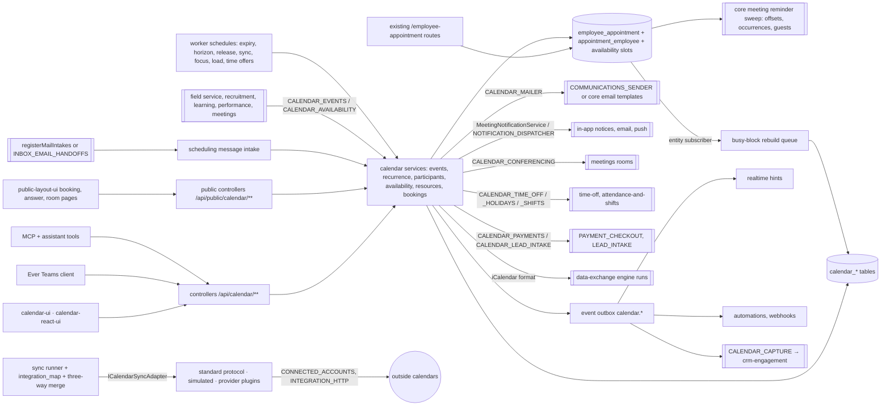

# Implementation Plan: Calendar and Scheduling

> Translates an approved `spec.md` into architecture and tech choices. The plan owns
> implementation details; the spec owns behaviour.

**Feature ID**: `calendar-and-scheduling`
**Spec**: `./spec.md`
**Tasks**: `./tasks.md`
**Status**: `Draft`
**Last updated**: 2026-11-23

---

## 1. Architecture Summary

A new plugin triple: `@gauzy/plugin-calendar` (`packages/plugins/calendar`), listed in `apps/api/src/plugins.ts` and
`apps/worker/src/plugins.ts` only when `GAUZY_CALENDAR_ENABLED` is exactly `true`, contributing `FEATURE_CALENDAR`
(default off, `@FeatureFlag` on every controller and resolver); `calendar-ui` (Angular pages, event form, settings) and
`calendar-react-ui` (event card, event form, answer buttons, free/busy strip, record events panel; hosted in Angular
through `@gauzy/ui-react` on calendar and record pages). Ever Teams reaches the calendar only through the API; its
screens are its client spec's. **The event is the core `employee_appointment` row**, extended by
additive nullable columns; colleague invitees stay `appointment_employee` rows (with answer columns), and the existing
appointment routes, the `MeetingNotificationService` notices, the meeting reminder sweep and the booking pages in
`public-layout-ui` keep working. The plugin adds calendars, sharing, guests, occurrence answers, resources, bookings,
busy blocks, sync and feeds in its own tables. An entity subscriber on `EmployeeAppointment` keeps busy blocks and sync
in step when the existing routes write. Sync adapters are separate plugins written on `@gauzy/connector-kit` of
`integration-hub`; the plugin ships the standard-protocol adapter (CalDAV client), iCalendar subscriptions and a
simulated adapter.

What exists is extended, not copied: the time zone is `User.timeZone`, the week start `Organization.startWeekOn` with a
personal override, and view choices live in `User.uiPreferences.calendar`; working hours and their date overrides are
availability slots (`availability_slots`, `employee_availability` with a new work location), so booking pages and the
free/busy strip read one source; reminders are sent by the core meeting reminder sweep (`MeetingReminderService`,
`employee_appointment_reminder`), extended with per-event offsets, occurrences, channels and outside guests; outside
guests are created from the appointment's `emails` and kept in step with it; equipment linked to a resource is booked
through core `equipment_sharing`; booking links are the appointment's signed links (`/employee-appointment/sign/:id`,
`/decode/:token`) with a purpose; invitation senders are the user's communication identities of
`email-and-communications`; iCalendar import and export are a format of the data-exchange engine of
`data-import-export`; sync items are mapped through core `integration_map` with the three-way merge of the Ever Works
sync engine lifted to core; recurrence is the core recurrence module; settings are keys of `calendar.settings.ts`.
Ever Teams' `/calendar` page is its working time-log calendar (`apps/web/core/components/calendar/calendar-page.tsx`,
`hooks/calendar/use-calendar-logs.ts`: month view, time grid, moving and splitting time entries); the event list
route lets its client add events as a layer on that page, so time entries keep their calendar.

## 2. Tech Choices

| Concern | Choice | Rationale |
| --- | --- | --- |
| Package | `packages/plugins/calendar` (`calendars/`, `sharing/`, `events/`, `recurrence/`, `participants/`, `scheduling-messages/`, `availability/`, `views/`, `reminders/`, `resources/`, `booking/`, `links/`, `sync/`, `feeds/`, `transfer/`, `assistant/`, `insights/`, `public/`, `schedule/`, `database/`), `calendar-ui`, `calendar-react-ui` | Principle I |
| Event storage | additive columns on core `employee_appointment`, `appointment_employee`, `event_type`; new tables in the plugin | build on appointments, no parallel event table |
| Recurrence and iCalendar | the core recurrence module (`packages/core/src/lib/recurrence/`, lifted from `invoice-schedule.rules.ts`), extended with weekday lists, nth and last weekday, counts, exceptions, splits and a plain-words description; the calendar's `ical/` module reads and writes the iCalendar form of those rules and the scheduling methods; property-tested | one recurrence implementation for invoices, documents, chat posts and events |
| Preferences | time zone `User.timeZone`; week start `Organization.startWeekOn` overridable per person; `User.uiPreferences.calendar` for view, second time zone, weekends, declined, week numbers, layers, default calendar, focus goal and tracked-time choice (read by the focus and offer jobs); answer notices as the `CalendarAnswer` kind of the notification preferences (`emailByType` immediate or digest) | no calendar preference table |
| Working hours | `availability_slots` (weekly defaults and date-specific slots, the overrides) and `employee_availability` (status per date, with a new nullable `workLocation`), read and written by the calendar and the existing schedules page | booking pages and free/busy agree |
| Reminders | per-event offsets on the event and per participant (`reminderOffsets` on `employee_appointment`, `appointment_employee`, `calendar_guest`); the core sweep sends them, its claim table extended with offset, channel and guest key, occurrences expanded with the core recurrence module | one reminder engine for one event table |
| Equipment | a resource linked to an equipment item books through core `equipment_sharing` (a request over the occurrence, approved by the item's sharing policy); the resource calendar shows sharing periods; rooms, vehicles and other resources book through `calendar_resource_booking` | one booking flow per equipment item |
| Booking links | confirm and manage links of bookings are the appointment's signed tokens (`signAppointmentId`, `decodeSignToken`) with a purpose and expiry claim, as the public `edit-appointment` page already uses | one link mechanism |
| Invitation senders | the user's communication identities (`communication_identity` filtered to the owner and their delegates) and their sign-in address; "me" addresses are those plus their mailboxes' addresses | no calendar identity table |
| Import and export | iCalendar registered as a data-exchange format (import profile and export writer) run by the engine of `data-import-export` with its dry run and result file; the calendar supplies the parser and writer | one import and export ledger |
| Outside guests | `calendar_guest` rows created from `employee_appointment.emails` on first read and written back to it on change | existing outside invitees stay visible everywhere |
| Settings | `calendar.settings.ts` (scope `ORGANIZATION`): free/busy to members, team expansion limit, discussion check and its threshold, meeting-free times, per-person load figures, tracked-time mode, sync and subscriptions allowed, guest invitations, refresh minutes, failure limit | platform settings store |
| Time zones | the runtime's time zone database (already used by core through its time zone dependency); instants stored in UTC plus the zone name | wall time kept across offset changes |
| Busy time | materialised `calendar_busy_block` rows (18 months ahead, 3 months back) rebuilt per event on change and rolled nightly | free/busy and slots without expanding series on every read |
| Concurrency | resource and booking checks inside a transaction under a named lock per resource or host (PostgreSQL advisory lock, MySQL `GET_LOCK`, in-process mutex on SQLite) | no double booking on three databases |
| Sync | `ICalendarSyncAdapter` on `@gauzy/connector-kit` (`ConnectorBase`, logged HTTP, connected account), runs reported through `INTEGRATION_SYNC_RUNS`; standard-protocol client in the plugin; items mapped through core `integration_map` (`entity` calendar event, `sourceId` remote key, `gauzyId` event id, the connection's `integrationTenantId`) with two additive nullable columns `remoteVersion` and `syncState`; field merge by the three-way merge of `packages/plugins/integration-ever-works/src/lib/sync/merge/three-way-merge.ts`, lifted to `packages/core/src/lib/integration-map/merge/` and used by both; conflicts listed from `syncState = CONFLICT` and reported as `integration_sync_issue` rows where `integration-hub` is loaded | providers stay optional plugins; one mapping and merge |
| Outside fetches | `createSsrfSafeHttpsAgent()` of core for subscriptions and the protocol adapter | internal-address guard |
| Real time | outbox events → realtime hints to calendar audiences (`RealtimeHintsService` pattern) | Principle VII |
| Jobs | `@ScheduledJob` + `@QueueWorker` (`@gauzy/scheduler`), schedules in `CalendarSchedulePlugin`; in-process timers under the plugin lock without a queue | task-automations pattern |
| UI grid | the calendar grid component already in `ui-core` (used by the appointment calendar), wrapped by `calendar-ui` | no new grid dependency |

## 3. Data Model

All new tables extend `TenantOrganizationBaseEntity` (soft delete through the base `deletedAt` where noted); JSON is
`text`; ids into other plugins carry no foreign key.

### Extended core entities (additive, nullable or defaulted)

| Table | New columns | Notes |
| --- | --- | --- |
| `employee_appointment` | `calendarId` uuid; `uid` varchar(255); `sequence` int default 0; `timeZone`, `endTimeZone` varchar(64); `isAllDay` bool default false; `showAs` varchar(12) (`BUSY`, `FREE`, `TENTATIVE`, `AWAY`, `ELSEWHERE`); `visibility` varchar(8) (`DEFAULT`, `PUBLIC`, `PRIVATE`); `eventStatus` varchar(10) (`DRAFT`, `CONFIRMED`, `TENTATIVE`, `CANCELLED`); `color` varchar(16); `recurrenceRule` varchar(500); `recurrenceExceptions` text; `recurrenceEndsAt` timestamp; `seriesId` uuid; `originalStartAt` timestamp; `organizerUserId` uuid; `organizerAddress` varchar(320); `organisedOutside` bool default false; `participantOptions` text; `sourceType` varchar(64), `sourceId` uuid, `sourceKey` varchar(120); `meetingRef` varchar(120); `joinUrl` varchar(1024); `reminderOffsets` text (the event's default reminders: minutes and channel; null = today's behaviour); `version` int default 1 | null `calendarId` = the host's default personal calendar (no backfill); `status` kept and mirrored (`CANCELLED` ↔ Cancelled); idx (`tenantId`,`calendarId`,`startDateTime`), (`tenantId`,`uid`), (`recurrenceEndsAt`); unique (`seriesId`,`originalStartAt`), unique (`tenantId`,`sourceType`,`sourceId`,`sourceKey`) (null-distinct on all three dialects) |
| `appointment_employee` | `role` varchar(10) (`CHAIR`, `REQUIRED`, `OPTIONAL`); `answer` varchar(16) (`NEEDS_ACTION`, `ACCEPTED`, `TENTATIVE`, `DECLINED`); `answeredAt` timestamp; `answerComment` varchar(1000); `answeredByUserId` uuid; `proposedStartAt`, `proposedEndAt` timestamp; `sentSequence` int; `addedVia` varchar(10) (`DIRECT`, `TEAM`, `SOURCE`); `sourceGroupKey` varchar(120); `reminderOffsets` text (the participant's own reminders; null = the event's, else their meeting reminder lead time) | null `answer` reads as `NEEDS_ACTION`; idx (`employeeId`,`answer`) |
| `employee_appointment_reminder` (core claim) | `offsetMinutes` int null (null = today's levels); `channel` varchar(8) null (`IN_APP`, `EMAIL`, `PUSH`); `guestKey` varchar(80) null (an outside guest instead of an employee); `employeeId` becomes nullable for guest rows; `startDateTime` is the occurrence's start; `claimKey` varchar(200) not null (`<appointmentId>/E:<employeeId>` or `<appointmentId>/G:<guestKey>`, then `/<level>/<start, ISO 8601 UTC>/<offset or ->/<channel or ->`), written by the sweep with every claim and backfilled for existing rows | claim key widened to (appointment, employee or guest, level, start, offset, channel) and held in the non-null `claimKey`: unique (`claimKey`) replaces `IDX_employee_appointment_reminder_key` on all three dialects, so a null employee, guest, offset or channel never lets two sweepers claim the same reminder (for existing rows the two keys are equivalent) |
| `employee_availability` | `workLocation` varchar(10) null (`OFFICE`, `REMOTE`, `OTHER`) | — |
| `integration_map` | `remoteVersion` varchar(255) null; `syncState` varchar(16) null (`SYNCED`, `PENDING_OUT`, `CONFLICT`, `DELETED`) | (`integrationId`, `syncState`) |
| `event_type` | `slug` varchar(120); `locationKind` varchar(10) (`IN_PERSON`, `PHONE`, `MEETING`, `CUSTOM`); `locationDetail` varchar(500); `minNoticeMinutes`, `maxDaysAhead`, `slotIntervalMinutes`, `bufferBeforeMinutes`, `bufferAfterMinutes`, `dailyLimit`, `seatsPerSlot`, `unconfirmedExpiryMinutes`, `cancelCutoffHours` int; `schedule`, `questions`, `guestReminders` text; `confirmByEmail`, `createsLeads`, `isPublished`, `paymentRequired` bool; `unconfirmedAction` varchar(10); `afterBookingText` text; `afterBookingUrl` varchar(1024); `color` varchar(16); `bookingCalendarId`, `organizationTeamId` uuid; `assignment` varchar(12) (`GUEST_CHOICE`, `ROUND_ROBIN`, `COLLECTIVE`, `GROUP`); `priceAmount` numeric(20,6); `priceCurrency` char(3) | nulls keep today's behaviour (FR-70); unique (`organizationId`,`slug`) |

### New plugin tables

| Table | Columns (besides base) | Keys and indexes |
| --- | --- | --- |
| `calendar` | `kind` varchar(12) (`PERSONAL`, `TEAM`, `ORGANIZATION`, `RESOURCE`, `SUBSCRIBED`, `SYNCED`); `name` varchar(120); `description` text; `color` varchar(16); `timeZone` varchar(64); `ownerUserId`, `ownerEmployeeId`, `organizationTeamId`, `resourceId` uuid; `isDefault` bool; `defaultKey` varchar(80) (owner user id while default personal); `countsAsBusy` bool default true (personal kinds; shared kinds count participation only); `defaultReminders` text; `defaultVisibility` varchar(8); `subscriptionUrlEnc` text; `refreshMinutes` int; `lastFetchedAt` timestamp; `lastError` varchar(1000); `version` int; soft delete | unique (`tenantId`,`defaultKey`); (`organizationId`,`kind`), (`ownerUserId`), (`organizationTeamId`) |
| `calendar_share` | `calendarId` FK cascade; `principalType` varchar(12) (`USER`, `TEAM`, `ROLE`, `ORGANIZATION`); `principalId` uuid null; `level` varchar(10) (`FREE_BUSY`, `DETAILS`, `RESPOND`, `EDIT_OWN`, `EDIT_ALL`, `MANAGE`) | unique (`calendarId`,`principalType`,`principalId`); (`tenantId`,`principalType`,`principalId`) |
| `calendar_user_setting` | `userId`; `calendarId` FK cascade; `isVisible` bool; `color` varchar(16); `position` int | unique (`userId`,`calendarId`) |
| `calendar_event_placement` | `eventId` FK `employee_appointment` cascade; `calendarId` FK cascade | unique (`eventId`,`calendarId`); (`calendarId`) |
| `calendar_guest` | `eventId` FK cascade; `address` varchar(320) (one of the event's `emails`, kept in step with that text); `name` varchar(200); `recordType` varchar(64); `recordId` uuid; `role` varchar(10); `answer` varchar(16) (values of `appointment_employee.answer`); `answeredAt` timestamp; `answerComment` varchar(1000); `proposedStartAt`, `proposedEndAt` timestamp; `sentSequence` int; `deliveryState` varchar(10) (`PENDING`, `SENT`, `FAILED`); `tokenHash` varchar(64); `language` varchar(10); `timeZone` varchar(64); `reminderOffsets` text | unique (`eventId`,`address`); unique `tokenHash`; (`tenantId`,`address`) |
| `calendar_occurrence_answer` | `eventId` FK cascade; `occurrenceStartAt` timestamp; `participantKind` varchar(8) (`EMPLOYEE`, `GUEST`); `participantId` uuid; `answer` varchar(16); `comment` varchar(1000); `answeredAt` timestamp; `answeredByUserId` uuid | unique (`eventId`,`occurrenceStartAt`,`participantKind`,`participantId`) |
| `calendar_resource` | `kind` varchar(10) (`ROOM`, `EQUIPMENT`, `VEHICLE`, `OTHER`); `name` varchar(120); `building`, `floor` varchar(80); `place` varchar(255); `capacity` int; `features` text; `timeZone` varchar(64); `openingHours`, `bookableBy`, `approverUserIds` text; `approvalRequired`, `allowOverlap`, `checkInRequired`, `isActive` bool; `maxDurationMinutes` int; `horizonDays` int default 365; `bufferBeforeMinutes`, `bufferAfterMinutes` int; `releaseAfterMinutes` int default 10; `equipmentId` uuid (set: bookings go through `equipment_sharing` and its policy), `calendarId` uuid; `displayTokenHash` varchar(64) | unique (`organizationId`,`name`); (`organizationId`,`kind`,`isActive`); unique `displayTokenHash`; unique (`tenantId`,`equipmentId`) |
| `calendar_resource_booking` | `resourceId` FK; `eventId` FK cascade; `occurrenceStartAt`, `startsAt`, `endsAt` timestamp; `state` varchar(10) (`REQUESTED`, `CONFIRMED`, `DECLINED`, `EXPIRED`, `RELEASED`, `CANCELLED`); `decidedByUserId` uuid; `decidedAt`, `checkedInAt` timestamp; `reason` varchar(500) (resources without an equipment item only; an equipment-linked occurrence is an `equipment_sharing` row whose id the event's link keeps) | unique (`resourceId`,`eventId`,`occurrenceStartAt`); (`resourceId`,`state`,`startsAt`,`endsAt`) |
| `calendar_busy_block` | `subjectType` varchar(10) (`EMPLOYEE`, `USER`, `RESOURCE`); `subjectId` uuid; `eventId`, `syncLinkId` uuid; `occurrenceStartAt`, `startsAt`, `endsAt` timestamp; `showAs` varchar(12); `isPrivate` bool | (`tenantId`,`subjectType`,`subjectId`,`startsAt`); (`eventId`); (`syncLinkId`) |
| `calendar_booking` | `eventTypeId` uuid FK `event_type`; `eventId` uuid; `hostEmployeeId` uuid; `guestName` varchar(200); `guestAddress` varchar(320); `guestPhone` varchar(32); `guestTimeZone` varchar(64); `guestLanguage` varchar(10); `answers` text; `state` varchar(16) (`UNCONFIRMED`, `AWAITING_PAYMENT`, `CONFIRMED`, `CANCELLED`, `EXPIRED`, `NO_SHOW`); `expiresAt` timestamp; `linkVersion` int default 1 (raised to invalidate signed links after a reschedule or cancel); `paymentRef` varchar(120); `paidAmount` numeric(20,6); `currency` char(3); `recordType` varchar(64); `recordId`, `dealId`, `rescheduledFromId` uuid; `source` varchar(8) (`PAGE`, `EMBED`, `API`); `cancelReason` varchar(500); `idempotencyKey` varchar(120) | unique (`tenantId`,`idempotencyKey`); (`eventTypeId`,`state`,`expiresAt`), (`hostEmployeeId`,`createdAt`) |
| `calendar_booking_host` | `eventTypeId` uuid FK `event_type` cascade; `employeeId` uuid; `weight` int default 1; `isActive` bool; `lastBookedAt` timestamp | unique (`eventTypeId`,`employeeId`) |
| `calendar_sync_connection` | `userId`; `adapterKey` varchar(64); `connectedAccountId`, `integrationTenantId` uuid; `serverAddress` varchar(2048); `state` varchar(12) (`ACTIVE`, `PAUSED`, `ERROR`, `DISCONNECTED`); `failures` int; `lastError` varchar(1000); `lastSyncedAt` timestamp; `noticeTokenHash` varchar(64) | (`organizationId`,`userId`); unique `noticeTokenHash` |
| `calendar_sync_link` | `connectionId` FK cascade; `remoteCalendarId` varchar(512); `remoteKey` varchar(64) (hash); `remoteName` varchar(255); `calendarId` FK; `direction` varchar(10) (`TWO_WAY`, `IMPORT`, `EXPORT`, `BUSY_ONLY`); `syncToken` text; `watchId` varchar(255); `watchExpiresAt`, `lastSyncedAt`, `nextSyncAt` timestamp | unique (`connectionId`,`remoteKey`); (`nextSyncAt`) |
| `calendar_feed` | `userId`; `calendarIds` text (null = all); `detail` varchar(10) (`DETAILS`, `FREE_BUSY`); `tokenHash` varchar(64); `revokedAt`, `lastReadAt` timestamp | unique `tokenHash` |
| `calendar_load_week` | `employeeId`; `weekStart` date; `meetingMinutes`, `focusMinutes`, `shortGaps`, `afterHoursMinutes`, `repeatingMinutes`, `invitations`, `declines` int | unique (`employeeId`,`weekStart`); (`organizationId`,`weekStart`) |
| `calendar_time_offer` | `eventId` uuid null; `occurrenceStartAt` timestamp null; `meetingSessionId` uuid null (a session of a room without an event); `employeeId` uuid; `minutes` int (attended minutes when `meetings` reports them, else the duration); `state` varchar(10) (`OFFERED`, `LOGGED`, `DISMISSED`); `timeLogId` uuid | unique (`eventId`,`occurrenceStartAt`,`employeeId`), unique (`meetingSessionId`,`employeeId`) (nulls distinct) |

Record links: an event's links to records (the record events panel) are record links of `record-views-and-search` (core `resource_link` with a record target): `entity = EmployeeAppointment` (the event), the record as target, `linkedBy` `PERSON`, `SYSTEM` (participant, source, booking) or `INTAKE` (capture).

Not calendar tables: preferences (`User.timeZone`, `Organization.startWeekOn`, `User.uiPreferences.calendar`, notification
preferences), working hours and overrides (`availability_slots`, `employee_availability`), reminders and their claims
(`employee_appointment_reminder` and the offset columns above), sync items (`integration_map`), identities
(`communication_identity`), transfers (data-exchange runs), settings (platform settings store), equipment bookings
(`equipment_sharing`).

### Migrations

**Migration timestamps**: `packages/plugins/calendar` `1791000061100` to `1791000061199`; `packages/core` `1791000061900` to `1791000061999`.

- Core (`packages/core/src/lib/database/migrations/`): `1791000061900-ExtendAppointmentsForCalendar` — the extended tables (`employee_appointment`,
  `appointment_employee`, `event_type`, `employee_appointment_reminder`, `employee_availability`, `integration_map`) and
  their indexes, idempotent per dialect, forward-only.
- Plugin (the shared core migration helpers of `@gauzy/core`; PostgreSQL, MySQL, SQLite; registered for both
  ORMs; listed only with `GAUZY_CALENDAR_ENABLED`): `1791000061100-CreateCalendarTables` (calendar, share, user setting,
  placement), `1791000061110-CreateCalendarParticipationTables` (guest, occurrence answer),
  `1791000061120-CreateCalendarResourceTables` (resource, resource booking, busy block),
  `1791000061130-CreateCalendarBookingTables` (booking, booking host), `1791000061140-CreateCalendarSyncTables` (connection,
  link, feed), `1791000061150-CreateCalendarInsightTables` (load week, time offer). Permissions and `FEATURE_CALENDAR`
  are plugin contributions (§9), not seeds.
- No backfill: default personal calendars are created on first use (FR-6); busy blocks of existing appointments are built
  by the enable handler per tenant in batches of 1,000, idempotent on (`eventId`); guests of existing appointments are
  created from `emails` when an event is first read.

### Contracts

`packages/contracts/src/lib/calendar.model.ts`: enums above, `ICalendar`, `ICalendarShare`, `ICalendarEvent` (an
`IEmployeeAppointment` with the new optional fields), `ICalendarOccurrence`, `IParticipant`, `IResource`,
`IResourceBooking`, `IBookingType` (an `IEventType` with the new optional fields), `IBooking`, `IFreeBusyRequest/Result`,
`ISlotRequest/Result`, `ITimeProposal` (option, free, conflicts, burden, sentence), `ISyncConnection`, `ISyncLink`,
`ICalendarSyncAdapter` (`key`, `capabilities` (push, incremental, answers, reminders, busy only), `configSchema`,
`listCalendars(conn)`, `pull(link, token) → { changes, nextToken }`, `push(link, change) → remote version`,
`watch?(link)`, `verifyNotice?(req)`), and ports `CALENDAR_EVENTS`, `CALENDAR_AVAILABILITY`, `CALENDAR_CAPTURE`,
`CALENDAR_SCHEDULING_MESSAGES`, `CALENDAR_TIME_OFFERS`, consumed `CALENDAR_CONFERENCING`, `CALENDAR_MAILER`,
`CALENDAR_IDENTITIES`, `CALENDAR_TIME_OFF`, `CALENDAR_HOLIDAYS`, `CALENDAR_SHIFTS`, `CALENDAR_PAYMENTS`,
`CALENDAR_LEAD_INTAKE`, `CALENDAR_FILES`, `CALENDAR_DISCUSSIONS`. `employee-appointment.model.ts`, `event-type.model.ts`,
`employee-availability.model.ts` and `integration.model.ts` (`IIntegrationMap`) gain the optional fields; `ICalendarUiPreferences` is
added to `IUserUiPreferences`; `EmployeeNotificationTypeEnum` gains `CalendarAnswer`.

## 4. API Surface

Authenticated routes: `TenantPermissionGuard`, `PermissionGuard`, `@FeatureFlag(FEATURE_CALENDAR)`, Swagger, DTOs,
cursor pagination, `Idempotency-Key` on creating routes; sharing checked by `CalendarAccessService` on every read.

| Method | Endpoint | Permission | Description | Status |
| --- | --- | --- | --- | --- |
| `GET` | `/calendar/status` | `CALENDAR_VIEW` | capabilities for the caller (FR-5) | New |
| `GET` `POST` `PATCH` `DELETE` | `/calendar/calendars[/:id]`, `POST …/:id/restore` | `CALENDAR_EDIT` (team, organization: `CALENDAR_SHARED_MANAGE`; changes: manage level) | calendars, subscriptions (`subscriptionUrl`) | New |
| `GET` `PUT` | `/calendar/calendars/:id/shares` · `/calendar/calendars/:id/my-settings` | manage level · `CALENDAR_VIEW` | sharing; personal show, colour, order | New |
| `GET` `PUT` | `/api/user/ui-preferences` (core, key `calendar`) · `/availability-slots`, `/employee-availability` (existing; the latter gains `workLocation`) · `GET /calendar/working-hours?employeeIds=&from=&to=` | self · `EMPLOYEE_AVAILABILITY_*` · `CALENDAR_VIEW` | view choices and focus goal; working hours, date overrides and work locations; the merged working hours the calendar computes | Existing · Changed · New |
| `GET` | `/calendar/events?calendarIds=&from=&to=&expand=` · `/calendar/events/:id[?occurrence=]` · `…/:id/history` | readable calendars | occurrences in range; event; history | New |
| `POST` `PATCH` | `/calendar/events` · `/calendar/events/:id?scope=THIS\|FOLLOWING\|ALL&occurrence=` | write level | create (draft or send), change with version | New |
| `POST` | `/calendar/events/:id/{send,cancel,forward,duplicate}` | organizer or write level | send, cancel by scope, forward, duplicate | New |
| `POST` | `/calendar/events/:id/answer` · `/calendar/events/:id/proposals/:pid/{accept,dismiss}` | participant or respond level · organizer | answers, proposals | New |
| `GET` `POST` | `/calendar/invitations` · `/calendar/invitations/answer` | `CALENDAR_VIEW` | awaiting answers; bulk answer | New |
| `GET` `POST` `DELETE` | `/calendar/events/:id/links[/:linkId]` · `GET /calendar/records/:type/:id/events` | write level + record read | links; record events panel | New |
| `PUT` | `/calendar/events/:id/reminders/me` · `/calendar/events/:id/guest-reminders` | participant · organizer | reminder offsets on the participant or guest row, sent by the core sweep | New |
| `POST` | `/calendar/free-busy` · `/calendar/slots` · `/calendar/proposals` | `CALENDAR_VIEW` | free/busy (≤ 62 days), open slots, assistant options | New |
| `GET` | `/calendar/layers?keys=&from=&to=` | `CALENDAR_VIEW` + each source's rights | read-only layers | New |
| `GET` `POST` `PATCH` | `/calendar/resources[/:id]`, `GET /calendar/resources/available` | read `CALENDAR_VIEW`; write `CALENDAR_RESOURCES_MANAGE` | resources, search by free time | New |
| `POST` | `/calendar/resource-bookings/:id/{decide,check-in}` | approver · organizer or participant | approvals, check-in | New |
| `PUT` | `/event-type/:id` (new optional fields) | `EVENT_TYPES_EDIT` | extended appointment types | Changed (additive) |
| `GET` `PUT` `POST` | `/calendar/booking-types/:id/hosts`, `/:id/{publish,unpublish}` | `CALENDAR_BOOKING_PAGES_MANAGE` (own single-host type: `EVENT_TYPES_EDIT`) | hosts, publishing | New |
| `GET` `PATCH` `POST` | `/calendar/bookings[/:id]`, `POST …/:id/cancel` | host or `CALENDAR_BOOKING_PAGES_MANAGE` | bookings, no-show, cancel | New |
| `GET` `POST` `DELETE` | `/calendar/sync/adapters` · `/calendar/sync/connections[/:id]`, `POST …/:id/reconnect`, `GET …/:id/remote-calendars`, `PUT …/:id/links` | `CALENDAR_SYNC_CONNECT` (own) | connections and mapping | New |
| `GET` `POST` | `/calendar/sync/conflicts`, `POST …/:itemId/resolve` | owner | changed-in-both review | New |
| `GET` `POST` `DELETE` | `/calendar/feeds[/:id]` | `CALENDAR_VIEW` (own) | feeds | New |
| `GET` | `/calendar/identities` | `CALENDAR_VIEW` (own) | the caller's "me" addresses and the identities invitations may come from (read from communication identities, sign-in address and mailboxes) | New |
| `POST` `GET` | the data-exchange run routes with the calendar's iCalendar profile and writer (`preview` = dry run) | write level / read level | iCalendar import and export | Existing (platform) |
| `GET` | `/calendar/search?q=` | `CALENDAR_VIEW` | event search (FR-99) | New |
| `GET` `PUT` | `/calendar/load?scope=me\|team` · `/calendar/settings` | own · `CALENDAR_LOAD_VIEW` · `CALENDAR_SETTINGS_MANAGE` | load figures; the `calendar.*` keys of the platform settings store | New |
| `POST` | `/calendar/events/:id/discussion-check` · `/calendar/time-offers/:id/{log,dismiss}` | organizer · the offered person | discussion check; tracked-time offers of events and meeting sessions | New |
| `GET` `POST` | `/public/calendar/pages/:pageKey`, `…/slots`, `…/bookings`; `/public/calendar/bookings/{confirm,manage}` | public: published type, the appointment's signed token with purpose and expiry, throttled | booking pages | New |
| `GET` `POST` | `/public/calendar/answer` · `/public/calendar/feeds/:token` · `/public/calendar/rooms/:token` · `/public/calendar/sync/:connectionId/:token` | public: signed or hashed token, throttled | guest answers, feeds, room display, adapter notices | New |
| `*` | `/calendar/dav/**` (standard calendar protocol) | personal key scoped to calendars | platform-side protocol (FR-97) | New |
| `*` | `/employee-appointment/**`, `/appointment-employees/**`, `/availability-slots/**`, `/employee-availability/**`, `/event-type/**` | unchanged | existing behaviour | Unchanged |

Errors: `CALENDAR_VERSION_CONFLICT`, `CALENDAR_RULE_EMPTY`, `CALENDAR_TIME_INVALID`, `CALENDAR_RESOURCE_UNAVAILABLE`
(reason, conflicting window), `CALENDAR_SLOT_TAKEN`, `CALENDAR_BOOKING_CLOSED`, `CALENDAR_SOURCE_OWNED`,
`CALENDAR_EXPANSION_LIMIT`, `CALENDAR_SUBSCRIPTION_REFUSED`. GraphQL reads `calendars`, `calendarEvents`,
`calendarBookings`, `calendarResources`.

## 5. Events, Real-Time and Notifications

| Event (outbox, partition `CALENDAR:<eventId>`) | Emitted when | Consumers |
| --- | --- | --- |
| `calendar.event.created` · `changed` · `cancelled` · `started` · `ended` · `linked_today` | event life and time | realtime hints, automations, webhooks, source features, `crm-engagement` timeline, tracked-time offer |
| `calendar.answer.changed` · `calendar.proposal.created` | answers | organizer notices (`CalendarAnswer` notifications, immediate or in the digest per the organizer's notification preferences), source features (`CALENDAR_EVENTS` listeners), automations |
| `calendar.booking.created` · `confirmed` · `rescheduled` · `cancelled` · `expired` · `paid` | booking states | host notices, lead capture, automations, reports |
| `calendar.resource_booking.requested` · `decided` · `released` | resources | approver Inbox items, organizer notices |
| `calendar.sync.failed` · `paused` | connection health | owner notice, integration health |

Realtime: `calendar.changed` hints to the audience of each affected calendar (owners, shares, team members) carrying
ids and ranges only. Notification categories (`registerNotificationCategories`): `calendar.invitation`,
`calendar.answer`, `calendar.reminder`, `calendar.booking`, `calendar.resource`, `calendar.sync`; colleague invitations
also go through core `MeetingNotificationService` so the Meeting kind and `/employee-appointment/invited` stay correct.
Consumed: `time_off.request.approved|withdrawn`, shift publication, holiday calendar changes (busy rebuild), lead and
contact merges (links follow), `payment.checkout.succeeded|failed` (bookings), meeting attendance from `meetings`.

## 6. UI Surface

- **`calendar-ui`** (Angular, menu "Calendar" under the feature): `/pages/calendar` (day, work week, week, month, agenda;
  month-picker; calendar list with show, colour, order; layers; second time zone), `/pages/calendar/scheduling` (people
  and resources side by side), event drawer and full form (recurrence editor with plain words, participants with a
  free/busy strip, proposals from the assistant, resources with capacity warning, meeting room, reminders, links,
  visibility, the discussion check), `/pages/calendar/invitations`, `/pages/calendar/resources` (list, calendar,
  approvals), `/pages/calendar/booking-pages` (types, hosts, assignment, publishing, embed code) and `/bookings`,
  `/pages/calendar/insights` (own figures, team load), Settings → Calendar (organization settings, resources, sync
  policy), My settings (view choices and focus goal in `uiPreferences.calendar`, feeds, connections, conflicts).
  Working hours, date overrides and work locations are edited on the existing schedules page
  (`apps/gauzy/src/app/pages/employees/schedules`), extended with date overrides and work location shown only while
  `FEATURE_CALENDAR` is on (with it off the page is as today); sending identities
  on the communications identities page; answer notices on the existing notification settings page. The existing event
  type form shows the new fields when the feature is on; the existing appointment calendar shows the "repeats" mark
  (FR-4); the existing equipment sharing page lists sharing requests made from events.
- **`calendar-react-ui`**: `EventCard`, `EventForm`, `AnswerButtons`, `FreeBusyStrip`, `TimeProposals`, `RecordEventsPanel`,
  `ScheduleAction`, hosted in Angular through `@gauzy/ui-react` on the calendar pages and on record pages through the
  record page extension points of `record-views-and-search`.
- **`public-layout-ui`**: `/share/book/:pageKey` (slots in the guest's zone, questions, confirmation), `/share/book/manage/:token`,
  `/share/calendar/answer/:token`, `/share/calendar/room/:token` (room display with check-in); `?embed=1` renders the
  booking route without chrome for the embeddable block; existing routes untouched.
- i18n keys `CALENDAR.*` in every locale of `packages/ui-core/i18n/`; React texts through `useTranslation()`; email
  templates `calendar-invitation`, `calendar-update`, `calendar-cancellation`, `calendar-reminder`, `booking-confirmation`,
  `booking-confirm-request`, `booking-cancelled` in the email template system for every language.
- Ever Teams (the Ever Teams spec `workspace-collaboration-clients`): its `/calendar` page stays its time-log calendar; events,
  invitations and booking screens come over the same routes, events as a layer on that page where its client spec adds
  them.

## 7. MCP Tools, SDKs and Integrations

- `packages/mcp-server/src/lib/tools/calendar.ts`: `calendar_events_list`, `calendar_event_get`, `calendar_free_busy`,
  `calendar_propose_times`, `calendar_event_create`, `calendar_event_update`, `calendar_event_cancel` (each `preview`
  default true; `send` default false), `calendar_answer`, `calendar_resources_find`, `calendar_resource_book` (preview),
  `calendar_bookings_list`, `calendar_booking_types_list`, `calendar_load_summary`; registered with `AiChatToolRegistry`.
- **Ports offered** (bound in `apps/api/src/plugin-composition.ts`):

  | Port | Bound to (consumer token) | Contract |
  | --- | --- | --- |
  | `CALENDAR_EVENTS` | `FIELD_SERVICE_CALENDAR`, `RECRUITMENT_CALENDAR`, `LEARNING_CALENDAR`, `PERFORMANCE_CALENDAR`, `MEETINGS_CALENDAR`, `ATTENDANCE_CALENDAR_SIGNALS` | `upsertSourceEvent({ source, key, owner, event, participants, links, private })`, `cancelSourceEvent`, `get`, `listForSubjects(subjects, range, { showAs })`, answer listener registration |
  | `CALENDAR_AVAILABILITY` | `RECRUITMENT_CALENDAR` (busy times, free slots), `FIELD_SERVICE_CALENDAR` (overlap checks), `MEETINGS_CALENDAR` | `freeBusy(subjects, range, viewer)`, `openSlots(request)`, `workingHours(subject, range)` |
  | `CALENDAR_CAPTURE` | `CRM_CAPTURE_SOURCES` (`crm-engagement`) | events with outside participants per user since a cursor, honouring the user's capture choice; private never |
  | `CALENDAR_SCHEDULING_MESSAGES` | `mail` (invitation banner and answers), communications intake | `receive(identity, message)`, `render(event, method, recipient)` |
  | `CALENDAR_TIME_OFFERS` | `MEETINGS_TIME_OFFERS` (`meetings`) | `attended(session or occurrence, employee, minutes)` |
  | iCalendar import profile and export writer | data-exchange engine of `data-import-export` | parse and write calendar files through the engine's runs |
  | `registerCalendarParticipantSources`, `registerCalendarLayers`, `registerCalendarBusySources` | crm (deal people, organisation members, saved views of people), learning (cohorts), recruitment (panels); time off, shifts, tasks, visits | the participant source registry `crm-engagement` assumed, layers and busy blocks |
  | `RECORD_TIMELINE_SOURCES` entry, a global search source | `record-views-and-search` | events on records; event hits |
  Tokens needing both events and availability (`RECRUITMENT_CALENDAR`, `FIELD_SERVICE_CALENDAR`, `MEETINGS_CALENDAR`)
  bind to `CalendarPortAdapter`, which implements the consumer's interface over both ports.

- **Ports consumed** (optional, with fallbacks): `CALENDAR_CONFERENCING` → `meetings` (absent: typed link);
  `CALENDAR_MAILER` → `COMMUNICATIONS_SENDER` (absent: core email send with the templates above); `CALENDAR_IDENTITIES` →
  the owner's and delegates' `communication_identity` rows (absent: the sign-in address and owned Inbox mailboxes);
  `NOTIFICATION_DISPATCHER`
  (absent: core employee notifications); `CONNECTED_ACCOUNTS`, `INTEGRATION_HTTP`, `INTEGRATION_SYNC_RUNS` (absent:
  standard-protocol adapter only, credentials in core `integration_setting`, guarded HTTP); `CALENDAR_TIME_OFF` →
  `TIME_OFF_AVAILABILITY` (absent: approved core time-off requests); `CALENDAR_HOLIDAYS` → `TIME_OFF_WORKING_CALENDAR`
  (absent: core official holidays, Saturday and Sunday); `CALENDAR_SHIFTS` → `SHIFTS_SCHEDULE` (absent: availability slots);
  `CALENDAR_PAYMENTS` → `PAYMENT_CHECKOUT`, `PAYMENT_CHARGES` (absent: paid types cannot be published);
  `CALENDAR_LEAD_INTAKE` → `LEAD_INTAKE` (absent: core contact of type lead); `RECORD_ACCESS_FILTER` (absent: record view
  permission); `CALENDAR_FILES` → `drive` (absent: documents hub, else core file storage); `CALENDAR_DISCUSSIONS` →
  `discussions`, else chat (absent: the check offers nothing to convert to and is skipped); core time log service for FR-108;
  core `candidate-interview` registered as a busy source and layer for interviewers until `recruitment` owns interviews.
- Mail intake: `registerMailIntakes` of `email-and-communications` with a matcher for messages carrying a calendar part
  addressed to a calendar identity; without communications, an `INBOX_EMAIL_HANDOFFS` listener on mailboxes of the
  identity.
- Formats: iCalendar (RFC 5545), scheduling methods (RFC 5546) over email (RFC 6047), standard calendar access protocol
  (RFC 4791) with scheduling (RFC 6638). Adapter plugins `packages/plugins/calendar-sync-<key>` pass a shared contract
  suite; none is part of this feature. OpenAPI regenerated; SDKs at release; report definitions of spec FR-114 on
  datasets `calendar.bookings`, `calendar.resource_bookings`, `calendar.answers`, `calendar.load_weeks`, `calendar.sync_runs`.

## 8. Background Jobs

| Trigger | When | What it does | Idempotency |
| --- | --- | --- | --- |
| queue `calendar-dispatch` | event sent, changed, cancelled; answers | notices, emails with iCalendar parts, guest tokens | (`eventId`, participant, `sequence`, kind) |
| core meeting reminder sweep (extended, not a calendar job) | every minute | reminders due in the next window, per occurrence, offset and channel, for colleagues and guests | the widened claim key of `employee_appointment_reminder` |
| queue `calendar-busy` + `calendar.busy-roll` | on event change (subscriber); nightly 02:10 | rebuild blocks of an event; extend the horizon | delete-and-insert per `eventId` in one transaction |
| `calendar.resource-horizon` | nightly 02:30 | book occurrences entering each resource's horizon, report conflicts | unique (`resourceId`,`eventId`,`occurrenceStartAt`) |
| `calendar.room-release` · `calendar.booking-expiry` | every minute | release unchecked rooms; expire unconfirmed and unpaid bookings | state compare-and-set |
| `calendar.linked-today` | 06:00 organization time | publish `linked_today` for events linked to leads and deals | (`eventId`, date) |
| queue `calendar-sync` | every 5 min per link, on adapter notices, on local change | pull with token, push pending items, renew watches hourly | `integration_map` row per remote key, `remoteVersion`, event `version` |
| `calendar.subscriptions` | per `refreshMinutes` | fetch iCalendar addresses through the guarded agent | replace items by identity |
| data-exchange runs (engine of `data-import-export`) | on request | iCalendar import with dry run, export | the engine's run state |
| `calendar.focus` · `calendar.load` | weekly Sunday 18:00 user time, daily adjust · nightly 03:00 | place focus blocks; weekly figures | `sourceKey` per week; unique (`employeeId`,`weekStart`) |
| `calendar.time-offers` | event end + 5 min; meeting session end (attendance from `meetings`) | offer tracked time | unique (`eventId`,`occurrenceStartAt`,`employeeId`), unique (`meetingSessionId`,`employeeId`) |

The worker loads `CalendarSchedulePlugin` (schedules only); the API consumes the queues. Without a queue root the API
runs them on in-process timers under the plugin lock. The core meeting reminder sweep (`meeting-reminder.service.ts`)
is extended instead of a second sweep: it reads per-event and per-participant offsets, expands occurrences of repeating
events with the core recurrence module, sends by channel to colleagues and outside guests, and claims on the widened
key; it runs for events with calendar reminders whenever the calendar feature is on, while the lead-time reminders of
plain appointments keep needing `GAUZY_MEETING_REMINDERS_ENABLED` (FR-60).

## 9. Security & Permissions

- New keys in `calendar.permissions.ts` as plugin contributions with `defaultFor`: `CALENDAR_VIEW`, `CALENDAR_EDIT`,
  `CALENDAR_RESOURCES_BOOK`, `CALENDAR_SYNC_CONNECT` (super admin, admin, manager, employee); `CALENDAR_SHARED_MANAGE`,
  `CALENDAR_BOOKING_PAGES_MANAGE`, `CALENDAR_LOAD_VIEW` (super admin, admin, manager); `CALENDAR_RESOURCES_MANAGE`,
  `CALENDAR_SETTINGS_MANAGE` (super admin, admin). Reused: `EVENT_TYPES_VIEW`, `EVENT_TYPES_EDIT`,
  `EMPLOYEE_AVAILABILITY_*` on the existing routes, `ORG_CONTACT_ADD`, time log permissions.
- `CalendarAccessService` resolves the caller's level per calendar (owner, shares by user, team, role, organization,
  organization free/busy default) and filters events, fields and private details in list queries, detail, search,
  feeds, exports, layers, MCP and port answers; record links additionally pass `RECORD_ACCESS_FILTER`. For everyone
  but the owner a private event is a "Private" block with its time in calendar views, free/busy and API reads, and is
  left out of search, feeds, exports, record panels and timelines, capture and MCP answers (spec FR-14).
- Public routes: published types only; tokens random, stored as SHA-256 hashes, single purpose, expiring at the event's
  end plus 30 days; throttling per address and network; guest content sanitised; booking pages never reveal other
  bookings beyond free slots.
- Credentials of the standard-protocol adapter encrypted in `integration_setting`; provider tokens only through
  `CONNECTED_ACCOUNTS`; subscription addresses encrypted at rest; all fetches through the guarded agent; adapter notices
  verified by token and adapter signature.
- Personal data handlers (`registerPersonalDataHandlers`): guests, bookings, feeds (export; erasure anonymises guests and
  bookings, keeps counts); preferences and identities follow their owners' handlers.

## 10. Observability

Activity log for calendar, share, event, resource, type, booking and connection changes. Metrics: free/busy and slot
latency, booking expiry, invitation failures, reminder lag, refused resource conflicts, sync lag and conflicts per
adapter, busy-block backlog. Errors carry tenant, calendar and event ids, never tokens, credentials or guest addresses.

## 11. Phased Rollout

1. **Phase 1 — Calendars on appointments** (flags off by default): contracts, core columns, calendars, sharing, single
   events, views, scheduling view, layers, working hours, busy blocks, free/busy, reminders, links and record panel,
   status route, MCP read tools.
2. **Phase 2 — Invitations and recurrence**: recurrence and splits, participants and guests, invitations with iCalendar,
   answers by link and reply, proposals, scheduling message intake, identities, search, import and export, feeds,
   subscriptions, source-owned events and participant sources for other features, report definitions.
3. **Phase 3 — Resources and booking**: resources with approvals and conflict-safe booking, extended appointment types,
   confirmation and expiry, party matching and lead intake, "linked event today".
4. **Phase 4 — Sync**: adapter contract and suite, standard-protocol and simulated adapters, two-way sync, conflicts,
   push notices, the platform-side protocol endpoint.
5. **Phase 5 — Advanced capabilities**: scheduling assistant, round-robin, collective and group pages, payment, room check-in and
   release, focus time, load analytics, discussion check, meeting-free times, tracked time, MCP write tools.
6. **Phase 6 — General availability**: the feature is off by default; after the trial period it may be switched on by default for new tenants only; existing tenants keep their setting until an administrator changes it.

## 12. Constitution Reconciliation

- I Plugin-first: new plugin triple; adapters as plugins; core gets additive columns and one sweep condition.
- II Tenant/organization scoping: base entity on every table; public routes and feeds resolve the tenant from tokens.
- III Both ORMs, additive migrations: MultiORM entities; one core and six plugin migrations; three dialects; no backfill;
  permissions as contributions.
- IV Default-off flag; nothing removed: deploy flag and `FEATURE_CALENDAR` off; appointment routes, pages, notices and
  reminders unchanged.
- V Contracts and API first: contracts, adapter and port contracts before UI; event type changes additive.
- VI Permissions, privacy, security: nine keys; sharing levels on every reader; hashed tokens; encrypted credentials;
  guarded fetches; personal data handlers.
- VII Real-time through the event bus: outbox events, realtime hints, no private socket.
- VIII i18n and accessibility: keys and email templates in every locale; keyboard grid with announced events.
- IX Tests: property tests for recurrence and time zones; unit tests for slots, ranking, sharing; concurrency tests for
  resources and bookings on three databases; e2e for invitations, booking and sync with the simulated adapter.
- X Behaviour-first spec: the spec names no table or class.
- XI Documentation describes our platform only.

## 13. Risks & Mitigations

| Risk | Likelihood | Impact | Mitigation |
| --- | --- | --- | --- |
| Recurrence and time-zone defects | Medium | High | standard rule library, property tests across offset changes, one expansion module used everywhere |
| Double booking under concurrency | Medium | High | named locks per resource or host, overlap check in the transaction, concurrency tests per dialect |
| Sync loops or duplicate invitations | Medium | High | identity by iCalendar UID, version tracking per item, invitations only from the organizing side |
| Busy blocks drift from events | Low | Medium | rebuild per event, nightly roll, enable-time rebuild, a consistency check job comparing counts |
| Privacy leak through layers or ports | Low | High | one access service for every reader, tests per level, private details never serialised for non-owners |
| Breaking existing appointment flows | Low | High | additive columns, legacy routes untouched, existing tests kept green, subscriber only enqueues work |

## 14. References

- Spec: `./spec.md` · Tasks: `./tasks.md` · Specs: plans of the consumers named in §7 and of `integration-hub`,
  `email-and-communications`, `record-views-and-search`
- Code: `packages/core/src/lib/employee-appointment/` (incl. `meeting-notifications/`), `appointment-employees/`,
  `availability-slots/`, `employee-availability/`, `event-types/`, `equipment-sharing/`, `official-holiday/`,
  `integration-map/`, `candidate-interview/`, `user/user.entity.ts` (`timeZone`, `uiPreferences`),
  `packages/plugins/integration-ever-works/src/lib/sync/merge/`, Ever Teams `apps/web/core/components/calendar/`,
  `core/util/ssrf-safe-agent.ts`, `packages/plugins/public-layout-ui/`, `packages/ui-core/shared/src/lib/appointments/`,
  `packages/plugins/inbox/src/lib/database/migration-helpers.ts`, `packages/plugins/realtime/`, `apps/api/src/plugin-composition.ts`
