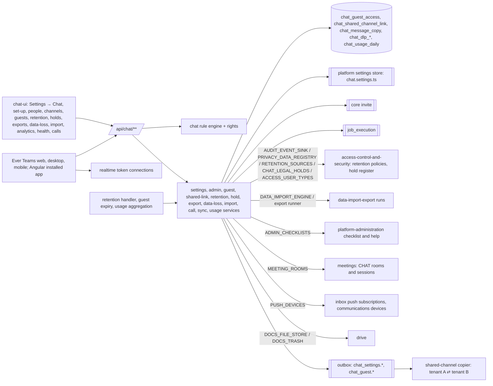

# Implementation Plan: Chat administration and client capabilities

> Translates an approved `spec.md` into architecture and tech choices. The plan owns
> implementation details; the spec owns behaviour.

**Feature ID**: `chat-administration-and-clients`
**Spec**: `./spec.md`
**Tasks**: `./tasks.md`
**Status**: `Draft`
**Last updated**: 2026-11-23

---

## 1. Architecture Summary

No new plugin: administration, governance and client capabilities extend `@gauzy/plugin-chat` and `@gauzy/plugin-chat-ui`, plus small additive changes in the realtime plugin (token connections already work; client kinds added to its status), the Documents hub's file route (byte ranges, signed addresses), the Inbox delivery (device pushes with grouping keys and silent clears) and the host app's existing manifest and service workers. All routes sit behind the existing chat gates and the new tenant feature `FEATURE_CHAT_ADMINISTRATION` (default off, needs `FEATURE_CHAT`; declared in `chat.features.ts` as a plugin feature contribution with `defaultEnabled: false`, checked by `FeatureFlagGuard` on every controller this spec adds, per tenant by its jobs and consumers, and by its menu entries and pages), so a tenant with chat on today gets nothing new until an administrator switches it on; while it is off the rule engine answers with today's rules; `GAUZY_CHAT_SHARED_CHANNELS_ENABLED` is read once at boot (`chat-shared-enabled.ts`, same contract as `chat-enabled.ts`) and decides whether the shared-channel controller and copy consumer are registered. One **rule engine** (`services/chat-rules.service.ts`) answers every chat permission question from the matrix of spec §3.3, whose defaults are exactly today's rules of `ChatAccessService` (a `CHAT_MANAGE` holder still reads channels without joining); the existing `ChatAccessService` calls it, so every route of the three chat specs and the rights call agree.

Administration keeps nothing in chat that the platform already stores: settings are keys of `chat.settings.ts` in the platform settings store; the set-up checklist and help items are rows of the administration checklist and help registry of `platform-administration` (`ownerPlugin = chat`); guests are core `invite` rows (`packages/core/src/lib/invite/`) with a thin chat access row; retention periods are `privacy_retention_policy` rows of kinds chat declares through `RETENTION_SOURCES`, legal holds are `privacy_legal_hold` rows of the hold register (`access-control-and-security`); compliance exports are runs of the data-export engine and imports runs of the data-import engine of `data-import-export` (else core `import-history` and `import-record`); retention runs are `job_execution` rows; calls are meeting rooms of kind `CHAT` and their sessions (`meetings`); device pushes go to the existing `inbox_push_subscription` and the devices of `email-and-communications`. Other features are reached through ports bound in `apps/api/src/plugin-composition.ts`: `ACCESS_USER_TYPES`, `AUDIT_EVENT_SINK`, `PRIVACY_DATA_REGISTRY`, `RETENTION_SOURCES`, `CHAT_LEGAL_HOLDS` (access hold register), `ADMIN_CHECKLISTS` (platform administration), `DATA_IMPORT_ENGINE` and the export runner (data exchange), `MEETING_ROOMS` (meetings FR-41), `PUSH_DEVICES` (Inbox web push and communications devices), `DOCS_TRASH` and `DOCS_FILE_STORE` (drive), `COUNTRY_IDENTIFIER_DETECTORS` (regional packs).

## 2. Tech Choices

| Concern | Choice | Rationale |
| ------- | ------ | --------- |
| Package | existing `chat`, `chat-ui`, `realtime`, `docs`, `inbox` | Principle I |
| Settings | `chat.settings.ts` (`PluginSettingContribution` keys with type, default and scope `ORGANIZATION`, the pattern of `search.settings.ts`), values in the platform settings store through `PluginSettingRegistry`; every write through the chat settings route sends a before and after audit event | typed keys, one settings store, history in the audit store |
| Set-up and help | a chat checklist (`admin_checklist` with `ownerPlugin = chat`, steps marked done by events or by hand, `admin_checklist_progress` shared per organization) and chat help items (`admin_help_item`, page keys of the chat pages) of `platform-administration` | one checklist and help model |
| Rules | pure function `decide(personKind, role, conversation, policy, action)` with a generated truth-table spec; rights route returns the allowed set | one source for server and clients |
| Guests | a core `invite` row per guest (email, token, status, expiry of the invitation, inviter, contact through `invite_organization_contact`, the portal or guest role of `access-control-and-security`), accepted through the invite flow; chat keeps only `chat_guest_access` (invite or user, channels, access end), as `discussions` does with `discussion_invite`; the portal user type's ceiling limits guests to chat routes | no second invitation or user model |
| Shared channels | replication, never cross-tenant reads: a copier consumes the outbox facts of a linked conversation and writes the copy in the partner tenant under a system request context of that tenant; only a message that originated on its own side (`copyOfMessageId` null) is copied out, so a copy is never copied back; edits, deletions and files follow the original's id and version; a reaction on a copy goes back to its original through `chat_message_copy` (`localMessageId` to `sourceMessageId`); every write of the copier carries the link as its origin, and the opposite consumer skips facts of that origin | Principle II |
| Retention | organization periods are `privacy_retention_policy` rows of the kinds `chat.channel`, `chat.group` and `chat.direct`, declared by chat through `RETENTION_SOURCES` with the default "keep forever"; a channel's own period is `chat_conversation.retentionDays` within the bounds settings; chat's purge handler deletes in batches of 5,000 with the hold check in the same transaction, each batch under the tenant's hold lock taken through `CHAT_LEGAL_HOLDS.withHoldLock` (the lock the hold register takes to place or release a hold), so a hold committed while a batch runs is seen by the next batch and none of its messages is deleted, called by the daily retention runner of `access-control-and-security`, or by chat's own `chat.retention.run` where that feature is not loaded (declared defaults and channel periods only); every run is a `job_execution` row with the deletion report (counts per conversation and kind, held items kept) and the resumable cursor in its metadata, exported as CSV | one retention model, one run ledger |
| Holds | `privacy_legal_hold` rows of the hold register: on a conversation (`recordType = ChatConversation`), on a person (`recordType = Employee`: every conversation they took part in) or on all chat messages of a period (`recordType = ChatMessage`, no record id, with the register's optional period `scopeFrom`, `scopeTo`); the matter name is the hold's reason; chat asks the register through `CHAT_LEGAL_HOLDS` inside each purge and deletion | one hold list for administrators |
| Exports | a run of the data-export engine (`data_export_run`, `targetKey = chat.compliance`, chat's filters in its `filter` document) written by chat's archive writer: streamed JSON lines plus a static HTML page per conversation, zipped with `archiver` (MIT, already used by the Documents hub export), file offered 7 days (`expiresAt`); with four-eyes on, the run is created unstarted and starts only when a second holder of `CHAT_COMPLIANCE_EXPORT` approves, the approval recorded in the audit trail | large exports without memory peaks; one export ledger |
| Data-loss detectors | regular expressions with check-digit validators (Luhn for cards, mod-97 for bank accounts), country identifier detectors from the regional packs port, entropy check for tokens; run on send in the API (< 20 ms budget) and in the composer for warnings | no outside service; matches never stored |
| Import | a chat import profile (`chat.archive`) registered with `registerImportProfiles` and run by the data-import engine (`DATA_IMPORT_ENGINE`: `data_import_run` with dry run, progress, undo window; one `data_import_row` per imported item mapping its outside kind and id to the local record), as `discussions` does for its import; without that engine, core `import-history` and `import-record` (`entityType`, `sourceId`, `destinationId`) map the ids and the run is a core operation (`packages/core/src/lib/operation/`); the profile reads the archive with `unzipper` (MIT, already used by the Documents hub import) in the documented import format (JSON lines: people, conversations, messages, reactions, files) | idempotent re-runs, undo; no chat run tables |
| Calls | meeting rooms of kind `CHAT` (one per conversation, `meeting_room.conversationId`) and their sessions through the `MEETING_ROOMS` port: start, join, end, participant and artifact events; the call card is a chat message whose `systemEvent` names the room and session, and the session keeps the card's message id (`meeting_session.callMessageId`); one live call per conversation is meetings' one live session per room | meetings owns calls and media; no chat call table |
| Sync | cursor = (`updatedAt`, `id`) per table over soft-deleted rows, capped at the settle horizon: an answer covers changes stamped up to `now − 120 s` only and its next cursor never passes that point; chat writes to synced tables run in transactions limited to 30 seconds, so a change stamped before the horizon is committed when the horizon passes it and a later-committing transaction does not fall behind a cursor within the limits of (4); newer changes reach clients by live delivery and the next sync; tombstones from `deletedAt` and `leftAt`. Guarantees behind the horizon: (1) one clock: the cursor column `updatedAt` of the synced tables (conversations, members, messages, read positions), raised by every insert, update, soft delete and leave, and the horizon itself are taken from the database server's clock, never from an API replica, and an `updatedAt` a caller supplies is overwritten (an import keeps its messages' original `createdAt`, `deletedAt` and `leftAt` as facts, while their `updatedAt` is the database's), so replica clock skew and backdated stamps cannot occur; (2) every write: the entity subscriber `chat-sync-stamp.subscriber.ts` stamps every insert, update and soft delete of a synced entity, whoever the caller (chat services, agent and bot posts, imports, shared-channel copies), and set-based statements on those tables go through `ChatSyncedWrite`, the one helper that stamps them too; before commit the helper and the subscriber compare the database clock with the transaction's first stamp and roll back a transaction older than 30 seconds, which the caller retries with a fresh stamp; (3) backward clock steps: the 90 seconds between the 30-second limit and the 120-second horizon absorb the commit itself and clock corrections; the job `chat.sync.clock-check` (every 30 seconds) and every sync answer compare the database clock with the highest reading recorded in the platform cache (the newest `chat_message.updatedAt` when the cache holds none), and a step back of more than 90 seconds sets a new sync epoch; every cursor carries the epoch it was issued in, and a cursor whose epoch differs from the current one answers `resync` (a lost epoch is replaced by a new one, which costs each client one resync and never a missed change); (4) limits: these bounds hold for a transaction whose commit ends within 90 seconds of its pre-commit check and for a backward clock step that the job or a sync answer observes; a commit stalled longer than that, or a step back of more than 90 seconds that ends before the clock is read again, can leave a change behind a cursor that has already passed its stamp: the change is stored, reaches connected clients by live delivery and shows in every online read, and a client that missed it receives it in its offline copy at its next resync (a new epoch or a cursor older than the sync window); the description of `GET /sync` states these limits | no new table; deletions included; no change missed by commit order within the limits of (4) |
| Push | `PUSH_DEVICES` with `collapseKey = chat:<conversationId>`, kinds `message`, `mention`, `reply`, `call`, `clear`: browsers through the existing `inbox_push_subscription` and the Inbox push delivery (`packages/plugins/inbox/src/lib/delivery/push/`), phones and desktop apps through the devices of `email-and-communications`; the browser push opt-in stays the existing page (`inbox-ui/src/lib/settings/inbox-browser-push.component.ts`) | grouped pushes, silent clears, one device registry per kind |
| Media | byte-range and validator support on the Documents hub download route; signed addresses (HMAC, 10 minutes) | streaming and resumable downloads |
| Installable app | the existing `apps/gauzy/src/manifest.json` (linked from `index.html`) gains icons, shortcuts and a `share_target`; the existing Angular service worker (`ngsw-config.json`, `ngsw-config.prod.json`, on in production) keeps the shell cache, and its production registration becomes a small extension script that imports `ngsw-worker.js` and adds only the share-target handler; the unread badge is set by the open app and by the existing push worker (`assets/inbox-push-sw.js`) on push; chat registers its share handler and badge source through `@gauzy/ui-core` | no second worker at the same scope; the one host-app change, a platform capability |
| Analytics | `chat_usage_daily` aggregated hourly for today and nightly for closed days | counts only, fast pages |

## 3. Data Model

All new tables extend `TenantOrganizationBaseEntity`; JSON uses `jsonColumnType()`; secrets and email addresses stored hashed and, where they must be shown, encrypted with the platform's encryption service.

### Changed entities

| Entity | New columns | Indexes |
| --- | --- | --- |
| `chat_conversation` | `guestsAllowed` bool default false; `callPolicy` varchar(12) default `all`; `retentionDays` int null (the channel's own period within the bounds settings); `sharedLinkId` uuid null; `movedFromOrganizationId` uuid null | (`tenantId`, `sharedLinkId`) |
| `chat_member` | `isGuest` bool default false | (`tenantId`, `organizationId`, `isGuest`) |
| `chat_message` | `heldDeletedAt` timestamp null; `externalAuthor` json null (name, organization, picture for shared and imported authors); `importId` uuid null (the import run); `externalId` varchar(128) null; `offlineSentAt` timestamp null; `copyOfMessageId` uuid null | (`tenantId`, `importId`); (`tenantId`, `copyOfMessageId`) |

### New entities

| Table | Columns (beyond the base) | Indexes and uniqueness |
| --- | --- | --- |
| `chat_guest_access` | `inviteId` uuid null (core `invite`), `userId` uuid null (once accepted), `conversationIds` json, `accessUntil` timestamp, `invitedByUserId`, `warnedAt` null, `endedAt` null | unique (`inviteId`); (`tenantId`, `userId`); (`accessUntil`) |
| `chat_shared_channel_link` | `conversationId` fk cascade, `partnerTenantId`, `partnerConversationId` null, `inviteCodeHash` char(64) null, `role` varchar(8) (`host`, `guest`), `state` varchar(12) (`invited`, `connected`, `paused`, `disconnected`), `connectedAt` null, `disconnectedAt` null, `createdByUserId` | unique (`conversationId`); unique (`inviteCodeHash`) |
| `chat_message_copy` | `linkId` fk cascade, `sourceTenantId`, `sourceMessageId`, `localMessageId`, `sourceVersion` int | unique (`linkId`, `sourceMessageId`) |
| `chat_dlp_rule` | `name` varchar(120), `detectors` json, `scope` varchar(12) (`all`, `guests`, `shared`, `direct`), `action` varchar(8) (`warn`, `block`, `mask`), `enabled` bool | (`tenantId`, `organizationId`, `enabled`) |
| `chat_dlp_match` (append-only) | `ruleId` fk, `detector` varchar(32), `conversationId`, `messageId` null, `userId` null, `botId` null, `outcome` varchar(12) (`warned`, `sent_anyway`, `blocked`, `masked`), `reason` varchar(500) null | (`tenantId`, `ruleId`, `createdAt`) |
| `chat_usage_daily` | `day` date, `conversationKey` varchar(40) (`org` or conversation id), `conversationKind` varchar(10), `messages`, `posters`, `readers`, `files` int, `bytes` bigint, `botPosts`, `guestPosts` int, `firstReplyMedianSeconds` int null | unique (`tenantId`, `organizationId`, `day`, `conversationKey`) |

Not chat tables: settings (platform settings store), set-up checklist and help (`admin_checklist`, `admin_checklist_progress`, `admin_help_item`), guest invitations (core `invite`), retention periods (`privacy_retention_policy`), legal holds (`privacy_legal_hold`), retention runs (`job_execution`), compliance exports (`data_export_run`), imports (`data_import_run`, `data_import_row`, else `import_history`, `import_record`), calls (`meeting_room`, `meeting_session`).

Setting keys in `chat.settings.ts` (scope `ORGANIZATION`, defaults in the declaration): `channels.createPolicy`, `channels.broadcastPolicy`, `messages.editWindowMinutes`, `messages.historyVisible`, `messages.deletePolicy`, `receipts.maxMembers`, `timeOffBadge`, `previews.enabled`, `previews.blockList`, `gif.sourceId`, `emoji.managers`, `files.types`, `files.maxBytes`, `members.defaultChannels`, `teamChannels`, `departmentChannels`, `ai.enabled`, `ai.autoTranslate`, `agents.allowInAllPublic`, `events.contentAllowed`, `guests.enabled`, `guests.domains`, `exports.fourEyes`, `erasure.messages` (`keep_as_former`, `delete`), `retention.channelMinDays`, `retention.channelMaxDays`, `sync.windowMessages` (200), `clients.minVersions` (empty: no minimum), `members.followDeactivation` (false). Every default is today's behaviour (spec FR-57): `channels.createPolicy` and `channels.broadcastPolicy` everyone who may send, `messages.editWindowMinutes` 0 (no window), `messages.deletePolicy` authors and `CHAT_MANAGE`, `previews.enabled` as the deployment's link preview switch, `files.*` the platform's upload limits, `members.defaultChannels` the default channel only. Agent limits are the agents' and budgets' of `ai-agents-and-assistants`; organization retention periods are retention policies.

### Migrations

**Migration timestamps**: `packages/plugins/chat` `1791000067800` to `1791000067899`.

In `packages/plugins/chat/src/lib/database/migrations/` (tri-dialect, idempotent, `CHAT_MIGRATIONS`):

1. `1791000067800-AddChatAdministrationColumns` — changed columns.
2. `1791000067810-CreateChatAdministrationTables` — the six new tables.

Permissions are contributions of `chat.permissions.ts` with `defaultFor` (§9), not a seed; `CHAT_CHANNEL_CREATE_*` are granted by the contribution reload to every role holding `CHAT_SEND`, so nothing changes for existing tenants.

Additive elsewhere: the Documents hub download route gains range support (no schema change); the inbox push payload gains `collapseKey` and `kind` (no schema change); the hold register's optional period and the meeting session's call message id belong to their owners' migrations.

### Contracts

`packages/contracts/src/lib/chat-admin.model.ts`: settings keys and value types, rights answer (`IChatRights`), guest access (over the invite), shared link, retention kinds and run report (the `job_execution` metadata shape), hold scopes, export filters, data-loss rule and match, import profile mapping and report, call card (room and session ids), sync page (`IChatSyncPage` with tombstones), client status (`IChatClientStatus`), usage rows; permission contributions; error codes `CLIENT_TOO_OLD`, `CHAT_DLP_BLOCKED`, `CHAT_GUEST_FORBIDDEN`, `CHAT_MOVE_NAME_CLASH`, `CHAT_CALL_LIVE`.

## 4. API Surface

Under `/api/chat` behind the chat gates; `ADMIN` = `CHAT_ADMIN_SETTINGS`.

| Method | Endpoint | Permission | Description | Status |
| --- | --- | --- | --- | --- |
| `GET` `PATCH` | `/settings` | `CHAT_VIEW` (read of client-relevant keys) / `ADMIN` | the `chat.*` keys of the platform settings store with before and after audit | New |
| `GET` `POST` | the checklist routes of `platform-administration` for checklist `chat.setup` | `ADMIN` | set-up checklist | Existing (platform) |
| `GET` | `/conversations/:id/rights` | `CHAT_VIEW` | the caller's allowed actions | New |
| `GET` `POST` | `/admin/people`, `/admin/people/:userId/conversations`, `/admin/people/:userId/access` (`preview` first), `/admin/people/:userId/{disable,enable}` | `ADMIN` | people administration | New |
| `GET` `POST` | `/admin/channels`, `/admin/channels/bulk`, `/admin/channels/:id/join`, `/admin/channels/:id/move` | `ADMIN` | channel browser and moves | New |
| `GET` `POST` `PATCH` `DELETE` | `/guests[/:id]` | `CHAT_GUESTS_INVITE` | creates a core `invite` (guest role, contact) with a `chat_guest_access` row; lists, changes channels and access end, revokes | New |
| `POST` `DELETE` `GET` | `/conversations/:id/share`, `/shared/accept`, `/shared/:linkId`, `/shared` | `ADMIN` | shared channels (only with the switch) | New |
| `GET` `PUT` `POST` | `/retention`, `/conversations/:id/retention`, `/retention/dry-run`, `/retention/runs[/:id]` | `CHAT_RETENTION_MANAGE` / channel manager within bounds | the chat kinds' retention policies (written through the retention service of `access-control-and-security`), channel periods, dry run, runs read from `job_execution` | New |
| `GET` `POST` | `/holds`, `/holds/:id/release` | `CHAT_RETENTION_MANAGE` | chat-scoped view and creation of hold register rows (conversation, person, period) | New |
| `GET` `POST` | `/exports`, `/exports/:id/approve`, `/exports/:id/download` | `CHAT_COMPLIANCE_EXPORT` | compliance export runs of the data-export engine | New |
| `GET` `POST` `PATCH` `DELETE` | `/dlp-rules[/:id]`, `GET /dlp/matches`, `POST /dlp/check` | `ADMIN` / `CHAT_SEND` for the check | data-loss rules | New |
| `POST` | `/conversations/:id/calls`, `/calls/:sessionId/{join,leave,end}` · `GET /conversations/:id/calls/live` | member, by call policy | calls and quick calls over the conversation's `CHAT` meeting room and its live session | New |
| `POST` | `/share-in` | `CHAT_SEND` | text and files from another app into one conversation | New |
| `GET` | `/messages/:id/share-out` | `CHAT_VIEW` | text, permalink, file links valid 1 hour | New |
| `GET` | `/sync?cursor=&window=` | `CHAT_VIEW` | delta for clients with tombstones of the changes stamped since the cursor up to the settle horizon (`now − 120 s`); `resync` when too old or of another sync epoch; every change within the limits of §2 Sync (4); a change whose commit ends more than 90 seconds after its pre-commit check, or one hidden by a backward clock step of more than 90 seconds that ends before the clock is read again, can be missing from later deltas and reaches the client's offline copy at its next resync | New |
| `GET` | `/client-status?client=&version=` | signed in | versions, capabilities, maintenance | New |
| `GET` | `/files/:documentId/url` | member of a conversation carrying it | short-lived signed address | New |
| `GET` `PUT` `POST` | `/imports`, `/imports/:id`, `/imports/:id/mapping`, `/imports/:id/{dry-run,run,undo}`, `/imports/:id/report` | `CHAT_IMPORT` | the chat archive profile's runs of the data-import engine (chat's mapping step in front of it) | New |
| `GET` | `/analytics?from=&to=&teamId=&conversationId=` · `/health` | `CHAT_ANALYTICS_VIEW` / `ADMIN` | analytics and health | New |

The employee invitation DTO of core `invite` gains an optional `chatConversationIds` (additive); chat consumes the acceptance fact. Existing `/api/realtime/status` and `/api/health` serve FR-42. DTOs in `dto/chat-admin.dto.ts`; Swagger tag `Chat administration`; idempotency keys on share-in, exports, imports and moves; `Cache-Control: no-store`.

## 5. Events, Real-Time and Notifications

| Event | Emitted when | Consumers |
| --- | --- | --- |
| `chat_settings.changed` | a setting changes | organization members' clients (capabilities, block list); audit |
| `chat_conversation.changed` (new values `moved`, `guests`, `shared`) | admin changes | members |
| `meetings.session.started` · `ended`, `meetings.participant.joined` · `left` (consumed for `CHAT` rooms) | call started, joined, left, ended | call card update as `chat_message.updated` to members; push kind `call` to direct and group members on start |
| `chat_guest.changed` | guest access granted, accepted (from the invite acceptance), expiring, ended | inviter notifications; audit |
| run events of the data-export and data-import engines, `job_execution` completion of the chat retention handler | background work moves | requester or administrators (notifications, realtime progress through the core operation events) |
| `chat_message.*` of linked conversations (consumed) | posts in a shared channel | shared-channel copier |
| `chat_member.state_changed` (consumed) | a read | silent clear push to the person's devices |
| meeting room facts (consumed through `MEETING_ROOMS`) | participants, end, recording, transcript, summary | call card updates and thread posts |

## 6. UI Surface

- **Angular (`chat-ui`)**: Settings → Chat (`/pages/chat/settings`) with sections General, Channels, Messages, Files and previews, Guests, Retention and holds, Exports, Data loss, Import, Apps (from the agents spec), Analytics, Health; the set-up checklist card and help panel are the checklist and help components of `platform-administration` fed with chat's checklist and help items; the Import and Exports sections open the data exchange run views filtered to chat's profiles; people administration with the access diff dialog; channel browser with filters and bulk actions; guest invitation dialog and guest badges; shared channel connect and accept dialogs; call button in the conversation header, call card, ringing toast; share route `/pages/chat/share` for the installed app; offline, maintenance, outdated and "reload to update" banners; virtualized message list (`@angular/cdk` virtual scroll with variable heights). Device push opt-in stays on the existing browser push settings page. i18n keys in `chat-ui/src/i18n/*.json`, right-to-left styles checked.
- **`apps/gauzy`**: the existing `manifest.json` gains icons, shortcuts and a `share_target`; the existing Angular service worker keeps its configuration, and its production registration loads a small extension script that imports `ngsw-worker.js` and adds the share-target handler; the existing push worker sets the unread badge on push; only on HTTPS, as today; chat registers its share handler and badge source through `@gauzy/ui-core` APIs.
- **Ever Teams**: consumes rights, sync, client status, share-in and share-out, calls, push kinds and media routes; screens in the Ever Teams spec `workspace-collaboration-clients`.

## 7. MCP Tools, SDKs and Integrations

- MCP scope `chat:admin` in `packages/mcp-server/src/lib/tools/collaboration/scopes.ts`; tools `list_chat_channels_admin`, `get_chat_usage`, `preview_chat_retention`, `set_chat_retention` (requires a preview token), `list_chat_holds`.
- OpenAPI regenerated; SDK regeneration noted.
- Import reads an archive in the documented import format (JSON lines: people, conversations, messages, reactions, files) through the chat profile of the data-import engine; the format is published in the docs site.
- Push through the Inbox web push and the communications devices; meetings through its port.

## 8. Background Jobs

| Trigger | When | What it does | Idempotency |
| --- | --- | --- | --- |
| chat retention handler (called by the retention runner of `access-control-and-security`, or by `chat.retention.run` daily where it is not loaded) | daily per organization (staggered) | deletes per policy and channel period in batches, checks holds in the transaction under the tenant's hold lock, writes the report | a `job_execution` row per run with the resumable cursor; one live run per job and organization (the scheduler's rule) |
| `chat.guests.expiry` | daily | warns inviters 7 days before `accessUntil`, ends access, removes guest memberships | `warnedAt`, `endedAt` |
| chat archive writer (run by the data-export engine) | on approval | streams the archive to storage, sets the link; the engine purges after 7 days | the export run |
| chat archive profile (run by the data-import engine) | on dry run, run, undo | parses, maps, writes items in batches of 1,000, records one row per item, undoes by those rows | the engine's row keys; resumable |
| `chat.shared.copy` consumer | on outbox facts of linked conversations | writes copies in the partner tenant's context, applies edits and deletions by version; skips facts of copies (`copyOfMessageId` set) and of its own writes (origin = the link) | unique (`linkId`, `sourceMessageId`) + version |
| `chat.usage.aggregate` | hourly (today) and nightly (closed days) | recomputes `chat_usage_daily` | upsert on the unique key |
| `chat.calls` consumer | on meeting session facts of `CHAT` rooms | updates call cards, posts artifacts in the thread | idempotent per fact id |
| `chat.sync.clock-check` | every 30 seconds | compares the database clock with the highest recorded reading and sets a new sync epoch after a step back of more than 90 seconds (plan §2 Sync) | the recorded reading only rises; one epoch per detected step |

API processes host them like the other chat workers, with in-process timers without a queue root.

## 9. Security & Permissions

Declared in `chat.permissions.ts` as plugin contributions (`defaultFor`); the contribution reload inserts missing grants for existing tenants.

| Permission | Default grant |
| --- | --- |
| `CHAT_ADMIN_SETTINGS`, `CHAT_RETENTION_MANAGE`, `CHAT_COMPLIANCE_EXPORT`, `CHAT_IMPORT`, `CHAT_ANALYTICS_VIEW` | super admin, admin |
| `CHAT_CHANNEL_CREATE_PUBLIC`, `CHAT_CHANNEL_CREATE_PRIVATE` | every role holding `CHAT_SEND` (today's behaviour) |
| `CHAT_GUESTS_INVITE` | super admin, admin, manager |

- Guests: the portal user type's ceiling allows only the chat routes guests need; the rule engine refuses the rest with `CHAT_GUEST_FORBIDDEN`.
- Shared channels: copying runs in the partner tenant's system context with that tenant's rules; nothing reads across tenants; invitation codes are 32 random bytes, hashed, single use, valid 7 days.
- Exports: direct and group conversations only when a member is named; optional four-eyes (the run starts only after a second approver); downloads by signed link to the requester only.
- Data-loss: detectors run server-side on every send path (people, bots, agents, webhooks, imports excluded by choice); matches store detector and outcome only.
- Media signed addresses carry document id, user id and expiry under HMAC; byte ranges served after the same membership check.
- Clients below the minimum version are refused writes once an administrator sets a minimum; none is set by default.
- Employee deactivation and organization leave change chat memberships only where `members.followDeactivation` is on; removing `CHAT_VIEW` ends access and live delivery at once in every case.

## 10. Observability

- Audit (or activity log): every act listed in spec FR-24, settings with before and after.
- Metrics: retention rows deleted and held, run duration, export and import throughput and failures, copier lag per link, data-loss matches by rule and outcome, sync payload sizes, push sends and clears, call starts.

## 11. Phased Rollout

1. **Phase 1 — Surface what exists**: rule engine over today's rules and the rights route, settings page with the existing knobs (creation, broadcast, previews, block list) on the platform settings store, people and channel administration, chat checklist and help items in the platform's checklist and help, virtualized Angular list, client status route.
2. **Phase 2 — Governance**: retention with reports, legal holds, compliance exports, audit events, privacy registry declarations, data-loss rules.
3. **Phase 3 — Guests, import, clients**: guests, import, installable Angular app, share in and out, device push with grouping and clears, sync route, offline rules, media ranges and signed addresses, version notice; calls and quick calls.
4. **Phase 4 — Advanced capabilities**: shared channels between tenants, analytics and health pages, call summaries in threads, per-channel retention bounds UI.

Availability: the feature (`FEATURE_CHAT_ADMINISTRATION`) is off by default, also for tenants that use chat today; the same contribution file declares `FEATURE_TEAMS_COLLABORATION_CLIENTS` (default off), the tenant switch the Ever Teams collaboration screens read from `GET /user/me`, which gates no route of this plugin; after the trial period it may be switched on by default for new tenants only; existing tenants keep their setting until an administrator changes it.

## 12. Constitution Reconciliation

- I Plugin-first: chat, chat-ui, realtime, docs and inbox extended; access, data exchange, platform administration, meetings and push through ports; the only host-app change extends the existing manifest and service worker registration, a platform capability.
- II Tenant/organization scoping: every new table scoped; shared channels replicate between tenants instead of reading across them.
- III Both ORMs, additive migrations: two plugin migrations, tri-dialect, idempotent; permissions as contributions.
- IV Default-off flag; nothing removed: chat flags and the shared-channel switch off; new creation permissions granted by contribution to keep today's behaviour.
- V Contracts and API first: `chat-admin.model.ts`, REST before UI, rights and sync documented.
- VI Permissions, privacy, security: new keys, guest ceilings, audited exports and holds, data-loss rules, signed media.
- VII Real-time through the event bus: outbox facts, realtime for clients, push through the platform delivery.
- VIII i18n and accessibility: every locale, right-to-left, keyboard operable admin pages.
- IX Tests: every task names its specs.
- X Behaviour-first spec: implementation only here.
- XI Documentation describes our platform only.

## 13. Risks & Mitigations

| Risk | Likelihood | Impact | Mitigation |
| ---- | ---------- | ------ | ---------- |
| Retention deletes held data | Low | Legal exposure | hold check inside the delete transaction; held-kept counts in every report; dry run first |
| Shared channels blur tenant isolation | Medium | Principle II breach | copies only, partner context writes, invitation by both administrators, switch off by default |
| Data-loss false positives annoy people | Medium | Friction | check digits, warn mode default, per-scope rules, match statistics on the health page |
| Import of very large archives | Medium | Long runs | streaming reader, batches, resumable items, progress events |
| Rights drift between clients and server | Low | Confusing UI | one rule engine, generated truth-table test, rights route used by every client |
| Host-app service worker caching stale bundles | Medium | Old UI | the existing Angular worker configuration (network-first for bundles), version notice of FR-43 |
| Retention without the access feature | Medium | No organization periods | declared defaults (keep forever) and channel periods still apply through `chat.retention.run`; holds and organization periods need the access feature |

## 14. References

- Spec: `./spec.md` · Tasks: `./tasks.md`
- Existing plans in `docs/specs/features/`: [`docs/specs/features/chat/plan.md`](../chat/plan.md), [`docs/specs/features/realtime-channel/plan.md`](../realtime-channel/plan.md), [`docs/specs/features/inbox/plan.md`](../inbox/plan.md)
- Siblings: [`../chat-messaging/plan.md`](../chat-messaging/plan.md), [`../chat-agents-and-record-actions/plan.md`](../chat-agents-and-record-actions/plan.md)
- Related plans: [`../meetings/plan.md`](../meetings/plan.md) (rooms of kind `CHAT`), [`../data-import-export/plan.md`](../data-import-export/plan.md) (import and export engines), [`../access-control-and-security/plan.md`](../access-control-and-security/plan.md) (retention, holds, user types), [`../platform-administration/plan.md`](../platform-administration/plan.md) (checklists, help)
- Code: `packages/plugins/chat/src/lib/{services/chat-access.service.ts,database/,egress/}`, `packages/plugins/realtime/`, `packages/plugins/docs/src/lib/controllers/`, `packages/plugins/inbox/src/lib/delivery/push/`, `packages/plugins/inbox-ui/src/lib/settings/inbox-browser-push.component.ts`, `packages/core/src/lib/{invite,export-import,job-execution,operation}/`, `packages/plugin/src/lib/plugin-contributions.ts`, `apps/gauzy/src/{manifest.json,index.html,assets/inbox-push-sw.js}`, `apps/gauzy/ngsw-config*.json`
