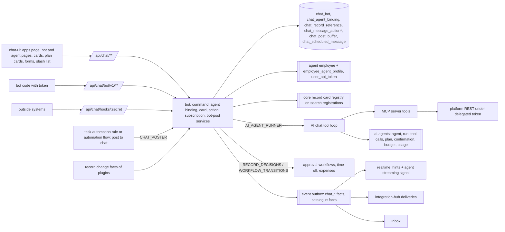

# Implementation Plan: Chat agents, bots and record actions

> Translates an approved `spec.md` into architecture and tech choices. The plan owns
> implementation details; the spec owns behaviour.

**Feature ID**: `chat-agents-and-record-actions`
**Spec**: `./spec.md`
**Tasks**: `./tasks.md`
**Status**: `Draft`
**Last updated**: 2026-11-23

---

## 1. Architecture Summary

No new plugin: bots, agents, cards and actions extend `@gauzy/plugin-chat` and `@gauzy/plugin-chat-ui`. The new tenant feature `FEATURE_CHAT_AGENTS` (a feature contribution of the chat plugin, default off) is checked by `FeatureFlagGuard` on the new bot, agent, command, subscription and recurring-post controllers; task cards stay behind the existing `FEATURE_CHAT` as today, while cards of other record types, send to chat and "Discussed in" on record pages, card settings and message actions sit behind the new tenant feature `FEATURE_CHAT_RECORD_CARDS` (a feature contribution of the chat plugin, default off, depends on `FEATURE_CHAT`); agent runs also need `GAUZY_CHAT_AI_ENABLED` (read by `chat-ai-enabled.ts` of `chat-messaging`). Chat owns only what is particular to conversations; everything an agent or a bot is elsewhere stays where it lives. Other features reach chat, and chat reaches them, only through contracts tokens bound in `apps/api/src/plugin-composition.ts` and through code registries in core:

- **Identities**: a bot is an agent employee (`EmployeeService.createAgentEmployee`, `employee.kind = agent`) whose display data is its existing `employee_agent_profile` (`packages/core/src/lib/employee-agent-profile/`: `source = 'chat'`, `slug` = handle, `title`, `avatarUrl`, `status`, `reportsToEmployeeId` = the responsible person); agents the Ever Works integration provisions (`packages/plugins/integration-ever-works/src/lib/inbox/`) join conversations as bots on their existing agent employee, without a second identity. A bot's credentials are core user API tokens (`packages/core/src/lib/auth/user-api-token/`, `user_api_token`) of its agent user, scoped by the credential policy of `access-control-and-security`.
- **Agents, runs, plans, limits**: owned by `ai-agents-and-assistants` (`ai_agent`, `ai_agent_version`, `ai_skill`, `ai_run`, `ai_run_step`, `ai_tool_call`, `ai_dry_run_plan`, `ai_confirmation`, `ai_budget`, `ai_usage_entry`); chat binds a bot to an agent and renders runs and plans; it depends on `ai-agents-and-assistants` for those tables and services.
- **Record card registry** (`packages/core/src/lib/record-card-registry/`, no table): built on the search plugin's index registrations (`packages/plugins/search/src/lib/registry/search-index.registry.ts`: label, read permission, title template and display fields per entity); a card registration adds only its reader, field formats, key patterns and editable fields (`registerRecordCardTypes([...])`); tasks are registered by core from the existing `chat-task-references.ts` resolver; the composer's record picker queries `GET /search`.
- **Chat poster** (`CHAT_POSTER` port, bound to `ChatBotPostService`): the notification engine's "post to chat" action, the task automations' new `POST_TO_CHAT` action, approvals, reminders and bot posts post through it, always as a bot.
- **Agent runner** (`AI_AGENT_RUNNER` port, bound to the AI chat plugin's tool loop, recording through the run service of `ai-agents-and-assistants`): a model call with tools, streaming callbacks and the tool approval hook; tools are the MCP server's tools reached over its HTTP transport with a delegated run token minted by core `AccessTokenService` (`packages/core/src/lib/access-token/access-token.service.ts`) and narrowed with the OAuth-app scope rules (`packages/core/src/lib/auth/oauth-app-scope.ts`).
- **Knowledge**: retrieval and citations come from the documents hub's knowledge index (`packages/plugins/docs/src/lib/knowledge/`: chunking, embeddings, `retrieval`, `vector-store`, `chat-tools`; `document_chunk`), and from the knowledge bases of `ai-agents-and-assistants` (`ai_knowledge_*`) where it is loaded.
- **Decisions** (`RECORD_DECISIONS` port of `approval-workflows`, plus registered decision handlers of time off and expenses) and **workflow transitions** (`WORKFLOW_TRANSITIONS`).
- **Channel subscriptions and bot posts** are automations, not a chat rule engine: a channel following tasks is a `task_automation` rule (trigger on task change through the existing `TaskAutomationChangeCapture` and `task_automation.task_changed`, action `POST_TO_CHAT`); a channel following other records or a saved view is an `automation_flow` of `automation-and-notifications` with its "post to chat" action; bot posts are rows of `chat_scheduled_message` (`chat-messaging`); chat keeps only the batching buffer.
- **Outgoing events**: chat-scoped subscriptions through the `WEBHOOK_SUBSCRIPTIONS` port of `integration-hub`; where it is not loaded, the core outgoing webhooks (`packages/core/src/lib/webhook/`: subscriptions on outbox event names, HMAC, retries, deliveries) are the store; the event catalogue entries are declared by chat.

## 2. Tech Choices

| Concern | Choice | Rationale |
| ------- | ------ | --------- |
| Package | existing `packages/plugins/chat`, `chat-ui`; core record card registry | Principle I; registry pattern of core |
| Bot identity | an agent employee through the existing agent-provisioning path (`EmployeeKindEnum.AGENT`) and its user with the agent user type of `access-control-and-security` when loaded; name, handle, picture, description, state and responsible person on its `employee_agent_profile` (`slug`, `title`, `avatarUrl`, `status`, `metadata.description`, `reportsToEmployeeId`) | bots are people-shaped participants with no sign-in; one profile per agent |
| Bot tokens | core `user_api_token` rows of the bot's agent user, created through its service by the responsible person or `CHAT_APPS_MANAGE`; scopes `chat:read`, `chat:post`, `chat:react`, `chat:edit-own`, `chat:direct` in the token's `access_credential_policy` row (`USER_API_TOKEN`) of `access-control-and-security`, which also carries its rate limit; rotation creates a new token and sets the old one's `expiresAt` 24 h ahead; `/api/chat/bot/v1` authenticates through the platform's API-token strategy and checks the scopes | revocation, audit, rate limits and the key list are the platform's |
| Callbacks | the webhook interaction transport (`webhooks/chat-interaction-transport.ts`) and egress guard, reused for bot buttons, forms and commands | signed, idempotent, safe egress |
| Agent binding | `chat_agent_binding` holds only the bot, the `ai_agent` it answers as (with an optional version pin) and chat's conversation scope; instructions, model, tools, knowledge, limits and budgets are the agent's (`ai_agent`, `ai_agent_version`, `ai_budget`) | one agent model |
| Agent runs | an `ai_run` per answer (`origin = chat`, conversation, thread and trigger message ids; steps, tool calls and usage in `ai_run_step`, `ai_tool_call`, `ai_usage_entry`), executed by the queue `chat-agent-runs` (`@QueueWorker`) in the API processes, in-process without a queue root; 10-minute deadline; chat keeps only `chat_message.agentRunId` | one run and usage record for every agent |
| Streaming | realtime signal `agent.streaming` (live only, members only) with text deltas; final text stored on the message, which emits `chat_message.updated` | Principle VII; no private stream |
| Delegated run token | a 15-minute access token for the invoker minted by `AccessTokenService` (claims, permissions, expiry), refreshed during the run, carrying the agent principal; scopes narrowed with the OAuth-app scope rules and the agent identity's ceiling | the narrower of two rights; no chat-specific signer |
| Plans and undo | tool previews (`preview: true`, [platform architecture](../../architecture/business-suite.md) §3.12) captured as an `ai_dry_run_plan` with `ai_confirmation` rows for the approvers (Inbox decision items); the plan card renders them; undo calls the tool's declared reverse | no write before approval; one plan model |
| Cards | batch resolve `GET /chat/cards` per message window through each registration's reader with the viewer's rights; live refresh through record change facts mapped by `chat_record_reference` | one call per window, viewer's rights |
| Channel subscriptions | an automation per subscription (task automation rule, else automation flow) whose action posts through `CHAT_POSTER`; posts within the window are upserted into `chat_post_buffer` per record and flushed by a minute job; a conversation never becomes a follower in `entity_subscription`, which stays the list of people who follow a record | no second rule engine; one summary per window |
| Bot posts | `chat_scheduled_message` rows with `botId` (once or recurring, core recurrence rule, holidays skipped), swept by `chat.scheduled.sweep` of `chat-messaging`; where the automation feature is loaded a schedule-triggered flow may post instead | one scheduled-post table and sweep |
| UI | Angular `chat-ui`; Ever Teams builds its screens on the same routes | Principle I |

## 3. Data Model

All new tables extend `TenantOrganizationBaseEntity`; JSON uses `jsonColumnType()`; soft delete through the base `deletedAt` where stated.

### Changed entities

| Entity | New columns | Indexes |
| --- | --- | --- |
| `chat_message` | `botId` uuid null; `agentRunId` uuid null (an `ai_run`); `agentSourceRefs` text null (the records, files and knowledge items a posted agent answer used, as the audience check recorded them); `sourceKind` varchar(16) null (`rule`, `flow`, `subscription`, `schedule`, `action`); `sourceId` uuid null; `cardCount` int default 0; `incomplete` bool default false. `kind` gains `bot` and `agent` (varchar, no schema change) | (`tenantId`, `botId`, `createdAt`); (`tenantId`, `sourceKind`, `sourceId`) |
| `chat_webhook` | `botId` uuid null; `allowOverride` bool default false; `previousSecretHash` char(64) null; `previousSecretValidUntil` timestamp null | (`previousSecretHash`) |
| `chat_scheduled_message` (of `chat-messaging`) | `cardEntity` varchar(64) null; `cardEntityId` uuid null; `savedViewId` uuid null; `flowId` uuid null | (`tenantId`, `botId`, `state`) |
| `chat_task_reference` (existing) | none: kept and written exactly as today for every task reference; the task routes, the GraphQL `taskReferences` field and `chat-task-references.ts` keep reading it; each task reference is also written to `chat_record_reference` with `entity = Task` in the same transaction | — |

### New entities

| Table | Columns (beyond the base) | Indexes and uniqueness |
| --- | --- | --- |
| `chat_bot` (soft delete) | `agentEmployeeId` (name, handle, picture, description, state and responsible person on its `employee_agent_profile`), `agentUserId` null, `handleKey` varchar(40) (lower-cased profile `slug`, unique for mentions), `platformKey` varchar(16) null (`platform` for the organization's platform bot), `interactionUrl` varchar(2048) null, `interactionSecretEncrypted` text null | unique (`tenantId`, `organizationId`, `handleKey`); unique (`tenantId`, `organizationId`, `platformKey`); unique (`tenantId`, `agentEmployeeId`) |
| `chat_slash_command` | `botId` null fk cascade, `pluginKey` varchar(64) null, `name` varchar(32), `nameKey` varchar(32), `description` varchar(200), `argumentHint` varchar(100) null, `conversationIds` json null, `handlerUrl` varchar(2048) null, `enabled` bool | unique (`tenantId`, `organizationId`, `nameKey`) |
| `chat_private_reply` | `userId`, `conversationId` fk cascade, `threadRootId` null, `botId` null, `body` text, `blocks` json null, `expiresAt` | (`tenantId`, `userId`, `conversationId`); (`expiresAt`) |
| `chat_response_address` | `tokenHash` char(64), `botId` null, `commandId` null, `messageId` null, `conversationId`, `userId`, `usesLeft` int, `expiresAt` | unique (`tokenHash`); (`expiresAt`) |
| `chat_agent_binding` | `botId` fk cascade, `aiAgentId` uuid (`ai_agent`), `aiAgentVersion` int null (pin; null = the published version), `allowedInAllPublic` bool default false, `conversationIds` json null (where it may be mentioned besides its own conversations), `enabled` bool | unique (`botId`); (`tenantId`, `aiAgentId`) |
| `chat_prompt` | `ownerUserId` null (null = shared), `botId` null, `title` varchar(120), `body` text | (`tenantId`, `organizationId`, `ownerUserId`) |
| `chat_card_setting` | `entity` varchar(64), `fields` json | unique (`tenantId`, `organizationId`, `entity`) |
| `chat_record_reference` | `messageId` fk cascade, `entity` varchar(64), `entityId` uuid, `kind` varchar(12) (`mention`, `sent`, `created`, `action`, `notice`) | unique (`messageId`, `entity`, `entityId`); (`tenantId`, `entity`, `entityId`) |
| `chat_message_action` | `name` varchar(80), `nameKey`, `icon` varchar(40) null, `scope` json, `kind` varchar(16) (`create_record`, `flow`, `tool`), `target` varchar(120), `fields` json, `builtInKey` varchar(40) null, `enabled` bool | unique (`tenantId`, `organizationId`, `nameKey`) |
| `chat_message_action_run` (append-only) | `actionId` fk, `messageId`, `userId`, `values` json, `resultEntity` null, `resultEntityId` null, `outcome` varchar(12), `error` varchar(500) null | (`tenantId`, `actionId`, `createdAt`) |
| `chat_post_buffer` | `conversationId` fk cascade, `sourceKind` varchar(16) (`rule`, `flow`), `sourceId` uuid (the task automation rule or flow), `windowMinutes` int, `entity` varchar(64), `entityId`, `changes` json, `firstAt` | unique (`conversationId`, `sourceKind`, `sourceId`, `entity`, `entityId`); (`firstAt`) |
| `chat_source_mute` | `conversationId` fk cascade, `sourceKind` varchar(16), `sourceId` uuid, `mutedByUserId` | unique (`conversationId`, `sourceKind`, `sourceId`) |

Not chat tables: bot identity and display (`employee` + `employee_agent_profile`), bot tokens (`user_api_token` with its credential policy), agent definitions, versions, limits and budgets (`ai_agent`, `ai_agent_version`, `ai_budget`), runs and usage (`ai_run`, `ai_run_step`, `ai_tool_call`, `ai_usage_entry`), plans and approvals (`ai_dry_run_plan`, `ai_confirmation`), shared instructions (`ai_skill`), channel subscriptions (`task_automation_rule` or `automation_flow`, their conditions in their own condition store), bot posts (`chat_scheduled_message`).

Backfill: existing `chat_task_reference` rows are copied into `chat_record_reference` (`entity = Task`); from then on a task reference is written to both tables in one transaction, so `chat_task_reference` stays complete and usable by every reader it has today. The generic card, "Discussed in" and timeline paths read `chat_record_reference` for every other record type; for tasks they read `chat_task_reference`, which every code version writes, edits and deletes as today, and add only the `chat_record_reference` task rows of the kinds that table does not hold (`action`, `notice`). A task reference added or removed by a replica still on the previous code (which writes `chat_task_reference` alone) while a release rolls out therefore shows, or disappears, at once, whenever the tenant switched the feature on. Catch-up: the task rows of `chat_record_reference` serve the live refresh of cards (§2 Cards) and are kept in step by a copy that is insert-if-absent on the unique key (`messageId`, `entity`, `entityId`) and deletes the task rows of kind `mention` whose `chat_task_reference` row no longer exists; it runs when `FEATURE_CHAT_RECORD_CARDS` is switched on for a tenant (an operation on the core runtime) and nightly in `chat.record-reference.catch-up` for every tenant with the feature on.

Settings are keys of `chat.settings.ts` (organization scope, platform settings store; listed by `chat-administration-and-clients`): `agents.allowInAllPublic` (false), `apps.platformBot` (name, picture), `teamChannels` (`off`, `public`, `private`), `departmentChannels`, `actions.builtIn` switches, `events.contentAllowed` (false). Agent limits are the agent's limits and the budgets of `ai-agents-and-assistants`, not chat settings.

### Migrations

**Migration timestamps**: `packages/plugins/chat` `1791000067500` to `1791000067599`.

In `packages/plugins/chat/src/lib/database/migrations/`, tri-dialect through `migration-helpers.ts`, idempotent, registered in `CHAT_MIGRATIONS`:

1. `1791000067500-AddChatAgentColumns` — changed columns (`chat_message`, `chat_webhook`, `chat_scheduled_message`).
2. `1791000067510-CreateChatAgentTables` — the twelve new tables (`chat_bot`, `chat_slash_command`, `chat_private_reply`, `chat_response_address`, `chat_agent_binding`, `chat_prompt`, `chat_card_setting`, `chat_record_reference`, `chat_message_action`, `chat_message_action_run`, `chat_post_buffer`, `chat_source_mute`).
3. `1791000067520-BackfillChatRecordReferences` — copies task references in batches of 10,000.

Permissions and the feature are contributions of the chat plugin, not seeds: `chat.permissions.ts` declares `CHAT_APPS_MANAGE` (`defaultFor` super admin and admin) and `CHAT_AGENTS_USE` (`defaultFor` every default role that holds `CHAT_VIEW`); `chat.features.ts` declares `FEATURE_CHAT_RECORD_CARDS` and `FEATURE_CHAT_AGENTS` (both `defaultEnabled: false`, `dependsOn: ['FEATURE_CHAT']`). The tables of `ai-agents-and-assistants` come with that plan's migrations; when they are absent, task T5 ships them unchanged.

### Contracts

`packages/contracts/src/lib/chat-agents.model.ts` (exported from `index.ts`): bot (identity fields read from the agent profile), bot token scopes enum, command, private reply, response address, agent binding, the chat view of a run and a plan (read from the `ai-agents-and-assistants` contracts), prompt, card type registration and resolved card, card setting, record reference, message action and its field types, action run, channel subscription (the automation it is and its window); `ChatMessageKindEnum` gains `BOT`, `AGENT`; `FEATURE_CHAT_RECORD_CARDS`, `FEATURE_CHAT_AGENTS`, `CHAT_APPS_MANAGE`, `CHAT_AGENTS_USE` as plugin contributions; `TaskAutomationActionEnum.POST_TO_CHAT`; port tokens `CHAT_POSTER`, `AI_AGENT_RUNNER`, `AGENT_DEFINITIONS`, `RECORD_DECISIONS`, `WORKFLOW_TRANSITIONS`, `WEBHOOK_SUBSCRIPTIONS`.

## 4. API Surface

People routes under `/api/chat` (tenant, `FEATURE_CHAT` and, where marked A, `FEATURE_CHAT_AGENTS`; the card, card-type, card-setting, record, send, discussions, message-action and tool-command routes also need `FEATURE_CHAT_RECORD_CARDS`, while the existing task routes keep only `FEATURE_CHAT`); bot routes under `/api/chat/bot/v1` authenticated by the platform's API-token strategy for the bot's agent user, with the token's scopes checked and the same feature checks.

| Method | Endpoint | Permission | Description | Status |
| --- | --- | --- | --- | --- |
| `GET` | `/apps` | `CHAT_APPS_MANAGE` | overview of FR-3 | New |
| `GET` `POST` `PATCH` `DELETE` | `/bots[/:id]` (A) | `CHAT_APPS_MANAGE` | bots: create provisions the agent employee and its profile, or binds an existing agent employee; edits write the profile | New |
| `GET` `POST` `DELETE` | `/bots/:id/tokens`, `POST /bots/:id/tokens/:tokenId/rotate` (A) | responsible person or `CHAT_APPS_MANAGE` | user API tokens of the bot's agent user through the core token service, with their scope policy (secret once) | New |
| `GET` `POST` `PATCH` `DELETE` | `/bot/v1/conversations`, `/bot/v1/conversations/:id/messages`, `/bot/v1/messages/:id`, `/bot/v1/messages/:id/reactions/:emoji`, `/bot/v1/direct`, `/bot/v1/conversations/:id/{join,leave}`, `/bot/v1/private-replies`, `/bot/v1/responses/:token` (A) | token scopes | bot API of FR-7, FR-10, FR-58 | New |
| `GET` `POST` `PATCH` `DELETE` | `/commands[/:id]` (A) · `GET /conversations/:id/commands` · `POST /conversations/:id/commands/:name/invoke` | `CHAT_APPS_MANAGE` / `CHAT_SEND` | slash commands | New |
| `POST` | `/interactions/:id/form` (A) | member | submit a bot form | New |
| `GET` `DELETE` | `/conversations/:id/private-replies`, `/private-replies/:id` (A) | the person | private replies | New |
| `GET` `POST` `PATCH` `DELETE` | `/agents[/:id]` (A) · `POST /agents/:id/test` · `GET /agents/:id/instructions/preview?employeeId=` | `CHAT_APPS_MANAGE` | bindings of bots to agents of `ai-agents-and-assistants`; the agent itself is edited through that feature's routes (or its pages opened from chat) | New |
| `GET` | `/agents/:id/runs` · `/agent-runs/:id` (A) | `CHAT_APPS_MANAGE` or the invoker | the agent's `ai_run` rows with `origin = chat`, filtered to readable conversations | New |
| `POST` | `/agent-runs/:id/stop` · `/agent-plans/:id/{approve,cancel,change}` · `/agent-plans/:id/steps/:n/undo` (A) | invoker or required approver | stop an `ai_run`; decide its `ai_dry_run_plan` through its `ai_confirmation` rows | New |
| `POST` | `/conversations/:id/agent-context/reset` (A) | `CHAT_AGENTS_USE` | new topic | New |
| `GET` `POST` `PATCH` `DELETE` | `/prompts[/:id]` (A) | own / `CHAT_APPS_MANAGE` for shared | prompts; shared instructions are `ai_skill` rows of `ai-agents-and-assistants` | New |
| `GET` | `/cards?refs=` · `/card-types` | `CHAT_VIEW` | batch resolve for the viewer; registry (labels and permissions from the search registrations); the composer's record picker calls `GET /api/search` | New |
| `GET` `PUT` | `/card-settings/:entity` | `CHAT_APPS_MANAGE` | card fields per organization | New |
| `PATCH` | `/messages/:id/records/:entity/:entityId` | `CHAT_SEND` + the record's edit rights | edit registered fields (tasks keep `/messages/:id/tasks/:taskId`) | New |
| `POST` | `/messages/:id/records/:entity/:entityId/{transition,decision}` | the workflow or decision rights | transitions and decisions from cards | New |
| `POST` | `/records/:entity/:entityId/send` · `GET /records/:entity/:entityId/discussions` | `CHAT_SEND` / `CHAT_VIEW` | send to chat, discussed in | New |
| `GET` `POST` `PATCH` `DELETE` | `/message-actions[/:id]` · `GET /messages/:id/actions` · `POST /messages/:id/actions/:actionId/run` | `CHAT_APPS_MANAGE` / reader | message actions (`preview: true` supported) | New |
| `GET` `POST` | `/conversations/:id/tool-commands` · `/conversations/:id/tool-commands/:tool` | `CHAT_SEND` + tool rights | slash actions from MCP tools | New |
| `GET` `POST` `PATCH` `DELETE` | `/conversations/:id/subscriptions[/:sid]` · `POST /conversations/:id/sources/mute` | channel manager | subscriptions as automations posting to this conversation (created, listed, changed and removed here; stored as task automation rules or automation flows), source mutes | New |
| `GET` `POST` `PATCH` `DELETE` | `/conversations/:id/bot-posts[/:pid]` · `POST /bot-posts/:id/{pause,resume}` · `GET /bot-posts/preview` (A) | channel manager or `CHAT_APPS_MANAGE` | recurring and one-time bot posts as `chat_scheduled_message` rows with a `botId` | New |
| `POST` | `/webhooks/:id/rotate` · `PATCH /webhooks/:id` (gains `botId`, `allowOverride`) | channel manager | incoming webhook changes | New / Changed |
| `POST` | `/hooks/:secret` | public | gains `thread_root_id`, `thread_key`, `files`, honoured `username` and `icon_url` | Changed |
| `GET` `POST` `DELETE` | `/conversations/:id/event-subscriptions` | channel manager | chat-scoped outgoing subscriptions through `WEBHOOK_SUBSCRIPTIONS`, else core outgoing webhooks | New |

DTOs in `dto/chat-agents.dto.ts`; Swagger tags `Chat apps`, `Chat bot API`; idempotency keys on bot posts, action runs and command invocations; rate limits per token from its credential policy (default 60/min, burst 20, like webhooks) and per person for agents (20 runs/min).

**Consumer tokens answered** (bound in `apps/api/src/plugin-composition.ts` to `CHAT_POSTER` and the record cards; each consumer plan states the shape it calls and its fallback): `AUTOMATION_CHAT`, `WORKFLOW_CHAT`.

## 5. Events, Real-Time and Notifications

| Event | Emitted when | Consumers |
| --- | --- | --- |
| `chat_reaction.added` / `removed`, `chat_member.joined` / `left` | reactions and membership changes | plugins through the consumer registry; catalogue |
| catalogue facts `chat.message.posted` / `edited` / `deleted`, `chat.reaction.added` / `removed`, `chat.conversation.created` / `archived` / `deleted`, `chat.member.joined` / `left` | mapped from the chat facts with owner-scoped enrichment (content only under FR-60) | `integration-hub` subscriptions, automation triggers |
| `ai_run.*` of `ai-agents-and-assistants` (consumed for `origin = chat`) | run state changes | invoker and conversation members (hint) |
| signal `agent.streaming` | text deltas while a run writes | conversation members, live only |
| `ai_confirmation.*` of `ai-agents-and-assistants` (consumed) | plan created, decided, expired, undone | plan card update for members of the conversation |
| `chat_message.updated` (existing) | a carried card's record changed; a bot edited; a plan card changed | members |
| record change facts of plugins (consumed) | `task.*`, `invoice.*`, `deal.*`, … | card refresh, subscription buffers |

Inbox: plan approvals awaiting a person become decision items; with `FEATURE_CHAT_AGENTS` on, mentions in bot and app messages file mention items attributed to the bot (FR-57; off, webhook mentions count on badges only, as today); decisions from cards close the matching approval items.

## 6. UI Surface

- **Angular (`chat-ui`)**: Settings → Chat → Apps page (`/pages/chat/settings/apps`) with tabs Bots, Agents, Commands, Actions, Webhooks, Recurring posts, Subscriptions, Card fields; bot editor (writes the agent profile) with the token dialog of the core API tokens; the Agents tab binds bots to agents and opens the agent editor and run log of `ai-agents-and-assistants` (identity, instructions with variable preview, model, tools, knowledge, limits, sandbox test), filtered to chat runs, with no second editor in chat; in the conversation: `record-card` (generic, replaces only the inner content of `task-card`, which keeps its behaviour), record picker in the composer, slash list, command form, bot form dialog, private reply style, agent message with progress lines and stop, `plan-card` with approve, change, cancel and undo, decision buttons on cards, "from <source>" label with mute, subscription dialog, bot post scheduler with next-five preview. Record pages: "Send to chat" and "Discussed in" through the page extension slots (`PAGE_EXTENSION_SLOTS`). i18n keys in `chat-ui/src/i18n/*.json`.
- **Ever Teams**: same routes; screens in the Ever Teams spec `workspace-collaboration-clients`.

## 7. MCP Tools, SDKs and Integrations

- `packages/mcp-server/src/lib/tools/collaboration/chat.ts`: `post_chat_record_card` (`{ conversationId, entity, entityId, note? }`), `list_chat_message_actions`, `run_chat_message_action` (`preview` default true), `list_chat_slash_commands`, `list_chat_agents`; scopes `chat:read` / `chat:write`.
- Tool metadata convention (shared with `ai-agents-and-assistants`): `writes`, `previewable`, `reverse` (tool name and input mapping), `hiddenFromAgents`; read by plans, undo and slash actions.
- OpenAPI regenerated (new tags), SDK regeneration noted; the bot API documented in the API catalogue of `integration-hub`.
- Integrations: incoming webhooks extended; outgoing through `integration-hub`; notification engine through `CHAT_POSTER`.

## 8. Background Jobs

| Trigger | When | What it does | Idempotency |
| --- | --- | --- | --- |
| `chat-agent-runs` worker | on invocation | builds context, calls `AI_AGENT_RUNNER`, streams; the run, its tool calls and usage are written by the `ai_run` service; stops at 10 minutes | job id = run id |
| run recovery and plan expiry | (jobs of `ai-agents-and-assistants`) | stale runs failed with reason, pending plans and confirmations expired | their compare-and-set |
| `chat.subscription.flush` | every minute | posts one summary per buffered source and conversation whose window ended, clears its buffer rows | buffer rows deleted in the post transaction |
| `chat.scheduled.sweep` (of `chat-messaging`) | every minute | also posts due one-time and recurring bot posts, next time from the core recurrence module with holidays | its claim and nonce |
| `chat.webhook.files` | on receive with files | fetches files through the egress guard into the Documents hub, attaches them | job id = message id + position |
| `chat.cards.refresh` consumer | on record facts | emits `chat_message.updated` for messages carrying the record | idempotent hints |
| `chat.private_reply.purge` | hourly | removes private replies and response addresses past expiry | delete by id batches |
| `chat.record-reference.catch-up` | when `FEATURE_CHAT_RECORD_CARDS` is switched on for a tenant, then nightly for every tenant with it on | copies task references missing from `chat_record_reference` and deletes its task mention rows whose `chat_task_reference` row is gone (plan §3 Catch-up) | insert-if-absent on (`messageId`, `entity`, `entityId`); an operation per tenant and run |

## 9. Security & Permissions

- New keys `CHAT_APPS_MANAGE` and `CHAT_AGENTS_USE` (plugin permission contributions with `defaultFor`); everything else uses `CHAT_*` and the target records' own permissions.
- Bot tokens are core user API tokens (hashed, prefix shown, revocable, last use recorded) with scopes, rate limit and expiry from their credential policy; rotation with overlap; the bot API refuses scopes beyond the token and conversations the bot is not in (`404`).
- Agent rights: delegated run token for the invoker minted by `AccessTokenService` with the agent principal, intersected with the agent identity's role and ceiling; context assembled after the membership filter; audience check (spec FR-18): the run records every record, file and knowledge passage its tools and retrieval return, and `chat/agents/chat-agent-audience.ts` checks each against the conversation's current members (batch through the same read checks and `RECORD_ACCESS_FILTER`) and, in a public channel, against the organization's default employee role; the answer streams in the conversation while every item passes and continues as a private reply to the invoker (FR-10) from the first item that does not, so nothing derived from it is posted; the posted answer stores the checked items in `chat_message.agentSourceRefs`, and `ChatMessageService.list` and `.thread` (behind the REST routes and the GraphQL `chatMessages` resolver), `ChatSearchService.search` and the conversation list's last-message preview check them for the reader in one batch per page through the same read checks, returning in place of the text a note that the answer used records the reader cannot open when one item that still exists is not readable, so a member added later reads no more than the audience check allowed; a direct conversation with the agent has the invoker as its only audience; tool results and message text passed as data with the platform's prompt delimiters; no secret in prompts; debug detail only to app managers.
- Message actions pass only declared fields; created records go through the target service's DTO validation.
- Outgoing: content only under FR-60; direct conversations excluded in the catalogue declaration.
- Webhook files fetched through `egress/egress-guard.ts` (public addresses, size and time caps), typed by content.

## 10. Observability

- Activity log: bots, tokens, commands, agent bindings, actions, subscriptions, recurring posts, card settings, webhook rotations.
- Audit trail: agent runs, plans, approvals, executed steps and undo (recorded by `ai-agents-and-assistants`), card decisions and transitions.
- Metrics: runs by state and agent and token use from `ai_usage_entry`; chat adds latency to first words, callback and command latency, subscription flush lag, notification post failures.

## 11. Phased Rollout

1. **Phase 1 — Surface what exists**: card registry with tasks moved onto it unchanged, cards for invoices, contacts, deals, projects and pages, send to chat and discussed in on those pages, card fields setting, incoming webhook gaps (threads, override, files, rotation, mentions in blocks), the Apps overview with webhooks. Behind `FEATURE_CHAT_RECORD_CARDS`; webhook additions apply only to posts that use them, and task cards stay as today under `FEATURE_CHAT`.
2. **Phase 2 — Depth**: bots and tokens, bot API, buttons and forms, private replies, slash commands, response addresses; message actions with built-ins; record notifications through `CHAT_POSTER` and record threads; team and department channels; outgoing catalogue facts; recurring bot posts. Behind `FEATURE_CHAT_AGENTS`.
3. **Phase 3 — Agents**: bindings to agents of `ai-agents-and-assistants`, runs with streaming, knowledge with citations from the documents hub index, files, prompts, limits and budgets, audit, MCP tools. Behind the AI switch too.
4. **Phase 4 — Advanced capabilities**: mention in any thread, plans with previews and undo, decisions in the message, slash actions from MCP tools, record subscriptions with batching.

Availability: the feature is off by default; after the trial period it may be switched on by default for new tenants only; existing tenants keep their setting until an administrator changes it.

## 12. Constitution Reconciliation

- I Plugin-first: chat plugin pair and a core registry; other plugins register cards, actions and decision handlers through registries and ports.
- II Tenant/organization scoping: every new table on the tenant and organization base; bot tokens resolve their tenant and organization from the bot.
- III Both ORMs, additive migrations: three plugin migrations, tri-dialect, idempotent; enum values added as strings; permissions and the feature as contributions.
- IV Default-off flag; nothing removed: `FEATURE_CHAT_RECORD_CARDS`, `FEATURE_CHAT_AGENTS` and the AI switch default off; task cards, task routes, the task reference table (still written) and webhook routes kept.
- V Contracts and API first: `chat-agents.model.ts`, REST before UI, bot API documented.
- VI Permissions, privacy, security: scoped hashed tokens, narrower-of-two agent rights, plans before writes, content rules for outgoing events.
- VII Real-time through the event bus: outbox facts, realtime hints and a live signal for streaming.
- VIII i18n and accessibility: chat-ui keys in every locale; keyboard operable plan cards and forms.
- IX Tests: every task names its specs.
- X Behaviour-first spec: implementation only here.
- XI Documentation describes our platform only.

## 13. Risks & Mitigations

| Risk | Likelihood | Impact | Mitigation |
| ---- | ---------- | ------ | ---------- |
| `ai-agents-and-assistants` not loaded when chat agents ship | Medium | No agents | chat ships that feature's agent, run, plan and budget tables unchanged (T5); one model from the start |
| The two reference tables drift apart | Low | Stale task links | the backfill copies every row before dual writing starts; both rows are written in one transaction; readers take task references from `chat_task_reference`, so a reference a previous-code replica adds or removes during a rollout shows at once; the catch-up runs when a tenant switches `FEATURE_CHAT_RECORD_CARDS` on and nightly, copying missing task rows and deleting removed mentions for the live refresh of cards; a parity spec compares them |
| Agent reads beyond the asker's rights | Low | Data leak | delegated token, context after membership filter, tests per AC-4 and AC-5 |
| Streaming load on the realtime channel | Medium | Chatty signals | deltas batched every 250 ms, members only, never stored |
| Card resolution cost in long histories | Medium | Slow windows | batch resolve per window, cache per viewer for 60 s, lazy loading |
| Tools without previews | Medium | Plans cannot show effects | tools without `previewable` are listed as "no preview" and need an explicit second confirmation |
| Notification storms into channels | Medium | Noise | record threads, batching subscriptions, source mute |

## 14. References

- Spec: `./spec.md` · Tasks: `./tasks.md`
- Existing plans and specs in `docs/specs/features/`: [`docs/specs/features/chat/plan.md`](../chat/plan.md) (task cards), [`docs/specs/features/chat-incoming-webhooks/plan.md`](../chat-incoming-webhooks/plan.md), [`docs/specs/features/mcp-collaboration-tools/spec.md`](../mcp-collaboration-tools/spec.md), [`docs/specs/features/task-automations/plan.md`](../task-automations/plan.md)
- Related plans: [`../chat-messaging/plan.md`](../chat-messaging/plan.md) (scheduled messages), [`../ai-agents-and-assistants/plan.md`](../ai-agents-and-assistants/plan.md) (agents, runs, plans, budgets), `access-control-and-security` (credential policy)
- Code: `packages/plugins/chat/src/lib/{chat-task-references.ts,services/chat-task-card.service.ts,webhooks/,egress/}`, `packages/plugins/ai-chat/src/lib/`, `packages/plugins/docs/src/lib/knowledge/`, `packages/plugins/search/src/lib/registry/`, `packages/plugins/task-automations/src/lib/engine/`, `packages/mcp-server/src/lib/tools/`, `packages/core/src/lib/{webhook,event-outbox,employee,employee-agent-profile,access-token,auth/user-api-token}/`, `packages/core/src/lib/auth/oauth-app-scope.ts`, `apps/api/src/plugin-composition.ts`
