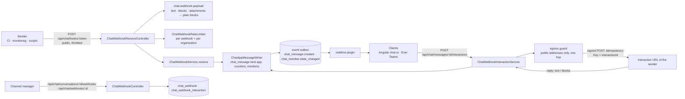

<!-- cspell:ignore gzcwh -->

# Implementation Plan: Chat incoming webhooks

> Translates an approved `spec.md` into architecture and tech choices. The plan owns
> implementation details; the spec owns behaviour.

**Feature ID**: `chat-incoming-webhooks`
**Spec**: `./spec.md`
**Tasks**: `./tasks.md`
**Status**: `Approved`
**Last updated**: 2026-11-11

---

## 1. Architecture Summary

Everything lives in `packages/plugins/chat` (Principle I). A webhook message is an ordinary `chat_message` row
(`kind: app`, no employee author), so it reaches members through the outbox, unread counters and mention rules the
member messages already use (Principle VII).

## 2. Tech Choices

| Concern | Choice | Rationale |
| ------- | ------ | --------- |
| Flag | `GAUZY_CHAT_WEBHOOKS_ENABLED` (exactly `true`; needs `GAUZY_CHAT_ENABLED`), read per request by `isChatWebhooksEnabled`: the management and interaction routes' first guard (`ChatWebhooksEnabledGuard`) and the services; the public route answers its own `404 no_webhook`; nothing posts or calls out | Principle IV; same contract as `isChatEnabled` |
| Tables | `chat_webhook`, `chat_webhook_interaction`, three nullable `chat_message` columns; migration `1791000006730`, tri-dialect and idempotent (`migration-helpers.ts`) | Principle III; the tables ship with the chat plugin, the routes with the flag |
| URL secret | 32 random bytes (base64url) after the prefix `gzcwh_`, in the URL path; stored as SHA-256 only (`tokenHash`, unique), last four characters kept as a hint; shown once | NFR "secrets hashed at rest"; a hash lookup needs no scan |
| Signing secret | a second 32-byte secret, shown once, sealed at rest (AES-256-GCM, key from `ENCRYPTION_KEY`, else derived from a non-default `JWT_SECRET`, bound to the webhook row) | the platform signs callbacks, so it must read the key back; a database copy alone cannot sign |
| Signature | `X-Signature: t=<unix-seconds>,v1=<hex HMAC-SHA256 of "<t>.<body>">` through core `signWebhookPayload`; receivers verify with a 300 s window (`verifyWebhookSignature`) | the platform's outgoing-webhook contract, one verifier for both |
| Egress | the chat plugin's egress guard (`src/lib/egress`, link-preview lane, ever-gauzy #11796): URL judged, every resolved address public, connection pinned to them, no redirect, `https:` only here, 5 s deadline, 64 KiB read cap | FR-5, no second SSRF guard in the plugin |
| Payload | `text` (markdown subset, mention tokens), `blocks` (header, section text + fields, divider, context, actions with buttons; any other type → its text as a plain `text` block), legacy `attachments` (pretext, title, text, fields, footer → blocks); JSON or a form body with a `payload` field | FR-2; existing senders work unchanged |
| Sanitizing | every block string is plain text: HTML tags removed, `&lt;` `&gt;` `&amp;` decoded, `<url\|label>` links rewritten (`[label](url)` in the body, `label (url)` in blocks), control characters dropped, lengths capped; button URLs `https:` and public hosts only | Principle VI, FR-5 |
| Limits | raw body ≤ 64 KiB (`422 payload_too_large`; over 128 KiB the platform's body parser refuses it with 413 before reading it: core `SMALL_BODY_ROUTES`), ≤ 50 blocks, ≤ 10 fields per section, ≤ 10 buttons per actions block, body ≤ 4,000 characters (longer text is cut with an ellipsis) | spec §2.2 |
| Rate limits | fixed windows through the platform's throttler storage: shared by every replica where the platform's throttler runs on Redis (`THROTTLE_ENABLED` with Redis), per process otherwise — the same reach as every other platform limit; per webhook 60/min and 20 per 10 s (burst), per organization 600/min and 100 per 10 s; all four from env; `429 rate_limited` + `Retry-After` | FR-6 |
| Idempotency | payload `nonce` or the `Idempotency-Key` header (≤ 64 chars) becomes the message nonce; unique (`webhookId`, `nonce`); a repeat answers `200 ok` and posts nothing | NFR reliability |
| Broadcast | `<!channel>` / `<!here>` count only when the webhook has `canBroadcast` (off by default; a manager sets it); otherwise they stay as plain `@channel` text | FR-3 |
| Author | `authorEmployeeId`/`authorUserId` null, `kind: app`, `webhookId`, `appName` + `appIconUrl` copied from the webhook at post time; `username` / `icon_url` / `channel` in a payload are ignored | FR-3; a payload cannot pose as someone else or another channel |
| Interactions | one `chat_webhook_interaction` row per click (its id is the `interactionId`); first attempt inline, then 3 retries (2 s, 10 s, 30 s), each re-signed with a fresh timestamp, same `interactionId` and `Idempotency-Key`; a reply that cannot be read is retried; a 2xx JSON reply with `text`/`blocks`/`attachments` replaces the message once per interaction (`replyAppliedAt` claimed in the same transaction as the message write) unless `replace_original: false`; an actions block without a `block_id` gets `_block-<index>`, so (block id, action id) names one button. A click carries the client's `Idempotency-Key` header (a UUID per click, the same on its retries; ≤ 64 printable characters, the receive route's rule), stored as `idempotencyKey`, unique per (tenant, message, clicker, key): a repeat — double click, retry after a lost answer, a concurrent duplicate refused by the index — answers the first click as it is now (`replayed: true`) and posts nothing; the same key for another button is `409 IDEMPOTENCY_KEY_REUSED`; no key, one interaction per request | FR-4, NFR reliability |
| Who manages | channel managers, the channel's creator and `CHAT_MANAGE` holders (`ChatAccessService.requireManager`); `CHAT_SEND` on the write routes | spec §8 open question, answered with the proposal |
| Activity log | `ActivityLogService.logActivity` on `BaseEntityEnum.ChatWebhook`: Created, Updated (rename, icon, interaction URL, broadcast), Deleted (revoke) | FR-7 |
| Counters | `acceptedCount`, `rejectedCount`, `rateLimitedCount`, `callbackFailureCount`, `lastUsedAt` on the webhook row (atomic increments), shown in the list | NFR observability, FR-1 "last used" |

## 3. Data Model

| Table | Columns (beyond the tenant/organization base) |
| ----- | --------------------------------------------- |
| `chat_webhook` | `conversationId` (FK cascade), `name` (80), `iconUrl` (2048), `interactionUrl` (2048), `tokenHash` (64, unique), `tokenHint` (8), `signingSecret` (text, sealed), `canBroadcast`, `createdByEmployeeId`, `revokedAt`, `revokedByEmployeeId`, `lastUsedAt`, `acceptedCount`, `rejectedCount`, `rateLimitedCount`, `callbackFailureCount`; index (`conversationId`) |
| `chat_webhook_interaction` | `webhookId` (FK cascade), `messageId` (FK cascade), `conversationId`, `actorEmployeeId`, `actorUserId`, `actionId` (255), `blockId` (255), `value` (2000), `status` (pending / delivered / retrying / failed), `attempts`, `lastStatusCode`, `lastError` (255), `deliveredAt`, `replyAppliedAt`, `idempotencyKey` (64, migration `1791000008300`); indexes (`messageId`), (`webhookId`), unique (`tenantId`, `messageId`, `actorUserId`, `idempotencyKey`) where a key is set |
| `chat_message` (+) | `webhookId` (index; unique (`webhookId`, `nonce`) where `nonce` is set), `appIconUrl` (2048), `blocks` (text: the normalised block JSON) |

Contracts (`packages/contracts/src/lib/chat.model.ts`): `ChatAppBlockTypeEnum`, `IChatAppBlock` union and
`IChatAppButton`, `IChatWebhook`, `IChatWebhookCreateInput` / `UpdateInput`, `IChatWebhookCreated` (with the URL and
signing secret shown once), `IChatInteractionInput` / `Result` / `State`, `ChatInteractionStatusEnum`, the limits
(`CHAT_WEBHOOK_*`), `IChatMessage.webhookId` / `appIconUrl` / `blocks`; `BaseEntityEnum.ChatWebhook`.

## 4. API Surface

| Method | Endpoint | Guard | Description |
| --- | --- | --- | --- |
| `POST` | `/api/chat/hooks/:token` | **public**; flag; throttled | the sender's post: `200 ok` · `404 no_webhook` (unknown, revoked, flag off, chat off for the tenant) · `410 channel_is_archived` · `422 invalid_payload` / `payload_too_large` / `too_many_blocks` / `no_text` · `429 rate_limited` (+ `Retry-After`) |
| `GET` | `/api/chat/conversations/:id/webhooks` | CHAT_VIEW + manager | the channel's webhooks (revoked ones included, newest first) |
| `POST` | `/api/chat/conversations/:id/webhooks` | CHAT_SEND + manager | `{ name, iconUrl?, interactionUrl?, canBroadcast? }` → webhook + `url` + `signingSecret` (once); channels only, ≤ 10 active |
| `PATCH` | `/api/chat/webhooks/:id` | CHAT_SEND + manager | rename, icon, interaction URL (`null` clears; a new one is judged by the egress guard, resolution included), broadcast |
| `POST` | `/api/chat/webhooks/:id/secret` | CHAT_SEND + manager | a new signing secret, shown once |
| `DELETE` | `/api/chat/webhooks/:id` | CHAT_SEND + manager | revoke (the row stays for history; the URL answers 404 from then on) |
| `POST` | `/api/chat/messages/:id/interactions` | CHAT_SEND + member | `{ actionId, blockId? }` (+ optional `Idempotency-Key` header) → `{ interaction, message?, events, replayed? }`; the value comes from the stored button, never from the client; a non-member gets 404; a repeated key answers the first click, the same key for another button 409 |
| `GET` | `/api/chat/interactions/:id` | CHAT_VIEW, the actor only | the state of a click (for a client waiting on retries) |

The public route runs outside the tenant guard: the webhook row names the tenant, the organization and the
conversation; the tenant's `FEATURE_CHAT` toggle is read from its stored toggle rows (an organization row first,
then the tenant row; no row means on). Answers are `Cache-Control: no-store`. The GraphQL `ChatMessage` type gains
`webhookId`, `appIconUrl` and `blocks: JSON`; the management routes have no GraphQL twin (they are writes and a
settings read; the REST surface is the contract).

## 5. Events, Real-Time and Notifications

- A webhook post appends `chat_message.created` (kind `app`, `authorUserId: null`) to every member, then each
  member's `chat_member.state_changed` (their unread and mention counts) after the commit, exactly like a send.
- A reply that replaces a message appends `chat_message.updated`.
- Mentions: `<@employeeId>` of members count like a member's (the mention badges, `mentionEmployeeIds`); broadcasts
  only with `canBroadcast`. No inbox notification is filed for a webhook's mention yet (§12). No direct-message
  notification (webhooks post to channels only, FR-8).

## 6. UI Surface

- Angular `packages/plugins/chat-ui`: conversation settings → **Integrations** tab for managers (create, URL and
  signing secret shown once with copy, list with creator, created, last used and counters, rename, icon,
  interaction URL, broadcast switch, rotate secret, revoke); the tab is hidden when the list route answers 404.
  Messages: App badge, webhook name and icon, the block subset (header, section text, fields side by side,
  divider, context, buttons; buttons call the interaction route and show pending / failed).
- Ever Teams (`apps/web` chat): the same rendering behind `NEXT_PUBLIC_CHAT_WEBHOOKS_ENABLED` (default off),
  strings in all 13 locales; the management UI under the same switch, as a channel's More > Integrations dialog
  (the Angular tab's behaviour and wording; hidden on 404 / 403; ever-teams #5183, T16).

## 7. Security & Permissions

- The URL secret is a bearer credential: 256 bits, compared through its SHA-256 (unique index), never logged by
  the plugin.
- Interaction and icon URLs: `https:`, no credentials, web ports, public hosts; the interaction URL is resolved when
  saved (every address public) and again at each attempt, with the connection pinned to the judged addresses and no
  redirect followed. Button URLs in payloads are judged on the URL (no lookup: the server never fetches them).
- Callbacks carry the actor's employee id and display name only, the message id, the action id and its stored value.
- Non-members get 404 on the interaction routes; a revoked webhook or one without an interaction URL answers 409.

## 8. Observability

Per-webhook counters on the row (accepted, rejected, rate-limited, callback failures) and `lastUsedAt`; a warning
log line per refused callback target (no host or address in it).

## 9. Phased Rollout

1. PR 1 (ever-gauzy): this plan, contracts, entities + migration, payload validation, receive route, management
   routes, rate limits, interactions with signing over the egress guard, specs.
2. PR 2 (ever-gauzy): Angular Integrations tab and app-message rendering.
3. PR 3 (ever-teams): app-message rendering and buttons behind `NEXT_PUBLIC_CHAT_WEBHOOKS_ENABLED`.

## 10. Constitution Reconciliation

I plugin · II every row tenant- and organization-scoped, the public route scoped by the webhook row · III
tri-dialect idempotent migration, MikroORM repositories · IV flag off by default, nothing removed · V contracts first ·
VI managers only, hashed URL secret, sealed signing secret, signed callbacks, egress guard · VII app messages are chat
messages on the outbox · VIII management strings in every locale (UI PRs) · IX specs for payloads, signing, limits,
revoke and refusals · X spec unchanged · XI no third-party product named.

## 11. Risks & Mitigations

| Risk | Mitigation |
| --- | --- |
| A leaked URL lets anyone post | revoke answers 404 at once; rate limits; posts carry the App badge and the webhook's own name |
| An interaction URL that points inside the network | the egress guard at save and at each attempt, pinned connection, no redirects |
| A slow receiver holds a request | 5 s deadline on the inline attempt; retries run after the answer |
| Retries lost on a restart | the start-up sweep (or the state read) marks the row failed (`process_restarted`); a new click on the same button, with a new key, starts a new interaction; a click sent again with the key it kept (its request got no answer, or a server error) answers the existing interaction and calls the app no second time; receivers deduplicate on `interactionId` |
| A double click, or a client retry after a lost answer, calls the app twice | the click's `Idempotency-Key`, unique per (tenant, message, clicker, key): the repeat answers the first interaction, and a concurrent duplicate loses on the unique index and answers the winner's row |
| `ENCRYPTION_KEY` unset | the signing secret falls back to a key derived from a non-default `JWT_SECRET`; with neither, no interaction URL can be saved (clear 400) |

## 12. Known limitations / follow-ups

- No `response_url` for late replies; a sender updates the message only through its synchronous reply.
- A webhook's `<@employee>` mention moves the badge but files no inbox notification: the platform's mention and
  notification writes (`MentionService`, `EmployeeNotificationService.create`) take the author and the tenant from a
  signed-in user, and the public route has none. Needs a system-actor path in core.
- Mention tokens count in `text` only, not inside blocks.
- Retries are in the process that took the click (no queue): a restart drops the pending ones, and a process that starts marks interactions left pending or retrying for longer than twice the retry schedule as failed (`process_restarted`). A durable queue is a follow-up.
