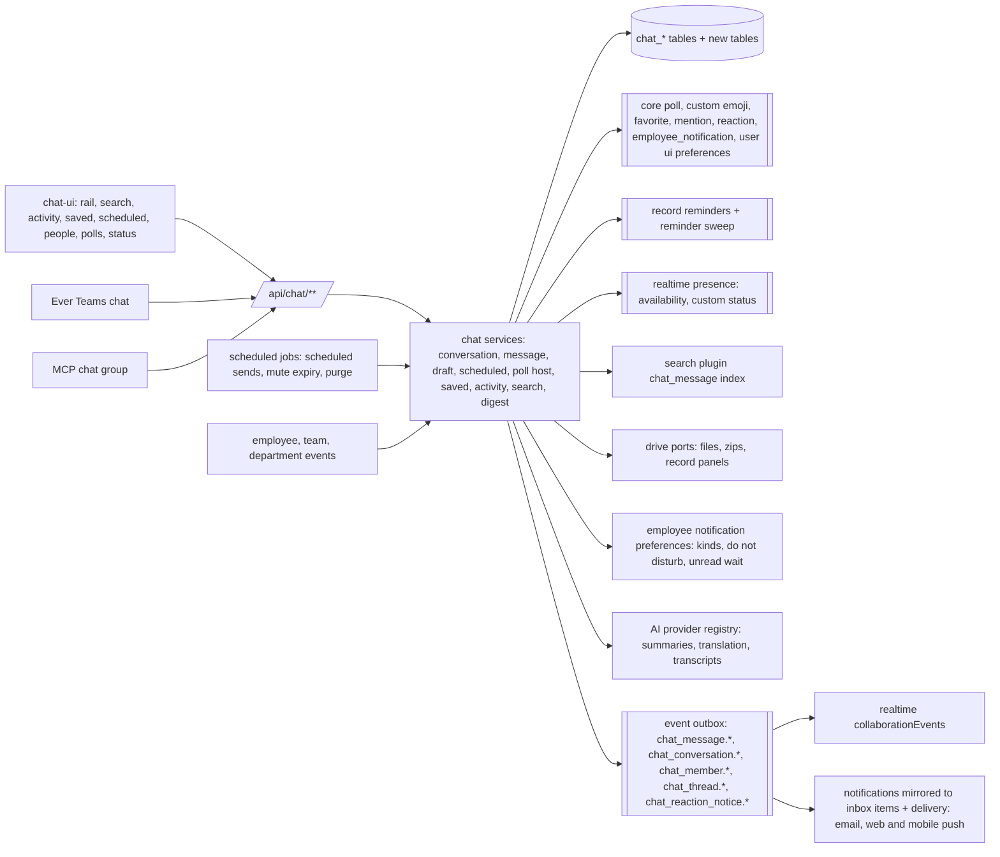

# Implementation Plan: Chat messaging

> Translates an approved `spec.md` into architecture and tech choices. The plan owns
> implementation details; the spec owns behaviour.

**Feature ID**: `chat-messaging`
**Spec**: `./spec.md`
**Tasks**: `./tasks.md`
**Status**: `Draft`
**Last updated**: 2026-11-23

---

## 1. Architecture Summary

No new plugin. Everything lands in `@gauzy/plugin-chat` (`packages/plugins/chat`) and its Angular UI `@gauzy/plugin-chat-ui` (`packages/plugins/chat-ui`), behind the existing gates: the plugin is listed only when `GAUZY_CHAT_ENABLED` is exactly `true` (`isChatEnabled`), and every controller already carries the `FEATURE_CHAT` guard. The AI parts read `GAUZY_CHAT_AI_ENABLED` once at boot (`chat-ai-enabled.ts`, same contract as `chat-enabled.ts`) and the organization setting `chat.ai.enabled` declared in `chat.settings.ts` (keys listed by `chat-administration-and-clients`). Shared pieces come from core and from other plugins only through ports in `@gauzy/contracts` bound in `apps/api/src/plugin-composition.ts`: polls and custom emoji (core modules introduced by `discussions`), favourites (core `favorite`), drive files and zips (`DOCS_FILE_STORE`, `DOCS_ZIP` of `drive`), working schedules and time off (core employee, time-off and availability services), reminders on records (`reminder` and its sweep, `automation-and-notifications`), the AI provider registry (`AI_PROVIDER_REGISTRY` of the AI chat plugin) with runs and usage recorded by `ai-agents-and-assistants` where loaded, and legal holds (`CHAT_LEGAL_HOLDS`, bound to the hold register of `access-control-and-security`). Nothing per person is stored by chat when the platform already holds it: chat choices live in `User.uiPreferences` (keys `chat`, `chatPlaces`), notification choices and quiet hours in the existing employee notification preferences (`IEmployeeNotificationPreferences`, read directly; `automation-and-notifications` widens the same object), notices are platform notifications (`employee_notification`, mirrored to the Inbox with their read state), and availability and custom status extend the realtime presence (`realtime_presence`). Every write keeps today's transaction-plus-outbox pattern (`chat-write-transaction.ts`, `chat-outbox-append.ts`).

## 2. Tech Choices

| Concern | Choice | Rationale |
| ------- | ------ | --------- |
| Package | existing `packages/plugins/chat` and `chat-ui` | Principle I; build on what exists |
| Persistence | MultiORM entities in `chat/src/lib/entities/` (added to `CHAT_ENTITIES`), plugin migrations in `chat/src/lib/database/migrations/` with `migration-helpers.ts`, registered in `CHAT_MIGRATIONS` | Principle III; the plugin's precedent |
| Polls, custom emoji | core `poll/` and `reaction/custom-emoji/` of the `discussions` plan; chat registers `@PollHostAccessPolicy()` for `ChatMessage`; the core modules keep the names that plan gives, whichever plugin needs them first | one module, several hosts |
| Saved messages | core `favorite` rows with `entity = ChatMessage`, listed through a chat route that filters by membership | reuse; no second bookmark table |
| Per-person chat choices | `User.uiPreferences` (`packages/core/src/lib/user/user.entity.ts`, `PUT /user/ui-preferences`, read with `GET /user/me`): key `chat` holds `IChatUiPreferences` (density, preview style, pictures, gallery threshold, Enter behaviour, sort, filters, sounds, quick reactions, nudge mode, `hideReadPosition`, relevance sort), key `chatPlaces` the last place per organization and the recent emoji, each written by clients as its own key so the two never overwrite each other; time format from `User.timeFormat`; the receipts query reads `hideReadPosition` of the at most 50 members from their `uiPreferences.chat` | no chat preference table |
| Notification choices | the existing `IEmployeeNotificationPreferences` (`packages/contracts/src/lib/employee-notification-setting.model.ts`, page `inbox-ui/src/lib/settings/notification-settings-page.component.ts`): `emailByType` and `pushByType` per chat kind (`Message`, `Mention`, `ChatReply`, `ChatQuote`, `ChatReaction`), the `dnd` window as quiet hours, and two additive members, `unreadEmailDelayMinutes` (unset by default, which keeps today's delivery; 30 offered when a person turns the wait on) and `dndDuringMeetings` | the delivery engine sees them; one settings page |
| Personal sections | `chat_category` rows with a `userId` (null = the organization's categories), served by the existing `/categories` routes and reorder endpoint; a person's placement is `chat_member.personalCategoryId`; personal categories list above the organization's, and a conversation a person placed in one of theirs shows only there for them | one grouping model in the sidebar |
| Channel name uniqueness | `nameKey` (trimmed, lowercased, Unicode NFKC) written only while the organization's `channels.uniqueNames` setting is on (default off, names repeat as today) and the channel is open; unique (`tenantId`, `organizationId`, `nameKey`), NULLs distinct on all three dialects | no partial index needed on MySQL; nothing enforced unless asked |
| Edit history | append-only `chat_message_revision` rows written in the edit transaction | Principle VI auditability |
| Drafts | server rows keyed by the place keys Ever Teams already computes (`draftKeyOf` in `apps/web/core/lib/utils/chat-format.ts`, today held in local storage by `use-chat-draft.ts`, which stays as the device copy so the server's 50-row and 30-day limits never drop a draft a client holds), debounced client writes (1 s); `attachmentIds` name `chat_attachment_draft` rows, which carry the holding `draftId` so the 24 h upload sweep (`chat-draft-uploads.ts`) skips them | sync across devices; one upload store |
| Timed work | `@ScheduledJob` + `@QueueWorker` from `@gauzy/scheduler` with row claims (`claimedAt`, `claimToken`); in-process timers where no queue root exists, like the link-preview worker | late rather than lost, exactly once |
| Reminders | `reminder` rows of `automation-and-notifications` with `recordType = ChatMessage`, created, snoozed and dismissed through its `/api/reminders` routes and fired by its reminder sweep into a `Reminder` notification; chat registers `ChatMessage` in the core record type registry (read check at fire time, snippet as title, permalink) | one reminder table and one sweep for every record |
| Scheduled sends | one `chat_scheduled_message` table for people's and bots' future posts (`botId`, `kind` once or recurring, `rule` in the core recurrence module's shape), sent through `ChatMessageService.send` with nonce `scheduled:<id>` (recurring: `scheduled:<id>:<occurrence>`) by one sweep | the existing nonce index makes the send exactly once; `chat-agents-and-record-actions` reuses the table |
| Search | extend the search plugin's private `chat_message` declaration with filter attributes; index on the outbox facts | Principle VII; existing index |
| Link search | `chat_message_link.urlHash` computed with `previewUrlHash(normalizePreviewUrl(url))` of `link-preview/link-preview-url.ts`, so a link joins its cached `chat_link_preview` (unique `tenantId` + `urlHash`) for title and site; nothing is fetched again | one normaliser, one preview cache |
| Link previews for other features | the chat plugin offers its `ChatLinkPreviewService` as the `LINK_PREVIEWS` port (`preview(viewer, url)`: title, description, icon through its egress guard and its `chat_link_preview` cache), bound in `apps/api/src/plugin-composition.ts` and used by `spreadsheets` for cell link cards; chat behaviour unchanged | one preview cache |
| Activity feed | platform notifications: replies and quotes are filed as `employee_notification` rows of two new kinds (`ChatReply`, `ChatQuote`) beside today's `Mention` and `Message` (`services/chat-notifier.service.ts`), mirrored to the Inbox with per-person read state in `inbox_item_recipient` (read and archive mirrored both ways by `inbox-notification.bridge.ts`); Activity is a query over the person's notifications whose entity is a chat message, grouped by thread; only bundled reaction notices stay in chat (`chat_reaction_notice`), because they reach no notification list unless the person turns reaction notifications on | one read state per notice |
| Email after delay | the Inbox's unread wait (`isSentOnlyWhileUnread` and `timerReminderWaitEnd` in `packages/plugins/inbox/src/lib/delivery/inbox-delivery-rules.ts`) generalised from the timer reminder to a per-kind wait: for a person who set `unreadEmailDelayMinutes`, notifications about chat messages wait that long and one read by `dueAt` is not emailed; a person who set nothing is emailed exactly as today (at once, digest or off) | one delivery engine; no new column; today's delivery unchanged by default |
| Presence and status | availability and custom status are person-wide, so they are columns of the published row of `realtime_presence` (`availability`, `statusEmoji`, `statusText`, `statusClearsAt`, `shareWorkSignals`) returned by the realtime presence merge (`realtime-presence.store.ts`) to every client; a manual do not disturb is read by the Inbox delivery's `dnd` rule as a window ending at `statusClearsAt`; work signals read the employee's `isTrackingTime` and running timer (core) and the calendar | one presence store for chat, Ever Teams, meetings, calendar and discussions |
| AI | the AI chat plugin's provider registry and `transcribe`; prompts hold only messages the caller may read; each call is recorded as an `ai_run` with its `ai_usage_entry` rows (purposes `chat.summary`, `chat.translate`, `chat.transcribe`) where `ai-agents-and-assistants` is loaded | Principle VI; existing providers; one usage record |
| Push | event bus → realtime; notifications → Inbox delivery | Principle VII |
| UI | Angular `chat-ui` standalone components; Ever Teams builds its own screens on the same routes | Principle I |

## 3. Data Model

All new tables extend `TenantOrganizationBaseEntity`; JSON columns use `jsonColumnType()`; user and employee ids carry no foreign key unless stated.

### Changed entities

| Entity | New columns | Indexes |
| --- | --- | --- |
| `chat_conversation` | `membershipMode` varchar(12) default `explicit` (`explicit`, `everyone`); `postingPolicy` varchar(12) default `all` (`all`, `managers`, `listed`); `posterEmployeeIds` json null; `threadRepliesAllowed` bool default true; `broadcastPolicy` varchar(12) default `all`; `pinPolicy` varchar(12) default `all`; `memberAddPolicy` varchar(12) default `managers` (private channels); `description` text null; `nameKey` varchar(120) null; `linkedEntity` varchar(64) null; `linkedEntityId` uuid null; `syncSource` varchar(16) null (`team`, `department`); `syncSourceId` uuid null; `deletedByUserId` uuid null; `purgeAfter` timestamp null; `pinCount` int default 0; `isNotes` bool default false | unique (`tenantId`, `organizationId`, `nameKey`); (`tenantId`, `linkedEntity`, `linkedEntityId`); (`purgeAfter`) |
| `chat_member` | `synced` bool default false; `muteUntil` timestamp null; `levelBeforeMute` varchar(12) null; `personalCategoryId` uuid null fk `chat_category` SET NULL (the member's own section) | (`muteUntil`) |
| `chat_message` | `quote` text null (JSON snapshot: author, time, excerpt, file names); `forwardedFromMessageId` uuid null; `forwardedFromConversationId` uuid null; `silent` bool default false; `urgent` bool default false; `systemEvent` text null (JSON: type, actorIds, targetIds, values); `pollId` uuid null; `revisionCount` int default 0; `previewHidden` bool default false; `linkCount` int default 0 | (`tenantId`, `pollId`); (`forwardedFromMessageId`) |
| `chat_category` | `userId` uuid null (null = an organization category, as every row today); `nameKey` varchar(120) null; `sort` varchar(12) null (`name`, `activity`) | unique (`tenantId`, `organizationId`, `userId`, `nameKey`) |
| `chat_attachment_draft` | `draftId` uuid null (the `chat_draft` holding the upload; the 24 h sweep skips held rows) | (`draftId`) |
| `realtime_presence` (realtime plugin; written on the published row only) | `availability` varchar(16) null (`auto`, `away`, `dnd`, `offline`); `statusEmoji` varchar(32) null; `statusText` varchar(100) null; `statusClearsAt` timestamp null; `shareWorkSignals` bool default false | (`statusClearsAt`) |

Backfill: `nameKey` is filled for an organization's open channels when it switches `channels.uniqueNames` on, oldest first; a later duplicate keeps `nameKey` null and is listed in the channel health report of `chat-administration-and-clients` (nothing renamed). Migration 1: the default channel gets `membershipMode = everyone`; `isNotes` false everywhere; existing categories keep `userId` null.

### New entities

| Table | Columns (beyond the base) | Indexes and uniqueness |
| --- | --- | --- |
| `chat_message_revision` (append-only) | `messageId` fk cascade, `body` text, `attachmentIds` json, `editedByUserId`, `editedAt` | (`messageId`, `editedAt`) |
| `chat_draft` | `userId`, `conversationId` fk cascade, `threadRootId` null, `placeKey` varchar(80) (the `draftKeyOf` key of the clients), `body` text, `attachmentIds` json (`chat_attachment_draft` ids), `quoteMessageId` null | unique (`tenantId`, `userId`, `placeKey`); (`updatedAt`) |
| `chat_scheduled_message` | `authorUserId`, `authorEmployeeId`, `botId` uuid null (a bot's post, `chat-agents-and-record-actions`), `conversationId` fk cascade, `threadRootId` null, `body` text, `attachmentIds` json, `mentionEmployeeIds` json, `cards` json null, `silent` bool, `kind` varchar(10) default `once` (`once`, `recurring`), `rule` json null (a core recurrence rule: frequency, interval, weekdays, month day, time zone, skip holidays), `sendAt` (next time for recurring rows), `pausedAt` null, `lastRunAt` null, `state` varchar(10) (`scheduled`, `sending`, `sent`, `failed`, `cancelled`), `failureReason` varchar(64) null, `sentMessageId` null, `attempts` int, `claimedAt`, `claimToken` null, `origin` varchar(16) (`author`, `their_hours`, `bot`) | (`state`, `sendAt`); (`tenantId`, `authorUserId`, `state`); (`tenantId`, `conversationId`) |
| `chat_message_link` | `messageId` fk cascade, `conversationId`, `url` varchar(2048), `urlHash` char(64) (`previewUrlHash` of the link-preview normaliser, joining `chat_link_preview`), `host` varchar(255), `position` int | (`tenantId`, `conversationId`, `createdAt`); (`tenantId`, `host`); (`tenantId`, `urlHash`) |
| `chat_reaction_notice` | `userId` (the author told), `messageId` fk cascade, `conversationId`, `threadRootId` null, `actorUserIds` json, `emojis` json, `readAt` null, `notificationId` uuid null (set when the person turned reaction notifications on) | unique (`tenantId`, `userId`, `messageId`); (`tenantId`, `userId`, `readAt`, `updatedAt`) |
| `chat_translation` | `messageId` fk cascade, `language` varchar(16), `body` text, `revision` int, `providerKey` varchar(64) | unique (`messageId`, `language`) |
| `chat_digest` | `userId`, `kind` varchar(12) (`conversation`, `record`), `scopeKey` varchar(120), `fromAt`, `toAt`, `items` json (text, messageIds), `expiresAt`, `aiRunId` uuid null | (`tenantId`, `userId`, `scopeKey`); (`expiresAt`) |

Not chat tables: chat choices of a person are `User.uiPreferences` keys; reminders are `reminder` rows (`automation-and-notifications`); mentions, replies, quotes, thread replies and fired reminders are `employee_notification` rows mirrored to the Inbox; availability and status are the realtime presence columns above.

Settings are keys of `chat.settings.ts` (organization scope, declared by `chat-administration-and-clients`, values in the platform settings store): `channels.createPolicy`, `channels.uniqueNames` (false), `members.managerSuccession` (false), `direct.readOnlyWithInactive` (false), `messages.editWindowMinutes` (0 = none), `messages.historyVisible` (true), `pins.max` (0 = no cap), `receipts.maxMembers` (50), `timeOffBadge` (true), `ai.enabled`, `ai.autoTranslate`, `previews.blockList`, `gif.sourceId`. Every default keeps today's behaviour (spec FR-129).

### Migrations

**Migration timestamps**: `packages/plugins/chat` `1791000067100` to `1791000067199`; `packages/plugins/realtime` `1791000067200` to `1791000067299`.

In `packages/plugins/chat/src/lib/database/migrations/`, PostgreSQL, MySQL and SQLite branches through `migration-helpers.ts`, idempotent, registered in `CHAT_MIGRATIONS` (both ORMs):

1. `1791000067100-AddChatMessagingColumns` — changed chat columns (conversation, member, message, category, attachment draft) and backfills above.
2. `1791000067110-CreateChatMessagingTables` — the seven new tables.
3. `1791000067120-AddChatSearchAttributes` — no schema; re-declares the `chat_message` search definition version so the search plugin reindexes with the new attributes in the background.

In `packages/plugins/realtime/src/lib/database/migrations/`: `1791000067200-AddRealtimePresenceStatusColumns` (the presence columns above; tri-dialect, idempotent).

Core module tables (`poll`, `poll_option`, `poll_vote`, `custom_emoji`) come with the core migrations `1791000064390` and `1791000064391` of [`discussions`](../discussions/spec.md) T42 and T43. `reminder` comes with migration `1791000032130` of `automation-and-notifications` and its reminder core (T60). The new notification kinds and preference members need no migration (the type column is an int mapped in `employee-notification-type-transform.ts`; preferences are JSON).

### Contracts

`packages/contracts/src/lib/chat.model.ts` (additive): `ChatMembershipModeEnum`, `ChatPostingPolicyEnum`, `ChatSystemEventTypeEnum`, `ChatScheduledStateEnum`, `ChatScheduledKindEnum`; fields on `IChatConversation`, `IChatMember`, `IChatMessage`, `IChatCategory` (`userId`, `sort`); inputs and pages for personal categories, drafts, scheduled messages, saved, activity, readers, revisions, links, digests, translations, relevance reasons; new event names in `CHAT_EVENT_NAMES`; error codes `CHAT_CHANNEL_NAME_TAKEN`, `CHAT_CONVERSATION_ARCHIVED`, `CHAT_RECIPIENT_INACTIVE`, `CHAT_POSTING_RESTRICTED`, `CHAT_POLL_CLOSED`, `CHAT_EDIT_WINDOW_PASSED`. Elsewhere (additive): `IChatUiPreferences` and `IChatPlacesUiPreferences` added to `IUserUiPreferences` in `user.model.ts`; `IEmployeeNotificationPreferences` gains `unreadEmailDelayMinutes` and `dndDuringMeetings`; `EmployeeNotificationTypeEnum` gains `ChatReply`, `ChatQuote` and `ChatReaction` (stored values appended after those other features add); the realtime presence contract gains `RealtimeAvailabilityEnum` and the status fields on its presence answer.

## 4. API Surface

All under `/api/chat` unless another prefix is shown, guarded as today (tenant, `FEATURE_CHAT`, permissions); non-members get `404`; writes need `CHAT_SEND` unless stated; GraphQL read twins for the new list reads (`chatActivity`, `chatSaved`, `chatScheduled`) in `graphql/chat.schema.ts`, and the existing categories read gains the personal ones.

| Method | Endpoint | Permission | Description | Status |
| --- | --- | --- | --- | --- |
| `GET` | `/organizations/states` | VIEW | unread and mention totals per organization of the caller | New |
| `GET` `PUT` | `/api/user/me`, `/api/user/ui-preferences` (core) | self | chat choices under the `chat` key, last place per organization and recent emoji under `chatPlaces` | Existing |
| `GET` `POST` `PATCH` `DELETE` | `/categories[/:id]` (gains `personal: true` for the caller's own, `CHAT_VIEW`), `POST /categories/reorder` (the caller's own order), `PUT /conversations/:id/category/me` | VIEW for personal; `CHAT_MANAGE` for organization categories as today | personal sections | Changed / New |
| `GET` | `/people/:employeeId/profile` | VIEW | profile card data the caller may see | New |
| `POST` `PATCH` | `/conversations`, `/conversations/:id` | SEND / manager | gain membership mode, policies, description, members | Changed |
| `POST` `DELETE` | `/conversations/:id/managers/:employeeId` | manager or MANAGE | promote, demote | New |
| `DELETE` | `/conversations/:id` · `POST /conversations/:id/restore` | manager or MANAGE / MANAGE | delete with name confirmation; restore within 30 days | New |
| `PUT` `DELETE` | `/conversations/:id/record` | manager | link a record | New |
| `POST` | `/conversations/:id/convert` | member of a group | group → private channel | New |
| `GET` | `/conversations/:id/links` · `/conversations/:id/threads` | VIEW | channel panel tabs | New |
| `POST` | `/notes` | VIEW | get or create my notes conversation | New |
| `POST` | `/conversations/:id/messages` | SEND | gains `silent`, `urgent`, `driveDocumentIds`, `cards`; `replyToId` now stores a quote | Changed |
| `GET` | `/messages/:id/context?before=&after=` | VIEW | permalink resolution with surrounding window | New |
| `GET` | `/messages/:id/revisions` | VIEW | edit history (if visible) | New |
| `POST` | `/messages/delete-batch` | SEND | up to 50 own messages, per-row results | New |
| `POST` | `/messages/:id/forward` | SEND | `{ targets, comment, nonce }` → per-target results | New |
| `GET` | `/messages/:id/readers` | VIEW | read and not read, within the member cap | New |
| `POST` | `/messages/:id/preview/hide` | author | remove previews | New |
| `POST` `DELETE` | `/messages/:id/save` · `GET /saved?q=&conversationId=&cursor=` | VIEW | saved messages | New |
| `GET` `POST` `PATCH` `DELETE` | `/api/reminders[/:id]` of `automation-and-notifications` with `recordType = ChatMessage` (create, edit, snooze, dismiss, list) | own; read of the message checked through chat's record type registration | reminders on messages | Existing (platform) |
| `GET` `POST` `PATCH` `DELETE` | `/scheduled[/:id]`, `POST /conversations/:id/scheduled`, `POST /scheduled/:id/send-now` | SEND | scheduled messages | New |
| `GET` | `/scheduled/suggestions?employeeIds=` | SEND | next working day, recipients' next start of day | New |
| `GET` `PUT` `DELETE` | `/drafts`, `/drafts/:placeKey` | VIEW | synced drafts | New |
| `POST` | `/conversations/:id/polls` | SEND | poll message and core poll in one transaction; votes, close and results through core `/api/polls/:id/*` under chat's host policy | New |
| `GET` | `/activity?kind=&unread=&cursor=` · `POST /activity/read` · `GET /saved/counts` | VIEW | activity feed over the caller's chat notifications and reaction bundles (read marks go to the notification, so the Inbox shows them read too); Saved badge from saved messages and fired reminders whose notification is unread | New |
| `PATCH` | `/conversations/:id/state` | VIEW | gains `muteUntil` | Changed |
| `PUT` `DELETE` | `/api/realtime/presence/status` · `GET /api/realtime/presence?employeeIds=` (realtime plugin) | signed in | availability and custom status on the person's platform presence; presence and status of colleagues | New (realtime) |
| `GET` | `/search?…&tab=&authorId=&kind=&mentionsMe=&hasFile=&hasLink=&hasPoll=&hasCard=&pinned=&saved=&inThread=&from=&to=` · `GET /search/quick?q=` · `GET /links?q=&host=` | VIEW | search with filters | Changed / New |
| `GET` | `/conversations/:id/files?type=&q=&cursor=` | VIEW | gains filters | Changed |
| `POST` | `/messages/:id/files/:documentId/attach` · `/save` · `/grant-view` · `POST /messages/:id/files/zip` | VIEW (+ record edit, drive manage) | file actions through drive ports | New |
| `GET` | `/states?sort=relevance` | VIEW | gains ranks and reasons | Changed |
| `POST` | `/conversations/:id/summary` · `/records/:entity/:entityId/summary` · `GET /digests/:id` | VIEW + AI on | summaries with source ids | New |
| `POST` | `/messages/:id/translate { language }` | VIEW + AI on | translation | New |

Request DTOs with class-validator in `dto/chat-messaging.dto.ts`; responses typed from contracts; Swagger decorators; `Cache-Control: no-store`; idempotency keys on forward, poll create, schedule and delete-batch; rate limits: forward 30/min, translate and summary 20/min per person.

**Consumer tokens answered** (bound in `apps/api/src/plugin-composition.ts` to the conversation and message services; each consumer plan states the shape it calls and its fallback): `HELPDESK_CHAT`, `LEARNING_CHAT`, `MEETINGS_CHAT`.

## 5. Events, Real-Time and Notifications

| Event | Emitted when | Consumers |
| --- | --- | --- |
| `chat_conversation.changed` (new `change` values `deleted`, `restored`, `managers`, `policy`, `record`, `converted`) | channel changes | members (realtime), lists |
| `chat_message.created` / `updated` / `deleted` (existing) | also for system events, forwards, revisions, poll tallies, preview hides | members |
| `chat_reaction_notice.changed` | a reaction bundle is written, read or removed | the person |
| `chat_draft.changed` | a draft is saved or cleared | the person's other sessions |
| `reminder.due` (consumed through the reminder sweep) | a reminder on a message fires | the person: `Reminder` notification, Inbox entry and push; chat answers the access check and the snippet |
| `chat_scheduled.changed` | scheduled state changes | the author; a notification on failure |
| presence change of the realtime plugin (existing, now with status fields) | availability or status set, cleared or expired | organization members, as presence today |
| `poll.changed` / `poll.closed` (core) | vote or close on a chat-hosted poll | members (mapped to `chat_message.updated`); chat writes the "poll closed" system event |
| `employee.created` / `.updated` (deactivation included), `organization_team_employee.created` / `.deleted` (consumed; core record events) | HR changes | everyone channels, synced memberships, manager succession |

Notifications: mentions and direct messages as today (`Mention`, `Message`), thread replies as today (`Message` to followers); replies to and quotes of a person's messages file `ChatReply` and `ChatQuote`; fired reminders are the platform's `Reminder` notifications; urgent messages carry `priority: urgent`. Each is an `employee_notification` mirrored to an Inbox item, so its read state is one state in the bell, the Inbox and Activity; email after a delay comes from the per-kind unread wait of the delivery rules. Reaction notices stay in `chat_reaction_notice`; a person who turns reaction notifications on (`pushByType.ChatReaction`) also gets one `ChatReaction` notification per bundle and hour, linked through `notificationId`, and reading either marks both.

## 6. UI Surface

- **Angular (`packages/plugins/chat-ui`)**: routes under `/pages/chat`: `activity`, `threads` (two tabs), `saved`, `scheduled`, `people`, `search`, `:conversationId`, `:conversationId/m/:messageId` (permalink), `?thread=` kept. New components: `nav-rail`, `org-switch-badges` (header extension slot), `sections-dialog`, `list-filters`, `channel-panel` (info, members, files, links, pins, threads), `people-page`, `profile-panel`, `composer-toolbar`, `emoji-picker` (custom emoji, recents), `voice-recorder`, `poll-composer`, `poll-card`, `reminder-dialog`, `schedule-menu`, `forward-dialog`, `revisions-dialog`, `readers-dialog`, `reactions-dialog`, `gallery`, `lightbox`, `status-dialog`, `search-page`, `activity-page`, `saved-page`, `scheduled-page`, `summary-panel`, `translate-toggle`, `shortcut-panel`, `outbox` service (IndexedDB through the existing storage helpers, fallback to memory). The appearance, sort, filter and sound choices read and write `uiPreferences.chat`; the status dialog writes the realtime presence status; the reminder dialog calls `/api/reminders`; the email delay, per-kind push and email choices and quiet hours are added to the existing notification settings page (`inbox-ui/src/lib/settings/notification-settings-page.component.ts`) as chat kinds, not repeated in chat. Header badge counts gain the per-organization totals. Command palette registrations through the record-views palette registry when loaded. i18n keys in `chat-ui/src/i18n/*.json` for every shipped locale.
- **Ever Teams**: consumes the same routes; its screens are specified in the Ever Teams spec `workspace-collaboration-clients`.

## 7. MCP Tools, SDKs and Integrations

- `packages/mcp-server/src/lib/tools/collaboration/chat.ts`: `search_chat_messages` gains the filters; new `get_chat_message_context`, `list_chat_threads`, `list_chat_saved`, `list_chat_reminders`, `create_chat_poll`, `vote_chat_poll`, `save_chat_message`, `set_chat_reminder`, `schedule_chat_message` (`preview: true` answers the computed send time and target without writing), `summarize_chat_conversation`, `translate_chat_message` (the last two only when the API reports AI on). Scopes as today (`chat:read`, `chat:write`); results mark user text as data.
- OpenAPI regenerated; SDK regeneration noted for release.
- GIF search source: a connector type `chat-gif-source` declared for `integration-hub`; calls go through the chat egress guard.

## 8. Background Jobs

| Trigger | When | What it does | Idempotency |
| --- | --- | --- | --- |
| reminder sweep of `automation-and-notifications` (not a chat job) | every minute | fires due `ChatMessage` reminders through chat's record type registration (access check, snippet, permalink) | its claim and status |
| `chat.scheduled.sweep` | every minute | claims due scheduled messages (people's and bots'), checks membership and state, sends with nonce `scheduled:<id>` (`scheduled:<id>:<occurrence>` for recurring rows), computes a recurring row's next time with the core recurrence module | the nonce index; state machine |
| `chat.mute.expiry` | every 5 minutes | restores `levelBeforeMute` | compare-and-set on `muteUntil` |
| `realtime.presence.status-expiry` (realtime plugin) | every minute | clears ended statuses on published presence rows and publishes the change | compare-and-set on `statusClearsAt` |
| `chat.purge` | daily | purges channels past `purgeAfter` (unless held), sent scheduled messages after 30 days, drafts after 30 days, read reaction notices after 90 days, expired digests and translations of deleted messages; cancels pending reminders on purged messages | deletes by id batches; re-runnable |
| `chat.membership.sync` | on HR events | everyone channels, synced team and department channels, manager succession where `members.managerSuccession` is on | upsert on the member unique key |
| `chat.transcribe` | on voice clip upload (AI on) | transcript into the file's metadata and the search index | job id per document |
| `chat.reindex` | after migration 3 | backfills the new search attributes | resumable cursor |

All in the API processes like the link-preview worker (the chat plugin is not hosted by `apps/worker`), with in-process timers without a queue root.

## 9. Security & Permissions

- No new permission keys: `CHAT_VIEW`, `CHAT_SEND`, `CHAT_MANAGE` and conversation roles cover every route; custom emoji writes accept `CHAT_MANAGE` besides the discussions manage permission (additive check in the core route).
- Membership on every read and write; anonymous ballots store `voterKeyHash` (HMAC of user and poll with a tenant key) instead of the user id; read receipts honour `hideReadPosition` both ways.
- AI prompts are built after the membership filter; provider answers are stored as data and sanitised like message bodies; no AI call when FR-3's conditions fail.
- Markdown subset extended in the shared sanitiser of both clients (`chat-markdown` rules), with table size limits.
- Rate limits on forward, summary, translate, drafts (1 write per second per place) and status changes.

## 10. Observability

- Activity log: channel delete, restore, manager changes by `CHAT_MANAGE`, visibility and policy changes, custom emoji add and archive, group conversion.
- Metrics: reminder and scheduled sweep lag, failures by reason, search index lag, AI calls and errors by kind, outbox sends.

## 11. Phased Rollout

1. **Phase 1 — Surface what exists**: Angular search page over the existing route, link preview icons, presence everywhere, notification levels in every place, permalinks, channel panel tabs; MCP search filters. Usable behind the chat flags.
2. **Phase 2 — Channels and messages**: migrations 1–2, everyone and announcement channels, unique names, managers and succession, deletion and restore, system events, sections and filters, people page, quote, forward, revisions, drafts, outbox, silent and urgent, threads auto-follow and Threads tabs.
3. **Phase 3 — Productivity**: polls, saved messages, read receipts, reminders, scheduled messages, the Saved page, Activity, statuses and mute until, email after delay, file actions, voice clips, search filters and link search, reports.
4. **Phase 4 — Advanced capabilities**: summary, record summary, translation, transcripts (behind `GAUZY_CHAT_AI_ENABLED`), relevance sort, work signals in presence, delivery in the recipient's hours.

Availability: the feature is off by default; after the trial period it may be switched on by default for new tenants only; existing tenants keep their setting until an administrator changes it.

## 12. Constitution Reconciliation

- I Plugin-first: everything in the chat plugin pair; shared modules in core only where `discussions` already placed them; preferences, notices, reminders and presence stay in the platform stores that already hold them.
- II Tenant/organization scoping: every new table on the tenant and organization base; the per-organization totals route reads only the caller's memberships.
- III Both ORMs, additive migrations: three chat migrations and one realtime migration, tri-dialect, idempotent; no column dropped or renamed; preferences and notification kinds need no schema.
- IV Default-off flag; nothing removed: chat flags and `GAUZY_CHAT_AI_ENABLED` default off; every existing route and field kept.
- V Contracts and API first: contracts in `chat.model.ts`; REST before UI; GraphQL read twins.
- VI Permissions, privacy, security: membership checks, hashed anonymous ballots, two-way receipts, listed outbound data.
- VII Real-time through the event bus: outbox facts and realtime; Inbox delivery for push and email.
- VIII i18n and accessibility: chat-ui keys in every locale; keyboard and screen-reader support.
- IX Tests: every task names its specs.
- X Behaviour-first spec: implementation only here.
- XI Documentation describes our platform only.

## 13. Risks & Mitigations

| Risk | Likelihood | Impact | Mitigation |
| ---- | ---------- | ------ | ---------- |
| Core poll and custom emoji modules absent | Medium | Polls blocked | Depends on [`discussions`](../discussions/spec.md) T42 and T43; poll and emoji actions hidden until they answer |
| Platform reminders not loaded | Medium | No Remind action | Depends on `automation-and-notifications` T60; without it the action is hidden |
| Two clients overwrite each other's chat choices | Low | Lost setting | `chat` and `chatPlaces` are separate `uiPreferences` keys; the busy last-place writes never touch appearance choices |
| Existing duplicate channel names | High | Uniqueness backfill fails | oldest keeps the key; others listed for administrators, nothing renamed |
| Sweep load at large tenants | Medium | Late reminders | batched claims, indexes on (`state`, time), metrics on lag |
| Index lag over 5 s | Medium | Search misses new messages | index on outbox facts, not on a nightly pass; lag metric and alert |
| AI cost and leakage | Medium | Data leaves unexpectedly | three-part gate, prompts built after membership filter, per-person rate limits |
| Draft writes chatty | Medium | Load | debounced writes, one row per place |

## 14. References

- Spec: `./spec.md` · Tasks: `./tasks.md`
- Existing plans in `docs/specs/features/`: [`docs/specs/features/chat/plan.md`](../chat/plan.md), [`docs/specs/features/realtime-channel/plan.md`](../realtime-channel/plan.md), [`docs/specs/features/inbox/plan.md`](../inbox/plan.md)
- Related plans: [`../discussions/plan.md`](../discussions/plan.md) (poll and custom emoji modules), [`../drive/plan.md`](../drive/plan.md) (ports), `automation-and-notifications` (reminders, notification preferences), `access-control-and-security` (holds)
- Code: `packages/plugins/chat/src/lib/{services,controllers,entities,database,realtime,link-preview}/`, `packages/plugins/chat-ui/src/lib/`, `packages/plugins/inbox/src/lib/delivery/inbox-delivery-rules.ts`, `packages/plugins/inbox/src/lib/notifications/inbox-notification.bridge.ts`, `packages/plugins/inbox-ui/src/lib/settings/`, `packages/plugins/realtime/src/lib/{realtime.entities.ts,realtime-presence.store.ts}`, `packages/plugins/search/`, `packages/core/src/lib/{favorite,mention,reaction,employee-notification,user}/`, `packages/contracts/src/lib/{user.model.ts,employee-notification-setting.model.ts}`, `packages/mcp-server/src/lib/tools/collaboration/chat.ts`; Ever Teams `apps/web/core/hooks/chat/use-chat-draft.ts`
