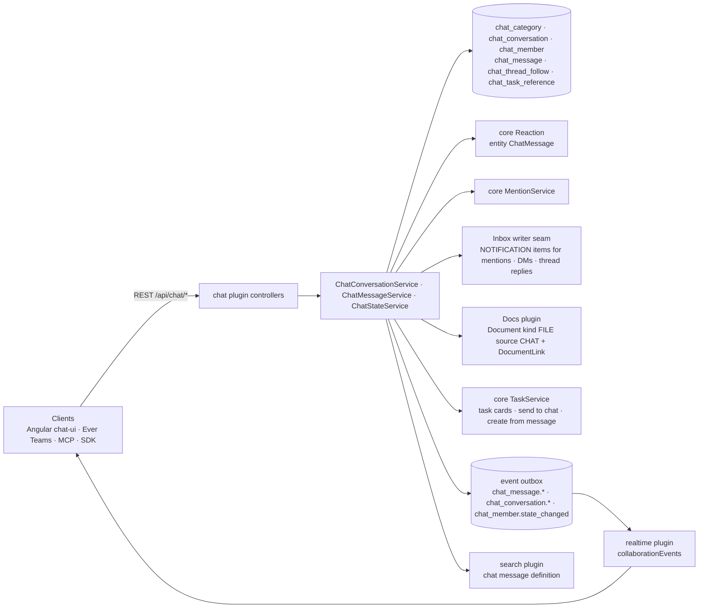

# Implementation Plan: Chat

> Translates an approved `spec.md` into architecture and tech choices. The plan owns
> implementation details; the spec owns behaviour.

**Feature ID**: `chat`
**Spec**: `./spec.md`
**Tasks**: `./tasks.md`
**Status**: `Approved`
**Last updated**: 2026-11-07

---

## 1. Architecture Summary

A new plugin owns the conversation model; everything else is the platform's: reactions, mentions, inbox
entries, files, tasks, search, the outbox and the subscription surface, presence and typing (realtime plugin).

## 2. Tech Choices

| Concern | Choice | Rationale |
| ------- | ------ | --------- |
| Package | `packages/plugins/chat` (`@gauzy/plugin-chat`), off unless `GAUZY_CHAT_ENABLED=true`; tenant feature `FEATURE_CHAT` | Principle I, IV; Inbox plugin layout |
| Tables | plugin-owned, tri-dialect, idempotent migrations `1791000006xxx`; prefix `chat_` (the core `channel` module is commerce) | Principle III; naming rule in the architecture doc |
| Unread | counters on `chat_member` (`readCount`, `mentionCount`, `lastReadMessageId`) maintained in the message write; `unread = conversation.messageCount − readCount` | one cheap read for all conversations; no count queries |
| Body | markdown subset, ≤ 4,000 chars, stored as text; mentions as tokens `<@employeeId>`, `<#conversationId>`, `<!channel>`, `<!here>` plus `mentionEmployeeIds` for the platform mention service | rename-safe, portable across Angular/React/mobile |
| Reactions | core `Reaction` rows with `ReactionEntityEnum.ChatMessage`, written through chat endpoints that check membership | reuse; membership enforced |
| Attachments | `Document { kind: FILE, source: CHAT }` uploaded through the docs plugin, linked by `DocumentLink { entity: ChatMessage }`; message carries `attachmentIds` | storage providers, search, AI knowledge for free |
| Mentions → inbox | `MentionService.publishMention` (parent = conversation) and `INBOX_ITEM_WRITER` items for DMs and followed-thread replies | existing seams |
| Task cards | `chat_task_reference` rows resolved at write (typed `KEY-number` and task links) and on "send to chat" / "create from message"; cards rendered by clients from task ids | Principle V |
| Real-time | outbox events declared with the subscription catalogue; `recipientUserIds` for addressed ones; typing/presence through the realtime plugin | Principle VII |
| Search | `packages/plugins/search` definition for chat messages (title = conversation, text = body), membership filter in the read | reuse |
| Permissions | `CHAT_VIEW`, `CHAT_SEND`, `CHAT_MANAGE` (contracts + default roles + plugin seed migration) | spec FR-23 |
| Idempotent send | `nonce` unique per author per 24 h (unique index author+nonce) | spec FR-8 |
| Link previews | server-side fetch with public-host-only guard, cached in `chat_link_preview`, off unless `GAUZY_CHAT_LINK_PREVIEWS_ENABLED=true`; the fetch on the `chat-link-preview` queue where a queue root exists, else inline (`link-preview/`, §15) | spec FR-20 |

## 3. Data Model

| Table | Columns (beyond the tenant/organization base) |
| ----- | --------------------------------------------- |
| `chat_category` | `name`, `position` |
| `chat_conversation` | `kind` (channel/direct/group), `name`, `topic`, `visibility` (public/private), `categoryId`, `position`, `isDefault`, `archivedAt`, `createdByEmployeeId`, `messageCount` (int), `lastMessageAt`, `directKey` (direct/group: SHA-256 of the sorted, deduplicated user ids, `directKeyOf` in `chat-direct-key.ts`; unique index (`tenantId`, `organizationId`, `directKey`), so the same people have one conversation per organization they share — migration `1791000006600` replaced the per-tenant (`tenantId`, `directKey`) index; the default channel stores `default:<organizationId>`) |
| `chat_member` | `conversationId`, `employeeId`, `userId`, `role` (member/manager), `notifyLevel` (all/mentions/muted), `isFavorite`, `readCount` (int), `mentionCount` (int), `lastReadMessageId`, `lastReadAt`, `joinedAt`, `leftAt`; unique (conversationId, employeeId) |
| `chat_message` | `conversationId`, `authorEmployeeId`, `authorUserId`, `kind` (message/system/app), `body` (text), `mentionEmployeeIds` (json), `mentionsChannel`, `mentionsHere`, `replyToId`, `threadRootId`, `alsoInConversation`, `replyCount` (int), `lastReplyAt`, `pinnedAt`, `pinnedByEmployeeId`, `editedAt`, `attachmentIds` (json), `nonce`; indexes (conversationId, createdAt), (threadRootId), unique (authorUserId, nonce) |
| `chat_thread_follow` | `rootMessageId`, `employeeId`, `userId`, `unreadReplies` (int), `lastReadReplyAt`; unique (rootMessageId, employeeId) |
| `chat_task_reference` | `messageId`, `taskId`, `kind` (mention/sent/created); unique (messageId, taskId) |
| `chat_link_preview` | `urlHash` (SHA-256 of the normalized link), `url`, `data` (JSON text), `fetchedAt`, `status` (pending/ready/unavailable); unique (`tenantId`, `urlHash`), migration `1791000006710` |
| `chat_attachment_draft` | `documentId` (unique), `userId` (the uploader): a chat composer's Docs upload no message carries yet; consumed by the send / edit that attaches it, discarded by its uploader or swept after `GAUZY_CHAT_DRAFT_UPLOAD_TTL_HOURS` (24) |

`chat_message.attachmentNames` (text, migration `1791000007320`): the names of a message's files at its send or last edit,
one per line — what a message of files only (empty body) reads as in notifications, the inbox and the search index.

Contracts: `packages/contracts/src/lib/chat.model.ts` (enums, interfaces, inputs, page shapes, event names
`CHAT_EVENT_NAMES`), `BaseEntityEnum.ChatConversation/ChatMessage`, `ReactionEntityEnum.ChatMessage`,
`PermissionsEnum.CHAT_*`, `FeatureEnum.FEATURE_CHAT`.

## 4. API Surface (`/api/chat`, guards tenant + permission + feature flag)

| Method | Endpoint | Permission | Description |
| --- | --- | --- | --- |
| `GET` | `/chat/categories` · `POST` · `PATCH /:id` · `DELETE /:id` · `POST /categories/reorder` | VIEW / MANAGE | sidebar sections |
| `GET` | `/chat/conversations` | VIEW | mine, with member state, unread and mention counts, last message time |
| `GET` | `/chat/conversations/browse` | VIEW | public channels I am not in |
| `POST` | `/chat/conversations` | SEND (channel) | create a channel (name, topic, visibility, category, members) |
| `POST` | `/chat/direct` | SEND | find or create a direct (2) or group (3+) conversation by employee ids |
| `GET` | `/chat/conversations/:id` · `PATCH` · `POST /:id/archive` · `/:id/unarchive` | VIEW / MANAGE or creator | detail and settings |
| `POST` | `/chat/conversations/:id/join` · `/:id/leave` | VIEW | public channels; default channel cannot be left |
| `GET` | `/chat/conversations/:id/members` · `POST` · `DELETE /:employeeId` | VIEW / MANAGE or creator | membership |
| `PATCH` | `/chat/conversations/:id/state` | VIEW | `notifyLevel`, `isFavorite` |
| `POST` | `/chat/conversations/:id/read` | VIEW | mark read up to `messageId` (default newest) |
| `GET` | `/chat/conversations/:id/messages?before=&after=&around=&limit=` | VIEW | anchor paging: `before` / `after` / `around` name a message id; the anchor row is read and the page is compared and ordered on (`createdAt`, `id`) of that row (`olderThan` / `newerThan` in `chat-message.service.ts`), so ids need no time order (`BaseEntity` ids are random UUIDs) |
| `GET` | `/chat/conversations/:id/pins` · `/:id/files` | VIEW | pins; attachments through document links, with a picture's `width` / `height` (read at the Docs upload, `metadata.upload.image`) |
| `POST` | `/chat/conversations/:id/messages` | SEND | `{ body?, nonce, replyToId?, threadRootId?, alsoInConversation?, attachmentIds?, mentionEmployeeIds?, taskId? }` → message + the events it caused; the body may be empty when the message carries an attachment |
| `POST` | `/chat/conversations/:id/typing` | SEND (member) | `{ threadRootId? }` → `{ sent, expiresInMs }`; `typing.signalled` to the other members, nothing stored |
| `DELETE` | `/chat/attachments/:documentId` | SEND | discard my draft upload (the document and its stored bytes go; a sent file stays) |
| `PATCH` | `/chat/messages/:id` · `DELETE` | author / MANAGE | edit (editedAt), delete (tombstone when replies exist) |
| `POST` | `/chat/messages/:id/pin` · `/unpin` · `/unread` | VIEW | pin; mark unread from here |
| `POST` / `DELETE` | `/chat/messages/:id/reactions/:emoji` | VIEW | core reactions with membership check (the generic `/reaction` routes leave chat reactions out, §14.2) |
| `GET` | `/chat/messages/:id/thread` · `POST /:id/thread/read` · `POST /:id/follow` · `/:id/unfollow` | VIEW | thread replies (same anchor paging), mark the thread read (clears its reply notifications), follow state |
| `POST` | `/chat/messages/:id/create-task` | SEND + task create | `{ projectId, title?, assigneeIds? }` → task + reference |
| `PATCH` | `/chat/messages/:id/tasks/:taskId` | SEND + `ORG_TASK_EDIT` (or `ALL_ORG_EDIT`) + `ORG_TASK_VIEW` (or `ALL_ORG_VIEW`); a member of the conversation | `{ status?, taskStatusId?, priority?, taskPriorityId?, assigneeEmployeeIds? }` → the task (through `TaskUpdateCommand`, FR-14) + `chat_message.updated` to every conversation showing it (the answer lists the caller's own conversations' events only) |
| `GET` | `/chat/states` · `POST /chat/read-all` · `POST /chat/read-restore` | VIEW | all member states; mark all read (returns a snapshot id); undo within 60 s |
| `GET` | `/chat/threads` | VIEW | followed threads with unread reply counts |
| `GET` | `/chat/search?q=&conversationId=&authorId=&hasFile=&cursor=` | VIEW | search plugin, membership-filtered |
| `GET` | `/chat/link-preview?url=` | VIEW | cached per tenant, public hosts only; `IChatLinkPreview` (`ready` / `pending`: ask again / `unavailable`); 404 unless `GAUZY_CHAT_LINK_PREVIEWS_ENABLED=true`; 120/min per user |

DTOs with class-validator; responses typed from contracts; Swagger decorators; `Cache-Control: no-store`.
Non-members get 404.

## 5. Events, Real-Time and Notifications

| Outbox event | Audience | Payload (content-free) |
| --- | --- | --- |
| `chat_message.created` / `updated` / `deleted` | conversation members (`recipientUserIds`) | `{ conversationId, messageId, threadRootId, authorUserId, kind }` |
| `chat_conversation.changed` | members | `{ conversationId, change: created / updated / archived / members }` |
| `chat_member.state_changed` | the member | `{ conversationId, readCount, mentionCount, notifyLevel, isFavorite }` |
| `chat_thread.changed` | followers | `{ rootMessageId, replyCount }` |

Inbox: `@employee` mention → `MentionService.publishMention` (existing MENTION notification → Inbox item);
direct message → `EmployeeNotificationTypeEnum.MESSAGE` through `publishNotificationEvent`; reply in a followed
thread → `MESSAGE` too (subject names the thread). Reading a conversation
(`ChatNotifierService.markConversationRead`) marks the notifications of its messages and its mentions read,
leaving out replies that live in a thread only (`threadRootId` set, `alsoInConversation` false); reading a thread
(`markThreadRead`, `POST /chat/messages/:id/thread/read`) marks the notifications of that thread's replies read.
A mention is filed against the conversation, not the reply, so a mention in a thread-only reply still clears
with the conversation read (§14.3). Typing and presence: realtime plugin signals.

## 6. UI Surface

- Angular: `packages/plugins/chat-ui` (lane G4): page `chat`, nav section before `tasks`, header unread
  badge, composer (`ga-rich-text-editor` markdown output), threads pane, task cards, settings dialogs.
- Ever Teams: `chat` spec (lane T3).

## 7. MCP Tools, SDKs and Integrations

- MCP `chat` group (lane G9). OpenAPI/SDK regeneration at release. Incoming webhooks (lane G8) post `kind: app` messages.

## 8. Background Jobs

- Link preview fetch: a job on the `chat-link-preview` queue (`ChatLinkPreviewWorker`, in the API processes: the chat plugin is not hosted by `apps/worker`), one per tenant and link; inline without a queue root (§15). Counter repair job (nightly, worker): recompute `messageCount`/`readCount` drift.

## 9. Security & Permissions

- Membership on every read/write; 404 for non-members; `CHAT_MANAGE` for categories, others' channels, others' messages.
- Body sanitised (markdown subset, no HTML); mention tokens validated against members; attachments must be the caller's own uploads.
- Nonce idempotency; rate limit on send (60/min per user) and typing.

## 10. Observability

- Activity log: channel create/archive/membership. Metrics: messages/min, search latency.

## 11. Phased Rollout

1. PR 1: contracts, entities, migrations, permissions/feature, conversations + direct, messages (send/edit/delete), read state, reactions, outbox events, inbox items for mentions/DMs.
2. PR 2: threads + follows, pins, files, task references (cards, send-to-chat, create-task), search definition, read-all/restore.
3. PR 3: link previews, counter repair job, webhooks (G8).

## 12. Constitution Reconciliation

I plugin · II scoped · III tri-dialect additive migrations, MikroORM repositories · IV flag + feature · V contracts first · VI membership + permissions · VII outbox · VIII (UI lanes) · IX specs · X spec unchanged · XI vendor-neutral.

## 13. Risks & Mitigations

| Risk | Mitigation |
| --- | --- |
| Counter drift under concurrent writes | increments in one UPDATE statement; nightly repair |
| Direct conversation duplicates | unique (`tenantId`, `organizationId`, `directKey`), the loser of a race answers the winner's conversation of its organization (§14.1) |
| Large histories | cursor paging on (createdAt, id); indexes |
| Reactions through the generic `/reaction` route bypassing membership | `ReactionService.create` refuses `ReactionEntityEnum.ChatMessage` (400, "managed through the chat API"); chat routes write reactions with the membership check. The other generic reads and writes leave chat reactions out (§14.2) |

## 14. Known limitations / follow-ups

What the merged code (ever-gauzy #11683 and its follow-ups) did not do; each item names the code. Items 1–3
were fixed together (branch `fix/chat-direct-org-thread-read-reactions`); what is still open is said in each.

1. **Fixed: `directKey` is unique per organization.** It was unique per tenant: `ChatConversationService.direct`
   looked up `{ tenantId, directKey }` under the unique index (`tenantId`, `directKey`), while `directKeyOf`
   hashes user ids only, so two people who share two organizations of a tenant found the first
   organization's conversation from the second, and `POST /chat/direct` answered 404 there
   (`ChatAccessService.conversation` refuses another organization's row). `direct` now looks up — and its
   race fallback re-reads — `{ tenantId, organizationId, directKey }`, and migration
   `ScopeChatDirectKeyToOrganization1791000006600` replaces the index with
   `UQ_chat_conversation_organization_direct_key` (`tenantId`, `organizationId`, `directKey`), partial on
   `directKey IS NOT NULL` on Postgres and SQLite, created before the old one is dropped (every existing row
   satisfies it; no data step). Its `down` restores the per-tenant index, which the database refuses while
   the same people have a conversation in two organizations. Still open: a caller the request scopes to no
   organization keeps the tenant-wide lookup (their reach is tenant-wide in chat), and a conversation it
   creates has no organization, so the index (NULLs distinct) does not guard two such first requests racing.
2. **Fixed: the generic reaction routes leave chat reactions out.** Only `ReactionService.create` refused
   `ChatMessage`; `GET /reaction`, `/reaction/pagination`, `/reaction/count`, `GET /reaction/:id` and the
   `reactions`, `reaction`, `reactionCount` fields listed chat reactions (emoji, employee, message id) to
   non-members, and `PUT /reaction/:id` (`updateReaction`) changed the emoji of the caller's own chat reaction
   without the membership check. `ReactionService` now adds `entity <> 'ChatMessage'` to every list, count and
   read by id (`withoutChatReactions` in `reaction-chat-scope.ts`, keeping the caller's own condition on
   `entity`), so a chat reaction reads as one that does not exist (404, also for withdrawing or restoring it);
   `update` refuses one with the same 400 as `create`, and `delete` does not delete one. The chat plugin reads
   the `reaction` rows itself, never through this service, so the chat routes are unchanged.
3. **Fixed: reading a conversation leaves followed-thread replies to the thread read.** `markConversationRead`
   selected the notifications of every message of the conversation, thread-only replies included, so opening
   the conversation cleared a followed-thread entry the member had not read (spec FR-17). It now leaves out
   replies that live in a thread only (`threadRootId IS NOT NULL AND alsoInConversation = false`); the thread
   read clears them. Still open: an `@mention` is filed against the conversation (`MentionService`, parent =
   conversation), not the reply, so the conversation read still clears a mention made in a thread-only reply,
   and the thread read does not.

## 15. Link previews (spec FR-20)

`packages/plugins/chat/src/lib/link-preview/`, behind `GAUZY_CHAT_ENABLED` and `GAUZY_CHAT_LINK_PREVIEWS_ENABLED`
(default off; off, the route answers 404 and nothing is fetched).

- **Route** `GET /chat/link-preview?url=`: the link is normalized (http(s), no credentials, no fragment, at most
  2,048 characters, else 400) and keyed by its SHA-256 per tenant. A link whose host is internal by name or a
  non-public address literal answers `unavailable` without a fetch or a row.
- **Refresh policy**: `ready` is served for 24 h and then served while it is fetched again; `unavailable` is fetched
  again after 1 h; `pending` is fetched again after 2 min (a fetch that never reported back). A refresh that fails for
  a reason that may pass (timeout, connection error, 5xx, 429) keeps the `ready` preview and tries again after 1 h; a
  4xx or a refusal takes it away. One person starts at most 60 fetches a minute (`CHAT_LINK_PREVIEW_FETCHES_PER_MINUTE`,
  cache answers not counted; 429 beyond), enforced by the service whether or not `THROTTLE_ENABLED` is on.
- **Fetch** (`fetchPreviewPage`, on the plugin's reusable egress guard `egress/egress-guard.ts`: `guardedRequest`, `resolveAllowedAddresses`, `pinnedLookup`, `readLimitedBody`, which the incoming webhooks' callbacks reuse): per hop, the URL is judged first (`http`/`https`, ports 80/443/8080/8443, no
  internal host names), then every address the host resolves to must be public (`isPublicAddress`: IPv4
  special-purpose ranges refused; for IPv6 only global unicast outside its special blocks, and the IPv4 that
  mapped/NAT64/6to4 addresses carry is judged too). The connection's `lookup` answers exactly the judged addresses
  (no second resolution, no pooled socket). Redirects are followed by hand (at most 3, each hop judged). There is
  one 5 s deadline, at most 512 KiB read (raw and decompressed), the read stops at the end of `<head>`, and only an
  HTML answer is read. No cookies, credentials or referrer are sent.
- **Parse** (`parsePreviewHead`): `<head>` only, scripts/styles/comments dropped; Open Graph, then the Twitter card,
  then `<title>` / description / icon link. Strings are decoded, stripped of markup, control and bidirectional characters and
  cut to limits. Image and icon URLs must be `https:` and not internal. Only these fields are stored.
- **Where it runs**: with a queue root (`isSchedulerQueueRootEnabled()`) the fetch is a `chat.link-preview.fetch` job
  on `chat-link-preview` (job id per tenant and link), consumed by `ChatLinkPreviewWorker` in the API processes, and
  the first ask answers `pending`. Without one (or when the queue refuses) it runs inline, at most 4 at a time per
  process, and the route waits for it.
- **Pictures** (chat T30, `GAUZY_CHAT_LINK_PREVIEW_IMAGES_ENABLED`, default off): `GET /chat/link-preview/image?url=`
  takes the link, looks up the tenant's ready preview, and fetches the picture it names through the same guard
  (`fetchPreviewImage`: raster types by their bytes, never SVG, at most 1 MiB). It serves the bytes with `nosniff`, a
  `sandbox` CSP and `no-store` (204 when the link has no picture to serve, 404 only while the switch is off), keeps them in a per-process LRU (256 entries / 32 MiB, 24 h; failures 10 min),
  and spends from the previews' per-person budget. Clients show it from a `blob:` URL of that answer.
- **Egress**: this is the one chat feature that makes outbound requests, to the hosts of the links people post and
  only on their ask. It is not an Ever Platform call (the egress audit's outbound-calls contract lists those only),
  and with previews off, the default, the API makes none.
