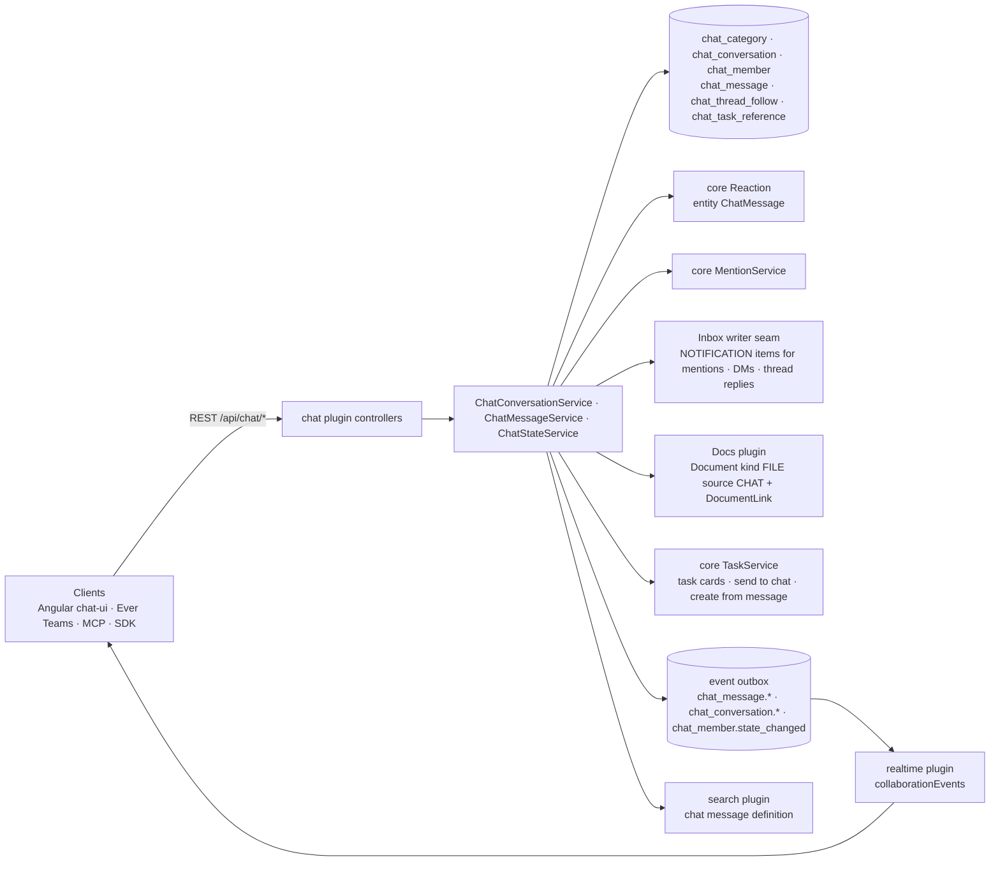

# Implementation Plan: Chat

> Translates an approved `spec.md` into architecture and tech choices. The plan owns
> implementation details; the spec owns behaviour.

**Feature ID**: `chat`
**Spec**: `./spec.md`
**Tasks**: `./tasks.md`
**Status**: `Approved`
**Last updated**: 2026-11-07

---

## 1. Architecture Summary

A new plugin owns the conversation model; everything else is the platform's: reactions, mentions, inbox
entries, files, tasks, search, the outbox and the subscription surface, presence and typing (realtime plugin).

## 2. Tech Choices

| Concern | Choice | Rationale |
| ------- | ------ | --------- |
| Package | `packages/plugins/chat` (`@gauzy/plugin-chat`), off unless `GAUZY_CHAT_ENABLED=true`; tenant feature `FEATURE_CHAT` | Principle I, IV; Inbox plugin layout |
| Tables | plugin-owned, tri-dialect, idempotent migrations `1791000006xxx`; prefix `chat_` (the core `channel` module is commerce) | Principle III; naming rule in the architecture doc |
| Unread | counters on `chat_member` (`readCount`, `mentionCount`, `lastReadMessageId`) maintained in the message write; `unread = conversation.messageCount − readCount` | one cheap read for all conversations; no count queries |
| Body | markdown subset, ≤ 4,000 chars, stored as text; mentions as tokens `<@employeeId>`, `<#conversationId>`, `<!channel>`, `<!here>` plus `mentionEmployeeIds` for the platform mention service | rename-safe, portable across Angular/React/mobile |
| Reactions | core `Reaction` rows with `ReactionEntityEnum.ChatMessage`, written through chat endpoints that check membership | reuse; membership enforced |
| Attachments | `Document { kind: FILE, source: CHAT }` uploaded through the docs plugin, linked by `DocumentLink { entity: ChatMessage }`; message carries `attachmentIds` | storage providers, search, AI knowledge for free |
| Mentions → inbox | `MentionService.publishMention` (parent = conversation) and `INBOX_ITEM_WRITER` items for DMs and followed-thread replies | existing seams |
| Task cards | `chat_task_reference` rows resolved at write (typed `KEY-number` and task links) and on "send to chat" / "create from message"; cards rendered by clients from task ids | Principle V |
| Real-time | outbox events declared with the subscription catalogue; `recipientUserIds` for addressed ones; typing/presence through the realtime plugin | Principle VII |
| Search | `packages/plugins/search` definition for chat messages (title = conversation, text = body), membership filter in the read | reuse |
| Permissions | `CHAT_VIEW`, `CHAT_SEND`, `CHAT_MANAGE` (contracts + default roles + plugin seed migration) | spec FR-23 |
| Idempotent send | `nonce` unique per author per 24 h (unique index author+nonce) | spec FR-8 |
| Link previews | server-side fetch with public-host-only guard, cached in `chat_link_preview` (phase 2) | spec FR-20 |

## 3. Data Model

| Table | Columns (beyond the tenant/organization base) |
| ----- | --------------------------------------------- |
| `chat_category` | `name`, `position` |
| `chat_conversation` | `kind` (channel/direct/group), `name`, `topic`, `visibility` (public/private), `categoryId`, `position`, `isDefault`, `archivedAt`, `createdByEmployeeId`, `messageCount` (int), `lastMessageAt`, `directKey` (direct/group: SHA-256 of the sorted, deduplicated user ids, `directKeyOf` in `chat-direct-key.ts`; unique index (`tenantId`, `directKey`); the default channel stores `default:<organizationId>`). Not organization-scoped yet: see §14.1 |
| `chat_member` | `conversationId`, `employeeId`, `userId`, `role` (member/manager), `notifyLevel` (all/mentions/muted), `isFavorite`, `readCount` (int), `mentionCount` (int), `lastReadMessageId`, `lastReadAt`, `joinedAt`, `leftAt`; unique (conversationId, employeeId) |
| `chat_message` | `conversationId`, `authorEmployeeId`, `authorUserId`, `kind` (message/system/app), `body` (text), `mentionEmployeeIds` (json), `mentionsChannel`, `mentionsHere`, `replyToId`, `threadRootId`, `alsoInConversation`, `replyCount` (int), `lastReplyAt`, `pinnedAt`, `pinnedByEmployeeId`, `editedAt`, `attachmentIds` (json), `nonce`; indexes (conversationId, createdAt), (threadRootId), unique (authorUserId, nonce) |
| `chat_thread_follow` | `rootMessageId`, `employeeId`, `userId`, `unreadReplies` (int), `lastReadReplyAt`; unique (rootMessageId, employeeId) |
| `chat_task_reference` | `messageId`, `taskId`, `kind` (mention/sent/created); unique (messageId, taskId) |
| `chat_link_preview` (phase 2) | `urlHash`, `url`, `data` (json), `fetchedAt`, `status` |

Contracts: `packages/contracts/src/lib/chat.model.ts` (enums, interfaces, inputs, page shapes, event names
`CHAT_EVENT_NAMES`), `BaseEntityEnum.ChatConversation/ChatMessage`, `ReactionEntityEnum.ChatMessage`,
`PermissionsEnum.CHAT_*`, `FeatureEnum.FEATURE_CHAT`.

## 4. API Surface (`/api/chat`, guards tenant + permission + feature flag)

| Method | Endpoint | Permission | Description |
| --- | --- | --- | --- |
| `GET` | `/chat/categories` · `POST` · `PATCH /:id` · `DELETE /:id` · `POST /categories/reorder` | VIEW / MANAGE | sidebar sections |
| `GET` | `/chat/conversations` | VIEW | mine, with member state, unread and mention counts, last message time |
| `GET` | `/chat/conversations/browse` | VIEW | public channels I am not in |
| `POST` | `/chat/conversations` | SEND (channel) | create a channel (name, topic, visibility, category, members) |
| `POST` | `/chat/direct` | SEND | find or create a direct (2) or group (3+) conversation by employee ids |
| `GET` | `/chat/conversations/:id` · `PATCH` · `POST /:id/archive` · `/:id/unarchive` | VIEW / MANAGE or creator | detail and settings |
| `POST` | `/chat/conversations/:id/join` · `/:id/leave` | VIEW | public channels; default channel cannot be left |
| `GET` | `/chat/conversations/:id/members` · `POST` · `DELETE /:employeeId` | VIEW / MANAGE or creator | membership |
| `PATCH` | `/chat/conversations/:id/state` | VIEW | `notifyLevel`, `isFavorite` |
| `POST` | `/chat/conversations/:id/read` | VIEW | mark read up to `messageId` (default newest) |
| `GET` | `/chat/conversations/:id/messages?before=&after=&around=&limit=` | VIEW | anchor paging: `before` / `after` / `around` name a message id; the anchor row is read and the page is compared and ordered on (`createdAt`, `id`) of that row (`olderThan` / `newerThan` in `chat-message.service.ts`), so ids need no time order (`BaseEntity` ids are random UUIDs) |
| `GET` | `/chat/conversations/:id/pins` · `/:id/files` | VIEW | pins; attachments through document links |
| `POST` | `/chat/conversations/:id/messages` | SEND | `{ body, nonce, replyToId?, threadRootId?, alsoInConversation?, attachmentIds?, mentionEmployeeIds?, taskId? }` → message + the events it caused |
| `PATCH` | `/chat/messages/:id` · `DELETE` | author / MANAGE | edit (editedAt), delete (tombstone when replies exist) |
| `POST` | `/chat/messages/:id/pin` · `/unpin` · `/unread` | VIEW | pin; mark unread from here |
| `POST` / `DELETE` | `/chat/messages/:id/reactions/:emoji` | VIEW | core reactions with membership check |
| `GET` | `/chat/messages/:id/thread` · `POST /:id/thread/read` · `POST /:id/follow` · `/:id/unfollow` | VIEW | thread replies (same anchor paging), mark the thread read (clears its reply notifications), follow state |
| `POST` | `/chat/messages/:id/create-task` | SEND + task create | `{ projectId, title?, assigneeIds? }` → task + reference |
| `GET` | `/chat/states` · `POST /chat/read-all` · `POST /chat/read-restore` | VIEW | all member states; mark all read (returns a snapshot id); undo within 60 s |
| `GET` | `/chat/threads` | VIEW | followed threads with unread reply counts |
| `GET` | `/chat/search?q=&conversationId=&authorId=&hasFile=&cursor=` | VIEW | search plugin, membership-filtered |
| `GET` | `/chat/link-preview?url=` (phase 2) | VIEW | cached, public hosts only |

DTOs with class-validator; responses typed from contracts; Swagger decorators; `Cache-Control: no-store`.
Non-members get 404.

## 5. Events, Real-Time and Notifications

| Outbox event | Audience | Payload (content-free) |
| --- | --- | --- |
| `chat_message.created` / `updated` / `deleted` | conversation members (`recipientUserIds`) | `{ conversationId, messageId, threadRootId, authorUserId, kind }` |
| `chat_conversation.changed` | members | `{ conversationId, change: created / updated / archived / members }` |
| `chat_member.state_changed` | the member | `{ conversationId, readCount, mentionCount, notifyLevel, isFavorite }` |
| `chat_thread.changed` | followers | `{ rootMessageId, replyCount }` |

Inbox: `@employee` mention → `MentionService.publishMention` (existing MENTION notification → Inbox item);
direct message → `EmployeeNotificationTypeEnum.MESSAGE` through `publishNotificationEvent`; reply in a followed
thread → `MESSAGE` too (subject names the thread). Reading a conversation
(`ChatNotifierService.markConversationRead`) marks the notifications of its messages and its mentions read;
reading a thread (`markThreadRead`, `POST /chat/messages/:id/thread/read`) marks the notifications of that
thread's replies read. Known gap: the conversation read also clears thread-only replies (§14.3). Typing and
presence: realtime plugin signals.

## 6. UI Surface

- Angular: `packages/plugins/chat-ui` (lane G4): page `chat`, nav section before `tasks`, header unread
  badge, composer (`ga-rich-text-editor` markdown output), threads pane, task cards, settings dialogs.
- Ever Teams: `chat` spec (lane T3).

## 7. MCP Tools, SDKs and Integrations

- MCP `chat` group (lane G9). OpenAPI/SDK regeneration at release. Incoming webhooks (lane G8) post `kind: app` messages.

## 8. Background Jobs

- Link preview fetch (phase 2, worker queue). Counter repair job (nightly, worker): recompute `messageCount`/`readCount` drift.

## 9. Security & Permissions

- Membership on every read/write; 404 for non-members; `CHAT_MANAGE` for categories, others' channels, others' messages.
- Body sanitised (markdown subset, no HTML); mention tokens validated against members; attachments must be the caller's own uploads.
- Nonce idempotency; rate limit on send (60/min per user) and typing.

## 10. Observability

- Activity log: channel create/archive/membership. Metrics: messages/min, search latency.

## 11. Phased Rollout

1. PR 1: contracts, entities, migrations, permissions/feature, conversations + direct, messages (send/edit/delete), read state, reactions, outbox events, inbox items for mentions/DMs.
2. PR 2: threads + follows, pins, files, task references (cards, send-to-chat, create-task), search definition, read-all/restore.
3. PR 3: link previews, counter repair job, webhooks (G8).

## 12. Constitution Reconciliation

I plugin · II scoped · III tri-dialect additive migrations, MikroORM repositories · IV flag + feature · V contracts first · VI membership + permissions · VII outbox · VIII (UI lanes) · IX specs · X spec unchanged · XI vendor-neutral.

## 13. Risks & Mitigations

| Risk | Mitigation |
| --- | --- |
| Counter drift under concurrent writes | increments in one UPDATE statement; nightly repair |
| Direct conversation duplicates | unique (`tenantId`, `directKey`), the loser of a race answers the winner's conversation; to be scoped per organization (§14.1) |
| Large histories | cursor paging on (createdAt, id); indexes |
| Reactions through the generic `/reaction` route bypassing membership | `ReactionService.create` refuses `ReactionEntityEnum.ChatMessage` (400, "managed through the chat API"); chat routes write reactions with the membership check. Reads and the emoji update through `/reaction` are not filtered yet (§14.2) |

## 14. Known limitations / follow-ups

What the merged code (ever-gauzy #11683 and its follow-ups) does not do yet; each item names the code.

1. **`directKey` is unique per tenant, not per organization.** `ChatConversationService.direct` looks up
   `{ tenantId, directKey }` and the unique index is (`tenantId`, `directKey`), while `directKeyOf` hashes
   user ids only. A user can be an employee of several organizations of one tenant; once two people have
   a direct (or group) conversation in one organization, `POST /chat/direct` for the same people in
   another organization finds that conversation and answers 404 (`ChatAccessService.conversation` refuses
   another organization's row), so they can never talk there. Follow-up: add `organizationId` to the
   lookup and to the unique index (migration: drop and recreate the index as (`tenantId`,
   `organizationId`, `directKey`)), or hash the organization into the key.
2. **The generic reaction routes still read and edit chat reactions.** Only `ReactionService.create`
   refuses `ChatMessage`; `GET /reaction` and `GET /reaction/:id` (core `ReactionController`, tenant-scoped
   only) list chat reactions (emoji, employee, message id) to non-members, and `PUT /reaction/:id` changes
   the emoji of the caller's own chat reaction without the membership check. Follow-up: exclude or refuse
   `entity = ChatMessage` in `findAll`, `findOneByIdString` and `update` of `ReactionService`.
3. **Reading a conversation also clears followed-thread replies.** `markConversationRead` selects the
   notifications of every message of the conversation, thread-only replies included, so opening the
   conversation clears a followed-thread entry the member has not read (spec FR-17). Follow-up: leave out
   replies that are not also in the conversation (`threadRootId IS NOT NULL AND alsoInConversation = false`)
   in the conversation read; the thread read already clears them.
