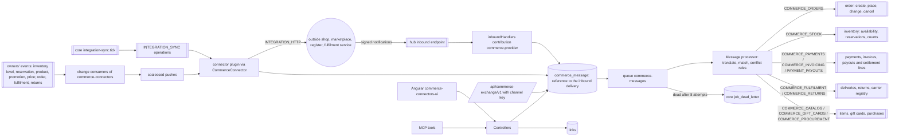

# Implementation Plan: Commerce connectors

> Translates an approved `spec.md` into architecture and tech choices. The plan owns
> implementation details; the spec owns behaviour.

**Feature ID**: `commerce-connectors`
**Spec**: `./spec.md`
**Tasks**: `./tasks.md`
**Status**: `Draft`
**Last updated**: 2026-11-23

---

## 1. Architecture Summary

A new plugin `packages/plugins/commerce-connectors` (connections, links, messages, the open channel exchange API,
reports) with its Angular UI `packages/plugins/commerce-connectors-ui`, a library `packages/commerce-connector-kit`
(`@gauzy/commerce-connector-kit`: the common commerce model, the `CommerceConnector` contract on top of
`@gauzy/connector-kit` of `integration-hub`, commerce contract checks) and three connector plugins:
`commerce-connector-sandbox`, `commerce-connector-open-channel` and `commerce-connector-file-feed`. The commerce plugin
turns outside objects into platform records only through the owners' services, reached through composition ports.

It builds on what exists and adds no second copy of it:

- **Integration framework and hub**: a connection is an `integration_tenant` with encrypted `integration_setting`
  rows; outside ids are `integration_map` rows; flows are the hub's sync jobs, which are core `integration_entity_setting`
  rows with the hub's columns; runs are `INTEGRATION_SYNC` operations of the core operation runtime; value mappings are
  `integration_sync_value_map` rows; conflicts and failed writes are `integration_sync_issue` rows; notifications arrive
  on hub inbound endpoints; outside calls go through the hub's logged HTTP client and call log; health history is the
  hub's health snapshots; connectors are declared through the hub's `connectors` contribution kind (`integration.provider`
  is the connector key) and their notification handlers through the `inboundHandlers` kind.
- **Platform changes**: pushes start from the owners' own events (CQRS `InventoryLevelChangedEvent`,
  `InventoryLevelLowEvent`, `InventoryLevelOutOfStockEvent`, `StockReservationChangedEvent`, `ProductPublishedEvent`,
  `ProductUnpublishedEvent`, `PromotionChangedEvent`; the outbox events `inventory.level.changed`,
  `pricing.price.changed` and `catalog.item.*` once their owners publish them; the order, fulfilment and returns
  streamed events); the plugin captures nothing itself.
- **Stock**: available-to-sell is the inventory plugin's `StockAvailabilityService` (on hand − reserved − the level's
  safety stock); channel shares and channel safety stock are columns of the existing `channel_warehouse`; low-stock
  crossings are the inventory stock alerts.
- **Money**: channel settlements are `payment_payout` + `payment_payout_line` rows of the payment plugin, the one
  settlement-line model (`ISettlementLine`) that banking matches through `SETTLEMENT_LINE_SOURCES`.
- **Credentials and links**: channel keys are core `user_api_token` rows of the connection's agent employee with an
  `access_credential_policy` row; pull links of feeds are core `shared_entity` links.
- **Files**: feeds are scheduled exports and file imports are scheduled imports of `data-import-export`.
- **Dead letters**: dead messages are core `job_dead_letter` rows, replayed through its service.

## 2. Tech Choices

| Concern | Choice | Rationale |
| ------- | ------ | --------- |
| Package | new plugin and UI, library `commerce-connector-kit`, connector plugins `commerce-connector-<key>` | Principle I; [platform architecture](../../architecture/business-suite.md) §2.4 names `commerce-connector-<name>` |
| Connections | one `integration_tenant` per connection (credentials in `integration_setting`, encrypted) plus `commerce_connection` for commerce state; sign-in by hub `CONNECTED_ACCOUNTS` when the connector declares it; the marketplace selling region is a core `region` | reuse the existing integration rows and regions |
| Connectors | each connector plugin declares its manifest through the hub's `connectors` contribution kind (`provider` = its `IntegrationEnum` key, category Commerce, with the commerce section of `ICommerceConnectorManifest`) and registers its class on the multi-provider `COMMERCE_CONNECTOR_IMPLEMENTATIONS` | one catalogue, one declaration place |
| Flows | each flow is a hub sync job: an `integration_entity_setting` row of the connection (entity `commerce.<flowKey>`, the existing `sync` switch as on and off, hub columns `direction`, `schedule`, `conflictRule`, `fieldMap` with per-field rules, `pausedAt`, `consecutiveFailures`, `lastOperationId`); the flow's trigger kind and status window are kept in the connection's `settings` per flow key | one scheduler, one run history |
| Runs | `INTEGRATION_SYNC` operations started by the core `integration-sync.tick` or on demand; the operation runtime calls `CommerceConnector.pull(flow, cursor, ctx)`; back-fills and catalogue imports are the same operation type with their input; one live run per connection by the runtime's aggregate rule | one run ledger |
| Notifications | `inboundHandlers` contribution `commerce.<provider>`; one hub inbound endpoint per connection (`handlerRef` = connection id); signature verification by the connector; answer `202`; message queued | Principle VI |
| Ids | core `integration_map` rows with additive `IntegrationEntity` values `Product`, `ProductVariant`, `Order`, `Delivery`, `Return`, `Payment`; outside customers use the existing `CLIENT` (outside customer ↔ organization contact); `order.externalId` = `<connectionId>:<outside order id>` (unique per organization), `order.source` and `order.metadata` keep the outside number | the existing map stays the dedupe key |
| Value mappings | rows of the hub's `integration_sync_value_map` with commerce kinds (`LOCATION`, `TAX`, `PAYMENT_METHOD`, `SHIPPING_METHOD`, `ORDER_STATUS`, `UNIT`, `ATTRIBUTE`, `CATEGORY`, `RETURN_REASON`, `STORE`, `STAFF`); location extras (return location, address, group summed for pushes, kept by the outside system) in the connection's `settings` | one value-map table for every connector |
| Writes | ports bound in `apps/api/src/plugin-composition.ts`: `COMMERCE_ORDERS` (order service: create, place, confirm, change, cancel, invoice), `COMMERCE_CATALOG` (items, variants, publication, relations reads; draft item create), `COMMERCE_PRICING` (channel price list reads), `COMMERCE_STOCK` (bound today to the inventory plugin's `StockAvailabilityService`, `StockReservationService` and `StockCountService`; `warehouse-and-stock-movements` extends them), `COMMERCE_PAYMENTS` (`payments-and-collections`), `PAYMENT_PAYOUTS` (`payment-gateways`), `COMMERCE_FULFILMENT` (deliveries, carrier registry), `COMMERCE_RETURNS`, `COMMERCE_GIFT_CARDS`, `COMMERCE_PROCUREMENT` | plugins never import each other |
| System actor | each connection has an agent employee (`EmployeeService.createAgentEmployee`, `employee_agent_profile.source = 'commerce-connectors'`, `externalId` = connection id) whose user holds the write permissions of the connection's flows; message processing runs in its request context | records attributed to "connector `<name>`" by the platform's own identity |
| Channel keys | core `user_api_token` rows of the connection's agent user (hashed, prefix, expiry, revocation, last use), each with an `access_credential_policy` row of `access-control-and-security` (kind `USER_API_TOKEN`, scopes `commerce-exchange:read`, `commerce-exchange:write`, the connection's organization, rate per minute) | one credential model |
| Platform changes | handlers of the owners' CQRS events and consumers of their outbox events (§1) feed `subscriber:commerce-connectors`, which coalesces per variant (stock 15 s, items 60 s) | no second capture |
| Stock arithmetic | `StockAvailabilityService` availability per variant and mapped location, minus `channel_warehouse.safetyStock`, times `channel_warehouse.allocationPercent`, never below zero; the immediate push on low stock follows the inventory stock alert of that variant and location (`stock_alert.threshold`, `InventoryLevelLowEvent`, `InventoryLevelOutOfStockEvent`) | one safety stock per level, one alert model |
| Settlements | a marketplace settlement is a `payment_payout` (`direction` `TO_ORGANIZATION`, `sourceType` `COMMERCE_CONNECTION`, the connection's `payment_provider` row tied to the connector's `integration`) with `payment_payout_line` rows (`CAPTURE`, `REFUND`, `FEE`, `ADJUSTMENT`, `externalRef`, `matched`), recorded through `PAYMENT_PAYOUTS.recordSettlement` of `payment-gateways` (idempotent on the channel's settlement id); banking matches them with every other settlement | one settlement-line model |
| Channel fees | `commerce_channel_fee` keeps the per-order fee facts a channel reports with the order, before and independent of any payout (read by profitability and posted from the order's events); a settlement's `FEE` line with the same `externalRef` marks the fee settled | fees are order costs, settlement lines are money movements |
| Messages | `commerce_message` follows the pattern of Ever Works' `ever_works_inbound_event` and `ever_works_outbound_change`: a message from a notification points at the hub's `integration_inbound_delivery` and stores no second payload; pulled objects, pushes and open channel writes store their redacted payload; a dead message is a core `job_dead_letter` row of queue `commerce-messages` and is replayed through `JobDeadLetterService` | one inbound store, one dead-letter form |
| Feeds and file imports | a feed is a `data-import-export` export template with a `data_schedule` of kind `EXPORT` over the commerce listing, price and stock targets this plugin registers; the file-feed connector delivers each finished export (`operation.completed` of the export) to the hub storage target named in the connection (`STORAGE_TARGETS.write`, purpose `commerce.feed`) or serves the latest file at a pull address (a `shared_entity` link of the schedule); file imports are `data_schedule` rows of kind `IMPORT` (link or drive folder of the platform, saved mapping template) whose import target turns each row into a message | no second scheduler, mapper or file store |
| No-code path | the existing automation-platform integrations (`integration-make-com`, `integration-zapier`, `integration-activepieces`, `integration-sim`) and core outbound `webhook` subscriptions can drive an outside system without a named adapter: they call the open channel API with a channel key and subscribe to `commerce.*` and order events | documented in the user docs |
| Migrations | shared core helpers (`@gauzy/core`, `database/migration-helpers.ts` beside `check-constraint.helper.ts`; lifted there by `procurement`, its T4) | no plugin copy |
| Permissions and feature | contributions in `commerce-connectors.permissions.ts` (with `defaultFor`) and `commerce-connectors.features.ts` | no seed migration for grants |
| Background work | `@ScheduledJob` in the worker (`CommerceConnectorsSchedulePlugin`, ticks recorded in `job_execution`), `@QueueWorker` in the API, in-process fallback | house split |
| Feature gate | `commerce-connectors-enabled.ts` (exact `true`, and the hub's flag), `FEATURE_COMMERCE_CONNECTORS`, `FeatureFlagGuard` + `@FeatureFlag` on every controller and handler | [platform architecture](../../architecture/business-suite.md) §6 |

The goods `marketplace` plugin (`packages/plugins/marketplace`: the platform's own sellers, offerings, seller payouts
and seller settlements) is a different thing: an outside marketplace's orders, fees and settlements never write seller
rows.

## 3. Data Model

New tables extend `TenantOrganizationBaseEntity` (soft delete, `isActive`, `isArchived`); MultiORM decorators with
MikroORM repositories; JSON as `text` (`longtext` for payloads on MySQL); money `numeric(20,6)` with currency.

### 3.1 Plugin tables

| Table | Columns (besides base) | Indexes and uniqueness |
| --- | --- | --- |
| `commerce_connection` | `integrationTenantId`, `provider` varchar(64) (copy of `integration.provider` for the key), `channelKind` varchar(16) (`WEB_SHOP`, `MARKETPLACE`, `POINT_OF_SALE`, `FULFILMENT`), `channelId`, `externalAccountId` varchar(255), `regionId` null (core `region`), `regionKey` varchar(36) not null (the `regionId`, or `*` for a connection without a region; written with it, so the unique key holds on every dialect), `label` varchar(120), `status` varchar(14) (`VERIFIED`, `NEEDS_SIGN_IN`, `FAILING`, `PAUSED`, `DISCONNECTED`), `connectedAccountId` null, `inboundEndpointId` null, `actorEmployeeId`, `paymentProviderId` null (settlements), `settings` text (connection settings, per-flow trigger and status window, location extras, `refuseCancelAnnouncedReceipts` false of spec FR-80), `isTestMode` bool, `healthScore` int null, `healthCauses` text, `verifiedAt` | unique `(tenantId, provider, externalAccountId, regionKey)`; idx `(organizationId, status)` |
| `commerce_listing_link` | `connectionId`, `productId`, `variantId`, `integrationMapId` (the variant's map row; the product's row and the outside code are in `integration_map`, the code in its `syncedFields`), `state` varchar(8) (`DRAFT`, `ACTIVE`, `REFUSED`, `ENDED`), `lastItemSyncAt`, `lastPriceSyncAt`, `lastStockSyncAt`, `lastPushedPrice` numeric(20,6), `lastPushedQuantity` numeric(20,6), `lastError` varchar(1000) | unique `(connectionId, variantId)`; idx `integrationMapId` |
| `commerce_value_list` | `connectionId`, `kind`, `values` text, `fetchedAt` | unique `(connectionId, kind)`; the cache of outside lists the mapping editor offers, while the mappings are hub value-map rows |
| `commerce_message` | `connectionId`, `flowKey`, `direction`, `objectKind` varchar(16), `externalId` varchar(255), `externalVersion` varchar(64), `status` varchar(9) (`QUEUED`, `PROCESSED`, `DUPLICATE`, `INVALID`, `FAILED`, `DEAD`, `HELD`), `heldReason` varchar(16) null (`UNMATCHED_ITEM`, `CONFLICT`), `inboundDeliveryId` null (the hub delivery holds the body), `payload` longtext null (redacted, ≤ 256 KB; only without an inbound delivery), `answer` text (≤ 16 KB), `recordType` varchar(64), `recordId` uuid null, `attempts` int, `nextAttemptAt`, `lastError` varchar(2000), `deadLetterId` null (core `job_dead_letter`), `callLogIds` text, `operationId` null, `isReplay`, `isDryRun` bool | unique `(connectionId, direction, objectKind, externalId, externalVersion)`; idx `(connectionId, status, nextAttemptAt)`, `(recordType, recordId)`, `(connectionId, createdAt)` |
| `commerce_order_link` | `connectionId`, `orderId`, `integrationMapId` (outside order id), `externalState` varchar(32), `lastVersion` varchar(64), `fulfilledByChannel` bool, `taxDifference` numeric(20,6) null | unique `(connectionId, orderId)`; idx `integrationMapId` |
| `commerce_unmatched_item` | `connectionId`, `externalProductId`, `externalVariantId`, `externalCode`, `title` varchar(500), `attributes` text, `waitingMessages` int, `proposals` text, `resolvedVariantId` null, `resolvedAt` | unique `(connectionId, externalVariantId)`; outside ids stay here only until a platform record exists for an `integration_map` row |
| `commerce_channel_fee` | `connectionId`, `orderId`, `orderLineId` null, `kind` varchar(14) (`COMMISSION`, `FEE`, `PROMOTION`, `SHIPPING_LABEL`, `PAYMENT_FEE`, `OTHER`), `amount` numeric(20,6), `currency`, `externalRef` varchar(255), `occurredAt`, `settledPayoutLineId` null | unique `(connectionId, externalRef)`; idx `(orderId)`, `(connectionId, occurredAt)` |
| `commerce_stock_difference` | `connectionId`, `variantId`, `warehouseId`, `channelQuantity`, `platformQuantity` numeric(20,6), `checkedAt` | unique `(connectionId, variantId, warehouseId)` |
| `commerce_oversell_incident` | `connectionId`, `orderId`, `variantId`, `warehouseId`, `ordered`, `available` numeric(20,6), `status` varchar(8) (`OPEN`, `RESOLVED`), `resolution` varchar(16) | idx `(connectionId, status)` |

Not tables of this plugin: flows (`integration_entity_setting`), runs (`operation`), value mappings
(`integration_sync_value_map`), conflicts (`integration_sync_issue` of kind `CONFLICT` with both values), health history
(`integration_health_snapshot`, subject `CONNECTION`), dead messages (`job_dead_letter`), settlements (`payment_payout`,
`payment_payout_line`), stock shares (`channel_warehouse`), channel keys (`user_api_token`, `access_credential_policy`),
feeds and file imports (`data_schedule`, export and mapping templates), pull links (`shared_entity`).

### 3.2 Core and shared changes (additive)

- Contracts `IntegrationEntity`: `Product`, `ProductVariant`, `Order`, `Delivery`, `Return`, `Payment` (customers use
  `CLIENT`); `IntegrationEnum`: `COMMERCE_SANDBOX`, `COMMERCE_OPEN_CHANNEL`, `COMMERCE_FILE_FEED`; `IntegrationTypeEnum`
  `COMMERCE`; `BaseEntityEnum` value for the feed schedule link.
- Inventory plugin: existing `channel_warehouse` + `allocationPercent` numeric(5,2) null (share of available stock the
  channel may sell from that location) and `safetyStock` numeric(20,6) null (channel safety stock, applied after the
  level's own), migration in the inventory plugin.
- Orders keep `externalId`, `source` and `metadata` (outside number, connection) as they exist; no order column changes.

### 3.3 Migrations

**Migration timestamps**: `packages/plugins/commerce-connectors` `1791000063100` to `1791000063199`; `packages/plugins/inventory` `1791000063200` to `1791000063299`.

Shared core migration helpers; three dialects; idempotent, forward-only; both ORMs:

1. `1791000063100-CreateCommerceConnectionTables` — connection, listing link, value list, order link, unmatched item.
2. `1791000063110-CreateCommerceMessageTables` — message, channel fee.
3. `1791000063120-CreateCommerceStockTables` — stock difference, oversell incident.
4. `1791000063130-SeedCommerceConnectorIntegrations` — the `integration` rows of the three shipped connectors (category
   Commerce); the feature and the permission grants are contributions; `down` no-op. Core `integration` rows have no
   tenant and the Integrations page lists them to everyone, so each connector manifest names
   `FEATURE_COMMERCE_CONNECTORS` and the hub's catalogue read (`connectors` contribution kind) leaves out rows whose
   manifest feature is off for the tenant; rows without a manifest feature are listed as today.
5. Inventory plugin (`packages/plugins/inventory/src/lib/database/migrations/`):
   `1791000063200-AddChannelWarehouseAllocation` — the two `channel_warehouse` columns.

### 3.4 Contracts

`packages/contracts/src/lib/commerce-connector.model.ts`: enums above, `ICommerceConnection`, `ICommerceFlow` (the view
of a hub sync job with the commerce extras), `IListingLink`, `ICommerceMessage`, `IChannelStockShare`,
`IOversellIncident`, `IChannelProfitabilityRow`, ports. `@gauzy/commerce-connector-kit`: `CommerceObject` union
(`OutsideProduct`, `OutsidePrice`, `OutsideStockLevel`, `OutsideOrder` with lines, adjustments, taxes and charges,
`OutsidePayment`, `OutsideFee`, `OutsideFulfilment`, `OutsideCancellation`, `OutsideReturn`, `OutsideRefund`,
`OutsideCustomer`, `OutsideRegisterSale`, `OutsideSettlement` shaped as `ISettlementLine` rows),
`ICommerceConnectorManifest` (extends the hub's `IConnectorManifest` with channel kind, objects and directions, limits,
value lists), `CommerceConnector` (`verify`, `fetchValueLists`, `pull(flow, cursor)`, `push(flow, objects)`,
`parseNotification`, `registerNotifications`, `fetchDocuments`), `runCommerceChecks(connector, sandbox)`.

## 4. API Surface

Administration routes: `TenantPermissionGuard`, `PermissionGuard`, `@FeatureFlag(FEATURE_COMMERCE_CONNECTORS)`, DTOs,
Swagger, cursor pagination, `Idempotency-Key` on creates, `preview` on bulk actions, `dryRun` on runs.

| Method | Endpoint | Permission | Description | Status |
| ------ | -------- | ---------- | ----------- | ------ |
| CRUD | `/api/commerce-connections`, `POST /:id/{verify,pause,resume,disconnect,reconnect}` | `COMMERCE_CONNECTIONS_VIEW` / `_MANAGE` | connections and settings | New |
| `POST` `GET` `PUT` | `/api/commerce-connections/:id/value-lists/:kind/fetch`, `/value-maps` (hub value-map rows), `/field-map` | `COMMERCE_CONNECTIONS_MANAGE` | mappings | New |
| `GET` `PUT` | `/api/commerce-connections/:id/flows[/:flowKey]` | view / `_MANAGE` | flows over the connection's hub sync jobs (through `IntegrationEntitySettingService`), triggers, conflict rules | New |
| `POST` | `/api/commerce-connections/:id/flows/:flowKey/{run,backfill}` (`dryRun`) | `COMMERCE_SYNC_RUN` | starts an `INTEGRATION_SYNC` operation (`202` with its handle) | New |
| `GET` `POST` | `/api/commerce-connections/:id/catalogue`, `/catalogue/import` | `COMMERCE_SYNC_RUN` | outside catalogue and import (operation) | New |
| `GET` `POST` | `/api/commerce-connections/:id/unmatched`, `/:uid/{link,create,proposals}` | view / `_MANAGE` | unmatched products | New |
| `GET` | `/api/commerce-connections/:id/{listing-links,order-links,stock-differences,oversell-incidents,health,dashboard}` | `COMMERCE_CONNECTIONS_VIEW` | state | New |
| `GET` `POST` `DELETE` | `/api/commerce-connections/:id/channel-keys` | `COMMERCE_CONNECTIONS_MANAGE` | issue (shown once), list and revoke the connection's API tokens and their credential policies | New |
| `GET` `POST` `PUT` | `/api/commerce-connections/:id/{feeds,file-imports}` | `COMMERCE_CONNECTIONS_MANAGE` | the connection's `data_schedule` rows, export and mapping templates, delivery target or pull link | New |
| `GET` `PUT` | `/api/commerce-channels/:channelId/stock-shares` | `COMMERCE_CONNECTIONS_MANAGE` | allocation share and channel safety stock per location, written to `channel_warehouse` through `COMMERCE_STOCK` | New |
| `GET` | `/api/commerce-messages`, `/:id`, `/export` | `COMMERCE_CONNECTIONS_VIEW` | message log (payload read from the inbound delivery when referenced) | New |
| `POST` | `/api/commerce-messages/{retry,replay}` (`filter`, `preview`), `/:id/{retry,skip,handled}` | `COMMERCE_MESSAGES_RETRY` | retries; replay of dead messages through `JobDeadLetterService` | New |
| `GET` `POST` | `/api/commerce-conflicts`, `/:id/resolve` | view / `COMMERCE_CONFLICTS_RESOLVE` | conflicts over hub issues | New |
| `POST` | `/api/commerce-connections/resync` `{ recordType, recordId, connectionId? }` | edit of the record | resync from a record | New |
| `POST` | `/api/commerce-connections/:id/explain/:messageId` | `COMMERCE_CONNECTIONS_VIEW` | explanation, no change | New |
| `GET` | `/api/commerce-exchange/v1/{listings,prices,stock}?cursor=` | channel key (`Authorization: Bearer`, scope `commerce-exchange:read`) | open channel reads | New |
| `POST` | `/api/commerce-exchange/v1/{orders,orders/:externalId/payments,…/fulfilments,…/cancellations,…/returns,stock-counts}` | channel key (scope `commerce-exchange:write`), `Idempotency-Key` | open channel writes → messages | New |
| `GET` | `/api/commerce-feeds/:token/:feedKey` | pull link (token resolved by the `shared_entity` service; expiry and revocation honoured) | latest feed file | New |

Inbound notifications use the hub's `POST /api/hooks/in/:token` with the handler `commerce.<provider>`. Errors:
`COMMERCE_CONNECTION_UNVERIFIED`, `COMMERCE_UNMATCHED_ITEM`, `COMMERCE_LIMIT_EXCEEDED` (limit named),
`COMMERCE_RECEIPT_ANNOUNCED` (only for a connection with `refuseCancelAnnouncedReceipts` on; otherwise the receipt
cancels and a hub issue asks a person to withdraw the announcement), `COMMERCE_CHANNEL_KEY_INVALID`. GraphQL reads
`commerceConnections`, `commerceMessages`.

**Ports and contributions consumed**: hub `CONNECTED_ACCOUNTS`, `INTEGRATION_HTTP`, `INTEGRATION_SYNC_RUNS`,
`STORAGE_TARGETS` and the contribution kinds `connectors` and `inboundHandlers` (required); the `COMMERCE_*` ports of §2
(orders, catalogue, stock required; the others optional, their flows hidden when absent); `PAYMENT_PAYOUTS` of
`payment-gateways` for settlements (the settlement flow is hidden without it); tax computation of `tax-engine` for
FR-36; the carrier registry of `delivery-and-shipping` for FR-48; the schedule, export-template and mapping-template
services of `data-import-export` for feeds and file imports; core `user_api_token`, `shared_entity`, `job_dead_letter`
and agent employee services; `COMMERCE_ASSISTANT` (ai-agents-and-assistants, else `AiProviderRegistry`); stock valuation
cost reader when `stock-ledger-and-valuation` is loaded. **Offered**: `COMMERCE_CONNECTOR_IMPLEMENTATIONS` (connector
class by `provider`) for connector plugins.

## 5. Events, Real-Time and Notifications

| Event | Emitted when | Consumers |
| ----- | ------------ | --------- |
| `commerce.connection.verified` / `.needs_sign_in` / `.paused` | sign-in and failure handling | owner Inbox notice, automations |
| `commerce.run.completed` / `.failed` | flow runs (beside the hub's `integration_sync.run.*`) | connection page live, owner notice on failure |
| `commerce.message.dead` / `commerce.item.unmatched` / `commerce.conflict.opened` | message processing | owner notice once per hour per connection, automations |
| `commerce.order.imported` | order created from a message | automations, webhooks |
| `commerce.oversell.incident` | order beyond available stock | stock team Inbox |
| In (CQRS, today): `InventoryLevelChangedEvent`, `InventoryLevelLowEvent`, `InventoryLevelOutOfStockEvent`, `StockReservationChangedEvent`, `ProductPublishedEvent`, `ProductUnpublishedEvent`, `PromotionChangedEvent` | owners' writes | `subscriber:commerce-connectors` → coalesced pushes of stock, listings and prices |
| In (outbox): `inventory.level.changed`, `pricing.price.changed`, `catalog.item.*` once their owners publish them; `order.placed`, `order.canceled`, fulfilment shipped, return received, refund issued | owners' events | pushes of stock, items, prices, fulfilments, cancellations, returns, refunds |
| In: `operation.completed` of a feed's export | `data-import-export` export finished | file-feed delivery to the storage target or the pull link |

Real-time record types `commerce_connection`, `commerce_message` (status counts), and the operation progress of
imports and back-fills.

## 6. UI Surface

- **Angular `packages/plugins/commerce-connectors-ui`** (lazy; hidden on `404`): one set of pages, opened from a
  "Commerce" tab registered on the Integrations page through the hub's `PLUGIN_LAYOUT_TABS` seam (the Sales menu links
  to the same route): connections list with health, connection wizard (connector, kind, sign-in, channel, locations,
  flows), connection page (live dashboard, flows with triggers and conflict rules, value mappings with fetched outside
  lists, field map, unmatched items with proposals, listing links, order links, stock differences, oversell incidents,
  feeds, file imports, channel keys), messages (filters, payload and answer view, retry, skip, replay with preview,
  export), conflicts (side-by-side values over hub issues), stock shares per channel and location, outside catalogue
  import with live progress, dry-run difference report.
- Record panels: listing links on the item page and order links on the order page with resync, through the hub's
  record integrations panel (`ngx-record-integrations`).
- i18n keys `COMMERCE_CONNECTORS.*` in every locale; keyboard operable tables and mapping editors.

## 7. MCP Tools, SDKs and Integrations

`packages/mcp-server/src/lib/tools/commerce-connectors.ts`: `commerce_connections_list`, `commerce_connection_health`,
`commerce_flow_run` (`dryRun` default true), `commerce_messages_list`, `commerce_messages_retry` (`preview` default true),
`commerce_unmatched_list`, `commerce_unmatched_link` (`preview`), `commerce_channel_profitability`. OpenAPI additive
(the open channel API is its own versioned group); Kiota SDKs regenerated. Report datasets and the definitions of spec
FR-79 are `reports` contributions of `report-builder-and-dashboards`: `commerce.messages`, `commerce.sync_activity`
(over `INTEGRATION_SYNC` operations), `commerce.unmatched`, `commerce.stock_differences`, `commerce.channel_orders`,
`commerce.channel_profitability` (computed: orders, channel fees, payment fees, delivery cost, returns, cost reader),
`commerce.oversell`, `commerce.health`. The no-code path of §2 is documented for outside developers with the open
channel API.

## 8. Background Jobs

| Trigger | When | What it does | Idempotency |
| ------- | ---- | ------------ | ----------- |
| core `integration-sync.tick` → `INTEGRATION_SYNC` operation | flow schedule, on demand | `CommerceConnector.pull` from the cursor → messages | operation lease and cursor, message unique key |
| queue `commerce-messages` | message queued or due | translate, match, apply rules, write through ports; retries with waits 1 min → 6 h; after 8 attempts the message is `DEAD` and a `job_dead_letter` row is recorded | message status compare-and-set; owners' idempotency keys (`commerce:<connection>:<object>:<externalId>:<version>`) |
| `subscriber:commerce-connectors` (CQRS handlers and outbox consumer) | owners' events | coalesce per variant (stock 15 s, items 60 s), push at once on a low-stock or out-of-stock crossing | delivery record per event; last pushed values |
| `commerce.status-sweep` (tick in `job_execution`) | per flow schedule | recent orders' status for channels without notifications | message unique key |
| `commerce.stock.compare` (tick in `job_execution`) | daily 04:00 | channel against platform quantities → differences | upsert per variant and location |
| `commerce.health` | daily 03:30 | scores with causes into hub health snapshots; warnings | one per connection and day |
| feed delivery | `operation.completed` of a feed's scheduled export | write the file to the storage target or keep it for the pull link | export run id |
| `commerce.retention` | nightly | processed messages past 90 days, handled failures past 30 days; counts kept | idempotent delete |

The worker loads `CommerceConnectorsSchedulePlugin`; processors run in the API. Without a queue root the API processes
messages in-process under a per-connection lock. Scheduled feeds and file imports run on the schedules of
`data-import-export`.

## 9. Security & Permissions

- Keys (`commerce-connectors.permissions.ts`, permission contributions): `COMMERCE_CONNECTIONS_VIEW`,
  `COMMERCE_CONNECTIONS_MANAGE`, `COMMERCE_SYNC_RUN`, `COMMERCE_MESSAGES_RETRY`, `COMMERCE_CONFLICTS_RESOLVE`,
  `COMMERCE_REPORTS_VIEW`. `defaultFor`: super admin and admin all; manager all but `COMMERCE_CONNECTIONS_MANAGE`.
- Connection actor: the connection's agent employee, organization scope, holding only the write permissions of its
  enabled flows (`ORDERS_CREATE`, `ORDERS_EDIT`, `ORDERS_CANCEL`, `FULFILLMENTS_CREATE`, `RETURNS_CREATE`, `STOCK_EDIT`
  for counts, `GIFT_CARDS_ISSUE`, `PURCHASE_ORDERS_CREATE`, `GOODS_RECEIPTS_CREATE`, `ORG_PAYMENT_ADD_EDIT`,
  `PRODUCTS_EDIT` for draft items); its channel keys can do only what their credential policy scopes allow.
- Credentials encrypted in `integration_setting` or hub connected accounts; never returned. Channel keys are
  `user_api_token` rows (hashed, shown once, expiring, revocable, rate per credential policy); feed pull links are
  `shared_entity` links (hashed token, expiry, revocation). Open channel writes need an `Idempotency-Key`.
- Payloads redacted (credentials, tokens, card and bank fields from the payment plugin's list) before storing.
- Customer push only for contacts of the channel's group with sharing consent; personal data of imported buyers follows
  the platform's erasure requests.

## 10. Observability

Activity-log entries for connection, mapping, flow, conflict rule, stock share and key changes, and for retries,
replays, skips and resolutions. Metrics: notification-to-order lag, push lag per object, messages by status, dead
messages, unmatched items, stock differences, oversell incidents, outside rate-limit waits per connector.

## 11. Phased Rollout

1. **Phase 1 — Contracts, entities, migrations, kit** (flags off).
2. **Phase 2 — Framework and sandbox**: connections, flows on hub sync jobs, notifications through inbound endpoints,
   messages with retries, links and mappings, orders in, payments in, fulfilments out, stock out, items and prices out,
   sandbox connector, screens, MCP tools. Demo: a sandbox shop order arrives, ships and updates stock.
3. **Phase 3 — Depth**: items in with matching and unmatched queue, back-fills, status sweeps, fulfilment in and
   channel-booked shipping documents, cancellations, returns and refunds both ways, customers, fees and settlements,
   outside registers (sales, gift cards, staff, purchases), stock counts in, receipts out, open channel and file feed
   connectors, conflicts, reports.
4. **Phase 4 — Advanced capabilities**: health scores, bulk replay, dry runs, channel safety stock and allocation shares,
   low-stock acceleration, oversell incidents, stock comparison, channel profitability, match proposals and explanations.
5. **Phase 5 — General availability**: the feature is off by default; after the trial period it may be switched on by default for new tenants only; existing tenants keep their setting until an administrator changes it.

## 12. Constitution Reconciliation

- I Plugin-first: new plugin, UI, kit and connector plugins; core gains additive enum values, the inventory plugin two
  `channel_warehouse` columns, and seed rows of the three connectors.
- II Tenant/organization scoping: every table on the base; matching and writes within the connection's organization.
- III Both ORMs, additive migrations: four plugin migrations and one inventory migration on three dialects.
- IV Default-off flag; nothing removed: deploy switch and `FEATURE_COMMERCE_CONNECTORS`; existing integrations unchanged.
- V Contracts and API first: contracts, connector contract and the versioned open channel API before screens.
- VI Permissions, privacy, security: six keys, scoped agent actor, encrypted credentials, scoped channel keys,
  signatures on notifications, redaction.
- VII Real-time through the event bus: owners' events drive pushes; live connection pages on the platform channel.
- VIII i18n and accessibility: keys in every locale; accessible mapping editors.
- IX Tests: sandbox scenarios end to end, contract suite, idempotency per object, both ORMs.
- X Behaviour-first spec: implementation lives here only.
- XI Documentation describes our platform only.

## 13. Risks & Mitigations

| Risk | Likelihood | Impact | Mitigation |
| ---- | ---------- | ---------- | ---------- |
| Duplicate orders from redeliveries | Medium | High | unique message key with version, `order.externalId` unique per organization, owners' idempotency keys |
| Overselling across channels | Medium | High | level and channel safety stock, allocation shares, immediate push on stock alerts, reservations on import, incidents |
| Outside rate limits | High | Medium | hub back-off with retry time, batch sizes from manifests, coalesced pushes |
| Tax disagreement on imported orders | Medium | Medium | keep channel amounts, record differences, report |
| Hub not loaded | Low | Medium | refuse to start with a boot message; dependency declared |
| A stock write path that misses its level event | Low | Medium | every level write goes through the warehouse level writer that publishes the events (`warehouse-and-stock-movements` FR-104); the daily stock comparison and the scheduled full refresh of FR-32 bound any drift |
| Payload storage growth | Medium | Low | size caps, redaction, inbound bodies kept once by the hub, 90-day retention |

## 14. References

- Spec: `./spec.md` · Tasks: `./tasks.md` · Siblings: `../integration-hub/plan.md`, `../sales-order-management/plan.md`,
  `../warehouse-and-stock-movements/plan.md`, `../delivery-and-shipping/plan.md`, `../payments-and-collections/plan.md`,
  `../payment-gateways/plan.md`, `../data-import-export/plan.md`, `../access-control-and-security/plan.md`
- Code: `packages/core/src/lib/{integration,integration-tenant,integration-setting,integration-map,integration-entity-setting,channel,region,event-outbox,operation,job-dead-letter,shared-entity,employee-agent-profile}`,
  `packages/core/src/lib/auth/user-api-token/`, `packages/core/src/lib/database/check-constraint.helper.ts`,
  `packages/plugins/inventory/src/lib/{events,stock-availability,stock-reservation,stock-count,stock-alert,channel-warehouse}`,
  `packages/plugins/order/src/lib/{order,order-change,order-streamed-events.ts}`, `packages/plugins/catalog/src/lib/events`,
  `packages/plugins/integration-ever-works/src/lib/sync/`, `packages/plugins/{fulfillment,returns,promotion,payment}`,
  `packages/plugins/integration-{make-com,zapier,activepieces,sim}`, `apps/api/src/plugin-composition.ts`
