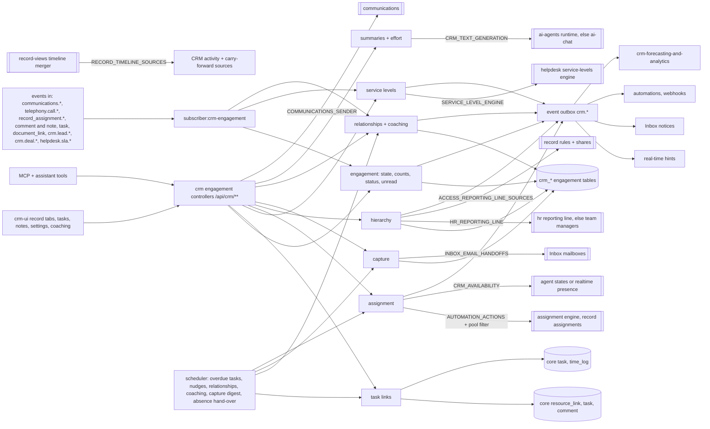

# Implementation Plan: CRM engagement

> Translates an approved `spec.md` into architecture and tech choices. The plan owns
> implementation details; the spec owns behaviour.

**Feature ID**: `crm-engagement`
**Spec**: `./spec.md`
**Tasks**: `./tasks.md`
**Status**: `Draft`
**Last updated**: 2026-11-23

---

## 1. Architecture Summary

No new plugin: engagement lands as sub-modules of `@gauzy/plugin-crm` (`packages/plugins/crm/src/lib/`) created by
`crm-leads-and-deals`, gated by the same `FEATURE_CRM`, with pages in `crm-ui`. The CRM owns only what is CRM-specific
(timeline contributions and carry-forward, engagement state and counts, communication status, response facts, sales
hierarchy exceptions, capture, relationships, coaching). Everything else is an existing store or a shared engine reached
through a port bound in `apps/api/src/plugin-composition.ts`, injected `@Optional()`, with the fallback named in §7:

- **Notes** are core `comment` rows on the record (polymorphic `entity` + `entityId`, mentions, reactions, access
  policies) of the note kind, with the private visibility and pin flag that `record-views-and-search` adds to `comment`;
  the Notes tab is a filter of one thread, not a second store. **Last visits** (unread marks, "what changed") are core
  `employee_recent_visit` rows.
- **Timeline, palette, saved views**: `record-views-and-search` (`RECORD_TIMELINE_SOURCES`,
  `registerPaletteProviders`, record type registry entries of `crm-leads-and-deals`).
- **Task links**: record links (core `resource_link` with a record target, specified by `record-views-and-search`; CRM
  record → `Task`), the same link store every feature uses; the CRM task list is a built-in view of core task views.
- **Sales hierarchy**: the reporting line of `hr-core-lifecycle` (`HR_REPORTING_LINE`; without it, the managers of the
  person's organization teams, `organization_team_employee.isManager`), with exceptions for sales stored by the CRM;
  its history is `activity_log`.
- **Settings and permissions**: contributions of the `crm` plugin (`crm.settings.ts`, `crm.permissions.ts`); personal
  choices in `user.uiPreferences` and the notification preferences.
- **Email, messages, templates, identities, scheduling, matching**: `email-and-communications` (`COMMUNICATIONS_SENDER`,
  its message log and links, `communications.message.*` events, templates with `recordType`).
- **Calls**: `telephony` contributes its own timeline source; the CRM reads call facts for response times and effort.
- **Service levels**: `SERVICE_LEVEL_ENGINE` of the helpdesk plugin (`declare`, `attach`, `signal`, `state`, `preview`).
- **Assignment**: the assignment engine and record assignments of `automation-and-notifications` (`assignment_rule`,
  `record_assignment`, `AUTOMATION_ACTIONS`), narrowed by a CRM pool filter through `registerAssignmentPoolFilters`.
- **Visibility and sharing**: `RECORD_ACCESS_FILTER` and shares of `access-control-and-security`; the sales hierarchy is
  offered as a reporting-line source for CRM record types.
- **Tasks**: core tasks (`packages/core/src/lib/tasks/`) with their due reminders; **files**: drive documents linked
  through the docs plugin's `document_link`; **time**: core time logs.

## 2. Tech Choices

| Concern | Choice | Rationale |
| --- | --- | --- |
| Package | sub-modules `engagement/`, `activity/`, `email/`, `service-levels/`, `assignment/`, `availability/`, `access/`, `hierarchy/`, `capture/`, `relationships/`, `coaching/`, `summaries/`, `effort/` of `packages/plugins/crm` | Principle I; one CRM plugin |
| Timeline | two `RECORD_TIMELINE_SOURCES` entries: `CrmActivityTimelineSource` (CRM facts) and `CrmCarryForwardTimelineSource` (source lead and child records, marked, deduplicated by entry id) | one timeline shell |
| Notes | core `comment` rows of the note kind (private visibility and pin flag added to `comment` by `record-views-and-search`); pin author and time read from the activity log entry of the pin | no second note model |
| Tasks | core `Task` without project, linked by `resource_link` rows (`entity` = the CRM record, `targetEntity = Task`, `role` `PRIMARY` or `RELATED`); created through `TaskCreateCommand`; reminders by `task-due-reminder`; the CRM task list is a locked system `task_view` "CRM tasks" written per organization by `CrmBootstrapService.ensureSeeded` (filter: linked through `resource_link` to a lead, deal, person or organisation the viewer may read; the task list query gains that link filter), shown by `task-views-ui` as list and board | tasks are platform tasks, timer works; one task board |
| Unread and "what changed" | the viewer's last opening of the record from core `employee_recent_visit` | existing visit store |
| Files | docs plugin `document_link` (entity `crm.lead`, `Deal`, `crm.person`, `crm.organisation`) behind port `CRM_DOCUMENTS` | existing polymorphic attachments |
| Counts and status | `crm_engagement_state` maintained by one outbox consumer; rebuild command per organization | boards without per-card queries |
| Working time | engine's working-time arithmetic through `SERVICE_LEVEL_ENGINE.preview`/`measure` | one calendar engine |
| Assignment | engine rules with `recordType` `crm.lead` / `Deal`; CRM pool filter (availability, time off, territory, language, skills, cap) | one assignment engine |
| Hierarchy | the reporting line through `HR_REPORTING_LINE` (fallback: team managers), with `crm_hierarchy_node` rows only for people whose sales manager differs; the effective tree (at most 2,000 people per tenant) is resolved in memory and cached per organization, invalidated by `hr.employee.placement_changed`, team changes and exception changes; history in `activity_log` | one reporting line; sales keeps only its exceptions |
| Relationships, coaching | nightly batch over `crm_response_fact` and communications, calls and meetings counts | facts, not scans |
| Capture | `CRM_CAPTURE_SOURCES` bound to the Inbox hand-off (`INBOX_EMAIL_HANDOFFS`: `read`, `deliveredSince`) for the user's own and team mailboxes, the same seam `helpdesk-tickets` and `lead-capture-and-enrichment` use; mailboxes connected through `email-and-communications` arrive as Inbox connected mailboxes, so one binding covers both; synced calendars of `calendar-and-scheduling` | one mail intake seam |
| Settings and preferences | organization switches as keys of `crm.settings.ts` (settings store); a user's subject pattern in `user.uiPreferences.crm`; nudges as the notification category `crm.nudge`, switched per user in the notification preferences; only capture modes, exclusions and digest time in `crm_user_preference` | no settings table; preferences where the platform keeps them |
| Bulk and rebuild | bulk assignment through the core bulk executor (per-record results); the engagement rebuild as an operation of the core runtime | one runtime for long work |
| Jobs | `@ScheduledJob` + `@QueueWorker` (`@gauzy/scheduler`), schedules in `CrmSchedulePlugin`; in-process timer under the plugin lock without a queue; runs recorded in `job_execution` | task-automations pattern |
| Concurrency | `If-Match` on owner, assignees, status; optimistic `version` on `crm_engagement_state` | single winner |

## 3. Data Model

All tables extend `TenantOrganizationBaseEntity`; JSON is `text`; ids into other plugins carry no foreign key; MultiORM
entities with MikroORM repositories under `packages/plugins/crm/src/lib/<module>/entities/`.

### Changed plugin tables (additive)

| Table | New columns | Notes |
| --- | --- | --- |
| `crm_list_item` | `category` varchar(16) null (`AWAITING_US`, `AWAITING_THEM`, `NEUTRAL`); list value `COMMUNICATION_STATUS` | three shipped statuses seeded by `CrmBootstrapService.ensureSeeded` |

Organization switches are keys added to `crm.settings.ts` (settings store, no table): `crm.engagement.slaLeadsEnabled`,
`slaDealsEnabled`, `hierarchyEnabled`, `hierarchyVisibility`, `captureAllowed`, `coachingEnabled`,
`coachingTeamRanking`, `bumpOnCommunication`, `bumpOnComment` (default false); `statusOnOutbound`, `statusOnInbound`,
`rulesSetOwner`, `ownerAlwaysAccess`, `tasksToDealOnConversion`, `sharesToDealOnConversion` (default true);
`captureCeiling` (`METADATA`, `FULL`; default `METADATA`); `goingQuietDays` (14); `absenceHandoverDays` (3);
`uploadLimits` (`json`, default empty: the docs plugin's own limits apply until the organization narrows them).

### New plugin tables

| Table | Columns (besides base) | Keys and indexes |
| --- | --- | --- |
| `crm_engagement_state` | `recordType` varchar(12) (`LEAD`, `DEAL`, `PERSON`, `ORGANISATION`); `recordId`, `communicationStatusId`, `slaPolicyId` uuid; `firstInboundAt`, `firstResponseAt`, `lastInboundAt`, `lastOutboundAt`, `lastActivityAt`, `waitingSince`, `goingQuietSince`, `slaDueAt` timestamp; `firstResponseSeconds`, `firstResponseWorkingSeconds` int; `commentCount`, `emailCount`, `messageCount`, `callCount`, `noteCount`, `openTaskCount`, `fileCount` int default 0; `slaState` varchar(12); `slaMetric` varchar(16); `version` int | unique (`recordType`,`recordId`); (`organizationId`,`communicationStatusId`,`waitingSince`), (`organizationId`,`slaState`,`slaDueAt`), (`organizationId`,`lastActivityAt`) |
| `crm_response_fact` | `recordType`, `recordId`; `inboundKind` varchar(8) (`INTAKE`, `EMAIL`, `MESSAGE`, `CALL`); `inboundRef`, `responseRef`, `responderUserId`, `ownerUserId` uuid; `responseKind` varchar(8) (`EMAIL`, `MESSAGE`, `CALL`, `MANUAL`); `inboundAt`, `respondedAt`, `nudgedAt` timestamp; `elapsedSeconds`, `workingSeconds` int; `isFirst` bool | unique (`recordType`,`recordId`,`inboundRef`); (`organizationId`,`responderUserId`,`respondedAt`), (`organizationId`,`ownerUserId`,`respondedAt`,`inboundAt`) |
| `crm_user_preference` | server-side capture choices only (personal data read by jobs, which no existing store holds): `userId`, `identityId` uuid (default sending identity for CRM mail); `mailCapture`, `calendarCapture` varchar(8) default `OFF` (`OFF`, `METADATA`, `FULL`); `captureExcluded` text; `lastDigestAt` timestamp | unique (`organizationId`,`userId`) |
| `crm_capture_entry` | `userId`, `sourceId`, `recordId` uuid; `sourceKind` varchar(8) (`MAIL`, `CALENDAR`); `threadKey` varchar(200); `mode` varchar(8); `recordType` varchar(12); `isPrivate` bool; `unlinkedAt` timestamp | unique (`sourceKind`,`sourceId`,`recordType`,`recordId`); (`organizationId`,`userId`,`createdAt`), (`tenantId`,`threadKey`) |
| `crm_hierarchy_node` | exceptions to the reporting line only: `userId`, `parentUserId` uuid null (null = top of the sales tree); `position` int | unique (`organizationId`,`userId`); (`organizationId`,`parentUserId`) |
| `crm_relationship` | `partyType` varchar(12) (`PERSON`, `ORGANISATION`); `partyId`, `userId` uuid (null = overall); `strength` int; `band`, `previousBand` varchar(8) (`STRONG`, `STEADY`, `WEAK`, `NONE`); `signals` text; `lastInteractionAt` timestamp; `interactions90` int; `medianReplySeconds` int; `computedOn` date | unique (`partyType`,`partyId`,`userId`); (`organizationId`,`band`) |
| `crm_coaching_fact` | `userId`; `periodEnd` date; `replies`, `medianSeconds`, `p90Seconds`, `teamMedianSeconds` int; `slowHours` text | unique (`organizationId`,`userId`,`periodEnd`) |

The engine keeps the clock rows of CRM records; the CRM mirrors policy, state, metric and due time into
`crm_engagement_state` from engine events so lists sort and filter without cross-plugin joins.

### Migrations

**Migration timestamps**: `packages/plugins/crm` `1791000051300` to `1791000051399`.

Plugin migrations with the shared core migration helpers of `@gauzy/core`; PostgreSQL, MySQL and SQLite branches; idempotent
(`hasColumn` / `hasTable` guards), forward-only, `down` reverses its own statements, registered for both ORMs:

- `1791000051300-AddCrmEngagementSettingsColumns` — the `crm_list_item` column above (settings are contributions).
- `1791000051310-CreateCrmEngagementTables` — engagement state, response fact, user preference.
- `1791000051320-CreateCrmHierarchyCaptureRelationshipTables` — hierarchy exceptions, capture entry, relationship,
  coaching fact.

Permissions are contributions (§9), not a seed. No migration writes per-organization rows: communication statuses, the
members-to-assignments backfill and the first engagement states are written by `CrmBootstrapService.ensureSeeded` and
the rebuild operation, idempotent on unique keys.

### Contracts

`packages/contracts/src/lib/crm-engagement.model.ts`: timeline kinds and CRM entry kinds, `ICrmEngagementState`,
communication status category, `ICrmResponseFact`, task link input, composer prefill, `ICrmUserPreference`, capture
modes and entries, availability view, hierarchy node, move and removal inputs, relationship band and signals, coaching
figures, summary proposal, selling effort; `crm-service-level.model.ts`: CRM policy and target shapes over the engine,
record service level view. Ports: `CRM_AVAILABILITY`, `CRM_DOCUMENTS`, `CRM_TERRITORIES`, `CRM_TRANSCRIPTS`,
`CRM_CAPTURE_SOURCES`, offered `CRM_ENGAGEMENT_FACTS`, `CRM_SALES_HIERARCHY`.

## 4. API Surface

All routes: `TenantPermissionGuard`, `PermissionGuard`, `@FeatureFlag(FEATURE_CRM)`, Swagger, class-validator DTOs,
cursor pagination, `Idempotency-Key` on creating routes, `If-Match` on owner, assignee and status writes. `:type` is
`leads`, `deals`, `people` or `organisations`; every route checks the record rules for the record.

| Method | Endpoint | Permission | Description | Status |
| --- | --- | --- | --- | --- |
| `GET` | `/crm/:type/:id/engagement` | view of the record | counts, status, first response, service level, unread | New |
| `GET` | `/crm/:type/:id/timeline?kinds=&order=&after=` | view of the record | merged timeline with carry-forward | New |
| `PUT` | `/crm/:type/:id/communication-status` | edit of the record | manual status | New |
| `GET`, `POST` | `/crm/:type/:id/tasks` | view / `ORG_TASK_ADD` | linked tasks; create (task plus its `resource_link` row) | New |
| `GET` | existing task view routes with the "CRM tasks" system view | `ORG_TASK_VIEW` | list and board of CRM-linked tasks; status, due and assignee changes through the existing task routes | Changed |
| `GET` | `/crm/notes` | `ORG_CONTACT_VIEW` or `VIEW_SALES_PIPELINES` | Notes page over comments of the note kind on CRM records | New |
| `GET` | `/crm/:type/:id/files` · `POST` `/crm/:type/:id/files` | view / edit of the record | linked documents and email attachments; upload within limits | New |
| `GET` | `/crm/:type/:id/compose` | `COMMUNICATIONS_MESSAGE_SEND` | composer prefill: recipients with exclusions, identity, templates, subject | New |
| `POST` | `/crm/messages/:communicationId/create-record` | `ORG_CONTACT_ADD` / `EDIT_SALES_PIPELINES` | lead or deal from a received email; `preview` | New |
| `GET`, `PUT` | `/crm/me/preferences` | self | one form over three stores: identity, capture modes and exclusions (`crm_user_preference`), subject pattern (`user.uiPreferences.crm` through the existing `PUT /user/ui-preferences`), nudges (notification preferences, category `crm.nudge`) | New |
| `GET` | `/crm/:type/:id/service-level` · `/crm/service-levels/due?within=` | view | record state; due list | New |
| `GET`, `POST`, `PATCH`, `DELETE` | `/crm/service-levels/policies[/:id]`, `PUT …/order`, `POST …/:id/duplicate`, `POST …/:id/impact`, `POST …/preview` | `CRM_SLA_MANAGE` (reads `VIEW_SALES_PIPELINES`) | policies for `crm.lead` and `Deal` on the engine | New |
| `GET`, `POST`, `PATCH` | `/crm/service-levels/calendars[/:id]` | `CRM_SLA_MANAGE` | engine calendars with holiday calendar choice | New |
| `GET`, `POST`, `PATCH` | `/crm/assignment-rules[/:id]`, `POST …/:id/duplicate`, `GET …/coverage?channel=` | `ASSIGNMENT_RULE_MANAGE` | engine rules for CRM types; channel coverage with overlaps | New |
| `POST`, `DELETE` | `/crm/:type/:id/assignees[/:userId]` · `POST /crm/assignments/bulk` | edit of the record | assign, unassign; bulk ≤ 500 with per-record results | New |
| `POST`, `GET` | `/crm/:type/:id/route` (`preview`) · `/crm/:type/:id/assignment-explain` | edit / view | run rules; "why this person?" | New |
| `GET`, `POST` | `/crm/assignments/handover` · `…/decide` | `ASSIGNMENT_RULE_MANAGE` or the absent person's manager | absence hand-over proposals | New |
| `GET`, `PUT` | `/crm/availability` · `/crm/availability/me` | member / self | states of people; own state with end time | New |
| `GET`, `POST` | `/crm/access/rule-templates` · `…/:key/apply` (`preview`) | `ACCESS_RECORD_RULES_MANAGE` | rule templates with impact | New |
| `GET` | `/crm/hierarchy` · `/crm/hierarchy/history` | `VIEW_SALES_PIPELINES` | effective tree (reporting line plus exceptions, each marked); changes from `activity_log` | New |
| `POST` | `/crm/hierarchy/moves` · `/crm/hierarchy/removals` (`preview`) | `CRM_HIERARCHY_MANAGE` | exceptions: move, add, remove with destinations; "back to reporting line" deletes the exception | New |
| `GET`, `POST`, `DELETE` | `/crm/capture/digest` · `/crm/capture/private` · `/crm/capture/:entryId` | self | digest, mark private, unlink | New |
| `GET` | `/crm/relationships/:partyType/:partyId` · `/crm/deals/:id/quiet` | view of the party / deal | strength per colleague, signals; going-quiet state | New |
| `GET` | `/crm/coaching/me` · `/crm/coaching/team?userIds=` | self / `CRM_COACHING_VIEW` | reply-time figures and evidence | New |
| `POST` | `/crm/:type/:id/what-changed` · `/crm/:type/:id/summaries` (`preview`) · `/crm/:type/:id/summaries/approve` | view / view / edit | catch-up; proposal; approved note | New |
| `GET` | `/crm/deals/:id/effort` | `VIEW_SALES_PIPELINES` (cost: `CRM_SELLING_COST_VIEW`) | selling effort | New |
| `GET`, `PUT` | `/crm/settings` (engagement keys of the settings store) | `CRM_SETTINGS_EDIT` | switches of spec FR-3 and the rest | Changed |

Errors: `CRM_ENGINE_UNAVAILABLE` (names the missing plugin), `CRM_RULE_NO_PEOPLE`, `CRM_COVERAGE_INVALID`,
`CRM_HIERARCHY_LOOP`, `CRM_HIERARCHY_DESTINATION_REQUIRED`, `CRM_HIERARCHY_RULES_UNAVAILABLE`, `CRM_FILE_LIMIT`,
`CRM_POLICY_DEFAULT_LOCKED`, `CRM_POLICY_CONDITION_INVALID`, `CRM_STALE` (409). GraphQL reads: `crmEngagement`,
`crmTimeline`, `crmTasks`, `crmHierarchy` in the plugin's schema extension.

## 5. Events, Real-Time and Notifications

| Event (outbox, partition `CRM:<recordId>`) | Emitted when | Consumers |
| --- | --- | --- |
| `crm.communication_status.changed` | status set by rule, person or automation | real-time, automations, webhooks, reports |
| `crm.record.replied` | a party message links to a lead or deal | automations ("prospect replied"), status, engine signal |
| `crm.task.overdue` | linked task passes its due time open (once per task and due) | automations, webhooks, Inbox to assignees |
| `crm.record.assigned` · `unassigned` | assignment change on a CRM record | real-time, automations, webhooks, timeline |
| `crm.sla.warned` · `breached` · `met` · `paused` · `resumed` | engine event for a CRM record, re-published | Inbox (owner, manager), automations, webhooks, timeline, reports |
| `crm.hierarchy.changed` | move, add, removal | access cache refresh, forecasting roll-up, audit |
| `crm.relationship.changed` · `crm.deal.going_quiet` | band change; quiet mark set | automations (owner task), deal health of `crm-leads-and-deals` |
| `crm.capture.linked` | a captured item linked | timeline real-time, counts |

Consumed by `subscriber:crm-engagement`: `communications.message.sent|received|delivered`, `telephony.call.*`,
comment (and note) created and deleted, `task.*` for linked tasks, docs link added and removed, `hr.employee.placement_changed`,
`record_assignment.created|closed`, `crm.lead.converted` (carry tasks, assignees, shares, figures), `crm.deal.*`
(stage ends clocks), `helpdesk.sla.*` for CRM record types, `time_off.request.approved` (hand-over), meeting and
calendar events linked to CRM records. Real-time: record hints `crm.engagement.changed` (counts, status, service level,
unread) and availability changes on the platform channel. Notification categories: `crm.mention`, `crm.task`,
`crm.reply`, `crm.sla`, `crm.assignment`, `crm.nudge`, `crm.capture_digest`, registered with
`registerNotificationCategories`. Automation trigger and action declarations: the events above and the action
`crm.set_communication_status`.

## 6. UI Surface

- **`crm-ui` record pages** (leads, deals, people, organisations): tabs Activity, Emails, Messages, Calls, Tasks, Notes,
  Comments, Files over `ngx-record-timeline` with kind filters; header with owner, assignee avatar stack (popover),
  availability indicators, communication status chip, service level badge with time left, "What changed?" button, composer
  and click-to-call shortcuts when their plugins are loaded; side panels for tasks and notes; drop zone for files.
- **Pages**: no CRM task board: the "CRM tasks" system view opens in the existing task views (`task-views-ui`, list and
  board by status, filters) and the CRM menu links to it; `/pages/crm/notes` (comments of the note kind),
  `/pages/crm/coaching` (own figures; team figures with `CRM_COACHING_VIEW`), `/pages/crm/relationships/:partyType/:id`
  (also a tab on organisation and person pages), capture digest at `/pages/crm/capture`.
- **Settings → CRM**: Service levels (policies list with drag order, conditions builder, targets per temperature,
  calendars with holiday calendar picker, impact dialog, preview), Assignment (rules filtered to CRM types, channel
  coverage grid per weekday, catch-all), Communication (statuses, switches, template list per account with month usage),
  Hierarchy (tree from the reporting line, exceptions by drag and drop plus keyboard move, removal dialog with
  destinations, history), Visibility (rule
  templates with impact, owner access switch), Capture (organization ceiling), Coaching, Files (upload limits).
- **My CRM preferences**: subject pattern with preview, identity, capture modes, exclusions, nudges.
- Lists and boards: count badges, unread dot, status and service level columns; system views "Awaiting our reply",
  "Response due", "Unassigned" registered with record-views; palette providers for due responses and tasks.
- i18n keys `CRM.ENGAGEMENT.*` in every locale of `packages/ui-core/i18n/`. On phones the installed web app keeps a note
  being typed and sends it on reconnect.

## 7. MCP Tools, SDKs and Integrations

- `packages/mcp-server/src/lib/tools/crm-engagement.ts`: `crm_get_timeline`, `crm_get_engagement`, `crm_add_note`,
  `crm_create_task`, `crm_update_task`, `crm_list_my_tasks`, `crm_set_communication_status`, `crm_assign`,
  `crm_explain_assignment`, `crm_get_service_level`, `crm_list_due`, `crm_share_record`, `crm_get_hierarchy`,
  `crm_get_relationships`, `crm_what_changed`, `crm_record_summarise` (preview); emails are drafted and sent through the
  communications tools. Same handlers registered with `AiChatToolRegistry` when `ai-chat` is loaded.
- Ports consumed and fallbacks: `SERVICE_LEVEL_ENGINE` (absent: elapsed first response only), `AUTOMATION_ACTIONS` and
  record assignments (absent: owner by hand), `CRM_AVAILABILITY` → helpdesk agent states adapter (absent: realtime
  presence), `RECORD_ACCESS_FILTER` (absent: view permission only), `COMMUNICATIONS_SENDER` (absent: no email tabs),
  `CRM_DOCUMENTS` → docs link service (absent: no Files tab), `CRM_TERRITORIES` → sales territories and people of
  `sales-order-management` (absent: no territory narrowing), `CRM_TRANSCRIPTS` → transcript readers of `telephony` and
  `meetings`, `CRM_CAPTURE_SOURCES` → the Inbox hand-off for the user's own and team mailboxes (mailboxes connected
  through communications included) and synced calendars of `calendar-and-scheduling`, `CRM_TEXT_GENERATION` (bound in
  `crm-leads-and-deals` to the agent runtime of `ai-agents-and-assistants`, which records usage and budgets; absent:
  lists without written summaries), `HR_REPORTING_LINE` (absent: team managers).
- Additive extension points needed in other plugins: a record type on engine policies and calendars
  (`helpdesk-sla-routing-and-analytics`); `ACCESS_REPORTING_LINE_SOURCES` and an "always visible to owner and assignees"
  registration flag (`access-control-and-security`); the timeline merger accepting a list of record references
  (`record-views-and-search`); an event participant source registry (`calendar-and-scheduling`).
- Offered: `CRM_ENGAGEMENT_FACTS` (first responses, interactions per record and owner, last activity, effort),
  `CRM_SALES_HIERARCHY` (subtree, manager of, roll-up tree) to `crm-forecasting-and-analytics`; personal data handlers
  for preferences and capture entries; report definitions of spec FR-105, listed as core `report` rows of the "Sales"
  category like those of `crm-forecasting-and-analytics` (keyed `FEATURE_CRM` in the shared catalogue feature filter of
  `report-builder-and-dashboards`). OpenAPI regenerated; SDKs at release.

## 8. Background Jobs

| Trigger | When | What it does | Idempotency |
| --- | --- | --- | --- |
| `subscriber:crm-engagement` (outbox consumer) | events of §5 | counts, last activity, status, response facts, unread hints, capture links | delivery record per event; counts recomputed from sources on conflict |
| `crm.task-overdue` (scheduler → queue `crm-engagement`) | every 5 minutes | linked open tasks whose due time falls after the end of the last completed run's window → `crm.task.overdue` | window taken from the job's last completed `job_execution`, so each due time is passed once and a missed run catches up |
| `crm.reply-nudge` | every 5 minutes | unanswered response facts past the nudge time → one Inbox nudge with draft action | `crm_response_fact.nudgedAt` |
| `crm.relationships` | nightly 03:00 per organization | strength per party and colleague, going-quiet marks, band events | unique (`partyType`,`partyId`,`userId`) upsert by `computedOn` |
| `crm.coaching` | nightly 03:30 | daily coaching facts per user | unique (`userId`,`periodEnd`) |
| `crm.capture-digest` | Mondays 07:00 user time | weekly digest per capturing user | `lastDigestAt` |
| `crm.absence-handover` | on `time_off.request.approved`; daily 06:30 | proposals for absent owners' records with running clocks | one proposal per record and absence |
| `crm.engagement-rebuild` (core operation) | on demand, after bootstrap | rebuild states and members-to-assignments backfill per organization | upserts on unique keys; one live operation per organization |

The worker (`apps/worker/src/plugins.ts`) loads schedules through `CrmSchedulePlugin`; the API consumes the queue.
Without a queue root the API runs them on the in-process timer under the plugin lock (PostgreSQL advisory lock, MySQL
`GET_LOCK`, in-process guard on SQLite); organizations are processed in batches of 1,000 records.

## 9. Security & Permissions

- New keys contributed in `crm.permissions.ts` with `defaultFor`: `CRM_SLA_MANAGE`, `CRM_HIERARCHY_MANAGE` (super admin,
  admin); `CRM_COACHING_VIEW`, `CRM_SELLING_COST_VIEW` (super admin, admin, manager); existing tenants get them from the
  permission reload. Reused: `ORG_CONTACT_*`, `VIEW_SALES_PIPELINES`, `EDIT_SALES_PIPELINES`, `ORG_TASK_*`,
  `CRM_SETTINGS_EDIT`, `COMMUNICATIONS_MESSAGE_SEND`, `COMMUNICATIONS_TEMPLATE_MANAGE`, `ASSIGNMENT_RULE_MANAGE`,
  `ACCESS_RECORD_SHARE`, `ACCESS_RECORD_RULES_MANAGE`.
- Every read passes `RECORD_ACCESS_FILTER` for the record and for carried-forward records; timeline entries of
  unreadable records are dropped server-side; mention notices to non-readers carry no content.
- Capture: the stored mode is the stricter of the user's choice and `captureCeiling`; items with only internal
  participants, excluded or suppressed addresses or sensitive templates are never linked; a private mark unlinks every
  entry of the thread or event. Preferences and capture entries are registered personal data (export and erasure).
- Coaching figures: self, the people a viewer leads (hierarchy or managed teams) with `CRM_COACHING_VIEW`; team ranking
  only with `coachingTeamRanking`. Selling cost only with `CRM_SELLING_COST_VIEW`.
- Summaries: content to the AI provider only with the organization's CRM assistant switch on and only entries the user
  may read; proposals are not stored; approved notes carry the generated marker and sources.
- Files are sanitised by the docs plugin; upload limits checked server-side before storage.

## 10. Observability

Activity log entries (`ActivityLogService`) for owner, assignee, status, policy, rule, hierarchy, capture and settings
changes with before and after; assignment decisions keep skip reasons in the engine's decision rows; agent changes are
marked with the confirming user. Metrics: consumer lag, timeline latency, counts rebuilds, assignment time, unassigned
records, service level warnings and breaches per day, nudges sent and acted on, capture links per day and unlinks,
relationship run duration. Errors to the platform logger with record and organization ids.

## 11. Phased Rollout

1. **Phase 1 — Surface what exists** (`FEATURE_CRM` off by default): CRM timeline tabs over comments, field changes and
   the documents panel; contact members as assignees with the mirror and backfill; owner and assignee avatars; linked
   tasks with the "CRM tasks" task view; notes (comments of the note kind) and the Notes page; counts and unread marks;
   MCP read tools.
2. **Phase 2 — Depth**: composer, templates, subject pattern, identities, messages, communication status and switches,
   create from email; first response facts and service levels through the engine; assignment rules, channel coverage,
   availability ordering; record rule registration, templates, shares; sales hierarchy over the reporting line and
   visibility; calendar
   participants; file limits; report definitions; the remaining MCP tools.
3. **Phase 3 — Advanced capabilities**: territory, language, skill and capacity routing with explanations; absence hand-over;
   activity capture with digest; relationship strength and going quiet; reply-time coaching and nudges; "What
   changed?" and approved summaries; selling effort.
4. **Phase 4 — General availability**: the feature is off by default; after the trial period it may be switched on by default for new tenants only; existing tenants keep their setting until an administrator changes it.

## 12. Constitution Reconciliation

- I Plugin-first: sub-modules of the `crm` plugin and pages in `crm-ui`; sibling engines through ports.
- II Tenant/organization scoping: base entity on every table; tenant-aware services; record rules on every read.
- III Both ORMs, additive migrations: MultiORM entities, three migrations on three dialects, nullable or defaulted columns;
  notes, task links, visits, history, settings and permissions in the platform's existing stores.
- IV Default-off flag; nothing removed: `FEATURE_CRM` and organization switches off; contact comments, documents and
  members kept, mirrored not replaced; hand-picked members never removed; no upload limit beyond the drive's own by
  default.
- V Contracts and API first: contracts and REST before UI; GraphQL reads; MCP tools on the same routes.
- VI Permissions, privacy, security: four keys as contributions; capture ceiling, private marks, personal data handlers.
- VII Real-time through the event bus: outbox events and record hints on the platform channel; no private channel.
- VIII i18n and accessibility: `CRM.ENGAGEMENT.*` keys in every locale; keyboard tabs, popovers, tree editor.
- IX Tests: unit specs per pure module (status rules, coverage overlap, pool ordering, hierarchy paths, strength,
  medians), e2e per controller, fallback tests with each sibling absent.
- X Behaviour-first spec: the spec names no table or class.
- XI Documentation describes our platform only.

## 13. Risks & Mitigations

| Risk | Likelihood | Impact | Mitigation |
| --- | --- | --- | --- |
| Extension points of other plugins (engine record type, reporting-line source, timeline refs) absent | High | Medium | each behind a port with a fallback; contract tests in both plugins; tasks name the dependency |
| Counts drift from their sources | Medium | Low | rebuild command, nightly check of a sample, recompute on conflict |
| Capture links private mail | Low | High | default off, ceiling, internal-only and exclusion rules, private mark, weekly digest, audit |
| Hierarchy visibility hides records unexpectedly | Medium | High | preview of who gains and loses access before switching on; owner and assignees always see theirs |
| Coaching read as surveillance | Medium | Medium | evidence not rankings, team ranking opt-in, self view first |
| Members mirror conflicts with old pages editing members | Medium | Low | mirror both ways for contacts only; members picked by hand are never removed by the mirror (each mirrored member is marked as added by an assignment); a member removed by hand closes the matching assignment; every change is logged |

## 14. References

- Spec: `./spec.md` · Tasks: `./tasks.md`
- Code: `packages/core/src/lib/organization-contact/organization-contact.entity.ts` (members),
  `apps/gauzy/src/app/pages/contacts/contact-view/contact-view.component.html`, `packages/core/src/lib/comment/`,
  `packages/core/src/lib/tasks/` (`task.entity.ts`, `due-reminder/`, `views/`), `packages/plugins/task-views-ui/`,
  `packages/core/src/lib/resource-link/`, `packages/core/src/lib/employee-recent-visit/`,
  `packages/core/src/lib/job-execution/`, `packages/plugins/inbox/src/lib/email/handoff/inbox-email-handoffs.ts`,
  `packages/core/src/lib/activity-log/`,
  `packages/core/src/lib/event-outbox/`, `packages/plugins/docs/src/lib/entities/document-link.entity.ts`,
  `packages/plugins/realtime/src/lib/realtime-presence.store.ts`, `packages/plugins/task-automations/src/lib/schedule/`,
  `packages/plugins/ai-chat/src/index.ts`, `apps/api/src/plugin-composition.ts`
- Specs: `../crm-leads-and-deals/plan.md`, `../crm-forecasting-and-analytics/plan.md`,
  `../helpdesk-sla-routing-and-analytics/plan.md`, `../automation-and-notifications/plan.md`,
  `../access-control-and-security/plan.md`, `../record-views-and-search/plan.md`, `../hr-core-lifecycle/plan.md`
  (reporting line), `email-and-communications`
