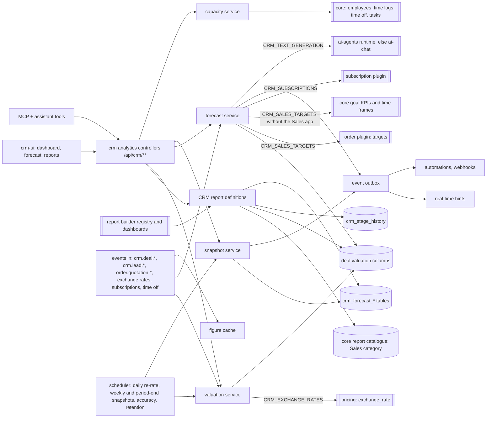

# Implementation Plan: CRM forecasting and analytics

> Translates an approved `spec.md` into architecture and tech choices. The plan owns
> implementation details; the spec owns behaviour.

**Feature ID**: `crm-forecasting-and-analytics`
**Spec**: `./spec.md`
**Tasks**: `./tasks.md`
**Status**: `Draft`
**Last updated**: 2026-11-23

---

## 1. Architecture Summary

Three sub-modules land in the `@gauzy/plugin-crm` package created by `crm-leads-and-deals`: `valuation/` (rates and
organization-currency amounts on deals), `forecast/` (categories, periods, roll-ups, submissions, overrides, snapshots,
movement, accuracy, recurring and capacity views) and `analytics/` (report definitions, cards, the CRM dashboard and its
read-only fallback). Report definitions are registered with the registry of `report-builder-and-dashboards` and listed
as rows of the core report catalogue (`report` in a "Sales" `report_category`, shown per organization through
`report_organization`), so the existing Reports page lists them beside every other report; while the builder is not
loaded the plugin's renderer shows the same definitions read-only through `/crm/analytics/reports/:key`. Dashboards are
the platform's dashboard records (`packages/core/src/lib/dashboard`), which the builder's dashboard engine manages.
Targets are the sales targets of `sales-order-management` when it is on, else core goal KPIs. Pages go into `crm-ui`;
CRM cards are also registered as widgets for the existing custom dashboards. Settings and permissions are contributions
of the `crm` plugin; snapshot runs use the core operation runtime.

## 2. Tech Choices

| Concern | Choice | Rationale |
| --- | --- | --- |
| Package | sub-modules of `packages/plugins/crm`; pages in `packages/plugins/crm-ui` | Principle I; one CRM plugin |
| Rates | port `CRM_EXCHANGE_RATES` bound to the pricing plugin's exchange-rate lookup (pair, date; inverse and cross handled in `valuation/rate-resolution.ts`) | one rate table; feeds from `general-ledger` |
| Money | core money kernel, `numeric(20,6)` amounts, `numeric(20,10)` rates | [platform architecture](../../architecture/business-suite.md) §6 |
| Reports | definitions registered with the report builder and listed as core `report` rows of the "Sales" category (`packages/core/src/lib/reports/`, page `apps/gauzy/src/app/pages/reports`), enabled per organization through `report_organization`; the same definitions rendered read-only by `/crm/analytics/reports/:key` when the builder is absent | spec FR-37, FR-38; one report catalogue |
| Targets | `CRM_SALES_TARGETS` bound to the targets of `sales-order-management` when on, else to `CrmGoalTargetsAdapter` over core goal KPIs (`goal_kpi` of type `Currency` for sales, owner = its lead employee; team and organization targets through goals owned by the team or organization with a KPI key result) and goal time frames (`goal_time_frame`) as periods | one target model; targets exist without the Sales app |
| Dashboards | core `dashboard` rows (`identifier` `crm`, `crm-team:<teamId>`, personal by `employeeId`) edited through the builder's dashboard engine; widget registry entries in `packages/ui-core/shared/src/lib/dashboard/widgets/crm/` | build on what exists |
| Figures | aggregate queries on indexed deal columns and `crm_stage_history`; per-organization cache keyed by definition and filters, invalidated by deal and lead events, 60 s maximum age | FR-46, FR-28, FR-34 |
| Snapshots | append-only tables for the frozen figures; each run is an operation of the core runtime (`packages/core/src/lib/operation/`, aggregate = organization and snapshot date, so one live run each), resumed after a stop and observable through `GET /api/operations/:id` | FR-20, FR-21; one runtime for long work |
| Settings | organization-scoped keys added to `crm.settings.ts` (`crm.analytics.reportingCurrency`, `snapshotWeekday`, `snapshotRetentionYears`, `committedThreshold`, `probableThreshold`, `rollupSource`, `defaultDeliveryTeamId`, `activeLeadMinInteractions`, `activeLeadMinAgeDays`) in the platform settings store | no settings table |
| Permissions | contributions in `crm.permissions.ts` with `defaultFor` (§9) | no seed migration |
| Periods | `accounting` fiscal periods through port `CRM_FISCAL_PERIODS` when bound; else organization `fiscalStartDate` | FR-14 |
| Jobs | `@ScheduledJob` + `@QueueWorker`; in-process timer under the advisory lock without a queue | task-automations pattern |
| AI | `CRM_TEXT_GENERATION` (bound in `crm-leads-and-deals` to the agent runtime of `ai-agents-and-assistants`, which records usage and applies budgets) for explanations; structured movement without a provider | FR-29, FR-49 |

## 3. Data Model

### Core columns (nullable or defaulted, declared on the core entities)

| Table | New columns | Indexes |
| --- | --- | --- |
| `deal` | `orgAmount` numeric(20,6); `orgCurrency` varchar(3); `rate`, `typedRate` numeric(20,10); `rateDate` date; `rateSource` varchar(8) (`DEAL`, `TABLE`, `INVERSE`, `CROSS`, `NONE`); `forecastCategory` varchar(12) (`POSSIBLE`, `PROBABLE`, `COMMITTED`, `EXCLUDED`, `CLOSED`); `forecastCategoryManual` bool default false; `deliveryTeamId` uuid; `expectedDeliveryStart` date | (`organizationId`,`outcome`,`expectedCloseDate`,`forecastCategory`), (`organizationId`,`rateSource`) where `rateSource = 'NONE'`, (`organizationId`,`deliveryTeamId`) |
| `pipeline_stage` | `forecastCategory` varchar(12) | — |

### Plugin tables

| Table | Columns (besides base) | Keys and indexes |
| --- | --- | --- |
| `crm_forecast_entry` | `kind` varchar(12) (`SUBMISSION`, `OVERRIDE`); `periodKey` varchar(16) (e.g. `2026-Q4`, `2026-11`); `periodStart`, `periodEnd` date; `scopeType` varchar(12) (`USER`, `TEAM`, `ORGANIZATION`); `scopeId` uuid; `committedAmount`, `probableAmount` numeric(20,6); `currency` varchar(3); `note` text; `byUserId` uuid; `enteredAt` timestamp | (`organizationId`,`periodKey`,`scopeType`,`scopeId`,`kind`,`enteredAt`) |
| `crm_forecast_snapshot` | `takenAt` timestamp; `snapshotDate` date; `kind` varchar(12) (`WEEKLY`, `PERIOD_END`, `MANUAL`); `status` varchar(12) (`RUNNING`, `COMPLETE`: whether its rows are complete; the run itself is the `operationId` operation); `operationId` uuid; `periodDefinition` varchar(64) (fiscal start and calendar source); `takenByUserId` uuid; `dealCount` int | unique (`organizationId`,`snapshotDate`,`kind`) where kind ≠ `MANUAL`; (`organizationId`,`takenAt`) |
| `crm_forecast_snapshot_deal` | `snapshotId` FK cascade; `dealId`, `ownerUserId`, `pipelineId`, `stageId`, `deliveryTeamId` uuid; `outcome` varchar(8); `category` varchar(12); `amount`, `orgAmount`, `recurringMonthly`, `oneTimeAmount` numeric(20,6); `currency` varchar(3); `rate` numeric(20,10); `probabilityPercent` numeric(5,2); `expectedCloseDate`, `closedAt` date; `periodKey` varchar(16); `serviceHours` numeric(12,2) | unique (`snapshotId`,`dealId`); (`organizationId`,`periodKey`,`snapshotId`) |
| `crm_forecast_snapshot_rollup` | `snapshotId` FK cascade; `periodKey`; `scopeType`, `scopeId`; `closedAmount`, `committedAmount`, `probableAmount`, `possibleAmount`, `weightedAmount`, `submittedCommitted`, `overrideCommitted`, `targetAmount`, `newRecurringMonthly`, `renewalsMonthly`, `atRiskMonthly` numeric(20,6); `demandHours`, `availableHours` numeric(12,2); `currency` | unique (`snapshotId`,`periodKey`,`scopeType`,`scopeId`) |
| `crm_forecast_accuracy` | `periodKey`; `scopeType`, `scopeId`; `snapshotId`; `basis` varchar(12) (`CALCULATED`, `SUBMITTED`, `OVERRIDE`); `forecastAmount`, `actualAmount` numeric(20,6); `errorPercent` numeric(9,4); `bias` varchar(8) (`OVER`, `UNDER`, `EXACT`) | unique (`periodKey`,`scopeType`,`scopeId`,`snapshotId`,`basis`) |

### Migrations

**Migration timestamps**: `packages/plugins/crm` `1791000051500` to `1791000051599`; `packages/core` `1791000051600` to `1791000051699`.

Three dialects, idempotent, registered for both ORMs:

- core `1791000051600-AddDealValuationAndForecastColumns` — the core columns above; backfill `orgAmount`, `rate`,
  `rateSource` for deals in the organization currency (rate 1, source `DEAL`); others are valued by the first daily run.
- plugin `1791000051520-CreateCrmForecastTables`; `1791000051540-SeedCrmReportCatalogue` — the "Sales" report category
  and one core `report` row per definition of spec §3.7 (global catalogue rows, idempotent on `slug`; organizations
  switch them on through `report_organization`). Settings and permissions are contributions, not rows.
- the shared catalogue feature filter is the core migration `1791000037900-AddReportCategoryFeatureKey` of
  `report-builder-and-dashboards` (its T51: nullable `featureKey` on `report_category` and on `report`, null for
  every existing row); the "Sales" category carries `FEATURE_CRM`. The report list and menu routes and a new organization's report switches leave out categories and
  rows whose feature is off for the caller's tenant, so a tenant with `FEATURE_CRM` off lists exactly today's
  reports (spec FR-38, AC-18).

### Contracts

`packages/contracts/src/lib/crm-analytics.model.ts` (valuation, rate source, pipeline summary query and result,
reporting currency), `crm-forecast.model.ts` (category, period, forecast view, entry, snapshot, movement buckets,
accuracy, recurring view, capacity view), `crm-dashboard.model.ts` (scopes, catalogue item kinds); additive fields on
`IDeal` and `IPipelineStage`.

## 4. API Surface

All routes: `TenantPermissionGuard`, `PermissionGuard`, `@FeatureFlag(FEATURE_CRM)`, Swagger, class-validator DTOs;
owner and team filters checked against the reader's rights server-side (FR-2).

| Method | Endpoint | Permission | Description | Status |
| --- | --- | --- | --- | --- |
| `GET` | `/crm/rates` | `VIEW_SALES_PIPELINES` | currencies of open deals with latest rate, date, source, deals without rate | New |
| `PUT` | `/crm/deals/:id/valuation` | `EDIT_SALES_PIPELINES` | typed rate on the deal (or clear it) | New |
| `PUT` | `/crm/deals/:id/forecast` | `EDIT_SALES_PIPELINES` | category, delivery team, expected delivery start | New |
| `GET` | `/crm/pipeline/summary?groupBy=&measures=&currencyMode=` | `CRM_REPORTS_VIEW` | counts, values, weighted, one-time and recurring | New |
| `GET` | `/crm/forecast?period=&scopeType=&scopeId=` | `CRM_FORECAST_VIEW` | roll-up tree with calculated, submitted, override, target, gap | New |
| `POST` | `/crm/forecast/submissions` | `CRM_FORECAST_SUBMIT` | own submission; `preview` | New |
| `POST` | `/crm/forecast/overrides` | `CRM_FORECAST_OVERRIDE` | team override with reason; `preview` | New |
| `GET` | `/crm/forecast/entries?period=&scopeType=&scopeId=` | `CRM_FORECAST_VIEW` | history of submissions and overrides | New |
| `GET`, `POST` | `/crm/forecast/snapshots` | `CRM_FORECAST_VIEW` / `CRM_FORECAST_OVERRIDE` | list; take one on request | New |
| `GET` | `/crm/forecast/movement?from=&to=&period=` | `CRM_FORECAST_VIEW` | movement buckets with deals | New |
| `GET` | `/crm/forecast/trend?period=` | `CRM_FORECAST_VIEW` | committed, probable, weighted per snapshot | New |
| `GET` | `/crm/forecast/accuracy?scopeType=&scopeId=&periods=` | `CRM_FORECAST_VIEW` | error and bias per snapshot and basis | New |
| `GET` | `/crm/forecast/recurring?period=` · `/crm/forecast/capacity?period=&teamId=` | `CRM_FORECAST_VIEW` | recurring and capacity views | New |
| `POST` | `/crm/forecast/explain` | `CRM_FORECAST_VIEW` | explanation of a movement; writes nothing | New |
| `GET` | `/crm/analytics/cards/:key` · `/crm/analytics/reports/:key` | `CRM_REPORTS_VIEW` | figures for one definition with filters (fallback viewer, phone cards); the catalogue itself is the existing `/report` routes filtered to the "Sales" category | New |
| `GET` | `/crm/analytics/drill/:key` | `CRM_REPORTS_VIEW` | saved-view filter for a figure segment | New |
| `POST` | `/crm/analytics/explain` | `CRM_REPORTS_VIEW` | how a figure is computed | New |
| `GET`, `PUT`, `POST` | `/crm/dashboards` · `/crm/dashboards/:id` · `/:id/copy` · `/:id/reset` | `CRM_REPORTS_VIEW` (own); `CRM_DASHBOARD_MANAGE` (team, organization) | resolved dashboards per user, team, organization | New |
| `GET`, `PUT` | `/crm/settings` (analytics keys of the settings store) | `CRM_SETTINGS_EDIT` | reporting currency, snapshot day, bands, roll-up source, retention, delivery team | Changed |

Rates themselves are entered through the existing `/exchange-rates` routes (`EXCHANGE_RATES_EDIT`). Errors:
`CRM_FILTER_OWNER_REFUSED`, `CRM_SNAPSHOT_IMMUTABLE`, `CRM_PERIOD_UNKNOWN`, `CRM_OVERRIDE_SCOPE_REFUSED`.

## 5. Events, Real-Time and Notifications

| Event (outbox, partition `CRM_FORECAST:<organizationId>`) | Emitted when | Consumers |
| --- | --- | --- |
| `crm.deal.revalued` | a deal's rate or organization amount changed | figure cache, real-time hint |
| `crm.forecast.submitted` · `overridden` | entry appended | real-time (forecast page), Inbox notice to the manager on submission, automations, webhooks |
| `crm.forecast.snapshot_taken` · `accuracy_computed` | job finished | automations, webhooks, Inbox digest to `CRM_FORECAST_OVERRIDE` holders |

Consumed: `crm.deal.*` and `crm.lead.*` (`crm-leads-and-deals`), `order.quotation.*` and order events (owner report),
exchange-rate changes (re-rate the affected pairs), subscription status changes, time-off approvals and task estimate
changes (capacity). Real-time: one debounced (2 s) organization hint `crm.analytics.changed` with the affected definition
keys; open dashboards, forecast pages and report viewers refetch those keys only.

## 6. UI Surface

- **`crm-ui`** routes: `/pages/crm/dashboard` (grid with add, remove, resize, reorder, reset; scope switch personal,
  team, organization; period presets, comparison, owner and team filters; table view per chart; drill-down to saved-view
  lists), `/pages/crm/forecast` (period picker, roll-up tree, category columns, target and gap, submit and override
  dialogs, entry history), `/pages/crm/forecast/{movement,accuracy,trend,recurring,capacity}`, `/pages/crm/rates`;
  Settings → CRM gains an Analytics tab. Deal page (`crm-leads-and-deals`) gains valuation, category and delivery team
  fields while `FEATURE_CRM` is on; with it off the existing pipeline and deal pages are unchanged.
- **Reports**: no CRM catalogue page. The CRM definitions appear on the existing Reports page
  (`apps/gauzy/src/app/pages/reports`) in the "Sales" category; opening one shows the builder, or the plugin's read-only
  viewer (`/pages/crm/reports/:key`) while the builder is absent; the CRM menu links to that category.
- `packages/ui-core/shared/src/lib/dashboard/widgets/crm/crm.widgets.ts`: CRM cards for the existing custom dashboards,
  each registered with `featureKey: FEATURE_CRM`, so the widget list is unchanged for tenants with the flag off.
- Charts use the chart components already used by the dashboard widgets; each chart has a table alternative and
  labelled series; i18n keys `CRM.ANALYTICS.*` in every locale.
- Phones: the dashboard of the installed web app keeps its last figures with the time they were computed for offline
  display.

## 7. MCP Tools, SDKs and Integrations

- `packages/mcp-server/src/lib/tools/crm-analytics.ts`: `get_pipeline_summary`, `get_forecast`, `submit_forecast`
  (preview), `override_forecast` (preview), `compare_forecast_snapshots`, `get_forecast_trend`, `get_forecast_accuracy`,
  `get_recurring_forecast`, `get_delivery_capacity`, `run_crm_report` (definition key and filters), `get_crm_dashboard`,
  `explain_forecast_change`, `explain_crm_figure`; registered with `AiChatToolRegistry` when `ai-chat` is loaded.
- Report definitions carry the builder's export formats and email schedules; OpenAPI regenerated, SDKs at release.

## 8. Background Jobs

| Trigger | When | What it does | Idempotency |
| --- | --- | --- | --- |
| `crm.revalue` (scheduler → queue `crm-analytics`) | daily 00:30 UTC; on exchange-rate change for the pair | re-rate open deals whose `rateDate` is before today or whose pair changed | conditional update on `rateDate` |
| `crm.forecast-snapshot` (core operation per organization and date) | weekly on `snapshotWeekday`; the day after each period end; on request | write snapshot deals and roll-ups in batches of 1,000 as operation steps | unique (`organizationId`,`snapshotDate`,`kind`), (`snapshotId`,`dealId`); the operation runtime resumes a stopped run; one live operation per aggregate |
| `crm.forecast-accuracy` | after the period-end snapshot | accuracy rows per scope, snapshot and basis | unique key of `crm_forecast_accuracy` |
| `crm.snapshot-retention` | monthly | delete snapshots older than the retention setting (system only) | conditional delete |
| `crm.analytics-cache` (outbox consumer) | deal, lead, quotation, rate events | invalidate cached figures, emit the debounced hint | per event delivery record |

The worker loads the schedules through `CrmSchedulePlugin`; the API consumes the queue. Without a queue root the API
runs them on the in-process timer under the advisory lock (PostgreSQL), `GET_LOCK` (MySQL) or the in-process guard.

## 9. Security & Permissions

- New keys contributed in `crm.permissions.ts` with `defaultFor`: `CRM_REPORTS_VIEW`, `CRM_FORECAST_VIEW`,
  `CRM_FORECAST_SUBMIT` (super admin, admin, manager, employee); `CRM_ANALYTICS_VIEW_ALL`, `CRM_FORECAST_OVERRIDE`,
  `CRM_DASHBOARD_MANAGE` (super admin, admin, manager); existing tenants get them from the permission reload. Existing
  `EXCHANGE_RATES_EDIT`, `VIEW_SALES_PIPELINES`, `EDIT_SALES_PIPELINES` and the goal permissions (targets in goal KPIs)
  are reused.
- Scope rule (FR-2): without `CRM_ANALYTICS_VIEW_ALL` a query is limited to `ownerUserId = caller` plus owners in the
  organization teams the caller manages (team manager role of the existing team membership); the filter is applied in
  the query builder, never on the client; drill-down re-reads each record under the caller's rights (FR-3).
- An override is refused for a team the caller does not manage, unless they hold `CRM_ANALYTICS_VIEW_ALL`.
- Snapshots carry owner ids and amounts only; exports and email schedules follow the builder's rules; explanations send
  only movement facts to the AI provider.

## 10. Observability

Activity log entries for submissions, overrides, typed rates and analytics settings. Metrics: snapshot duration and
size, re-rate count, deals without a rate, cache hit rate, figure latency per definition, accuracy computed. Errors to
the platform logger with organization, definition and snapshot ids.

## 11. Phased Rollout

1. **Phase 1 — Surface what exists** (needs `crm-leads-and-deals` phase 1): valuation and rates page, pipeline summary,
   definitions over existing deal data (deals per stage and owner, open deal summary, lost deals, list of leads), the default CRM
   dashboard read-only, CRM widgets for custom dashboards, read MCP tools.
2. **Phase 2 — Depth**: forecast categories, periods and roll-ups, targets and gap, the full catalogue of §3.7 (stage reach
   from history, time to close, won and lost deals, sources, owners, first response and engagement reports), dashboard
   editing, period filters, drill-down, reporting currency.
3. **Phase 3 — Advanced capabilities**: submissions and overrides, snapshots, movement, trend, accuracy, recurring forecast,
   delivery capacity, team and organization dashboards, live figures, explanations.
4. **Phase 4 — General availability**: the feature is off by default; after the trial period it may be switched on by default for new tenants only; existing tenants keep their setting until an administrator changes it.

## 12. Constitution Reconciliation

- I Plugin-first: sub-modules of the `crm` plugin; core gets nullable columns on `deal`, `pipeline_stage` and
  `report_category` (`featureKey`) and catalogue rows in `report`; targets, dashboards, settings, permissions and runs use the platform's own stores.
- II Tenant/organization scoping: every table on the tenant-organization base; queries tenant-aware and owner-scoped.
- III Both ORMs, additive migrations: MultiORM entities, three dialects, forward-only.
- IV Default-off flag; nothing removed: `FEATURE_CRM` off; existing dashboards, widgets, reports and saved reports kept.
- V Contracts and API first: contracts first; every figure reachable by REST and MCP; reports as definitions.
- VI Permissions, privacy, security: six new keys as contributions; server-side owner scope; immutable snapshots.
- VII Real-time through the event bus: outbox events and one debounced organization hint on the platform channel.
- VIII i18n and accessibility: table view per chart, locale number and date formats, keys in every locale.
- IX Tests: unit specs per calculation (rates, categories, roll-up, movement, accuracy, capacity), e2e per route, demo
  data figures.
- X Behaviour-first spec: the spec names no table or class.
- XI Documentation describes our platform only.

## 13. Risks & Mitigations

| Risk | Likelihood | Impact | Mitigation |
| --- | --- | --- | --- |
| Report builder lands after this feature | High | Medium | read-only viewer and cards served by the plugin from the same definitions |
| Snapshot volume grows | Medium | Medium | compact rows, retention setting, batch writes, index by period |
| Missing rates distort totals | Medium | Medium | out of totals and listed, never 1:1; daily check report |
| Live aggregates slow at large tenants | Medium | Medium | indexes on deal columns, figure cache with event invalidation, 60 s maximum age |
| A person in two teams counts twice in team figures | Medium | Low | documented default (§8 of the spec); organization total deduplicated |
| Capacity figures misread as a plan | Low | Low | shown as an indication with its formula; no booking is made |

## 14. References

- Spec: `./spec.md` · Tasks: `./tasks.md`
- Code: `packages/plugins/pricing/src/lib/exchange-rate/exchange-rate.entity.ts`, `packages/core/src/lib/dashboard/`,
  `packages/core/src/lib/reports/` (`report.seed.ts`, `report-organization.entity.ts`), `packages/core/src/lib/saved-report/`,
  `packages/core/src/lib/goal-kpi/`, `packages/core/src/lib/goal-time-frame/`, `packages/core/src/lib/operation/`,
  `packages/ui-core/shared/src/lib/dashboard/widgets/accounting/accounting.widgets.ts` (widget registry idiom),
  `packages/core/src/lib/time-tracking/time-log/`, `packages/core/src/lib/time-off-request/`,
  `packages/plugins/subscription/src/lib/subscription/subscription.entity.ts`,
  `packages/contracts/src/lib/organization.model.ts` (`fiscalStartDate`, formats)
- Specs: `../crm-leads-and-deals/plan.md`, `../sales-order-management/plan.md` (targets),
  `../general-ledger/spec.md` (rate feeds), `report-builder-and-dashboards`
