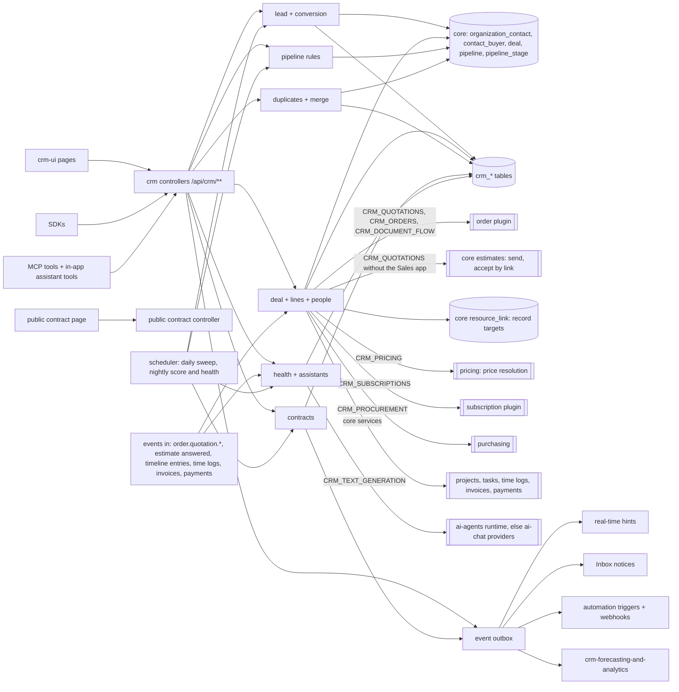

# Implementation Plan: CRM leads and deals

> Translates an approved `spec.md` into architecture and tech choices. The plan owns
> implementation details; the spec owns behaviour.

**Feature ID**: `crm-leads-and-deals`
**Spec**: `./spec.md`
**Tasks**: `./tasks.md`
**Status**: `Draft`
**Last updated**: 2026-11-23

---

## 1. Architecture Summary

A new plugin `@gauzy/plugin-crm` (`packages/plugins/crm`) owns the CRM behaviour and its own tables; the records stay the
core ones. Leads, people and organisations are `organization_contact` rows (`contactType`, `partyKind`), memberships are
`contact_buyer` rows, deals are `deal` rows, lead and deal pipelines are `pipeline` / `pipeline_stage` rows: the core
entities gain nullable columns (declared on the core entity classes, added by a core migration) and nothing parallel is
created. The plugin is always loaded (as the commerce plugins are) and every CRM route carries
`@FeatureFlag(FEATURE_CRM)`. Other plugins are reached through ports bound in `apps/api/src/plugin-composition.ts`. A new
Angular plugin `@gauzy/plugin-crm-ui` (`packages/plugins/crm-ui`) gives the pages; the signature page lives in
`public-layout-ui`.

Nothing the contact row already holds is stored twice: first and last names stay on the 1:1 `contact` row (which gains
the middle name and salutation), the description is the existing `notes`, the lead source is the existing
`acquiredChannel`, marketing consent is `acceptsMarketing` (cached flag of the consent records of
`email-and-communications`), and the primary email and phone stay `primaryEmail` / `primaryPhone`. A deal's links to the
documents and records made from it are record links: rows of the core `resource_link` table with a record target,
specified by `record-views-and-search` and shared by every feature that links two records. Quotations from a deal are the Sales app's quotations where
`sales-order-management` is on and the core estimates with their accept-by-link page otherwise. With `FEATURE_CRM` on,
the CRM pages sit beside the existing contact and deal-board pages; those redirect to the CRM pages only where the
organization turns `crm.openCrmPages` on (off by default, §6). Settings and permissions are plugin
contributions; scoring conditions are core `rule` rows.

## 2. Tech Choices

| Concern | Choice | Rationale |
| --- | --- | --- |
| Package | new `packages/plugins/crm` (sub-folders `lead/`, `conversion/`, `party/`, `deal/`, `pipeline-rules/`, `duplicate/`, `merge/`, `health/`, `contract/`, `settings/`, `assist/`, `schedule/`, `database/`) | Principle I; the forecasting feature adds `forecast/` and `analytics/` to the same plugin |
| Records | core entities extended with nullable columns; core migration in `packages/core/src/lib/database/migrations/` | hard rule: no parallel model; the contact entity's own rule (columns, not a 1:1 table) |
| UI | new `packages/plugins/crm-ui` (Angular, registered with `@gauzy/plugin-ui`); public page in `public-layout-ui` | Principle I |
| Lists | record types registered with `registerRecordTypes()` (core registry from `custom-fields-and-forms`); lists are saved-view lists of `record-views-and-search` | one list engine |
| Persistence | MultiORM entities + MikroORM repositories, migration helpers copied from the task-automations plugin | Principle III |
| Money | core money kernel: `numeric(20,6)` text decimals with a currency column | [platform architecture](../../architecture/business-suite.md) §6 |
| Numbering | core `SequenceService` keys `crm.lead`, `crm.deal`; contracts as document type `crm_contract` of `business-documents` when `FEATURE_BUSINESS_DOCUMENTS` is on, else `SequenceService` key `crm.contract` | depends on `business-document-engine` |
| Events | `EventOutboxService.append` + `EventConsumerRegistry`; triggers declared with `registerAutomationTriggers` | Principle VII |
| Jobs | `@ScheduledJob` + `@QueueWorker` (`@gauzy/scheduler`); in-process timer under an advisory lock without a queue | task-automations pattern |
| Concurrency | `If-Match` carries the row's `updatedAt`; conversion and merge take a per-record lock (PostgreSQL advisory, MySQL `GET_LOCK`, in-process on SQLite) | single winner |
| Flags | `FEATURE_CRM` (contributed by `crm.features.ts`, default off) on every CRM controller; `FEATURE_PIPELINE` on the CRM pipeline controller and `FEATURE_PIPELINE_DEAL` on the CRM deal controller; the existing `PipelineController` and `DealController` stay ungated as today | wire declared codes without narrowing an existing route |
| Settings | organization-scoped `PluginSettingContribution`s in `crm.settings.ts` (JSON values as `json`), resolved by the platform settings store (`tenant_setting` through `PluginSettingRegistry`, as `search.settings.ts` does); no settings table | one settings store |
| Permissions | `crm.permissions.ts` contributions with `defaultFor`, unioned at boot by `PluginPermissionRegistry` (the `purchasing.permissions.ts` idiom); no seed migration | existing tenants get missing rows from the permission reload |
| Record links | core `resource_link` (`packages/core/src/lib/resource-link/`, polymorphic `entity` + `entityId`) with the record target columns of §3: a deal's estimates, quotations, invoices, proposals, orders, projects, tasks, subscriptions, contracts and requests for quotation are its link rows | one link store for every feature that links records |
| Quotations | `CRM_QUOTATIONS` bound to the quotation service of `sales-order-management` when that plugin is on, else to `CrmEstimateQuotationAdapter` over core estimates (`invoice` with `isEstimate`, lines as `invoice_item`, sending through `estimate-email`, answer once by link through `public-share/invoice/`, PDF through the invoice generator); deal lines are copied one way into the quotation or estimate | no third quotation; the accept-by-link flow already exists |
| Line totals | the order plugin's totals module (`packages/plugins/order/src/lib/order-totals/`) computes net, one-time and recurring totals of deal lines | one line calculator |
| Scoring conditions | core `rule` rows with owner type `RuleOwnerType.CRM_SCORE` (scope `CUSTOMER`, context mapping of the lead's fields contributed by the plugin), evaluated by the core rule evaluator; patterns checked by `rule.pattern-safety.ts` | no condition column on a plugin table |
| Bulk work | bulk conversion runs through the core bulk executor (`packages/core/src/lib/api/bulk-executor.service.ts`) as an async operation (`api/async-operation.ts`: `202` with the operation handle, per-lead results in the operation result) | one runtime for long and bulk work |
| Signatures | each signature is an append-only `terms_acceptance` evidence row (`TermsAcceptanceService.record`: document `crm_contract:<id>`, version = contract version, SHA-256 of the exact terms, locale, hashed address, user agent, method) | one evidence store with its tamper check |
| Contract print | contract terms templates are `accounting_template` rows of type `contract` (Handlebars + MJML, edited on the existing accounting templates page) until `print-and-pdf-designer` takes print templates over | existing template store |
| Legacy pages | `featureCrmRedirectGuard` beside `apps/gauzy/src/app/pages/feature-documents-redirect.guard.ts` (same shape: flag or the organization setting `crm.openCrmPages` off activates the old page, both on return a `UrlTree`) | one page per concept by the organization's choice; nothing deleted |
| AI | port `CRM_TEXT_GENERATION` bound to the agent runtime of `ai-agents-and-assistants` (`AGENT_RUNTIME.complete`, purposes `crm.*`), which records usage and applies budgets; without that plugin, an adapter over `AiChatService` of `ai-chat`; unbound means rule-only answers | works without a provider (FR-77); no AI usage store here |

## 3. Data Model

All new tables extend `TenantOrganizationBaseEntity`. JSON is `text` on every dialect. References into another plugin's
tables carry no foreign key; the plugin that owns a target adds the constraint.

### Core columns (all nullable or defaulted; declared on the core entity classes)

| Table | New columns | Indexes |
| --- | --- | --- |
| `organization_contact` | `ownerUserId`, `leadStageId`, `qualifiedByUserId`, `convertedByUserId`, `convertedDealId`, `territoryId`, `campaignId` uuid; `jobTitle`, `companyName` varchar(255); `leadScore` int; `leadTemperature` varchar(8); `qualification` varchar(16); `qualifiedAt`, `convertedAt` timestamp; `employeeBand` varchar(16); `annualRevenue` numeric(20,6); `annualRevenueCurrency` varchar(3); `socialLinks` text; `languageCode` varchar(10); `intake` text (intake references and the attribution parameters as received: source, medium, content, keyword, referrer, landing page); `reference` varchar(64); `phoneKey` varchar(32), `websiteDomain` varchar(255), `nameKey` varchar(255) (kept by `OrganizationContactSubscriber` as `emailKey` is); existing `notes` widened to `text` where it is shorter | (`organizationId`,`contactType`,`leadStageId`), (`organizationId`,`ownerUserId`), (`organizationId`,`convertedAt`), (`organizationId`,`acquiredChannel`), (`organizationId`,`campaignId`), (`tenantId`,`phoneKey`), (`tenantId`,`websiteDomain`), (`organizationId`,`nameKey`); unique (`organizationId`,`reference`) where not null |
| `contact` | `middleName` varchar(100); `salutationId` uuid (beside the existing `firstName`, `lastName`) | — |
| `deal` | `ownerUserId`, `dealTypeId`, `sourceId`, `campaignId`, `territoryId`, `sourceLeadId`, `pipelineId`, `lostAtStageId`, `wonQuotationId` (the accepted quotation or estimate) uuid; `amount` numeric(20,6); `currency` varchar(3); `probabilityPercent` numeric(5,2); `probabilitySetInStageId` uuid; `expectedCloseDate`, `nextStepDueAt` date; `closedAt`, `stageEnteredAt`, `lastActivityAt` timestamp; `outcome` varchar(8) default `OPEN`; `amountFromLines` bool null; `nextStep` varchar(255); `description`, `lostNote` text; `reference` varchar(64); `externalId` varchar(255) | (`organizationId`,`pipelineId`,`outcome`,`stageId`), (`organizationId`,`ownerUserId`,`outcome`), (`organizationId`,`expectedCloseDate`), (`organizationId`,`campaignId`), (`clientId`); unique (`organizationId`,`reference`), (`organizationId`,`externalId`) where not null |
| `resource_link` (record links of `record-views-and-search`, used here) | `targetEntity` varchar(50) (a `BaseEntityEnum` value or a registered record type key), `targetEntityId` uuid, `role` varchar(32), `linkedBy` varchar(16) (`PERSON`, `SYSTEM`, `MATCH`, `INTAKE`); `url` becomes nullable (a row has a URL or a record target) | unique (`entity`,`entityId`,`targetEntity`,`targetEntityId`) where `targetEntityId` is not null; (`tenantId`,`targetEntity`,`targetEntityId`) |
| `pipeline` | `kind` varchar(8) default `DEAL` (`DEAL`, `LEAD`); `isDefault` bool default false | (`organizationId`,`kind`,`isDefault`) |
| `pipeline_stage` | `kind` varchar(8) default `OPEN` (`OPEN`, `ON_HOLD`, `WON`, `LOST`); `color` varchar(16); `probability` numeric(5,2); `staleAfterDays` int; `requiredFields` text | — |
| `contact_buyer` | `jobTitle`, `department` varchar(255); `reportsToBuyerId` uuid (self, set null); `isPrimary` bool default false; `endedAt` timestamp; `ContactBuyerRole` gains `CONTACT` (no buying authority) | (`companyCustomerId`,`isPrimary`) |

`deal.clientId` keeps its column and foreign key; the one-to-one relation becomes many-to-one and the unique key
`REL_1ae3abc0ae1dcf6c13f49b62b5` is replaced by a plain index (the only non-additive step: a constraint is relaxed, no
data changes; on SQLite the table is rebuilt with its rows). `IDeal` keeps its shape. `BaseEntityEnum` gains `Deal` and
`CrmContract` (comments, favourites, activity log) with comment access policies beside
`organization-contact-comment-access.policy.ts`.

**Existing columns the CRM writes instead of adding its own.** A lead's and person's first and last name are
`contact.firstName` / `lastName`; the description of a lead, person or organisation is `organization_contact.notes`
(timeline notes are comments, `crm-engagement`); the lead source is `acquiredChannel`, which holds the `code` of a
`LEAD_SOURCE` list item when chosen in a CRM form, and any text written through the existing contact routes and forms,
which keep accepting free text (shown as it is); the first-touch campaign is `campaignId`, a reference
to the organization's one campaign record (the promotion plugin's `campaign` row that `marketing-campaigns` extends;
never free text), and the rest of the campaign attribution stays in the
`intake` snapshot and in the touches of `marketing-campaigns`, the one attribution writer; marketing consent is
`acceptsMarketing`, and "do not contact" is a withdrawal of every channel and purpose in the consent records of
`email-and-communications` (which also clears `acceptsMarketing`), read through port `CRM_CONSENT`; the primary email
and phone are `primaryEmail` / `primaryPhone` (with `emailKey` and `phoneKey` for matching); an archived contact is
`status = ARCHIVED`. A person's job title lives on their live membership (`contact_buyer.jobTitle`);
`organization_contact.jobTitle` and `companyName` hold only what a lead or a person without an organisation typed, and
conversion moves them to the membership and the organisation and clears them.

**Record links.** `resource_link` rows with a record target carry every link between two records: here a deal
(`entity = Deal`) to its estimates and invoices (`Invoice`), proposals (`Proposal`), quotations, orders, projects,
tasks, subscriptions, contracts and requests for quotation, with `role` `CREATED_FROM_DEAL` or `RELATED`; the same rows
serve `crm-engagement` (tasks on CRM records), `telephony` (calls on records) and the helpdesk, and they are the record
links that `record-views-and-search` and the related-records panel of `custom-fields-and-forms` list. The existing URL
links keep their shape (`url` set, no target).

### Plugin tables (`packages/plugins/crm`)

| Table | Columns (besides base) | Keys and indexes |
| --- | --- | --- |
| `crm_list_item` | `list` varchar(24) (`LEAD_SOURCE`, `DEAL_TYPE`, `LOST_REASON`, `CHOSEN_ALTERNATIVE`, `SALUTATION`, `DEAL_ROLE`); `name` varchar(120); `code` varchar(64) (the value `acquiredChannel` holds for a lead source); `description` text; `color` varchar(16); `position` int; `appliesTo` varchar(8) (`LEAD`, `DEAL`, `BOTH`); `requiresNote`, `isSystem` bool | unique (`organizationId`,`list`,`name`) and (`organizationId`,`list`,`code`) where not deleted |
| `crm_stage_history` | `recordType` varchar(8) (`LEAD`, `DEAL`); `recordId`, `pipelineId`, `fromStageId`, `toStageId`, `actorUserId` uuid; `enteredAt`, `leftAt` timestamp; `durationSeconds` int; `actorType` varchar(12) (`USER`, `AUTOMATION`, `AGENT`, `SYSTEM`); `reason` varchar(64) | (`organizationId`,`recordType`,`recordId`,`enteredAt`), (`organizationId`,`toStageId`,`enteredAt`) |
| `crm_contact_channel` | the additional channels only, beside the primary email and phone that stay in `organization_contact.primaryEmail` / `primaryPhone`: `contactId` FK `organization_contact` cascade; `kind` varchar(12) (`EMAIL`, `PHONE`, `MOBILE`, `HANDLE`); `label` varchar(32); `value`, `valueKey` varchar(320). Making one primary swaps it with the contact's column in the same transaction; a contact has as many rows as it has extra channels (none for most). Needed because the contact row holds one email and one phone, and people carry several labelled ones and messaging handles (FR-41) | unique (`contactId`,`kind`,`valueKey`); (`tenantId`,`kind`,`valueKey`) |
| `crm_line` | `ownerType` varchar(8) (`LEAD`, `DEAL`); `ownerId`, `productId`, `productVariantId`, `unitId` uuid; `position` int; `description` varchar(500); `quantity`, `unitPrice`, `netAmount` numeric(20,6); `discountPercent` numeric(7,4); `currency` varchar(3); `recurrence` varchar(12) (`NONE`, `MONTHLY`, `QUARTERLY`, `YEARLY`); `recurrenceCount` int; `isService` bool; `hours` numeric(12,2). Interest lines before a document exists; copied one way into quotation lines or estimate lines (`invoice_item`) when a quotation or estimate is made; totals by the order totals module | (`ownerType`,`ownerId`,`position`) |
| `crm_deal_contact` | `dealId` FK `deal` cascade; `contactId` FK `organization_contact` cascade; `roleItemId` uuid; `isPrimary` bool | unique (`dealId`,`contactId`); one primary per deal (partial unique; generated key column on MySQL) |
| `crm_deal_outcome_item` | `dealId` FK cascade; `kind` varchar(24) (`REASON`, `CHOSEN_ALTERNATIVE`); `itemId` | unique (`dealId`,`kind`,`itemId`) |
| `crm_record_state` | `recordType`, `recordId`; `staleSince`, `staleNotifiedAt`, `computedAt` timestamp; `healthState` varchar(8); `healthScore` int; `healthSignals`, `healthSummary`, `scoreBreakdown` text | unique (`recordType`,`recordId`); (`organizationId`,`healthState`) |
| `crm_score_rule` | `name` varchar(120); `points` int; `position` int; its conditions are core `rule` rows (`ownerType = CRM_SCORE`, `ownerId` = this row), deleted with it in one transaction | (`organizationId`,`position`) |
| `crm_duplicate_dismissal` | `firstId`, `secondId` uuid (ordered pair) | unique (`organizationId`,`firstId`,`secondId`) |
| `crm_merge` | `kind` varchar(16); `survivorId`; `mergedIds`, `fieldChoices`, `moved` text (every rewritten table, row, column and old value); `expiresAt`, `undoneAt` timestamp; `undoneByUserId` | (`organizationId`,`survivorId`) |
| `crm_contract` | `number` varchar(64); `title` varchar(255); `partyType` varchar(12) (`CONTACT`, `VENDOR`, `EMPLOYEE`); `partyId`, `ownerUserId`, `dealId`, `templateId`, `sourceId`, `previousContractId` uuid; `sourceType` varchar(24); `chainKind` varchar(12) (`AMENDMENT`, `RENEWAL`); `startDate`, `endDate` date; `terms` text (sanitised); `value` numeric(20,6); `currency` varchar(3); `status` varchar(20); `fulfilment` varchar(16); `autoRenew` bool; `renewalTermMonths`, `noticeDays` int; `sentAt`, `signedAt`, `activatedAt`, `terminatedAt`, `cancelledAt`, `supersededAt`, `renewalRemindedAt` timestamp; `terminationReason` text; `version` int (`@VersionedColumn`) | unique (`organizationId`,`number`); (`organizationId`,`status`,`endDate`), (`partyType`,`partyId`), (`dealId`); unique (`previousContractId`,`chainKind`) where not null |
| `crm_contract_signer` | the invitation and its token only: `contractId` FK cascade; `role` varchar(12) (`PARTY`, `ORGANIZATION`); `name`, `email` varchar(255); `userId`, `signatureAssetId`, `scanAssetId` uuid; `tokenHash` varchar(128); `tokenExpiresAt` timestamp; `acceptanceId` varchar(128) (the `terms_acceptance` evidence row that holds signing time, hashed address, client, method and the SHA-256 of the signed terms) | unique `tokenHash` |
| `crm_contract_requirement` | `contractId` FK cascade; `position` int; `title` varchar(255); `dueDate` date; `responsibleUserId`, `doneByUserId` uuid; `note` text; `doneAt` timestamp | (`contractId`,`position`), (`organizationId`,`dueDate`) |
| `crm_contract_template` | `accountingTemplateId` uuid (the `accounting_template` row of type `contract` holding name and terms); `requirements` text | unique (`organizationId`,`accountingTemplateId`) |

### Migrations

**Migration timestamps**: `packages/core` `1791000051100` to `1791000051199`; `packages/plugins/crm` `1791000051200` to `1791000051299`.

Each has PostgreSQL, MySQL and SQLite branches, is idempotent
(`hasColumn` / `hasTable` guards), has a `down` that reverses its own statements, and is registered for both ORMs:

- core `1791000051100-AddCrmColumnsToContactsAndDeals` — the core columns and indexes above on `organization_contact`,
  `contact`, `deal`, `pipeline`, `pipeline_stage` and `contact_buyer` (each guarded by `hasColumn`); the record target of
  `resource_link` is the core migration `1791000036310-AddResourceLinkRecordTarget` of `record-views-and-search`
  (its T52);
  `ContactBuyerRole` widened; `notes` widened to `text` where it is shorter.
- core `1791000051110-AllowSeveralDealsPerContact` — replaces the unique key on `deal.clientId` with an index; backfills
  `deal.pipelineId` from the stage, `deal.outcome = 'OPEN'`, `probabilityPercent = probability × 20`.
- plugin `1791000051200-CreateCrmTables`, `1791000051210-CreateCrmContractTables`. Permissions and settings are
  contributions (§2), not rows. Lists and default pipelines are seeded per organization by
  `CrmBootstrapService.ensureSeeded` (idempotent on the unique keys), called by the first CRM request of an organization,
  the organization-created handler and the daily sweep; no migration writes per-organization data.

### Contracts

`packages/contracts/src/lib/`: `crm-lead.model.ts` (lead fields, qualification, temperature, progress, conversion input
and result, re-conversion policy), `crm-party.model.ts` (organisation, person, channel, membership, relationship map),
`crm-deal.model.ts` (deal extension, outcome, line, deal person, deal link, hand-off input and preview, delivery panel),
`crm-pipeline.model.ts` (pipeline kind, stage kind, stage rules, stage history), `crm-duplicate.model.ts`,
`crm-contract.model.ts`, `crm-settings.model.ts` (typed setting keys), `crm-assist.model.ts`; additive optional fields on
`IOrganizationContact`, `IContact`, `IDeal`, `IPipeline`, `IPipelineStage`, `IContactBuyer`, `IResourceLink`;
`ContactBuyerRole.CONTACT`; `RuleOwnerType.CRM_SCORE`.

## 4. API Surface

All new routes: `TenantPermissionGuard`, `PermissionGuard`, `@FeatureFlag(FEATURE_CRM)`, Swagger, class-validator DTOs,
cursor pagination on lists, `Idempotency-Key` on creating and converting routes, `If-Match` on writes.

| Method | Endpoint | Permission | Description | Status |
| --- | --- | --- | --- | --- |
| `*` | `/pipelines/**`, `/deals/**` | existing | contracts and gating unchanged (the flags gate the CRM routes) | Unchanged |
| `PUT` | `/pipelines/:id` | existing | with `FEATURE_CRM` on: removed stages need `targetStageId` per stage | Changed |
| `GET`, `POST` | `/crm/leads` | `ORG_CONTACT_VIEW` / `ORG_CONTACT_ADD` | list, create (duplicate check on create) | New |
| `GET`, `PUT` | `/crm/leads/:id`, `PUT /crm/leads/:id/stage` | `ORG_CONTACT_VIEW` / `ORG_CONTACT_EDIT` | read, edit, move (required fields) | New |
| `POST` | `/crm/leads/:id/convert` · `/crm/leads/convert` (bulk) · `/crm/leads/:id/to-customer` | `CRM_LEADS_CONVERT` | conversion; `preview`; bulk returns per-lead results | New |
| `GET` | `/crm/leads/:id/score` | `ORG_CONTACT_VIEW` | score with breakdown | New |
| `GET`, `POST`, `PUT` | `/crm/organisations[/:id]`, `/crm/people[/:id]`, `PUT /crm/people/:id/channels` | `ORG_CONTACT_*` | organisations and people | New |
| `POST`, `PUT`, `DELETE` | `/crm/memberships[/:id]` | `ORG_CONTACT_EDIT` | add, change, end | New |
| `GET` | `/crm/organisations/:id/relationship-map` · `/crm/contacts/:id/related` | `ORG_CONTACT_VIEW` | map; related records with counts | New |
| `DELETE` | `/crm/contacts/:id?mode=unlink\|trash` | `ORG_CONTACT_DELETE` | CRM delete (FR-46) | New |
| `POST` | `/crm/duplicates/check` · `/crm/duplicates/dismiss` | `ORG_CONTACT_VIEW` / `ORG_CONTACT_EDIT` | candidates with reasons | New |
| `POST`, `GET` | `/crm/merges` (`preview`) · `/crm/merges/:id` · `/crm/merges/:id/undo` | `CRM_CONTACTS_MERGE` | merge and undo | New |
| `GET`, `POST` | `/crm/deals` · `/crm/deals/mine` · `/crm/deals/search` · `/crm/deals/statistics` | `VIEW_SALES_PIPELINES` / `EDIT_SALES_PIPELINES` | lists, search, counts and values by stage and outcome | New |
| `GET`, `PUT` | `/crm/deals/:id`, `PUT /crm/deals/:id/stage` · `/lines` · `/people` · `/pipeline` | `VIEW_SALES_PIPELINES` / `EDIT_SALES_PIPELINES` | read, edit, move, lines, people | New |
| `POST` | `/crm/deals/:id/win` · `/lose` | `EDIT_SALES_PIPELINES` | outcomes; `preview` | New |
| `POST` | `/crm/deals/:id/reopen` | `CRM_DEALS_REOPEN` | reopen | New |
| `GET`, `POST` | `/crm/deals/:id/quotations` | `VIEW_SALES_PIPELINES` / + `SALES_QUOTATIONS_EDIT` (Sales app) or `ESTIMATES_EDIT` (estimates) | list, create through `CRM_QUOTATIONS`: a Sales quotation, else a core estimate | New |
| `POST` | `/crm/deals/:id/requests-for-quotation` · `/crm/deals/:id/hand-off` | `EDIT_SALES_PIPELINES` + target grant | supplier quotes; project, order, subscription, contract; `preview` | New |
| `GET` | `/crm/deals/:id/delivery` · `/history` · `/health` | `VIEW_SALES_PIPELINES` | live panel, stage history, health | New |
| `POST` | `/crm/deals/:id/next-actions` | `VIEW_SALES_PIPELINES` | proposals; writes nothing | New |
| `POST`, `PUT`, `DELETE` | `/crm/pipelines` · `/crm/pipelines/:id/stages[/:stageId]` | `EDIT_SALES_PIPELINES` | kind, default, stage rules; removal needs a target | New |
| `GET`, `POST`, `PUT` | `/crm/lists/:list[/:id]` · `/crm/score-rules[/:id]` · `/crm/settings` | `CRM_SETTINGS_EDIT` (reads: any CRM view key) | lists, rules (conditions written as `rule` rows), settings (read and written through the settings store) | New |
| `GET` | `/crm/contacts/statistics`; `POST`, `PUT`, `DELETE` `/crm/contacts/bulk` | `ORG_CONTACT_VIEW` / `ORG_CONTACT_*` | for the existing MCP tools; per-row results | New |
| `GET`, `POST`, `PUT` | `/crm/contracts[/:id]` · `/crm/contract-templates[/:id]` | `CRM_CONTRACTS_VIEW` / `CRM_CONTRACTS_EDIT` | contracts, templates (terms saved as the `accounting_template` row of type `contract`) | New |
| `POST` | `/crm/contracts/:id/send` · `/amend` · `/terminate` · `/cancel` · `/requirements/:reqId` | `CRM_CONTRACTS_EDIT` | lifecycle; `send` takes `preview` | New |
| `POST` | `/crm/contracts/:id/countersign` · `/paper-signature` | `CRM_CONTRACTS_SIGN` | organization signature | New |
| `GET`, `POST` | `/public/contracts/:token` · `/sign` · `/pdf` | public, token | signer page, a built-in transactional page like the public estimate answer (same layout and throttling as `public-share/invoice/public-invoice.controller.ts`) | New |
| `POST` | `/crm/assist/follow-up` · `/conversation-update` · `/meeting-brief` | `VIEW_SALES_PIPELINES` (update: `EDIT_SALES_PIPELINES`) | assistants; `preview` | New |

Errors use coded messages (`CRM_STAGE_REQUIRED_FIELDS`, `CRM_STAGE_HAS_RECORDS`, `CRM_LEAD_LOST`, `CRM_LEAD_CONVERTED`,
`CRM_DUPLICATE_REFUSED`, `CRM_MERGE_UNDO_PARTIAL`, `CRM_DEAL_QUOTATION_OPEN`, `CRM_CURRENCY_NOT_ALLOWED`,
`CRM_MEMBERSHIP_EXISTS`, `CRM_CONTRACT_SIGNED`). GraphQL: read fields for the new columns on the existing contact, deal
and pipeline types, plus `crmLeads`, `crmDeal`, `crmContracts` queries in the plugin's schema extension.

**Consumer tokens answered** (bound in `apps/api/src/plugin-composition.ts` to the lead intake, duplicate check and text generation adapters; each consumer plan states the shape it calls and its fallback): `LEAD_CAPTURE_CRM`, `LEAD_CAPTURE_TEXT_GENERATION`, `MARKETING_CRM`, `PORTAL_DUPLICATE_CHECK`.

## 5. Events, Real-Time and Notifications

| Event (outbox, partition `CRM:<recordId>`) | Emitted when | Consumers |
| --- | --- | --- |
| `crm.lead.created` · `updated` · `stage_changed` · `scored` · `stale` | lead changes | real-time hint, automations, webhooks, forecasting facts |
| `crm.lead.converted` | conversion | automations, webhooks, real-time, lead-capture follow-ups |
| `crm.deal.created` · `updated` · `stage_changed` · `won` · `lost` · `reopened` · `stale` · `health_changed` | deal changes | real-time, Inbox (stale, health poor to owner), automations, webhooks, `crm-forecasting-and-analytics` |
| `crm.contact.merged` · `merge_undone`; `crm.membership.changed` | merges, memberships | real-time, search reindex, automations |
| `crm.contract.sent` · `signed` · `activated` · `expiring` · `expired` · `renewed` · `amended` · `terminated` | contract lifecycle | Inbox (signed, expiring, renewal reminder), automations, webhooks, document engine |

Consumed: `order.quotation.sent|viewed|accepted|declined|lost|expired` and, for estimates, the core
`EstimateAnsweredEvent` (`packages/core/src/lib/invoice/estimate-answer/estimate-answered.event.ts`) with estimate sent
and viewed status changes (deal follows its quotations or estimates, FR-65, lead progress FR-17), the record timeline's
entry-added event (`lastActivityAt`), invoice, payment, time-log and task events
of linked records (real-time hint to the open deal page; the delivery panel reads on demand). Triggers declared with
`registerAutomationTriggers`; templates for the stage rules (FR-74) with the automation templates registry. Emails:
`crm-contract-signature-request`, `crm-contract-signed` (email templates system).

## 6. UI Surface

- **`packages/plugins/crm-ui`** (routes under `/pages/crm`): `leads` (saved-view list and board by stage, lead page with
  score breakdown, conversion dialog with duplicates and required fields, bulk convert), `deals` (board, list, calendar by
  expected close; deal page tabs: overview, lines, people, quotations, delivery, history, health), `organisations` (list;
  page with members, relationship map, deals, documents), `people`, `contracts` (list, editor, signers, requirements,
  chain), and `/pages/settings/crm` (pipelines and stage rules, lists, scoring rules, settings). Every list is a
  saved-view list; every form uses the custom-field layout renderer. Shared components: `ga-document-flow` from
  `order-ui` when loaded, `ga-entity-comments` for `Deal` and `CrmContract`. The Quotations tab lists the deal's Sales
  quotations, or its estimates, which open on the existing estimate pages
  (`apps/gauzy/src/app/pages/invoices/invoice-estimates/`).
- **One page per concept, by choice.** With `FEATURE_CRM` on, the CRM pages have their own menu entries and the old
  pages keep working beside them. Where the organization turns `crm.openCrmPages` on (off by default),
  `featureCrmRedirectGuard` (the pattern of `apps/gauzy/src/app/pages/feature-documents-redirect.guard.ts`: flag or
  setting off activates the old page exactly as today, both on return a `UrlTree` so the old module never loads; query
  parameters carried) sits on the old routes:
  `/pages/contacts/leads` → `/pages/crm/leads`; `/pages/contacts/clients` and `/customers` → `/pages/crm/organisations`
  filtered by that relationship type (its switch to people keeps the filter); `/pages/contacts/view/:id` → the CRM page
  of that record (lead, person or organisation by its type and kind); `/pages/sales/pipelines` →
  `/pages/settings/crm/pipelines`; `/pages/sales/pipelines/:pipelineId/deals` → `/pages/crm/deals?pipelineId=…`, its
  create and edit routes → the CRM deal form and page. The menu items "Contacts", "Leads" and "Pipelines" point to
  `crm-ui` with the flag and the setting on. The old pages are gated, never deleted; switching the setting off brings
  them back at their addresses.
- Phone width: one-column layouts, bottom-sheet actions, stage-by-stage board (drag and drop, plus a keyboard move to the
  next or previous stage); the web app installed on a phone keeps an unsaved form and retries.
- `public-layout-ui`: route `contract/:token` (terms, signature pad with typed alternative), built on the layout of the
  existing estimate answer page (`components/invoice-estimate`).
- i18n keys `CRM.*` in every locale of `packages/ui-core/i18n/`.

## 7. MCP Tools, SDKs and Integrations

- Fixed (names and inputs unchanged): `deals.ts` — `update_deal_stage` → `PUT /crm/deals/:id/stage`, `get_my_deals` →
  `/crm/deals/mine`, `get_deal_statistics` → `/crm/deals/statistics`, `get_deals_pipeline` → `/crm/deals?groupBy=stage`,
  `search_deals` → `/crm/deals/search`, `add|update|remove_deal_property` → custom field values of the deal;
  `pipelines.ts` — `add|update|remove_pipeline_stage` → `/crm/pipelines/:id/stages`; `organization-contact.ts` —
  `bulk_*` → `/crm/contacts/bulk`, `get_organization_contact_statistics` → `/crm/contacts/statistics`,
  `assign|unassign_contact_from_employee` and `update_organization_contact_by_employee` → `PUT /organization-contact/employee`,
  `get_contact_projects` → `GET /organization-projects` filtered by contact, `invite_organization_contact` →
  `POST /invite/contact`. With `FEATURE_CRM` off, the tools that need it answer "CRM is not enabled".
- New: `crm-leads.ts` (`get_leads`, `create_lead`, `update_lead`, `move_lead_stage`, `convert_lead`, `convert_leads`,
  `get_lead_score`), `crm-parties.ts` (`get_organisations`, `get_people`, `get_relationship_map`, `add_membership`,
  `find_duplicates`, `merge_contacts`, `undo_merge`), `crm-deals.ts` (`win_deal`, `lose_deal`, `reopen_deal`,
  `set_deal_lines`, `set_deal_people`, `create_quotation_from_deal`, `hand_off_won_deal`, `get_deal_delivery`,
  `get_deal_health`, `suggest_next_actions`), `crm-assist.ts` (`draft_deal_follow_up`, `update_deal_from_conversation`,
  `prepare_meeting_brief`), `crm-contracts.ts` (`get_contracts`, `create_contract`, `send_contract`), `crm-settings.ts`
  (`get_crm_settings`, `update_crm_settings`). Writing tools take `preview`. The same handlers are registered with
  `AiChatToolRegistry` when `ai-chat` is loaded.
- OpenAPI regenerated; SDKs regenerated at release. Import mappings for leads, organisations, people and deals are
  declared to `data-import-export` with `externalId` as update key and the duplicate rule as row check.

## 8. Background Jobs

| Trigger | When | What it does | Idempotency |
| --- | --- | --- | --- |
| `crm.daily-sweep` (scheduler → queue `crm-maintenance`) | daily 02:00 UTC | seed check, stale marking and notices, auto-close, contract activation and expiry, requirement lapse, renewal reminders and renewals | `crm_record_state.staleNotifiedAt` per spell; conditional status updates; unique (`previousContractId`,`chainKind`) |
| `crm.score-health` (queue) | nightly and on change (debounced 60 s per record) | recompute lead scores and deal health | last writer by `computedAt` |
| `crm.quotation-events` (outbox consumer and `EstimateAnsweredEvent` handler) | `order.quotation.*`; estimate answered, sent, viewed | win, prompt, lead progress | delivery record per event; estimate answers are answer-once in core |
| `crm.bulk-convert` (core bulk executor, async operation) | over 50 leads | convert per lead; per-lead results in the operation result, progress through `GET /api/operations/:id` | per-lead lock and `convertedAt` check; `Idempotency-Key` resolves to the same operation |
| `crm.merge-expiry` | daily | drop undo snapshots older than 30 days | conditional delete |

The worker (`apps/worker/src/plugins.ts`) loads `CrmSchedulePlugin` (schedules only); the API loads `CrmPlugin` with the
queue consumers. Without a queue root the API runs the sweep on an in-process timer under an advisory lock (PostgreSQL),
`GET_LOCK` (MySQL) or an in-process guard (SQLite).

## 9. Security & Permissions

- New keys contributed in `crm.permissions.ts` with `defaultFor`: `CRM_LEADS_CONVERT` (super admin, admin, manager,
  employee); `CRM_DEALS_REOPEN`, `CRM_CONTACTS_MERGE`, `CRM_CONTRACTS_VIEW`, `CRM_CONTRACTS_EDIT` (super admin, admin,
  manager); `CRM_SETTINGS_EDIT`, `CRM_CONTRACTS_SIGN` (super admin, admin). New tenants get them from `defaultFor`;
  existing tenants from the permission reload, which only inserts missing rows. Existing `ORG_CONTACT_*`,
  `VIEW_SALES_PIPELINES`, `EDIT_SALES_PIPELINES` are reused.
- Hand-off and quotation routes also check the target's own permission (`SALES_QUOTATIONS_EDIT` or `ESTIMATES_EDIT`,
  `ORDERS_CREATE`, `SUBSCRIPTIONS_CREATE`, project create, `CRM_CONTRACTS_EDIT`).
- Public signature routes: 32-byte random token, SHA-256 stored, expires (default 30 days) and is revoked by amendment or
  cancellation; 30 requests per minute per token and address; each signature is recorded through
  `TermsAcceptanceService.record` (append-only, fingerprint re-verified on read).
- Contract terms and notes are sanitised HTML; signatures, network addresses and personal fields are in the contact's
  export and erasure. Agents act in the caller's request context; previews write nothing; the AI adapter sends only the
  facts the request needs and nothing when no provider is configured.

## 10. Observability

Activity log entries (`ActivityLogService`) for lead, deal, membership and contract changes with before and after;
stage history rows; merge records; agent changes marked `actorType = AGENT` with the confirming user. Metrics: leads
created and converted per day, conversion failures by code, duplicate checks and refusals, merges and undos, stale
counts, sweep duration, contract signatures. Errors to the platform logger with record and organization ids.

## 11. Phased Rollout

1. **Phase 1 — Surface what exists** (`FEATURE_CRM` off by default): flags wired on the CRM pipeline and deal routes,
   several deals per contact, `crm-ui` pages over existing contacts, pipelines and deals with the opt-in redirect guard
   on the old pages, stage kind and probability, deal owner, value, currency and dates, comments on deals, the MCP tool fixes.
2. **Phase 2 — Depth**: lead fields, lead pipelines and history, organisations, people, channels and memberships,
   conversion (single and bulk), deal lines, people and outcomes, lists and settings, quotations from deals (Sales
   quotations or core estimates), contracts with signature, requirements and print, record types and saved views,
   import mappings.
3. **Phase 3 — Advanced capabilities**: duplicate detection and merge with undo, relationship map, pipeline rules, explainable
   score, hand-off and live delivery panel, health and next best action, assistants, contract renewals and renewal deals.
4. **Phase 4 — General availability**: the feature is off by default; after the trial period it may be switched on by default for new tenants only; existing tenants keep their setting until an administrator changes it.

## 12. Constitution Reconciliation

- I Plugin-first: new `crm` and `crm-ui` plugins; core gets additive columns on its own tables (`organization_contact`,
  `contact`, `deal`, `pipeline`, `pipeline_stage`, `contact_buyer`, `resource_link`), additive enum values and an opt-in
  redirect guard; settings, permissions and conditions use the platform stores.
- II Tenant/organization scoping: base entity on every table; `TenantAwareCrudService`; the public page resolves the tenant
  from the token only.
- III Both ORMs, additive migrations: MultiORM entities, three dialects, nullable columns; one uniqueness relaxed.
- IV Default-off flag; nothing removed: `FEATURE_CRM` off; old pages, routes, fields and MCP tools kept (the old pages
  redirect only while the flag and the organization's `crm.openCrmPages` setting are on).
- V Contracts and API first: contracts (T1) before services; REST before UI; GraphQL reads.
- VI Permissions, privacy, security: new keys as contributions, hashed tokens, signature evidence, sanitised terms,
  export and erasure.
- VII Real-time through the event bus: outbox events, real-time hints, Inbox notices; no private channel.
- VIII i18n and accessibility: `CRM.*` keys in every locale; keyboard board moves; typed signature alternative.
- IX Tests: unit specs per service and pure function, e2e per controller, tool-to-route test for MCP.
- X Behaviour-first spec: the spec names no table or class.
- XI Documentation describes our platform only.

## 13. Risks & Mitigations

| Risk | Likelihood | Impact | Mitigation |
| --- | --- | --- | --- |
| Relaxing the deal-contact uniqueness breaks a reader that assumed one deal per contact | Low | Medium | search for `client` relation readers (web app, MCP, seeds) in T6; contract test on `/deals` |
| SQLite table rebuild of `deal` loses data | Low | High | rebuild in a transaction with row count check; demo data set test |
| The existing pipeline update silently deletes deals with a removed stage | Medium (today) | High | with `FEATURE_CRM` on, refuse without a target (FR-22); release note for the flag-off path |
| Merge misses a reference column added later by another plugin | Medium | Medium | contact reference registry filled by core and plugins; merge test lists every registered column |
| Dependent plugins (record views, custom fields, sales quotations, document engine) absent | High | Medium | each dependency behind a port or registry with a documented fallback (plain lists, no custom fields, core estimates for quotations, `SequenceService`) |
| Core contact table grows wide | Medium | Low | only queryable fields are columns; the rest are JSON text columns |

## 14. References

- Spec: `./spec.md` · Tasks: `./tasks.md`
- Code: `packages/core/src/lib/organization-contact/organization-contact.entity.ts`,
  `organization-contact.subscriber.ts`, `packages/core/src/lib/contact-buyer/contact-buyer.entity.ts`,
  `packages/core/src/lib/deal/deal.entity.ts`, `deal.controller.ts`, `packages/core/src/lib/pipeline/pipeline.service.ts`
  (stage removal), `packages/core/src/lib/pipeline-stage/pipeline-stage.entity.ts`,
  `packages/plugins/purchasing/src/lib/purchasing.features.ts` and `purchasing.permissions.ts` (contribution idiom),
  `packages/plugins/search/src/lib/search.settings.ts` (settings contributions), `packages/core/src/lib/contact/contact.entity.ts`,
  `packages/core/src/lib/resource-link/`, `packages/core/src/lib/rule/` (`rule.entity.ts`, `rule.evaluator.ts`),
  `packages/core/src/lib/terms-acceptance/terms-acceptance.service.ts`, `packages/core/src/lib/estimate-email/`,
  `packages/core/src/lib/public-share/invoice/`, `packages/core/src/lib/accounting-template/`,
  `packages/core/src/lib/api/bulk-executor.service.ts`, `packages/plugins/order/src/lib/order-totals/`,
  `apps/gauzy/src/app/pages/feature-documents-redirect.guard.ts`,
  `packages/plugins/task-automations/` (jobs, migration helpers), `packages/plugins/ai-chat/src/index.ts`
  (`AiChatToolRegistry`, `AiProviderRegistry`), `apps/api/src/plugin-composition.ts`
- Specs: `../sales-order-management/plan.md` (quotation owner, `order_quotation.dealId`, territories, document flow),
  `../record-views-and-search/plan.md`, `../custom-fields-and-forms/plan.md`, `../automation-and-notifications/plan.md`
