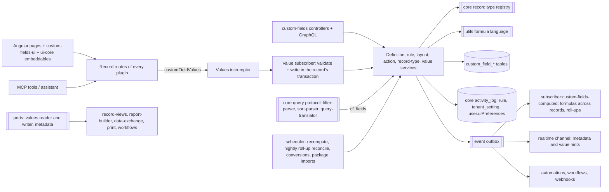

# Implementation Plan: Custom fields and forms

> Translates an approved `spec.md` into architecture and tech choices. The plan owns
> implementation details; the spec owns behaviour.

**Feature ID**: `custom-fields-and-forms`
**Spec**: `./spec.md`
**Tasks**: `./tasks.md`
**Status**: `Draft`
**Last updated**: 2026-11-23

---

## 1. Architecture Summary

A new plugin pair, `@gauzy/plugin-custom-fields` (`packages/plugins/custom-fields`) and `custom-fields-ui` (Angular),
loaded by `apps/api/src/plugins.ts` only when `GAUZY_CUSTOM_FIELDS_ENABLED` is exactly `true`, and gated per tenant by
`FEATURE_CUSTOM_FIELDS`. Two shared pieces land outside the plugin because several plugins use them: the **record type
registry** in core (`packages/core/src/lib/record-type/`, a code registry with no table) built on what the platform
already declares per type (`BaseEntityEnum`, the resource query schemas, the comment parent access policies and the
search definitions), and the **formula language** as an isomorphic module of `@gauzy/utils`
(`packages/utils/src/lib/formula/`) that the API and the Angular app import alike. On self-hosted installations only, a
third shared piece, the **tenant script runtime** in core (`packages/core/src/lib/tenant-script/`), runs script
formulas here and script steps of automation flows behind a deployment switch the cloud deployment refuses. The existing code-declared custom fields
(`packages/core/src/lib/core/entities/custom-entity-fields/`, `config.customFields`) are untouched and are read into
the catalogue as system fields.

Values ride on each record's own routes: a request interceptor takes `customFieldValues` out of create and update
bodies of registered routes before validation, and an entity subscriber (`BaseEntityEventSubscriber`) validates them
in `beforeEntityCreate/Update` and writes them with the same entity manager in `afterEntityCreate/Update`, so the record
and its values commit together. A response interceptor and a GraphQL field add `customFieldValues` to reads. Both
interceptors and the subscriber act only for tenants with `FEATURE_CUSTOM_FIELDS` on; for other tenants requests and
responses of record routes pass through exactly as today. Lists
filter and sort on custom fields through the platform's one query protocol: `filter[cf.<key>][<op>]` and `sort=cf.<key>`
are dynamic fields that `filter-parser.ts`, `sort-parser.ts` and `query-translator.ts` hand to a resolver this plugin
binds, on REST and GraphQL alike. Value changes and customization changes are core `activity_log` rows; conditions are
core `rule` rows; per-type settings and user defaults live in the settings store and `user.uiPreferences`.

## 2. Tech Choices

| Concern | Choice | Rationale |
| ------- | ------ | --------- |
| Package | new `packages/plugins/custom-fields`, `-ui`; no React package (forms are the Gauzy web app, installable on phones) | Principle I |
| Record types | core `record-type/` registry keyed on `BaseEntityEnum` values (plugin types without one, e.g. `Order`, `PurchaseOrder`, add a key in their own registration and the `entity-type-base` validation accepts registered keys); each entry points at the existing declarations, which stay the sources: names and polymorphic keys → `BaseEntityEnum`; read and write permissions → the type's `@CommentParentAccessPolicy` (`ICommentParentAccessPolicy.readPermissions` / `writePermissions`); filterable and sortable standard fields → the type's `ApiQuerySchema` (`query-schema.registry.ts`, listed in `query-schemas.ts`; a type without one declares it beside its controller as part of being registered); title and search fields → the search plugin's definition (`packages/plugins/search/src/lib/definitions/*.definition.ts`) when present; the entry itself holds only what none of them declares (entity class, routes whose bodies carry values, Angular link, relations for roll-ups); custom types resolved per tenant through a source the plugin binds | one list of record types, no restated declarations |
| Storage of values | typed value rows (§3.1) | no run-time DDL, one model for three dialects and both ORMs |
| Conditions | rows of the core `rule` table with new `RuleOwnerType` values `CUSTOM_FIELD_RULE`, `FORM_LAYOUT_DRAFT`, `FORM_LAYOUT_VERSION`, `FORM_ACTION` (`ownerId` = the rule, layout, layout version or action); no condition column on plugin tables | one condition store with pricing, ledger and workflow rules |
| Formulas | `@gauzy/utils` `formula/`: tokenizer, parser, type checker, evaluator, exact decimals on `BigInt` | same verdict in browser and server; conformance suite against core `rule.evaluator` |
| Write path | interceptor + entity subscriber with the transaction's manager | values commit with their record on every route |
| List filters and sort | the core query protocol: `cf.<key>` dynamic fields of `filter[...]` and `sort=` resolved through a resolver hook added to `filter-parser.ts` / `query-translator.ts` (both ORMs) and bound by this plugin; no `cf[...]` dialect and no list hook in `CrudService` | one filter grammar for REST, GraphQL and saved views |
| History and audit | value changes are core `activity_log` rows (`entity` = the record type, `entityId` = the record, `updatedFields` `cf.<key>`, `previousValues` / `updatedValues`, `actorType`, `data.source` = form, API, import, automation, workflow, agent, computed, restore, package); customization changes are `activity_log` rows with `entity` `CustomFieldDefinition`, `CustomFieldOverride`, `CustomFieldRule`, `FormLayout`, `FormAction`, `CustomRecordType` | one timeline per record for record views |
| Per-type settings | core settings store: one `tenant_setting` row per record type, `recordType.<key>` (JSON, `ORGANIZATION` scope, `TENANT` for tenant-wide), declared once by the core registry; this plugin owns its `form` section (title, image, search fields where the type has no search definition, sort, quick entry, history, copy, attachments limit, print and email templates, picker title, after-create message and next steps, and `layoutRendering`, default `false`: the standard type keeps its existing form with the custom field section until an administrator switches it on); `record-views-and-search` owns the `views` section, including the default view | one per-type settings store; default view in one place |
| User defaults | `user.uiPreferences.customFields` (`IUserUiPreferences`, `PUT /user/ui-preferences`): per record type, field path → value | existing per-user preference store |
| Masks | a provider of the core `FieldVisibility` (`api/field-visibility.service.ts`, `@VisibleWith`) for `cf.<key>` fields, used by the response interceptor, GraphQL, the ports, exports, print and MCP | one visibility service |
| Numbering | port `CUSTOM_FIELDS_NUMBERING` → `business-documents` series; fallback core `SequenceService.allocate` | numbering series owner |
| Background work | `@ScheduledJob` + `@QueueWorker` (`@gauzy/scheduler`), outbox consumer; in-process fallback without a queue root | task automations layout |
| Push | event outbox → realtime channel | Principle VII |
| Permissions | plugin permission contributions with `defaultFor` in `custom-fields.permissions.ts`; no seeding migration | grants declared once, not seeded |
| UI | Angular plugin + embeddables in `packages/ui-core/shared/src/lib/custom-fields/`; custom record lists are the generic record list of `record-views-and-search` | every page embeds without importing a plugin |
| Scripts (self-hosted only) | core `tenant-script/` runtime: deployment switch `GAUZY_TENANT_SCRIPTS_ENABLED` (exactly `true`, default off) read by `@gauzy/config`; refused at start-up when the deployment marker `GAUZY_DEPLOYMENT` is `cloud` (logged, switch ignored, script routes `403`); scripts run in a separate worker process per call from a small pool, with no network, file system, environment or platform credentials, a time limit (default 2 s, `GAUZY_TENANT_SCRIPTS_TIMEOUT_MS`) and a memory limit (default 64 MB, `GAUZY_TENANT_SCRIPTS_MEMORY_MB`), killed on breach; input is the record's values as JSON, output one value; every run appended to core `tenant_script_run`; shared with automation flows' script steps | scripts never on the cloud; isolated and bounded where allowed |

## 3. Data Model

All tables extend `TenantOrganizationBaseEntity` (soft delete, `isActive`, `isArchived`); `organizationId` is null on
tenant-wide definitions (with `organizationIds` text as the allow-list); JSON is `text` on every dialect; keys are
`varchar(64)`; ids into other plugins carry no foreign key.

### 3.1 Storage strategy for values

**Chosen: one typed value row per record, field and position** in `custom_field_value`, with one column per value
family. Considered and rejected: a JSON column on each owner table (a migration on every record table, owned by other
plugins; JSON indexing differs per dialect and per ORM; SQLite needs expression indexes); a real column per field
created at run time (DDL under traffic, locks, schema drift between tenants of one database, static ORM metadata);
spare generic columns on a side table (hard caps, opaque). Trade-off accepted: a filter or sort on a custom field is a
semi-join, and a write touches up to seven indexes; mitigated by field-first composite indexes, per-type field limits,
and benchmarks at one million records (T52).

| Column | Type | Notes |
| --- | --- | --- |
| `recordType` | varchar(64) | registry key (`OrganizationContact`, `PurchaseOrder`, `custom:vehicle`, …) |
| `recordId` | uuid | no foreign key (polymorphic) |
| `fieldId` | uuid | FK `custom_field_definition` |
| `position` | int default 0 | order of a multi-value |
| `valueString` | varchar(255) | short text, choice key, email, phone, address, first 255 characters of long text |
| `valueText` | text | long and formatted text, location and signature payloads |
| `valueNumber` | numeric(28,9) | numbers, money amount, percentage, duration in seconds, rating |
| `currency` | varchar(3) | money only |
| `valueDate` | varchar(10) | ISO date (`YYYY-MM-DD`), sorts as text on every dialect |
| `valueDateTime` | timestamp | UTC |
| `valueBoolean` | boolean | |
| `valueRefId` / `valueRefType` | uuid / varchar(64) | references, people, teams, files |
| `uniqueKey` | varchar(160) | set only for unique fields: `<fieldId>:<scopeId>:<sha256 of normalised value>` |
| `computedAt` | timestamp | formula and roll-up values |
| `version` | int default 1 | per-record values version (on position 0 of a reserved row per record, see below) |

Indexes: unique `(tenantId, recordType, recordId, fieldId, position)` (read a record, upsert); `(tenantId, fieldId,
valueString, recordId)`, `(tenantId, fieldId, valueNumber, recordId)`, `(tenantId, fieldId, valueDate, recordId)`,
`(tenantId, fieldId, valueDateTime, recordId)`, `(tenantId, fieldId, valueRefId, recordId)` (filter, sort, roll-up and
dependent lookups); unique `(tenantId, uniqueKey)` (several nulls allowed on all three dialects). MySQL index lengths
stay under 3,072 bytes with `varchar(255)` in `utf8mb4`. A record's values version is kept in
`custom_field_record_state` (`recordType`, `recordId`, `version`, `updatedAt`; unique `(tenantId, recordType,
recordId)`) and checked by `If-Match` on value writes.

Filter: `alias.id IN (SELECT v.recordId FROM custom_field_value v WHERE v.tenantId = :t AND v.fieldId = :f AND
v.valueNumber > :x)`. Sort: `LEFT JOIN custom_field_value s ON s.recordId = alias.id AND s.fieldId = :f AND
s.position = 0 AND s.tenantId = :t`. A page of 50 records reads its values with one `recordId IN (…)` query.

### 3.2 New entities

| Table | Columns (besides base) | Indexes and uniqueness |
| --- | --- | --- |
| `custom_field_definition` | `recordType`, `key`, `labels` text (per language), `description`, `helpTexts` text, `placeholder`, `type` varchar(24), `config` text (precision, currency mode, bounds, options with labels, colours and archived flags, reference targets and filter, files, multi-value limit, formula or, on self-hosted installations with scripts on, script, roll-up spec, series key), `groupKey`, `position` int, `behaviour` text (required, unique, uniqueScope, readOnly, setOnce, noCopy, nonNegative, default, list, filter, sort, search, quickEntry, hideInPrint, history, timeline, userDefaultAllowed), `viewPermission`, `editPermission` varchar(64), `organizationIds` text, `status` (`DRAFT`, `PUBLISHED`, `DEPRECATED`, `ARCHIVED`), `source` (`USER`, `PLUGIN`, `CODE`, `PACKAGE`), `sourceRef` varchar(128), `replacesFieldId`, `publishedAt`, `deprecatedAt`, `version` int | unique `(tenantId, recordType, key)` (keys never reused); index `(tenantId, recordType, status)` |
| `custom_field_override` | `recordType`, `fieldPath` varchar(128), `labels`, `helpTexts`, `position`, `hidden`, `required`, `defaultValue` text, `listDefault`, `filterDefault`, `options` text, `organizationIds` text, `status` | unique `(tenantId, recordType, fieldPath)` |
| `custom_field_rule` | `recordType`, `kind` (`VISIBLE`, `REQUIRED`, `READ_ONLY`, `OPTIONS`, `REFERENCE_FILTER`, `COPY_FROM`, `DEFAULT`, `VALIDATE`, `SECTION`), `target` varchar(128) (field path or section key), `formula` text (conditions are core `rule` rows owned by this row), `config` text (options subset, copy source and mode, message per language), `layoutId` (null = all layouts), `position`, `status`, `dependsOn` text (resolved paths, for cycle checks and dependents) | index `(tenantId, recordType, status)` |
| `custom_field_record_state` | see §3.1 | unique `(tenantId, recordType, recordId)` |
| `custom_field_value` | see §3.1 | see §3.1 |
| `form_layout` | `recordType`, `kind` (`MAIN`, `QUICK_ENTRY`, `SIDE_PANEL`, `LINE_EDITOR`, `TRANSITION`), `name`, `audienceRoleIds` text, `device` (`ANY`, `DESKTOP`, `TABLET`, `PHONE`), `priority` int (conditions: core `rule` rows), `parentLayoutId`, `transitionKey` varchar(128), `draft` text (tabs → sections → columns → elements with overrides), `draftVersion` int, `publishedVersion` int, `status` | index `(tenantId, recordType, kind, status, priority)` |
| `form_layout_version` | `layoutId`, `version`, `document` text, `publishedAt`, `publishedByUserId` | unique `(layoutId, version)` |
| `form_action` | `recordType`, `key`, `labels`, `icon`, `placement` (`TOOLBAR`, `MENU`, `BULK`, `FIELD`), `fieldPath`, `permission` varchar(64) (conditions: core `rule` rows), `confirmation` text, `inputLayoutId`, `kind` (`OPEN_URL`, `OPEN_PAGE`, `SET_FIELDS`, `CREATE_RELATED`, `START_FLOW`, `WORKFLOW_TRANSITION`, `CALL_WEBHOOK`, `ASK_AGENT`), `config` text, `position`, `status` | unique `(tenantId, recordType, key)` |
| `custom_record_type` | `key`, `labels` text (singular and plural), `icon`, `description`, `kind` (`LIST`, `LINES`, `TREE`, `SINGLE`), `parentTypeKey`, `scope` (`ORGANIZATION`, `TENANT`), `organizationIds` text, `titleFieldKey`, `titleFormula`, `seriesKey`, `capabilities` text, `menu` text, `ownerFieldKey`, `status` | unique `(tenantId, key)` |
| `custom_record_type_access` | `recordTypeId`, `roleId`, `canView`, `canCreate`, `canEdit`, `canDelete`, `canExport`, `canImport` bools, `scope` (`OWN`, `TEAM`, `ORGANIZATION`, `ALL`); kept beside core `role_permission` because custom types are created per tenant at run time while the permission catalogue is fixed at bootstrap; shown as a section of the existing roles and permissions page | unique `(recordTypeId, roleId)` |
| `custom_record` | `recordTypeId`, `number` varchar(64), `title` varchar(255), `ownerUserId`, `parentRecordId`, `lineOfRecordType` varchar(64), `lineOfRecordId`, `position` int, `path` varchar(1024) (tree), `version` int | unique `(organizationId, recordTypeId, number)`; index `(tenantId, recordTypeId, organizationId, updatedAt)`, `(lineOfRecordType, lineOfRecordId)`, `(recordTypeId, path)` |
| `record_template` | `recordType`, `name`, `values` text, `visibility` (`PRIVATE`, `SHARED`), `ownerUserId`, `isDisabled` | index `(tenantId, recordType, visibility)` |
| `customization_package_import` | `packageName`, `packageHash` varchar(64), `diff` text, `choices` text, `createdItems` text, `state` (`PREVIEWED`, `APPLIED`, `UNDONE`, `FAILED`), `appliedAt`, `undoneAt` | index `(tenantId, state)` |

Not tables of this plugin, by design: value and customization history (`activity_log`), conditions (`rule`), per-type
settings (`tenant_setting`), user defaults (`user.uiPreferences`). Core gains one append-only table for the self-hosted
script runtime, `tenant_script_run` (`scriptKind` `FIELD_FORMULA` / `FLOW_STEP`, `scriptRef`, `scriptVersion`,
`recordType`, `recordId`, `actorUserId`, `actorType`, `startedAt`, `durationMs`, `peakMemoryKb`, `outcome` `OK` /
`ERROR` / `TIMEOUT` / `MEMORY`, `error` text; index `(tenantId, scriptRef, startedAt)`), separate from `activity_log`
because it records one row per execution with its own retention, not a change; it is created only by a core migration
that runs everywhere and stays empty where scripts are off.

### 3.3 Changed code in core (one new table, `tenant_script_run`)

- `packages/core/src/lib/record-type/`: `record-type.registry.ts` (`registerRecordTypes`, `RecordTypeRegistry` with
  `list`, `get`, `settings(key, organizationId)`, `resolve(tenantId, key)` consulting a bound `RECORD_TYPE_SOURCE` for
  custom types), `core-record-types.ts` (the platform's own entries keyed by `BaseEntityEnum`: entity class, REST
  routes for create, update and detail, Angular link, relations for roll-ups; permissions, standard fields, title and
  search fields are read from the comment access policy, the query schema and the search definition, never restated).
- `packages/core/src/lib/api/`: a dynamic-field resolver hook (`registerDynamicQueryFields(prefix, resolver)`) in
  `filter-parser.ts`, `sort-parser.ts` and `query-translator.ts` for `cf.<key>` on both ORMs; unbound = `cf.` fields
  are refused as unknown, as today.
- `packages/core/src/lib/tenant-script/` (self-hosted only): switch and deployment check, worker pool, limits,
  `tenant_script_run` writer; core migration `1791000030900-CreateTenantScriptRun` (§3.4).
- `packages/contracts/src/lib/`: `record-type.model.ts`, `custom-field.model.ts` (enums, definitions, rules, layouts,
  actions, values, ports, errors), `formula.model.ts` (AST, value types, function catalogue); export from `index.ts`.
- `packages/utils/src/lib/formula/`: the formula language and the isomorphic condition evaluator.
- Question sets (FR-92), in shared packages so they work without this plugin: contracts `question-set.model.ts`
  (`IQuestionSetDefinition`: `version`, sections, questions with `key`, labels and help per language, `type` from
  `CustomFieldType`, `required`, options or rating scale, bounds, visible-when formula; `IQuestionSetAnswers` =
  `{ [questionKey]: value }` with `questionSetVersion`), `packages/utils/src/lib/question-set/` (definition checks:
  unique keys, known types, valid conditions; `validateAnswers(definition, answers)` on the isomorphic evaluator, used
  by browser and server), and `packages/ui-core/shared/src/lib/question-set/` (`ngx-question-set-editor`,
  `ngx-question-set-form`). The owning features store their published versions and answers on their own records
  (recruitment application questions, performance review templates, HR exit questionnaires, lead-capture form
  versions, which add their consent boxes and hidden values around the questions); this plugin adds no table for them.
- Plugins that own record types register them in their plugin class (`order`, `purchasing`, `inventory`, `warehouse`,
  `fulfillment`, `returns`, `subscription`, `pricing`, `promotion`, `catalog`) — one entry each, owned by those packages.

### 3.4 Migrations

**Migration timestamps**: `packages/plugins/custom-fields` `1791000030100` to `1791000030199`; `packages/core` `1791000030900` to `1791000030999`.

In `packages/plugins/custom-fields/src/lib/database/migrations/`, with the shared core migration helpers of
`@gauzy/core` (dialect, quoting, `hasIndex`, Postgres advisory lock); PostgreSQL, SQLite and MySQL branches;
idempotent, forward-only, registered for both ORMs:

1. `1791000030100-CreateCustomFieldDefinitionTables` — definition, override, rule.
2. `1791000030110-CreateCustomFieldValueTables` — value, record state.
3. `1791000030120-CreateFormLayoutTables` — layout, layout version, action.
4. `1791000030130-CreateCustomRecordTables` — record type, access, record.
5. `1791000030140-CreateRecordTemplateTables` — template.
6. `1791000030150-CreateCustomizationAuditTables` — package import.

In `packages/core/src/lib/database/migrations/` (self-hosted tenant scripts, §3.3):

7. `1791000030900-CreateTenantScriptRun` — tenant script run.

Role grants come from the permission contributions' `defaultFor`. No existing table changes.

### 3.5 Contracts

`record-type.model.ts`, `custom-field.model.ts` and `question-set.model.ts` in `packages/contracts/src/lib/`, listed in §3.3; they reach the SDKs through the OpenAPI document.

## 4. API Surface

| Method | Endpoint | Permission | Description | Status |
| ------ | -------- | ---------- | ----------- | ------ |
| `GET` | `/api/custom-fields/record-types` | tenant member (types the caller may view) | registry with counts | New |
| `GET` | `/api/custom-fields/record-types/:key/metadata` | view permission of the type | fields, overrides, rules, layouts, actions resolved for roles, device, organization; `ETag` | New |
| `GET` | `/api/custom-fields/record-types/:key/schema` | view permission of the type | machine-readable schema of `customFieldValues` | New |
| `GET` `PUT` | `/api/custom-fields/record-types/:key/settings` | view / `CUSTOM_FIELDS_MANAGE` | the `form` section of the type's `recordType.<key>` setting; `If-Match` | New |
| `GET` `POST` `PATCH` | `/api/custom-fields/definitions[/:id]` | `CUSTOM_FIELDS_MANAGE` | definitions (system fields read-only) | New |
| `POST` | `/api/custom-fields/definitions/:id/{publish,deprecate,archive,restore}` | `CUSTOM_FIELDS_MANAGE` | lifecycle | New |
| `GET` | `/api/custom-fields/definitions/:id/{impact,health}` | `CUSTOM_FIELDS_MANAGE` | usage and record counts; formula errors | New |
| `POST` | `/api/custom-fields/definitions/:id/convert` | `CUSTOM_FIELDS_MANAGE` | `preview` then commit (queued) | New |
| `GET` `POST` `PATCH` `DELETE` | `/api/custom-fields/overrides[/:id]` | `CUSTOM_FIELDS_MANAGE` | standard field overrides; delete = reset | New |
| `GET` `POST` `PATCH` | `/api/custom-fields/rules[/:id]`, `POST …/:id/publish` | `CUSTOM_FIELDS_MANAGE` | field rules | New |
| `POST` | `/api/custom-fields/formulas/test` | `CUSTOM_FIELDS_MANAGE` | rule or formula on a record or sample; writes nothing | New |
| `GET` `POST` `PATCH` | `/api/form-layouts[/:id]`, `POST …/:id/{publish,preview}`, `GET …/:id/versions`, `POST …/:id/restore/:version` | `FORM_LAYOUTS_MANAGE` | layouts | New |
| `GET` `POST` `PATCH` | `/api/form-actions[/:id]` | `FORM_ACTIONS_MANAGE` | actions | New |
| `POST` | `/api/form-actions/:id/run` | the action's permission + edit of each record | `{ recordIds, input, preview }` → per-record results | New |
| `GET` `PUT` `PATCH` | `/api/custom-field-values/:recordType/:recordId` | view / edit of the record | read, replace, merge; `If-Match` | New |
| `POST` | `/api/custom-field-values/bulk` | edit of each record | per-row results | New |
| `GET` | `/api/custom-field-values/:recordType/:recordId/history` | view of the field | per field timeline from `activity_log` (`cf.` fields), masks applied | New |
| `POST` | `/api/custom-field-values/:recordType/:recordId/history/:activityLogId/restore` | edit of the field | restore as a new change | New |
| `GET` | `/api/custom-fields/changes` | `CUSTOM_FIELD_HISTORY_VIEW` | change search across records over `activity_log` | New |
| `GET` `POST` `PATCH` | `/api/custom-record-types[/:id]`, `POST …/:id/{publish,deprecate,archive}`, `PUT …/:id/access` | `CUSTOM_RECORD_TYPES_MANAGE` | custom record types | New |
| `GET` `POST` | `/api/custom-records/:typeKey` | type access (view / create) | list with filters, sort, cursor; create | New |
| `GET` `PUT` `DELETE` | `/api/custom-records/:typeKey/:id` | type access (view / edit / delete) | record with values; `If-Match` | New |
| `POST` | `/api/custom-records/:typeKey/{bulk,:id/restore,:id/duplicate}` | type access | bulk with per-row results | New |
| `GET` `POST` `DELETE` | `/api/record-templates[/:id]` | owner; sharing `RECORD_TEMPLATES_SHARE` | templates | New |
| `POST` | `/api/customization-packages/{export,import}`, `POST …/imports/:id/undo` | `CUSTOMIZATION_PACKAGES_MANAGE` | packages; import with `preview` | New |
| `GET` | `/api/custom-fields/reports/{fill-rate,changes,records-by-type,computed-health,inventory}` | `CUSTOM_FIELDS_MANAGE` (changes: `CUSTOM_FIELD_HISTORY_VIEW`) | FR-87 datasets | New |
| `*` | every registered create, update and detail route | unchanged | accepts and returns `customFieldValues`; list routes on the query protocol accept `filter[cf.<key>][<op>]` and `sort=cf.<key>` | Changed (additive) |
| `PUT` | existing `/api/user/ui-preferences` | the caller | own field defaults under `customFields` | Existing |
| `GET` `POST` | `/api/custom-fields/scripts/test`, `/api/custom-fields/scripts/runs` | `CUSTOM_FIELD_SCRIPTS_MANAGE`; self-hosted with the switch on, else `403` | test a script on a record (writes nothing); run audit | New |

Every route carries `@FeatureFlag(FEATURE_CUSTOM_FIELDS)` (custom records also `FEATURE_CUSTOM_RECORD_TYPES`),
`TenantPermissionGuard`, class-validator DTOs and Swagger decorators; creating routes take an idempotency key.
Errors: `CUSTOM_FIELD_REQUIRED`, `CUSTOM_FIELD_INVALID`, `CUSTOM_FIELD_DUPLICATE` (409), `CUSTOM_FIELD_MASKED` (403),
`CUSTOM_FIELD_STALE` (409), `CUSTOM_FIELD_CYCLE`, `CUSTOM_FIELD_LIMIT`, `CUSTOM_FIELD_IN_USE`, `LAYOUT_HIDES_REQUIRED`,
`RECORD_TYPE_HAS_RECORDS`. GraphQL (`graphql/schema-extensions.ts`): `customFieldValues: JSON` on every registered type,
`customFieldMetadata(recordType)`, `customRecords(typeKey, filter, first, after)`, `customRecord(typeKey, id)`.

**Ports offered** (contracts `custom-field.model.ts`, tokens provided when the plugin is loaded, injected `@Optional()`):

| Port | Consumers | Contract |
| --- | --- | --- |
| `CUSTOM_FIELD_METADATA` | record-views, print, data-exchange, workflows | `resolve(recordType, { roles, device, organizationId })` |
| `CUSTOM_FIELD_VALUE_READER` | print, report-builder, workflows, automations, webhooks | `readMany(recordType, ids, { fields, viewer })` honouring masks |
| `CUSTOM_FIELD_VALUE_WRITER` | data-exchange, workflows (state field), automations | `validateAndWrite(recordType, recordId, values, { manager, actor, source })` |
| `RECORD_TYPE_SOURCE` (bound into core) | core registry | custom record types per tenant |

**Ports consumed**: `CUSTOM_FIELDS_NUMBERING` (`business-documents` series, else `SequenceService.allocate`),
`CUSTOM_FIELDS_FLOWS` (automation flows for actions), `CUSTOM_FIELDS_WORKFLOW` (transition actions),
`CUSTOM_FIELDS_WEBHOOKS` (integration hub), `CUSTOM_FIELDS_AGENTS` (agent actions and drafting); unbound → the action
kind is not offered. Integration syncs that map external custom fields (`integration-asana` `asana-task.mapper.ts`,
Jira, Linear) can write into definitions and values through `CUSTOM_FIELD_VALUE_WRITER`. Custom fields leave the
`metadata` JSON columns of plugin entities ("tenant extras") as they are: those stay the owners' integration
extension point and are neither read nor replaced. A choice field describes one attribute of one record type; tags
(`tag`, `tag-type`) and contact groups stay the classification shared across types.

## 5. Events, Real-Time and Notifications

| Event | Emitted when | Consumers |
| ----- | ------------ | --------- |
| `custom_fields.definition.published` / `.deprecated` / `.archived` | lifecycle of fields, rules, layouts, actions | realtime hint `custom-fields:<tenantId>` (clients drop cached metadata); recompute job |
| `custom_fields.values.changed` `{ recordType, recordId, changes[{ key, before, after }], source }` | values committed | automations, workflows, webhooks, realtime record channel, `subscriber:custom-fields-computed` |
| `custom_record.<typeKey>.created` / `.updated` / `.deleted` / `.restored` | custom record writes | automations, workflows, webhooks, search indexing, realtime |
| `custom_fields.rollup.dirty` `{ targetType, targetId, fieldIds }` | a roll-up source record changed (subscriber, after commit) | `subscriber:custom-fields-computed` |
| `custom_fields.package.imported` / `.undone` | package runs | audit, inbox notice to the importer |

Outbox partition `custom-fields:<recordType>:<recordId>` keeps one record's recomputations in order. Inbox notices
(through `INBOX_ITEM_WRITER`) for finished conversions, package imports and recomputations with errors.

## 6. UI Surface

- **Angular `packages/plugins/custom-fields-ui`** (lazy, `@gauzy/plugin-ui`, hidden when the metadata route answers
  404): Settings → Customization `/pages/settings/customization` (record types list); per type `…/:recordType/{fields,
  standard-fields,rules,layouts,layouts/:id/designer,actions,templates,settings,history}`; custom record type builder
  `…/record-types/:id`; packages `…/packages`; menu entries per published type to `/pages/records/:typeKey`, whose list
  is the generic record list of `record-views-and-search` (menu entries shown only while that route answers), while
this plugin registers the detail and create forms
  (`ngx-dynamic-record-form`) that route opens. The designer offers drag and drop and a keyboard list editor, preview by role,
  device and record, version history; the rule editor offers the condition builder and the formula editor with a test
  pane.
- **Embeddables `packages/ui-core/shared/src/lib/custom-fields/`**: `ngx-custom-fields-section` (edit section driven by
  the main layout), `ngx-dynamic-record-form` (full layout-driven form), `ngx-quick-entry-dialog`, `ngx-line-editor`,
  `ngx-field-history`, `ngx-form-actions-bar`, directive `ngxFieldOverride` for standard fields of hand-built forms,
  `CustomFieldsRecordViewProvider` (sections for `ngx-record-view`), `CustomFieldColumnsService` (smart-table columns and
  in-place editing), `CustomFieldsMetadataService` (cached by `ETag`, 404 → nothing rendered). Wired into every
  registered page as a section of its existing form; contacts, deals, vendors, projects, employees and items render
  through `ngx-dynamic-record-form` only while their type's `form.layoutRendering` setting is on (off by default), and
  return to their existing form when it is switched off.
- **Phone layouts** render in the Gauzy web app on phones (installable, with offline drafts re-validated by the server).
- i18n keys `CUSTOM_FIELDS.*` in every locale of `packages/ui-core/i18n`; tenant labels come from the definitions.

## 7. MCP Tools, SDKs and Integrations

New file `packages/mcp-server/src/lib/tools/custom-fields.ts`, registered in `register-all-tools.ts`:

| Tool | Input | Output |
| --- | --- | --- |
| `custom_fields_list_record_types` | — | types with counts |
| `custom_fields_get_metadata` | record type, device | resolved fields, rules, layouts, actions |
| `custom_fields_draft` | sentence, record type, `preview` (default true) | draft definitions, rules, layout or record type with impact |
| `custom_fields_get_values` / `custom_fields_set_values` | record type, id, values, `preview` | values / validation outcome or write |
| `custom_fields_field_history` | record type, id, field | changes |
| `custom_records_query` | type, filters, sort, limit | records |
| `custom_records_create` / `custom_records_update` | type, values, `preview` | record or preview |
| `custom_fields_run_action` | action, record ids, input, `preview` | per-record results |

The report datasets of FR-87 are registered in the core reports catalogue (`packages/core/src/lib/reports/`) so they
appear in the Reports menu of tenants with the feature on, and with the report builder when it is present. Their
category carries `FEATURE_CUSTOM_FIELDS` in the shared catalogue feature filter of `report-builder-and-dashboards`
(nullable `report_category.featureKey`); core `ReportService.findAllReports`, `getMenuItems` and
`ReportOrganizationService.bulkCreateOrganizationReport` skip categories and rows whose feature is off for the tenant, so with the feature off the Reports page and menu are exactly today's
(FR-93). The filter is guarded so that it is safe from any feature.

Existing domain tools gain `customFieldValues` through the routes they call. OpenAPI additive; the Kiota SDKs are
regenerated after merge and expose the schema route for typed helpers. Import, export, print and report integration
goes through the ports of §4.

## 8. Background Jobs

| Trigger | When | What it does | Idempotency |
| ------- | ---- | ------------ | ----------- |
| `custom-fields.recompute` (queue `custom-fields-maintenance`) | a formula or roll-up published or changed | recomputes in batches of 500 with a checkpoint | per field, record and definition version |
| outbox consumer `subscriber:custom-fields-computed` | `custom_fields.values.changed`, `custom_fields.rollup.dirty`, record events | dependents of changed inputs; roll-ups of dirty targets | delivery record; value written only if `computedAt` is older |
| `custom-fields.rollup.reconcile` | nightly 03:00 tenant time | recomputes every roll-up whose sources changed since the watermark | per field and watermark |
| `custom-fields.convert` | conversion confirmed | copies converted values into the new field, then deprecates the old | per conversion and record |
| `custom-fields.package.import` | import confirmed | applies a package as one unit, records created items | per import run |

Schedules live in a `CustomFieldsSchedulePlugin` loaded by `apps/worker/src/plugins.ts`; queue jobs run in the API;
without a queue root the API runs them on in-process timers under a database lock (task automations layout).

## 9. Security & Permissions

`custom-fields.permissions.ts` (contributions with `defaultFor`): `CUSTOM_FIELDS_MANAGE`, `FORM_LAYOUTS_MANAGE`,
`FORM_ACTIONS_MANAGE`, `CUSTOM_RECORD_TYPES_MANAGE`, `CUSTOMIZATION_PACKAGES_MANAGE`, `CUSTOM_FIELD_HISTORY_VIEW`,
`RECORD_TEMPLATES_SHARE`, `CUSTOM_FIELD_SCRIPTS_MANAGE`. `defaultFor`: all but the script permission to `SUPER_ADMIN`
and `ADMIN`; `CUSTOM_FIELD_HISTORY_VIEW` and `RECORD_TEMPLATES_SHARE` to `MANAGER`; `CUSTOM_FIELD_SCRIPTS_MANAGE` to
`SUPER_ADMIN` only, and it grants nothing where the switch is off. Values follow the record's own view and edit
permissions; masked fields use `viewPermission` / `editPermission` through the `cf.` provider of the core
`FieldVisibility`, used by the response interceptor, GraphQL, the ports, exports, print and MCP. Custom
record access rows are checked by a `CustomRecordAccessGuard` and by every query (own, team, organization, all).
Formulas run in the `@gauzy/utils` evaluator only (no `eval`, no I/O, a step budget of 10,000 operations and a depth of
32). Scripts exist only on self-hosted installations with the switch on and run only in the core tenant script
runtime (separate process, no network, files or credentials, time and memory limits, every run in
`tenant_script_run`, every script change in `activity_log`); on the cloud deployment the switch is refused at start-up
and a test spec proves script fields and routes answer `403`. Formatted text is sanitised with the platform's sanitizer on write and render; web-address actions accept https
only and encode values; package files are size-limited (5 MB) and schema-validated. Agents act in the caller's request
context and their changes are marked `Agent` in history and audit.

## 10. Observability

`activity_log` entries for values and customizations; `tenant_script_run` where scripts are on; metrics for refusals,
formula and script errors, script time and memory, recompute lag, cache hits.

## 11. Phased Rollout

1. **Phase 1 — Foundation and surface what exists** (flag off): contracts, core registry with the platform's types,
   formula module, the core dynamic-field hook, question sets, plugin, tables, definitions and values with the write and read integration, history, the read-only
   listing of code-declared fields, Settings → Fields, the embedded section on contacts, deals, vendors, projects,
   employees and items, MCP value tools.
2. **Phase 2 — Depth**: rules in browser and server, overrides, layouts with designer and resolution, quick entry, line
   editor, templates, user defaults, actions, filters and sort, ports for views, reports, import, print and search,
   custom record types with access and generic API.
3. **Phase 3 — Advanced capabilities**: formula and roll-up fields including tracked time, history restore, lifecycle with
   impact analysis and conversion, packages, organization variants, assistant drafting, real-time publication,
   layout rendering of standard pages behind its per-type setting (off by default), phone layouts in the Gauzy web app;
   script formulas on self-hosted installations.
4. **Phase 4 — General availability**: the feature is off by default; after the trial period it may be switched on by default for new tenants only; existing tenants keep their setting until an administrator changes it.

## 12. Constitution Reconciliation

- I Plugin-first: plugin pair; core gets the shared registry, a dynamic-field hook in the query protocol and the
  self-hosted script runtime; formulas in `@gauzy/utils`.
- II Tenant/organization scoping: every table on the tenant-organization base; tenant-wide definitions carry an
  organization allow-list; every query filters by tenant.
- III Both ORMs, additive migrations: six plugin migrations and one core migration, three dialects, both ORMs; no
  run-time DDL.
- IV Default-off flag; nothing removed: deploy switch plus tenant feature; code-declared fields and every record route
  unchanged.
- V Contracts and API first: contracts, REST, GraphQL, schema route and SDK regeneration before UI.
- VI Permissions, privacy, security: eight permissions, masking, custom record access rows, sandboxed formulas;
  scripts never on the cloud, isolated and audited on self-hosted installations.
- VII Real-time through the event bus: outbox events and realtime hints, no private channel.
- VIII i18n and accessibility: labels per language, keyboard designer, announced errors.
- IX Tests: unit, dialect, ORM parity, e2e and UI specs per task.
- X Behaviour-first spec: implementation stays in this plan.
- XI Documentation describes our platform only.

## 13. Risks & Mitigations

| Risk | Likelihood | Impact | Mitigation |
| ---- | ---------- | ------ | ---------- |
| Value queries slow at scale | Medium | High | field-first composite indexes, semi-joins, field limits, benchmark task on PostgreSQL and MySQL at 1M records |
| Every write pays for the subscriber | Medium | Medium | registry lookup is O(1); no work when a type has no published field (30 s cache per tenant) |
| Browser and server rules disagree | Low | High | one isomorphic module; conformance suite shared with the core rule evaluator |
| Interceptor strips a body on the wrong route | Low | High | explicit route list per registered type; e2e spec per registered route |
| Masked values leak through a side surface | Low | High | one visibility filter used by every surface; tests per surface |
| Formula abuse (very long, deep, slow) | Low | Medium | parser limits, step budget, depth limit, timeouts in recompute jobs |
| A script escapes or exhausts the host (self-hosted) | Low | High | separate process without network, files or credentials; time and memory limits; small pool; switch off by default and refused on the cloud deployment |
| Recompute storms after a change | Medium | Medium | queue batches, per-tenant concurrency of 1, checkpoints |
| Both ORMs read arbitrary entities differently | Medium | Medium | descriptors carry the entity class; ORM parity specs |

## 14. References

- Spec: `./spec.md` · Tasks: `./tasks.md` · Related: `../approval-workflows/plan.md`, `../record-views-and-search/plan.md`
- Code: `packages/core/src/lib/core/entities/custom-entity-fields/`, `core/src/lib/rule/rule.evaluator.ts`,
  `core/src/lib/core/entities/subscribers/`, `core/src/lib/measurement/unit-references.ts`,
  `core/src/lib/sequence/sequence.service.ts`, `contracts/src/lib/base-entity.model.ts` (`BaseEntityEnum`),
  `core/src/lib/api/` (`query-schema.registry.ts`, `query-schemas.ts`, `filter-parser.ts`, `sort-parser.ts`,
  `query-translator.ts`, `field-visibility.service.ts`), `core/src/lib/comment/parent-access/`,
  `plugins/search/src/lib/definitions/`, `core/src/lib/activity-log/`, `core/src/lib/tenant/tenant-setting/`,
  `contracts/src/lib/user.model.ts` (`IUserUiPreferences`), `ui-core/shared/src/lib/record-view/`, task automations
  `migration-helpers.ts`
