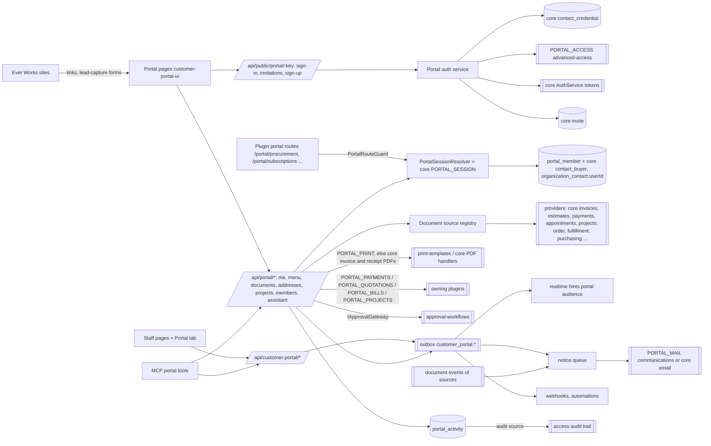

# Implementation Plan: Customer and supplier portal

> Translates an approved `spec.md` into architecture and tech choices. The plan owns
> implementation details; the spec owns behaviour.

**Feature ID**: `customer-and-supplier-portal`
**Spec**: `./spec.md`
**Tasks**: `./tasks.md`
**Status**: `Draft`
**Last updated**: 2026-11-23

---

## 1. Architecture Summary

A new plugin pair: `@gauzy/plugin-customer-portal` (`packages/plugins/customer-portal`) and `customer-portal-ui`
(Angular: the portal pages under `/#/portal/:key` and the staff pages; the Gauzy web app is installable on phones).
`apps/api/src/plugins.ts` lists `CustomerPortalPlugin` only when `GAUZY_CUSTOMER_PORTAL_ENABLED` is exactly `true`
(`isCustomerPortalEnabled`, the task automations idiom); `apps/worker/src/plugins.ts` lists the schedule-only
`CustomerPortalSchedulePlugin`. Every controller carries `@FeatureFlag(FEATURE_CUSTOMER_PORTAL)`; the settings service
refuses `portal.signInEnabled` while `FEATURE_ADVANCED_ACCESS` is off. The portal is a signed-in application: the
portal address serves sign-in, invitation, sign-up and the signed-in areas, and links to the organization's public sites,
which are Ever Works sites (public forms on them are forms of `lead-capture-and-enrichment`).

It builds on what exists and adds no second identity, role, invitation or comment system:

- **Secret**: core `ContactCredential` (one login row per person contact: hash, hashed tokens, lockout ladder, encrypted
  authenticator secret, `lastLoginAt`, `metadata`) through `ContactCredentialService` (`createCredential`,
  `setVerificationToken`, `verifyEmail`, `setResetToken`, `completeReset`, `registerFailedAttempt`,
  `recordSuccessfulLogin`, `setMfaSecret`).
- **Principal and account link**: a core `User` of type `PORTAL` made by `PORTAL_ACCESS.provisionPortalUser(party,
  profile)` of `advanced-access` (its `access_user_state` holds the party of the active membership; its ceiling narrows
  every permission). The person contact's `organization_contact.userId` links the person to that user (the link between
  a party and its identity is a property of the party); the user's `preferredLanguage` and `timeZone` are the person's
  portal language and time zone. The user has no staff password (`hash` null) and no `user_organization` row; tokens come
  from core `AuthService.getJwtAccessToken` / `getJwtRefreshToken` with the claims `userType` and `portalMemberId`.
- **Invitations** are core `invite` rows (token, email, status, `expireDate`, `invitedByUserId`, the person through
  `invite_organization_contact`, resend, throttling and its security tests) of a new invitation type `PORTAL`, accepted
  only on the portal's accept route.
- **Roles** are the `role` of the person's membership in the party's company account (`contact_buyer`: `ADMIN`
  administers members, `APPROVER` reviews and approves, `PURCHASER` acts, `VIEWER` reads); which portal rights each role
  holds per party kind is a portal setting. A supplier's people are memberships of the supplier's company contact
  (`organization_vendor.contactId`) in the same way; a person who is the party (an individual customer) acts as its
  administrator.
- **Parties and people**: core `OrganizationContact` (person = `partyKind INDIVIDUAL`, company = `COMPANY`),
  `ContactBuyer`, `OrganizationVendor`, `Address` (the address book), `contact_group` (prices and promotions the party
  sees in reorder and quotations).
- **Comments** with members are core `comment` rows with an audience and author kind (§3); **approvals** of quotations
  by several reviewers go through the approval gateway of `approval-workflows` (`IApprovalGateway`, fallback core
  `request_approval` / `approval_policy`); **the assistant** is a platform AI conversation (`ai_chat_conversation`) whose
  runs, usage and budget belong to `ai-agents-and-assistants`; **settings** are setting contributions; **permissions**
  and default grants are contributions; **bulk** invitations run as core operations.
- **Pages of other plugins** plug in through two code registries in core (`registerPortalAreas`,
  `registerPortalDocumentSources`) and one guard (`@PortalRoute`), so no plugin imports this one.



## 2. Tech Choices

| Concern | Choice | Rationale |
| ------- | ------ | --------- |
| Package | new `customer-portal`, `customer-portal-ui` | Principle I; [platform architecture](../../architecture/business-suite.md) §2.4 |
| Flags | `FEATURE_CUSTOMER_PORTAL`, `FEATURE_PORTAL_ASSISTANT`, `FEATURE_SUPPLIER_ONBOARDING` as feature contributions; deploy switch `GAUZY_CUSTOMER_PORTAL_ENABLED` | [platform architecture](../../architecture/business-suite.md) §6 |
| Identity | contact login as secret, portal-type user as principal, `organization_contact.userId` as the link | builds on the existing models; one login per person for the portal and the existing customer sign-in of the commerce plugins |
| Invitations | core `invite` of type `PORTAL` | one invitation model with its throttles and tests |
| Roles | `contact_buyer.role` with rights per role and party kind in settings | one membership role per company account |
| Party scoping | `PortalSessionResolver` puts `{ memberId, partyKind, partyId, organizationId, rights }` on the request; every provider receives it; `get` re-checks the record's party | the party never comes from the client |
| Lists | one generic list and page API over registered sources; saved views through `record-views` with context `portal` when loaded, else UI preferences of the portal user | one shell for every area |
| Rendering | `PORTAL_PRINT` (print-templates `render`, output `HTML` or `PDF`, purpose `PORTAL`); without it the core PDFs for invoices, estimates and receipts and a field layout for other sources | spec FR-42 |
| Comments | core `comment` with `audience = EXTERNAL` and `authorKind = PORTAL`; `sanitize-html` allowlist of the Inbox; print HTML in a sandboxed frame | one comment model; Principle VI |
| Shared approval | approval requests through `IApprovalGateway` with portal users as approvers | one approval engine |
| Assistant | `ai_chat_conversation` with the portal assistant agent; usage and budget in the AI ledger (purpose `portal.assistant`) | one conversation and usage store |
| Real time | outbox events with `declareStreamedEvents`; audience `portal:<partyKind>:<partyId>` filtered by rights through `SubscriptionCatalogue.restrictAudience` | Principle VII |
| Settings | `customer-portal.settings.ts` contributions (organization scope); the address key and custom domain stay columns | unique address needs an index |
| Background | `@ScheduledJob` in the worker, `@QueueWorker` in the API, in-process timers without a queue root; bulk invitations as core operations | task automations layout |
| Rate limits | `@nestjs/throttler` buckets per address, network address and portal key on public routes; sign-up through `PUBLIC_FORM_DEFENCE` of lead capture | spec FR-12 |

## 3. Data Model

All tables extend `TenantOrganizationBaseEntity` (soft delete, `isActive`, `isArchived`); JSON is `text` on every
dialect; core ids (`user`, `organization_contact`, `contact_buyer`, `organization_vendor`, `invite`) carry foreign keys
with `SET NULL` or `CASCADE` as noted; other plugins' ids carry none.

| Table | Columns (besides base) | Indexes and uniqueness |
| --- | --- | --- |
| `portal_settings` (the address only) | `addressKey` varchar(40), `customDomainId` uuid null (core `channel_domain`), `version` int | unique `(organizationId)`; unique `(addressKey)` where not deleted |
| `portal_member` (a person's access to one party) | `personContactId` FK `organization_contact` cascade, `partyKind` varchar(24), `partyId` uuid, `membershipId` uuid null FK `contact_buyer` set null (company parties: the role comes from it), `inviteId` uuid null FK `invite` set null, `state` varchar(16) (`INVITED`, `PENDING_APPROVAL`, `ACTIVE`, `SUSPENDED`, `REVOKED`, `EXPIRED`), `validUntil` null, `source` varchar(12) (`STAFF`, `MANAGER`, `SIGN_UP`, `DOCUMENT`, `ONBOARDING`, `BULK`, `PLUGIN`), `invitedByUserId` null, `activatedAt`, `lastSeenAt`, `version` int | unique `(personContactId, partyKind, partyId)` where not deleted; idx `(organizationId, partyKind, partyId, state)`, `(state, validUntil)` |
| `portal_sign_up_request` | `email` varchar(320), `emailKey` varchar(320), `name` varchar(200), `companyName` varchar(255), `phone` varchar(40), `partyKind`, `state` (`UNCONFIRMED`, `PENDING`, `APPROVED`, `REJECTED`, `EXPIRED`), `matches` text (from the CRM duplicate check), `duplicateOfPartyId` null, `createdPartyId` null, `createdMemberId` null, `decidedByUserId`, `decidedAt`, `reason` text, `networkHash` varchar(64), `language` | idx `(organizationId, state, createdAt)`, `(tenantId, emailKey)` |
| `portal_activity` (append-only; the one store of portal reads and actions) | `memberId`, `userId`, `partyKind`, `partyId`, `kind` varchar(16) (`SIGN_IN`, `VIEW`, `DOWNLOAD`, `PAY`, `ACCEPT`, `DECLINE`, `ANSWER`, `CREATE`, `COMMENT`, `ASSISTANT`), `recordType` varchar(64), `recordId` uuid null, `amount` numeric(20,6) null, `currency` varchar(3) null, `details` text, `occurredAt` | idx `(organizationId, partyKind, partyId, occurredAt)`, `(tenantId, recordType, recordId, occurredAt)`; pruned after 400 days |
| `portal_supplier_application` | `signUpRequestId`, `companyName`, `taxNumber` varchar(64), `countryCode` varchar(2), `addressId` null (core `address`), `categories`, `contacts`, `documents` text (document id, type, number, issued, expires), `state` (`DRAFT`, `SUBMITTED`, `CHANGES_REQUESTED`, `APPROVED`, `REJECTED`), `checks` text, `reviewerUserId`, `decidedAt`, `reason`, `vendorId` null | idx `(organizationId, state)`, `(tenantId, taxNumber)` |
| `portal_party_change_request` | `partyKind`, `partyId`, `memberId`, `changes` text, `state` (`PENDING`, `ACCEPTED`, `DECLINED`), `decidedByUserId` | idx `(organizationId, state)` |

Where the rest lives, with no portal table: the account (`organization_contact.userId` → the portal user;
`contact_credential` of the person; the user's `preferredLanguage` and `timeZone`; the active membership in
`access_user_state`; last sign-in in `contact_credential.lastLoginAt`; "password not chosen yet" in
`contact_credential.metadata.passwordSet`), roles (`contact_buyer.role` plus the `portal.roleRights` setting),
invitations (`invite` of type `PORTAL`), comments (`comment`), quotation reviews (approval requests of
`approval-workflows`), assistant turns (`ai_chat_conversation` and its messages, `ai_answer_rating` for feedback),
assistant usage and budget (`ai_usage_entry`, `ai_budget`), member notice preferences (the notification preferences of
`automation-and-notifications` for the portal user; all notices on without it), membership changes (`activity_log`).

A person holds at most one live company membership (the rule of `contact_buyer`); a company that is both customer and
supplier is one membership seen under two party kinds, and further parties come from an individual customer and the
party kinds other plugins register.

**Settings** (`customer-portal.settings.ts`, scope `ORGANIZATION`): `portal.signInEnabled`, `portal.names`,
`portal.languages`, `portal.defaultLanguage`, `portal.signInMethods`, `portal.selfSignUp` (`OFF`, `CUSTOMERS`,
`SUPPLIERS`, `BOTH`), `portal.signUpApproval` (true), `portal.adminInviteApproval` (true), `portal.autoInviteKinds`
(default `["purchasing.rfq"]`), `portal.termsUrl`, `portal.privacyUrl`, `portal.supportEmail`, `portal.publicSiteUrl`
(the organization's public site the portal links to), `portal.menu`, `portal.areaSwitches`, `portal.sourceSettings`
(custom fields per source, area off per party), `portal.roleRights` (rights per membership role and party kind;
shipped: administrators every right with `members.manage`, `party.edit` and `keys.manage`; approvers also
`quotations.review` and approve; purchasers view, download, pay, accept, answer and create; viewers view and download),
`portal.defaultRole` (`PURCHASER`), `portal.noticeDigestThreshold` (5), `portal.onboardingRequirements` (required
documents per category).

Invited people without a password get a contact login whose hash is of 32 random bytes (never shown) and
`metadata.passwordSet = false`; the entity's required hash stays satisfied and no column changes.

**Changes outside the plugin (additive):**

- `packages/contracts/src/lib/customer-portal.model.ts`: enums (party kinds `CUSTOMER`, `SUPPLIER` plus registered
  ones, member states, sources, activity kinds, application states), interfaces, DTO shapes, events and:

```ts
interface IPortalSession { userId: ID; personContactId: ID; memberId: ID; organizationId: ID; tenantId: ID;
    partyKind: string; partyId: ID; role: ContactBuyerRole; rights: string[]; language: string; }
interface IPortalSessionResolver { resolve(req: unknown): Promise<IPortalSession | null> }      // core PORTAL_SESSION
interface IPortalArea { key: string; partyKinds: string[]; labelKey: string; icon: string; order: number;
    rights: { key: string; labelKey: string }[]; homeCards?: IPortalHomeCard[]; uiRoute: string; featureKey?: string }
interface IPortalDocumentSource { key: string; recordType: string; area: string; partyKinds: string[];
    statusLabels: Record<string, { labelKey: string; color: string }>; columns: IPortalColumn[];
    detailFields: string[]; print?: { recordType: string; templateKey?: string };
    actions?: { key: string; right: string; labelKey: string }[]; notices?: { event: string; noticeKey: string }[];
    provider: Type<IPortalDocumentProvider>; priority?: number }
interface IPortalDocumentProvider {
    list(q: IPortalListQuery, s: IPortalSession): Promise<IPortalPage>;      // must filter by s.partyKind / s.partyId
    get(id: ID, s: IPortalSession): Promise<IPortalDocument | null>;         // party re-checked by the portal
    partyOf(id: ID): Promise<{ partyKind: string; partyId: ID } | null>;
    related?(id: ID, s: IPortalSession): Promise<IRecordRef[]>;
    runAction?(id: ID, action: string, input: JsonData, s: IPortalSession, idempotencyKey: string): Promise<JsonData>;
}
interface IPortalProvisioning {                                                   // PORTAL_PROVISIONING
    ensureAccess(i: { partyKind: string; partyId: ID; personContactId?: ID; email?: string; name?: string;
        role?: ContactBuyerRole; reason: string; documentRef?: IRecordRef; validUntil?: Date }): Promise<{ memberId: ID; state: string; invited: boolean }>;
    membersOf(party: IPartyRef, right?: string): Promise<{ userId: ID; memberId: ID; email: string; language: string }[]>;
}
```

- `packages/core/src/lib/portal/` (shared infrastructure, no tables): `PORTAL_SESSION` token, `PortalRouteGuard` and
  `@PortalRoute(right?)` (unbound → `404`, no session → `401`, missing right → `403`; sets tenant and organization on
  `RequestContext` from the session), `RequestContext.currentPortalSession()`, and the code registries
  `registerPortalAreas`, `registerPortalDocumentSources`, `registerPortalPartyKinds` read at bootstrap.
- Core `invite`: a nullable `invitationType` column (`InvitationTypeEnum` gains `PORTAL`); the existing accept routes
  refuse `PORTAL` invitations, which only the portal's accept route takes; `organization_contact.inviteStatus` keeps
  describing the client's own-workspace invitation.
- Core `comment`: additive columns `audience` varchar(8) default `INTERNAL` (`INTERNAL`, `EXTERNAL`), `authorKind`
  varchar(8) null (`STAFF`, `PORTAL`) and `anchor` varchar(64) null (a quotation line); `BaseEntityEnum` gains the
  record types the portal comments on where missing. Staff screens show both audiences, marked.
- `packages/ui-core/core/src/lib/common/component-registry.types.ts`: `PageRouteLocationId` gains `'public-sections'` and
  `'portal-sections'`; `packages/plugins/public-layout-ui/src/lib/public-layout.routes.ts` appends registered
  `public-sections` before the `**` route.
- Core email templates: `EmailTemplateEnum` gains `PORTAL_INVITATION`, `PORTAL_WELCOME`, `PORTAL_SIGN_IN_LINK`,
  `PORTAL_PASSWORD_RESET`, `PORTAL_NOTICE`, `PORTAL_DIGEST`, `PORTAL_SIGN_UP_DECISION` with seeded bodies per language.
- `apps/api/src/plugin-composition.ts`: bindings of §7.

**Migration timestamps**: `packages/core` `1791000052400` to `1791000052499`; `packages/plugins/customer-portal` `1791000052500` to `1791000052599`.

**Migrations** (core and plugin `database/`, helpers copied from task automations; PostgreSQL, SQLite and MySQL;
idempotent; forward-only; both ORMs): `1791000052490-AddPortalColumnsToInviteAndComment` (core: `invite.invitationType`;
`comment.audience`, `authorKind`, `anchor`), `1791000052500-CreateCustomerPortalTables` (settings, member, sign-up,
activity), `1791000052510-CreateCustomerPortalReviewTables` (supplier application, change request),
`1791000052530-SeedCustomerPortalEmailTemplates`. Permissions and grants are contributions (§9). No backfill: nothing
existing becomes a member.

**Contracts**: `packages/contracts/src/lib/customer-portal.model.ts`, listed with the shared changes above; they reach the SDKs through the OpenAPI document.

## 4. API Surface

Staff routes under `/api/customer-portal` (`TenantPermissionGuard`, `PermissionGuard`, `@Permissions`, class-validator
DTOs, Swagger, cursor paging, `If-Match` on settings, `Idempotency-Key` on creating routes). Portal routes under
`/api/portal` (`@PortalRoute(right)`), public routes under `/api/public/portal/:key` (`@Public()`, throttled).

| Method | Endpoint | Permission | Description | Status |
| ------ | -------- | ---------- | ----------- | ------ |
| `GET` `PUT` | `/customer-portal/settings`, `GET /settings/key-available?key=` | `PORTAL_SETTINGS_MANAGE` | address and setting contributions, address check | New |
| `GET` `PUT` | `/customer-portal/rights`, `/areas`, `/sources`; `PUT /menu`, `/role-rights`, `/sources/:key` | `PORTAL_SETTINGS_MANAGE` | catalogue, rights per membership role, menu, source settings | New |
| `GET` `POST` | `/customer-portal/members?partyKind&partyId`, `POST /members` (`preview`), `/members/bulk` | `PORTAL_ACCESS_VIEW` / `PORTAL_ACCESS_MANAGE` | members, give access (bulk as a core operation) | New |
| `PATCH` `POST` | `/members/:id` (role through the membership), `/members/:id/{suspend,resume,revoke,send-sign-in-link,send-reset-link,preview}` | `PORTAL_ACCESS_MANAGE` | change, lifecycle, links, read-only preview | New |
| `GET` `POST` | `/invitations` (core invites of type `PORTAL`), `/invitations/:id/{resend,extend,cancel,approve}` | `PORTAL_ACCESS_MANAGE` | invitations through `InviteService` | New |
| `GET` `POST` | `/sign-up-requests`, `/sign-up-requests/decide` (bulk), `/party-change-requests`, `/:id/decide` | `PORTAL_ACCESS_MANAGE` | queues | New |
| `GET` `POST` | `/supplier-applications[/:id]`, `/:id/{request-changes,approve,reject}` | `SUPPLIER_ONBOARDING_REVIEW` | onboarding | New |
| `GET` `POST` | `/customer-portal/activity?party|record`, `/comments?recordType&recordId` | `PORTAL_ACCESS_VIEW` / `PORTAL_COMMENTS_REPLY` | activity, staff answers as external comments | New |
| `GET` | `/public/portal/:key` | public | name, branding, languages, methods, sign-up kinds, public site link | New |
| `POST` | `/public/portal/:key/{sign-in,sign-in/code,sign-in/code/verify,sign-in/passkey/options,sign-in/passkey,sign-in/social}` | public, throttled | sign-in; tokens through core | New |
| `GET` `POST` | `/public/portal/:key/invitations/:token`, `…/accept`; `/password/{reset-request,reset}` | public, throttled | invitation (core invite token), reset | New |
| `POST` `PUT` | `/public/portal/:key/sign-up`, `…/sign-up/:id/confirm`, `/supplier-applications[/:id]` | public, `PUBLIC_FORM_DEFENCE`, sign-up token | sign-up, application | New |
| `GET` `PUT` `PATCH` | `/portal/me`, `/me/active-membership`, `/me/profile`, `POST /me/email`, `/me/password` | portal session | profile on the portal user, switch party | New |
| `GET` | `/portal/menu`, `/portal/home`, `/portal/updates` | portal session | shell | New |
| `GET` `POST` | `/portal/documents/:source[/:id]`, `/:id/pdf`, `/:id/attachments/:fileId`, `/:id/actions/:action`, `/:id/comments` | source rights | lists, pages, actions, external comments | New |
| CRUD | `/portal/addresses` | `addresses.edit` (read: any member) | address book of the party | New |
| `GET` `POST` `PATCH` | `/portal/projects[/:id]`, `/projects/:id/tasks`, `/tasks/:id`, `/tasks/:id/comments`, `/milestones/:entryId/decision`, `/timesheets` | `projects.view`, `tasks.create`, `timesheets.view` | projects | New |
| `GET` `POST` `PATCH` `DELETE` | `/portal/members`, `/members/invitations`, `/members/suggestions`, `/members/:id`, `/invitations/:id` | `members.manage` | administrator self-service | New |
| `PATCH` `POST` | `/portal/party`, `/portal/party/change-requests` | `party.edit` | party details | New |
| `GET` `PUT` | `/portal/preferences/notices` | portal session | notice preferences of the portal user | New |
| `POST` `GET` | `/portal/reviews`, `/reviews/:id`, `/reviews/:id/decision` | `quotations.review` / `quotations.accept` | shared approval through the approval gateway | New |
| `POST` | `/portal/assistant/ask`, `/assistant/conversations/:id/{feedback,hand-over}` | `assistant.use` | assistant | New |
| `POST` | `/portal/orders/:id/reorder/preview`, `/portal/orders/reorder` | `orders.create` | reorder | New |
| `GET` | `/portal/production/orders/:id` | `orders.view` | work orders of an order | New |

Errors: `PORTAL_DISABLED` (404), `PORTAL_NOT_MEMBER` (404 for another party's record), `PORTAL_RIGHT_DENIED` (403),
`PORTAL_STAFF_ADDRESS`, `PORTAL_LAST_ADMIN`, `PORTAL_INVITATION_EXPIRED`, `PORTAL_ALREADY_ANSWERED` (409),
`PORTAL_RATE_LIMITED` (429), `PORTAL_ACCESS_REQUIRED` (access control off). Portal keys of FR-90 are access control keys
owned by the administrator's portal user (`/api/access/keys`, `ACCESS_API_KEYS_OWN` inside the portal ceiling for holders
of `keys.manage`), so they never exceed the party's rights.

## 5. Events, Real-Time and Notifications

| Event | Emitted when | Consumers |
| ----- | ------------ | --------- |
| `customer_portal.member.invited` / `.activated` / `.suspended` / `.revoked` / `.expired` | membership lifecycle | inbox to the inviter, welcome email, session end through `access.user.deprovisioned`, webhooks |
| `customer_portal.sign_up.requested` / `.approved` / `.rejected` | sign-up queue | inbox to `PORTAL_ACCESS_MANAGE` holders, decision email |
| `customer_portal.document.viewed` / `.downloaded` | page or PDF read | timeline, presence, reports |
| `customer_portal.action.performed` `{ action, recordType, recordId }` | pay, accept, decline, answer, create | owner plugin consumers, timeline, automations |
| `comment.created` with audience `EXTERNAL` | member or staff comment | realtime to staff and party, inbox to the record owner |
| `workflows.approval.*` (recordType quotation, portal approvers) | shared approval | email to reviewers, realtime, acceptance gate |
| `customer_portal.supplier_application.submitted` / `.approved` / `.rejected` | onboarding | inbox to reviewers, applicant email |
| In: source events (`order.*`, `invoice.*`, `payments.*`, `fulfillment.*`, `purchasing.*`, `helpdesk.ticket.*`, `project_costing.update.published`, `employee_appointment.*`), `access.user.deprovisioned`, `crm.contact.merged`, `purchasing.supplier.document_expiring` | as declared by sources | notices, digests, realtime hints, membership moves, renewal requests |

Real time through `RealtimeHintsService.appendHint` with audience `portal:<partyKind>:<partyId>`; presence (FR-91)
through the record signal of `record-views-and-search` with actor kind `portal`. Notices go through `PORTAL_MAIL`
(communications sender, purpose `RECORD`; invitations and codes `SYSTEM`) else core `EmailSendService` with the new
templates. Activity and audit: every portal action writes one `portal_activity` row; the access audit trail of
`access-control-and-security` reads it as a registered audit source and the party timeline shows it, so nothing is
written twice; membership changes go to `activity_log`.

## 6. UI Surface

- **Angular `customer-portal-ui`** (lazy; hidden on `404`):
  - Portal pages at `/#/portal/:key` registered in `public-sections`: `PortalLayoutComponent` (branding, party and role
    switcher, menu, notices, profile, assistant panel, link to the public site), sign-in, invitation, reset, sign-up and
    supplier application, home with cards, `PortalDocumentListComponent` and `PortalDocumentPageComponent` (sandboxed
    print HTML, core PDF or field layout, actions bar, related documents, comments), addresses, projects, project, task,
    timesheets, members, party, profile and security, notice preferences. Plugin areas (help and tickets, subscriptions,
    field service, procurement blocks) mount through `portal-sections` child routes, or as React blocks through the
    existing `@gauzy/ui-react` host (`react-extension.helper.ts`) in the slots `portal.area.page`, `portal.home.card`,
    `portal.document.actions`, `portal.document.panel`, which receive the portal session as context.
  - Staff pages: `/pages/settings/portal/*` (general, sign-in, sign-up, role rights, menu, document kinds, assistant,
    onboarding requirements, portal branding of the help centre), `/pages/portal/{sign-ups,supplier-applications,change-requests}`;
    a Portal tab on contact, person and vendor pages through `PageTabRegistryService`, where the contact page names its
    two actions apart: "Invite as own workspace" (the existing client invitation, shown by `inviteStatus`) and "Give
    portal access"; the quotation page shows review comments and live portal viewers.
  - i18n keys `CUSTOMER_PORTAL.*` in every locale of `packages/ui-core/i18n`; portal pages responsive to 360 px.

## 7. MCP Tools, SDKs and Integrations

`packages/mcp-server/src/lib/tools/customer-portal.ts`:

| Tool | Input | Output |
| --- | --- | --- |
| `portal_members_list` | party or person, state | members with roles and last sign-in |
| `portal_member_invite` | party, people or emails, role, `preview` (default true) | planned or created members |
| `portal_member_suspend` / `portal_member_revoke` | member, reason | result |
| `portal_activity_list` | party or record, period | activity rows |
| `portal_my_documents` / `portal_my_document_get` / `portal_my_updates` | source, filters / id | party-scoped data (portal sessions and party keys only) |

**Ports offered**: core `PORTAL_SESSION` → `PortalSessionResolver` (consumers: this plugin's areas and the helpdesk portal
pages); `PORTAL_PROVISIONING` → `PortalProvisioningService`, also bound to `PURCHASING_PORTAL`
(procurement) and `SUBCONTRACTING_PORTAL` (subcontracting).

**Ports consumed** (unbound → the capability is absent): `PORTAL_ACCESS` and `ACCESS_ONE_TIME_CODES` (advanced-access;
required), the audit source registry of access control; `PORTAL_PRINT` → `PrintService` (fallback the core invoice,
estimate and payment receipt PDF handlers);
`PORTAL_MAIL` → `COMMUNICATIONS_SENDER`; `PORTAL_BRANDING` → help-centre branding (fallback organization branding);
`PORTAL_QUOTATIONS` → online acceptance service of the `order` plugin (fallback core estimate answer for estimates);
`PORTAL_APPROVALS` → `IApprovalGateway` of `approval-workflows` (fallback core `request_approval`); `PORTAL_PAYMENTS` →
pay link and allocation of payments-and-collections with `PAYMENT_CHECKOUT` (fallback the `invoice-payment` connector
checkout of the `payment` plugin); `PORTAL_BILLS` → bill capture of receivables-payables; `PORTAL_PROJECTS` →
stakeholders, updates and billing-plan decisions of project-costing (fallback core projects whose client is the party,
time hidden without `timesheets.view`); `PORTAL_TICKETS` → `HELPDESK_TICKETS`; `PORTAL_ASSISTANT` → ai-agents (purpose
`portal.assistant` over `ai_chat_conversation`), else `AiProviderRegistry` of `ai-chat`; `PUBLIC_FORM_DEFENCE` (lead
capture); `PORTAL_DUPLICATE_CHECK` → the duplicate check of `crm-leads-and-deals` (sign-up matches; fallback exact
email and name match); `PORTAL_LOYALTY`, `PORTAL_PRODUCTION`, `PORTAL_ORDER_REQUESTS`,
`PORTAL_SUPPLIER_ONBOARDING` (procurement vendor and supplier documents), `RECORD_VIEWS_SAVED_VIEWS`,
`CUSTOM_FIELD_VALUE_READER`. Sources shipped by this plugin for what exists: core invoices, estimates, payments,
appointments (`employee_appointment` whose `emails` name the party's people, linking to the existing public booking
pages), projects, tasks and time logs, `order` orders, `fulfillment` deliveries and `purchasing` purchase orders; owning
plugins register richer sources with the same key and a higher `priority`. OpenAPI additive; Kiota SDKs regenerated
after merge.

## 8. Background Jobs

| Trigger | When | What it does | Idempotency |
| ------- | ---- | ------------ | ----------- |
| `customer-portal.expiry` | hourly | expires portal invitations, sign-up requests over 30 days and memberships past `validUntil`; 3-day warnings | state transition under row lock |
| `customer-portal.notices` (queue) | source event | resolves members with the right and preferences, sends or queues for digest | `(eventId, memberId)` |
| `customer-portal.digests` | every 15 minutes | sends grouped notices above the threshold | digest window key per member |
| `customer-portal.renewals` | daily and on `document_expiring` | asks supplier administrators for replacements 30 and 7 days before expiry | `(documentId, daysBefore)` |
| `customer-portal.maintenance` | daily 03:40 | prunes activity over 400 days and unconfirmed sign-ups over 7 days | watermark |
| core operations | bulk access from a selection | invites the people of up to 500 parties with a result per party | operation id |

Schedules in the worker's `CustomerPortalSchedulePlugin`; queue jobs in the API; without a queue root, in-process
timers under the plugin's advisory lock.

## 9. Security & Permissions

Permission contributions with `defaultFor` in `customer-portal.plugin.ts`: `PORTAL_SETTINGS_MANAGE`,
`PORTAL_ACCESS_VIEW`, `PORTAL_ACCESS_MANAGE`, `PORTAL_COMMENTS_REPLY`, `PORTAL_REPORTS_VIEW`, `SUPPLIER_ONBOARDING_REVIEW`
— all for `SUPER_ADMIN` and `ADMIN`; `MANAGER` all but settings and onboarding review; `EMPLOYEE` `PORTAL_ACCESS_VIEW` and
`PORTAL_COMMENTS_REPLY`. Portal rights are not permissions: they come from the membership role through the
`portal.roleRights` setting and only narrow what the portal ceiling allows; a membership role never grants an internal
permission.

The party comes only from `IPortalSession`; providers filter by it and `get` is re-checked with `partyOf`; a contract
test per source fails when a document of another party, an internal field, an internal comment, a rate or a cost leaves.
Passwords through the platform hasher; invitation tokens through core invites; sign-up tokens 32 random bytes stored as
SHA-256; codes through access control. Public routes throttled per address (10/h), network address (60/h) and portal
(600/min); sign-up through the shared public-form defence. Comments sanitised on write and render; the customer side
reads only `EXTERNAL` comments; print HTML in a sandboxed frame with `nosniff`. Preview as member uses access control
impersonation in read-only mode. Staff user lists exclude portal users through a list-query extension on the user record
type unless `userType=PORTAL` is asked by a holder of `PORTAL_ACCESS_VIEW`.

## 10. Observability

Audit trail over `portal_activity` and the sign-in, refusal, invitation and membership events (actor kind portal,
party); metrics `portal_sign_ins_total{outcome}`, `portal_active_members`, `portal_cross_party_refusals_total`,
`portal_notices_sent_total`; assistant cost from the AI ledger; Sentry breadcrumbs on provider failures.

## 11. Phased Rollout

1. **Phase 1 — Surface what exists**: contracts, core guard and registries, invite and comment columns, entities and
   migrations, settings, accounts and sign-in on the contact login, staff invitations through core invites, membership
   roles and rights, menu, sources for core invoices, estimates, payments, appointments and the existing order,
   fulfillment and purchasing back ends, core PDF downloads, addresses, Portal tab. Demo: invite a customer, see and
   download invoices, answer an estimate, edit addresses.
2. **Phase 2 — Depth**: self sign-up and queue, administrator self-service, dated access, notices and digests, pay from
   the portal, quotation acceptance, supplier pages and bills, projects, tasks, timesheets and milestones, production
   progress, party change requests, saved views, activity, reports, staff MCP tools.
3. **Phase 3 — Advanced capabilities**: further party kinds and role switch, assistant, shared approval, supplier onboarding
   and renewals, reorder, party keys, live presence.
4. **Phase 4 — General availability**: the feature is off by default; after the trial period it may be switched on by default for new tenants only; existing tenants keep their setting until an administrator changes it.
   No supplier is invited and no staff page changes for an existing tenant unasked (spec FR-4).

## 12. Constitution Reconciliation

- I Plugin-first: new plugin pair; core gets the portal guard, session token and registries others share, and additive
  invite and comment columns.
- II Tenant/organization scoping: every table scoped; tenant and organization set from the session's member.
- III Both ORMs, additive migrations: one core and three plugin migrations on three dialects; no existing column changed.
- IV Default-off flag; nothing removed: deploy switch, three tenant features; public links, client invitations and login
  rows unchanged.
- V Contracts and API first: contracts, registries and REST before pages; OpenAPI additive.
- VI Permissions, privacy, security: six staff permissions as contributions, portal rights within ceilings, cross-party
  contract tests.
- VII Real-time through the event bus: outbox events and realtime hints; no private channel.
- VIII i18n and accessibility: `CUSTOMER_PORTAL.*` keys and email templates per language; keyboard portal pages.
- IX Tests: unit, provider contract, cross-party e2e, dialect and ORM parity, UI rendering tests.
- X Behaviour-first spec: the spec names no tables or classes.
- XI Documentation describes our platform only.

## 13. Risks & Mitigations

| Risk | Likelihood | Impact | Mitigation |
| ---- | ---------- | ------ | ---------- |
| A provider forgets the party filter | Medium | High | `get` re-check with `partyOf`; list results sampled against `partyOf` in the contract test of every source |
| Portal users appear in staff lists or seat counts | Medium | Medium | no `user_organization` row; user-list extension; seat counts exclude user type portal |
| A portal invitation accepted through the staff invite flow | Low | High | `invitationType = PORTAL` refused by the core accept routes; security spec in both flows |
| An internal comment shown to a member | Low | High | the customer side reads `audience = EXTERNAL` only; contract test per comment surface |
| Two logins for one person (workspace and portal) | Low | Medium | one contact login per person contact (`organization_contact.userId`) |
| Sign-up abuse | Medium | Medium | throttles, shared public-form defence, approval on by default, unconfirmed requests pruned |
| Dependent plugins absent | High | Low | shipped sources over existing back ends; areas hidden when their plugin is off |

## 14. References

- Spec: `./spec.md` · Tasks: `./tasks.md`
- Siblings: `../access-control-and-security/plan.md` (`PORTAL_ACCESS`, codes, ceilings, audit), `../procurement/plan.md`
  (`PURCHASING_PORTAL`, portal procurement routes), `../subscription-billing/plan.md`, `../subcontracting/plan.md`,
  `../print-and-pdf-designer/plan.md` (`PrintService`), `../payments-and-collections/plan.md` (pay links),
  `../project-costing-and-billing/plan.md` (`project_stakeholder`), `../email-and-communications/plan.md`,
  `../approval-workflows/plan.md`, `../ai-agents-and-assistants/plan.md`, `../lead-capture-and-enrichment/plan.md`
- Code: `packages/core/src/lib/{contact-credential,contact-buyer,organization-contact,organization-vendor,address,invite,comment,employee-appointment,activity-log}/`,
  `packages/core/src/lib/auth/auth.service.ts`, `packages/core/src/lib/invoice/commands/handlers/{invoice,invoice-payment}.generate.pdf.handler.ts`,
  `packages/core/src/lib/public-share/invoice/`, `packages/plugins/public-layout-ui/`,
  `packages/ui-react/src/lib/react-extension.helper.ts`, `packages/plugin/src/lib/plugin-contributions.ts`,
  `apps/api/src/plugin-composition.ts`
