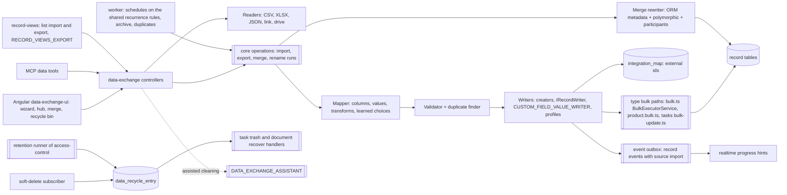

# Implementation Plan: Data import and export

> Translates an approved `spec.md` into architecture and tech choices. The plan owns
> implementation details; the spec owns behaviour.

**Feature ID**: `data-import-export`
**Spec**: `./spec.md`
**Tasks**: `./tasks.md`
**Status**: `Draft`
**Last updated**: 2026-11-23

---

## 1. Architecture Summary

A new plugin pair, `@gauzy/plugin-data-exchange` (`packages/plugins/data-exchange`) and `data-exchange-ui` (Angular),
loaded by `apps/api/src/plugins.ts` only when `GAUZY_DATA_EXCHANGE_ENABLED` is exactly `true` and gated per tenant by
`FEATURE_DATA_EXCHANGE`. The existing export menus, document import and time-entry import routes stay unchanged.
It builds on what exists:

- **Targets** are entries of the core record type registry (`custom-fields-and-forms` T2). This plan adds optional
  registry parts: `import` (creator, match keys, reference resolvers, child collections, tree parent, second-pass
  fields, duplicate rules), `rename` (identifier field and scope), `trash` (list, restore, purge, dependents) and
  `mergeGuard`. Composite targets are **import profiles**; profiles, migration toolkits and merge participants are a
  member `dataExchange` of `PluginContributions` (`packages/plugin/src/lib/plugin-contributions.ts`) on
  `@GauzyCorePlugin`, unioned by the core `plugin-contributions/` registry, so plugins declare them without importing
  this plugin and the plugin contributions report lists them; `registerImportProfiles`, `registerMigrationToolkits` and
  `registerMergeParticipants` are typed helpers that build those entries. The import templates other plugins declare
  (`customer_invoices`, `payments`, `accounting.chart`, …) are these profiles. Time entries are not a target: the
  existing time-entry import (column mapping, remembered columns, checks against recorded time and overlaps,
  per-row results, posting through the time log service) stays the one time import. Documents keep the Docs plugin's own
  import and export (`packages/plugins/docs/src/lib/import/`).
- **Writes** go through each type's own path: creators for create, the record writers of `record-views-and-search`
  (`IRecordWriter`) for update, `CUSTOM_FIELD_VALUE_WRITER` for custom values with source `IMPORT`, so validation,
  events and automations behave as for a person's save. Existing bulk-create services (`POST …/bulk`) back the creators
  of employees, users, candidates, tasks, expenses, tags and roles. Bulk changes and match-key upserts go through each
  type's existing bulk path where one exists: the core bulk contract (`packages/core/src/lib/api/bulk.ts`,
  `BulkExecutorService`: natural-key `upsert`, per-item outcomes) used by expenses, organizations and products
  (`product/product.bulk.ts`), and the task bulk update (`packages/core/src/lib/tasks/bulk-update.ts`); the plugin
  orchestrates (reading, mapping, batching, preview, undo) and is never a second writer.
- **External ids**: the ids carried in the files go to core `integration_map` (`entity`, `sourceId`,
  `gauzyId`) under an `integration_tenant` named for the files' origin, the map the integration importers already use, so
  later toolkit steps and re-imports resolve "customer 123" from an earlier file without a match key. Core
  `import_record` (uuid source ids) keeps serving the tenant archive import.
- **Reading uploads** reuses core `export-import/import/import-archive-extract.ts` for archives and the Docs import's
  `import-tenant-storage.ts` and `import-limits.ts`, moved into `packages/core/src/lib/export-import/import/` and
  re-exported by the docs plugin; CSV output uses `csv-writer` (a core dependency).
- **References** for merge and where-used are discovered from ORM metadata (every many-to-one column that points at the
  type's table, both ORMs), plus polymorphic links (`BasePerEntityType` tables: comments, mentions, reactions,
  favourites, activity; custom-field reference values; record-views notes, visits, tags and orders) and participants
  plugins register for special tables (`registerMergeParticipants`).
- **Runs** are core durable operations (`packages/core/src/lib/operation/`, `@AcceptedOperation` → `/api/operations`)
  with steps, resumable per batch (the operation lease recovers stalled runs, as the Docs import runner's stale-run
  recovery does); per-row results reuse the result model of `packages/core/src/lib/api/bulk-executor.service.ts`. A
  migration toolkit run is a parent operation whose child operations are its import runs.
- **Existing code stays**: the tenant export and import (`packages/core/src/lib/export-import/`) is not changed; its
  `export-redact.decorator.ts` and `spreadsheet-safe-row.ts` are reused by every export of this plugin. There is one
  import history: Settings → Data → Imports lists tenant archive imports from `import_history` (with their download)
  beside `data_import_run`, and the existing `apps/gauzy/src/app/pages/import-export/` page is also shown as the "Tenant
  archive" tab of Settings → Data while its own route keeps opening it exactly as today.
- **Trash**: the recycle bin restores and purges tasks through the existing task trash handlers (`PUT /tasks/:id/recover`,
  `DELETE /tasks/:id/trashed`, `task-trash-enabled.ts`, with the manager-scoped rules of `comments-and-trash`) and
  documents through the Docs plugin's `recover-document.handler.ts`, so who may restore and which events are published
  stay the same; the Angular task trash page (`pages/tasks/components/task-trash/`) stays and links to the bin filtered
  to tasks, and both show the same tasks with the same rights.
- **Schedules and retention**: recurring imports, exports and archive rules use the platform's one recurrence
  implementation, the frequency and period-claim rules of `packages/core/src/lib/invoice-schedule/` lifted to core by
  `business-document-engine`; recycle bin and file retention are kinds of the one retention model of
  `access-control-and-security` (`RETENTION_SOURCES`: `recycle-bin:<recordType>` declared with the default `KEEP`, so nothing is purged unless a
  period is set for the organization, 120 days suggested; `data-exchange.files` 30 days, this plugin's files only), whose daily runner calls this plugin's
  purge.
- **Deletion safeguards**: the where-used check lists references before a deletion; it blocks only references the
  type's own delete path refuses today, references a newly added record type declares blocking, and, where the
  organization turns `data.blockReferencedDeletion` on (off by default), any reference.



## 2. Tech Choices

| Concern | Choice | Rationale |
| ------- | ------ | --------- |
| Package | new `packages/plugins/data-exchange`, `-ui`; record type registry parts and the `dataExchange` contributions member | Principle I |
| Permissions and feature | `PluginContributions` on `@GauzyCorePlugin`: the nine permissions with `defaultFor`, `FEATURE_DATA_EXCHANGE` | no seed migration |
| CSV | streaming `csv-parser` (MIT, already a core dependency); decoding with `iconv-lite` (MIT, already in the dependency tree); byte-order-mark and heuristic detection in the plugin | no new parser |
| XLSX | `exceljs` (MIT, already used by the docs plugin) streaming reader and writer | 1,000,000 rows without loading the file |
| JSON | `stream-json` (BSD-3-Clause) for arrays over 10 MB | streaming |
| Legacy binary spreadsheets | refused (spec §8) | no approved library |
| Runs | core `OperationRegistry` operations with steps; toolkits as parent operations; queue `data-exchange`; per-row results in `data_import_row` because a run holds up to 1,000,000 rows with before-images for undo and row-filtered result pages, which do not fit an operation's result | durable, resumable, `/api/operations` |
| Writes | registry creators and writers, the types' bulk paths for bulk changes and upserts; custom values through `CUSTOM_FIELD_VALUE_WRITER` | each owner keeps its rules |
| External ids | core `integration_map` | one external-id map with the integration importers |
| Recurrence | shared recurrence and period-claim rules (`invoice-schedule` lifted to core) | one implementation |
| Retention | kinds of the `access-control-and-security` retention model | one retention model and runner |
| Reference discovery | TypeORM `entityMetadatas` relations and MikroORM `MetadataStorage` many-to-one properties | covers every plugin without declarations |
| Duplicate matching | blocking keys (normalised email, phone tail, name prefix) and trigram similarity in the plugin | no database extension; three dialects |
| Link fetching | core outbound endpoint policy used for webhooks (no private networks), 200 MB cap, 60 s timeout | one outbound policy |
| Push | outbox and `RealtimeHintsService.appendHint` (`packages/plugins/realtime`) | Principle VII |
| Assistant | `DATA_EXCHANGE_ASSISTANT` → `ai-agents-and-assistants`; fallback `ai-chat` `AiProviderRegistry` | tenant's own provider |

## 3. Data Model

All tables extend `TenantOrganizationBaseEntity` (soft delete, `isActive`, `isArchived`); JSON is `text` on every
dialect; keys `varchar(96)`; record ids into other plugins carry no foreign key. A bulk change and a bulk rename are
import runs with another source or mode, so per-record results and undo have one model.

| Table | Columns (besides base) | Indexes and uniqueness |
| --- | --- | --- |
| `data_import_run` | `targetKey`, `mode` (`CREATE`, `UPDATE`, `UPSERT`, `RENAME`), `sourceKind` (`UPLOAD`, `LINK`, `DRIVE`, `VIEW`, `MCP`, `SCHEDULE`, `TOOLKIT`), `sourceRef` text, `fileId`, `fileName` varchar(255), `fileHash` varchar(64), `headerShape` varchar(64), `options` text (delimiter, encoding, sheet, header row, formats, empty clears, mute notifications, run automations, confirm documents, create missing references), `mapping`, `valueMapping`, `transforms` text, `mappingTemplateId` null, `status` (`DRAFT`, `ANALYZING`, `READY`, `DONE`, `PARTIAL`, `FAILED`, `CANCELLED`, `TIMED_OUT`, `UNDONE`; while running, the state is the operation's), `dryRunAt`, `totals` text, `operationId`, `startedAt`, `finishedAt`, `undoUntil`, `undoneAt`, `requestedByUserId`, `toolkitOperationId` null, `sourceSystemId` null (the `integration_tenant` of external ids), `scheduleId` null, `periodKey` varchar(32) null | idx `(tenantId, organizationId, requestedByUserId, createdAt)`, `(tenantId, status)`, `(tenantId, targetKey, headerShape)`; unique `(scheduleId, periodKey)` where set |
| `data_import_row` | `runId` FK cascade, `sheet` varchar(64), `rowNumber` int, `phase` (`DRY_RUN`, `RUN`), `outcome` (`CREATE`, `UPDATE`, `UNCHANGED`, `SKIP`, `DUPLICATE`, `ERROR`, `WARNING`, `CHANGED_SINCE_PREVIEW`, `UNDONE`), `decision` (`SKIP`, `UPDATE_EXISTING`, `CREATE`, `MERGE`) null, `recordType`, `recordId`, `matchedRecordId`, `messages` text, `before` text (changed fields only), `values` text null (dry-run rows with outcome `CREATE` or `UPDATE`: the validated values after mapping, transforms, value mapping and reference resolution, kept with the dry run for 7 days so the run writes them without reading the file again, FR-27), `matchedVersion` varchar(64) null (the version of the matched record the dry run saw), `versionAfter` varchar(64), `batch` int | unique `(runId, phase, sheet, rowNumber)`; idx `(runId, phase, outcome)`, `(tenantId, recordType, recordId)` |
| `data_mapping_template` | `targetKey`, `name` varchar(160), `visibility` (`PRIVATE`, `SHARED`), `ownerUserId`, `source` (`USER`, `LEARNED`, `ASSISTANT`, `TOOLKIT`), `headerShape` varchar(64), `headers` text, `mapping`, `valueMapping`, `transforms`, `options` text, `usageCount` int, `lastUsedAt` | idx `(tenantId, targetKey, headerShape)`, `(tenantId, ownerUserId)` |
| `data_value_memory` | `targetKey`, `fieldKey` varchar(128), `fileValue` varchar(255) (normalised), `resolved` text, `hits` int | unique `(tenantId, organizationId, targetKey, fieldKey, fileValue)` |
| `data_export_run` (the export log of FR-46; one `AUDIT_EVENT_SINK` event per row) | `targetKey`, `viewKind`, `viewId` null, `filter` text, `columns` text, `childCollections` text, `format` (`CSV`, `XLSX`, `JSON`), `scope` (`ALL`, `SELECTED`, `SAMPLE`, `TEMPLATE`, `FOR_UPDATE`), `source` (`UI`, `VIEW`, `MCP`, `SCHEDULE`, `AUTOMATION`, `ARCHIVE`), `status`, `rowCount` int, `fileId`, `operationId`, `exportTemplateId` null, `scheduleId` null, `periodKey` varchar(32) null, `expiresAt`, `requestedByUserId` | idx `(tenantId, requestedByUserId, createdAt)`, `(tenantId, targetKey, createdAt)`; unique `(scheduleId, periodKey)` where set |
| `data_export_template` | `targetKey`, `name`, `columns` text, `format`, `options` text, `visibility`, `ownerUserId` | idx `(tenantId, targetKey)` |
| `data_merge` | `recordType`, `keptRecordId`, `mergedRecordIds` text, `fieldChoices` text, `referenceCounts` text, `status` (`PREVIEWED`, `RUNNING`, `DONE`, `FAILED`, `UNDONE`), `operationId`, `undoUntil`, `requestedByUserId` | idx `(tenantId, recordType, keptRecordId)` |
| `data_merge_journal` | `mergeId` FK cascade, `tableName` varchar(96), `columnName` varchar(64), `rowId` varchar(64), `fromId`, `toId` varchar(64), `action` (`REPOINT`, `DELETE_DUPLICATE`, `MOVE_CHILD`) | idx `(mergeId)`; append-only |
| `data_duplicate_candidate` | `recordType`, `recordIdA`, `recordIdB`, `score` numeric(5,4), `reasons` text, `status` (`OPEN`, `MERGED`, `DISMISSED`), `reviewedByUserId` | unique `(tenantId, recordType, recordIdA, recordIdB)`; idx `(tenantId, recordType, status)` |
| `data_recycle_entry` | `recordType`, `recordId`, `title` varchar(255), `deletedByUserId`, `deletedAt`, `groupId` uuid (one deletion with its dependents), `parentEntryId` null, `snapshot` text null (types that delete hard and opt in), `mergedIntoId` null, `restoredAt`, `restoredByUserId`, `purgeAfter` (from the retention kind of its type), `purgedAt` | unique `(recordType, recordId, deletedAt)`; idx `(tenantId, organizationId, recordType, deletedAt)`, `(purgeAfter)`, `(groupId)` |
| `data_archive_rule` | `recordType`, `viewKind`, `viewId`, `ageField` varchar(128), `ageDays` int, `exportFirst` bool, `exportFormat`, `recurrence` (shared recurrence rule, daily or weekly), `nextRunAt`, `lastRunAt`, `status`, `ownerUserId` | idx `(status, nextRunAt)` |
| `data_schedule` | `kind` (`IMPORT`, `EXPORT`), `targetKey`, `viewKind`, `viewId` null, `sourceKind` (`LINK`, `DRIVE`), `destination` (`DRIVE`, `INBOX`), `addressEnc` text (encrypted), `driveFolderId` null, `mappingTemplateId`, `exportTemplateId` null, `recurrence` (shared recurrence rule), `timeZone`, `nextRunAt`, `lastRunAt`, `lastFileHash` varchar(64), `status`, `ownerUserId` | idx `(status, nextRunAt)` |

**Core and shared changes (additive, no core schema change):**

- `packages/contracts/src/lib/data-exchange.model.ts`: targets, profiles, mapping, transforms grammar, value mapping,
  run and row results, export, merge, recycle entry, toolkit and port interfaces; `record-type.model.ts` gains optional
  `import`, `rename`, `trash`, `mergeGuard` parts; exported from `index.ts`.
- `packages/plugin/src/lib/plugin-contributions.ts`: `PluginContributions.dataExchange` (`importProfiles`,
  `migrationToolkits`, `mergeParticipants`), unioned by a registry in `packages/core/src/lib/plugin-contributions/`
  (inert without the plugin); helpers `registerImportProfiles`, `registerMigrationToolkits`,
  `registerMergeParticipants`; `core-record-import.ts` next to the record type registry with creators and match keys for
  contacts, vendors, employees, candidates, projects, tasks, items, expenses, incomes, tags and equipment (bulk-create
  services and the core bulk contract where they exist).
- `packages/core/src/lib/export-import/import/`: the Docs import's tenant storage and limit helpers moved here.
- `packages/core/src/lib/core/entities/subscribers/`: the soft-delete subscriber hook calls an optional
  `RECORD_DELETION_LISTENERS` port (bound to the recycle bin) after a registered type's soft removal; unbound, nothing
  happens.

**Profile contract for plugins** (other plugins rely on it: accounting chart and manual journals, invoices and bills,
payments, opening open items, assets, payroll tables, time-off openings, HR employees and reporting lines, structures
and routings, tax rates, suppliers, subscriptions):

```ts
registerImportProfiles([{                      // builds contributions.dataExchange.importProfiles of the plugin
  key: 'accounting.chart', labels: { en: 'Chart of accounts' }, recordType: 'LedgerAccount',
  modes: ['CREATE', 'UPDATE', 'UPSERT'], matchKeys: ['code'], tree: { parentColumn: 'parentCode', key: 'code' },
  children: [], secondPass: [], duplicateRules: [{ fields: ['code'], exact: true }],
  validateBatch: ChartImportService,          // cross-row checks and preview (owner keeps tree validation)
  writer: 'registry',                          // or a class implementing IImportRowWriter
  afterRun: ChartImportService,                // rebuild closure tables, recompute
  permission: 'ACCOUNTING_CHART_EDIT', featureKey: 'FEATURE_ACCOUNTING', undoable: true,
}]);
```

The engine owns reading, mapping, transforms, value mapping, reference resolution, dry run, error files, batching,
resume, undo and progress; the profile owns domain checks and writes. The `DATA_IMPORT_ENGINE` port (bound also as
`ACCOUNTING_IMPORT_ENGINE`) lets a plugin parse a file through the engine and keep its own reader as a fallback.

**Migration timestamps**: `packages/plugins/data-exchange` `1791000035100` to `1791000035199`.

**Migrations** (the shared core migration helpers of `@gauzy/core`; PostgreSQL, SQLite and
MySQL branches; idempotent, forward-only, both ORMs):

1. `1791000035100-CreateDataImportTables` — import run, import row, mapping template, value memory.
2. `1791000035110-CreateDataExportTables` — export run, export template.
3. `1791000035120-CreateDataMergeTables` — merge, merge journal, duplicate candidate.
4. `1791000035130-CreateDataRecycleTables` — recycle entry, archive rule.
5. `1791000035140-CreateDataScheduleTables` — schedule.

Permissions and default grants are plugin contributions; no migration is needed for them.

**Contracts**: `packages/contracts/src/lib/data-exchange.model.ts`, listed with the shared changes above; they reach the SDKs through the OpenAPI document.

## 4. API Surface

| Method | Endpoint | Permission | Description | Status |
| ------ | -------- | ---------- | ----------- | ------ |
| `GET` | `/api/data-exchange/targets[/:key]` | `DATA_IMPORT_RUN` or `DATA_EXPORT` | targets the caller may import or export, with fields, match keys, children | New |
| `GET` | `/api/data-exchange/targets/:key/template` | `DATA_IMPORT_RUN` | template file (`format`, `fields`, `helpRow`, `withRecords`) | New |
| `POST` | `/api/data-exchange/imports` | `DATA_IMPORT_RUN` + target create or edit | upload, `{ url }` or `{ fileId }` → draft run with sheets, headers, formats, suggested mapping | New |
| `GET` `PATCH` | `/api/data-exchange/imports[/:id]` | owner / `DATA_IMPORT_MANAGE` | runs; mapping, values, transforms, options | New |
| `GET` | `/api/data-exchange/imports/:id/{preview,rows}` | owner / manager | 20 rows as saved; row results by outcome, cursor | New |
| `POST` | `/api/data-exchange/imports/:id/{dry-run,run,cancel,retry,undo,assist}` | owner | `202` operations; `undo` and `assist` take `preview` | New |
| `PUT` | `/api/data-exchange/imports/:id/decisions` | owner | duplicate decisions per row or for all | New |
| `GET` | `/api/data-exchange/imports/:id/files/{errors,skipped,log}` | owner / manager | CSV or XLSX | New |
| `GET` `POST` `PUT` `DELETE` | `/api/data-exchange/mapping-templates[/:id]` | owner; shared: `DATA_IMPORT_MANAGE` | mapping templates | New |
| `POST` | `/api/data-exchange/bulk-changes` | `DATA_BULK_CHANGE` + edit of each record | `{ targetKey, view \| runId, changes, preview }` → preview or run; writes through the type's bulk route where one exists | New |
| `POST` `GET` | `/api/data-exchange/exports[/:id[/file]]` | `DATA_EXPORT` + read of the type | stream ≤ 50,000 rows or `202`; log; download | New |
| `GET` `POST` `PUT` `DELETE` | `/api/data-exchange/export-templates[/:id]` | `DATA_EXPORT` | export templates | New |
| `POST` | `/api/data-exchange/renames` | `RECORD_RENAME` + edit | one record or a file run | New |
| `POST` `GET` | `/api/data-exchange/merges/preview`, `/merges[/:id]`, `POST …/:id/undo` | `RECORD_MERGE` + edit kept, delete merged | preview counts and field choices; run; undo | New |
| `GET` `POST` | `/api/data-exchange/duplicate-candidates`, `POST …/:id/dismiss` | `RECORD_MERGE` | proposed duplicates | New |
| `GET` | `/api/data-exchange/where-used/:recordType/:id` | read of the record | referencing records by type, blocking flags (today's refusals and declared ones; every reference only with `data.blockReferencedDeletion`); each referencing type's rows pass its read scope (the type's read permission and hard-coded scopes, plus `DATA_EXCHANGE_ACCESS_RULES` record rules when bound) before they are listed, counted or followed recursively; unreadable references give only `hiddenBlocking: true` when one of them blocks, with no type, count or id | New |
| `GET` `POST` | `/api/data-exchange/recycle-bin`, `POST …/restore`, `POST …/purge` | `RECYCLE_BIN_VIEW` (own) / `RECYCLE_BIN_MANAGE` | list, restore groups, purge with `confirm: true`; tasks and documents through their own trash handlers and rules | New |
| `GET` | `/api/data-exchange/imports/history` | `DATA_IMPORT_RUN` (own) / `IMPORT_ADD` | one history: `data_import_run` rows and tenant archive imports of `import_history` | New |
| `GET` `POST` `PUT` `DELETE` | `/api/data-exchange/archive-rules[/:id]`, `POST …/:id/run` | `DATA_ARCHIVE_MANAGE` | rules; run with `preview` | New |
| `GET` `POST` `PUT` `DELETE` | `/api/data-exchange/schedules[/:id]` | `DATA_IMPORT_MANAGE` (import) / `DATA_EXPORT` (export) | recurring imports and exports | New |
| `GET` `POST` | `/api/data-exchange/toolkits`, `POST …/:key/runs`, `POST /toolkit-runs/:operationId/{dry-run,run}` | `DATA_IMPORT_MANAGE` | toolkits and their runs (parent core operations) | New |
| `*` | `/api/export/**`, `/api/import/**`, `/api/import-history/**`, every `POST …/bulk`, soft delete and recover routes, `/api/tasks/trash` | unchanged | existing behaviour | Unchanged |

Controllers carry `@FeatureFlag(FEATURE_DATA_EXCHANGE)`, `TenantPermissionGuard`, `@Permissions()`, class-validator
DTOs, Swagger, idempotency keys on run, merge and purge routes, cursor pagination; uploads through the platform's
multipart handling with the 200 MB cap. Errors: `IMPORT_FILE_UNSUPPORTED`, `IMPORT_FILE_TOO_LARGE`,
`IMPORT_REQUIRED_UNMAPPED`, `IMPORT_TARGET_FORBIDDEN`, `IMPORT_RUN_STATE`, `MERGE_FORBIDDEN`, `MERGE_CROSS_ORGANIZATION`,
`DELETE_BLOCKED` (409, with references), `RESTORE_PARENT_DELETED`, `PURGE_NOT_CONFIRMED`.

**Ports offered** (contracts tokens, injected `@Optional()`, bound in `apps/api/src/plugin-composition.ts`):

| Port | Consumers | Contract |
| --- | --- | --- |
| `DATA_IMPORT_ENGINE` (also `ACCOUNTING_IMPORT_ENGINE`) | accounting, general ledger, any profile owner | `parse(file, options)`, `start(profileKey, source, options, actor)` |
| `RECORD_VIEWS_EXPORT` | record-views | `startExport(recordType, viewRef \| definition, columns, format, viewer)` → stream or operation |
| `DATA_WHERE_USED` | record pages, record-views bulk delete, other plugins | `check(recordType, ids, viewer)` → references and blocking flags |
| `RECORD_DELETION_LISTENERS` (bound into core) | core subscriber | `afterSoftRemove(recordType, ids, context)` |
| `RECORD_TIMELINE_SOURCES` contribution | record-views | import, merge, rename and restore entries |
| automation actions `data.export_view`, `data.import_from_link` (`registerAutomationActions`) | flows | export a view; start an import from a link with a template |

**Ports consumed** (unbound → the capability is not offered): `CUSTOM_FIELD_METADATA`, `CUSTOM_FIELD_VALUE_WRITER`,
`CUSTOM_FIELD_VALUE_READER`, `RECORD_VIEWS_QUERY`, `RECORD_VIEWS_SELECTION`, `DATA_EXCHANGE_DOCUMENTS` (confirm drafts
through `business-documents`), `DATA_EXCHANGE_DRIVE` (`drive` folders), `DATA_EXCHANGE_ASSISTANT`,
`DATA_EXCHANGE_ACCESS_RULES` (record and field rules of `access-control-and-security`), `NOTIFICATION_DISPATCHER` (else
`INBOX_ITEM_WRITER`), `AUDIT_EVENT_SINK` (one event per export log row), `RETENTION_SOURCES` (entries offered for the
recycle bin per type, archive by type and files).

**Consumer tokens answered** (bound in `apps/api/src/plugin-composition.ts` to the import engine and the bulk change; each consumer plan states the shape it calls and its fallback): `ACCOUNTING_DATA_EXCHANGE`, `SHEETS_BULK_CHANGE`.

## 5. Events, Real-Time and Notifications

| Event | Emitted when | Consumers |
| ----- | ------------ | --------- |
| `data_import.started` / `.finished` / `.undone` | run lifecycle | inbox notice to the requester, webhooks, automations, realtime |
| `data_export.finished` | an export file is ready | inbox notice with the link |
| `record.merged` / `.merge_undone` `{ recordType, keptId, mergedIds }` | merge lifecycle | search re-index, timeline, webhooks, automations |
| `record.renamed`, `record.restored`, `record.purged` | rename, restore, purge | search, timeline, webhooks |
| Record events of the owners with `origin: { kind: 'import', runId }` | rows written | automations (filter by origin), the storm guard of automations |
| Hint `data-import:<runId>` | every second during a run | live progress in the wizard and the hub |

Notification categories: `data.import-finished`, `data.export-ready`, `data.merge-finished`, `data.schedule-failed`.
Outbox events carry ids only.

## 6. UI Surface

- **Angular `packages/plugins/data-exchange-ui`** (lazy, hidden on `404`): Settings → Data `/pages/settings/data` with
  Imports (one history with tenant archive imports), Tenant archive (the existing import-export page), Exports,
  Templates, Recycle bin, Archive rules, Schedules, Toolkits and Duplicates; retention periods are set on the retention
  page of `access-control-and-security`; import wizard
  `/pages/data/import/:runId` (source, sheet and formats, mapping with learned suggestions, value mapping, transforms,
  assistant pane, preview, dry run with filters and duplicate decisions, live progress, results, downloads, undo); merge
  page `/pages/data/merge/:recordType`; toolkit checklist `/pages/data/toolkits/:key`. The existing
  `/pages/import-export` route keeps opening the page exactly as today, with the feature on and off; the task trash
  page links to the recycle bin filtered to tasks.
- **Embeddables `packages/ui-core/shared/src/lib/data-exchange/`**: `ngx-import-button` (list menus and empty states),
  `ngx-export-dialog`, `ngx-merge-dialog`, `ngx-where-used-dialog`, `ngx-rename-dialog`; record pages and record-views
  lists place them through bulk and record action contributions.
- No React package: the Angular embeddables above are the only clients' screens of this feature.
- i18n keys `DATA_EXCHANGE.*` in every locale of `packages/ui-core/i18n`.

## 7. MCP Tools, SDKs and Integrations

New `packages/mcp-server/src/lib/tools/data-exchange.ts`, registered in `register-all-tools.ts`:

| Tool | Input | Output |
| --- | --- | --- |
| `data_list_targets` | — | targets with fields and match keys |
| `data_import_start` | target, mode, file (base64 up to 10 MB, file id or https link), mapping template or mapping, `dryRun` (default true) | run id, counts per outcome, first 50 problems |
| `data_import_report` / `data_import_commit` | run id | row results / run started |
| `data_import_undo` | run id, `preview` (default true) | records to revert and kept ones |
| `data_export` | target or view, columns, format | file link or operation |
| `records_merge_preview` / `records_merge` | type, kept id, merged ids, field choices | reference counts / merge run |
| `recycle_bin_list` / `recycle_bin_restore` | filters / entry ids | entries / restored records |

OpenAPI additive; Kiota SDKs regenerated after merge. Formats: CSV (UTF-8 with optional byte-order mark, RFC 4180), XLSX,
JSON; every exported cell passes core `spreadsheet-safe-row.ts`; columns marked by `export-redact.decorator.ts` are
redacted.

## 8. Background Jobs

| Trigger | When | What it does | Idempotency |
| ------- | ---- | ------------ | ----------- |
| operation `data-exchange.import` (queue `data-exchange`) | dry run, run, retry, bulk change, rename | read, map, validate, resolve, write batches of 200, second pass, after-run hooks, error files; a run started from a retained dry run reads the dry-run rows' `values` instead of the file, writes them through the same creators and writers (validated again), and marks a row whose matched record changed since `matchedVersion` `CHANGED_SINCE_PREVIEW` | row key `(runId, phase, sheet, rowNumber)`; resume from the last committed batch |
| operation `data-exchange.export` | export above 50,000 rows, scheduled or archive export | pages through the view, writes the file | per run |
| operation `data-exchange.merge` | merge above 10,000 references or undo | repoint per table in batches, journal | journal rows per table and row |
| operation `data-exchange.toolkit` | toolkit dry run or run | parent operation; one child import operation per step in dependency order | per toolkit run and step |
| `data-exchange.schedules` | every 5 minutes | due recurring imports (skips an unchanged file by hash) and exports, through the shared recurrence and period-claim rules | unique `(scheduleId, periodKey)` on the run |
| `data-exchange.archive` | daily 02:00 tenant time | archive rules due by the shared recurrence rules, export first when asked | per rule and day |
| retention kinds `recycle-bin:<recordType>`, `data-exchange.files` | daily, by the retention runner of `access-control-and-security` (this plugin's `data-exchange.purge` only while that plugin is not loaded, and then only for this plugin's files) | purges recycle entries past a retention period set for the organization (`KEEP` by default: nothing is purged; tasks and documents through their own purge handlers), this plugin's files past retention, row payloads past the undo window | status checks |
| `data-exchange.duplicates` | nightly per type with duplicate rules | candidate pairs by blocking keys and similarity | unique pair |
| `data-exchange.recycle-backfill` | once when the feature is enabled | indexes already soft-deleted records of registered types | per type watermark |

Queue jobs run in the API; schedules in the worker (`DataExchangeSchedulePlugin` in `apps/worker/src/plugins.ts`);
without a queue root the API runs them on in-process timers under a database lock. On SQLite one batch writer runs at a
time.

## 9. Security & Permissions

`data-exchange.permissions.ts`, declared as permission contributions: `DATA_IMPORT_RUN`, `DATA_IMPORT_MANAGE`, `DATA_EXPORT`, `DATA_BULK_CHANGE`,
`RECORD_RENAME`, `RECORD_MERGE`, `RECYCLE_BIN_VIEW`, `RECYCLE_BIN_MANAGE`, `DATA_ARCHIVE_MANAGE`. `defaultFor`: all to
`SUPER_ADMIN` and `ADMIN`; `DATA_IMPORT_RUN`, `DATA_EXPORT`, `DATA_BULK_CHANGE`, `RECORD_MERGE`, `RECYCLE_BIN_VIEW` to
`MANAGER`; `DATA_IMPORT_RUN`, `DATA_EXPORT`, `RECYCLE_BIN_VIEW` to `DATA_ENTRY`; `DATA_EXPORT`, `RECYCLE_BIN_VIEW` to
`EMPLOYEE`. The existing `IMPORT_ADD` and `EXPORT_ADD` keep guarding the tenant export and import only.

Every import also needs the target's own create or edit permission and, per field, the custom field `editPermission`
and field rules (`DATA_EXCHANGE_ACCESS_RULES` when bound); a masked field cannot be mapped. Rows run in the requester's
request context (`RequestContext`), never as a system actor; scheduled imports run as their owner and pause when the
owner loses the permission. Exports apply the type's read scope, `CustomFieldVisibility`, `@VisibleWith` metadata and
redaction. Uploaded and fetched files are stored in the tenant's file storage, size-capped, never executed; spreadsheet
formulas are read as their cached values; links are fetched under the outbound endpoint policy and stored encrypted.
The assistant receives only the header row, at most 20 sample rows and the target's field catalogue. Merge needs edit of
the kept record and delete of the merged ones and never crosses organizations; purge needs `RECYCLE_BIN_MANAGE` and an
explicit confirmation.

## 10. Observability

Run and row logs, the export log, the merge journal and recycle entries; activity entries for merges, renames, restores,
purges and retention changes; metrics `data_import_rows_per_second{target}`, `data_import_failure_ratio{target}`,
`data_export_rows_total`, `data_queue_depth`, `data_undo_total{kind}`, `data_recycle_purged_total`.

## 11. Phased Rollout

1. **Phase 1 — Surface what exists** (flag off): contracts, registry parts and the `dataExchange` contributions member,
   plugin scaffold and tables, one import history with the tenant archive tab, recycle bin over the existing
   soft-deleted records with the existing restore behaviour (task and document trash handlers), exports of record types and views (CSV,
   XLSX, JSON) bound to `RECORD_VIEWS_EXPORT`, mapped create imports on the types that already have bulk-create services
   plus contacts, vendors and items, error files, MCP tools with dry run.
2. **Phase 2 — Depth**: every registered target with custom fields and custom record types, composite profiles and the
   party profiles, update and create-or-update, value mapping, transforms, templates, child rows, trees, second pass,
   retry, bulk change through the types' bulk paths, rename, merge with discovered references, where-used, retention
   kinds and purge, archive rules, toolkits with external ids in `integration_map`, `DATA_IMPORT_ENGINE`, reports.
3. **Phase 3 — Advanced capabilities**: learned mappings, duplicates before writing, batch undo of imports, merge undo,
   assisted cleaning, recurring imports and scheduled exports, duplicate candidates.
4. **Phase 4 — General availability**: the feature is off by default; after the trial period it may be switched on by default for new tenants only; existing tenants keep their setting until an administrator changes it.

## 12. Constitution Reconciliation

- I Plugin-first: plugin pair; core gains optional registry parts, a contributions member and a deletion listener port.
- II Tenant/organization scoping: every table on the tenant-organization base; rows run in the requester's context.
- III Both ORMs, additive migrations: five plugin migrations on three dialects; reference discovery for both ORMs.
- IV Default-off flag; nothing removed: deploy switch and `FEATURE_DATA_EXCHANGE`; tenant export and import untouched.
- V Contracts and API first: contracts, REST, OpenAPI and SDKs before the wizard.
- VI Permissions, privacy, security: nine permissions, form-level validation, masked and logged exports, safe fetching.
- VII Real-time through the event bus: progress hints and record events with origin through the outbox.
- VIII i18n and accessibility: keys in every locale; keyboard wizard; labels matched in every language.
- IX Tests: unit, ORM parity, dialect and e2e per route; round-trip specs per target.
- X Behaviour-first spec: implementation stays in this plan.
- XI Documentation describes our platform only.

## 13. Risks & Mitigations

| Risk | Likelihood | Impact | Mitigation |
| ---- | ---------- | ------ | ---------- |
| Imports bypass a type's rules | Low | High | writes only through creators, writers and the custom value writer; e2e per target |
| Merge misses a reference | Medium | High | discovery from ORM metadata on both ORMs, polymorphic tables, participants; journal and undo; a post-merge check counts references left on merged ids |
| Unique conflicts while repointing | Medium | Medium | per-table strategies: drop duplicate join rows, participants for special tables |
| Large files exhaust memory | Medium | Medium | streaming readers; batches of 200; 200 MB cap |
| Automation storms from imports | Medium | Medium | origin on events, notifications muted, the automation storm guard |
| Undo overwrites newer work | Low | High | version and timestamp checks per record; changed records listed, never reverted |

## 14. References

- Spec: `./spec.md` · Tasks: `./tasks.md` · Related: `../custom-fields-and-forms/plan.md`,
  `../record-views-and-search/plan.md`, `../accounting-foundation/plan.md`, `../report-builder-and-dashboards/plan.md`
- Code: `packages/core/src/lib/export-import/` (`export-redact.decorator.ts`, `spreadsheet-safe-row.ts`,
  `import-history/`, `import/import-archive-extract.ts`), `packages/core/src/lib/api/{bulk,bulk-create,bulk-executor.service}.ts`,
  `packages/core/src/lib/tasks/{bulk-update.ts,task-trash-enabled.ts}`, `packages/core/src/lib/product/product.bulk.ts`,
  `packages/core/src/lib/integration-map/`, `packages/core/src/lib/invoice-schedule/`, `packages/core/src/lib/operation/`,
  `packages/core/src/lib/core/entities/subscribers/`, `packages/plugins/docs/src/lib/import/`,
  `packages/plugins/docs/src/lib/commands/handlers/recover-document.handler.ts`,
  `packages/plugins/task-automations/src/lib/database/migration-helpers.ts`, `apps/gauzy/src/app/pages/import-export/`
