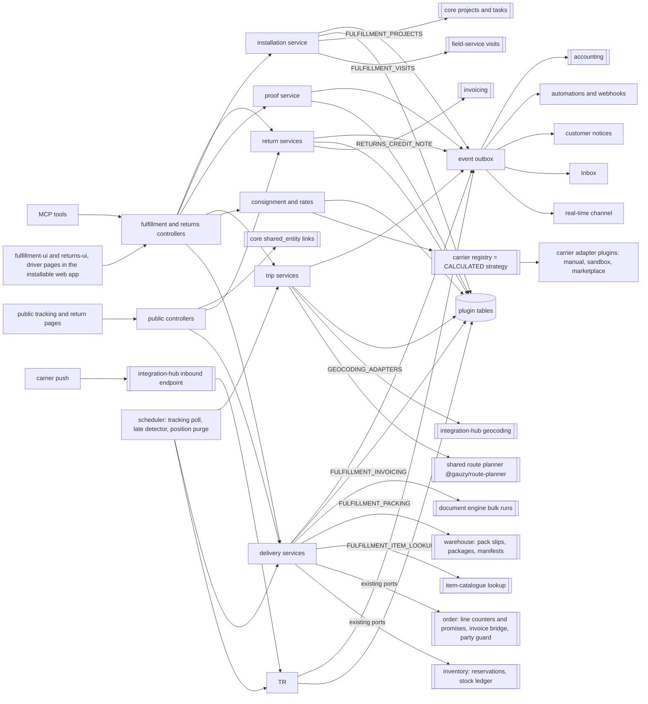

# Implementation Plan: Delivery and shipping

> Translates an approved `spec.md` into architecture and tech choices. The plan owns
> implementation details; the spec owns behaviour.

**Feature ID**: `delivery-and-shipping`
**Spec**: `./spec.md`
**Tasks**: `./tasks.md`
**Status**: `Draft`
**Last updated**: 2026-11-23

---

## 1. Architecture Summary

The work extends three existing plugins and adds two Angular UI plugins: `@gauzy/plugin-fulfillment` (deliveries,
shipping rules, carriers, consignments, tracking, trips, drivers, vehicles, proofs, installations), `@gauzy/plugin-returns`
(delivery-bound returns, restock rules, credit notes, self-service) and `@gauzy/plugin-warehouse` (packages on its pack
slips; its manifests are reused). Carriers are separate plugins behind a registry the fulfilment plugin owns; trip
planning uses the route planner shared with `maintenance-and-field-service`. A "delivery" in the app is the existing
`Fulfillment` row; no parallel document is introduced. Every screen, the driver's included, is a page of the Gauzy web
app.

**Built on what exists, one model per concept.**

- **Promises**: a delivery's promise is its order lines' `promisedAt` (`order_line.promisedAt`, written only by the
  promise service of `sales-order-management`); the late detector and the on-time report read it there. No promise
  column on the delivery.
- **Carrier facts**: the consignment is the source of carrier, service, tracking and label. Booking writes the
  existing `fulfillment.providerId` (the adapter's provider key), `carrier`, `service`, `trackingNumber` (the master
  tracking number), `trackingUrl`, `labelUrl` and `labelData`, and the existing `pack_slip.carrierKey`,
  `trackingNumber` and `labelUrl`, so the label route, manifests and every current reader keep working; these columns
  are not edited by hand on a consigned delivery.
- **Packages**: `pack_slip_package` rows are the packages; the pack slip's `packageCount`, `totalWeight` and
  `totalVolume` are derived from them whenever a slip has packages; per-package tracking numbers and labels sit on the
  package rows, and the slip's own tracking number and label are the consignment's master ones.
- **Provider keys**: a carrier adapter registers under a provider key, the key the existing
  `region.fulfillmentProviderKeys`, `fulfillment.providerId` and `shipping_option.providerKey` already hold; regional
  eligibility of carrier services reads `region.fulfillmentProviderKeys`.
- **Rates**: the carrier registry is registered as the strategy of the existing `CALCULATED` shipping price type
  (selected by `shipping_option.providerKey`), so `ShippingOptionService.calculate` and the cart's rating path
  (`CART_SHIPPING_RATE`, `resolveShippingRate`) get live rates; estimates for quotations go through the existing
  `POST /shipping-options/calculate`.
- **Carrier pushes** arrive on the inbound endpoints of `integration-hub` (`POST /api/hooks/in/:token`,
  `integration_inbound_delivery`), with one inbound handler per adapter (`inboundHandlers` contribution); the adapter
  verifies its own signature scheme. Without the hub, tracking is polled.
- **Public links**: the tracking and return links are core `shared_entity` rows (hashed token, expiry, revocation,
  views, as extended by `access-control-and-security`); the built-in tracking and return pages stay in
  `public-layout-ui`.
- **Bulk invoicing** of deliveries starts a document-engine bulk run (`business-document-engine`, core operation
  `BUSINESS_DOCUMENT_BULK`, grouping per party and currency) through the order's invoice bridge.
- **Existing document types**: deliveries and returns exist today in the fulfillment and returns plugins, so their
  types register with the document engine with `preexisting: true` (`business-document-engine` FR-113): the engine's
  added locks, refusals and tolerances stay off for them unless the organization turns a type policy on.
- **Route planning**: one shared route planner package, `@gauzy/route-planner` (`packages/route-planner`: the
  `RoutePlanner` contract and registry, a built-in planner for several routes with time windows, locked stops and
  capacities by insertion heuristic plus local search, deterministic, time-boxed, travel-time providers), used by this
  plugin for trips and shared with field-service dispatch (`maintenance-and-field-service`); this plan
  adds only its constraints (depot = the
  ship-from warehouse, locked stops, vehicle payload and volume, stop service minutes). Straight-line distances by
  default; a road-distance provider plugs into that package as a travel-time provider. Positions come from the address book's coordinates,
  filled through the geocoding adapters of `integration-hub` (`GEOCODING_ADAPTERS`).
- **Installations**: with `maintenance-and-field-service` loaded, scheduling an installation creates its service visit
  (technician, schedule, signature, labour and report are the visit's; it consumes `delivery.installation.completed`
  for the installed base); without it, the installation record carries them and its labour comes from a core task's
  tracked time. Installed quantities and serials per delivery line are always on the installation record.
- **Vehicles** are core `equipment` rows; `delivery_vehicle` holds only what equipment lacks (registration, payload,
  volume, validity dates, odometer, default driver) and is read by `expenses-and-travel` through `EXPENSE_VEHICLES`.
  Vehicles are edited on the existing Equipment page.
- **Scanning** resolves codes through the item lookup of `item-catalogue` (`/item-lookup`: barcodes with units,
  customer codes, part numbers), falling back to `product_variant.barcode` without it.
- **Reports** are report-builder definitions; **migrations** use the shared core migration helpers (`@gauzy/core`,
  `database/migration-helpers.ts` beside `check-constraint.helper.ts`); **permissions** are contributions.

## 2. Tech Choices

| Concern | Choice | Rationale |
| --- | --- | --- |
| Packages | existing `fulfillment`, `returns`, `warehouse`; new `fulfillment-ui`, `returns-ui`; carrier adapters as `packages/plugins/carrier-<key>` (`carrier-manual`, `carrier-sandbox` shipped); shared `packages/route-planner` (`@gauzy/route-planner`) with `maintenance-and-field-service` | Principle I; extend, adapters pluggable, one route planner |
| Delivery record | existing `Fulfillment` + `FulfillmentLine`, extended | one model |
| Carrier contract | `CarrierAdapter` interface + `carrierAdapterRegistry` (module-level registry filled at plugin bootstrap, the cart checkout registry idiom) keyed by provider key; the existing `FULFILLMENT_LABEL_PROVIDER` port bound to the registry dispatcher; the registry registered as the `CALCULATED` shipping price strategy | keeps the existing label and rating routes |
| Carrier pushes | `integration-hub` inbound endpoints with one inbound handler per adapter; polling without the hub | one inbound facility |
| Route planning | shared route planner `@gauzy/route-planner` (also field-service dispatch) with delivery constraints | one solver |
| Geocoding | `GEOCODING_ADAPTERS` of `integration-hub` fills the address's existing latitude and longitude; unbound → stops flagged | one geocoding port |
| Public links | core `shared_entity` for tracking and return links | one link facility |
| Credentials | core integration framework (`IntegrationTenant`, encrypted `IntegrationSetting`); `carrier_account` keeps only the reference | Principle VI |
| Files | platform file storage (image assets) for labels, signatures, photos | existing service |
| Persistence | MultiORM entities, MikroORM repositories, tri-dialect migrations per plugin set with the shared core migration helpers | Principle III; no plugin copy |
| Events and jobs | event outbox and consumer registry; `@ScheduledJob` + `@QueueWorker` (ticks in `job_execution`), in-process fallback | Principle VII |
| Permissions | contributions in `fulfillment.permissions.ts` and `returns.permissions.ts` with `defaultFor` | no seed migration |
| Driver client | pages of `fulfillment-ui` in the installable Gauzy web app (its existing offline worker, `apps/gauzy/ngsw-config.json`), with camera, signature pad and position | no separate app |
| New ports (declared by the consuming plugin, bound in `apps/api/src/plugin-composition.ts`) | `FULFILLMENT_PACKING` (warehouse `PackSlipService`, so packing works without `FEATURE_WAREHOUSE`), `FULFILLMENT_PROJECTS` (core project and task services), `FULFILLMENT_VISITS` (field-service visits; unbound → installation record with a core task), `FULFILLMENT_ITEM_LOOKUP` (`item-catalogue` lookup; unbound → variant barcode), `FULFILLMENT_PARTY_GUARD` (the order plugin's `SALES_PARTY_GUARD`: party holds and credit checks), `FULFILLMENT_INVOICING` (the order invoice bridge and the document-engine bulk run), `RETURNS_CREDIT_NOTE` (invoicing; unbound → refund path only), `FULFILLMENT_LOT_BUNDLES` and `RETURNS_LOT_BUNDLES` (lot and serial bundles on fulfilment, return, claim and exchange lines, bound by `serials-and-batches`; unbound → `lotSerials` text as today); consumed: `GEOCODING_ADAPTERS` (optional); provided by the returns plugin: `FIELD_SERVICE_RETURNS` (`maintenance-and-field-service` files an `order_claim` or `order_exchange` on the delivering order for a replacement or refund, so stock and refunds run here) | the existing port idiom; each unbound port has a documented fallback |
| Flags | `@FeatureFlag(FEATURE_FULFILLMENT)` added to the 5 fulfilment controllers; `FEATURE_RETURNS` kept; new `FEATURE_DELIVERY_TRIPS` on trip, driver and vehicle controllers; `FEATURE_MULTI_WAREHOUSE` (declared today) read for deliveries of one order from several warehouses | wire declared codes |

## 3. Data Model

All new tables extend `TenantOrganizationBaseEntity`; weights in kg and dimensions in cm as `numeric(12,3)`; money
`numeric(20,6)` with currency; JSON as `text`. References into other plugins carry no FK (the set that creates a
target constrains it).

### New or changed entities

| Table (plugin) | Columns (besides base) | Keys and indexes |
| --- | --- | --- |
| `fulfillment` (+, fulfillment) | `deliveryTermsId`, `projectId`, `consignmentId`, `tripStopId`, `creditDecisionId` uuid (the `sales_credit_decision` row of a delivery awaiting credit release); `deliveryTermsPlace`, `buyerReference` varchar(255); `shippingCost` numeric; `shippingCostCurrency` varchar(3); `trackingState` varchar(24); `isDirect` bool default false; `awaitingCredit` bool default false; `installationState` varchar(16) default `NONE`. The existing `providerId`, `carrier`, `service`, `trackingNumber`, `trackingUrl`, `labelUrl`, `labelData` are written from the consignment | index `consignmentId`, `tripStopId` |
| `fulfillment_line` (+) | `packedQuantity`, `installedQuantity`, `returnedQuantity`, `invoicedQuantity`, `refusedQuantity` numeric default 0; `lotSerials` text; `lotSerialBundleId` uuid; `customerItemCode` varchar(64); `inspectionState` varchar(16) | — |
| `shipping_option` (+) | `bandBasis` varchar(16) (`SUBTOTAL`,`WEIGHT`); `bands` text; `aboveLastBand` varchar(16) (`HIDE`,`LAST_PRICE`); `analyticHint` varchar(64); new `priceType` value `BANDED`; `CALCULATED` options name a carrier provider key in the existing `providerKey` | — |
| `shipping_package_preset` (fulfillment) | `name`, `lengthCm`, `widthCm`, `heightCm`, `tareWeightKg`, `maxWeightKg`, `carrierPackageCode`, `isDefault` | unique (`organizationId`,`name`) |
| `carrier_account` (fulfillment) | `providerKey` varchar(64) (the adapter's provider key), `name`, `integrationTenantId` uuid, `mode` (`TEST`,`LIVE`), `enabledServices` text, `defaultPresetId`, `status`, `inboundEndpointId` uuid null (its `integration-hub` inbound endpoint) | unique (`organizationId`,`name`); index `providerKey` |
| `delivery_consignment` (fulfillment; the source of carrier facts) | `number`, `carrierAccountId`, `serviceCode`, `warehouseId`, `toAddress` text, `pickupFrom`, `pickupTo`, `declaredValue`, `currency`, `contentsDescription`, `contentKind` (`GOODS`,`DOCUMENTS`), `deliveryTermsId`, `status` (`DRAFT`,`RATED`,`BOOKED`,`HANDED_OVER`,`CANCELED`), `quotes` text, `selectedQuote` text, `bookedAt`, `cost`, `costCurrency`, `manifestId`, `pickupRef`, `externalId`, `version` | unique (`organizationId`,`number`); index (`carrierAccountId`,`status`) |
| `fulfillment_tracking_event` (fulfillment) | `fulfillmentId`, `consignmentId`, `occurredAt`, `code` varchar(24), `carrierCode` varchar(64), `description`, `location`, `source` (`PUSH`,`POLL`,`DRIVER`,`USER`), `externalEventId` varchar(128), `inboundDeliveryId` uuid null (the hub delivery it came from) | unique (`fulfillmentId`,`source`,`externalEventId`); index (`fulfillmentId`,`occurredAt`) |
| `delivery_driver` (fulfillment) | `employeeId`, `vendorId`, `userId` uuid null; `name`, `phone`; `licenceNumber` varchar(64); `licenceCategories` varchar(64); `licenceValidFrom`, `licenceValidTo` date; `isActive` | unique (`organizationId`,`employeeId`) where not null |
| `delivery_vehicle` (fulfillment; extension of an `equipment` row) | `equipmentId` (core `equipment`, no FK per the cross-set rule); `registration` varchar(32); `payloadKg`, `volumeM3`; `insuranceValidTo`, `inspectionValidTo` date; `odometerKm` int; `defaultDriverId`; `isActive` | unique (`organizationId`,`registration`); unique `equipmentId` |
| `delivery_trip` (fulfillment) | `number`, `tripDate`, `departureAt`, `warehouseId`, `vehicleId`, `driverId`, `status` (`DRAFT`,`READY`,`ON_ROUTE`,`COMPLETED`,`CANCELED`), `plannerKey` (the route planner's travel-time provider), planned and actual `distanceKm` / `durationMin`, `startedAt`, `completedAt`, `odometerStart`, `odometerEnd`, `note`, `version` | unique (`organizationId`,`number`); index (`organizationId`,`tripDate`,`status`), `driverId` |
| `delivery_trip_stop` (fulfillment) | `tripId` FK cascade; `sequence` int; `isLocked`; `address` text; `latitude`, `longitude` numeric(10,7); `contactName`, `contactPhone`; `windowFrom`, `windowTo`, `plannedArrivalAt`, `etaAt`, `arrivedAt`, `departedAt` timestamp; `status` (`PENDING`,`ARRIVED`,`DONE`,`FAILED`,`SKIPPED`); `failureReason`; `distanceFromPreviousKm` | unique (`tripId`,`sequence`) |
| `delivery_trip_position` (fulfillment) | `tripId`, `recordedAt`, `latitude`, `longitude`, `accuracyM`, `speedKmh`, `clientKey` | unique (`tripId`,`clientKey`); index (`tripId`,`recordedAt`) |
| `delivery_proof` (fulfillment) | `fulfillmentId`, `tripStopId`, `outcome` (`DELIVERED`,`PARTIAL`,`REFUSED`,`FAILED`), `recipientName`, `signatureAssetId`, `photoAssetIds` text, `latitude`, `longitude`, `accuracyM`, `capturedAt`, `receivedAt`, `capturedByUserId`, `clientKey`, `lineOutcomes` text, `failureReason`, `note` | unique (`tenantId`,`clientKey`); index `fulfillmentId` |
| `delivery_installation` / `_line` (fulfillment) | `number`, `fulfillmentId`, `visitId` uuid null (the field-service visit when that plugin is loaded), `status` (`SCHEDULED`,`DONE`,`CANCELED`), `scheduledAt`, `completedAt`, `technicianEmployeeId`, `taskId`, `signatureAssetId`, `labourMinutes` (these five only without a visit), `note` / `installationId` FK cascade, `fulfillmentLineId`, `quantity`, `serials` text, `uninstalledQuantity` | unique (`organizationId`,`number`); index `visitId` |
| `delivery_contact_preference` (fulfillment) | `contactId`, `channel` (`NONE`,`EMAIL`,`TEXT`), `events` text | unique (`organizationId`,`contactId`) |
| `pack_slip_package` (warehouse) | `packSlipId` FK cascade, `sequence`, `presetId`, `lengthCm`, `widthCm`, `heightCm`, `grossWeightKg`, `netWeightKg`, `contents` text, `trackingNumber`, `labelAssetId`, `consignmentId`; the slip's `packageCount`, `totalWeight`, `totalVolume` are derived from these rows | unique (`packSlipId`,`sequence`); index `trackingNumber` |
| `order_return` (+, returns) | `fulfillmentId`, `creditNoteInvoiceId` uuid; `source` varchar(24) (`STAFF`,`SELF_SERVICE`,`REFUSED_AT_DOOR`); `autoApproved` bool; `photoAssetIds` text; `restockLocationId` uuid | index `fulfillmentId` |
| `order_return_line` (+) | `fulfillmentLineId`; `lotSerials` text | index `fulfillmentLineId` |
| `order_return_reason` (+) | `restockRule` varchar(16) default `SELLABLE`; `isAutoApprovable` bool default false (`procurement` adds `appliesTo`: `SALES`, `PURCHASE`, `BOTH`; customer returns offer the `SALES` and `BOTH` reasons) | — |

The tracking and self-service return links are `shared_entity` rows of the delivery (no token column here); the
promise is the order line's.

### Migrations

**Migration timestamps**: `packages/plugins/fulfillment` `1791000021100` to `1791000021199`; `packages/plugins/warehouse` `1791000021200` to `1791000021299`; `packages/plugins/returns` `1791000021300` to `1791000021399`.

Per plugin set, PostgreSQL, MySQL and SQLite branches written with the shared core migration helpers, idempotent,
`down` reversing its own statements, both ORMs:

- fulfillment: `1791000021100-AddDeliveryColumns` (fulfilment, line, option columns and `BANDED`),
  `1791000021110-CreateCarrierTables` (presets, accounts, consignments, tracking events),
  `1791000021120-CreateTripTables` (drivers, vehicles, trips, stops, positions), `1791000021130-CreateProofAndInstallationTables`
  (proofs, installations, preferences), `1791000021150-EnableFulfillmentForActiveTenants`
  (data: enable the `FEATURE_FULFILLMENT` toggle for tenants holding fulfilment, option or profile rows), email
  templates `delivery-shipped`, `delivery-dispatched`, `delivery-arriving`, `delivery-delivered`, `delivery-exception`,
  `return-authorised` (seed, every locale). Permissions and default grants are plugin contributions; no migration is
  needed for them.
- warehouse: `1791000021200-CreatePackSlipPackageTable`.
- returns: `1791000021300-AddReturnDeliveryColumns`.

No `NOT NULL` column without a default; no backfill except the feature toggle data step.

### Contracts

`packages/contracts/src/lib/`: `delivery.model.ts` (package, preset, consignment, quote, tracking event and codes,
trip, stop, driver, vehicle, proof, installation, preference), `carrier-adapter.model.ts` (the adapter interface types:
rate request and quote, booking request and result, tracking event, pickup, inbound verification); the trip planning
input and output are the shared route planner's types, with the delivery constraints mapped in the fulfilment
plugin; additive fields on the fulfilment, shipping option and return interfaces; `ShippingPriceType.BANDED`.

## 4. API Surface

All routes: `TenantPermissionGuard`, `PermissionGuard`, `@FeatureFlag`, Swagger, DTO validation, cursor pagination,
`Idempotency-Key` on create, book, ship and proof routes, `If-Match` on versioned writes.

| Method | Endpoint | Permission | Description | Status |
| --- | --- | --- | --- | --- |
| `*` | `/fulfillments/**`, `/fulfillment-lines`, `/shipping-options`, `/shipping-profiles`, `/shipping-profile-variants` | existing | now gated by `FEATURE_FULFILLMENT`; contracts unchanged | Changed |
| `POST` | `/shipping-options/calculate` (existing) | existing | additive: estimated packages for a quotation's lines; `CALCULATED` options priced live by the carrier registry | Changed, additive |
| `POST` | `/fulfillments/from-order/:orderId` | `FULFILLMENTS_CREATE` | due lines, chosen lines, due-by date, reserved only; `preview` | New |
| `POST` | `/fulfillments/direct` | `FULFILLMENTS_CREATE` + `ORDERS_CREATE` | direct delivery with its order | New |
| `GET`, `PUT` | `/fulfillments/:id/packing` | `FULFILLMENTS_VIEW` / `_EDIT` | packages and contents (through `FULFILLMENT_PACKING`) | New |
| `POST` | `/fulfillments/:id/scan` | `FULFILLMENTS_EDIT` | code resolved through `FULFILLMENT_ITEM_LOOKUP`, one unit added to the line | New |
| `POST` | `/fulfillments/bulk/invoice` | `FULFILLMENTS_VIEW` + `INVOICES_EDIT` | starts a document-engine bulk run (`202`); per-order results at the engine's `/bulk-runs/:operationId/items` | New |
| `GET` | `/fulfillments/:id/timeline` · `/flow` | `FULFILLMENTS_VIEW` | tracking events; document flow | New |
| CRUD | `/shipping-package-presets` | `SHIPPING_OPTIONS_*` | presets | New |
| CRUD | `/carrier-accounts` (+ `/:id/test`) | `CARRIER_ACCOUNTS_MANAGE` | accounts; credentials write-only; creating one with push support opens its hub inbound endpoint | New |
| `GET` | `/carrier-adapters` | `SHIPPING_OPTIONS_VIEW` | registered adapters, provider keys and capabilities | New |
| CRUD | `/delivery-consignments` (+ `/:id/rates` · `/book` · `/cancel` · `/pickup`) | `FULFILLMENTS_EDIT` | consignments, rate shopping, booking; `preview` on book | New |
| `POST` | `/api/hooks/in/:token` (owned by `integration-hub`) | public, verified by the adapter's handler | tracking push | Used |
| `POST` | `/fulfillments/:id/tracking-events` | `FULFILLMENTS_EDIT` | manual event | New |
| CRUD | `/delivery-drivers`, `/delivery-vehicles` (the vehicle extension of an equipment row) | `DELIVERY_FLEET_EDIT` (read `DELIVERY_TRIPS_VIEW`) | fleet | New |
| CRUD | `/delivery-trips` (+ `/:id/plan` · `/ready` · `/depart` · `/complete` · `/cancel`, `/:id/stops/:stopId` · `/arrive` · `/skip`) | `DELIVERY_TRIPS_EDIT` (read `_VIEW`) | trips and stops; `plan` takes `preview` and runs the shared route planner | New |
| `GET` | `/delivery-trips/mine` | `DELIVERY_PROOF_CAPTURE` | the driver's trips | New |
| `POST` | `/delivery-trips/:id/positions` | `DELIVERY_PROOF_CAPTURE` (trip's driver) | batch of positions with client keys | New |
| `POST` | `/delivery-proofs` | `DELIVERY_PROOF_CAPTURE` (trip's driver) or `FULFILLMENTS_EDIT` | proof with assets and line outcomes | New |
| CRUD | `/delivery-installations` (+ `/:id/complete` · `/cancel`) | `INSTALLATIONS_EDIT` (read `_VIEW`) | installations; scheduling creates the field-service visit when that plugin is loaded | New |
| `GET`, `PUT` | `/delivery-contact-preferences/:contactId` | `FULFILLMENTS_EDIT` | notification preferences | New |
| `GET` | `/public/tracking/:token` | public, `shared_entity` link | tracking page data | New |
| `GET`, `POST` | `/public/returns/:token` · `/requests` | public, `shared_entity` link (or portal session) | self-service return | New |
| `POST` | `/order-returns/:id/credit-note` | `RETURNS_APPROVE` + `INVOICES_EDIT` | settle invoiced quantities | New |
| `*` | `/order-returns/**`, `/order-claims/**`, `/order-exchanges/**`, `/order-return-reasons/**` | existing | `fulfillmentLineId`, restock rule, auto-approval fields added | Changed |
| `*` | `/pack-slips/**`, `/carrier-manifests/**` | existing | unchanged; packages readable, totals derived from them | Changed |

Reports have no routes of their own: they are report definitions served by the report builder.

**Consumer tokens answered** (bound in `apps/api/src/plugin-composition.ts` to the return reason service of the `returns` plugin; each consumer plan states the shape it calls and its fallback): `PURCHASING_RETURN_REASONS`.

## 5. Events, Real-Time and Notifications

| Event (outbox; partition `FULFILLMENT:<id>` unless noted) | Emitted when | Consumers |
| --- | --- | --- |
| `fulfillment.created` · `shipped` · `in_transit` · `delivered` · `canceled` (existing) | lifecycle | order counters (existing), customer notices, `accounting`, sales facts, automations |
| `fulfillment.packed`, `fulfillment.tracking.updated`, `fulfillment.exception`, `fulfillment.late` | packing, tracking, late detector | real-time, Inbox to order owner, customer notice per preference, automations |
| `fulfillment.proof.recorded` | proof stored | delivery status, refused-quantity return, real-time |
| `delivery.consignment.booked` · `canceled` · `handed_over` (partition `CONSIGNMENT:<id>`) | carrier booking | manifest, shipping cost on deliveries, automations |
| `delivery.trip.ready` · `departed` · `stop_arrived` · `completed` · `canceled` (partition `TRIP:<id>`) | trip lifecycle | dispatch and arrival notices, real-time trip board |
| `delivery.installation.scheduled` · `completed` | installation | task or visit creation, Inbox to technician, field-service installed base, automations |
| `order_return.*` (existing) + `order_return.self_service_requested` | returns | Inbox to returns staff, credit note, label issue |
| `document.delivery.*`, `document.return.*` | through the document engine | posting engines, document flow |

Consumed: `order.held` / `order.credit.released` (credit-awaiting drafts), `order.promise.changed` (late detector),
time log events on installation tasks, the field-service visit completion (installation done), `fulfillment.delivered`
for the installation-pending view. Real-time change hints for `fulfillment`, `delivery_trip`, `delivery_consignment`,
`order_return`. Inbox notices: exception and late (order owner), refused at door (returns staff), self-service request
awaiting approval, installation assigned (technician).

## 6. UI Surface

- **`packages/plugins/fulfillment-ui`** under `sales-sections`: `deliveries` (saved-view lists, board, detail with
  lines, packages, timeline, proof, installations, flow), `packing` (station: scan, weigh, print), `consignments`
  (rate shopping dialog, booking, manifests of the day), `trips` (board by day, trip editor with stop list and the map
  component the contacts page already uses, planning, trip sheet), `fleet` (drivers; vehicles listed from the equipment
  marked as vehicles), `shipping-setup` (profiles, options with bands, presets, carrier accounts, notification
  templates), `installations`, and the driver pages (my trips, stop list, proof capture with camera, signature pad and
  typed alternative, failed-stop reasons, positions while on route), laid out for phones and working offline through
  the installable Gauzy web app's offline worker. Menu needs the feature and view permission; a page answered `404` is
  hidden.
- The existing Equipment page (`apps/gauzy/src/app/pages/equipment`) gains a Vehicle section contributed by
  `fulfillment-ui` (registration, payload, volume, validity dates, odometer, default driver), shown only while
  `FEATURE_DELIVERY_TRIPS` is on; with it off the page is as today.
- **`packages/plugins/returns-ui`**: returns, claims, exchanges lists and pages, receive dialog with restock location,
  credit note action, reasons with restock rule and auto-approval.
- `public-layout-ui`: routes `track/:token` (tracking page) and `return/:token` (self-service return, photos upload),
  opened by `shared_entity` links.
- The feature links of `commerce-feature-catalogue.ts` point at the new pages (`pages/sales/deliveries` for
  `FEATURE_FULFILLMENT`, `pages/sales/returns` kept for `FEATURE_RETURNS`).
- i18n keys `DELIVERY.*`, `RETURNS.*` in every locale; units shown in the organization's unit system.

## 7. MCP Tools, SDKs and Integrations

- `packages/mcp-server/src/lib/tools/deliveries.ts`: `get_deliveries`, `get_delivery`, `create_delivery_from_order`
  (preview), `ship_delivery` (preview), `get_delivery_timeline`, `explain_delivery_delay` (output: promise, causes,
  events, suggested actions), `draft_delivery_update` (preview message).
- `shipping.ts`: `get_shipping_rates`, `book_consignment` (preview), `propose_carrier` (cost against promise),
  `get_shipping_options`. `delivery-trips.ts`: `get_trips`, `plan_delivery_trip` (preview: stop order, distances,
  arrival times from the shared route planner), `make_trip_ready` (preview). `returns.ts`: `get_returns`,
  `approve_return` (preview), `receive_return` (preview), `get_installations`.
- Carrier adapter conformance kit (`packages/plugins/fulfillment/src/lib/carrier/testing/`) that every adapter plugin
  runs in its own tests (rates, booking, labels, polling and its inbound handler); the sandbox carrier passes it.
- OpenAPI regenerated; official SDKs regenerated at release; outbound webhooks carry §5 events.

## 8. Background Jobs

| Trigger | When | What it does | Idempotency |
| --- | --- | --- | --- |
| `delivery.tracking-poll` (scheduler → queue) | every 10 min, each consignment due by its own interval (30 min; 2 h after 5 days; stop at delivered or 30 days) | ask the adapter, store new events | unique event key |
| `delivery.late-detector` | hourly and on `order.promise.changed` | deliveries whose order lines' promise passed, not delivered → `fulfillment.late`, Inbox | once per delivery and promise date |
| `delivery.position-purge` | daily | delete trip positions older than the retention (30 days) | delete by date |
| `delivery.eta-refresh` (queue) | on position batches, debounced 60 s per trip | recompute stop arrival times, send "arriving soon" once per stop | per stop flag |
| `delivery.notice-sender` (outbox consumer) | on lifecycle events | customer notices per preference (no notice to a contact who opted out), only where `fulfillment.shipmentNotices` is on (default off), dispatch notices of trips and consignments included (spec FR-22, FR-51) | per event and contact |
| carrier push handlers (hub inbound handlers, one per adapter) | on an inbound delivery | verify through the adapter, store, advance status | unique event key |

The worker registers schedules; queue consumers run in the API (they need email, files and core services). Without a
queue root the API runs the timers in-process under the platform's advisory lock pattern.

## 9. Security & Permissions

- New keys as contributions with `defaultFor` (in `fulfillment.permissions.ts` and `returns.permissions.ts`; existing
  tenants through the permission reload): `FULFILLMENTS_OVER_DELIVER`, `CARRIER_ACCOUNTS_MANAGE`, `DELIVERY_FLEET_EDIT`,
  `DELIVERY_REPORTS_VIEW` (super admin, admin); `DELIVERY_TRIPS_VIEW`, `DELIVERY_TRIPS_EDIT`, `INSTALLATIONS_VIEW`,
  `INSTALLATIONS_EDIT` (super admin, admin, manager); `DELIVERY_PROOF_CAPTURE` (also employee: a proof or position is
  accepted only from the trip's assigned driver, or from a holder of `FULFILLMENTS_EDIT`). Existing `FULFILLMENTS_*`,
  `SHIPPING_OPTIONS_*`, `RETURNS_*`, `CLAIMS_*`, `EXCHANGES_*` kept.
- Carrier credentials only in `IntegrationSetting` (encrypted); adapter calls run server side; pushes reach the hub's
  inbound endpoint of the account and the adapter's handler verifies its signature scheme; unverifiable pushes are
  refused and logged.
- Public tracking and return links are `shared_entity` rows (random token stored hashed, revocable, expiring 90 days
  after delivery); 30 requests per minute per token and address; photo uploads limited to 5 images of 10 MB,
  type-checked.
- Positions only while a trip is on route, retention 30 days; signatures, photos and recipient names follow the
  contact's export and erasure.
- Data leaving the platform: addresses, contact phone and email, package data and declared value to the chosen carrier;
  addresses to the geocoding adapter and the road-distance provider when configured; customer notices.

## 10. Observability

Delivery timeline (tracking events) and order history entries for every booking, trip, proof and return decision;
metrics per carrier (rate latency, booking failures, push verification failures, poll lag), trips (planned vs actual),
late deliveries open; adapter errors logged with provider key, account and consignment ids, never credentials.

## 11. Phased Rollout

1. **Phase 1 — Surface what exists**: feature wiring with the toggle data step; `fulfillment-ui` deliveries list and
   page, shipping profiles and options setup; `returns-ui` returns, claims, exchanges, reasons; read views of pack slips
   and manifests; delivery document print; MCP read tools; report definitions late order lines, late orders,
   deliveries over time.
2. **Phase 2 — Depth**: deliveries from orders and direct, scanning through the item lookup, lots and serials,
   inspection gate, over-delivery tolerance; packages and presets; banded options; consignments with the manual carrier;
   manifests; drivers, vehicles on equipment, trips with manual stop order; dispatch notices and tracking page;
   delivery-bound returns, restock rules, credit notes; installations; internal-customer receipts; remaining reports.
3. **Phase 3 — Advanced capabilities**: carrier registry with rate shopping, the `CALCULATED` strategy, booking and push
   tracking through the hub (sandbox carrier); route planning with the shared route planner and live arrival times;
   proof of delivery with offline sync on the driver pages; self-service returns; installation visits or tasks with
   tracked time; agent tools; exception automation.
4. **Phase 4 — General availability**: the feature is off by default; after the trial period it may be switched on by default for new tenants only; existing tenants keep their setting until an administrator changes it.

## 12. Constitution Reconciliation

- I Plugin-first: extends `fulfillment`, `returns`, `warehouse`; UI in `fulfillment-ui`, `returns-ui`; carriers are
  plugins; route planning is the route planner package shared with field service.
- II Tenant/organization scoping: base entity everywhere; pushes resolve the account through the hub endpoint, public
  routes the link.
- III Both ORMs, additive migrations: three dialects per set, nullable columns, one data step for the toggle.
- IV Default-off flag; nothing removed: flags off by default; existing routes, statuses, ports, carrier columns and
  label answer kept.
- V Contracts and API first: contracts before services; REST first; GraphQL types extended where they exist.
- VI Permissions, privacy, security: permission contributions, encrypted credentials, verified pushes, hashed link
  tokens, retention.
- VII Real-time through the event bus: outbox events, real-time hints, Inbox notices; no private channel.
- VIII i18n and accessibility: keys in every locale, keyboard packing station, typed signature alternative.
- IX Tests: unit, e2e, contract tests on existing routes, adapter conformance kit.
- X Behaviour-first spec: the spec names no table or class.
- XI Documentation describes our platform only.

## 13. Risks & Mitigations

| Risk | Likelihood | Impact | Mitigation |
| --- | --- | --- | --- |
| Gating REST breaks an API user | Low | High | toggle data step for tenants with fulfilment data; release note |
| Carrier APIs differ widely | High | Medium | narrow adapter contract, conformance kit, manual carrier as fallback |
| Straight-line planning misjudges real roads | Medium | Low | road-distance provider of the shared route planner; planned vs actual kept; manual reorder and lock |
| A change in the shared route planner for field service alters trip plans | Low | Medium | delivery fixtures in the route planner package's own tests; deterministic seed |
| Offline proofs arrive out of order | Medium | Medium | capture times and client keys; state derived from proofs, not arrival order |
| Fulfilment writes not in one transaction on every ORM path | Medium | Medium | new writes use the plugin's unit of work; tests on both ORMs |
| Position data is sensitive | Medium | Medium | only during trips, 30-day retention, driver sees what is sent |

## 14. References

- Spec: `./spec.md` · Tasks: `./tasks.md`
- Code: `packages/plugins/fulfillment/src/lib/fulfillment.types.ts` (`FULFILLMENT_LABEL_PROVIDER`, events),
  `fulfillment/fulfillment.service.ts`, `fulfillment/fulfillment.entity.ts` (`providerId`, carrier columns),
  `shipping-option/shipping-option.service.ts` (`calculate`, `CALCULATED`), `return-shipment/`,
  `packages/plugins/cart/src/lib/commerce-cart/commerce-cart.service.ts` (`resolveShippingRate`),
  `packages/plugins/returns/README.md` (ports), `packages/plugins/warehouse/src/lib/pack-slip/`, `carrier-manifest/`,
  `packages/core/src/lib/region/region.entity.ts` (`fulfillmentProviderKeys`), `packages/core/src/lib/shared-entity/`,
  `packages/core/src/lib/address/address.entity.ts` (coordinates), `packages/core/src/lib/equipment/`,
  `packages/plugins/order/src/lib/order-line/order-line.entity.ts` (`promisedAt`), `apps/gauzy/ngsw-config.json`,
  `apps/api/src/plugin-composition.ts`
- Plans: `../maintenance-and-field-service/plan.md` (dispatch solver, visits), `../integration-hub/plan.md` (inbound
  endpoints, geocoding), `../item-catalogue/plan.md` (lookup), `../sales-order-management/plan.md` (promises),
  `../business-document-engine/plan.md` (bulk runs), `../expenses-and-travel/plan.md` (`EXPENSE_VEHICLES`)
