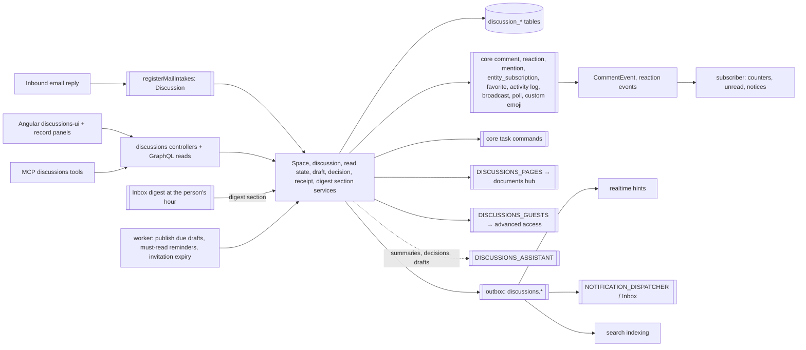

# Implementation Plan: Discussions

> Translates an approved `spec.md` into architecture and tech choices. The plan owns
> implementation details; the spec owns behaviour.

**Feature ID**: `discussions`
**Spec**: `./spec.md`
**Tasks**: `./tasks.md`
**Status**: `Draft`
**Last updated**: 2026-11-23

---

## 1. Architecture Summary

A new plugin pair, `@gauzy/plugin-discussions` (`packages/plugins/discussions`) and `discussions-ui` (Angular, which also
exports the record panel used on record pages), loaded by `apps/api/src/plugins.ts` only when
`GAUZY_DISCUSSIONS_ENABLED` is exactly `true` and gated per tenant by `FEATURE_DISCUSSIONS` (a feature contribution of
the plugin). The plugin owns spaces, groups, membership, discussions, read states, drafts, decisions and receipts;
everything a record or a person already has comes from core and the platform:

- **Replies** are core `comment` rows on entity `Discussion` (one level of replies through `parentId`, `editedAt`,
  resolve for accepted answers), written through `CommentCreateCommand` / `CommentUpdateCommand` so mentions,
  `CommentEvent` and the follower fan-out work unchanged. A `@CommentParentAccessPolicy()` for `Discussion` makes the
  comment API follow space membership and refuse writes on closed discussions.
- **Reactions** are core `reaction` rows (`ReactionEntityEnum.Discussion` added; `Comment` and `Broadcast` exist);
  **mentions** the core mention service; **following and muting** core `entity_subscription` only (`MANUAL`, `COMMENT`,
  `MENTION`, `CREATED_ENTITY`, and the new type `muted` with a `mutedUntil`) on `Discussion` and `DiscussionSpace`;
  **bookmarks** core `favorite` through `@FavoriteService()` providers; the **activity feed** the core activity log;
  **reply edit history** a core `comment_revision` written by `CommentUpdateCommand` for comments on `Discussion`, so
  edits through any route are kept; comments on other entities get revisions only when the tenant setting
  `comments.keepRevisions` (default `false`) is on.
- **Per-person choices**: badge style, quick reactions, onboarding and the digest's discussion sections live in
  `User.uiPreferences.discussions`; digest frequency, weekday and hour are the person's notification preferences
  (`IEmployeeNotificationPreferences.digestHour` and two additive members, `digestFrequency` and `digestDay`, used by every
  digest); the "what's new" marker is `uiPreferences.changelog.seenAt`. No per-member setting table.
- **Digest**: discussions is a section of the person's one Inbox digest (`inbox_delivery` mode `DIGEST` at their hour,
  one `digestKey` per period, `inbox-delivery-rules.ts` `decideEmailDelivery`), contributed through the digest section
  registry the Inbox mailer gains; no second digest email and no send ledger in the plugin.
- **Announcements** are core `broadcast` rows on `DiscussionSpace` or on the space's linked record. The broadcast service
  gains an optional multi-port so `ENTITY_MEMBERS` can resolve a space's members; broadcasts finally get screens.
- **Shared pieces added to core** (used by several plugins, Principle I): `poll` (polls on any record: discussions,
  replies, broadcasts, slide sessions, chat later) and `custom_emoji` beside `reaction`.
- **Notifications** go through `NOTIFICATION_DISPATCHER` (automation-and-notifications; else `INBOX_ITEM_WRITER`, else the
  employee notification); reply by email through `registerMailIntakes` of `email-and-communications`; guests and members
  invited by email through core `invite` and the portal user type of `access-control-and-security`; pages through the
  documents hub; search through the `search` plugin; imports through the data-import engine of `data-import-export`
  (its run rows keep the outside id map); settings in `discussions.settings.ts` (platform settings store).

A discussion is not a broadcast: a broadcast is a one-way announcement to an audience on a record, with a category and a
publish time; a discussion is a conversation in a space with a state (open, closed, resolved), a kind, an accepted
answer, decisions and per-reader unread state. Announcements stay broadcasts; a space's feed merges both by time, and
must-read receipts (`discussion_receipt`) cover both. Space announcements are never `EXTERNAL_VIEW`: a space is internal,
so no public link is created for them; broadcasts on records keep their own rules.

On a record page, one record timeline (`RECORD_TIMELINE_SOURCES` of `record-views-and-search`) shows the record's core
comments, the discussions of its space and the chat messages carrying its card ("Discussed in" of
`chat-agents-and-record-actions`, with `FEATURE_CHAT_RECORD_CARDS` on); "Comment" on a record keeps creating a core comment on the record, "Start a
discussion" creates a discussion in the record's space, and "Send to chat" (with `FEATURE_CHAT_RECORD_CARDS` on) posts its card to a conversation.

## 2. Tech Choices

| Concern | Choice | Rationale |
| ------- | ------ | --------- |
| Package | new `packages/plugins/discussions`, `-ui`; core `poll/`, `custom-emoji`, `comment_revision` | Principle I; shared pieces in core; one plugin UI |
| Replies, reactions, mentions, followers and mutes, bookmarks, activity, reply history | core modules | build on what exists; one notification path |
| Announcements | core `broadcast` with an audience resolver port | the existing model gets screens |
| Per-person choices | `User.uiPreferences.discussions` and the notification preferences | no per-member setting table |
| Digest | a section of the Inbox digest | one digest email per person and period |
| Import | the data-import engine's profile and toolkit, its run rows as the identifier map | no plugin map table |
| Settings | `discussions.settings.ts` (organization scope): defaults of new spaces, guest posting default, space-wide mention default, must-read reminder days | platform settings store |
| Rich text | the documents hub editor's JSON schema (TipTap, already in `docs-ui`), sanitised on the server | one editor family |
| Search | `search` plugin index definitions for discussions and their replies | one search |
| Background work | scheduler jobs in the worker; queue `discussions` | durable |
| Push | outbox → `RealtimeHintsService.appendHint`; typing as ephemeral signals | Principle VII |
| Email | `COMMUNICATIONS_SENDER` and mail intake (`email-and-communications`); fallback core `EmailSendService` without a reply address | reply by email where available |
| Assistant | `DISCUSSIONS_ASSISTANT` → `ai-agents-and-assistants`; fallback `ai-chat` `AiProviderRegistry` | tenant's own provider |

No outside library is added: the editor, emoji picker and charts already ship in `ui-core` and `docs-ui`.

## 3. Data Model

### New plugin tables (all `TenantOrganizationBaseEntity`, soft delete; JSON as `text`)

| Table | Columns (besides base) | Indexes and uniqueness |
| --- | --- | --- |
| `discussion_space_group` | `name` varchar(120), `icon`, `coverFileId` null, `readmeDocumentId` null, `isPrivate` bool, `status` (`ACTIVE`, `ARCHIVED`), `mergedIntoId` null, `position` int | idx `(organizationId, status)` |
| `discussion_space` | `groupId` null, `name`, `slug` varchar(120), `description` text, `icon`, `coverFileId` null, `readmeDocumentId` null, `visibility` (`OPEN`, `PRIVATE`), `status` (`ACTIVE`, `ARCHIVED`), `membershipSource` (`MANUAL`, `TEAM`, `PROJECT`, `RECORD`), `sourceId` null, `linkedRecordType` varchar(64) null, `linkedRecordId` null, `pagesFolderId` null, `guestsMayPost` bool, `spaceMentionOpen` bool, `mergedIntoId` null, `lastActivityAt`, `discussionCount` int, `activityVersion` int | unique `(tenantId, organizationId, slug)`; idx `(organizationId, status, lastActivityAt)`, `(linkedRecordType, linkedRecordId)` |
| `discussion_member` | `subjectKind` (`GROUP`, `SPACE`), `subjectId`, `userId`, `employeeId` null, `role` (`ADMIN`, `MEMBER`, `GUEST`), `source` (`MANUAL`, `TEAM`, `PROJECT`, `RECORD`, `INVITE`), `accessUntil` null, `joinedAt` | unique `(subjectKind, subjectId, userId)`; idx `(tenantId, userId)` |
| `discussion` | `spaceId` FK, `kind` (`DISCUSSION`, `QUESTION`), `title` varchar(300), `slug` varchar(160), `body` text (editor JSON, sanitised), `bodyText` text, `authorUserId`, `authorEmployeeId` null, `actorType` int, `state` (`DRAFT`, `SCHEDULED`, `PUBLISHED`), `publishedAt` null, `status` (`OPEN`, `CLOSED`, `RESOLVED`), `closedAt`, `closedByUserId`, `pinScope` (`SPACE`, `GROUP`, `ORGANIZATION`) null, `pinnedAt` null, `mustRead` bool, `mustReadAudience` text null, `remindAfterDays` int, `acceptedReplyId` null, `replyCount`, `participantCount`, `reactionCount` int, `lastActivityAt`, `lastReplyId` null, `lastReplyUserId` null, `editedAt` null, `sourceRecordType` null, `sourceRecordId` null | unique `(spaceId, slug)`; idx `(spaceId, state, lastActivityAt)`, `(tenantId, organizationId, lastActivityAt)`, `(pinScope, pinnedAt)` |
| `discussion_revision` | `discussionId` FK cascade, `title` null, `body` text, `editedByUserId`, `editedAt` (the discussion body only; replies' history is core `comment_revision`) | idx `(discussionId, editedAt)` |
| `discussion_draft` | `userId`, `spaceId`, `discussionId` null, `parentReplyId` null, `title` null, `body` text, `scheduledAt` null, `timeZone` varchar(64), `status` (`DRAFT`, `SCHEDULED`, `PUBLISHED`, `CANCELLED`, `BLOCKED`), `publishedRef` null, `blockedReason` null | idx `(status, scheduledAt)`, `(tenantId, userId)` |
| `discussion_read_state` | `userId`, `discussionId` FK cascade, `lastReadAt`, `lastReadReplyId` null, `markedUnread` bool | unique `(userId, discussionId)` |
| `discussion_space_state` | `userId`, `spaceId` FK cascade, `lastVisitedAt`, `unreadCount` int, `countedVersion` int, `isPinned` bool, `position` varchar(32) null (follow and mute are `entity_subscription` rows) | unique `(userId, spaceId)`; idx `(tenantId, userId, isPinned)` |
| `discussion_decision` | `discussionId` FK, `spaceId`, `outcome` text, `ownerEmployeeId` null, `dueDate` null, `sourceReplyIds` text, `decidedByUserId`, `decidedAt`, `taskIds` text, `taskError` text null, `broadcastId` null, `status` (`ACTIVE`, `SUPERSEDED`), `supersededById` null | idx `(spaceId, decidedAt)`, `(discussionId)` |
| `discussion_receipt` | `subjectKind` (`DISCUSSION`, `BROADCAST`), `subjectId`, `userId`, `confirmedAt` null, `remindedAt` null, `remindCount` int | unique `(subjectKind, subjectId, userId)`; idx `(subjectKind, subjectId, confirmedAt)` |
| `discussion_tag_link` | `subjectKind` (`DISCUSSION`, `REPLY`), `subjectId`, `tagId` FK `tag` cascade | unique `(subjectKind, subjectId, tagId)`; idx `(tenantId, tagId)` |
| `discussion_summary` | `discussionId` FK cascade, `kind` (`FULL`, `SINCE_READ`), `forUserId` null, `upToReplyId`, `points` text (text and source reply ids), `model` varchar(96), `aiRunId` null (the run of `ai-agents-and-assistants` where loaded), `requestedByUserId` | idx `(discussionId, createdAt)` |
| `discussion_invite` | `inviteId` (core `invite`), `spaceIds` text, `role` (`MEMBER`, `GUEST`), `accessUntil` null, `invitedByUserId` | unique `(inviteId)` |
| `discussion_search_feedback` | `userId`, `queryHash` varchar(64), `subjectKind`, `subjectId`, `helpful` bool | unique `(userId, queryHash, subjectKind, subjectId)`; idx `(queryHash)` |

Record links: tasks made from a discussion, a reply or a decision are record links of `record-views-and-search` (core `resource_link` with a record target): `entity` = the discussion, reply or decision, target `Task`, `role` `CREATED_FROM`, `linkedBy` `PERSON`.

Unread rule: a discussion is unread for a member when `lastActivityAt` is later than their `lastReadAt` (or their join
time) or `markedUnread` is set. Space counts are cached in `discussion_space_state` and recomputed when the space's
`activityVersion` moved past `countedVersion`, so a new reply updates one counter, not one row per member.

### Core changes (additive)

**Migration timestamps**: `packages/plugins/discussions` `1791000064300` to `1791000064389`; `packages/core` `1791000064390` to `1791000064399`.

- `packages/contracts`: `BaseEntityEnum.Discussion`, `BaseEntityEnum.DiscussionSpace`; `ReactionEntityEnum.Discussion`;
  `poll.model.ts`, `custom-emoji.model.ts`, `discussions.model.ts`; `FeatureEnum.FEATURE_DISCUSSIONS`; `PermissionsEnum`
  keys of §9 in a `DISCUSSIONS` group.
- `packages/core/src/lib/poll/`: entities `poll` (`entity`, `entityId` as `BasePerEntityType`, `question`, `multiple`
  bool, `anonymous` bool, `allowChange` bool, `closesAt` null, `status` (`OPEN`, `CLOSED`), `totalVotes` int,
  `createdByUserId`), `poll_option` (`pollId`, `label`, `position`, `votes` int), `poll_vote` (`pollId`, `optionId`,
  `voterUserId` null, `voterKeyHash` varchar(64) null); unique `(pollId, optionId, voterUserId)` and `(pollId, optionId,
  voterKeyHash)` where set; service, controller `/api/polls`, and `@PollHostAccessPolicy()` discovered like the comment
  parent policies (a host type without a policy cannot carry polls).
- `packages/core/src/lib/reaction/custom-emoji/`: entity `custom_emoji` (`shortcode` varchar(64), `fileId`, `createdByUserId`,
  `isArchived`), unique `(tenantId, organizationId, shortcode)`; routes `/api/custom-emoji`.
- `packages/core/src/lib/broadcast/`: optional multi-port `BROADCAST_AUDIENCE_RESOLVERS` (`entity`, `isMember(entityId,
  viewer)`, `memberEmployeeIds(entityId)`) consulted for `ENTITY_MEMBERS` on entity types the service does not know; the
  four known types keep their code path.
- `packages/core/src/lib/comment/`: entity `comment_revision` (`commentId` FK cascade, `body` text, `editedByUserId`,
  `editedByEmployeeId` null, `editedAt`; idx `(commentId, editedAt)`) written by `CommentUpdateCommand` before each edit
  of a comment on `Discussion`, and of other comments only while the tenant setting `comments.keepRevisions` (default
  `false`) is on; read through `GET /api/comment/:id/revisions` under the comment's parent access policy.
- `packages/core/src/lib/entity-subscription/`: `EntitySubscriptionTypeEnum.MUTED` (`muted`) and a nullable `mutedUntil`
  column; the fan-out skips a muted subscriber until `mutedUntil` (null = until unmuted).
- `packages/contracts`: `IEmployeeNotificationPreferences` gains `digestFrequency` (`daily`, `weekly`, `off`; default
  daily) and `digestDay` (0–6, for weekly), honoured by the Inbox digest for every section; `IUserUiPreferences` gains
  `discussions` (badge style, quick reactions, onboarded, digest sections) and `changelog` (`seenAt`).
- `packages/plugins/inbox/src/lib/delivery/`: a digest section registry (`registerDigestSections`: key, title, `build(person,
  period)` answering items or nothing) used by the digest mailer; existing digest content becomes its first section,
  rendered exactly as today when no other section answers items.
- `packages/plugins/changelog/`: route `GET /changelog/unseen-count`, counting entries newer than the caller's
  `uiPreferences.changelog.seenAt`; the sidebar panel shows the marker and writes `seenAt` through
  `PUT /user/ui-preferences` when opened, only for tenants with `FEATURE_DISCUSSIONS` on; no table.
- Core migrations (`packages/core/src/lib/database/migrations/`, tri-dialect): `1791000064390-CreatePollTables`,
  `1791000064391-CreateCustomEmojiTable`, `1791000064393-CreateCommentRevisionTable`,
  `1791000064394-AddMutedUntilToEntitySubscription`.

### Plugin migrations

Plugin migrations with the shared core migration helpers of `@gauzy/core`; PostgreSQL, SQLite and MySQL branches;
idempotent, forward-only, both ORMs:

1. `1791000064300-CreateDiscussionSpaceTables` — group, space, member, space state, invite.
2. `1791000064310-CreateDiscussionTables` — discussion, revision, draft, read state, tag link.
3. `1791000064320-CreateDiscussionDecisionTables` — decision, receipt, summary.
4. `1791000064330-CreateDiscussionSearchTables` — search feedback.

`FEATURE_DISCUSSIONS` and the permissions of §9 are plugin contributions (`discussions.features.ts`,
`discussions.permissions.ts` with `defaultFor`), not seeds.

### Contracts

The `packages/contracts` additions listed under "Core changes (additive)": the `BaseEntityEnum` and `ReactionEntityEnum` values and the digest frequency of `IEmployeeNotificationPreferences`; they reach the SDKs and Ever Teams through the OpenAPI document.

## 4. API Surface

All routes under `/api/discussions`, `@FeatureFlag(FEATURE_DISCUSSIONS)`, `TenantPermissionGuard`, `PermissionGuard`,
class-validator DTOs, Swagger; space membership checked by `SpaceAccessService` on every route; `Idempotency-Key` on
creating routes; cursor pagination. Replies, reactions and bookmarks also stay reachable through `/api/comment`,
`/api/reaction` and `/api/favorite`, where the policies of §3 apply.

| Method | Endpoint | Permission | Description | Status |
| ------ | -------- | ---------- | ----------- | ------ |
| `GET` `POST` `PATCH` | `/groups[/:id]`, `POST …/:id/{archive,unarchive,merge}` | `DISCUSSIONS_VIEW` / `DISCUSSIONS_MANAGE` / group admin | space groups | New |
| `GET` `POST` `PATCH` | `/spaces[/:id]`, `POST …/:id/{archive,unarchive,merge,link-record}` | view / `DISCUSSIONS_SPACE_CREATE` / space admin | spaces | New |
| `GET` `POST` `DELETE` | `/spaces/:id/members[/:userId]`, `POST …/{join,leave}`, `PUT …/me` | member / space admin | members, join, leave, follow, mute, pin | New |
| `GET` `POST` | `/spaces/:id/discussions`, `/discussions?scope=mine\|following\|all` | member / `DISCUSSIONS_POST` | lists; publish | New |
| `GET` `PATCH` `DELETE` | `/discussions/:id` | member / author or space admin | read with replies page; edit with `If-Match`; delete | New |
| `POST` | `/discussions/:id/{close,reopen,pin,unpin,move,accept-answer}` | author, space or group admin, `DISCUSSIONS_MANAGE` | moderation | New |
| `GET` `POST` `PATCH` `DELETE` | `/discussions/:id/replies[/:replyId]`, `POST …/:replyId/restore` | member / author / space admin | replies over core comments, quotes, revisions | New |
| `GET` | `/revisions?subjectKind&subjectId` | member | edit history | New |
| `GET` `PUT` | `/me/unread`, `PUT /discussions/:id/read`, `POST /spaces/:id/read`, `POST /me/read-all` | self | unread counts; read and unread marks | New |
| `GET` `POST` `PATCH` `DELETE` | `/drafts[/:id]` | self | drafts and schedules | New |
| `POST` | `/discussions/:id/decisions`, `PATCH /decisions/:id`, `GET /spaces/:id/decisions` | author or space admin / member | resolve with decision, tasks, announce, supersede; decision log | New |
| `POST` | `/discussions/:id/tasks` | member + task create | task from a discussion or reply | New |
| `POST` `GET` | `/discussions/:id/{summary,since-last-visit,proposed-decisions,draft-reply}` | `DISCUSSIONS_ASSISTANT_USE` | assistant proposals | New |
| `POST` | `/announcements`, `GET /spaces/:id/feed` | `DISCUSSIONS_POST` + `BROADCAST_CREATE` / member | broadcasts in spaces and on records | New |
| `PUT` `POST` `GET` | `/must-read/:kind/:id`, `POST …/confirm`, `GET …/receipts` | `DISCUSSIONS_MUST_READ` / reader / author | must-read and receipts | New |
| `GET` `PUT` | `/api/user/me`, `/api/user/ui-preferences` (core) · the notification settings of the Inbox | self | badge style, quick reactions and digest sections under `discussions`; digest frequency, weekday and hour in the notification preferences | Existing |
| `GET` | `/me/digest/preview` | self | the discussions section of the person's next digest (FR-66) | New |
| `POST` `GET` `DELETE` | `/invitations[/:id]`, `POST …/:id/resend` | `DISCUSSIONS_INVITE_GUESTS` + space admin | member and guest invitations | New |
| `GET` | `/search`, `POST /search/feedback` | member | search with filters; feedback | New |
| `GET` | `/records/:recordType/:recordId/space`, `POST …/discussions` | read of the record | record panel and start from a record | New |
| `GET` | `/reports/{space-activity,decisions,receipts}` | space admin / `DISCUSSIONS_MANAGE` | FR-67 to FR-69, CSV | New |
| `GET` `POST` `DELETE` | `/api/polls[/:id]`, `POST …/:id/{vote,close}` (core) | per host policy | polls | New |
| `GET` `POST` `DELETE` | `/api/custom-emoji[/:id]` (core) | read / `DISCUSSIONS_MANAGE` | custom emoji | New |
| `GET` | `/api/comment/:id/revisions` (core) | the comment's parent policy | edit history of any comment | New |
| `GET` | `/api/changelog/unseen-count` (changelog plugin) | signed in | entries since `uiPreferences.changelog.seenAt` | New |
| `*` | `/api/comment/**`, `/api/reaction/**`, `/api/entity-subscription/**`, `/api/favorite/**`, `/api/broadcasts/**`, `/api/changelog/**` | unchanged | existing behaviour; new entity values only | Unchanged |

Errors: `DISCUSSION_CLOSED` (409), `DISCUSSION_STALE` (409), `SPACE_ARCHIVED` (409), `SPACE_FORBIDDEN` (404 for
non-members of private spaces), `MENTION_NOT_MEMBER`, `GUESTS_NOT_ALLOWED`, `INVITATION_EXPIRED`. GraphQL reads
`discussionSpaces`, `discussions`, `discussion`, `discussionUnread` in `graphql/schema-extensions.ts`.

**Ports consumed** (contracts tokens, injected `@Optional()`, bound in `apps/api/src/plugin-composition.ts`; unbound →
the capability is not offered): `NOTIFICATION_DISPATCHER` (else `INBOX_ITEM_WRITER`, else the employee notification),
`COMMUNICATIONS_SENDER` and `registerMailIntakes` (reply by email), `DISCUSSIONS_GUESTS` (advanced access: provision a
portal user with sponsor and expiry, end access), `DISCUSSIONS_PAGES` (documents hub: ensure the space's folder, share
it with the space's members or team, list pages), `DISCUSSIONS_ASSISTANT`, `DATA_IMPORT_ENGINE` (discussion import profile),
`RECORD_VIEWS_QUERY` (records' members for record spaces), `AUDIT_EVENT_SINK`, `INBOX_DIGEST_SECTIONS` (the Inbox digest's
section registry).

**Ports offered**: `CORE_POLLS` is core's; the plugin registers `@PollHostAccessPolicy()` for `Discussion`, `Comment` on a
discussion and `Broadcast` in a space; `RECORD_TIMELINE_SOURCES` entry (discussions and decisions on a record);
`registerImportProfiles` profile `discussions.file_import` and toolkit `discussions.import`; automation triggers
`discussion.published`, `discussion.resolved`, `decision.recorded` and action `discussion.post` (`registerAutomationTriggers`,
`registerAutomationActions`); `DISCUSSIONS_FOR_RECORD` for other plugins' record pages.

**Consumer tokens answered** (bound in `apps/api/src/plugin-composition.ts` to the discussion services; each consumer plan states the shape it calls and its fallback): `CALENDAR_DISCUSSIONS`.

## 5. Events, Real-Time and Notifications

| Event | Emitted when | Consumers |
| ----- | ------------ | --------- |
| `discussions.discussion.published` / `.edited` / `.closed` / `.reopened` / `.moved` / `.resolved` | discussion changes | space followers' notices, realtime hint `discussion-space:<id>`, search index, activity log, automations |
| `discussions.reply.created` / `.edited` / `.removed` (from `CommentEvent` on `Discussion`) | replies | counters, unread version, followers (core fan-out), quoted author, realtime hint `discussion:<id>`, search |
| `discussions.decision.recorded` / `.superseded` | decisions | owner and followers, decision log, digest, automations |
| `discussions.must_read.published` / `.reminded` / `.confirmed` | must-read items | audience notices, receipts report |
| `discussions.space.archived` / `.merged` / `.member_added` / `.member_removed` | space changes | realtime hint to members, activity log, access caches |
| In: `CommentEvent`, reaction events, broadcast events on spaces and linked records | core records change | counters, feeds, bundled reaction notices |
| In: `organization_team_employee.created` / `.deleted`, `organization_project_employee.created` / `.deleted` (team and project membership changes: core record-change events of `integration-hub`, the facts chat's synced team channels consume) | members change | membership sync of `TEAM` and `PROJECT` spaces |

Notification categories (`registerNotificationCategories`): `discussions.mention`, `discussions.quote`,
`discussions.reply`, `discussions.new_discussion`, `discussions.reaction` (bundled per discussion and hour),
`discussions.must_read`, `discussions.decision`, `discussions.accepted_answer`, `discussions.invitation`, plus the
`discussions` section of the person's digest. Emails about a discussion carry the reference token of
`email-and-communications` so a reply is matched to it. Events carry ids, never bodies.

## 6. UI Surface

- **Angular `packages/plugins/discussions-ui`** (lazy, hidden on `404`): `/pages/discussions` (home: unread, pinned,
  following, my spaces), `/pages/discussions/spaces/:slug` (feed, discussions, pages, decisions, members, settings),
  `/pages/discussions/d/:space/:slug` (discussion with replies from the first unread, quote, poll, reactions, revisions,
  decision dialog, summary panel), `/pages/discussions/drafts`, `…/bookmarks`, `…/search`, `…/groups/:id`, Settings →
  Discussions (custom emoji, defaults, import); sidebar section with pinned spaces and badges; a Discussions panel
  component for record pages (project, team, client, deal), shown in the record timeline shell of
  `record-views-and-search` where a page has it and placed on the project and team pages directly through the page
  extension slots; profile tab on the employee page; what's new marker in the theme sidebar's changelog panel. Badge
  style and quick reactions are read from `uiPreferences.discussions`; digest choices link to the existing notification
  settings page. Phone-width layouts for every page. i18n keys `DISCUSSIONS.*` in every locale of
  `packages/ui-core/i18n`.
- The body editor is the hub editor in a reduced configuration (no page-only blocks), with mentions and hub file links.

## 7. MCP Tools, SDKs and Integrations

New group `discussions` in `packages/mcp-server/src/lib/tools/collaboration/discussions.ts`, switch
`GAUZY_MCP_TOOLS_DISCUSSIONS` (exactly `true`), scopes `discussions:read` and `discussions:write`:

| Tool | Input | Output |
| --- | --- | --- |
| `list_discussion_spaces` / `list_discussions` | filter / space, scope, unread | spaces; discussions with counts |
| `get_discussion` | id, replies page | body, replies, polls, decisions |
| `search_discussions` | query, filters | ranked results with snippets |
| `post_discussion` / `reply_to_discussion` | space or discussion, title, body, `preview` (default true) | rendered post, or the record |
| `react` / `vote_poll` | subject, emoji / poll, options | new counts |
| `summarize_discussion` | id, since last read | points with source reply ids |
| `propose_decisions` / `record_decision` | id / outcome, owner, due, source replies, tasks, `preview` (default true) | proposals; decision and tasks |
| `mark_discussion_read` | id or space | new unread counts |

OpenAPI additive; Kiota SDKs regenerated after merge. Integration hooks: outbox events reach webhooks; inbound email
replies through the communications intake; import files in the documented format (JSON or CSV in a zip) through the
data exchange toolkit, whose run rows (`data_import_row`, or core `import_record` without the engine) map outside ids to
spaces, discussions and replies so a repeated import updates.

## 8. Background Jobs

| Trigger | When | What it does | Idempotency |
| ------- | ---- | ------------ | ----------- |
| `discussions.publish-due` | every minute | publish scheduled drafts whose time passed; block those whose author or space lost access | draft status claim |
| digest section `discussions` (called by the Inbox digest) | at each person's digest time | builds the FR-40 items for the person and period; answers nothing when empty | the Inbox digest's key per person and period |
| `discussions.must-read-reminders` | hourly | remind unconfirmed readers after `remindAfterDays`, at most three times | `remindCount`, `remindedAt` |
| `discussions.membership-sync` | on team and project events, and nightly | add and remove members of `TEAM`, `PROJECT` and `RECORD` spaces | per space and version |
| `discussions.invitation-expiry` | hourly | expire invitations after 14 days; end guest access at `accessUntil` | status checks |
| `discussions.restore-window` | daily | purge removed replies older than 30 days from restore | per reply |
| queue `discussions.assistant` | summary, changes since the last visit, proposals | assistant call with one discussion's text, 60 s timeout | per request |
| outbox consumer `subscriber:discussions-counters` | comment and reaction events | counters, `activityVersion`, bundled reaction notices | delivery record per event |

Without the Inbox there is no digest email; notifications still reach the platform's notification list.

Queue jobs run in the API; schedules in the worker (`DiscussionsSchedulePlugin` in `apps/worker/src/plugins.ts`); without
a queue root the API runs them on in-process timers under a database lock.

## 9. Security & Permissions

Permission contributions in `discussions.permissions.ts`: `DISCUSSIONS_VIEW`, `DISCUSSIONS_POST`,
`DISCUSSIONS_SPACE_CREATE`, `DISCUSSIONS_MANAGE`, `DISCUSSIONS_INVITE_GUESTS`, `DISCUSSIONS_MUST_READ`,
`DISCUSSIONS_ASSISTANT_USE`. `defaultFor`: all to `SUPER_ADMIN` and `ADMIN`; all but `MANAGE` to `MANAGER`; `VIEW`, `POST`,
`SPACE_CREATE`, `ASSISTANT_USE` to `EMPLOYEE`; `VIEW`, `POST` to `DATA_ENTRY`; `VIEW` to `VIEWER`. Portal guest profiles
get `VIEW` and `POST`, narrowed to their spaces by membership.

- **Space access** (`SpaceAccessService`): open spaces are readable by organization members holding `DISCUSSIONS_VIEW`;
  private spaces by members only (`404` otherwise); guests by their `GUEST` membership until `accessUntil`. The same check
  backs the comment, poll, reaction and favourite policies, the search index filter, notifications, digests and the
  assistant. `DISCUSSIONS_MANAGE` lists private spaces' names and members; reading needs membership, and adding oneself
  writes an audit event.
- **Rich text** is sanitised on the server against the editor schema (no scripts, no outside frames, links `http`, `https`,
  `mailto` and platform paths); quotes store the source id and are re-checked for access when rendered.
- **Email replies** are accepted only from a member's verified address, for a discussion they may reply to, once per
  message id; quoted text and signatures are cut by the communications parser.
- **Assistant** receives one discussion's text the member may read; summaries are stored with their source reply ids
  and hidden from readers who lost access to the space.
- **Audit**: moderation, merges, membership changes, guest invitations and private-space joins go to `AUDIT_EVENT_SINK`.

## 10. Observability

Activity feed and core activity log entries; metrics `discussions_posts_total{kind}`, `discussions_fanout_ms`,
`discussions_unread_query_ms`, `discussions_digest_section_items_total`, `discussions_email_replies_total{outcome}`,
`discussions_assistant_requests_total{kind}`.

## 11. Phased Rollout

1. **Phase 1 — Surface what exists** (flag off): contracts, core enum values and policies, the core poll and custom
   emoji modules, plugin tables, spaces and
   members, discussions with replies on core comments, reactions, mentions, following and bookmarks on core modules,
   broadcasts as announcements with screens and MCP tools, unread tracking, Inbox notices, record panels.
2. **Phase 2 — Depth**: space groups, polls and custom emoji on discussions, quotes, revisions, tags, pins, close and accepted
   answers, drafts and scheduling, digests, search with feedback, activity feed, pages, tasks from discussions, guests and
   invitations, moderation, discussion import, what's new marker, phone layouts.
3. **Phase 3 — Advanced capabilities**: resolve with decision and the decision log, must-read with receipts, summaries and
   decision proposals, reply by email, time-zone digests, record spaces created on first use, the reports.
4. **Phase 4 — General availability**: the feature is off by default; after the trial period it may be switched on by default for new tenants only; existing tenants keep their setting until an administrator changes it.

## 12. Constitution Reconciliation

- I Plugin-first: plugin pair `discussions`; core gains polls, custom emoji, comment revisions, muted follows and a
  broadcast port shared by plugins; the Inbox digest gains sections.
- II Tenant/organization scoping: every new row is tenant and organization scoped; space access filters every read.
- III Both ORMs, additive migrations: four plugin and four core migrations on three dialects; one nullable column added
  to `entity_subscription`, none changed.
- IV Default-off flag; nothing removed: `GAUZY_DISCUSSIONS_ENABLED` plus `FEATURE_DISCUSSIONS`; core APIs unchanged.
- V Contracts and API first: contracts, REST, GraphQL reads and MCP before screens.
- VI Permissions, privacy, security: §9; data leaving the platform listed in the spec §4.
- VII Real-time through the event bus: outbox events to realtime hints, the Inbox and search.
- VIII i18n and accessibility: `DISCUSSIONS.*` keys in every locale; keyboard-operable lists, polls and reactions.
- IX Tests: per-endpoint e2e, access tests for private spaces and guests, digest time-zone tests.
- X Behaviour-first spec: implementation details only here.
- XI Documentation describes our platform only.

## 13. Risks & Mitigations

| Risk | Likelihood | Impact | Mitigation |
| ---- | ---------- | ------ | ---------- |
| Private content leaks through a core API (comments, reactions, favourites, search) | Medium | High | one `SpaceAccessService` behind every policy; access tests per core API |
| Notification fatigue in busy spaces | Medium | Medium | bundled reactions, follow and mute, Inbox delivery preferences, one digest |
| Comment revisions grow on busy records | Low | Low | rows only on edits, and outside discussions only where the tenant chose to keep them; covered by the comment retention |
| Counter drift between replies and discussion counts | Medium | Low | counters rebuilt nightly from comments; reads tolerate drift |
| Email reply spoofing | Low | High | verified member addresses, reference tokens, authentication verdicts of the inbound pipeline |
| Core poll model does not fit chat later | Low | Medium | host policies per type; chat-messaging reviews before its plan |

## 14. References

- Spec: `./spec.md` · Tasks: `./tasks.md`
- Existing plans in `docs/specs/features/`: [`docs/specs/features/inbox/plan.md`](../inbox/plan.md),
  [`docs/specs/features/comments-and-trash/plan.md`](../comments-and-trash/plan.md); `packages/plugins/inbox/README.md`,
  `packages/plugins/inbox/src/lib/delivery/inbox-delivery-rules.ts`, `packages/core/src/lib/comment/parent-access/`,
  `packages/core/src/lib/entity-subscription/fan-out/`, `packages/core/src/lib/broadcast/broadcast.service.ts`,
  `packages/core/src/lib/favorite/global-favorite-service.service.ts`, `packages/core/src/lib/user/user.entity.ts`
  (`uiPreferences`), `packages/core/src/lib/export-import/`
- Related plans: `automation-and-notifications`, `email-and-communications`, `access-control-and-security`,
  `record-views-and-search`, `data-import-export`, `presentations` (polls on slide sessions), `chat-messaging`
