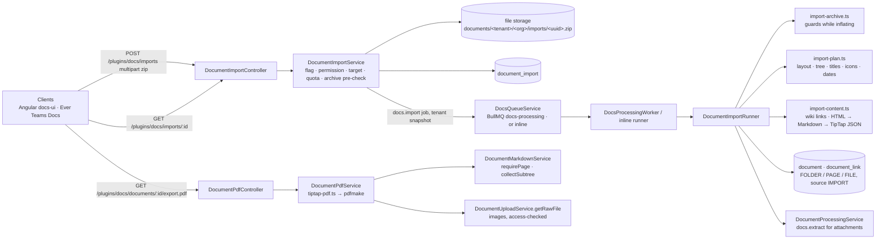

# Implementation Plan: Docs import from exported workspaces and PDF export

> Translates an approved `spec.md` into architecture and tech choices. The plan owns
> implementation details; the spec owns behaviour.

**Feature ID**: `docs-import-export`
**Spec**: `./spec.md`
**Tasks**: `./tasks.md`
**Status**: `In Review`
**Last updated**: 2026-11-11

---

## 1. Architecture Summary

Everything lives in `packages/plugins/docs` (and its two clients); no new plugin.

## 2. Reuse

| Need | Existing piece | How it is used |
| --- | --- | --- |
| Markdown → page JSON | `services/document-markdown.ts` `markdownToDocument` (`marked` lexer) | every page body, after the wiki syntax is rewritten to plain Markdown links |
| HTML → Markdown | `knowledge/extraction/html.extractor.ts` `createTurndown()` + `sanitize-html` | HTML pages: sanitize, then Turndown, then the Markdown path |
| Page schema | `validation/tiptap-schema.validator.ts`, `tiptap-html.serializer.ts`, core `sanitizeRichHtml` | every stored page; `contentHtml` derived the way a save derives it |
| Zip reading | `unzipper` (a core dependency; the core import archive guard is the precedent) | central directory first, then one entry at a time through a counting stream |
| Upload checks | `services/file-sniffer.ts` `sniffFile`, `DocumentQuotaService`, the upload storage key shape | every attachment |
| Background work | `docs-processing` queue, `DocsQueueService` (BullMQ or inline), `DocsPipelineService.runStage` dispatch, the `FEATURE_DOCUMENTS` park gate | one new stage `docs.import` whose `documentId` slot carries the import id |
| Idempotent writes | `externalSource` + `externalId` with the unique index `UQ_document_external_provenance` | `externalSource = docs-import:<importId>`, `externalId` = a hash of the entry path: a resumed run finds what it already created |
| Subtree reading | `DocumentMarkdownService.collectSubtree` (readable pages, breadth first, unique names) | the PDF subtree, made public for it |
| Images | `DocumentUploadService.getRawFile` (access-checked) + `sharp` (a plugin dependency) | images stored in Docs, re-encoded to PNG/JPEG and bounded in size for the PDF |
| PDF | `pdfmake` 0.3 (a core dependency, used by invoices) with its bundled Roboto font | the renderer; the URL access policy denies every URL |

No headless browser is added: the PDF is built from the stored TipTap JSON.

## 3. Data Model

| Table | Columns (beyond the tenant/organization base) |
| ----- | --------------------------------------------- |
| `document_import` | `status` (QUEUED / RUNNING / COMPLETED / FAILED), `phase` (PLANNING / TREE / CONTENT / DONE), `layout` (MARKDOWN_VAULT / HTML_EXPORT), `fileName`, `fileSize`, `storageProvider`, `storageKey`, `parentId` (SET NULL to `document`), `visibility`, `organizationTeamId`, `totalItems`, `processedItems`, `importedCount`, `skippedCount`, `failedCount`, `attempts`, `errorCode`, `errorMessage`, `optionsJson` (text: the decisions taken on the request thread), `reportJson` (text: the report, at most 5,000 items), `startedAt`, `finishedAt`, `lastProgressAt`; index (`tenantId`, `organizationId`, `createdByUserId`), index `status` |

Migration `1791000007420-CreateDocumentImportTable` (PostgreSQL, MySQL, SQLite), entity `DocumentImport`
(`MultiORMEntity`, TypeORM + MikroORM repositories). JSON travels in `text` columns parsed by the service, so the
three dialects behave alike without a subscriber. Contracts in `packages/contracts/src/lib/document.model.ts`:
`DocumentImportStatusEnum`, `DocumentImportPhaseEnum`, `DocumentImportLayoutEnum`, `DocumentImportItemStatusEnum`,
`IDocumentImport`, `IDocumentImportReport`, `IDocumentImportReportItem`, `IDocumentImportOptions`,
`IDocumentPdfExportOptions`.

## 4. API Surface

| Method | Endpoint | Permission | Description |
| --- | --- | --- | --- |
| `GET` | `/plugins/docs/imports` | `DOCS_CREATE` | the caller's last imports (the client's capability probe and history); 404 `DOCS_IMPORT_DISABLED` when off |
| `POST` | `/plugins/docs/imports` | `DOCS_CREATE` | multipart `file` (one zip) + `parentId?`, `visibility?`, `organizationTeamId?`, `organizationId?`; 201 with the import (QUEUED); 400 / 413 with `code` on a refused archive |
| `GET` | `/plugins/docs/imports/:id` | `DOCS_CREATE` | state, progress, report; 404 for another member's import (unless `DOCS_MANAGE`); a stale import is resumed |
| `GET` | `/plugins/docs/exports/pdf` | `DOCS_READ` | the PDF capability probe (`{ maxPages }`); 404 `DOCS_PDF_EXPORT_DISABLED` when off |
| `GET` | `/plugins/docs/documents/:id/export.pdf` | `DOCS_READ` | `?subtree=true` one PDF with a table of contents, `&format=zip` a zip of PDFs; `organizationId` scope as the Markdown export |

Error codes (in `docs.constants.ts`): `DOCS_IMPORT_DISABLED`, `DOCS_IMPORT_FILE_REQUIRED`, `DOCS_IMPORT_TOO_LARGE`,
`DOCS_IMPORT_NOT_A_ZIP`, `DOCS_IMPORT_TOO_MANY_ENTRIES`, `DOCS_IMPORT_UNSAFE_PATH`, `DOCS_IMPORT_SYMLINK`,
`DOCS_IMPORT_ZIP_BOMB`, `DOCS_IMPORT_NO_PAGES`, `DOCS_PDF_EXPORT_DISABLED`, `DOCS_PDF_TOO_MANY_PAGES`.

## 5. Import pipeline

1. **Request thread** (`DocumentImportService.start`): flag, permission (route), the target resolved as a page
   create resolves it (the parent must be a container the caller may write; the space fields through
   `DocumentService.resolveSpaceFields`; the organization default visibility), the quota and the
   import-to-knowledge default read from the organization settings, the zip stored under
   `documents/<tenant>/<org>/imports/<uuid>.zip`, the archive pre-checked (`inspectImportArchive`: entry count,
   declared size, ratio, paths, links, at least one page) — a refused zip is deleted and answered 400/413 — then the
   row (QUEUED) and the `docs.import` job with the tenant / organization / user snapshot.
2. **Job** (`DocumentImportRunner.run`): loads the row with the snapshot, marks it RUNNING (`attempts + 1`), reads
   the zip from storage, inspects it again (defence in depth), builds the **plan** (`buildImportPlan`): layout,
   ignored entries, the node tree (folder / page / attachment) with names, icons, created dates, the page that
   first shows each attachment.
3. **Tree phase**: nodes in parent-first order; each node first looks up `externalSource` / `externalId`, so a
   resumed run reuses what exists; folders and pages are created empty (`source: IMPORT`, `status: READY`);
   attachments go through `sniffFile`, the per-file size, the quota (resolved once, counted as the run goes),
   are stored and created as `FILE` documents under their page (or folder) and enqueued for `docs.extract`.
4. **Content phase**: each page's body is converted (`convertImportedPage`) with the path → document map:
   - wiki syntax (`[[target]]`, `[[target|alias]]`, `[[target#heading]]`, `![[file]]`, `![[file|300]]`) outside code
     spans and fences becomes Markdown links / images with an internal scheme;
   - HTML pages: the export header (title, icon, properties) is read, the body sanitized (`sanitize-html`
     allowlist, no `data:` images) and turned into Markdown with the plugin's Turndown;
   - `markdownToDocument`, then a walk that turns page links into `documentMention` nodes (label = the link
     text), images of attachments into stored images (`/api/plugins/docs/documents/<id>/raw`, `documentId`), a
     paragraph that is a single non-image embed into a `fileAttachment` block, keeps http / https / mailto / tel
     links and drops every other target;
   - a leading heading equal to the title is dropped; the result passes `validateTiptapDocument` (a page that
     cannot is stored as plain paragraphs and reported); `contentHtml` is derived and sanitized; the
     `document → document` links of the mentions are written.
5. **End**: COMPLETED (or FAILED with a code and a message), counts, `finishedAt`, the zip deleted from storage.
   Progress (`processedItems`, `phase`, `lastProgressAt`) is saved every 25 items and at every phase change.

**Resume**: BullMQ retries a transient failure (attempts 3). A row left QUEUED or RUNNING without progress for
`DOCS_IMPORT_STALE_MINUTES` (10) is re-enqueued with a run-unique job id by `GET /imports/:id` and by the startup
sweep (`DocumentImportService.resumeStale`, scheduled from `DocsPlugin.onPluginBootstrap`); a row that failed three
runs stays FAILED. Everything a run writes is keyed by `externalSource` / `externalId`, so a rerun never duplicates.

**Limits** (environment): `GAUZY_DOCS_IMPORT_MAX_ZIP_BYTES` (100 MiB), `GAUZY_DOCS_IMPORT_MAX_ENTRIES` (5,000),
`GAUZY_DOCS_IMPORT_MAX_UNCOMPRESSED_BYTES` (1 GiB), a 200:1 ratio cap for entries above 1 MiB, the per-file upload
size for each attachment, 2 MiB of text per page.

## 6. PDF export

`DocumentPdfService` builds a pdfmake document definition from the stored JSON (`pdf/tiptap-pdf.ts`, pure):
headings (sizes 20 → 11), paragraphs with bold / italic / underline / strike / code / links, lists (ordered start,
task boxes as `[x]` / `[ ]`), quotes and callouts as shaded single-cell tables, code blocks in a grey box, tables
(header row bold, `colspan`), rules, toggles (summary bold, content indented), mentions, emoji names and math as
text, images from the page's files (read through `DocumentUploadService.getRawFile`, re-encoded with `sharp` to at
most 1,600 px, a 64 MiB budget per export). The header carries the title and the export date, the footer
`page / pages`. The subtree is `DocumentMarkdownService.collectSubtree` (readable pages only, at most
`GAUZY_DOCS_PDF_MAX_PAGES`, 200, at most 499 since the collection reads at most 500 pages): one document with a `toc` and a `tocItem` heading per page from a new sheet, or a
zip with one PDF per page at the Markdown export's paths. The bundled Roboto font is registered with buffers (no
file access), the URL access policy denies every URL, and the local access policy is left to the platform's.

## 7. Clients

- **Angular `docs-ui`**: `DocsImportService` (list probe, start with upload progress, poll), the
  `DocsImportDialogComponent` (zip, target page or space, start, live progress, report with links, skipped and
  failed lists), "Import" in the browse header, "Export as PDF" / "Export as PDF with sub-pages" in the page's
  overflow menu (`DocsExportService.downloadPdf`); each hidden while its probe answers 404.
- **Ever Teams**: Next proxy routes for the five endpoints, `docs-import` service + hook, the Import dialog in Docs
  home, the PDF entries in the page menu; `NEXT_PUBLIC_DOCS_IMPORT_ENABLED` (default off) plus the 404 probe;
  strings in the 13 locales.

## 8. Tests

`import-archive.spec` (limits, bomb, traversal, symlink, duplicates), `import-plan.spec` (layout detection, ids,
folder pages, titles, icons, dates, hidden files), `import-content.spec` (wiki links, aliases, headings, embeds,
relative links, unresolved links, HTML sanitizing, front matter, converter edge cases), `document-import.runner.spec`
(tree + content phases against in-memory repositories, resume without duplicates, quota, failures),
`document-import.stale.spec`, `tiptap-pdf.spec` (every node type), `document-pdf.service.spec` (a real PDF buffer),
docs-ui and Teams component / hook specs.

## 9. Rollout

Both flags default off. Enable `GAUZY_DOCS_IMPORT_ENABLED` and `GAUZY_DOCS_PDF_EXPORT_ENABLED` on dev, import a
vault and an HTML export zip, export a subtree, then stage. The migration is additive and idempotent.
