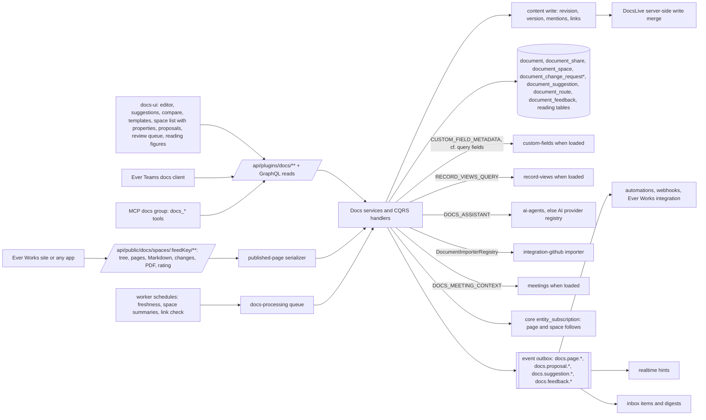

# Implementation Plan: Documents and wiki (pages, wiki spaces, review, publishing)

> Translates an approved `spec.md` into architecture and tech choices. The plan owns
> implementation details; the spec owns behaviour.

**Feature ID**: `documents-and-wiki`
**Spec**: `./spec.md`
**Tasks**: `./tasks.md`
**Status**: `Draft`
**Last updated**: 2026-11-23

---

## 1. Architecture Summary

No new plugin: pages and wiki spaces are the PAGE half of `@gauzy/plugin-docs` (`packages/plugins/docs`) and `@gauzy/plugin-docs-ui`. The one tree, the shares with inherited access, link items, `ownerUserId`, the extended `document_version`, the public link reader, recent visits and the asking scope of the AI chat come from `drive` (its migrations run first; build order `drive` → `documents-and-wiki`). Everything new is gated per tenant by `FEATURE_WIKI` (new `FeatureEnum`, default off, `FeatureFlagGuard` on new controllers and the menu); the public read feed also needs `FEATURE_WIKI_PUBLIC` and the deployment switch `GAUZY_DOCS_PUBLIC_SITES_ENABLED` (exact `true`; `DocsModule` adds the feed controller only then). Writes keep one path: every server-side change of a page (accepted suggestion, merged proposal, restored block, ticked action item, sync) goes through the existing content write that bumps `contentRevision`, snapshots a version, syncs mentions and links, and is merged into open live sessions by `live/document-live.service.ts`.

**A wiki space is an existing space with properties.** The hub already lists one organization space, one space per team and each person's private space, computed from `document.visibility` and `organizationTeamId` (`DocumentSpaceKindEnum` in `packages/contracts/src/lib/document.model.ts`, `GET /documents/spaces` and `POST /documents/:id/space` in `controllers/document-collaboration.controller.ts`, `services/document-collaboration.service.ts`, the move-space dialog `docs-ui/src/lib/dialogs/move-space-dialog.component.ts`, the tree's space list, Ever Teams' team spaces). This plan adds no second kind of space: a `document_space` row holds the wiki properties of one of those spaces, keyed by its kind and team (or owner, for a private space); `GET /documents/spaces` returns each space with its properties and the existing space list shows them; space roles are `document_share` rows on the space; adding or removing properties changes no page. A group without a team gets a space by creating the team (core `organization-team`).

**Public sites are built with Ever Works.** The platform keeps the publication state (the space's publication and each page's `isPublished` flag), a public read feed (`/api/public/docs/spaces/:feedKey/**`: navigation tree, pages as sanitised HTML and Markdown, change list, PDF download, rating) and publication events. With the Ever Works integration enabled, the linked Work calls the feed with its integration token; any site may read it. No renderer, themes, custom domains, site search, site maps, preview cards or visitor analytics exist in the platform.

**Help articles live here.** `helpdesk-portal-and-knowledge-base` keeps help articles as pages of the organization's one help space: it marks one existing space as the help space (a `purpose` column on its `document_space` row, unique per organization; no separate root folder and no space column on `document`), each page carries its language in the help fields, and it can copy the articles of the existing help centre (`packages/plugins/knowledge-base`: `help_center`, `help_center_article`, `help_center_article_version`) into it; the help centre, its rows, routes and pages stay and keep working. This plan provides what it uses: the space properties (`document_space`), the slug history (`document_route`), page feedback (`document_feedback`), daily reading counts (`document_view_stat`) and in-app search counts (`document_search_stat`). Help pages are read through the help read API, which applies audiences; the space feed serves the other published spaces; both use one published-page serializer (`services/published-page.serializer.ts`), the same publication rules and the same search index (the docs knowledge pipeline over `search_document`, `DOCS_KNOWLEDGE_SEARCH_SERVICE`).

**Reused, not rebuilt:** following a space is a core `entity_subscription` (`BaseEntityEnum.DocumentSpace`), as following a page is today (`document-collaboration.service.ts`); space summaries are Inbox items delivered at the person's digest hour by the Inbox (`packages/plugins/inbox/src/lib/delivery/inbox-delivery-rules.ts`, `inbox-delivery-mailer.ts`); asking a page or space is drive's AI chat docs scope; member reads come from drive's recent-visit write; the first repository importer is `packages/plugins/integration-github`; writing help binds `DOCS_ASSISTANT` of `ai-agents-and-assistants`; comment anchors stay the one `document_comment_anchor` table, generalised here for cells and slide elements; permissions and settings are plugin contributions.

## 2. Tech Choices

| Concern | Choice | Rationale |
| ------- | ------ | --------- |
| Package | existing `docs`, `docs-ui`; no public pages rendered, the feed is JSON and Markdown | Principle I; public sites are Ever Works sites |
| Persistence | MultiORM entities in `docs/src/lib/entities` (`ALL_DOC_ENTITIES`); migrations in `packages/core/src/lib/database/migrations/` | the plugin's precedent; Principle III |
| Space model | `document_space` = properties of an existing space, keyed by `spaceKey` (`organization`, `team:<teamId>`, `private:<userId>`); roles as `document_share` rows with `spaceId` and `spaceRole` | one list of spaces, one sharing model, no rows to move |
| Suggestions | marks `suggestionInsert` / `suggestionDelete` and a `suggestionFormat` attribute in the stored page JSON (attrs: id, author, time), a `document_suggestion` row per suggestion for listing and state; editor code in `docs-ui/src/lib/editor/track-changes/` (the `editor/suggestion/` folder already holds the mention and slash-menu suggestion plugins) | survive co-editing as ordinary content; older editors are refused saves by the existing schema-version check |
| Compare and merge | pure helpers over the block ids the Markdown merge already relies on (`services/document-markdown.ts`): block alignment by id and LCS, word-level changes with `diff` (BSD-3-Clause), three-way merge per block | one meaning of a block for update, compare and merge |
| Diagrams | rendered in the browser with `mermaid` (MIT, lazy chunk); the node stores its source and a sanitised SVG so the server prints it without a browser | no headless browser on the server |
| Office formats | DOCX export with `docx` (MIT), DOCX import with `mammoth` (BSD-2-Clause, already used by `knowledge/extraction/docx.extractor.ts`) into the existing HTML import path; ODT through drive's `DOCS_PREVIEW_CONVERTER` (extended with `convert(from, to)`) | in-process for the common format, optional service for the rest |
| Public feed | `services/published-page.serializer.ts` over the sanitised `contentHtml` and the Markdown of `services/document-markdown.ts`; ETag from `publicationRevision`; cache manager entries invalidated on publication events | one serializer for the space feed, the help read API and drive's page links |
| Reading figures | daily upsert into `document_view_stat` from drive's recent-visit write (a new reader of the day when the employee's previous `visitedAt` is before today); in-app search counts into `document_search_stat` | no visitor identity, no second visit store |
| Templates | template fields on `document` serve pages, workbooks and decks (`editorKind`); one gallery route filtered by kind | one template model for the hub |
| Space summaries | follows as core `entity_subscription`; one Inbox item per follower and period through `INBOX_ITEM_WRITER`, kinds `docs.space-summary.daily` and `docs.space-summary.weekly` switched per person in the Inbox settings, e-mailed by the Inbox digest at the person's hour | the Inbox owns delivery and frequency |
| Asking | drive's AI chat docs scope with a page or space | one answer path |
| Repository sync | `DocumentImporterRegistry` importer registered by `integration-github` (installation = connected account; push from its app's verified webhook) | the repository integration we already run |
| AI | `DOCS_ASSISTANT` port bound by `ai-agents-and-assistants` (purposes `docs.writing`, `docs.summary`), fallback `AiProviderRegistry` of `ai-chat` | one usage ledger and budget |
| Background work | `docs-processing` queue stages and `@ScheduledJob` + `@QueueWorker` with in-process fallback timers; long imports and conversions as docs import runs | the plugin's dispatch model |
| Push | `DocumentEvent` → realtime hints; outbox for automations | Principle VII |
| Permissions and settings | permission contributions (`defaultFor`) and setting contributions of the docs plugin (`docs.settings.ts`), values in `tenant_setting` through `document-settings.service.ts` | the platform's catalogue and settings store |

## 3. Data Model

All new tables extend `TenantOrganizationBaseEntity`; JSON uses the plugin's `jsonColumnType()`; user and employee ids carry no foreign key.

### Changed entities

| Entity | New columns | Indexes |
| --- | --- | --- |
| `document` (pages; template fields on every kind) | `slug` varchar(160) null; `isPublished` bool default false (the public flag); `seo` json null (title, description, imageDocumentId, noIndex); `coverDocumentId` uuid null; `layout` json null (page size, orientation, margins, header, footer, numbers, paragraph defaults); `suggestionMode` varchar(10) null (`REQUIRED`); `reviewIntervalDays` int null; `reviewDueAt` timestamp null; `verifiedAt`, `verifiedUntil` timestamp null; `verifiedByUserId` uuid null; `templateScope` varchar(12) null (`PERSONAL`, `SPACE`, `ORGANIZATION`); `templateCategory` varchar(64) null; `templateShortcut` varchar(32) null; `fromTemplateId` uuid null. A page's space is its existing `visibility` and `organizationTeamId` (and creator for a private page); no space column | `(tenantId, organizationId, templateScope, editorKind)`, `(tenantId, organizationId, reviewDueAt)`, `(tenantId, organizationId, visibility, organizationTeamId, isPublished)` |
| `document_share` | `spaceId` uuid null fk `document_space` cascade (a share on a space; `documentId` is then null, and a check keeps exactly one of the two); `spaceRole` varchar(12) null (`READER`, `CONTRIBUTOR`, `EDITOR`, `REVIEWER`, `MANAGER`); `access` follows the role (view, comment, edit, edit, manage) | `(tenantId, spaceId, spaceRole)` |
| `document_version` | `sourceRef` varchar(128) null (proposal id, sync revision, agent id); `source` (drive) gains `LIVE`, `API`, `SUGGESTION`, `PROPOSAL`, `SYNC`, `AGENT`, `BLOCK_RESTORE` | — |
| `document_import` | `kind` varchar(8) default `IMPORT` (`IMPORT`, `SYNC`, `CONVERT`); `repositorySyncId` uuid null; `sourceRevision` varchar(64) null | `(tenantId, repositorySyncId, createdAt)` |
| `document_comment_anchor` (one row per hub comment) | `kind` varchar(8) default `TEXT` (`TEXT`, `CELL`, `SLIDE`); `locator` json null (cell: sheet, row and column keys and label; slide: slide key, element key, x, y); `state` varchar(10) default `ATTACHED` (`ATTACHED`, `ORPHANED`); `blockId`, `startOffset`, `endOffset`, `quote` filled for `TEXT` only (made nullable) | existing `(tenantId, documentId)` and unique `(commentId)` |

The existing routes `GET /documents/:id/comment-anchors` and `PUT|DELETE /documents/:id/comments/:commentId/anchor` (`controllers/document-comment-anchor.controller.ts`) take and return the kind and locator; `spreadsheets` and `presentations` write `CELL` and `SLIDE` anchors through them, and this plan uses `state` for orphaned text threads (FR-15).

Editor schema (`docs-ui/src/lib/editor/extensions/editor-schema.inventory.json` and the server schema validator; the editor offers these only while `FEATURE_WIKI` is on, and today's video block keeps its own address handling): heading level 4, `tableOfContents`, `diagram` (source, svg), `pdfViewer` (documentId), `pageBreak`, `tabs` / `tab` (id, title), `subPageView` (viewId), image attrs `caption`, `darkDocumentId`; paragraph attrs `spaceBefore`, `spaceAfter`; marks `suggestionInsert`, `suggestionDelete`; attribute `suggestionFormat`; task item attrs `taskId`, `dueDate`. Each degrades to text in the Markdown export and older readers.

### New entities

| Table | Columns (beyond the base) | Indexes and uniqueness |
| --- | --- | --- |
| `document_space` (properties of one existing space) | `spaceKind` varchar(12) (`ORGANIZATION`, `TEAM`, `PRIVATE`), `organizationTeamId` uuid null, `ownerUserId` uuid null, `spaceKey` varchar(80) (`organization`, `team:<id>`, `private:<userId>`), `name` varchar(120) null (null = today's name), `slug` varchar(64) null, `description` varchar(500) null, `icon` varchar(64) null, `logoDocumentId` null, `color` varchar(32) null, `homeDocumentId` null, `position` int, `isListed` bool default true, `defaultRole` varchar(12) null (null = today's access), `acceptsContributions` bool default false, `requiresReview` bool default false, `publication` varchar(8) (`NONE`, `ALL`, `SELECTED`), `publishedAt` null, `publicationRevision` int, `feedKey` varchar(32) null (public key of the feed, set at first publication), `feed` json (allowPdfDownload, feedbackEnabled, contentsPanel, hideNames), `siteUrl` varchar(2048) null; archive through the base `isArchived` | unique `(tenantId, organizationId, spaceKey)`; unique `(tenantId, organizationId, slug)` where set; unique `(feedKey)` where set |
| `document_route` | `spaceId` fk cascade, `documentId` fk cascade, `path` varchar(512), `isCurrent` bool | unique `(spaceId, path)`; `(documentId, isCurrent)` |
| `document_suggestion` | `documentId` fk cascade, `suggestionKey` varchar(64), `authorUserId`, `onBehalfOfUserId` null, `kind` varchar(8) (`INSERT`, `DELETE`, `FORMAT`, `REPLACE`), `excerpt` text, `state` varchar(10) (`OPEN`, `ACCEPTED`, `REJECTED`, `ORPHANED`), `decidedByUserId` null, `decidedAt` null, `commentId` null | unique `(documentId, suggestionKey)`; `(tenantId, documentId, state)` |
| `document_change_request` | `spaceId` fk cascade, `title` varchar(200), `description` text null, `authorUserId`, `onBehalfOfUserId` null, `state` varchar(10) (`DRAFT`, `PENDING`, `RETURNED`, `APPROVED`, `MERGED`, `REJECTED`, `WITHDRAWN`), `reviewerUserIds` json, `submittedAt`, `decidedAt`, `decidedByUserId`, `decisionNote` text, `mergedAt`, `mergedByUserId` null, `revision` int | `(tenantId, spaceId, state)`, `(tenantId, authorUserId, state)` |
| `document_change_request_item` | `changeRequestId` fk cascade, `documentId` null (null for a new page), `operation` varchar(8) (`EDIT`, `CREATE`, `MOVE`, `RENAME`, `DELETE`), `baseRevision` int null, `baseContentJson` json null, `proposedContentJson` json null, `proposedName` varchar(255) null, `proposedParentId` null, `proposedIndex` int null, `itemRevision` int, `conflicts` json null, `resolution` json null, `resultDocumentId` null | `(changeRequestId)`, `(tenantId, documentId)` |
| `document_feedback` | `documentId` fk cascade, `spaceId` null, `rating` varchar(8) (`YES`, `PARTLY`, `NO`), `comment` text null, `addressHash` varchar(64), `readerUserId` null, `state` varchar(8), `closedByUserId` null, `closeNote` varchar(500) null | `(tenantId, spaceId, createdAt)`, `(documentId, state)` |
| `document_view_stat` (daily reads) | `spaceId` null (the properties row when the space has one), `spaceKey` varchar(80), `subjectKey` varchar(48) (page id or `space:<spaceKey>`), `day` date, `audience` varchar(8) (`MEMBER`; `VISITOR` written only by a feature that posts site reads through its own read route, as the help read API does), `views`, `visitors` int | unique `(tenantId, subjectKey, day, audience)`; `(tenantId, spaceKey, day)` |
| `document_search_stat` (in-app searches within a space) | `spaceId` null, `spaceKey` varchar(80), `day`, `term` varchar(120) (normalised), `searches`, `withResults` int | unique `(tenantId, organizationId, spaceKey, day, term)` |
| `document_repository_sync` | `spaceId` fk cascade, `importerId` varchar(64) (`github` first), `connectedAccountId` null, `repository` varchar(255), `branch` varchar(120), `folder` varchar(512), `lastRevision` varchar(64) null, `state` varchar(10), `lastRunAt` null | unique `(spaceId)` |
| `document_property_set` | `scope` varchar(8) (`SPACE`, `PARENT`), `scopeDocumentId` null, `spaceId` null, `fieldKeys` json (custom field keys of record type `Document`), `position` int | unique `(tenantId, scope, scopeDocumentId, spaceId)` |

Page properties are custom fields of record type `Document` (`custom-fields-and-forms`), values in its `custom_field_value`; `document_property_set` only says which fields a space or parent shows. Sub-page views are saved views (`record-views-and-search`) of record type `Document` filtered by `parentId`. Without those plugins the two capabilities are hidden.

Not tables of this plan: space follows and their summary frequency (core `entity_subscription` and the Inbox settings), referrers and site searches (the site's), preview cards and domains (the site's), runs of an import, a conversion or a sync (the existing `document_import`). The help module of `helpdesk-portal-and-knowledge-base` adds its own columns to `document_space`, `document_feedback` and `document_view_stat` after these migrations.

### Migrations

**Migration timestamps**: `packages/core` `1791000047100` to `1791000047199`.

In `packages/core/src/lib/database/migrations/`, PostgreSQL, MySQL and SQLite, idempotent, both ORMs, after drive's `1791000046100`–`1791000046110`:

1. `1791000047100-AddWikiDocumentColumns` — the changed columns above (`document`, `document_share` with `documentId` nullable and the one-of check, `document_version`, `document_import`, `document_comment_anchor`).
2. `1791000047110-CreateWikiTables` — the ten new tables.

Permissions and their default grants are contributions (§9); Inbox items reach e-mail through the Inbox's own templates, so no e-mail template seed is needed. Starter templates are seeded by the existing `DocsSeederService` per locale.

### Contracts

`packages/contracts/src/lib/document.model.ts` (new fields, enum values; `IDocumentSpace` gains `properties?` and `spaceKey`) and a new `document-wiki.model.ts`: space properties and keys, roles, routes, suggestion, change request and item, merge preview and conflicts, comparison result, template (with kind), feedback, reading figures, repository sync, property set, writing action, comment anchor kinds and locators, feed space, tree and page shapes; `BaseEntityEnum` gains `DocumentChangeRequest` and `DocumentSpace` (comments and subscriptions on them); ports `DOCS_MEETING_CONTEXT` (`describe(meetingRef) → { title, startsAt, attendees, agenda }`, offered by `meetings`) and `DOCS_ASSISTANT` (bound by `ai-agents-and-assistants`); `IPublishedPageSerializer` (offered to the help read API).

## 4. API Surface

All under `/api/plugins/docs`, class guards `TenantPermissionGuard`, `PermissionGuard`, `FeatureFlagGuard` (`FEATURE_DOCUMENTS` and `FEATURE_WIKI` on new routes), DTOs, Swagger, `Idempotency-Key` on creating routes, `expectedRevision` on every page write; space-level rights checked in services from the caller's space role (404 unreadable, 403 below the role).

| Method | Endpoint | Permission | Description | Status |
| ------ | -------- | ---------- | ----------- | ------ |
| `GET` | `/documents/spaces` | `DOCS_READ` | the existing space list; each space gains its properties and key; archived spaces for their managers | Changed (additive) |
| `PUT` `DELETE` | `/documents/spaces/properties` (`kind`, `organizationTeamId`; the properties), `/wiki/spaces/:id/properties`; `PUT /wiki/spaces/order`; `POST /wiki/spaces/:id/archive`, `/restore` | `WIKI_SPACE_MANAGE` (a team's managers for its space) | create or change a space's properties, remove them, order, archive | New |
| `GET` `PUT` | `/wiki/spaces/:id/members` | space manager | roles as `document_share` rows on the space; default role | New |
| `GET` | `/wiki/spaces/:id/history?documentId=&authorId=` | space reader | changes by day | New |
| `POST` `DELETE` | `/wiki/spaces/:id/follow` | space reader | core `entity_subscription` on `DocumentSpace`; daily or weekly in the Inbox settings | New |
| `GET` `PUT` | `/wiki/resolve?space=&path=`, `/documents/:id/slug` | `DOCS_READ` / `DOCS_UPDATE` | address resolution, redirects | New |
| `GET` `POST` `PUT` | `/documents/:id/suggestions`, `/suggestions/:key/accept`, `/suggestions/:key/reject`, `/suggestions/decide` (author or all), `/documents/:id/suggestion-mode` | `DOCS_READ` / `DOCS_UPDATE` + edit level | suggestions | New |
| `GET` `POST` | `/documents/:id/versions/compare?from=&to=&mode=`, `/versions/:versionId/restore-block` | `DOCS_READ` / `DOCS_UPDATE` | comparison, block restore | New |
| `GET` `PUT` `DELETE` `POST` | `/templates?scope=&q=&category=&kind=page|sheet|deck`, `/documents/:id/template`, `/documents/from-template`, `/documents/:id/insert-template` | `DOCS_CREATE` (organization scope `WIKI_TEMPLATE_MANAGE`) | templates of every kind; `from-template` of a workbook or deck calls the kind's `createBlank` with the template's state | New |
| `POST` | `/documents/:id/action-items/tasks` (`blockIds`, `projectId`, `preview`) | `DOCS_UPDATE` + task create permission | tasks from action items | New |
| `POST` | `/documents/meeting-notes` (`meetingRef`, `parentId`) | `DOCS_CREATE` | notes from a meeting | New |
| `GET` | `/documents/:id/export.docx`, `/export.odt`, `/export.html` (`subtree=true` → zip) | `DOCS_READ` | office and HTML exports | New |
| `POST` `GET` | `/documents/:id/convert-to-page`, `/documents/:id/markdown-preview` | `DOCS_CREATE` / `DOCS_READ` | office and Markdown files to pages | New |
| CRUD | `/wiki/change-requests` (`tab=mine|assigned|all`, `state`), `/wiki/change-requests/:id/items`, `PUT …/items/:itemId/content` | space contributor | proposals and their drafts | New |
| `POST` | `/wiki/change-requests/:id/{submit,withdraw,approve,return,reject,merge}` (`merge`: `resolutions`, `preview`) | author / space reviewer / manager for tree operations | review and merge | New |
| `GET` | `/wiki/change-requests/:id/diff` | space reader | differences per item | New |
| `GET` | `/review/queue?tab=&state=` | `DOCS_READ` | document reviews and proposals in one queue | New |
| `PUT` | `/documents/:id/page-settings` | `DOCS_UPDATE` (answers `202` with a proposal in review-required spaces) | address, search-engine fields, cover, layout, owner, interval | New |
| `POST` `GET` | `/documents/:id/verify`, `/documents/:id/unverify`, `/wiki/stale?spaceId=` | edit level / `DOCS_READ` | freshness | New |
| `GET` `PUT` | `/wiki/property-sets/:scope/:id` | space manager | properties shown per space or parent | New |
| `PUT` | `/wiki/spaces/:id/publication`, `/documents/:id/publish`, `/wiki/spaces/:id/feed` (feed options, site address) | `WIKI_PUBLISH` | publication, each page's public flag, feed settings | New |
| `GET` `POST` | `/wiki/feedback?spaceId=&documentId=&rating=&state=`, `/wiki/feedback/:id/close`, `/documents/:id/feedback` | space manager or page owner / `DOCS_READ` | feedback | New |
| `GET` | `/wiki/analytics?spaceId=&documentId=&from=&to=&interval=` | space manager or `WIKI_ANALYTICS_VIEW` | reading figures and tops, in-app searches without results | New |
| CRUD `POST` `GET` | `/wiki/spaces/:id/repository-sync`, `…/run`, `…/runs` | `WIKI_SPACE_MANAGE` | repository sync | New |
| `POST` | `/documents/:id/writing` (`action`, `selection`, `prompt`) | `DOCS_UPDATE` + AI provider | writing help as suggestions (Ever Teams' editor assist can call it too) | New |
| `GET` | `/wiki/broken-links?spaceId=` | space reader | broken links | New |

Asking a page or space (FR-74) adds no route: the Ask action opens drive's AI chat docs scope with the page or the space key.

Public feed (`@Public()`, throttled per address, tenant and organization from the space's `feedKey`, switch and sub-feature on; with the Ever Works integration enabled the linked Work calls it with its integration token for higher limits): `GET /api/public/docs/spaces/:feedKey` (space summary, navigation tree, `publicationRevision`), `GET …/pages?changedSince=` (published, changed, unpublished and removed since), `GET …/pages/*path` (page JSON: title, summary, sanitised HTML, table of contents, cover, search-engine fields, previous and next; `.md` suffix or `Accept: text/markdown` → Markdown; an earlier address answers with the current one), `GET …/pages/:id/pdf` (when allowed), `POST …/pages/:id/feedback` (rating, throttled). Help spaces are served by the help read API of `helpdesk-portal-and-knowledge-base` instead. Drive's public link reader for a page uses the same serializer.

GraphQL reads in `graphql/docs.schema.ts`: `wikiSpaces` (the space list with properties), `documentSuggestions`, `editProposals`, `reviewQueue`, `documentTemplates`.

**Consumer tokens answered** (bound in `apps/api/src/plugin-composition.ts` to the page, live-session and retrieval services of the documents hub; each consumer plan states the shape it calls and its fallback): `DISCUSSIONS_PAGES`, `DOCS_LIVE_SESSIONS`, `LEARNING_CONTENT_INDEX`, `MEETINGS_NOTES`.

## 5. Events, Real-Time and Notifications

| Event | Emitted when | Consumers |
| ----- | ------------ | --------- |
| `docs.page.published` / `docs.page.unpublished` | publication changes | feed cache invalidation, webhooks and the Ever Works integration (site refresh), automations, audit |
| `docs.proposal.submitted` / `.returned` / `.merged` / `.rejected` | proposal lifecycle | inbox (reviewers, author), realtime review queue, automations |
| `docs.suggestion.created` / `.decided` | suggestion lifecycle | inbox (page owner, author), realtime panel |
| `docs.page.stale` | `reviewDueAt` passes | inbox (owner), automations |
| `docs.page.verified` | verification | search reindex, activity |
| `docs.feedback.received` | a rating arrives | inbox (owner on "not helpful" with comment), reading figures |
| `docs.sync.finished` | a repository sync ends | inbox (space managers on failure), activity |

Outbox appends after commit (partition `docs:<documentId>` or `docs-space:<spaceKey>`), declared with `registerAutomationTriggers` and `registerNotificationCategories` (including `docs.space-summary.daily` and `docs.space-summary.weekly`); inbox items through `INBOX_ITEM_WRITER` or `document-notifier.service.ts`. Real time: `DocumentEvent` hints (existing) plus `wiki.change_request` and `document.suggestion` hint kinds; accepted suggestions and merges reach editors through the live server-side write.

## 6. UI Surface

- **Editor** (`docs-ui/src/lib/editor`): text bubble menu gains font family and size (organization list), clear formatting and format painter; paragraph spacing dialog; image caption, alternative text and dark image; PDF viewer block; diagram node view (lazy chunk); tabs; page break; page layout dialog; table of contents block; heading 4; suggestion mode toggle, suggestion marks rendering and suggestions panel in `editor/track-changes/`; writing help menu; template entries in the slash menu; "Create tasks" on task items; sub-page view block and properties header (when the two plugins are loaded); stale banner and verify action; comment filters (open, resolved, orphaned); local draft store (browser storage, 7 days) in `services/`.
- **Versions** (`editor/version-history`): name, pin, compare (side by side, inline, changes only), restore block.
- **Templates**: gallery dialog (pages, workbooks and decks by kind), New from template, template settings in the page menu.
- **Spaces**: the tree's existing space list (`components/tree/docs-tree.component.ts`, `services/document-tree.store.ts`) shows each space's name, icon, colour, order and pins; a space settings dialog from that list (general, members and roles, publication and feed, feedback, reading figures, repository sync); the move-space dialog shows the space names; no second switcher. Wiki pages under `/pages/documents/wiki`: space home, history, proposal editing mode, proposal page (differences, review actions, conflict choices), feedback list, reading figures, stale pages, broken links. The review page (`pages/review`) gains proposals and the submitted-by-me, waiting-for-me and space-manager views.
- **Publication**: publish toggles on the space and each page, the feed address, the site address with "View on site"; the platform has no site templates.
- Strings `DOCS.WIKI.*` and new `DOCS.EDITOR.*` keys in every locale of `docs-ui/src/i18n`; starter templates per locale in `docs/src/lib/seeds/templates/` (meeting notes, decision record and project brief cover the three page templates Ever Teams offers today).
- **Ever Teams** consumes `/documents/spaces`, `/wiki/**`, `/documents/:id/suggestions*`, `/documents/:id/versions/compare`, `/templates`, `/review/queue`, `/documents/:id/writing` (its screens: the Ever Teams spec `workspace-collaboration-clients`).

## 7. MCP Tools, SDKs and Integrations

MCP (`packages/mcp-server/src/lib/tools/collaboration/docs.ts`, `GAUZY_MCP_TOOLS_DOCS`, scopes `docs:read` / `docs:write`): `docs_list_spaces` (over `/documents/spaces`), `docs_list_templates`, `docs_create_from_template`, `docs_suggest_edit` (a block range and its new Markdown → suggestions), `docs_propose_change`, `docs_list_proposals`, `docs_get_proposal_diff`, `docs_comment`, `docs_verify_page`; asking a space is drive's `search_pages` with a space `scope` (cited passages), not a second tool. Today's `update_page_markdown` is unchanged except on pages of spaces whose manager switched "requires review" on (off by default, so every page it writes today stays writable until then), where it answers with a hint to use `docs_suggest_edit`. Tool writes carry the agent marker so suggestions and versions record `onBehalfOfUserId`.

SDK: additive OpenAPI; Kiota SDKs regenerated at release. Formats: DOCX, ODT (with the conversion service), HTML, Markdown with front matter, PDF; the feed's JSON and Markdown. Integrations: `packages/plugins/integration-github` registers the first repository importer in the existing `DocumentImporterRegistry` (`listChangedSince`, `fetch`, `mapToDocument`): its installation is the connected account (`CONNECTED_ACCOUNTS` of `integration-hub` when loaded), its repositories come from `github/repository/`, and its app's verified push webhook (`github/github-event.subscriber.ts`) publishes `DocumentRepositoryPushedEvent` (contracts). Other repository integrations register the same importer shape. The Ever Works integration reads the feed with its integration token and receives publication events through webhooks.

Palette: a `registerPaletteProviders` entry of `record-views-and-search` for spaces and pages (title and text through the search plugin's documents index, access-filtered).

Reports (`registerReportDatasets`, `registerReportDefinitions`): datasets `wiki_reads`, `wiki_searches`, `wiki_feedback`, `wiki_review_queue`, `wiki_broken_links`, `wiki_stale_pages`; definitions for spec FR-82.

## 8. Background Jobs

| Trigger | When | What it does | Idempotency |
| ------- | ---- | ------------ | ----------- |
| `docs.wiki.freshness` | hourly | pages whose `reviewDueAt` passed and not yet notified → inbox, outbox `docs.page.stale` | per page and due date |
| `docs.wiki.space-summaries` | daily 06:00 tenant time (and Mondays for the week) | for each followed space with changes in the period, one Inbox item per follower (`docs.space-summary.daily` or `.weekly`) from versions, proposals and stale pages, with one-line summaries through `DOCS_ASSISTANT` when present; the Inbox delivers it and adds it to the person's e-mail digest at their hour | Inbox dedupe key per space, period and follower |
| `docs.wiki.link-check` | weekly | checks outside links of published pages through core `createSsrfSafeHttpsAgent()` after the `@gauzy/utils` URL check | per link and week |
| queue stages `sync`, `convert`, `export-office` | push or "sync now"; import or convert; subtree office export | repository import in update mode; office conversion; zipped exports | deterministic job ids; provenance index upserts; runs on `document_import` |

Reading counts are written in the visit path (an upsert per page and day), so no flush job exists. Worker split as in drive: a schedule plugin in `apps/worker/src/plugins.ts`, consumers in the API, in-process timers under a lock without a queue root.

## 9. Security & Permissions

- Permission contributions of the docs plugin (`defaultFor`): `WIKI_SPACE_MANAGE`, `WIKI_PUBLISH`, `WIKI_TEMPLATE_MANAGE`, `WIKI_ANALYTICS_VIEW`; `SUPER_ADMIN` and `ADMIN` all; `MANAGER` `WIKI_SPACE_MANAGE`, `WIKI_TEMPLATE_MANAGE`, `WIKI_ANALYTICS_VIEW`; `EMPLOYEE` none (space roles come from shares).
- Space roles: reader (view), contributor (comment + propose), editor (edit), reviewer (edit + approve and merge content), manager (manage + tree operations in merges, settings, members); space shares and the default role enter `document-access.predicate.ts` and `document-access.sql.ts` beside drive's folder-chain shares (the space is the top of the chain, a restriction stops it as any inherited share); role checks in `services/wiki-space-access.ts`.
- Suggest-only writes: content saves and live updates from a person in suggestion mode (or below edit level) are applied to a copy and refused (`400 DOCS_SUGGESTION_ONLY`) unless every change is a suggestion mark of that person — an extension of the live update validator in `live/document-live.service.ts` and of the content save path.
- Sanitising: imported, converted, synced and pasted HTML through the existing sanitiser of `import/import-content.ts`; diagram SVG sanitised on save; embeds only from the organization's host list, in sandboxed frames without same-origin; the feed sends the same sanitised HTML.
- Public feed: published pages only, unpublished and unreadable answer the same 404 on every route, no session cookie, the page's `noIndex` passed as a field for the site, rate limits per address on every route and on feedback; the `feedKey` is random and can be rotated by `WIKI_PUBLISH`.
- Audit: publication, roles, merges, suggestion decisions and verifications to `AUDIT_EVENT_SINK` when bound and to the activity log.

## 10. Observability

Activity entries per page and space; counters for suggestions created and decided, merges with and without conflicts, feed requests and cache hit rate, sync runs and failures, conversion failures, writing-help calls; one log line per job run; the run report of each sync and conversion on its `document_import` row.

## 11. Phased Rollout

1. **Phase 1 — Surface what exists** (flag off by default): `FEATURE_WIKI`, permission contributions, migrations; space properties on today's spaces in today's space list; review queue tabs over today's reviews; comment filters; named and pinned versions over today's snapshots and "save version now"; font family and size controls for marks the schema already stores; table of contents block; MCP `docs_list_spaces` over today's spaces.
2. **Phase 2 — Depth**: roles, addresses and redirects, proposals with review and merge, compare and block restore, suggestions, templates for every kind and starter templates, DOCX and ODT, Markdown file preview, diagrams, tabs, page layout, drafts in the browser, publication and the public read feed (switch) with PDF and Markdown copies, feedback, reading figures, repository sync through `integration-github`, print, broken links, reports.
3. **Phase 3 — Advanced capabilities**: writing help and agent edits as suggestions, owners and review dates, verified ranking, page properties and sub-page views, action items to tasks, meeting notes, space summaries, in-app searches without results, asking a space.
4. **Phase 4 — General availability**: the feature is off by default; after the trial period it may be switched on by default for new tenants only; existing tenants keep their setting until an administrator changes it.
   The public switch stays explicit.

## 12. Constitution Reconciliation

- I Plugin-first: extends `docs` and `docs-ui`; uses `custom-fields`, `record-views`, `meetings`, `ai-agents`, `integration-github` and the Inbox only through ports, registries and core tables.
- II Tenant/organization scoping: every table on the base; the feed resolves tenant and organization from the space's `feedKey`.
- III Both ORMs, additive migrations: new tables and columns, schema nodes additive, three dialects.
- IV Default-off flag; nothing removed: `FEATURE_WIKI`, `FEATURE_WIKI_PUBLIC`, `GAUZY_DOCS_PUBLIC_SITES_ENABLED` off; existing switches, spaces, follows and the document review unchanged.
- V Contracts and API first: contracts and REST before UI; the stored page format only gains nodes, marks and attributes.
- VI Permissions, privacy, security: four keys as contributions; space roles; suggest-only validation; sanitising; sandboxed embeds; no visitor identity kept.
- VII Real-time through the event bus: outbox facts and hints; page changes through the existing live merge.
- VIII i18n and accessibility: keys and starter templates in every locale; keyboard operable editor and review.
- IX Tests: pure helper specs (compare, three-way merge, slugs, suggestion validation), DB specs on SQLite, e2e for proposals and the feed.
- X Behaviour-first spec: no tables or routes in the spec.
- XI Documentation describes our platform only.

## 13. Risks & Mitigations

| Risk | Likelihood | Impact | Mitigation |
| ---- | ---------- | ------ | ---------- |
| An older editor strips suggestion marks it does not know | Medium | High | the existing schema-version check refuses its saves on pages with newer nodes; Ever Teams updates its schema guard and editor extensions in the same release |
| Three-way merge picks the wrong block | Low | High | block ids as anchors, conflicts on any doubt (as the Markdown update does), preview before merge, versions linked for undo |
| The feed leaks an unpublished page | Low | High | publication checked in the serializer and in every link, change list and Markdown copy; one 404 for unpublished and missing; tests per route |
| Suggest-only validation slows live typing | Medium | Medium | validate only sessions in suggestion mode, on the copy already made for schema checks |
| A default role narrows access people had | Low | Medium | the default role is null (today's access) until a manager sets it; the settings dialog lists who loses edit before saving |
| A team is removed while its space has properties | Low | Low | the properties row stays with its pages; a manager can move the pages to another space with today's move-space action and re-key the properties |

## 14. References

- Spec: `./spec.md` · Tasks: `./tasks.md` · Depends on: `../drive/plan.md`
- Code: `packages/plugins/docs/src/lib/{services/document-markdown.ts,services/document-version.service.ts,services/document-collaboration.service.ts,services/document-access.predicate.ts,controllers/document-collaboration.controller.ts,controllers/document-comment-anchor.controller.ts,entities/document-comment-anchor.entity.ts,live/**,import/**,pdf/**,knowledge/retrieval/**,knowledge/chat-tools/**,controllers/document-review.controller.ts,seeds/**}`, `packages/plugins/docs-ui/src/lib/{editor/**,pages/review/**,components/tree/**,dialogs/move-space-dialog.component.ts}`, `packages/plugins/inbox/src/lib/delivery/`, `packages/plugins/integration-github/src/lib/github/`, `packages/plugins/knowledge-base/src/lib/`, `packages/mcp-server/src/lib/tools/collaboration/docs.ts`, `packages/contracts/src/lib/document.model.ts`
- Specs: `../docs-collaboration/`, `../docs-import-export/`, `../comments-and-trash/`, `../mcp-collaboration-tools/`, `../drive/`, `../helpdesk-portal-and-knowledge-base/`, `../custom-fields-and-forms/`, `../record-views-and-search/`, `../integration-hub/`, `../report-builder-and-dashboards/`, `../automation-and-notifications/`, `../access-control-and-security/`, `../ai-agents-and-assistants/`
