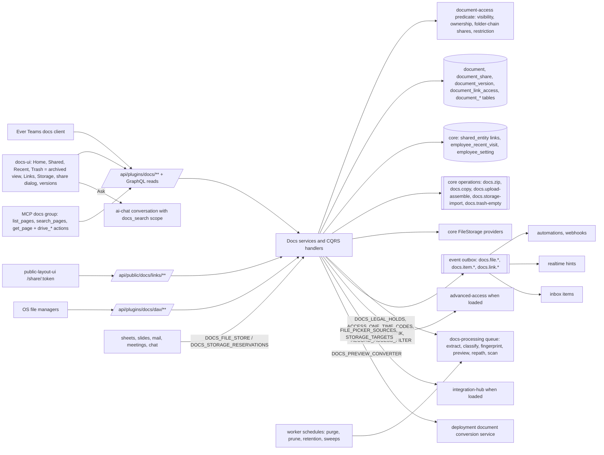

# Implementation Plan: Drive (files and folders of the Documents hub)

> Translates an approved `spec.md` into architecture and tech choices. The plan owns
> implementation details; the spec owns behaviour.

**Feature ID**: `drive`
**Spec**: `./spec.md`
**Tasks**: `./tasks.md`
**Status**: `Draft`
**Last updated**: 2026-11-23

---

## 1. Architecture Summary

No new plugin and no second file store: drive is the FILE / FOLDER half of `@gauzy/plugin-docs` (`packages/plugins/docs`) and its Angular UI `@gauzy/plugin-docs-ui` (`packages/plugins/docs-ui`). Pages stay `documents-and-wiki`'s. Everything new is gated per tenant by `FEATURE_DRIVE` (a `FeatureEnum` code, default off, checked by `FeatureFlagGuard` on every new controller and by the menu) on top of the existing `FEATURE_DOCUMENTS`; the unauthenticated surfaces are absent from a deployment unless `GAUZY_DRIVE_PUBLIC_LINKS_ENABLED` (public link controller) or `GAUZY_DRIVE_WEBDAV_ENABLED` (network-drive controller) is exactly `true` (`docs.config.ts`, read once at boot; `DocsModule` adds those controllers conditionally). Three code paths change behaviour only for tenants with the feature on: the file replace handler keeps the old blob as a version, the access predicate adds inherited shares, and rows deleted forever are purged after the window an organization sets (none by default). Other plugins reach drive through ports in `@gauzy/contracts` bound in `apps/api/src/plugin-composition.ts` and through code registries in core (no plugin imports another).

**Built on what exists, nothing beside it:**

- **Trash = today's archive.** `controllers/document-tree.controller.ts` already archives a subtree (`/:id/archive`), unarchives it, deletes only archived items (`DOCS_DELETE_REQUIRES_ARCHIVE`) as a soft delete, and recovers a soft-deleted item back into the archived state (`/:id/recover`); the Angular browse page has the "archived" preset (`docs-ui/src/lib/components/filter-bar/preset-chips.component.ts`) and Ever Teams lists archived pages as its trash. Drive keeps that meaning: the Trash view is the archived list with trash fields (every archived item the reader may read, as today), restore is unarchive with its rights of today, delete forever is the existing delete with its rights of today, and the purge hard-deletes soft-deleted rows after `drive.trash.purgeDays` only where an organization set it (unset by default: nothing is purged, as today). Archived items nobody deleted are never purged, except where an organization sets `drive.trash.autoEmptyDays` (off by default).
- **Recents** are core `employee_recent_visit` rows (`packages/core/src/lib/employee-recent-visit/`, `entity = Document`, count and last action in `data`), written through `EmployeeRecentVisitService` as tasks and projects already do. **View choices** are core `employee_setting` rows (`packages/core/src/lib/employee-setting/`, new type `DOCS_VIEWS` beside `TASK_VIEWS`, `entity = Document`).
- **Public links** are core `shared_entity` rows (`packages/core/src/lib/shared-entity/`, entity `Document`), with the link options in `sharedOptions` and the token, expiry, revocation and code columns of the `shared_entity` extension of `access-control-and-security`; documents have no second public-link table.
- **Background zips, deep copies, upload assembly, storage imports and emptying the trash** are core operations (`packages/core/src/lib/operation/`, `api/async-operation.ts`, `api/accepted.decorator.ts`); bulk actions go through `api/bulk-executor.service.ts`.
- **Asking** is the AI chat (`packages/plugins/ai-chat`, conversations) with the docs tools `docs_search` / `docs_read` (`knowledge/chat-tools/docs-chat-tools.service.ts`) given a folder, space or selection scope; one answer path for drive and `documents-and-wiki`.
- **MCP**: the existing `list_pages`, `search_pages` and `get_page` of `packages/mcp-server/src/lib/tools/collaboration/docs.ts` gain file filters; only actions get new tools.
- **Outbound fetches** use core `createSsrfSafeHttpsAgent()` (`packages/core/src/lib/core/util/ssrf-safe-agent.ts`) after the URL check of `@gauzy/utils` (`ssrf-url.ts`).
- **Exact duplicates** read the `sha256` every upload already stores (`document-upload.service.ts` step 3, `findDuplicate`, index `IDX_document_tenant_org_sha256`).
- **Permissions** are permission contributions of the docs plugin (`packages/plugin/src/lib/plugin-contributions.ts`, `defaultFor`); **settings** are setting contributions (`docs.settings.ts`) stored by the existing `document-settings.service.ts` in `tenant_setting`.



## 2. Tech Choices

| Concern | Choice | Rationale |
| ------- | ------ | --------- |
| Package | existing `packages/plugins/docs` + `docs-ui`; public pages in existing `public-layout-ui` | Principle I; build on what exists |
| Persistence | MultiORM entities in `docs/src/lib/entities` (added to `ALL_DOC_ENTITIES`); migrations in `packages/core/src/lib/database/migrations/` like every `document_*` migration | Principle III; the plugin's precedent |
| Inherited access | two materialised id paths on `document`: `treePath` (root to item) and `accessPath` (nearest restricted item or root to item); a share inherits when its document id is in the viewer row's `accessPath`. A move applies the destination's access at once: the move transaction rewrites the moved item's own row and up to 10,000 descendants; a larger subtree is finished by the core operation `docs.repath`, whose input holds the moved item's old and new `treePath` and `accessPath` prefixes, and until that operation is `COMPLETED` (pending, running or failed: it is registered as not cancelable and without compensators, so a move is never undone, and a failed run is resumed through the core `POST /api/operations/:id/retry`) the access predicate reads every row whose `accessPath` still starts with the old prefix as the new prefix followed by the rest of its path (the organization's `docs.repath` operations not yet completed, loaded once per request), so an ancestor of the old place grants nothing from the move on, also while a failed rewrite is never retried; rows below a restricted item inside the subtree keep their own `accessPath` | one SQL predicate for lists, counts, search and retrieval, no recursive query per row; no window in which former inherited readers keep access |
| Resumable upload | own part protocol (create, put part, query ranges, complete) with parts in provider storage under `documents/<tenant>/<org>/uploads/<id>/`; assembled by streaming | no client library lock-in; works on every provider |
| Public links | core `shared_entity` rows, entity `Document`: link options (level, download, password hash, limits, receipt options, suspension) in `sharedOptions`; token hash, sealed copy, expiry, revocation, code and recipient columns from the `shared_entity` extension of `access-control-and-security`; counts come from `document_link_access` | one public-link model for every record type |
| Tokens and passwords | 32 random bytes, SHA-256 at rest through the core token helper (`saved-report/saved-report-token.ts`, shared as `core/utils/hashed-token.ts`), `EncryptionService` (AES-256-GCM) copy for "copy link again"; passwords with `scrypt` (Node crypto) | Principle VI |
| Recents and view choices | core `employee_recent_visit` (`entity = Document`) and `employee_setting` (`DOCS_VIEWS`) | the platform's per-employee stores |
| Watermark | images with `sharp` (already a docs dependency); PDF stamping with `pdf-lib` (MIT) | no network, no native service |
| Receipts | HMAC-SHA-256 over the receipt with a per-tenant key derived from the server secret | verifiable later without storing a second secret |
| Duplicates | exact: the stored `sha256` of each upload; near: 64-bit SimHash of extracted text shingles, four 16-bit bands indexed | candidate lookup in indexed equality, Hamming check in memory |
| Zips | `archiver` (already used by the Markdown export) streamed to provider storage, inside a core operation | streaming, no full archive in memory, durable progress |
| Network drive | own RFC 4918 class 1 and 2 controller on Nest (no server framework), personal API tokens of core `auth/user-api-token` | standard clients; one credential model |
| Background work | core operations (`OperationRegistry`, `/operations`) for zips, deep copies, upload assembly, storage imports and emptying the trash; `api/bulk-executor.service.ts` for bulk actions; existing `docs-processing` queue (new stages) and `@ScheduledJob` + `@QueueWorker` from `@gauzy/scheduler` for sweeps, in-process timers without a queue root | one runtime for long work; the plugin's dispatch model for stages |
| Asking | AI chat conversation with the docs tools scoped to a folder, space or selection | one answer path, one usage ledger |
| Outbound fetch | core `createSsrfSafeHttpsAgent()` with the `@gauzy/utils` URL check, no redirects, size and time caps | one outbound safety rule |
| Permissions and settings | permission contributions (`defaultFor`) and setting contributions of the docs plugin; values in `tenant_setting` through `document-settings.service.ts` | the platform's catalogue and settings store |
| Push | `DocumentEvent` → realtime hints (existing `realtime-hints.service.ts`); outbox for automations | Principle VII |
| UI | Angular `docs-ui`; React not needed (Ever Teams builds its own screens) | Principle I |

## 3. Data Model

All new tables extend `TenantOrganizationBaseEntity`; JSON is `jsonColumnType()` as in the plugin; ids of users and employees carry no foreign key unless stated. On `document`, the base entity's `isArchived` / `archivedAt` are the trash and its `deletedAt` marks an item deleted forever and waiting for the purge (today's meanings); other tables soft-delete as usual, except tables marked append-only.

### Changed entities

| Entity | New columns | Indexes |
| --- | --- | --- |
| `document` | `ownerUserId` uuid null (backfilled from `createdByUserId`; predicates read `COALESCE(ownerUserId, createdByUserId)`); `inheritsAccess` bool default true; `treePath` varchar(1200) null; `accessPath` varchar(1200) null; `retentionLabelId` uuid null fk `document_retention_label` SET NULL; `retainUntil` timestamp null; `editorKind` varchar(32) null; `linkUrl` varchar(2048) null (kind `LINK`); `archivedByUserId` uuid null (set by the existing archive command, shown in the trash) | `(tenantId, organizationId, treePath)` (MySQL: 255-character prefix), `(tenantId, organizationId, ownerUserId)`, `(tenantId, organizationId, isArchived, archivedAt)` (trash list), `(tenantId, organizationId, deletedAt)` (purge), `(tenantId, organizationId, retainUntil)` |
| `document_share` | `expiresAt` timestamp null, `message` text null; `access` values gain `UPLOAD`, `MANAGE` (varchar(16), no schema change) | `(tenantId, expiresAt)` |
| `document_version` | `versionNumber` int, `label` varchar(120) null, `isPinned` bool default false, `source` varchar(16) (`AUTO`, `MANUAL`, `REPLACE`, `RESTORE`, `APP`, `DAV`, `IMPORT`), `storageProvider` varchar(20) null, `storageKey` varchar(1024) null (excluded from JSON), `mimeType` varchar(127) null, `fileSize` bigint/integer null, `sha256` char(64) null, `originalFilename` varchar(255) null | unique `(documentId, versionNumber)` (backfilled by row number over `lastSavedAt`) |
| `document_category` | `defaultFolderId` uuid null, `defaultRetentionLabelId` uuid null, `autoFile` bool default false | — |

Contracts: `DocumentKindEnum` gains `LINK`; `DocumentShareAccessEnum` gains `UPLOAD`, `MANAGE`; `DocumentReviewReasonEnum` gains `guest-upload`; `DocumentSourceEnum` gains `GUEST`; `EmployeeSettingTypeEnum` gains `DOCS_VIEWS` (`'Docs-View'`) (all additive).

### Existing core tables used and extended

| Table | Use | Change |
| --- | --- | --- |
| `shared_entity` (`packages/core/src/lib/shared-entity/`) | one row per public link: `entity = 'Document'`, `entityId` = the linked item; `sharedOptions` holds `access` (`VIEW`, `UPLOAD`, `VIEW_UPLOAD`), `allowDownload`, `passwordHash`, `maxDownloads`, `recipientEmailEncrypted`, `requireAcknowledgement`, `watermark`, `notifyFirstAccess`, `label`, `suspendedAt`, `suspendReason`; `shareRules` lists the fields the reader shows; revoking sets `revokedAt` | the extension columns of `access-control-and-security` (`tokenHash`, `tokenPrefix`, `tokenEncrypted`, `expiresAt`, `revokedAt`, `requireCode`, `recipientEmailHash`, view counters); the token lookup of `shared-entity.service.ts` tries the hash first, then the plain column, so existing shares keep working; `shared-entity.access.ts` lists `Document` as a type its plugin manages, so, for tenants with `FEATURE_DRIVE` on, the generic `/shared-entities` routes neither create nor list new document links (with it off they treat `Document` as today); a `Document` row created earlier through those routes keeps its `token`, keeps resolving by it, and its author and the organization's managers copy it again as today, from those routes and from the item's link list |
| `employee_recent_visit` | Recent: `entity = 'Document'`, `entityId`, `employeeId`, `visitedAt`, `data` = `{ count, lastAction: 'OPEN' \| 'EDIT' }`; written at most once a minute per item through `EmployeeRecentVisitService.create` (its upsert); Recent reads the latest 200 `Document` visits per employee (`visitedAt` descending, limit 200); the write path prunes nothing, so earlier visits stay (`record-views-and-search` FR-58), and visits of other entities are untouched | the core module gains deleting one's own visits of an entity type (one, or all), used by "remove" and "clear"; a person without an employee record has no Recent list (a later need is met in the core module, not here) |
| `employee_setting` | view mode, sort and kinds per view: `settingType = DOCS_VIEWS`, `entity = 'Document'`, `data` = `{ [viewKey]: { mode, sort, kinds } }`, patched through the existing `PATCH /employee-settings/:id/data` | enum value only |
| `operation` | zips (`docs.zip`: result = storage key, manifest, `expiresAt`), deep copies past 500 items (`docs.copy`), assembly of a completed resumable upload (`docs.upload-assemble`), storage imports (`docs.storage-import`), emptying a trash (`docs.trash-empty`), the path rewrite of a moved subtree past 10,000 rows (`docs.repath`: input = the old and new path prefixes, read by the access predicate until it completes); registered in `OperationRegistry`, progress through `operation-event.publisher.ts` | none |

### New entities

| Table | Columns (beyond the base) | Indexes and uniqueness |
| --- | --- | --- |
| `document_link_access` (append-only; the receipts and the counts of a link) | `sharedEntityId` fk `shared_entity` cascade, `documentId` (item reached), `action` varchar(12) (`VIEW`, `DOWNLOAD`, `UPLOAD`, `ACKNOWLEDGE`, `DENIED`), `addressHash` varchar(64), `recipientEmailHash` null, `acknowledgedName` varchar(120) null, `fileSha256` char(64) null, `versionNumber` int null, `signature` varchar(64) null | `(sharedEntityId, action, createdAt)`, `(tenantId, documentId, createdAt)` |
| `document_upload_session` (the part ranges a client sends; a protocol resource the client drives, not background work: its assembly runs as the `docs.upload-assemble` operation) | `parentId` null, `targetDocumentId` null (replace), `relativePath` varchar(1024) null, `fileName` varchar(255), `declaredSize` bigint, `partSize` int, `receivedParts` text (ranges), `receivedBytes` bigint, `status` varchar(12) (`OPEN`, `ASSEMBLING`, `DONE`, `FAILED`, `EXPIRED`), `reservationId` null, `operationId` null, `expiresAt`, `resultDocumentId` null, `error` varchar(255) null | `(tenantId, createdByUserId, status)`, `(status, expiresAt)` |
| `document_retention_label` | `name` varchar(120), `description` varchar(500) null, `keepForDays` int, `anchor` varchar(10) (`CREATED`, `MODIFIED`, `LABELLED`), `endAction` varchar(8) (`NONE`, `REVIEW`, `TRASH`) | unique `(tenantId, organizationId, name)` |
| `document_filing_log` | `documentId` fk cascade, `kind` varchar(10) (`FOLDER`, `LABEL`), `fromValue`, `toValue` varchar(64), `automatic` bool, `undoneAt` null | `(tenantId, documentId, createdAt)` |
| `document_storage_reservation` | `scope` varchar(6) (`USER`, `TEAM`, `ORG`), `subjectId`, `bytes` bigint, `purpose` varchar(32), `expiresAt`, `consumedDocumentId` null, `releasedAt` null | `(tenantId, organizationId, scope, subjectId)`, `(expiresAt)` |
| `document_quota_override` | `scope` varchar(6) (`USER`, `TEAM`), `subjectId`, `quotaBytes` bigint | unique `(tenantId, organizationId, scope, subjectId)` |
| `document_dav_lock` | `documentId` null, `path` varchar(1024), `token` varchar(64), `ownerUserId`, `scope` varchar(9), `depth` varchar(8), `expiresAt` | unique `(token)`; `(tenantId, documentId)` |
| `document_text_fingerprint` (near duplicates only; exact duplicates group by `document.sha256`) | `documentId` fk cascade, `fingerprint` char(16), `b0`, `b1`, `b2`, `b3` int | unique `(documentId)`; `(tenantId, organizationId, b0)` … `b3` |

Settings (setting contributions in `packages/plugins/docs/src/lib/docs.settings.ts`, organization scope, read and written by the existing `document-settings.service.ts` in `tenant_setting`): `drive.links.*` (enabled, requirePassword, maxExpiryDays, fileRequests, allowedDomains), `drive.trash.purgeDays` (null = never, as today; 7 to 365: days between delete forever and the purge), `drive.trash.autoEmptyDays` (null = never; 7 to 365), `drive.trash.deleteNeedsManage` (false: today's delete rights), `drive.versions.keepDays` (30), `drive.versions.keepCount` (50), `drive.quota.defaultUserBytes` (0), `drive.preview.maxBytes` (0 = no cap, as today), `drive.webdav.mode` (`OFF`, `READ_ONLY`, `READ_WRITE`, default `READ_WRITE` once the switch is on), `drive.webdav.exposePages` (false), `drive.records.limits` (per type), `drive.links.agentsMayCreate` (false).

### Migrations

**Migration timestamps**: `packages/core` `1791000046100` to `1791000046199`.

In `packages/core/src/lib/database/migrations/`, PostgreSQL, MySQL and SQLite branches, idempotent, registered for both ORMs:

1. `1791000046100-AddDriveDocumentColumns` — the changed columns above; backfills `ownerUserId`, `versionNumber`, and `treePath` / `accessPath` with a recursive common table expression per dialect (PostgreSQL, MySQL 8, SQLite all support it), in batches of 10,000.
2. Core `shared_entity` columns: the core migration `1791000039900-ExtendSharedEntitySocialAccountAndApiCallLog` of
   `access-control-and-security` (its T5); nothing of it is shipped here.
3. `1791000046110-CreateDriveTables` — the eight new tables.

Permissions and their default grants are contributions (§9), not a migration.

**Legacy organization documents.** The organization documents page (`packages/core/src/lib/organization-document`) leads to the Documents hub once `FEATURE_DOCUMENTS` is on (`apps/gauzy/src/app/pages/feature-documents-redirect.guard.ts`), but its rows were never carried over. When `FEATURE_DRIVE` is first switched on for an organization (or on demand), a `docs.storage-import` operation copies each `organization_document` row's file (its `image_asset`, on the same storage providers) into a FILE row of an "Organization documents" folder in the organization space, with `externalSource = 'organization-document'` and `externalId` = the row id, idempotent through the existing `UQ_document_external_provenance`; the legacy rows and routes stay as they are. The help-centre articles are carried into the hub by `helpdesk-portal-and-knowledge-base`.

### Contracts

`packages/contracts/src/lib/document.model.ts` (enum values, new fields), `shared-entity.model.ts` (`expiresAt`), `employee-settings.model.ts` (`DOCS_VIEWS`) and a new `document-drive.model.ts` (exported from `index.ts`): link options (the `sharedOptions` shape of a document link), link access, upload session, version, retention label, quota, reservation, zip operation result, access panel, docs chat scope, duplicate group, file kind, record action; port tokens and interfaces of §4.1.

## 4. API Surface

### 4.1 Ports and registries

```ts
// core code registry packages/core/src/lib/document-registry/ (no table; inert without the docs plugin)
registerDocumentFileKinds([{ key: 'sheet', labelKey, icon, mimeTypes, extensions, canCreate,
  createBlank(ctx): Promise<{ bytes?: Buffer; state?: Buffer; mimeType: string; fileName: string }>,
  render?(doc, format?): Promise<{ stream: Readable; mimeType: string; fileName: string }>,   // downloadable copy
  extractText?(doc): Promise<string>, thumbnail?(doc): Promise<Buffer>, openRoute: '/pages/sheets/:id',
  live?: boolean,            // the kind brings its own co-editing logic to the live server (used by `spreadsheets`, `presentations`)
  maxStateBytes?: number }]); // cap of the co-editing state for this kind; default: the documents binary cap
registerDocumentRecordActions([{ key, recordType, labelKey, mimeTypes, create(documentId, viewer): Promise<IRecordRef> }]);

interface IDocumentFileStore {           // DOCS_FILE_STORE, bound to DocumentFileStoreService
  create(i: { parentId?: ID; space?: IDocumentSpaceRef; name: string; editorKind?: string; bytes?: Buffer;
              state?: Buffer; mimeType: string; source: DocumentSourceEnum }, viewer: IViewer): Promise<IDocument>;
  read(id: ID, viewer: IViewer, o?: { versionNumber?: number }): Promise<{ document: IDocument; stream: Readable; state?: Buffer }>;
  write(id: ID, viewer: IViewer, w: { bytes?: Buffer; state?: Buffer; mimeType?: string; expectedRevision: number;
              versionSource: 'APP' | 'DAV' }): Promise<{ revision: number; versionNumber?: number }>;
  access(id: ID, viewer: IViewer): Promise<DocumentShareAccessEnum | 'OWNER' | null>;
  folderFor(i: { purpose: 'mail' | 'meeting' | 'chat' | 'deck'; ownerUserId: ID; recordRef?: IRecordRef }): Promise<ID>;
}
interface IDocumentStorageReservations { // DOCS_STORAGE_RESERVATIONS
  reserve(i: { scope: 'USER' | 'TEAM' | 'ORG'; subjectId: ID; bytes: number; purpose: string; ttlMinutes?: number }): Promise<ID>;
  consume(reservationId: ID, documentId: ID): Promise<void>; release(reservationId: ID): Promise<void>;
}
interface IDocumentRecordFiles {         // DOCS_RECORD_FILES (record panels, timelines, other plugins)
  list(ref: IRecordRef, viewer: IViewer): Promise<IDocument[]>; attach(ref: IRecordRef, documentId: ID, viewer: IViewer): Promise<void>;
}
interface IDocumentLegalHolds {          // consumed: DOCS_LEGAL_HOLDS → advanced-access hold register
  heldIds(tenantId: ID, documentIdsWithAncestors: ID[]): Promise<Map<ID, { holdId: ID; reason: string }>>;
}
interface IDocumentPreviewConverter {    // consumed: DOCS_PREVIEW_CONVERTER → deployment conversion service adapter
  toPdf(input: Readable, mimeType: string): Promise<Readable>; frame?(input: Readable, mimeType: string): Promise<Buffer>;
}
```

A file of a registered kind is an ordinary FILE row with `editorKind`: the app's native state lives in `contentBinary` (bounded by `GAUZY_DOCS_MAX_BINARY_BYTES`), the downloadable copy in the stored blob (refreshed by `render` on save or lazily on download), versions in `document_version` with `source = APP`. Sharing, trash, quota, search (via `extractText`) and record links need nothing from the app. `spreadsheets` and `presentations` register their kinds and call `DOCS_FILE_STORE`; their co-editing transport is theirs.

**Offered** (bound in `plugin-composition.ts`): `DOCS_FILE_STORE`, `DOCS_STORAGE_RESERVATIONS` (meetings, imports), `DOCS_RECORD_FILES`, `DOCS_PUBLIC_LINK_SOURCE` (`list(recordType, recordId)` for the access link register, over the `shared_entity` rows of entity `Document`), a `RECORD_TIMELINE_SOURCES` entry (`files`), a `registerPaletteProviders` entry (files and folders), a `PERSONAL_DATA_HANDLERS` entry (`docs.files`: find, export with bytes, reassign or delete; refuses held items), report datasets and definitions (§7). **Consumed** (optional, unbound = capability hidden): `DOCS_LEGAL_HOLDS`, `ACCESS_ONE_TIME_CODES` (external recipients; without it a recipient link needs a password), `AUDIT_EVENT_SINK`, `RECORD_ACCESS_FILTER` (record-granted reads; fallback the registry entry's read permission), `FILE_PICKER_SOURCES`, `STORAGE_TARGETS`, `DOCS_PREVIEW_CONVERTER`, `DOCS_CONTENT_SCANNERS` (optional malware scanner; guest uploads wait for it when bound), `INBOX_ITEM_WRITER`.

### 4.2 REST

All under `/api/plugins/docs`, class guards `TenantPermissionGuard`, `PermissionGuard`, `FeatureFlagGuard` with `@FeatureFlag(FEATURE_DOCUMENTS)` and `@FeatureFlag(FEATURE_DRIVE)` on new routes, class-validator DTOs, Swagger, `Idempotency-Key` on creating routes; item-level checks in services (404 unreadable, 403 below the needed level).

| Method | Endpoint | Permission | Description | Status |
| ------ | -------- | ---------- | ----------- | ------ |
| `POST` `PUT` `GET` `POST` `DELETE` | `/uploads`, `/uploads/:id/parts/:index`, `/uploads/:id`, `/uploads/:id/complete`, `/uploads/:id` | `DOCS_CREATE` (`DOCS_UPDATE` with `targetDocumentId`) | resumable upload session, parts (raw body, ≤ part size), received ranges, assemble (`202` with the `docs.upload-assemble` operation above 100 MB), cancel; `relativePath` builds folders | New |
| `POST` | `/documents` with `kind: LINK` | `DOCS_CREATE` | link item | Changed (additive) |
| `POST` | `/documents/:id/duplicate` with `parentId`, `onConflict` | `DOCS_CREATE` | copy files with bytes and folders deep (past 500 items: `202` with a `docs.copy` operation); no `onConflict` = today's naming | Changed (additive) |
| `POST` | `/documents/bulk` (`action`: move, copy, share, label, download, favourite, archive; ≤ 200 ids) | the action's right per item | one result per item through core `BulkExecutor` (`api/bulk-executor.service.ts`) | New |
| `POST` | `/documents/:id/move` with `onConflict` | `DOCS_UPDATE` | keep both, replace, skip; no `onConflict` = today's behaviour (same names allowed) | Changed (additive) |
| `POST` | `/documents/:id/owner` | owner or `DOCS_MANAGE` | transfer ownership | New |
| `GET` | `/documents/:id/access` | `DOCS_READ` | access panel | New |
| `POST` | `/documents/:id/restrict`, `/documents/:id/unrestrict` | `DOCS_UPDATE` + manage level | stop or resume inheritance | New |
| `POST` `PUT` | `/documents/:id/shares` (`access`, `expiresAt`, `message`) | `DOCS_UPDATE` + manage level | new levels, ceiling check | Changed (additive) |
| `POST` | `/documents/:id/external-shares` | `DRIVE_LINK_CREATE` + manage level | email recipient with code | New |
| `GET` | `/shared-with-me`, `/home`, `/recent`; `DELETE /recent`, `/recent/:documentId`; `POST /documents/:id/visit` | `DOCS_READ` | home sections; Recent reads and writes core `employee_recent_visit` rows (`entity = Document`), filtered by document access | New |
| `GET` `PATCH` | `/api/employee-settings?settingType=Docs-View`, `/api/employee-settings/:id/data` | own employee | view mode, sort and kinds per view, on the existing core routes | Unchanged (used) |
| `GET` `POST` | `/documents/:id/public-links`; `PUT` `DELETE` `/public-links/:id`; `GET /public-links?mine=true`, `/public-links/:id/accesses`, `/public-links/:id/receipts.(json|csv)`; `POST /public-links/receipts/verify` | `DRIVE_LINK_CREATE` + manage level (lists: owner) | links as core `shared_entity` rows (entity `Document`), their accesses and receipts; `DELETE` revokes the link (`revokedAt`) | New |
| `GET` `PUT` `DELETE` | `/documents/:id/versions` (files too), `/documents/:id/versions/:versionId` (label, pin), `/versions/:versionId/download`; `POST …/restore` | read / edit / manage | file versions on the existing routes | Changed (additive) |
| `GET` | `/documents?archived=only&scope=trash` (the existing list) | `DOCS_READ` | the trash: the archived items `archived=only` lists today, with `archivedAt`, `archivedByUserId`, original path and days left; `mine=true` narrows to items I archived or that sit in what I manage | Changed (additive) |
| `POST` | `/documents/:id/unarchive` with `targetParentId` | existing rights | restore from the trash in place, or at the space top when the folder is gone | Changed (additive) |
| `DELETE` | `/documents/:id` (archived items only, `DOCS_DELETE_REQUIRES_ARCHIVE`) | `DOCS_DELETE` + write access as today (manage level only where `drive.trash.deleteNeedsManage` is on) | delete forever; recoverable into the trash through `POST /documents/:id/recover` (existing) until a purge | Changed (additive) |
| `POST` | `/trash/empty` (`confirm=true`) | the delete rights above, per item | empties my trash as a `docs.trash-empty` operation (`202`) | New |
| CRUD | `/retention-labels`; `POST /documents/:id/retention-label` | `DRIVE_RETENTION_MANAGE` | labels | New |
| `GET` `POST` | `/documents/:id/suggestions`, `/suggestions/:kind/accept`, `/suggestions/:kind/dismiss`, `POST /filing-log/:id/undo` | `DOCS_UPDATE` | filing suggestions | New |
| `GET` `POST` | `/duplicates?folderId=&space=`, `/duplicates/merge` (`preview`) | `DOCS_READ` / `DOCS_UPDATE` | duplicate groups and merge | New |
| `GET` | `/storage/me`, `/storage/usage?groupBy=owner|space|type`, `/storage/largest`; CRUD `/storage/quotas` | `DOCS_READ` / `DRIVE_SETTINGS_MANAGE` | meter, breakdown, overrides | New |
| `POST` | `/storage-imports/preview`, `/storage-imports` | `DOCS_MANAGE` | import a storage path (`202` with a `docs.storage-import` operation) | New |
| `POST` `GET` | `/zips` (`202` with a `docs.zip` operation, inline stream below 100 items and 200 MB), `/zips/:operationId/download`; status on the core `/operations/:id` | `DOCS_READ` | background zip | New |
| `GET` | `/records/attachments?recordType=&recordId=` | `DOCS_READ` | attached-to-records tree | New |
| `GET` `POST` | `/documents/:id/record-actions`, `/record-actions/:key` | `DOCS_READ` + the record's create permission | create a record from a file | New |
| `POST` | `/documents/upload/from-url` | `DOCS_CREATE` | fetch through core `createSsrfSafeHttpsAgent()` after the `@gauzy/utils` URL check | New |
| `GET` `PUT` | `/settings` (drive keys) | `DOCS_READ` / `DRIVE_SETTINGS_MANAGE` | policies | Changed (additive) |
| WebDAV | `/dav/**`: `OPTIONS`, `PROPFIND`, `PROPPATCH`, `GET`, `HEAD`, `PUT`, `MKCOL`, `COPY`, `MOVE`, `DELETE`, `LOCK`, `UNLOCK` | personal API token + `DRIVE_WEBDAV_USE` | network drive (switch on) | New |

Asking (FR-54) adds no docs route: the Ask action opens an `ai-chat` conversation whose tool context carries a `docsScope` (folder subtree by `treePath` prefix, a space, or a list of ids); `docs_search` and `docs_read` apply it with the access filter in `knowledge/retrieval/retrieval.service.ts`, fall back to the content search for items not in the knowledge index, and cite through `docs-citations.ts`. The same scope serves `documents-and-wiki` (pages and spaces).

Public (`@Public()`, throttled per address and per link, tenant from the `shared_entity` row, `Referrer-Policy: no-referrer`, `X-Robots-Tag: noindex`, switch on): `GET /api/public/docs/links/:token` (state, item summary, what is required), `POST …/unlock` (password → 30-minute link session token), `POST …/code`, `POST …/code/verify`, `POST …/acknowledge`, `GET …/items?parentId=`, `GET …/items/:id/preview`, `GET …/items/:id/download`, `POST …/uploads` (≤ 100 MB per file), `GET …/page` (page reader payload from `documents-and-wiki`).

GraphQL reads in `graphql/docs.schema.ts`: `driveHome`, `sharedWithMe`, `documentAccess(id)`, `documentFileVersions(id)`, `documentTrash`.

**Consumer tokens answered** (bound in `apps/api/src/plugin-composition.ts` to the file store, record files, public link and extraction services of the documents hub; each consumer plan states the shape it calls and its fallback): `CALENDAR_FILES`, `CRM_DOCUMENTS`, `DATA_EXCHANGE_DRIVE`, `EXPENSE_RECEIPT_MAILBOX`, `LEARNING_FILES`, `MAIL_ATTACHMENT_TEXT`, `MEETINGS_FILES`, `PAYROLL_DOCUMENT_READER`, `SLIDES_PUBLIC_LINKS`.

## 5. Events, Real-Time and Notifications

| Event | Emitted when | Consumers |
| ----- | ------------ | --------- |
| `docs.file.uploaded` | a file is created by upload, file request, network drive, record panel or app | automations, webhooks, activity |
| `docs.file.version_added` | a replace or app save adds a version | automations, realtime `document.updated` hint |
| `docs.item.shared` / `docs.item.unshared` | share or external share added, changed, removed, expired | inbox (recipient), audit, automations |
| `docs.link.created` / `docs.link.revoked` / `docs.link.accessed` | link lifecycle; access sampled to the first per link and day | inbox (first access, opt-in), audit, automations |
| `docs.upload.guest_received` | a file request receives files | inbox (owner), review queue |
| `docs.item.trashed` / `docs.item.restored` / `docs.item.deleted` / `docs.item.purged` | archive, unarchive, delete forever, purge | realtime, record panels, audit |
| `docs.retention.due` | a label's end date is reached | inbox (owner), automations |
| `docs.quota.threshold` | usage passes 80 % or 95 % | inbox (owner, space managers) |

Appended with `EventOutboxService.append` inside the transaction of the document change (partition `docs:<documentId>`), so no change commits without its event, and dispatched by the outbox after commit; declared with `registerAutomationTriggers` and `registerNotificationCategories` of `automation-and-notifications`. Inbox items through `INBOX_ITEM_WRITER` when the Inbox is loaded, else the existing `document-notifier.service.ts` platform notifications (its ten-minute dedupe kept). Real time: the existing `DocumentEvent` → `realtime-hints.service.ts` path, plus hint kinds `document.version`, `document.trash`, `document.link`; zip, copy, import and emptying progress reaches the requester through the core operation's own events (`operation-event.publisher.ts`).

## 6. UI Surface

- **Angular `docs-ui`** (routes under `/pages/documents`, guarded by `docsFeatureGuard` plus a drive guard that reads the feature): tree sidebar sections Home, Recent, Shared with me, Favourites (existing), Trash, My links, Storage; pages `home`, `recent`, `shared`, `links`, `storage` (meter, breakdown, largest files, quotas for managers), `records` (attached to records), `duplicates`; the Trash entry opens the browse page's existing "archived" preset (`components/filter-bar/preset-chips.component.ts`) with the trash columns (original place, archived by, when, days left) and the delete-forever and empty actions, so there is one list of archived items; components: upload queue with parts and resume (`components/upload`), folder upload (directory input and drop), name-collision dialog, share dialog (levels, inheritance source, restrict, external recipients, links tab, access panel), link editor, file versions panel in `pages/file-view` and the detail panel, suggestion chips on the detail panel, an "Ask" action that opens the AI chat panel already scoped to the folder, space or selection, progress toasts from operation events, retention label picker, keyboard help overlay (`pages/browse/docs-browse-shortcuts.ts` gains `s`, `F2`, `Delete`, `f`, `t`, `?`). Settings → Documents (`pages/settings`) gains Drive (links policy, trash, versions, preview cap, default personal quota, network drive) and Retention labels. Strings `DOCS.DRIVE.*` in every locale file of `docs-ui/src/i18n`.
- **Record pages**: `gz-document-links-panel` is registered through `PageTabRegistryService` for every record type whose registry entry declares `files: true`; the five hosts that embed it today keep their markup.
- **Public pages**: `public-layout-ui` route `/share/:token` (unlock, code, acknowledgement, folder browser, preview, download, file request form).
- **Ever Teams** consumes the same routes (its screens: the Ever Teams spec `workspace-collaboration-clients`): `/uploads/**`, `/shared-with-me`, `/home`, `/recent`, `/documents?archived=only&scope=trash`, `/documents/:id/unarchive`, `/trash/empty`, `/documents/:id/access|shares|public-links|versions`, `/zips/**` with the core `/operations/:id`, the core `/employee-settings` for view choices, `/storage/me`; asking goes through the platform's AI chat API with a docs scope.

## 7. MCP Tools, SDKs and Integrations

MCP (`packages/mcp-server/src/lib/tools/collaboration/docs.ts`, group flag `GAUZY_MCP_TOOLS_DOCS`, scopes `docs:read` / `docs:write`): the existing read tools cover files and folders, one tool per index: `list_pages` gains `kind` (`PAGE`, `FOLDER`, `FILE`, `LINK`) and `parentId`, `search_pages` gains the drive filters of FR-53 and a `scope` (folder, space, ids) whose hits carry cited passages (how an agent asks a folder), `get_page` returns a file's metadata, extracted text and versions. New action tools: `drive_upload_text` (≤ 10 MB), `drive_move`, `drive_copy`, `drive_share` (`preview`), `drive_create_link` (`preview`; refused unless `drive.links.agentsMayCreate`), `drive_list_versions`, `drive_restore_version` (`preview`), `drive_trash` (`preview`; archives), `drive_restore`, `drive_find_duplicates`. No tool deletes forever or empties a trash. Every tool calls a REST route (route check script of `integration-hub`).

SDK: OpenAPI additive (new routes, enum values); Kiota SDKs regenerated at release. Formats: zip archives with a `manifest.json`; receipts as JSON and CSV with signatures; network drive per RFC 4918. Integrations: `FILE_PICKER_SOURCES` and `STORAGE_TARGETS` of `integration-hub`; the existing `DocumentImporterRegistry` stays the seam for outside stores that sync into folders.

Reports (`registerReportDatasets`, `registerReportDefinitions` of `report-builder-and-dashboards`): datasets `docs_storage` (bytes by owner, space, type), `docs_largest_files`, `docs_public_links`, `docs_link_access`, `docs_guest_uploads`, `docs_trash_due`, `docs_duplicates`, `docs_retention_due`; definitions for spec FR-85, computed by the same services as the storage routes.

## 8. Background Jobs

| Trigger | When | What it does | Idempotency |
| ------- | ---- | ------------ | ----------- |
| `docs.drive.trash-purge` | daily 02:00 tenant time | where `drive.trash.autoEmptyDays` is set, first deletes forever the archived items older than it; then, where `drive.trash.purgeDays` is set, hard-deletes rows deleted forever (`deletedAt`) more than `purgeDays` ago, not labelled-before-date or held, then their blobs and versions; with neither set it does nothing; archived rows nobody deleted are never touched otherwise | blob delete after row delete; a sweep removes orphan blobs by key prefix |
| `docs.drive.version-prune` | daily 02:30 | prunes unpinned file versions beyond `keepDays` and `keepCount`, unless held or labelled | per-version delete |
| `docs.drive.retention` | daily 03:00 | runs end actions of labels due; inbox items | `document_filing_log` and label date |
| `docs.drive.share-expiry` | hourly | removes expired shares, marks expired links, notifies | expiry timestamps |
| `docs.drive.upload-sweep` | hourly | expires open sessions after 24 h, deletes parts, releases reservations | status transition |
| `docs.drive.zip-sweep`, `docs.drive.reservation-sweep` | hourly | deletes the archives of `docs.zip` operations past their `expiresAt`; lapses reservations | expiry timestamps |
| core operations `docs.zip`, `docs.copy`, `docs.upload-assemble`, `docs.storage-import`, `docs.trash-empty` | on request | archive build with a manifest; deep copy past 500 items; streamed assembly into the upload checks; storage import (idempotent by `externalSource`/`externalId`); delete forever of a trash, held and labelled items skipped | the operation's idempotency key and lease; steps resume after a restart |
| queue stages `fingerprint`, `preview`, `repath`, `scan` | on upload, replace, request, move | SimHash bands; converted preview; path rewrite of large subtrees (as the core operation `docs.repath`, whose rows not yet completed the access predicate reads); malware scan | deterministic job id `docs:<stage>:<id>` (existing convention) |

Schedules follow the task-automations layout: the worker loads a `DocsDriveSchedulePlugin` that registers the queue jobs only; the API consumes them; without a queue root an in-process timer runs them under a lock (Postgres advisory lock, MySQL `GET_LOCK`, in-process on SQLite; copied from `task-automation-sweep-lock.ts`).

## 9. Security & Permissions

- Permission contributions of the docs plugin (`PluginPermissionContribution` with `defaultFor`): `DRIVE_LINK_CREATE`, `DRIVE_SETTINGS_MANAGE`, `DRIVE_RETENTION_MANAGE` (administration group), `DRIVE_WEBDAV_USE` (general group); `SUPER_ADMIN` and `ADMIN` all four, `MANAGER` `DRIVE_LINK_CREATE` and `DRIVE_WEBDAV_USE`, `EMPLOYEE` `DRIVE_WEBDAV_USE`; existing tenants get the missing rows from the permission reload. Item levels stay the composition invariant of `document-access.predicate.ts`: permission AND (visibility OR ownership OR admin override OR own share OR inherited share); `MANAGE` is needed to share, link, restrict and delete versions.
- Public routes: tokens hashed in `shared_entity.tokenHash`, constant-time compare, per-address and per-link throttling (existing throttler), password attempts limited (spec FR-23), no session cookie of the platform set, no names beyond the sharer's display name, content served with `Content-Disposition: attachment` for script-capable types and `X-Content-Type-Options: nosniff`. Guest uploads: the existing upload checks, `source = GUEST`, review status `PENDING` with reason `guest-upload`, optional scanner.
- Network drive: personal API tokens only (never the account password), per-organization mode, method allow-list in read-only mode, locks expire (default 10 minutes, at most 1 hour).
- Fetch by address through core `createSsrfSafeHttpsAgent()` (`packages/core/src/lib/core/util/ssrf-safe-agent.ts`: resolved addresses checked at connection time) after `getUnsafeOutboundUrlReason` of `@gauzy/utils`, no redirects followed, size and time caps.
- Audit: every share, restriction, link, access, hold check refusal and permanent deletion goes to `AUDIT_EVENT_SINK` when bound and to the document activity log always.

## 10. Observability

Activity entries per item (`activity/document-activity-log.subscriber.ts` gains the new facts); counters for resumed uploads, assembly failures, link accesses and denials, purge and prune counts, quota refusals, ask latency and citation counts; one log line per job run with counts; `GET /live/status`-style probe `GET /plugins/docs/drive/status` for operators (switches, queue mode, converter and scanner bound).

## 11. Phased Rollout

1. **Phase 1 — Surface what exists** (flag off by default): `FEATURE_DRIVE`, permission contributions, migrations; the Trash view over today's archive (unarchive to restore, today's delete and recover), shared with me, Recent and Home over core recent visits, view choices in employee settings, the access panel (today's shares), record panels on every registered record type, storage meter and breakdown over today's quota service, copy link, folder zip on the existing folder export as a core operation, the one-time import of the legacy organization documents, shortcuts help, the existing MCP tools with file filters.
2. **Phase 2 — Depth**: resumable and folder upload, collisions, link items, inherited shares with upload and manage levels and restriction, ownership transfer, external recipients, public links and file requests (switch), file versions and pruning, delete forever and purge, quotas per person and space and reservations, previews (code, tables, archives, converter), thumbnails, zips in the background, network drive (switch), the file-kind registry and `DOCS_FILE_STORE`, reports.
3. **Phase 3 — Advanced capabilities**: ask your files (the AI chat docs scope), filing and retention suggestions, retention labels, duplicates, acknowledgement, watermark and receipts, legal holds, agent previews.
4. **Phase 4 — General availability**: the feature is off by default; after the trial period it may be switched on by default for new tenants only; existing tenants keep their setting until an administrator changes it.
   The deployment switches stay explicit.

## 12. Constitution Reconciliation

- I Plugin-first: extends `docs` and `docs-ui`; registries in core only because several plugins register into them; core `shared_entity`, `employee_recent_visit`, `employee_setting` and `operation` used, with the `shared_entity` extension of `access-control-and-security` and a delete-own route on recent visits.
- II Tenant/organization scoping: every table on the tenant and organization base; public and network routes resolve tenant and organization from the link or token and run in that request context.
- III Both ORMs, additive migrations: columns and tables added, enum values added, three dialects, both ORMs; backfills batched.
- IV Default-off flag; nothing removed: `FEATURE_DRIVE` off; switches off; replace-in-place, archive, delete-after-archive and recover keep working for tenants without the feature, and with their rights of today for tenants with it; nothing archived is purged unless an organization sets automatic emptying, and nothing deleted unless it sets a purge period.
- V Contracts and API first: contracts and REST before UI; additive OpenAPI.
- VI Permissions, privacy, security: four keys as contributions; hashed secrets; throttling; guest upload checks; data leaving listed in spec §4.
- VII Real-time through the event bus: outbox and realtime hints; long-work progress through the core operation events.
- VIII i18n and accessibility: `DOCS.DRIVE.*` in every locale; keyboard and screen-reader labels.
- IX Tests: unit specs per service and pure helper, DB specs on SQLite for the predicate, purge and pruning, e2e for public links and the network drive.
- X Behaviour-first spec: the spec has no tables, columns or routes.
- XI Documentation describes our platform only.

## 13. Risks & Mitigations

| Risk | Likelihood | Impact | Mitigation |
| ---- | ---------- | ------ | ---------- |
| Inherited access slows lists | Medium | High | materialised paths; viewer's share roots computed once per request; benchmark at 1 M rows in CI on PostgreSQL |
| Path rewrite of a huge moved subtree | Medium | Medium | one prefix-replace statement up to 10,000 rows, the `docs.repath` operation beyond, until whose completion access is read through the new prefix, a failed run included (plan §2 Inherited access), so the destination's rules apply at the move |
| Public links used to host malware | Medium | High | throttling, file requests reviewed before knowledge, optional scanner port, tenant policy off switch, audit |
| `LINK` kind surprises older clients | Low | Low | additive value; clients treat unknown kinds as generic items |
| Quota races on parallel uploads | Medium | Medium | reservations and a lock per charged scope on the final check (the team space, the owner's personal quota, the organization's quota), taken in that fixed order |
| Version bytes grow storage | Medium | Medium | pruning defaults, per-organization settings, breakdown report |
| Automatic emptying removes items archived on purpose | Low | High | off by default; the setting shows how many archived items a period would delete before it is saved; held and labelled items are skipped; deleted items stay recoverable until the purge |
| Generic shared-link routes expose document links | Low | High | `Document` listed as a plugin-managed type in `shared-entity.access.ts`: the generic routes refuse new document links while `FEATURE_DRIVE` is on; links created before keep their token and are copied again as today; a contract test per route |

## 14. References

- Spec: `./spec.md` · Tasks: `./tasks.md`
- Code: `packages/plugins/docs/src/lib/{controllers,services/document-access.*,services/document-upload.service.ts,services/document-quota.service.ts,services/document-settings.service.ts,commands/handlers/replace-document-file.handler.ts,knowledge/**,capture/document-importer.interface.ts}`, `packages/plugins/docs-ui/src/lib/**`, `packages/core/src/lib/{auth/user-api-token,shared-entity,employee-recent-visit,employee-setting,operation,organization-document,saved-report/saved-report-token.ts,core/util/ssrf-safe-agent.ts}`, `packages/core/src/lib/api/{async-operation.ts,accepted.decorator.ts,bulk-executor.service.ts}`, `packages/plugins/ai-chat/src/lib/conversations/`, `packages/plugin/src/lib/plugin-contributions.ts`, `apps/api/src/plugin-composition.ts`
- Specs: `../docs-collaboration/`, `../docs-import-export/`, `../comments-and-trash/`, `../mcp-collaboration-tools/`, `../access-control-and-security/`, `../record-views-and-search/`, `../integration-hub/`, `../report-builder-and-dashboards/`, `../automation-and-notifications/`, `../documents-and-wiki/`
