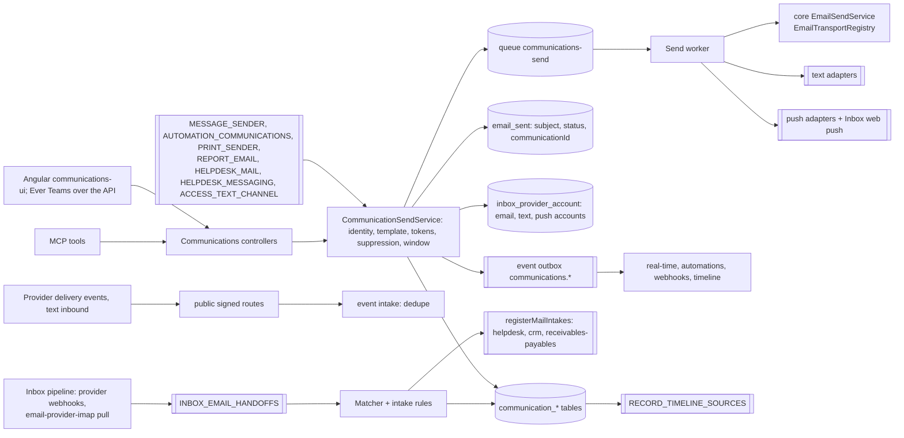

# Implementation Plan: Email and communications

> Translates an approved `spec.md` into architecture and tech choices. The plan owns
> implementation details; the spec owns behaviour.

**Feature ID**: `email-and-communications`
**Spec**: `./spec.md`
**Tasks**: `./tasks.md`
**Status**: `Draft`
**Last updated**: 2026-11-23

---

## 1. Architecture Summary

A new plugin pair `packages/plugins/communications` (API) and `communications-ui` (Angular) sits on what exists and owns
no transport of its own (Ever Teams builds its mail screens in its own app over `/api/communications/*`): outbound mail still leaves through core `EmailSendService` (provider resolvers of the
`EmailTransportRegistry`, then the mail server settings chain); inbound mail still enters through the Inbox receiving
pipeline and reaches this plugin through the existing hand-off seam (`INBOX_EMAIL_HANDOFFS`). A new provider plugin
`packages/plugins/email-provider-imap` builds the `CONNECTED` mailbox kind and the `connectedMailbox` capability that
the Inbox contracts already declare. Text message and push adapters are small plugins registering with this plugin's
adapter registries; the generic HTTP text gateway adapter ships inside the plugin. Every other feature sends through
one in-process contract (`IMessageSender`) bound in `apps/api/src/plugin-composition.ts`.

**One store per fact.**

- **Message bodies.** A message sent through this plugin keeps its subject and body on `communication` (drafts,
  schedules, holds and retries need them); the `email_sent` row core writes for every send keeps its subject and status
  and gets `communicationId`, but no `content` (the email history page shows the body, and its resend sends it, through
  the link). Mail sent or
  received through a mailbox lives in `inbox_email` and the communication only references it (`inboxEmailId`), with no
  copy of subject or body. Text and push messages have no other store and keep their text on `communication`. The
  delivery truth per recipient is `communication_recipient` (accepted, delivered, bounced, opened), fed by provider
  events; `email_sent.status` stays the transport outcome shown by the history page. Invoice and estimate emails
  (`email.service.ts`) and invoice reminders (`invoice/invoice-reminder/`) keep sending through core; with the feature
  on their `email_sent` rows are logged as communications of the invoice, never sent again.
- **Provider accounts.** Text and push accounts are rows of the Inbox's `inbox_provider_account` with a new `channels`
  list (`EMAIL`, `TEXT`, `PUSH`, and `VOICE` for `telephony`; one account may serve several): one account list, one secret mechanism (`configEncrypted` sealed by
  `email/secrets/inbox-secret-box.ts`), one state (`status`, `lastVerifiedAt`, `lastError`, `capabilities`). Text and
  push therefore need the Inbox's email part loaded, as connected mailboxes do.
- **Sender rules.** A mailbox's sender rules live in `communication_sender_rule`. When the feature is enabled, each
  mailbox's `inbox_mailbox.senderAllowlist` entries become its `ALLOW` rows, and the rule service writes the allow rows
  back to `senderAllowlist`, so the Inbox's own check (used while this plugin is not loaded) stays in step. Precedence:
  mailbox rules before organization rules; at one level `BLOCK`, then `QUARANTINE`, then `ALLOW`; the Inbox's spam
  verdict (`inbox_email.spamVerdict`) still applies to allowed senders. The allow list keeps its meaning: a mailbox
  with `ALLOW` rows admits only those senders and holds one without a passing domain authentication in the quarantine,
  as the Inbox does today; for tenants with `FEATURE_COMMUNICATIONS` off, the policy answers exactly as
  `senderAllowlist` does today.
- **Domains.** Sender-record checks (authentication and reporting records) are added to the Inbox's domain verifier
  (`mailboxes/inbox-mailbox.service.ts`: `resolveTxt`, `domainStatus`, `domainVerificationToken`); identities on a
  domain read its status.
- **Identity state.** An identity over a provider account or a connected mailbox reads that account's state; one over
  mail server settings reads the `custom_smtp` validation; the identity keeps only its warm-up and health pause.
- **Devices.** One device list per user: `inbox_push_subscription` gains mobile devices (`platform` `WEB`, `IOS`,
  `ANDROID`, app, provider key, hashed and encrypted token), so "My devices" lists browsers and phones from one table.
- **Around it.** Broadcasts (`packages/core/src/lib/broadcast/`) stay the internal announcements; bulk sends reach
  outside parties. Follower fan-out (`entity-subscription/fan-out/`) stays the notification path; record messages
  between colleagues are not notifications. Recurring and bulk work run as core operations; retention of sensitive
  bodies and events is a kind of the platform retention model of `access-control-and-security`; intake conditions are
  core `rule` rows.



## 2. Tech Choices

| Concern | Choice | Rationale |
| ------- | ------ | --------- |
| Package | new `packages/plugins/communications` (+ `-ui`); new `packages/plugins/email-provider-imap`; additive seams and columns in `inbox` | Principle I; build on the Inbox and core mail |
| Permissions, feature, settings | `PluginContributions` on `@GauzyCorePlugin`: the eight permissions with `defaultFor`, `FEATURE_COMMUNICATIONS` (registered disabled by the feature registry), settings | no seed migration |
| Outbound email | core `EmailSendService.sendMessage` and `getEmailInstance` with `providerAccountId`; identities resolve the account | one transport order (spec FR-3) |
| Templates | core `email_template` gains nullable columns for user templates; render with core `EmailTemplateRenderService` (MJML + Handlebars) | no second template store |
| Inbound | Inbox receiving pipeline unchanged; `communications` registers a hand-off listener; sender rules through a new optional Inbox port `INBOX_EMAIL_SENDER_POLICY` | the pipeline keeps sanitizing, threading, quarantine |
| Connected mailboxes | `email-provider-imap` registers with `INBOX_EMAIL_PROVIDER_REGISTRY` (`inbound` by pull, `createTransport` over SMTP, `connectedMailbox: true`); sign-in tokens from `CONNECTED_ACCOUNTS` of `integration-hub` | uses the declared `CONNECTED` kind |
| Text and push | adapter registries `TEXT_MESSAGE_ADAPTERS`, `PUSH_ADAPTERS` (`registerTextAdapters`, `registerPushAdapters`); generic HTTP gateway and a test adapter in the plugin; web push stays in `inbox` | vendor code stays in optional plugins |
| Credentials | text and push accounts are `inbox_provider_account` rows: non-secret config in `config`, secrets in `configEncrypted` sealed by the Inbox secret box | one account store and one secret mechanism with email providers and connected mailboxes |
| Bulk work | bulk expansion and sending as core operation `communications.bulk` (`packages/core/src/lib/operation/`) | resumable, listed in `/api/operations` |
| Conditions | intake rule conditions as core `rule` rows (owner type `COMMUNICATION_INTAKE`) | one condition store |
| Queue | `@QueueWorker` `communications-send` in the API; `@ScheduledJob` ticks in the worker (`CommunicationsSchedulePlugin`); in-process timer without a queue root | house split |
| Locks | lease per message (`leaseUntil`), recipient `acceptedAt` as the no-resend guard | spec FR-38 |
| Assistant | `COMMUNICATIONS_ASSISTANT` port (`ai-agents-and-assistants`), fallback `ai-chat` `AiProviderRegistry` with the organization's credentials | no new provider code |
| HTML | `sanitize-html` with the Inbox allowlist on write and render | one sanitizing rule |
| Feature gate | `communications-enabled.ts` (exact `true`); `FEATURE_COMMUNICATIONS` contribution in `communications.features.ts`; `FeatureFlagGuard` + `@FeatureFlag` on every controller | [platform architecture](../../architecture/business-suite.md) §6 |

## 3. Data Model

All new tables extend `TenantOrganizationBaseEntity` (soft delete, `isActive`, `isArchived`); MultiORM decorators with
MikroORM repositories; JSON is `text` (MySQL `longtext` for bodies, as `inbox_email` does); ids into other plugins carry
no foreign key; timestamps take their type from the design type (SQLite rule of the Inbox).

### 3.1 Plugin tables (`communications`)

| Table | Columns (besides base) | Indexes and uniqueness |
| --- | --- | --- |
| `communication_identity` | `name` varchar(120), `address` varchar(320), `displayName` varchar(200), `replyTo` text, `archiveBcc` varchar(320) null, `signatureId` uuid null, `footerHtml` text null, `logoImageAssetId` uuid null, `transportKind` varchar(20) (`SMTP_SETTINGS`, `PROVIDER_ACCOUNT`, `CONNECTED_MAILBOX`, `PLATFORM_DEFAULT`), `customSmtpId`, `providerAccountId`, `mailboxId` uuid null, `forceSender` bool, `ownerUserId` uuid null, `delegateUserIds` text, `isOrganizationDefault` bool, `defaultForRecordTypes` text, `defaultForPurposes` text, `trackOpens`, `trackClicks` bool default false, `attachmentLimitBytes` int default 20971520, `standardFooterOff` bool, `sendingWindow` text null, `healthScore` int null, `pausedAt`, `pausedReason` varchar(32) (verification state is the transport's: the provider account, the mailbox or the mail server settings) | unique `(organizationId, address, ownerUserId)`; idx `(organizationId, isOrganizationDefault)` |
| `communication_signature` | `ownerUserId` uuid null, `name` varchar(120), `html` text, `isOrganizationBlock` bool, `defaultForIdentityId` uuid null | idx `(tenantId, ownerUserId)` |
| `communication` | `channel` varchar(8) (`EMAIL`, `TEXT`, `PUSH`), `direction` varchar(4) (`OUT`, `IN`), `purpose` varchar(16) (`SYSTEM`, `RECORD`, `BULK`, `NOTIFICATION`, `CODE`, `MARKETING`), `status` varchar(16) (`DRAFT`, `SCHEDULED`, `HELD`, `QUEUED`, `IN_PROGRESS`, `SENT`, `SENT_WITH_ERRORS`, `FAILED`, `CANCELLED`, `RECEIVED`), `priority` smallint, `notBefore`, `holdReason` varchar(24) null (`UNDO`, `WINDOW`, `WARMUP`, `QUEUE_SUSPENDED`), `identityId`, `providerAccountId`, `mailboxId`, `inboxEmailId` (mailbox mail: subject and body live there only), `emailSentId` null (the core history row), `bulkSendId` uuid null, `threadKey` varchar(200), `referenceToken` varchar(24), `subject` varchar(500) null, `snippet` varchar(300) null, `bodyHtml`, `bodyText` long text null (null for mailbox mail), `isSensitive` bool, `templateId` uuid null, `templateKey` varchar(120) null, `language` varchar(8), `attachments` text, `fromAddress` varchar(320), `fromName` varchar(200), `authorUserId` uuid null, `idempotencyKey` varchar(120) null, `messageId` varchar(512), `providerMessageId` varchar(255), `segments` int null, `cost` numeric(12,6) null, `costCurrency` varchar(3), `attemptCount` int, `lastError` varchar(1000), `leaseUntil`, `sentAt`, `receivedAt`, `matchReason` varchar(24), `matchConfidence` numeric(4,3), `sentiment` varchar(12), `urgency` varchar(8) | idx `(status, notBefore, priority)`, `(tenantId, threadKey)`, `(tenantId, referenceToken)`, `(organizationId, channel, createdAt)`, `(bulkSendId)`; unique `(tenantId, idempotencyKey)` |
| `communication_recipient` | `communicationId` FK cascade, `role` varchar(4) (`TO`, `CC`, `BCC`, `FROM`), `address` varchar(320), `number` varchar(32) null, `name` varchar(200), `partyType` varchar(16), `partyId`, `userId`, `employeeId` uuid null, `status` varchar(12) (`PENDING`, `ACCEPTED`, `DELIVERED`, `DEFERRED`, `BOUNCED`, `COMPLAINED`, `REJECTED`, `FAILED`, `SUPPRESSED`, `SKIPPED`), `skipReason` varchar(24), `bounceKind` varchar(4), `acceptedAt`, `deliveredAt`, `openedAt`, `clickedAt`, `lastEventAt`, `openCount`, `clickCount` int, `trackingToken` varchar(32) null | idx `(communicationId)`, `(tenantId, address, createdAt)`, `(partyType, partyId, createdAt)`; unique `trackingToken` |
| `communication_link_state` | `resourceLinkId` uuid (a record link of the communication: core `resource_link` with `entity = Communication` and the record as target, see below), `state` varchar(10) (`OPEN`, `ANSWERED`, `CLOSED`), `stateChangedByUserId`, `stateChangedAt` | unique `(resourceLinkId)`; idx `(tenantId, state)` |
| `communication_event` | `communicationId`, `recipientId` uuid, `kind` varchar(16), `occurredAt`, `providerKey` varchar(32), `providerEventId` varchar(255), `detail` varchar(1000), `url` varchar(1024) null | unique `(tenantId, providerKey, providerEventId)`; idx `(recipientId, occurredAt)` |
| `communication_intake_rule` | `mailboxId`, `name`, `position` int, `action` varchar(10) (`CREATE`, `LINK_ONLY`), `recordType` varchar(64) null, `fieldMap` text, `acknowledgeTemplateId` uuid null, `alertAfterMinutes` int null, `alertRecipients` text, `createContacts` bool; conditions are core `rule` rows of owner type `COMMUNICATION_INTAKE` | idx `(mailboxId, isActive, position)` |
| `communication_sender_rule` | `mailboxId` uuid null (null = organization), `pattern` varchar(320), `action` varchar(12) (`ALLOW`, `BLOCK`, `QUARANTINE`); a mailbox's `ALLOW` rows are kept in step with `inbox_mailbox.senderAllowlist` | unique `(organizationId, mailboxId, pattern)` |
| `communication_suppression` | `channel` varchar(8), `address` varchar(320) (lower-case email or international number), `purpose` varchar(16) null, `reason` varchar(16) (`UNSUBSCRIBED`, `HARD_BOUNCE`, `COMPLAINT`, `STOP_KEYWORD`, `MANUAL`, `IMPORT`), `note` text, `consentId` uuid null, `createdByUserId` | unique `(organizationId, channel, address, purpose)` |
| `communication_consent` | `partyType`, `partyId`, `channel`, `purpose`, `granted` bool, `source` varchar(16), `textShown` text, `capturedAt`, `capturedByUserId` | idx `(partyType, partyId, channel, purpose, capturedAt)` |
| `communication_bulk_send` | `name`, `channel`, `identityId`, `templateId`, `source` text (view id or ids), `operationId` (core operation `communications.bulk`: progress, lease, cancel), `state` varchar(12) (`PREPARING`, `SENDING`, `PAUSED`, `COMPLETED`, `CANCELLED`, `STOPPED`), `total`, `queued`, `sent`, `failed` int, `skipped` text, `spreadDays` int, `createdByUserId` | idx `(organizationId, state)` |
| `communication_identity_health` | `identityId`, `day` varchar(10), `sent`, `delivered`, `bounced`, `complained`, `deferred` int, `score` int, `causes` text (domain check results are read from the Inbox domain verifier) | unique `(identityId, day)` |
| `communication_thread_summary` | `threadKey`, `upToCommunicationId`, `summary` text, `generatedByUserId`, `model` varchar(64) | unique `(tenantId, threadKey, upToCommunicationId)` |

### 3.2 Inbox tables extended (additive, in `packages/plugins/inbox`)

| Table | Change |
| --- | --- |
| `inbox_provider_account` | + `channels` varchar(64) default `EMAIL` (list of `EMAIL`, `TEXT`, `PUSH`, `VOICE`; the same column `telephony` uses, added by whichever migration runs first under a `hasColumn` guard); text and push accounts keep senders, allowed countries, monthly cap and allowed roles in `config`, secrets in `configEncrypted` |
| `inbox_push_subscription` | + `platform` varchar(8) default `WEB` (`WEB`, `IOS`, `ANDROID`), `app` varchar(32) null, `providerKey` varchar(32) null, `tokenHash` varchar(64) null (unique where set), `tokenEnc` text null, `invalidAt` null; web subscriptions keep `endpoint` and keys |
| `inbox_mailbox` | none: domain verification gains the sender-record checks in code; `senderAllowlist` is kept in step with the allow rules |

### 3.3 Connected mailbox state (`email-provider-imap`)

| Table | Columns | Indexes |
| --- | --- | --- |
| `email_imap_folder_state` | `providerAccountId`, `mailboxId`, `folder` varchar(255), `uidValidity` bigint, `lastUid` bigint, `lastPulledAt`, `consecutiveFailures` int, `status` varchar(12) (`ACTIVE`, `PAUSED`, `RECONNECT`) | unique `(providerAccountId, folder)` |

The account itself is an `inbox_provider_account` with `providerId = 'imap'` (host, port, encryption, user, folders,
mode, initial window, attachment limit in `config`; password sealed in `configEncrypted` as for every provider; or a
`connectedAccountId` for sign-in), and the mailbox an `inbox_mailbox` of kind `CONNECTED`.

### 3.4 Core changes (additive)

- `email_template`: `channel` varchar(8) null (null = `EMAIL`), `recordType` varchar(64) null, `templateTitle`
  varchar(160) null, `isUserDefined` bool default false, `purpose` varchar(16) null, `sharing` varchar(12) null,
  `ownerUserId` uuid null, `isSensitive` bool default false, `isRaw` bool default false, `attachments` text null,
  `declaredBy` varchar(64) null (document default of a plugin); user templates use `name = 'custom.<slug>'`; idx
  `(tenantId, organizationId, recordType, channel)`. System templates of `EmailTemplateEnum` are untouched.
- `email_sent` (email history): `communicationId` uuid null, idx; history rows keep being written for every send, without
  `content` when the communication holds the body.
- `EmailSendService.sendMessage` result already returns `providerMessageId` and `transport`; no signature change.

### 3.5 Migrations

**Migration timestamps**: `packages/plugins/communications` `1791000033100` to `1791000033199`; `packages/core` `1791000033200` to `1791000033299`; `packages/plugins/email-provider-imap` `1791000033300` to `1791000033399`; `packages/plugins/inbox` `1791000033400` to `1791000033499`.

Plugin migrations with the shared core migration helpers of `@gauzy/core`; PostgreSQL, SQLite and MySQL
branches; idempotent and forward-only; registered for both ORMs; listed only when `GAUZY_COMMUNICATIONS_ENABLED`:

1. `1791000033100-CreateCommunicationCoreTables` — identity, signature, communication, recipient, link state, event;
   the record target of `resource_link` comes from the core migration `1791000036310-AddResourceLinkRecordTarget` of
   `record-views-and-search` (its T52).
2. `1791000033110-CreateCommunicationIntakeAndSuppressionTables` — intake rule, sender rule, suppression, consent.
3. `1791000033120-CreateCommunicationBulkTables` — bulk send.
4. `1791000033130-CreateCommunicationHealthTables` — identity health, thread summary.
5. Core `1791000033200-AddCommunicationColumnsToEmailTemplateAndHistory` — nullable columns and indexes; no backfill.
6. `email-provider-imap`: `1791000033300-CreateImapFolderState`.
7. Inbox `1791000033400-AddChannelsAndMobileDevicesToInbox` — the `inbox_provider_account` and `inbox_push_subscription`
   columns of §3.2; listed with the Inbox's own migrations.

The feature, the permissions and their default grants are plugin contributions; no migration is needed for them.

### 3.6 Contracts

`packages/contracts/src/lib/communications.model.ts` (exported from `index.ts`): enums above; `ICommunication`,
`ICommunicationRecipient`, `ICommunicationLinkState`, `ISendingIdentity`, `ICommunicationTemplate` (extends
`IEmailTemplate`), `IIntakeRule`, `ISuppression`, `IConsent`, `IBulkSend`, `IIdentityHealth`; the in-process contracts:

```ts
interface IMessageSender {                       // COMMUNICATIONS_SENDER, bound to every consumer token
    send(req: {
        channel: 'EMAIL' | 'TEXT' | 'PUSH'; purpose: CommunicationPurpose;
        to: IRecipientRef[]; cc?: IRecipientRef[]; bcc?: IRecipientRef[];  // party, user, employee, address or number
        identityId?: ID; templateKey?: string; templateId?: ID; subject?: string; body?: string; language?: string;
        tokens?: JsonData; records?: IRecordRef[]; attachments?: IAttachmentRef[];  // fileId or { print: IPrintRenderRequest }
        replyToCommunicationId?: ID; notBefore?: Date; idempotencyKey: string; actor?: IActorRef;
    }): Promise<{ communicationId: ID; status: CommunicationStatus; skipped: ISkippedRecipient[] }>;
    cancel(communicationId: ID, actor: IActorRef): Promise<void>;
}
interface IMailIntakeDeclaration {               // registerMailIntakes([...]) in a plugin class
    recordType: string; fields: IIntakeFieldSpec[];
    create(input: IIntakeInput, ctx: IIntakeContext): Promise<IRecordRef>;   // through the owner's write path
    referenceOf?(ref: IRecordRef): Promise<string>;                            // for subjects and acknowledgements
}
interface ITextAdapter { key: string; configSchema: IEmailProviderConfigSchema; capabilities: { inbound: boolean;
    deliveryReports: boolean; unicode: boolean };
    send(msg: ITextOutbound, account: IAdapterAccount): Promise<ITextSendResult>;
    verifyWebhook?(req: IInboundWebhookRequest, account: IAdapterAccount): Promise<ITextWebhookResult>; }
interface IPushAdapter { key: string; platforms: string[]; send(msg: IPushOutbound, account: IAdapterAccount):
    Promise<IPushSendResult /* includes invalid tokens */>; }
```

## 4. API Surface

All routes `TenantPermissionGuard`, `PermissionGuard`, `@FeatureFlag(FEATURE_COMMUNICATIONS)`, class-validator DTOs,
Swagger decorators, cursor pagination; `Idempotency-Key` on sending, bulk and record-creating routes.

| Method | Endpoint | Permission | Description | Status |
| ------ | -------- | ---------- | ----------- | ------ |
| `GET` | `/api/communications/accounts` | `COMMUNICATIONS_ACCOUNT_MANAGE` | mail server settings and the `inbox_provider_account` rows (email providers, connected mailboxes, text and push accounts) in one list | New |
| `GET` `POST` `PATCH` `DELETE` | `/api/communications/identities[/:id]`; `POST …/:id/test`, `…/:id/resume` | `COMMUNICATIONS_ACCOUNT_MANAGE` (personal: own) | sending identities | New |
| `POST` `PATCH` | `/api/communications/connected-mailboxes[/:id]`, `POST …/:id/reconnect`, `GET …/:id/folders` | own mailbox; `COMMUNICATIONS_ACCOUNT_MANAGE` for shared | connect by protocol or sign-in | New |
| `GET` | `/api/communications/adapters` | `COMMUNICATIONS_ACCOUNT_MANAGE` | loaded text and push adapters with config schemas | New |
| `GET` `POST` `PATCH` `DELETE` | `/api/communications/provider-accounts[/:id]`, `POST …/:id/verify` | `COMMUNICATIONS_ACCOUNT_MANAGE` | text and push accounts as `inbox_provider_account` rows whose `channels` include theirs | New |
| CRUD | `/api/communications/signatures` | own; organization block: `COMMUNICATIONS_ACCOUNT_MANAGE` | signatures | New |
| CRUD + `POST` | `/api/communications/templates`, `…/:id/preview`, `GET …/defaults` | view: send; edit: `COMMUNICATIONS_TEMPLATE_MANAGE` | user and document-default templates | New |
| `POST` | `/api/communications/messages` | `COMMUNICATIONS_MESSAGE_SEND` + view of each linked record | compose, `preview`, send or schedule | New |
| `GET` | `/api/communications/messages` (`recordType`, `recordId`, `channel`, `direction`, `status`), `/:id` | view of a linked record, or sender or recipient | log and detail with recipients and events | New |
| `PATCH` `POST` | `/api/communications/messages/:id`, `…/:id/{cancel,retry}`, `GET …/scheduled/mine` | author; retry: `COMMUNICATIONS_QUEUE_MANAGE` | scheduled edit, cancel, retry | New |
| `POST` `DELETE` | `/api/communications/messages/:id/links[/:linkId]`, `POST …/:id/create-record`, `…/:id/assign` | access to the mailbox or record | filing | New |
| `GET` | `/api/communications/mailboxes/:id/messages` (`filed`, `to-file`, `waiting`) | mailbox member | mailbox view with links | New |
| CRUD | `/api/communications/intake-rules`, `GET /api/communications/intake-types`, CRUD `/api/communications/sender-rules` | `COMMUNICATIONS_INTAKE_MANAGE` | rules | New |
| `POST` `GET` | `/api/communications/bulk-sends` (`preview`), `/:id`, `POST /:id/{pause,resume,cancel}` | `COMMUNICATIONS_MESSAGE_BULK_SEND` | bulk | New |
| `GET` `POST` | `/api/communications/queue`, `/queue/{suspend,resume}` | `COMMUNICATIONS_QUEUE_MANAGE` | backlog, suspend | New |
| CRUD + `GET` | `/api/communications/suppressions`, `/suppressions/export`; `GET` `POST` `/api/communications/consents` | `COMMUNICATIONS_SUPPRESSION_MANAGE`; consent: send | suppression, consent | New |
| `GET` `POST` `DELETE` | `/api/communications/devices[/:id]` | own | the user's browsers and phones from `inbox_push_subscription` | New |
| `GET` `POST` | `/api/communications/identities/:id/health`, `/api/communications/domains/check` | `COMMUNICATIONS_ACCOUNT_MANAGE` | health; domain records through the Inbox domain verifier | New |
| `POST` | `/api/communications/threads/:threadKey/summary`, `/api/communications/messages/draft-reply` | read of the thread; send | assistant | New |
| `GET` `POST` | `/api/communications/conversations/:partyType/:partyId`, `…/merge-address` | view of the party | conversation | New |
| `GET` `POST` | `/api/public/communications/unsubscribe/:token`, `/preferences/:token` | public token, throttled | unsubscribe and preference page | New |
| `POST` | `/api/public/communications/events/:providerKey/:accountId`, `/text-inbound/:providerKey/:accountId` | provider signature, throttled | delivery events, inbound texts | New |
| `GET` | `/api/public/communications/t/o/:token`, `/t/c/:token` | public token | open pixel, click redirect (allow-listed targets) | New |
| `GET` | `/api/email-template/*` | unchanged | system templates; list gains user templates when the feature is on | Changed (additive) |

GraphQL reads `communications`, `communication`, `communicationTemplates`, `sendingIdentities` in `graphql/`.

**Ports offered** (contracts tokens, bound in `apps/api/src/plugin-composition.ts`, injected `@Optional()`):
`COMMUNICATIONS_SENDER` (`CommunicationSendService`) aliased to `MESSAGE_SENDER` (payments-and-collections, payroll),
`AUTOMATION_COMMUNICATIONS`, `PRINT_SENDER`, `REPORT_EMAIL`, `HELPDESK_MAIL`, `HELPDESK_MESSAGING`,
`ACCESS_TEXT_CHANNEL`, `NOTIFICATION_TEXT_TRANSPORT` (Inbox delivery's text lane); mail intakes as a `communications`
member of `PluginContributions` (`registerMailIntakes` builds the entries, unioned by the core contributions registry);
`RETENTION_SOURCES` entries (`communications.sensitive-bodies` 1 day, `communications.events` 400 days);
`AUDIT_EVENT_SINK` calls (one per sent or received communication, referencing it);
a `RECORD_TIMELINE_SOURCES` entry (`CommunicationTimelineSource`); `ACCESS_PROCESSORS` entries (one per loaded email,
text and push adapter with regions and fields); `COMMUNICATION_CONVERSATION_SOURCES` (multi; chat and telephony add
theirs).

**Ports consumed** (unbound → capability absent or fallback): `COMMUNICATIONS_PRINT` (print `PrintService`; fallback the
core invoice and estimate PDF only), `CONNECTED_ACCOUNTS` (`integration-hub`; without it only protocol sign-in),
`COMMUNICATIONS_ASSISTANT` (fallback `AiProviderRegistry`), `COMMUNICATIONS_PREFERENCES` (Inbox preference resolver as
extended by `automation-and-notifications`; fallback the employee notification settings), `NOTIFICATION_DISPATCHER`
(unanswered alerts; fallback employee notification), `RECORD_VIEWS_SELECTION` (bulk from a saved view),
`CUSTOM_FIELD_VALUE_READER`, core record type registry (record types, titles, party paths), `MAIL_THREAD_STATE` (`mail`:
the one assignee and state store of mailbox conversations, used by the mailbox view's assign action; unbound → the
assign action is not offered).

**Inbox seams (additive, optional):** `INBOX_EMAIL_SENDER_POLICY` (the processor asks it before storing:
allow, block, quarantine with rule id; unbound, the mailbox's `senderAllowlist` applies as today; bound, it answers
as `senderAllowlist` for tenants with the feature off); `INBOX_EMAIL_OUTBOUND`
(new message and HTML replies from a mailbox, shared with `helpdesk-tickets`); `InboxEmailService.reply` accepts `html`
and attachment file ids; the domain verifier of `inbox-mailbox.service.ts` gains sender-record checks; the provider
account and push subscription columns of §3.2.

**Consumer tokens answered** (bound in `apps/api/src/plugin-composition.ts` to the consent, identity, template, suppression, tracking and record intake services; each consumer plan states the shape it calls and its fallback): `CALENDAR_IDENTITIES`, `LEAD_CAPTURE_CONSENT`, `MAIL_RECORD_INTAKE`, `MARKETING_CONSENT`, `MARKETING_IDENTITIES`, `MARKETING_SUPPRESSION`, `MARKETING_TEMPLATES`, `MARKETING_TRACKING`, `TELEPHONY_CONTACT_POLICY`.

## 5. Events, Real-Time and Notifications

| Event | Emitted when | Consumers |
| ----- | ------------ | --------- |
| `communications.message.queued` / `.sent` / `.failed` | queue transitions (partition `communication:<id>`) | real-time (record readers, composer), automations, webhooks |
| `communications.message.delivered` / `.bounced` / `.opened` / `.complained` | first event of the kind per recipient | timeline, automations, CRM engagement, suppression handler |
| `communications.message.received` | inbound message linked (partition `thread:<threadKey>`) | automations (incoming message trigger), helpdesk, CRM, timeline |
| `communications.intake.record_created` | intake created a record | inbox notice to rule recipients, automations |
| `communications.suppression.added` / `.removed` | suppression changes | marketing-campaigns, audit |
| `communications.consent.granted` / `.withdrawn` | a consent record is captured | marketing-campaigns lists, automations, audit |
| `communications.identity.health_changed` / `.paused` | score band change or pause | inbox notice to account managers |
| `communications.bulk_send.completed` / `.stopped` | bulk end | inbox notice to sender |
| In: Inbox hand-off `delivered`, `inbox_email` replies sent | inbound pipeline | matcher, intake |

Real-time record types `communication`, `communication_bulk_send`, `communication_queue`. Notices (unanswered thread,
reconnect needed, health warning, bulk end) through `NOTIFICATION_DISPATCHER` with categories `communications.alert`
and `communications.account`. Payloads carry ids; bodies never ride the outbox.

## 6. UI Surface

- **Angular `packages/plugins/communications-ui`** (lazy; hidden on `404`): Settings → Communications with tabs
  **Accounts** (identities with test, the existing mail server settings page linked, provider accounts, connected
  mailboxes, text and push accounts), **Templates** (list, editor with token picker and preview; the existing
  `pages/email-templates` editor opens system templates), **Signatures**, **Intake rules**, **Sender rules**,
  **Suppressions**, **Queue**, **Health** (score chart with causes, domain checks). The existing Settings → SMS gateway
  route shows the text accounts list when the feature is on (its toggle page stays as fallback).
- **Embeddables** in `packages/ui-core/shared/src/lib/communications/`: `ngx-record-composer` (email and text tabs,
  template picker, attachments with print template choice, schedule, undo toast, part counter), `ngx-record-communications`
  (filters; used by the record timeline of `record-views-and-search` and on existing pages: contacts, deals, invoices,
  estimates, orders, employees), `ngx-party-conversation`, `ngx-thread-assistant` (summary, draft).
- **`inbox-ui`** (additive): mailbox view gains record chips, "to file" tab, assign and create-record actions; connected
  mailbox form; My devices (browsers and phones from one table) in notification settings.
- i18n keys `COMMUNICATIONS.*` in every locale of `packages/ui-core/i18n`; composer keyboard shortcuts with labels.
- **Ever Teams** builds its mail screens in its own app over `/api/communications/*` and registers its phones through
  `/api/communications/devices`; no React package is shipped for it.

## 7. MCP Tools, SDKs and Integrations

New `packages/mcp-server/src/lib/tools/communications.ts`, registered in `register-all-tools.ts`:

| Tool | Input | Output |
| --- | --- | --- |
| `communications_send` | channel, record, recipients, template or body, attachments, `preview` (default true) | rendered message and recipients, or the queued message |
| `communications_schedule` / `communications_cancel` | as send + time / id | scheduled message / state |
| `communications_list` | record or party, filters | communications with states |
| `communications_get_delivery` | id | recipients and events |
| `communications_thread_summary` / `communications_draft_reply` | thread / message, tone | summary / draft (never sent) |
| `communications_templates_list` / `communications_template_save` | filters / template | templates |
| `communications_bulk_send` | view or ids, template, `preview` | counts and skips, or the bulk send |
| `communications_suppressions_list` | filters | suppressions |

OpenAPI additive; Kiota SDKs regenerated after merge. Import templates for suppressions and consents
(`data-import-export`). Report definitions of spec FR-81 on datasets `communications`, `communication_recipients`,
`communication_identity_health`, `communication_suppressions`. Webhook catalogue of `integration-hub` gains the
`communications.*` events.

## 8. Background Jobs

| Trigger | When | What it does | Idempotency |
| ------- | ---- | ------------ | ----------- |
| queue `communications-send` | message due | resolve identity and transport, render, check suppression and window, send per recipient, record attempt | lease; recipient `acceptedAt` never resent |
| `communications.queue.tick` | every minute | enqueue due scheduled and held messages, recover leases older than 10 minutes | status compare-and-set |
| core operation `communications.bulk` (queue `communications-bulk`) | bulk created | expand the view or selection in pages of 1,000 as steps, create messages, honour spread and warm-up | `(bulkSendId, recipient)` key |
| `communications.unanswered.sweep` | every 5 minutes | threads waiting longer than the rule within working hours → one alert per message | alert marker per communication |
| `communications.health.daily` | 02:00 per tenant | aggregate events to `communication_identity_health`, score, pause on complaint rate | unique `(identityId, day)` |
| Inbox domain verifier, weekly and on demand | weekly and on demand | resolves the domain's published sender records with the existing verification; identities read its status | overwrite per day |
| `email-imap.pull` (worker of `email-provider-imap`) | every minute, mailboxes due | pull new messages per folder since `lastUid`, hand to the pipeline, write read state back | `(mailboxId, messageId)` unique in `inbox_email` |
| retention kinds `communications.sensitive-bodies`, `communications.events` | nightly, by the retention runner of `access-control-and-security` (`communications.retention` only while that plugin is not loaded) | drop bodies of sensitive messages older than 1 day, events older than 400 days (counts kept) | idempotent delete |
| hand-off listener `communications` | message delivered by the Inbox | match, link, intake, acknowledge | `(tenantId, inboxEmailId)` link uniqueness |

Worker: `CommunicationsSchedulePlugin`, `EmailImapSchedulePlugin` in `apps/worker/src/plugins.ts`; without a queue root
the API runs ticks and sends on in-process timers under a lock.

## 9. Security & Permissions

- New keys (`communications.permissions.ts`): `COMMUNICATIONS_MESSAGE_SEND`, `COMMUNICATIONS_MESSAGE_BULK_SEND`,
  `COMMUNICATIONS_ACCOUNT_MANAGE`, `COMMUNICATIONS_TEMPLATE_MANAGE`, `COMMUNICATIONS_INTAKE_MANAGE`,
  `COMMUNICATIONS_SUPPRESSION_MANAGE`, `COMMUNICATIONS_QUEUE_MANAGE`, `COMMUNICATIONS_LOG_VIEW` (administrators'
  delivery report across records), declared as permission contributions. `defaultFor`: super admin and admin all;
  manager send, bulk send, template manage; employee send.
- Reading a communication requires view of a linked record, or being its author or recipient (spec FR-49); log queries
  join the communication's record links (`resource_link`, `entity = Communication`) to the record type's read scope (record-level rules of `access-control-and-security` when
  loaded through the shared list-query hook).
- Secrets: connected mailbox passwords, text and push secrets in the Inbox account's sealed config (one mechanism);
  device tokens encrypted with the platform key and looked up by hash. Provider event routes
  verify each adapter's signature; a delivery event for an unknown message is stored as ignored.
- Public tokens (unsubscribe, preference page, tracking): 128-bit random, stored hashed, per recipient; click redirects
  only to links present in the sent body.
- Bodies sanitised on write and render; uploads limited by identity size, scanned where the deployment scans.
- Data leaving the platform listed in spec §4; the assistant sends thread text only when enabled per organization.

## 10. Observability

Activity-log entries for identity, template, intake rule, suppression, queue and bulk actions. Metrics: queue depth and
age, send latency, attempts, failures per transport, bounce and complaint rates per identity, pull lag per mailbox, text
parts and cost, assistant calls. Breadcrumbs carry communication ids, never addresses.

## 11. Phased Rollout

1. **Phase 1 — Contracts, entities, migrations** (flags off, no behaviour change).
2. **Phase 2 — Surface and unify what exists**: accounts overview, sending identities on the existing transports,
   composer on records with system and user templates, outbound queue around `EmailSendService`, communication log
   (history and Inbox mail linked to records), mailbox view with filing, intake rules on existing mailboxes, the one
   sending contract bound to every consumer, MCP tools. Demo: send a quotation by email from a deal; a support mailbox
   creates tickets.
3. **Phase 3 — Depth**: connected mailboxes, delivery events and tracking, suppression, unsubscribe and consent,
   text messages with the generic gateway, inbound texts and stop keywords, bulk sends, mobile push, document default
   templates, unanswered alerts, reports.
4. **Phase 4 — Advanced capabilities**: identity health and warm-up, domain checks, assistant summaries and drafts, match
   confidence, party conversation, local sending windows.
5. **Phase 5 — General availability**: the feature is off by default; after the trial period it may be switched on by default for new tenants only; existing tenants keep their setting until an administrator changes it.

## 12. Constitution Reconciliation

- I Plugin-first: new `communications` pair and `email-provider-imap`; Inbox and core gain optional seams and nullable
  columns only.
- II Tenant/organization scoping: every table on the tenant-organization base; public routes resolve scope by token.
- III Both ORMs, additive migrations: MultiORM entities and repositories; new tables and nullable columns, three dialects.
- IV Default-off flag; nothing removed: deploy switch and tenant feature; system templates, history, mail server
  settings, Inbox routes and the SMS gateway page stay.
- V Contracts and API first: contracts and ports in Phase 1, REST and GraphQL before UI, idempotency keys.
- VI Permissions, privacy, security: eight keys, encrypted secrets, signed provider events, hashed tokens, sanitizing.
- VII Real-time through the event bus: outbox events; queue and timeline updates on the real-time channel.
- VIII i18n and accessibility: keys in every locale, templates per language, keyboard composer.
- IX Tests: transport and adapter fakes, queue crash-recovery specs, matcher fixtures, both ORMs, e2e for send and intake.
- X Behaviour-first spec: implementation lives here only.
- XI Documentation describes our platform only.

## 13. Risks & Mitigations

| Risk | Likelihood | Impact | Mitigation |
| ---- | ---------- | ------ | ---------- |
| Duplicate sends after crashes or retries | Medium | High | per-recipient `acceptedAt`, leases, idempotency keys, crash-recovery tests |
| Bulk sends damage a domain's reputation | Medium | High | warm-up curve, failure stop, complaint pause, suppression on bounce |
| Connected mailbox load on first sync | Medium | Medium | initial window cap, paged pulls, per-tenant concurrency limit |
| Wrong record linking exposes mail to the wrong team | Low | High | confidence threshold, person filing below it, read rule through linked records only |
| Spoofed provider events | Low | Medium | per-adapter signature verification, unknown ids ignored, dedupe |
| Thread content to AI providers | Medium | Medium | per-organization opt-in, facts-only prompts, listed in data leaving |
| Inbox seam conflicts with `mail` and `helpdesk-tickets` work | Medium | Medium | seams optional and additive; `INBOX_EMAIL_OUTBOUND` defined once and shared |

## 14. References

- Spec: `./spec.md` · Tasks: `./tasks.md` · Siblings: `../automation-and-notifications/plan.md`,
  `../record-views-and-search/plan.md`, `../print-and-pdf-designer/plan.md`, `../integration-hub/plan.md`,
  `../helpdesk-tickets/plan.md`, `../access-control-and-security/plan.md`, `../payments-and-collections/plan.md`
- Code: `packages/core/src/lib/{email-send,email-template,email-history,custom-smtp,broadcast,operation,rule}`,
  `packages/core/src/lib/invoice/invoice-reminder/`, `packages/core/src/lib/entity-subscription/fan-out/`,
  `packages/plugins/inbox/src/lib/email` (`entities/inbox-provider-account.entity.ts`, `secrets/inbox-secret-box.ts`,
  `mailboxes/inbox-mailbox.service.ts`), `packages/plugins/inbox/src/lib/delivery/push`, `packages/plugins/email-provider-*`,
  `packages/plugin/src/lib/plugin-contributions.ts`, `apps/api/src/plugin-composition.ts`
