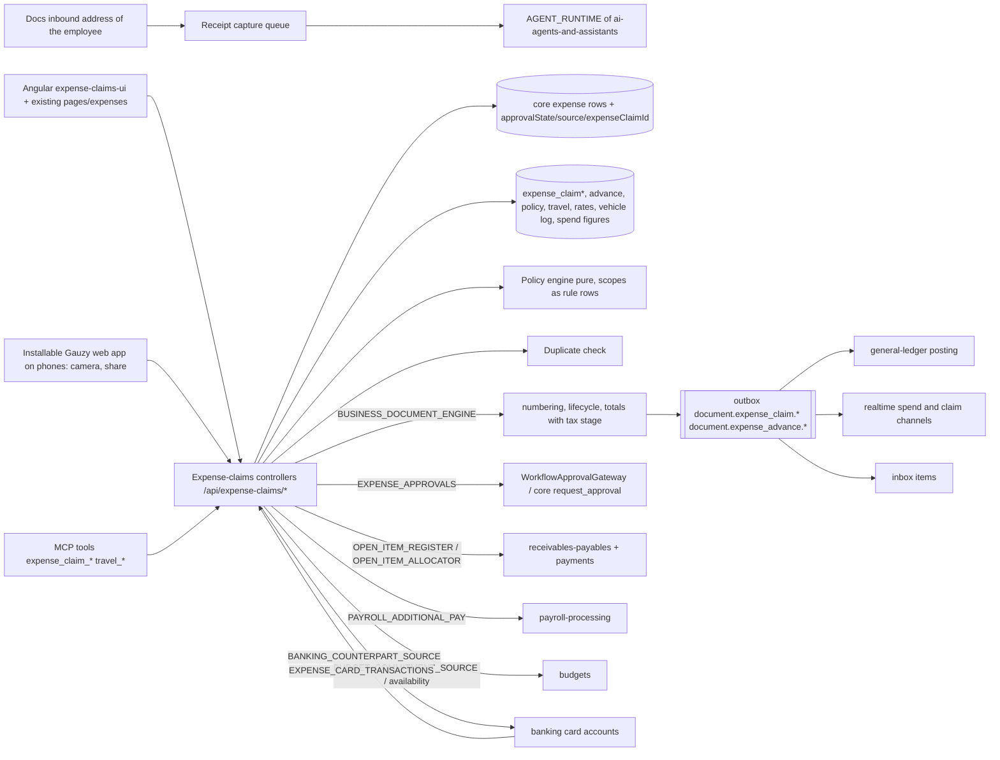

# Implementation Plan: Expenses and travel

> Translates an approved `spec.md` into architecture and tech choices. The plan owns
> implementation details; the spec owns behaviour.

**Feature ID**: `expenses-and-travel`
**Spec**: `./spec.md`
**Tasks**: `./tasks.md`
**Status**: `Draft`
**Last updated**: 2026-11-23

---

## 1. Architecture Summary

The core `expense` record stays the one model of spending. It gains three nullable columns (`approvalState`, `source`,
`expenseClaimId`) and one read filter: existing reads count a row when `approvalState` is null (a direct expense, as
today) or `APPROVED`. Every claim line is an `expense` row from its first draft; claim-only facts live in a one-to-one
plugin table keyed by `expenseId`. The new plugin `@gauzy/plugin-expense-claims` (`packages/plugins/expense-claims`,
`expense-claims-ui`), tenant feature `FEATURE_EXPENSE_CLAIMS`, owns claims, advances, policies, receipt reading, card
explanations, travel, rates, vehicle log, spend figures, reports and MCP tools. Money moves only through the owners'
ports: open items and payments (`receivables-payables`, `payment`), postings (`general-ledger` document events), pay
(`payroll`), budgets (`accounting` budgets), approvals (`workflows`). Its screens are the Gauzy web app, installable on
phones for receipt photos.

**Built on what exists.** The merchant of a line resolves to `organization_vendor` (`expense.vendorId`) when one
matches and none is created automatically; the first receipt's URL is written to `expense.receipt`, so the existing
list, report and MCP tools show a receipt. A reimbursed line keeps its `expense.status` (which tracks re-billing to the
client: `UNINVOICED`, `INVOICED`, `NOT_BILLABLE`); reimbursement state lives on the claim. A personal receipt address is a
Docs inbound address (`document_inbound_address`, the Docs plugin's token addresses with rotation, sender allow-lists
and message counts) owned by the employee with target "expense receipts". Supplier invoices are captured in the
capture register of `invoicing-receivables-payables` (`bill_capture`); employee receipts are captured here
(`receipt_capture`), both read through the same agent runtime. Spend figures are the one maintained expense figure per
project, client and month; `project-costing-and-billing` reads them. A benefit claim is a claim line on a category
linked to a payroll benefit element, checked against that element's yearly eligibility and paid through payroll, which keeps the benefit ledger. Service plans and odometer readings of
company vehicles (core `equipment`) belong to `fixed-assets` when the vehicle is an asset; the vehicle log keeps fuel,
costs and its own readings for private vehicles. Policy scopes are core `rule` rows; settings are in the platform
settings store; permissions are plugin contributions; notices de-duplicate through the notification dispatcher;
claims and advances fall back to core `request_approval` on the existing Approvals page, as business trips already do;
the existing expenses list gains its column through the core data-table registry.

## 2. Tech Choices

| Concern | Choice | Rationale |
| ------- | ------ | --------- |
| Package | new `packages/plugins/expense-claims`, `expense-claims-ui` (Angular, phone-width forms with camera capture in the installable web app) | Principle I; [platform architecture](../../architecture/business-suite.md) §2.5 |
| Settings and permissions | `expense-claims.settings.ts` setting contributions in `tenant_setting` at `ORGANIZATION` scope; `expense-claims.permissions.ts` with `defaultFor` | no settings table, no seed migration |
| Conditions | policy scopes (branches, departments, groups, levels) as core `rule` rows of owner type `EXPENSE_POLICY`, evaluated with `HR_EMPLOYEE_RULE_CONTEXT` (core employee fields without `hr-core-lifecycle`) | no condition column |
| Notices | `NOTIFICATION_DISPATCHER.notify({ …, dedupeKey })` (`expenses:advance-reminder:<advance>:<n>`, `expenses:card-reminder:<transaction>:<stage>`, `expenses:deadline:<claim>`, …); else `INBOX_ITEM_WRITER` with the key as `externalId` | no notice log |
| One expense model | core `expense` + 3 nullable columns; claim facts in plugin `expense_claim_line` keyed by `expenseId` | spec FR-6, FR-7; no parallel record |
| Read filter | one helper `actualExpenseCondition()` in `packages/core/src/lib/expense/expense-actual.filter.ts` (TypeORM query builder and MikroORM `FilterQuery` forms) applied by every existing read | existing rows have null and read as today |
| Flag | tenant feature `FEATURE_EXPENSE_CLAIMS` (`expense-claims.features.ts`, default off); `@FeatureFlag` + `FeatureFlagGuard` on every plugin controller; `FEATURE_EXPENSE` untouched | default off |
| Documents | `expense_claim`, `expense_advance`, `travel_request` registered with `business-documents` (numbering, lifecycle, totals pipeline with `DOCUMENT_TAX_STAGE`, effects preview); fallback core `SequenceService` | [platform architecture](../../architecture/business-suite.md) §3.1 |
| Postings | ledger document types `expense_claim` (area `PURCHASES`), `expense_advance` (area `MONEY`) registered with `LedgerDocumentTypeRegistry`; facts on the confirmed event | [platform architecture](../../architecture/business-suite.md) §3.4 |
| Money | exact decimals of the core money kernel, `numeric(20,6)`, document and organization currency with the rate | [platform architecture](../../architecture/business-suite.md) §6 |
| Receipt reading | queue `expense-receipt-extract` calling `EXPENSE_RECEIPT_READER`, bound to `AGENT_RUNTIME.complete` of `ai-agents-and-assistants` (purpose `expenses.receipt-read`; runs, usage and budgets recorded there), else the AI provider registry of `ai-chat` with the organization's credentials, as bill capture does | no agent, run or usage table here |
| Policy engine | pure functions over line, claim, trip and month aggregates; results stored as findings | testable, explainable |
| Spend figures | `expense_spend_figure` maintained by an outbox consumer: the platform's one maintained expense figure per project, client and month (`EXPENSE_SPEND` for project costing), covering approved claim lines and direct expenses alike; each event recomputes the figure keys it touches (before and after project, client and month) from the `expense` rows under the figure row's lock, so replays and the switch-on backfill give the same totals | dashboards without scans; no second figure |
| Persistence | MultiORM entities, the shared core migration helpers of `@gauzy/core`, three dialects; JSON as `text` | Principle III |
| Background work | `@ScheduledJob` + `@QueueWorker`, schedule-only plugin in the worker, in-process fallback | house idiom |

## 3. Data Model

### Changed core entities (additive, nullable)

| Table | New columns (type) | Notes |
| --- | --- | --- |
| `expense` | `approvalState` varchar(16) (`DRAFT`/`SUBMITTED`/`APPROVED`/`REJECTED`/`CANCELLED`), `source` varchar(16) (`DIRECT`/`CLAIM`/`CARD`/`VEHICLE_LOG`; null reads `DIRECT`), `expenseClaimId` uuid (no FK, plugin-owned) | idx `(organizationId, approvalState)`, `(expenseClaimId)`; core DTO whitelists unchanged, so existing routes neither set nor read them; the existing update and delete paths refuse rows where either is set (§4) |

On approval the plugin writes the approved amount into `expense.amount` (the claimed amount stays in
`expense_claim_line.claimedAmount`), sets `typeOfExpense = BILLABLE_TO_CONTACT` and `status = UNINVOICED` for billable
lines (else `NOT_BILLABLE`), so the existing report, statistics, split and invoice selection read correct figures.
From the first draft a line's `expense.vendorId` is set when the merchant matches an `organization_vendor` (name or tax
number; none created automatically, the free name kept on the line otherwise) and `expense.receipt` holds the first
receipt's file URL.

Other additive changes outside this plugin:

| Where | Change |
| --- | --- |
| `contracts/approval-policy.model.ts`, `request-approval/linked-document-decision.gate.ts` | `ApprovalPolicyTypesStringEnum.EXPENSE_CLAIM`, `EXPENSE_ADVANCE`; gates for them (`EXPENSE_CLAIMS_APPROVE` or being named on the request) and, for `BUSINESS_TRIP`, a gate (`TRAVEL_REQUESTS_APPROVE` or being named) applied only to a request linked to a `travel_request`, so `documentDecisionGateOf` keeps answering null for every other business-trip request, as today; settlers registered with `registerRequestApprovalSettler` (the core settler registry of `approval-workflows`) |
| `contracts/rule.model.ts` | `RuleOwnerType.EXPENSE_POLICY` |
| Docs plugin `document_inbound_address` | `employeeId` uuid null and `target` varchar(32) default `DOCUMENTS` (`EXPENSE_RECEIPTS`), unique `(employeeId, target)` where set; the inbound handler hands messages of a registered target to its consumer (`DOCS_INBOUND_TARGETS`), so rotation, allow-lists and counts stay the Docs plugin's |
| `apps/gauzy/src/app/pages/expenses`, `ui-core` `PageDataTablePageId` | the expenses list moves onto `PageDataTableRegistryService` as `expenses-page` (existing columns registered first), so plugins add columns |
The filter is applied in `expense.service.ts` (list, pagination, count, report, daily chart, statistics, `me`),
`queries/handlers/expense.find-split-expense.handler.ts`, `expense.resolver.ts`,
`employee-statistics/employee-statistics.service.ts`, `employee-statistics/queries/handlers/aggregate-employee-statistic.handler.ts`
and the invoice expense picker. The tenant export and import of `export-import` (`repositories.service.ts`, which lists
the `expense` repository in its export set) is a full copy of the tenant and applies no filter: draft, submitted and
rejected claim lines go out and come back with `approvalState`, `source` and `expenseClaimId`, beside the plugin's
claim tables registered with that export (T7), so a restore returns every claim whole and the filtered reads above
keep counting only direct and approved rows after it.

### New plugin entities (`TenantOrganizationBaseEntity`)

| Table | Columns (type) | Indexes and uniqueness |
| --- | --- | --- |
| `expense_category_detail` | `categoryId` fk unique (core `expense_category`), `kind` varchar(16) (incl. `BENEFIT`), `benefitElementId` uuid null (the `payroll-setup` benefit element whose yearly limit applies), `reimbursable`, `rebillable` bool, `receiptThreshold`, `taxCategoryId` uuid, `spreadMonths` int, `isActive` | — |
| `expense_claim` | `number`, `employeeId` fk, `purpose`, `periodStart`, `periodEnd`, `currency`, `organizationCurrency`, `projectId`, `organizationContactId`, `travelRequestId`, `channel`, `lifecycleState` (`DRAFT`/`SUBMITTED`/`APPROVED`/`REJECTED`/`CANCELLED`), `returnedForChanges` bool, `claimedTotal`, `approvedTotal`, `taxTotal`, `advancesApplied`, `payableTotal`, `reimbursedAmount` numeric(20,6), `reimbursementState` (`NOT_DUE`/`OPEN`/`PARTLY`/`REIMBURSED`), `postingDate`, `postingState` (`NONE`/`PENDING`/`POSTED`/`FAILED`), `openItemRef`, `additionalPayRef`, `approvalRef`, `approverEmployeeId`, `submittedAt`, `decidedAt`, `decidedById`, `filedById`, `actorType`, `version` | unique `(organizationId, number)`; idx `(employeeId, lifecycleState)`, `(organizationId, reimbursementState)`, `(travelRequestId)` |
| `expense_claim_line` | `expenseId` fk unique (core `expense`, cascade), `claimId` fk cascade, `lineNumber`, `kind` (`STANDARD`/`PER_DIEM`/`MILEAGE`/`VEHICLE`/`CARD`), `claimedAmount`, `approvedAmount`, `currency`, `rateToClaim` numeric(20,10), `rateSource`, `rateReason`, `claimAmount`, `taxInclusive` bool, `taskId`, `dimensionSetId` (`analytic_dimension_set` of `accounting-foundation`, resolved through `AnalyticDimensionSetService.resolve` from the project, the cost centre and the other dimension values; null without accounting), `billable` bool, `markupPercent`, `paymentSource` (`PERSONAL`/`COMPANY_CARD`/`COMPANY_ACCOUNT`), `cardExplanationId`, `vendorName` (only when no `organization_vendor` matches), `receiptFileIds` text (the first also in `expense.receipt`), `captureId`, `vehicleLogEntryId`, `working` text, `findings` text, `justification`, `duplicateOf` text, `attendees` text, `decisionComment` | idx `(claimId, lineNumber)` |
| `expense_claim_tax_line` | `lineId` fk cascade, `taxRateRef`, `rate`, `base`, `amount`, `recoverableAmount`, `projectId`, `dimensionSetId` | idx `(lineId)` |
| `expense_advance` | `number`, `employeeId`, `purpose`, `amount`, `currency`, `neededBy`, `travelRequestId`, `paymentMethodPref`, `state` (`REQUESTED`/`APPROVED`/`PAID`/`PARTLY_SETTLED`/`SETTLED`/`RETURNED`/`RECOVERED`/`CLOSED`/`CANCELLED`), `approvedAmount`, `paidAmount`, `appliedAmount`, `returnedAmount`, `recoveredAmount`, `unsettledAmount`, `payoutRef`, `creditItemRef`, `recoveryRef`, `approvalRef`, `version` | unique `(organizationId, number)`; idx `(employeeId, state)` |
| `advance_application` | `claimId`, `advanceId`, `amount`, `advanceAmount`, `rate`, `allocationRef`, `state` (`ACTIVE`/`RELEASED`), `liveKey` varchar(120) null | unique `(tenantId, liveKey)` (`<claim>:<advance>` while active); idx `(advanceId, state)`, `(claimId, state)`; an application locks the claim row, then the advance rows in id order (`FOR UPDATE` on PostgreSQL and MySQL, the database write lock on SQLite), recomputes the claim's remaining payable and each advance's unsettled amount from the active applications under those locks, and refuses a new one above either |
| `expense_policy`, `expense_policy_rule` | policy: `name`, `priority` int, `isActive`, scope as core `rule` rows (owner type `EXPENSE_POLICY`: branches, departments, groups, levels); rule: `policyId` fk cascade, `kind` varchar(24) (`ITEM_LIMIT`/`DAY_LIMIT`/`TRIP_LIMIT`/`MONTH_LIMIT`/`RECEIPT_THRESHOLD`/`ALLOWED_CATEGORIES`/`REQUIRED_FIELD`/`DEADLINE`/`WEEKEND_HOLIDAY`/`TRACKED_TIME`), `categoryIds` text, `countryCode`, `cityClass`, `amount`, `currency`, `action` (`WARN`/`JUSTIFY`/`CAP`/`BLOCK`), `message` | idx `(organizationId, priority)`; idx `(policyId)` |
| `receipt_capture` (employee receipts; supplier invoices are `bill_capture` rows of `invoicing-receivables-payables`) | `fileId`, `fileName`, `mimeType`, `checksum` varchar(64), `source` (`UPLOAD`/`EMAIL`/`PHONE`/`API`), `employeeId`, `inboundAddressId` (Docs inbound address, for `EMAIL`), `state` (`RECEIVED`/`EXTRACTING`/`PROPOSED`/`USED`/`DISCARDED`/`FAILED`), `proposal` text, `error`, `extractedAt`, `lineId` | idx `(organizationId, checksum)`, `(employeeId, state)` |
| `card_holder` | `bankAccountRef` uuid (banking card account), `employeeId`, `last4` varchar(4), `isActive` | unique `(bankAccountRef, employeeId, last4)` |
| `card_transaction_explanation` | `bankTransactionRef` uuid, `employeeId`, `amount`, `currency`, `bookedOn`, `merchant`, `state` (`TO_EXPLAIN`/`EXPLAINED`/`PERSONAL`/`DISMISSED`), `lineId`, `personalAdvanceId`, `remindedAt`, `escalatedAt`, `proposal` text | unique `(tenantId, bankTransactionRef)`; idx `(employeeId, state)` |
| `travel_request` | `number`, `employeeId`, `purpose`, `projectId`, `organizationContactId`, `isInternational` bool (derived from leg countries), `payer` (`ORGANIZATION`/`THIRD_PARTY`/`SHARED`), `thirdPartyName`, `thirdPartyShare` numeric(7,4), `hostContact` text, `travelerNotes` text, `startDate`, `endDate`, `currency`, `estimatedTotal`, `actualTotal`, `state` (`DRAFT`/`SUBMITTED`/`APPROVED`/`REJECTED`/`CANCELLED`/`CLOSED`), `approvalRef`, `requestApprovalId` (core `request_approval`), `budgetCheck` text, `commitmentRef`, `identityCheck` text, `version` | unique `(organizationId, number)`; idx `(employeeId, state)`, `(projectId)` |
| `travel_leg`, `travel_stay` | leg: `requestId` fk cascade, `sequence`, `origin`, `originCountry`, `destination`, `destinationCountry`, `transport` varchar(12), `departAt`, `arriveAt`, `bookingFileIds` text; stay: `requestId` fk cascade, `city`, `countryCode`, `checkIn`, `checkOut` date, `needs` text, `providedMeals` text | unique `(requestId, sequence)`; idx `(requestId)` |
| `travel_cost_estimate` | `requestId` fk cascade, `categoryId`, `amount`, `thirdPartyAmount`, `comment`, `source` (`MANUAL`/`PER_DIEM`) | idx `(requestId)` |
| `per_diem_rate` | `countryCode` char(2), `region` varchar(64) null, `effectiveFrom` date, `dailyAmount`, `currency`, `lodgingCap`, `mealDeductions` text, `partialDayRules` text, `travelDayShare` numeric(5,4), `source` (`MANUAL`/`PACK`), `packRef` | unique `(organizationId, countryCode, region, effectiveFrom)` |
| `mileage_rate` | `countryCode`, `vehicleKind` varchar(16), `effectiveFrom`, `bands` text (from km, rate), `passengerSupplement`, `currency`, `source` | unique `(organizationId, countryCode, vehicleKind, effectiveFrom)` |
| `employee_mileage_year` | `employeeId`, `year` int, `vehicleKind`, `distanceKm` numeric(12,2) | unique `(employeeId, year, vehicleKind)` |
| `employee_vehicle` | `employeeId`, `registration`, `kind`, `description`, `isActive` | unique `(organizationId, registration)` |
| `vehicle_log_entry` | `equipmentId` null (core `equipment` vehicle), `employeeVehicleId` null, `driverEmployeeId`, `date`, `odometerKm` int (for a company vehicle that is an asset, also written as an `asset_usage_reading` of `fixed-assets` through `EXPENSE_ASSET_READINGS`, `sourceRef = vehicle-log:<entryId>`), `energyQuantity` numeric(10,3), `energyUnit` (`LITRE`/`KWH`), `unitPrice`, `energyAmount`, `currency`, `vendorId`, `stationName`, `receiptFileIds` text, `paidBy` (`COMPANY_CARD`/`EMPLOYEE`/`COMPANY_ACCOUNT`), `claimId`, `state` (`ACTIVE`/`CANCELLED`), `version` | idx `(equipmentId, date)`, `(employeeVehicleId, date)`; unique `(claimId)` where set |
| `vehicle_service_item`, `vehicle_service_work` | item: `name`, `isActive` (seeded, editable); work: `entryId` fk cascade, `serviceItemId`, `cost` (what was done and paid; the next due service of a company vehicle is its `fixed-assets` maintenance plan, and private vehicles have none) | idx `(entryId)` |
| `expense_spend_figure` | `projectId` null, `organizationContactId` null, `month` char(7), `currency`, `approved`, `pending`, `rebillable`, `invoiced` numeric(20,6), `byCategory` text, `figureKey` varchar(120) | unique `(tenantId, figureKey)` |

Settings (`expense-claims.settings.ts`, `ORGANIZATION` scope): `expenses.claimCurrencyMode` (`ORG`/`ANY`),
`.channels`, `.defaultChannel` (`PAYMENT`/`PAYROLL`/`MANUAL`), `.approverMandatory`, `.approvalStepAmount`,
`.submissionDeadlineDays`, `.receiptThreshold`, `.receiptReading`, `.travelEnabled`, `.vehicleLogEnabled`,
`.cardsEnabled`, `.rebillMarkupPercent`, `.advanceReminderDays`, `.cardReminderDays`, `.cardEscalationDays`,
`.releaseAdvancePaymentsOnCancel`. The receipt address domain is the Docs inbound address configuration.

### Migrations

**Migration timestamps**: `packages/plugins/expense-claims` `1791000025100` to `1791000025199`; `packages/core` `1791000025900` to `1791000025999`.

- Core (`packages/core/src/lib/database/migrations/`): `1791000025900-AddExpenseClaimColumns`: the three `expense`
  columns and two indexes, three dialects, no backfill (null = direct). Enum values need none.
- Core `1791000025910-AddInboundAddressOwnerAndTarget`: two nullable columns and the partial unique key on
  `document_inbound_address` (entity in the Docs plugin; its table comes from core migrations, so the change is a core
  migration too).
- Plugin (`packages/plugins/expense-claims/src/lib/database/migrations/`): `1791000025100-CreateExpenseClaimTables` (category detail, claim, line, tax line, advance, application),
  `1791000025110-CreateExpensePolicyAndReceiptTables` (policies, rules, captures, cards, explanations),
  `1791000025120-CreateTravelTables` (requests, legs, stays, estimates, per-diem and mileage rates, mileage years),
  `1791000025130-CreateVehicleLogTables` (vehicles, entries, seeded service items, service work),
  `1791000025140-CreateExpenseSpendFigureTable`. Permissions, role grants, feature and settings are contributions; no seed
  migration.
- Idempotent with the plugin helpers; partial uniqueness through nullable key columns; new tables registered with
  tenant export, import and factory reset.

### Contracts

`packages/contracts/src/lib/expense.model.ts`: optional `approvalState`, `source`, `expenseClaimId` on `IExpense` and
enums `ExpenseApprovalStateEnum`, `ExpenseSourceEnum`. New `expense-claims.model.ts`: interfaces, enums, DTO and
preview shapes (policy findings, receipt proposals, per-diem and mileage working), event payloads, port tokens of §7.
`payroll-processing.model.ts` gains `AdditionalPayKindEnum.EXPENSE_REIMBURSEMENT` (additive).

## 4. API Surface

Routes under `/api/expense-claims` (plugin) guarded by `TenantPermissionGuard`, `PermissionGuard`, `FeatureFlagGuard`;
cursor pagination; `Idempotency-Key` on creating, submitting, deciding, applying and reimbursing routes; `version` on
updates. Errors `400` with codes (`EXPENSE_NO_LINES`, `EXPENSE_POLICY_BLOCKED`, `EXPENSE_RECEIPT_REQUIRED`,
`EXPENSE_EMPLOYEE_INACTIVE`, `EXPENSE_AGENT_EMPLOYEE`, `EXPENSE_SELF_APPROVAL`, `EXPENSE_NO_APPROVER`,
`EXPENSE_AMOUNT_ABOVE_CLAIMED`, `EXPENSE_ACCOUNT_MISSING`, `EXPENSE_PERIOD_LOCKED`, `EXPENSE_ADVANCE_EXCEEDED`,
`EXPENSE_REIMBURSED`, `EXPENSE_ODOMETER_BACKWARDS`, `EXPENSE_DUPLICATE_RECEIPT`), `403`, `404`, `409`.

| Method | Endpoint | Permission | Description (request → response) | Status |
| ------ | -------- | ---------- | -------------------------------- | ------ |
| `GET/PUT` | `/settings`, `/categories/:id/detail` | `ORG_EXPENSES_VIEW` / `EXPENSE_POLICIES_EDIT` | the `expenses.*` keys of the settings store; category detail (benefit element when kind `BENEFIT`) | New |
| `GET/POST/PUT/DELETE` | `/claims`, `/claims/:id`, `/claims/:id/lines`, `/claims/:id/lines/:lineId` | own `EXPENSE_CLAIMS_OWN`; others `EXPENSE_CLAIMS_EDIT`; read `EXPENSE_CLAIMS_VIEW` or approver | `ExpenseClaimDTO`, `ClaimLineDTO` (writes core expense row + line detail in one transaction) | New |
| `POST` | `/claims/lines/check` | `EXPENSE_CLAIMS_OWN` | line draft → policy findings, duplicates, tracked-time flag, tax split, remaining benefit for benefit categories | New |
| `POST` | `/claims/:id/submit`, `/withdraw`, `/decision` (`APPROVE`, per-line amounts, `REJECT`, `RETURN`), `/cancel` (`preview`), `/reclassify` | claimant; approver or `EXPENSE_CLAIMS_APPROVE` | lifecycle; decision returns posting preview; without `approval-workflows` the same decision is also taken on the existing Approvals page (core request approval `EXPENSE_CLAIM`) | New |
| `POST` | `/claims/:id/advances` (apply), `DELETE /claims/:id/advances/:applicationId` | claimant or approver | applications | New |
| `POST` | `/claims/:id/reimburse` (`channel`, `preview`), `/claims/:id/mark-reimbursed` | `EXPENSE_CLAIMS_REIMBURSE` | hand-off or manual mark | New |
| `POST` | `/claims/from-trip/:travelRequestId`, `/claims/from-receipts`, `/claims/from-vehicle-log/:entryId`, `/claims/from-delivery-trip/:tripId` (`preview`) | `EXPENSE_CLAIMS_OWN` | prefilled draft | New |
| `GET/POST` | `/receipts` (multipart), `/receipts/:id`, `/receipts/:id/discard`, `GET /receipts/address` (+ rotate) | `EXPENSE_CLAIMS_OWN` | captures and proposals; the personal address is the employee's Docs inbound address of target `EXPENSE_RECEIPTS` (created on first read, rotated by the Docs service) | New |
| `GET/POST/PUT` | `/advances` (+ `/:id/submit`, `/:id/decision`, `/:id/settle` repayment or recovery with `preview`, `/:id/cancel`) | as claims; settle `EXPENSE_CLAIMS_REIMBURSE` | advances | New |
| CRUD | `/policies` (+ `/:id/rules`), `/per-diem-rates`, `/mileage-rates` (+ `POST /rates/import-pack`) | `EXPENSE_POLICIES_EDIT` (read `ORG_EXPENSES_VIEW`) | policies and rates | New |
| `POST` | `/mileage/quote`, `/per-diem/quote` | `EXPENSE_CLAIMS_OWN` | legs or trip → lines with working | New |
| CRUD, `POST` | `/cards/holders`, `GET /cards/to-explain` (`me` or all), `POST /cards/transactions/:id/explain`, `/personal`, `/dismiss` | `EXPENSE_CARDS_MANAGE`; holder for own | card programme | New |
| `GET/POST/PUT` | `/travel-requests` (+ `/:id/submit`, `/:id/decision`, `/:id/cancel`, `/:id/close`, `POST /travel-requests/preview`, `POST /travel-requests/from-approval/:requestApprovalId`) | own `EXPENSE_CLAIMS_OWN`; decide `TRAVEL_REQUESTS_APPROVE` or approver | travel with estimate, budget and identity checks | New |
| CRUD | `/vehicles` (private), `/vehicle-log`, `/vehicle-service-items` | own; `EXPENSE_VEHICLES_MANAGE` | vehicle log | New |
| `GET` | `/spend/projects/:id`, `/spend/clients/:id`, `/reports/*` | `EXPENSE_REPORTS_VIEW` or project manager | figures; report sources | New |
| `GET` | `/expense`, `/expense/report`, `/expense/statistics`, … | as today | approved claim lines included (vendor and receipt filled as for direct expenses); `source` filter accepted | Changed (additive) |
| `PUT` `DELETE` | `/expense/:id`, `/expense/:id/soft` | as today | a row with `expenseClaimId` or `approvalState` set (a claim line) is refused with `409 EXPENSE_CLAIM_OWNED`, so the claim and its posting keep the approved amount; the claim routes above are the only writers of claim lines; every other expense is updated and deleted as today | Changed (additive) |
| `*` | `/request-approval/*` | as today | claims and advances appear as request approvals when `approval-workflows` is off, beside the existing business trips | Changed (additive) |

## 5. Events, Real-Time and Notifications

| Event | Emitted when | Consumers |
| ----- | ------------ | --------- |
| `document.expense_claim.confirmed` / `.cancelled` / `.amended` (`posting`: `ILedgerPostingFacts`, components `EXPENSE`, `RECOVERABLE_TAX`, `EMPLOYEE_PAYABLE`, `CARD_LIABILITY`, `ADVANCE_SETTLEMENT`, keys `expenseCategoryId`, `projectId`, `taskId`, `recogniseOverPeriod`) | approval, cancellation, reclassification | `general-ledger`; `budgets-and-revenue-schedules` deferrals |
| `document.expense_advance.confirmed` / `.cancelled` | advance approved or cancelled | `general-ledger`, payout hand-off |
| `expenses.claim.submitted` / `.decided` / `.cancelled` / `.reimbursed` | claim lifecycle | inbox, push, automations, webhooks, spend figures, real-time |
| `expenses.direct_expense.changed` `{ expenseId, before, after }` (project, client, month, amount, currency) | a direct expense (`approvalState` null) is created, changed, soft deleted or deleted through the existing routes; appended in the same transaction by the plugin's subscriber on core `expense` while the feature is on | spend figures |
| `expenses.advance.decided` / `.paid` / `.settled` | advance lifecycle | inbox, reminders |
| `expenses.travel_request.decided` / `.closed` | travel lifecycle | budget commitments, inbox |
| `expenses.receipt.proposed`, `expenses.card_transaction.to_explain` | reading done; card line arrived | inbox item to the employee, real-time |
| consumed `receivables_payables.open_item.changed`, `payments.payment_order.executed` | payments | reimbursement and advance states |
| consumed `payroll.payslip.paid` (additional pay of kind expense reimbursement or advance recovery) | payroll | reimbursed, recovered |
| consumed `workflows.approval.decided` (record types `expense.claim`, `expense.advance`, `travel.request`), settlers of core request approvals (types `EXPENSE_CLAIM`, `EXPENSE_ADVANCE`, `BUSINESS_TRIP`) | approvals | decisions |
| consumed Docs inbound messages of target `EXPENSE_RECEIPTS` (`DOCS_INBOUND_TARGETS`) | receipt mail | captures |
| consumed `accounting.journal.posted` / `.failed` | ledger | posting state |
| consumed `banking.transaction.created` (card account lines) | banking | explanations to create |
| consumed `hr.separation.completed` | HR | final settlement sources |

Real-time channels: `expenses:claim:<id>` (states, decisions), `expenses:spend:project:<id>`,
`expenses:spend:client:<id>`. Notices through `NOTIFICATION_DISPATCHER` with `dedupeKey` (else `INBOX_ITEM_WRITER`
with the same key): decisions to approvers, receipts read, card lines to explain, returned claims, reminders. Emails
through the email-template system (`expense-claim-decided`, `expense-advance-reminder`, `expense-card-reminder`,
`travel-request-decided`).

## 6. UI Surface

- **Core UI (first, T40)**: the expenses list of `apps/gauzy/src/app/pages/expenses` moves onto
  `PageDataTableRegistryService` with page id `expenses-page` (added to `PageDataTablePageId`), its existing columns
  registered first.
- **Angular `expense-claims-ui`** (registered in `apps/gauzy/src/plugin-ui.config.ts`) adds to the existing Expenses
  menu: My claims, Approvals, Advances, Travel, My receipts, Cards to explain, Vehicle log, Spend (project and client
  dashboards), Policies and rates, Reports, Settings — hidden without the feature or permission. The claim form shows
  findings live beside each line, receipt previews with read fields highlighted, per-diem and mileage working. Claim,
  advance and trip decisions also appear on the existing Approvals page when `approval-workflows` is off.
- The existing expenses list gains a source column and a link to the claim of a line through the `expenses-page`
  data-table registration; direct entry is unchanged.
- **Phones**: My receipts (camera capture and the share target of the installable Gauzy web app), the claim form,
  advance and travel forms and the approval card render at phone width.
- i18n keys `EXPENSE_CLAIMS.*` in every locale; forms keyboard operable; findings announced to screen readers.

## 7. MCP Tools, SDKs and Integrations

The 9 tools of `packages/mcp-server/src/lib/tools/expenses.ts` stay unchanged (they read approved rows only). New
`expense-claims.ts`:

| Tool | Input | Output |
| --- | --- | --- |
| `expense_claim_draft` | receipts, trip or lines, `preview` (default true) | lines with findings and duplicates, then draft |
| `expense_policy_check` | line | findings with explanations |
| `expense_claim_submit`, `expense_claim_decide` | claim; decision, amounts, `preview` | result; posting preview then decision |
| `expense_claims_list`, `expense_claim_get` | filters; id | claims |
| `expense_advance_request`, `expense_advance_apply` | advance; claim and advances, `preview` | result |
| `travel_request_submit` | trip, `preview` | estimate with per diem, budget and identity checks, then request |
| `expense_cards_to_explain`, `expense_card_explain` | holder; transaction, line, `preview` | transactions; line |
| `expense_spend` | project or client, period | figures |

Ports (tokens in contracts; optional; bound in `apps/api/src/plugin-composition.ts`):

| Port | Bound to | Fallback when unbound |
| --- | --- | --- |
| `BUSINESS_DOCUMENT_ENGINE` | `BusinessDocumentEngine` (types `expense_claim`, `expense_advance`, `travel_request`) | core `SequenceService` numbers; plugin states; legacy tax fields |
| `EXPENSE_APPROVALS` | `WorkflowApprovalGateway` with default definitions | core `request_approval` of type `EXPENSE_CLAIM`, `EXPENSE_ADVANCE` or `BUSINESS_TRIP` naming the resolved approver (minimum count 1, nobody approves their own), decision gates in `linked-document-decision.gate.ts`, decided on the existing Approvals page; outcome through its settler (`registerRequestApprovalSettler`) |
| `HR_APPROVER_RESOLVER` (kind expenses), `HR_ACTIVE_EMPLOYEE_CHECK`, `HR_DIRECTORY` (identity document validity), `HR_EMPLOYEE_RULE_CONTEXT` | hr-lifecycle | `EXPENSE_CLAIMS_APPROVE` holders; core start and end of work; no identity check; policy scopes on core employee fields |
| `PAYROLL_BENEFIT_ELIGIBILITY` | `payroll-setup` (remaining eligible amount for the employee, element and payroll year; same-month warning; refusal `PAYROLL_CLAIM_ABOVE_ELIGIBLE`) | `BENEFIT` categories not offered |
| `EXPENSE_ASSET_READINGS` | `fixed-assets` usage readings and maintenance plans of the asset of an `equipment` vehicle | odometer kept in the vehicle log only; no next-service reminder |
| `HR_SETTLEMENT_SOURCE` (provided) | `ExpenseSettlementSource` | — |
| `OPEN_ITEM_REGISTER`, `OPEN_ITEM_ALLOCATOR`, `EXPENSE_PAYMENTS` (outward payment request for advances, employee repayment receipt) | receivables-payables; `payment` plugin adapter | manual "mark reimbursed / paid" |
| `PAYROLL_ADDITIONAL_PAY` | payroll (`propose`, `cancel`; kinds `EXPENSE_REIMBURSEMENT`, `BENEFIT_CLAIM` (approved benefit lines, always on this channel; payroll writes the benefit ledger from it), `ADVANCE_RECOVERY`) | payroll channel and recovery hidden |
| `LedgerDocumentTypeRegistry`, `LEDGER_PERIOD_GUARD`, `LEDGER_EFFECTS_PREVIEW` | accounting | no postings, no lock check |
| `BUDGET_COMMITMENT_SOURCE` (provided), `EXPENSE_BUDGET_AVAILABILITY` | budgets (`/budgets/availability` service) | project cost budget only |
| `EXPENSE_CARD_TRANSACTIONS`, `BANKING_COUNTERPART_SOURCE` (provided: explained card lines) | banking | card programme hidden |
| `EXPENSE_RECEIPT_READER` | `AGENT_RUNTIME.complete` of `ai-agents-and-assistants` (purpose `expenses.receipt-read`) | AI provider registry of `ai-chat`; without either, reading off |
| `EXPENSE_RECEIPT_MAILBOX` | Docs inbound addresses (`document_inbound_address` with `employeeId`, target `EXPENSE_RECEIPTS`) | upload only |
| `EXPENSE_SPEND` (provided) | `ExpenseSpendFigureReader` for `project-costing-and-billing` | — |
| `EXPENSE_RATE_CONTENT` (multi) | regional packs per-diem and mileage content | rates entered by hand |
| `EXPENSE_DISTANCE_PROVIDER` | an optional distance provider plugin | distance typed |
| `EXPENSE_VEHICLES`, `EXPENSE_CLAIM_SOURCES` (multi) | fulfillment delivery vehicles and trips adapter | core equipment marked as vehicle; no trip claims |

Report definitions for spec §3.10 on datasets `expenses.claims`, `.claim_lines`, `.advances`, `.vehicle_costs`,
`.findings`, `.travel`. Import templates: claims history, advances, rates. OpenAPI grows additively; Kiota SDKs
regenerated after merge.

## 8. Background Jobs

| Trigger | When | What it does | Idempotency |
| ------- | ---- | ------------ | ----------- |
| `expense-receipt-extract` (queue) | upload or mail arrival | reads the receipt, stores the proposal, checks duplicates | capture state; `checksum` |
| `expenses.card-intake` (outbox consumer) | card account lines imported | creates explanations with proposals | unique `bankTransactionRef` |
| `expenses.reminders` | daily | unsettled advances, unexplained card lines, card escalations, submission deadlines (next service of company vehicles is reminded by their `fixed-assets` maintenance plan) | dispatcher `dedupeKey` |
| `expenses.travel-close` | daily | closes trips whose claims are decided, releases commitments | state transition; commitment key |
| `expenses.policy-recheck` | on policy change | re-evaluates draft and submitted lines | findings replaced per line |
| `expenses.spend-figures` (outbox consumer) | claim events, invoice events, `expenses.direct_expense.changed` | recomputes the touched figure keys from the `expense` rows, pushes hints | recompute per `figureKey` under its row lock |
| core operation `EXPENSE_SPEND_BACKFILL` | the feature switched on for a tenant (the first time and after any period off) | builds the figures of every month that holds direct expenses or approved claim lines, in steps of one project or client and month | the same recompute per `figureKey` |
| `expenses.reimbursement-sync` (outbox consumer) | open item, payment and payslip events | reimbursement and advance states | state derived from amounts |

The worker loads `ExpenseClaimsSchedulePlugin`; the API loads `ExpenseClaimsPlugin` and the queue workers; without a
queue root the API runs the schedules on in-process timers under an advisory lock per organization. Every pass is a
core `job_execution` row; the policy re-check over many lines and imports run as core operations.

## 9. Security & Permissions

- New keys: `EXPENSE_CLAIMS_OWN`, `EXPENSE_CLAIMS_VIEW`, `EXPENSE_CLAIMS_EDIT`, `EXPENSE_CLAIMS_APPROVE`,
  `EXPENSE_CLAIMS_REIMBURSE`, `EXPENSE_POLICIES_EDIT`, `EXPENSE_CARDS_MANAGE`, `EXPENSE_VEHICLES_MANAGE`,
  `TRAVEL_REQUESTS_APPROVE`, `EXPENSE_REPORTS_VIEW`. Existing `ORG_EXPENSES_*` and `EMPLOYEE_EXPENSES_*` unchanged.
- Default grants through the contributions' `defaultFor`: super admin and admin all keys; manager `EXPENSE_CLAIMS_OWN`, `EXPENSE_CLAIMS_APPROVE`,
  `TRAVEL_REQUESTS_APPROVE`, `EXPENSE_REPORTS_VIEW` (scoped to their reports); employee `EXPENSE_CLAIMS_OWN`. Being the
  resolved approver or a workflow step assignee authorises reading and deciding that record (spec FR-22).
- Self-approval refused in the plugin and in the default workflow definitions; preparer of a reimbursement order
  cannot approve it (payments' own rule).
- Receipt files in platform storage, readable by the claimant, approvers and holders of `EXPENSE_CLAIMS_VIEW`; receipt
  content sent to the AI provider only when `receiptReading` is on; personal receipt addresses are Docs inbound
  addresses (token addresses, rotation, sender allow-lists); card data limited to last digits; identity documents read
  through `HR_DIRECTORY` as valid or not only.
- Agents act with the caller's permissions; writing tools default to `preview: true`; records carry `actorType`.

## 10. Observability

- Claim, advance and trip histories; activity-log entries for policies, rates, card links, settings and
  reclassifications. Metrics: extraction latency and fields accepted unchanged, findings by rule, duplicates, time to
  approve and to reimburse, posting failures, unexplained card lines by age. Structured logs without receipt content.

## 11. Phased Rollout

1. **Phase 1 — Claims on the existing expense** (flag off by default): core columns and read filter, plugin scaffold,
   settings and category detail, claims with lines and receipts, submission, one-step approval, approved lines in the
   existing report, manual reimbursement mark, read MCP tools, claims page and approvals.
2. **Phase 2 — Depth**: workflows and HR approver resolution, taxes through the tax engine, postings and
   reclassification, reimbursement by payment and payroll, advances with applications, repayment and recovery,
   travel requests with legs and estimates and the business-trip bridge, vehicle log with claims, re-billing with
   markup, reports FR-60 to FR-67 and FR-70, final-settlement source.
3. **Phase 3 — Advanced capabilities**: policy engine with live explanations and tracked-time flag, receipt reading and
   duplicates, card programme and matching, per-diem and mileage rates and quotes, budget pre-approval and
   commitments, spend dashboards and alerts, delivery-trip claims, write MCP tools, reports FR-68 and FR-69.
4. **Phase 4 — General availability**: the feature is off by default; after the trial period it may be switched on by default for new tenants only; existing tenants keep their setting until an administrator changes it.

## 12. Constitution Reconciliation

- I Plugin-first: `expense-claims` pair; core gets three nullable columns, one shared read filter and enum values; the
  Docs inbound address gains an owner and a target.
- II Tenant/organization scoping: every table tenant-organization based; approvers' read access per record.
- III Both ORMs, additive migrations: add-column and create-table migrations; filter in both ORM forms.
- IV Default-off flag; nothing removed: `FEATURE_EXPENSE_CLAIMS`; direct expenses and their routes unchanged.
- V Contracts and API first: optional fields on `IExpense`; new routes; existing routes keep their contracts.
- VI Permissions, privacy, security: ten keys; receipt and card data minimized; AI use opt-in.
- VII Real-time through the event bus: outbox events; spend and claim channels.
- VIII i18n and accessibility: `EXPENSE_CLAIMS.*` keys; accessible forms and dashboards.
- IX Tests: filter parity on existing suites, policy golden cases, limits of applications, idempotent hand-offs.
- X Behaviour-first spec: implementation lives here.
- XI Documentation describes our platform only.

## 13. Risks & Mitigations

| Risk | Likelihood | Impact | Mitigation |
| ---- | ---------- | ------ | ---------- |
| A read path misses the filter and counts drafts | Medium | High | one helper; spec listing every read; a guard spec that seeds draft rows and runs every existing expense suite |
| Approved amount written into `expense.amount` surprises integrations | Low | Medium | claimed amount kept on the line; event carries both |
| Double reimbursement through payment and payroll | Low | High | one channel per claim; open item and additional pay keyed by claim; channel change only while not handed off |
| Receipt reading wrong | Medium | Medium | never auto-submits; confidences; duplicates and policies still apply |
| Dependent plugins (payments, payroll, banking, budgets) absent | High | Medium | optional ports with fallbacks; manual marks |

## 14. References

- Spec: `./spec.md` · Tasks: `./tasks.md`
- [platform architecture](../../architecture/business-suite.md) §2.5, §3.1, §3.4, §3.6, §3.8, §3.12, §6
- Code: `packages/core/src/lib/expense/` (`expense.entity.ts`, `expense.service.ts`, `expense.controller.ts`,
  `expense.resolver.ts`, `queries/handlers/expense.find-split-expense.handler.ts`), `expense-categories/`,
  `employee-statistics/`, `request-approval/linked-document-decision.gate.ts`, `packages/contracts/src/lib/expense.model.ts`
  (`ExpenseStatusesEnum`), `approval-policy.model.ts` (`BUSINESS_TRIP`), `organization-vendor/`, `equipment/`, `rule/`,
  `packages/plugins/docs/src/lib/entities/document-inbound-address.entity.ts`,
  `packages/ui-core/core/src/lib/services/page/page-data-table-registry.service.ts`,
  `packages/mcp-server/src/lib/tools/expenses.ts`,
  `packages/plugins/inbox/src/lib/database/migration-helpers.ts`, `apps/api/src/plugin-composition.ts`
