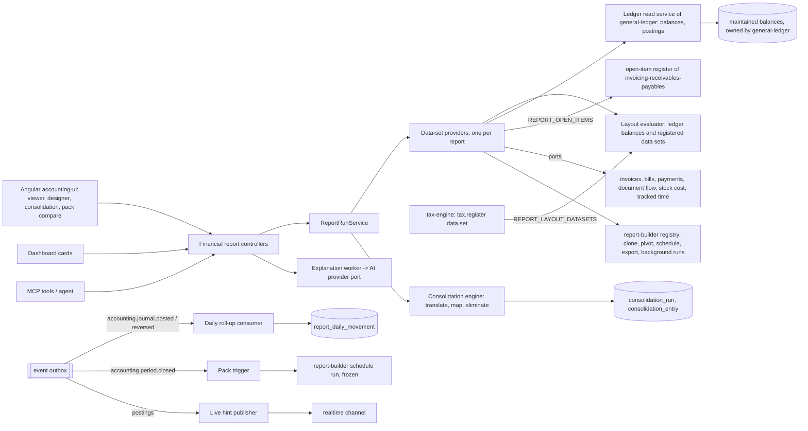

# Implementation Plan: Financial reports

> Translates an approved `spec.md` into architecture and tech choices. The plan owns
> implementation details; the spec owns behaviour.

**Feature ID**: `financial-reports`
**Spec**: `./spec.md`
**Tasks**: `./tasks.md`
**Status**: `Draft`
**Last updated**: 2026-11-23

---

## 1. Architecture Summary

The feature is a module of the new `@gauzy/plugin-accounting` (`packages/plugins/accounting/src/lib/financial-reports`),
beside the chart and ledger modules that `accounting-foundation` and `general-ledger` define. It owns **no ledger
data**: it reads balances and postings through the ledger read service of the same plugin, reads open items and their
settlements from the one open-item register owned by `invoicing-receivables-payables` (which works without a ledger),
reads documents through ports for the registers, and writes only its own configuration and results (layouts, bucket
schemes, consolidation groups and runs, note anchors). Each report is a **data-set provider** registered with the
report builder; packs and background runs are the report builder's schedules and runs.

This module owns the platform's **one statement and return layout model and evaluator**: balance sheet, profit and
loss, cash flow and ratios use it over ledger balances, and `tax-engine` registers tax return layouts (kind
`TAX_RETURN`) and the `tax.register` data set with it; country packs ship their statement and return layouts as
content of the same model. The existing core modules stay: `packages/core/src/lib/reports` (catalogue rows gain the
new reports), `saved-report`, `dashboard`, `employee-statistics`, `comment`; the Angular widget registry gains
finance cards beside `packages/ui-core/shared/src/lib/dashboard/widgets/accounting`.

## 2. Tech Choices

| Concern | Choice | Rationale |
| ------- | ------ | --------- |
| Package | `packages/plugins/accounting` (module `financial-reports`), `accounting-ui` | Principle I; same plugin as the ledger it reads |
| Report registration | `ReportDefinitionRegistry` of `report-builder` with computed data-set providers; catalogue rows in core `report` / `report_category` by seed migration | architecture rule: reports are definitions |
| Balances | read from the maintained balance table of `general-ledger` (account, fiscal period, ledger book, currency, dimension set); this module adds `report_daily_movement` only for ranges inside a period | no second ledger truth; bounded scans |
| Open items | read from the open-item register (`OPEN_ITEM_REGISTER` of `invoicing-receivables-payables`) and its settlements (`payment_allocation` of `payments-and-collections`); ageing bands applied at read time from `ageing_bucket_scheme` | one register, one ageing computation |
| Layout evaluation | pure evaluator: rows select from a data set named by the layout (`ledger.balances` here; others registered through `REPORT_LAYOUT_DATASETS`, such as `tax.register`), formula rows by a small expression parser (row codes, `+ - * /`, parentheses, `abs`, `min`, `max`), topological order, cycle check | one deterministic, testable evaluator for statements and returns |
| Packs | a pack is a `report_schedule` of the report builder with several items; this module adds an event trigger (period close) and frozen figures with a content fingerprint to the builder's schedule tables | one schedule and delivery model |
| Background runs | `report_run` of the report builder (mode `BACKGROUND`, result file) | one run model |
| Notes | a note anchor (report cell key, period, figure fingerprint, origin) with its text, replies and mentions as core `comment` rows | notes on a record use `comment` |
| Consolidation | pure engine over member trial balances plus, for equity and investment accounts, the members' dated movements (sums per account, currency and posting date read from the `general-ledger` journal lines), each translated at the rate of its posting date and summed into a historically translated balance; a run starts from the historically translated balances of the previous final run and adds the period's dated movements, so two members with equal equity balances but different posting dates translate differently; results stored per run; never writes member ledgers | spec §3.5 rate table, FR-49, FR-84 |
| Money and rates | `Money` and exact decimals of core; exchange rates from the rate tables used by `general-ledger` | one arithmetic |
| Background work | `@ScheduledJob` + `@QueueWorker` (`@gauzy/scheduler`); in-process fallback; scheduled passes recorded in `job_execution` | house idiom |
| Live figures | outbox consumer publishes hints `(organization, book, accounts touched, period)` on the realtime channel; clients refetch affected cells | Principle VII |
| Explanations | the AI provider port used by the AI plugins; deterministic driver analysis first, model only words the result; runs and usage recorded by `ai-agents-and-assistants` | explainable, small prompts |
| Settings | `accounting.settings.ts` contributions (organization scope): dashboard source, time budget, "Explain" on or off | platform settings store |
| Permissions | contributions with `defaultFor` in the accounting plugin's permission file | no seed migration |
| Files | pack documents rendered by `print-templates`; stored through the platform file storage | reuse |

## 3. Data Model

All tables extend `TenantOrganizationBaseEntity` (soft delete); JSON is `text` on every dialect; references to
ledger accounts, organizations of a group and documents carry no cross-plugin foreign key (accounts are in the same
plugin: foreign keys where the table exists at migration time).

### New or changed entities

| Table | Columns (besides base) | Indexes and uniqueness |
| --- | --- | --- |
| `statement_layout` | `code`, `name`, `kind` (`BALANCE_SHEET`, `PROFIT_AND_LOSS`, `CASH_FLOW`, `RATIOS`, `TAX_RETURN`, `CUSTOM`), `datasetKey` varchar(64) default `ledger.balances`, `presentation` (`VERTICAL`, `SIDE_BY_SIDE`), `isSystem`, `isDefault`, `sourcePackKey`, `sourcePackVersion`, `clonedFromId` | unique `(organizationId, code)` live; unique partial `(organizationId, kind)` where `isDefault` |
| `statement_layout_version` | `layoutId` FK, `version` int, `effectiveFrom` date, `status` (`DRAFT`, `PUBLISHED`), `publishedAt`, `publishedById`, `acknowledgedAccounts` text | unique `(layoutId, version)`; index `(layoutId, status, effectiveFrom)` |
| `statement_layout_row` | `versionId` FK, `code` varchar(32), `sequence`, `kind` (`ACCOUNTS`, `FILTER`, `FORMULA`, `HEADING`, `BLANK`, `COLUMN_BREAK`, `METRIC`), `label` text (per language), `selector` text (read by the layout's data set: kinds, categories, ranges, tags, include, exclude for ledger balances; direction, kind, category, regime, rate, subdivision, account for the tax register), `measure` varchar(24) null, `formula` text, `metricKey`, `balanceBasis` (`OPENING`, `CLOSING`, `MOVEMENT`), `reverseSign`, `hideIfZero`, `indent` smallint, `emphasis` varchar(8), `color` varchar(9), `roundingUnit` int, `inChart`, `shareOfRowCode`, `cashFlowSection` | unique `(versionId, code)`; index `(versionId, sequence)` |
| `ageing_bucket_scheme` | `name`, `bounds` text (ascending day limits), `isDefault`, `appliesTo` (`RECEIVABLE`, `PAYABLE`, `BOTH`) | unique `(organizationId, name)` live; the only definition of age bands: the open-item register of `invoicing-receivables-payables` reads the default scheme for its maintained per-party band totals |
| `consolidation_group` | `name`, `parentOrganizationId`, `presentationCurrency`, `incomeRateBasis` (`PERIOD_AVERAGE`, `POSTING_DATE`), `groupLayoutId`, `status` | `organizationId` = the parent; unique `(tenantId, name)` live |
| `consolidation_member` | `groupId` FK, `memberOrganizationId`, `ownershipPercent` numeric(9,6), `method` (`FULL`, `PROPORTIONAL`), `effectiveFrom`, `effectiveTo` | unique `(groupId, memberOrganizationId, effectiveFrom)` |
| `consolidation_account_map` | `groupId` FK, `memberOrganizationId`, `ledgerAccountId`, `groupLineCode` | unique `(groupId, memberOrganizationId, ledgerAccountId)`; default mapping by account category when no row |
| `elimination_rule` | `groupId` FK, `kind` (`BALANCES`, `REVENUE_EXPENSE`, `DIVIDENDS`, `INVESTMENT_EQUITY`, `STOCK_MARGIN`), `selectors` text, `tolerance`, `marginPercent`, `differenceLineCode`, `isEnabled` | index `(groupId, kind)` |
| `consolidation_run` | `groupId` FK, `periodStart`, `periodEnd`, `ledgerBookId`, `version` int, `status` (`DRAFT`, `FINAL`), `isProvisional`, `result` text, `resultHash` varchar(64), `warnings` text, `finalizedAt`, `finalizedById`, `operationId` null (the core operation that computed it) | unique `(groupId, periodStart, periodEnd, ledgerBookId, version)` |
| `consolidation_entry` | `runId` FK, `kind` (`ELIMINATION`, `TRANSLATION`, `NON_CONTROLLING`, `ADJUSTMENT`), `ruleId`, `groupLineCode`, `memberOrganizationId`, `counterpartOrganizationId`, `debit`, `credit`, `currency`, `description`, `sources` text | index `(runId, kind)` |
| `intercompany_mismatch` | `runId` FK, `organizationAId`, `organizationBId`, `kind`, `amountA`, `amountB`, `difference`, `currency`, `documents` text, `status` (`OPEN`, `CARRIED`, `RESOLVED`) | index `(runId, status)` |
| `statement_note` | the anchor of a note on a statement cell: `reportKey`, `layoutRowCode`, `ledgerAccountId`, `periodStart`, `periodEnd`, `scope` text (book, dimension), `kind` (`NOTE`, `EXPLANATION`, `HINT`), `origin` (`USER`, `ASSISTANT`), `figureHash`; text, author, edits, replies, mentions and resolution are core `comment` rows (`entity = StatementNote`) | index `(organizationId, reportKey, periodStart, periodEnd)` |
| `report_daily_movement` | `ledgerBookId`, `ledgerAccountId`, `date`, `currency`, `dimensionSetHash`, `debit`, `credit`, `postingCount` | unique on the key columns; derived, rebuildable |
| `report_schedule` (report builder) + columns | `trigger` varchar(12) default `RECURRENCE` (`RECURRENCE`, `EVENT`), `triggerEvent` varchar(64) null (for example `accounting.period.closed`), `freezeFigures` bool default false | generic: any schedule may be event-triggered and frozen; a report pack is a schedule with several items |
| `report_schedule_run` (report builder) + columns | `figures` text null, `contentHash` varchar(64) null, `ledgerWatermark` varchar(64) null | a frozen run is never updated after it is sent; compare reads it |

The statement note keeps an anchor table because a comment needs a record to hang on and a statement cell has none:
the anchor carries the cell key, the period and the fingerprint of the figure the note was written against; all text
and discussion live in `comment`.

**Read contracts relied on:** `LedgerReadService.balances(filter, asOf)`, `.movements(filter, range, groupBy)`,
`.lines(filter, cursor)`, `.journalIntegrity(range)` (owned by `general-ledger`, same plugin); open items on a date
(original minus settlements dated up to it) and settlements through `REPORT_OPEN_ITEMS`, answered by
`OPEN_ITEM_REGISTER` of `invoicing-receivables-payables`. The control-account report compares ledger control
accounts with that register. If a ledger read query is missing when this module is built, the task that needs it
adds it to the ledger module as a read-only query.

### Migrations

**Migration timestamps**: `packages/plugins/accounting` `1791000079100` to `1791000079199`.

In `packages/plugins/accounting/src/lib/database/migrations/` (the plugin's helpers), three dialect branches,
idempotent, registered for both ORMs, after the ledger migrations:

1. `1791000079100-CreateStatementLayoutTables` — `statement_layout`, `statement_layout_version`, `statement_layout_row`,
   `ageing_bucket_scheme`.
2. `1791000079110-CreateConsolidationTables` — the six consolidation tables.
3. `1791000079120-CreateStatementNoteTable` — `statement_note`; and `1791000079130-ExtendReportScheduleForPacks` — the
   columns on `report_schedule` and `report_schedule_run`.
4. `1791000079140-CreateReportDailyMovementTable` — with a backfill job (not in the migration) that builds rows from the
   ledger.
5. `1791000079150-SeedFinancialReportCatalogue` — rows in core `report_category` ("Accounting") and `report` for the reports,
   `showInMenu` false by default; shipped layouts and the default bucket scheme are seeded per organization when the
   feature is first enabled (service seed, not migration). The core catalogue has no tenant and lists every row to
   every organization (`ReportService.findAllReports`, `getMenuItems`), so the "Accounting" category is keyed
   `FEATURE_FINANCIAL_REPORTS` in the shared catalogue feature filter of `report-builder-and-dashboards` (nullable
   `report_category.featureKey`, guarded so that it is safe from any feature): a tenant whose code is
   off is answered without these rows, and rows of other categories are listed exactly as today.

Default role grants are permission contributions (`defaultFor`), not a migration. The only existing tables altered
are the two report-builder schedule tables, additively; core `reports` gains only the additive visibility filter of
item 5 (no filter registered: the catalogue answers as today).

### Contracts

`packages/contracts/src/lib/financial-reports.model.ts`: `FinancialReportKeyEnum` (one key per report of the spec),
`IFinancialReportOptions`, `IFinancialReportResult` (columns, rows, cell drill keys, computed-at, watermark),
`IStatementLayout`, `IStatementLayoutVersion`, `IStatementLayoutRow`, `ILayoutDataset` (data-set registration of the
layout model), `IAgeingBucketScheme`, `IConsolidationGroup`, `IConsolidationMember`, `IEliminationRule`,
`IConsolidationRun`, `IConsolidationEntry`, `IIntercompanyMismatch`, `IReportPackItem`, `IStatementNote`,
`IDrillDownRequest`, `IDrillDownResult`, `IFinanceCardData`; port shapes `IRegisterDocumentSource`, `IStockCostSource`,
`ITrackedTimeCostSource`, `IBudgetFigures`, `ICommissionSource`, `IReportOpenItems`.

## 4. API Surface

All routes: `TenantPermissionGuard`, `PermissionGuard`, `FeatureFlagGuard` with
`@FeatureFlag(FEATURE_FINANCIAL_REPORTS)`; cursor pagination on line-level reports; consolidation and pack routes
take `Idempotency-Key`.

| Method | Endpoint | Permission | Description | Status |
| ------ | -------- | ---------- | ----------- | ------ |
| `GET` | `/financial-reports` | any view key | catalogue: keys, groups, availability (ledger on or off) | New |
| `POST` | `/financial-reports/:key/run` | view key of the group | `IFinancialReportOptions` → `IFinancialReportResult`, or `202` with a report-builder background run id | New |
| `POST` | `/financial-reports/:key/drill` | view key of the group | cell drill key → postings, journals, documents, time entries | New |
| `GET` `POST` `PUT` `DELETE` | `/statement-layouts` (+ `/:id/clone`, `/:id/versions`, `/versions/:vid/publish`, `/versions/:vid/completeness`, `/versions/:vid/preview`, `/:id/export`, `/import`, `PUT /:id/default`) | `ACCOUNTING_REPORTS_VIEW` / `ACCOUNTING_STATEMENT_LAYOUTS_EDIT` (kind `TAX_RETURN`: `TAX_REPORTS_VIEW` / `TAX_REPORTS_EDIT`) | layouts, versions, rows of every kind | New |
| `GET` `POST` `PUT` `DELETE` | `/ageing-bucket-schemes` | `ACCOUNTING_REPORTS_VIEW` / `ACCOUNTING_STATEMENT_LAYOUTS_EDIT` | bucket schemes | New |
| `GET` `POST` `PUT` `DELETE` | `/consolidation-groups` (+ `/:id/members`, `/:id/account-map`, `/:id/elimination-rules`) | `ACCOUNTING_CONSOLIDATION_VIEW` / `_MANAGE` | group setup | New |
| `POST` `GET` | `/consolidation-runs` (+ `GET /:id`, `/:id/entries`, `POST /:id/adjustments`, `/:id/finalize`, `GET /:id/mismatches`, `PUT /mismatches/:mid`) | `ACCOUNTING_CONSOLIDATION_VIEW` / `_MANAGE` | run (an operation), entries, adjustments, finalize | New |
| `GET` | `/financial-reports/pack-runs/:runId/compare` | `ACCOUNTING_REPORTS_VIEW` | a frozen report-builder schedule run against current figures, with the postings made since | New |
| `POST` `GET` `PUT` `DELETE` | `/statement-notes` | `ACCOUNTING_REPORTS_VIEW` / `ACCOUNTING_ANNOTATIONS_EDIT` | note anchors with their first comment; replies, edits and mentions through core `/comments` | New |
| `POST` | `/financial-reports/explain` | `ACCOUNTING_REPORTS_VIEW` | figure or variance reference → note (async; `202`) | New |
| `GET` | `/finance-cards/:key` | view key of the card's report | `IFinanceCardData` for a dashboard context | New |
| `GET` `PUT` | `/financial-reports/settings` | `ACCOUNTING_REPORTS_VIEW` / `ACCOUNTING_STATEMENT_LAYOUTS_EDIT` | organization settings in the platform settings store: source of the existing dashboard (records, default, or ledger), time budget, "Explain" on or off | New |

Packs are created, edited, run and listed through the report builder's schedule routes
(`/api/report-builder/schedules`, `ACCOUNTING_REPORT_PACKS_MANAGE` required for a schedule that freezes figures);
background results through the builder's run routes. No route of this module duplicates them.

Errors: `REPORT_RATE_MISSING`, `REPORT_LEDGER_REQUIRED`, `LAYOUT_INCOMPLETE`, `LAYOUT_FORMULA_CYCLE`,
`CONSOLIDATION_MEMBER_PERIOD_OPEN`, `PACK_RUN_FROZEN`, `EXPLAIN_UNAVAILABLE`.

**Ports** (optional tokens, bound in `apps/api/src/plugin-composition.ts`): `REPORT_REGISTER_DOCUMENTS` (invoices,
bills, lines, tax columns, payments — answered by the invoicing package, today core `invoice` and `payment`),
`REPORT_OPEN_ITEMS` (`OPEN_ITEM_REGISTER` of `invoicing-receivables-payables`), `REPORT_DOCUMENT_FLOW` (open billing
roll-ups — `business-documents`), `REPORT_STOCK_COST` (`inventory-valuation`), `REPORT_TRACKED_TIME_COST` (core time
tracking and employee rates), `REPORT_BUDGET_FIGURES` (budgets module), `REPORT_COMMISSIONS` (`order`),
`REPORT_BANK_BALANCES` (`banking`), `REPORT_EFFECTS_PREVIEW` (`business-documents`), `REPORT_LAYOUT_DATASETS` (multi:
data sets registered with the layout model, such as `tax.register` of `tax-engine`). The layout service answers the
`TAX_RETURN_LAYOUTS` port of `tax-engine` (list, evaluate, register pack layouts) and answers it only
for tenants with `FEATURE_FINANCIAL_REPORTS` on, so a tax return needs this feature. A report whose port is unbound is
listed as unavailable with the reason, except gross profit: with `REPORT_STOCK_COST` unbound it lists the selling
amounts from `REPORT_REGISTER_DOCUMENTS` and marks cost and margin unavailable (spec FR-64); the stock cost does not
depend on accounting, so the report is the same with accounting on or off.

**Consumer tokens answered** (bound in `apps/api/src/plugin-composition.ts` to the ageing bucket schemes; each consumer plan states the shape it calls and its fallback): `AGEING_BUCKET_SCHEME`.

## 5. Events, Real-Time and Notifications

| Event | Emitted when | Consumers |
| ----- | ------------ | --------- |
| `accounting.journal.posted` / `.reversed` (in) | `general-ledger` | daily roll-up consumer; live hint publisher |
| `accounting.period.closed` (in) | `general-ledger` | pack trigger: runs every report-builder schedule with `triggerEvent` of this name, frozen |
| `accounting.account.created` (in) | `accounting-foundation` | completeness notice to owners of published layouts |
| `accounting.report.figures_changed` (realtime only) | a posting touched accounts of an organization and book | open statements, ledger reports and cards refetch affected cells |
| `accounting.statement_layout.published` | a layout version is published | activity log, automation rules |
| `accounting.consolidation_run.finalized` | a run becomes final | inbox item to the group's owners, automation rules |
| `report_schedule.delivered`, `report_run.completed` (report builder) | a pack is delivered; a background report finished | inbox and email to recipients; inbox item to the requester |

Inbox items through `INBOX_ITEM_WRITER`; pack emails through the report builder's delivery with the files attached;
approval of a pack is the builder's review state (`AWAITING_REVIEW`).

## 6. UI Surface

- **Angular `packages/plugins/accounting-ui`**, module `financial-reports` (lazy; routes registered through the
  `accounting-sections` page location, menu Accounting → Reports, gated by the feature codes and permissions):
  `/pages/accounting/reports` (catalogue by group), `/reports/:key` (viewer: grid with expand and collapse, period
  and comparison columns, dimension split, value, growth and share views, drill-down side panel, notes as comment
  threads, "Explain", freeze, export through the builder), `/reports/layouts` and `/reports/layouts/:id/design`
  (designer: row list with drag and drop, account or register-filter picker with figures, formula editor,
  completeness panel, live preview; also used for tax return layouts), `/reports/consolidation` (groups, members,
  mapping, rules, runs, mismatches), `/reports/ageing-schemes`. Packs are listed on the report builder's schedules
  page; this module adds the "compare with now" view of a frozen run.
- The existing stub route `/pages/reports/accounting` (`WorkInProgressModule`, `pages.routes.ts`) gets a redirect
  guard on the pattern of `feature-documents-redirect.guard.ts`: with `FEATURE_FINANCIAL_REPORTS` on it returns a
  `UrlTree` to `/pages/accounting/reports`; off, it behaves as today.
- **Cards**: `provideFinanceDashboardWidgets()` registers `finance.*` widget ids in the existing widget registry
  (`@gauzy/ui-core/core`), beside `provideCoreDashboardWidgets()`; the existing ids `accounting.*` are untouched.
  The accounting dashboard page (`apps/gauzy/src/app/pages/dashboard/accounting`) gains a source switch shown only
  with accounting enabled.
- i18n keys `FINANCIAL_REPORTS.*` in every locale of `packages/ui-core/i18n`; shipped layout labels are keys.

## 7. MCP Tools, SDKs and Integrations

New file `packages/mcp-server/src/lib/tools/financial-reports.ts`:

| Tool | Input | Output |
| --- | --- | --- |
| `finance_list_reports` | organization | catalogue with availability |
| `finance_run_report` | report key, options | columns, rows, drill keys, computed-at |
| `finance_get_statement` | kind or layout, periods, comparison, dimension split | statement rows |
| `finance_get_trial_balance` | period, book, options | rows and proof |
| `finance_get_ledger` | account or party or document, range | lines with running balance |
| `finance_get_ageing` | side, as-on date, scheme, grouping | bands per party or document |
| `finance_get_consolidated_statement` | group, period, kind | columns per member, eliminations, total |
| `finance_drill_down` | drill key | postings, documents, time entries |
| `finance_explain_variance` | figure or variance reference | note text with links |
| `finance_find_report` | question in words | report key and options to run |
| `finance_run_report_pack` | pack schedule, period, `preview` (default true) | contents or frozen run |
| `finance_add_note` | line, period, text, `preview` | note |

OpenAPI additive; SDKs regenerated after merge. Layout files are JSON (versioned schema) for export and import.
Exports (PDF, XLSX, CSV) and scheduled emails come from the report builder.

## 8. Background Jobs

| Trigger | When | What it does | Idempotency |
| ------- | ---- | ------------ | ----------- |
| Outbox consumer `subscriber:financial-report-rollup` | journal posted or reversed | updates `report_daily_movement`; publishes live hints (coalesced per second) | delivery record per event |
| `financial-reports.rollup.verify` | nightly | recount of open periods against the ledger; drift to the job monitor and auto-rebuild | per organization and day |
| operation `financial-reports.rollup.backfill` | feature first switched on, on demand | builds `report_daily_movement` from the posted journal lines of every period, closed ones included, in slices per organization, book and month; until a range is built, intra-period reports of it read the ledger | upsert on the row key |
| report-builder background run | a run exceeds the time budget | the builder computes and stores the result file through this module's data-set provider | builder run id |
| operation `FINANCIAL_CONSOLIDATION` | run requested | member trial balances and dated equity and investment movements, mapping, translation (historical rates per posting date for equity and investments), eliminations, interest, mismatches | group, period, book, version |
| Outbox consumer `subscriber:financial-report-packs` | period closed | starts every schedule whose `triggerEvent` is `accounting.period.closed`, frozen | schedule and period key |
| `financial-reports.explain` worker | explanation requested | driver analysis, wording, note anchor and comment | figure hash |

Recurring packs run on the report builder's schedule tick; results expire with the builder's own retention. Scheduled
passes are recorded in `job_execution`. Schedules register in the worker app through the accounting schedule plugin;
workers run in the API; without a queue root the API runs sweeps on timers under a database lock.

## 9. Security & Permissions

Permission contributions in the accounting plugin's permission file: `ACCOUNTING_REPORTS_VIEW` (ledger reports,
statements, cards), `ACCOUNTING_RECEIVABLE_REPORTS_VIEW`, `ACCOUNTING_PAYABLE_REPORTS_VIEW`,
`ACCOUNTING_REGISTERS_VIEW`, `ACCOUNTING_STATEMENT_LAYOUTS_EDIT`, `ACCOUNTING_CONSOLIDATION_VIEW`,
`ACCOUNTING_CONSOLIDATION_MANAGE`, `ACCOUNTING_REPORT_PACKS_MANAGE`, `ACCOUNTING_ANNOTATIONS_EDIT`. `defaultFor`: all
to `SUPER_ADMIN` and `ADMIN`; the view keys to accountant-type roles; none to employees. Organization membership is
checked for every organization read, including each member of a consolidation. Formula rows are parsed by the
plugin's own parser (no evaluation of arbitrary code). "Explain" is off until an administrator enables it per
organization; prompts carry aggregated figures, account names and document numbers, never bank or tax numbers.
Layout imports are schema-validated.

## 10. Observability

Activity-log entries for layout publication, consolidation runs and adjustments; pack runs, approvals and
deliveries are recorded by the report builder; metrics `financial_report_duration{key}`,
`financial_report_live_lag_seconds`, `financial_report_rollup_drift`, `consolidation_duration`; statement identities
(trial balance proof, balance sheet check, cash flow reconciliation) are also exposed as health checks per
organization for the system health page.

## 11. Phased Rollout

1. **Phase 1 — Registers without a ledger**: contracts, catalogue, run service, document lists, trends, open billing
   lists, receipts per payment method, mismatched discounts, document-based cards. Usable on today's invoices, bills and payments.
2. **Phase 2 — Ledger reports and statements**: general ledger, daily journal, trial balances, integrity lists,
   layout evaluator with shipped layouts and registered data sets, balance sheet, profit and loss, cash flow, ageing
   and party summaries, print templates, ledger cards.
3. **Phase 3 — Depth**: designer, versions, ratios, dimension analysis, budget against actual, consolidation
   with translation, consolidated ageing, gross profit with stock cost.
4. **Phase 4 — Advanced capabilities**: drill-down to time entries, live figures, eliminations, mismatches and
   non-controlling interest, packs and comparison, notes and explanations, hints, MCP tools, people-margin cards.
5. **Phase 5 — General availability**: the feature is off by default; after the trial period it may be switched on by default for new tenants only; existing tenants keep their setting until an administrator changes it.

## 12. Constitution Reconciliation

- I Plugin-first: a module of the `accounting` plugin and its UI package; core receives catalogue rows only.
- II Tenant/organization scoping: every table on the tenant-organization base; consolidation checks membership of each member organization.
- III Both ORMs, additive migrations: six additive migrations, three dialects, both ORMs.
- IV Default-off flag; nothing removed: `FEATURE_FINANCIAL_REPORTS` off; existing dashboard, widgets, reports and the stub route behave as today.
- V Contracts and API first: one run endpoint with typed options and results per report key; additive OpenAPI.
- VI Permissions, privacy, security: nine keys; membership checks; AI use opt-in with minimal data.
- VII Real-time through the event bus: posting events → realtime hints; no polling, no private channel.
- VIII i18n and accessibility: keyed labels in every locale; keyboard and screen-reader grid.
- IX Tests: identity properties, data-set specs per report, consolidation fixtures, e2e for routes.
- X Behaviour-first spec: implementation is here only.
- XI Documentation describes our platform only.

## 13. Risks & Mitigations

| Risk | Likelihood | Impact | Mitigation |
| ---- | ---------- | ------ | ---------- |
| The ledger read contracts differ from those assumed | Medium | Medium | contracts listed in §3; same plugin, so missing read queries are added as read-only tasks |
| Two sources of balances drift | Low | High | maintained balances have one owner; the daily roll-up is derived, verified nightly, rebuildable |
| Reports and statements do not fit the builder's tabular model | Medium | Medium | computed data-set providers return rows with a stable row key and level; the builder treats them as any data set |
| Tax returns need more than ledger selectors | Medium | Medium | rows read selectors through the layout's data set; the tax register data set defines its own filters and measures |
| Slow reports on large tenants | Medium | Medium | time budget with background runs; balances not scans; pagination on line reports |
| Wrong eliminations | Medium | High | eliminations are entries of a run, visible and drillable; mismatches listed; final runs need closed periods |
| Live updates flood clients | Low | Low | hints coalesced per second and scoped to accounts on screen |
| Explanations state wrong causes | Medium | Medium | deterministic driver analysis supplies the facts; the note is marked as assistant-written and editable |

## 14. References

- Spec: `./spec.md` · Tasks: `./tasks.md`
- Code: `packages/core/src/lib/reports/report.seed.ts`, `packages/core/src/lib/reports/report.entity.ts`,
  `packages/core/src/lib/saved-report/saved-report.entity.ts`, `packages/core/src/lib/dashboard`,
  `packages/core/src/lib/comment`, `packages/core/src/lib/employee-statistics/employee-statistics.service.ts`,
  `packages/ui-core/shared/src/lib/dashboard/widgets/accounting/accounting.widgets.ts`,
  `apps/gauzy/src/app/pages/dashboard/accounting`, `apps/gauzy/src/app/pages/pages.routes.ts` (stub route
  `reports/accounting`, `accounting-sections`), `apps/gauzy/src/app/pages/feature-documents-redirect.guard.ts`,
  `packages/core/src/lib/invoice`, `packages/core/src/lib/payment`
- Related plans: `../general-ledger/plan.md`, `../accounting-foundation/plan.md`,
  `../invoicing-receivables-payables/plan.md`, `../tax-engine/plan.md`, `../report-builder-and-dashboards/plan.md`,
  `../print-and-pdf-designer/plan.md`
