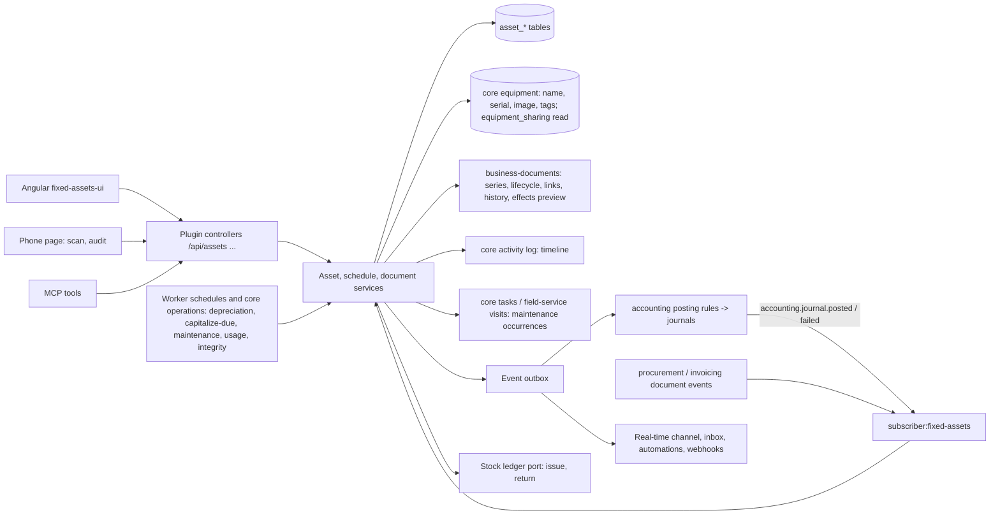

# Implementation Plan: Fixed assets

> Translates an approved `spec.md` into architecture and tech choices. The plan owns
> implementation details; the spec owns behaviour.

**Feature ID**: `fixed-assets`
**Spec**: `./spec.md`
**Tasks**: `./tasks.md`
**Status**: `Draft`
**Last updated**: 2026-11-23

---

## 1. Architecture Summary

A new plugin `@gauzy/plugin-fixed-assets` (`packages/plugins/fixed-assets`) owns the accounting and custody side of
assets: categories, books, schedules and the asset documents. It never writes a ledger line or a stock quantity: it
registers its document types with the business document engine, publishes document events to the event outbox, and
the posting rules of `accounting` turn them into journals; parts and consumed stock go through the stock ledger port.
It builds on what exists instead of keeping copies:

- **Equipment is the physical item.** Every tangible asset has exactly one core `equipment` row
  (`packages/core/src/lib/equipment`), created or chosen when the asset is created and written through the existing
  equipment service; name, serial number, image and tags are read from it and never copied. Intangible and
  right-of-use assets have no equipment row and carry their own name. Lending stays in `equipment-sharing`.
- **Timeline** entries are core activity-log entries (`ActivityLogService`) and the document history of the business
  document engine; the plugin keeps only derived usage facts.
- **Maintenance** occurrences are core tasks (internal work) or field-service visits of
  `maintenance-and-field-service` (external work, visit source `ASSET_MAINTENANCE`); their recurrence uses the
  platform's one recurrence implementation (the invoice-schedule rules lifted to core by `business-document-engine`).
- **Depreciation runs** are core operations (`packages/core/src/lib/operation`); integrity differences go to the
  finding store of `general-ledger`; analysis uses dimension sets of `accounting-foundation`; reminders are
  `reminder` rows of `automation-and-notifications`.



Posting contract ([platform architecture](../../architecture/business-suite.md) §3.4): for every posting document the plugin appends
`document.<type>.confirmed` (or `.cancelled`) with a neutral payload (amounts per account **role**, asset, category,
ledger book, dimension set). The posting rule templates listed in §7 resolve roles to accounts through
`asset_category_account`, which this plugin exposes through the account-determination port. The result event
carries the journal id; the consumer stamps it on the line or document. With the ledger port unbound, documents
confirm without postings (spec FR-96).

## 2. Tech Choices

| Concern | Choice | Rationale |
| ------- | ------ | --------- |
| Package | `packages/plugins/fixed-assets` (new), `fixed-assets-ui` (new) | Principle I; equipment stays in core |
| Flag | tenant feature `FEATURE_FIXED_ASSETS` in `fixed-assets.features.ts`, `@FeatureFlag` + `FeatureFlagGuard` on every controller and resolver (pattern: `subscription.features.ts`) | default off |
| Persistence | MultiORM entities on `TenantOrganizationBaseEntity`, the shared core migration helpers of `@gauzy/core`, tri-dialect migrations | Principle III |
| Money | core `money` (exact decimals `numeric(20,6)`, currency precision, explicit rounding); rates `numeric(20,10)` | one money kernel |
| Schedule mathematics | pure functions in `engine/` (method, proration, revision, split, usage), property-tested | invariants: total equals depreciable amount; posted lines immutable |
| Physical item | core `equipment` (one row per tangible asset) through `EquipmentService`; tags through `tag_equipment` | no copied fields |
| Timeline | `ActivityLogService` entries (actor type person, automation, agent), which also hold the lifecycle history of the asset documents of the document engine | one change history |
| Maintenance | core tasks (`packages/core/src/lib/tasks`) or field-service visits through `FIXED_ASSETS_FIELD_SERVICE`; recurrence by the shared core recurrence rules | one task model, one recurrence |
| Runs | depreciation runs as core operations (one step per ledger book and batch of 500 lines), started and read through `/operations`; scheduled sweeps recorded in `job_execution` | one run model |
| Analysis | `dimensionSetId` resolved by `AnalyticDimensionSetService.resolve` (a cost centre is a dimension) | one analysis shape |
| Cross-plugin calls | optional injection tokens bound in `apps/api/src/plugin-composition.ts`: `FIXED_ASSETS_LEDGER` (also bound to the finding service of `general-ledger`), `FIXED_ASSETS_STOCK`, `FIXED_ASSETS_INVOICING`, `FIXED_ASSETS_DOCUMENTS`, `FIXED_ASSETS_APPROVALS`, `FIXED_ASSETS_FIELD_SERVICE`; answers to other plugins' ports: `MANUFACTURING_ASSETS` of `shop-floor-and-work-orders` (maintenance windows of a work centre's asset from its maintenance occurrences, open or find the asset's open `asset_repair`, and write `asset_repair.downtimeHours` as the sum of the linked downtime rows) and `EXPENSE_ASSET_READINGS` of `expenses-and-travel` (the distance driven per vehicle-log entry of a company vehicle that is an asset, written as a usage reading with source `VEHICLE_LOG`; service due dates from the asset's maintenance plans) | no import of another plugin's internals |
| Background work | `@ScheduledJob` + `@QueueWorker` (`@gauzy/scheduler`); schedule-only plugin in the worker, consumers in the API; in-process timer without a queue | same split as task automations |
| Events | `EventOutboxService.append` in the document's transaction; `EventConsumerRegistry` consumer `subscriber:fixed-assets` | at-least-once, deduplicated |
| Offline scans | client-generated scan ids, bulk upsert endpoint, unique `(sessionId, assetId)` | idempotent merge |
| Reports | report definitions registered with the report builder; balances from `asset_book` and a monthly snapshot table | no raw scans of lines |
| Settings | `fixed-assets.settings.ts` contributions (organization scope): automatic posting, journal grouping, locked-period handling, acknowledgement escalation days, idle days | platform settings store |
| UI | Angular plugin `fixed-assets-ui`; the phone page is an installable route of the same plugin (camera and offline queue) | one plugin UI |

## 3. Data Model

### New or changed entities

All tables extend `TenantOrganizationBaseEntity` (tenant, organization, soft delete, timestamps). No existing table
changes. `asset_category`, `asset_intensity_factor` rows with `organizationId` null are shared in the tenant.

```ts
@MultiORMEntity('asset', { mikroOrmRepository: () => MikroOrmAssetRepository })
export class Asset extends TenantOrganizationBaseEntity implements IAsset { /* columns below */ }
```

| Table | Columns (type) | Indexes and uniqueness |
| --- | --- | --- |
| `asset_category` | `code` varchar(64), `name` varchar(255), `kind` varchar(16), `isDepreciable` bool, `usesWorkInProgress` bool, `lendableByDefault` bool, `organizationIds` json null (allow-list) | unique `(tenantId, code)` where not deleted |
| `asset_category_account` | `categoryId` fk, `role` varchar(32), `ledgerAccountId` uuid (no fk: owned by `accounting`) | unique `(organizationId, categoryId, role)` |
| `asset_category_book_rule` | `categoryId` fk, `ledgerBookId` uuid null, `method` varchar(24), `periods` int, `periodMonths` int, `salvagePercent` numeric(9,6), `rate` numeric(9,6) null, `factor` numeric(9,6) null, `dailyProration` bool | unique `(organizationId, categoryId, ledgerBookId)` |
| `asset_item_rule` | `variantId` uuid, `categoryId` fk, `grouping` varchar(16) (`PER_UNIT`/`PER_LINE`), `seriesId` uuid null | unique `(organizationId, variantId)` |
| `asset` | `number` varchar(64) null, `name` null (intangible and right-of-use assets only; a tangible asset shows its equipment's name), `description` text, `categoryId` fk, `kind` varchar(16), `parentAssetId` fk null, `variantId` uuid null, `equipmentId` uuid null (fk core `equipment`, set null; required when `kind` is tangible), `accountingState` varchar(24), `operationalState` varchar(24), `locationId` fk null, `custodianEmployeeId` uuid null, `custodianTeamId` uuid null, `awaitingAcknowledgement` bool, `departmentId` uuid null, `dimensionSetId` uuid null, `acquisitionDate` date, `inServiceDate` date null, `plannedInServiceDate` date null, `cost` numeric(20,6), `currency` char(3), `organizationCurrency` char(3), `exchangeRate` numeric(20,10), `costInOrganizationCurrency` numeric(20,6), `quantity` numeric(20,6) default 1, `isExisting` bool, `ownership` varchar(16), `ownerPartyType` varchar(16) null, `ownerPartyId` uuid null, `labelCode` varchar(40), `maintenanceRequired` bool, `sourceType` varchar(32) null, `sourceDocumentId` uuid null, `sourceLineId` uuid null, `splitFromAssetId` fk null, `disposalId` uuid null, `version` int | unique `(tenantId, labelCode)`; unique `(organizationId, number)` where number not null; unique `(equipmentId)` where not null; idx `(organizationId, accountingState, categoryId)`, `(organizationId, locationId)`, `(custodianEmployeeId)`, `(sourceLineId)` |
| `asset_book` | `assetId` fk, `ledgerBookId` uuid null, `method`, `periods` int, `periodMonths` int, `startDate` date, `salvageValue` numeric(20,6), `rate`, `factor`, `dailyProration` bool, `openingAccumulated` numeric(20,6), `openingPeriodsBooked` int, `expectedUsageUnits` numeric(20,6) null, `costBasis`, `accumulatedPosted`, `netBookValue` (numeric(20,6), maintained), `activeRevisionId` uuid null, `lastPostedPeriodEnd` date null | unique `(assetId, ledgerBookId)` |
| `asset_schedule_revision` | `assetBookId` fk, `revisionNo` int, `reason` varchar(32), `sourceType`, `sourceId`, `note` text, `status` varchar(16) (`DRAFT`/`ACTIVE`/`SUPERSEDED`), `activatedAt`, `authorId` | unique `(assetBookId, revisionNo)` |
| `asset_depreciation_line` | `assetBookId` fk, `revisionId` fk, `sequence` int, `periodStart` date, `periodEnd` date, `amount`, `accumulatedAfter`, `netBookValueAfter` numeric(20,6), `intensityFactorId` fk null, `usageUnits` numeric(20,6) null, `isEstimated` bool, `status` varchar(16) (`PLANNED`/`POSTED`/`REVERSED`/`SUPERSEDED`), `postedOn` date null, `journalId` uuid null, `operationId` uuid null (the core operation that posted it), `postingGeneration` int default 0 (incremented when a reversal makes the line unposted again, FR-42; the posting key is `(lineId, postingGeneration)`, so a retry of one generation replays its journal and a post after a reversal creates a new one), `failureReason` varchar(255) null | unique `(revisionId, sequence)`; idx `(organizationId, status, periodEnd)`, `(assetBookId, status)`, `(operationId)` |
| `asset_intensity_factor` | `name`, `multiplier` numeric(9,6), `isDefault` bool | unique `(tenantId, organizationId, name)` |
| `asset_usage_reading` | `assetId` fk, `readingDate` date, `units` numeric(20,6), `source` varchar(16) (`MANUAL`/`IMPORT`/`LENDING`/`TRACKED_TIME`/`VISIT`/`VEHICLE_LOG`), `sourceRef` varchar(160) | unique `(assetId, source, sourceRef)` |
| `asset_location` | `code`, `name`, `parentId` fk null, `path` varchar(1024), `holdsOnlySubLocations` bool, `area` numeric(20,6) null, `areaUnitId` uuid null, `warehouseId` uuid null (a location that is a stock location: name and address from core `warehouse`), `addressId` uuid null (any other place: core `address`, coordinates included) | unique `(organizationId, code)`; idx `(path)`; at most one of `warehouseId`, `addressId`; a sub-location without either inherits its parent's place |
| `asset_movement`, `asset_movement_line` | header: `number`, `movedOn` timestamp, `status`, `note`; line: `assetId`, `fromLocationId`, `toLocationId`, `fromCustodianEmployeeId`/`TeamId`, `toCustodianEmployeeId`/`TeamId`, `acknowledgedAt`, `acknowledgedById`, `conditionNote`, `conditionImageId` | idx `(assetId, createdAt)` |
| `asset_capitalization`, `asset_capitalization_line` | header: `number`, `targetAssetId`, `capitalisedOn` date, `status`, `total`, `costChanged` bool; line: `lineType` (`STOCK`/`ASSET`/`SERVICE`), `variantId`, `stockLocationId`, `quantity`, `lotOrSerialRef`, `consumedAssetId`, `expenseAccountId`, `billLineId`, `amount` | idx `(targetAssetId)`, `(consumedAssetId)` |
| `asset_repair`, `asset_repair_part`, `asset_repair_bill_line` | header: `number`, `assetId`, `failedOn`, `completedOn`, `downtimeHours`, `description`, `actionsTaken`, `status` (`OPEN`/`COMPLETED`/`CONFIRMED`/`CANCELLED`), `addToAssetValue` bool, `extraPeriods` int, `totalCost`; part: `variantId`, `stockLocationId`, `quantity`, `value`; bill line: `billLineId`, `amount` | idx `(assetId, status)`, `(billLineId)` |
| `asset_value_adjustment` | `number`, `assetId`, `assetBookId`, `kind` (`REVALUATION`/`IMPAIRMENT`/`IMPAIRMENT_REVERSAL`/`COST_ADJUSTMENT`), `effectiveOn` date, `valueBefore`, `valueAfter`, `difference`, `recoverableAmount` null, `reversalCap` null, `evidence` json, `approvalRequestId` null, `status` | idx `(assetId, effectiveOn)` |
| `asset_disposal` | `number`, `assetId`, `kind` (`SALE`/`SCRAP`), `reason` varchar(24), `disposedOn` date, `quantity`, `invoiceId` null, `invoiceItemId` null, `proceeds`, `netBookValue`, `result`, `status`, `restoredOn` date null | unique `(invoiceItemId)` where not null; idx `(assetId)` |
| `asset_lease`, `asset_lease_period` | header: `assetId`, `vendorId`, `startOn`, `endOn`, `paymentAmount`, `paymentEveryMonths`, `discountRate` numeric(9,6), `initialCosts`, `exempt` bool, `initialLiability`, `status`; period: `sequence`, `dueOn`, `payment`, `interest`, `repayment`, `liabilityAfter`, `status`, `journalId` | unique `(leaseId, sequence)` |
| `asset_maintenance_plan`, `asset_maintenance_task`, `asset_maintenance_occurrence` | plan: `assetId`, `teamId`, `projectId` null (where its tasks are created); task: `planId`, `name`, `kind`, `recurrence` json (the shared core recurrence format), `everyUsageUnits` numeric null (usage-based tasks), `assigneeEmployeeId`, `startOn`, `endOn`, `certificateRequired`, `takesOutOfService`, `external` bool; occurrence (the link only): `maintenanceTaskId`, `dueOn`, `taskId` uuid null (core task: assignee, due date, status, completion, comments, attachments), `visitId` uuid null (field-service visit for external work), `certificateFileId` null, `cost` | unique `(maintenanceTaskId, dueOn)`; idx `(taskId)`, `(visitId)` |
| `asset_insurance_policy` | `assetId`, `insurerVendorId` null, `insurerName`, `policyNumber`, `insuredValue`, `currency`, `startOn`, `endOn` (its reminder is a `reminder` row 30 days before `endOn`) | idx `(endOn)` |
| `asset_audit_session`, `asset_audit_scan` | session: `name`, `scope` json, `status` (`OPEN`/`CLOSED`), `expectedCount`, `closedAt`, `summary` json; scan: `sessionId`, `clientScanId` varchar(64), `assetId` null, `scannedCode`, `scannedAt`, `auditorId`, `condition`, `imageId`, `latitude`, `longitude`, `locationId` | unique `(sessionId, assetId)` where asset not null; unique `(sessionId, clientScanId)` |
| `asset_balance_snapshot` | `assetBookId`, `periodEnd` date, `cost`, `accumulated`, `netBookValue` | unique `(assetBookId, periodEnd)` |

Record links: an asset's task and project links are record links of `record-views-and-search` (core `resource_link` with a record target): `entity = Asset`, target `Task` or `OrganizationProject`, `role` `WORK`.

**Existing tables used, not copied:** core `equipment` and `tag_equipment` (identity of tangible assets),
`equipment_sharing` (lending, read), `activity_log` (timeline), `task` (maintenance occurrences), `warehouse` and
`address` (places), `operation` and `job_execution` (runs and sweeps), `analytic_dimension_set`, `ledger_integrity_finding` (`source = FIXED_ASSETS`), `reminder`, and the field-service
`fs_visit` for external maintenance.

**Kept apart, with the reason:**

- `asset_audit_session` / `asset_audit_scan` and the inventory count session (`stock_count`, `stock_count_line`):
  a stock count measures quantities of variants in one warehouse (its `warehouseId` is required) against a snapshot of
  expected quantities; an asset audit confirms individual labelled assets wherever they are (offices, sites, people)
  with condition, photo and position per scan and offline merge, which the count-session model cannot hold. Assets
  that are stock items are counted by stock counts.
- `asset_usage_reading` and the field-service meter readings: asset readings are period usage totals that feed
  units-of-usage depreciation, mostly derived from lending and tracked time; field-service meters are cumulative or
  gauge readings of a customer's installed unit. A meter reading taken on a field-service visit that services an
  asset is recorded once, as an asset reading with source `VISIT` and the visit id, so nothing is entered twice.

### Migrations

**Migration timestamps**: `packages/plugins/fixed-assets` `1791000080100` to `1791000080199`.

- In `packages/plugins/fixed-assets/src/lib/database/migrations/`: `1791000080100-CreateFixedAssetRegisterTables` (categories, rules, asset, books, revisions, lines, factors, snapshots),
  `1791000080110-CreateFixedAssetDocumentTables` (locations, movement, capitalization, repair, adjustment, disposal),
  `1791000080120-CreateFixedAssetMaintenanceTables` (plans, tasks, occurrence links, insurance),
  `1791000080130-CreateFixedAssetAuditAndUsageTables` (audit, usage readings), `1791000080140-CreateFixedAssetLeaseTables`.
  Default role grants are permission contributions (`defaultFor`), not a migration.
- Additive, idempotent, hand-written per dialect with the plugin's helpers; partial unique indexes become full
  unique indexes over a generated "live" column on MySQL; SQLite tables are created whole (no later `ALTER`).
- No backfill: nothing existing gains a `NOT NULL` column.

### Contracts

`packages/contracts/src/lib/fixed-asset.model.ts`: `IAsset`, `IAssetCategory`, `IAssetBook`,
`IAssetDepreciationLine`, `IAssetScheduleRevision`, document interfaces, enums (`AssetAccountingState`,
`AssetOperationalState`, `AssetDepreciationMethod`, `AssetAccountRole`, `AssetRevisionReason`,
`AssetMovementPurpose`, `AssetDisposalReason`, `AssetMaintenanceKind`), preview and run result shapes, event
payloads. Permissions are contributed by the plugin (`fixed-assets.permissions.ts`), not added to the core enum.
`BaseEntityEnum` gains `Asset` for activity-log entries and comments on assets.

## 4. API Surface

All routes are under `/api`, guarded by `TenantPermissionGuard`, `PermissionGuard`, `FeatureFlagGuard`; lists use
cursor pagination; creating and posting routes accept an `Idempotency-Key`; updates take the row `version`.

| Method | Endpoint | Permission | Description (request → response) | Status |
| ------ | -------- | ---------- | -------------------------------- | ------ |
| `GET/POST/PUT/DELETE` | `/asset-categories`, `/asset-categories/:id` | `FIXED_ASSETS_VIEW` / `FIXED_ASSET_CATEGORIES_EDIT` | `AssetCategoryDTO` → `IAssetCategory` | New |
| `PUT` | `/asset-categories/:id/accounts` | `FIXED_ASSET_CATEGORIES_EDIT` | `AssetCategoryAccountsDTO` (per organization) | New |
| `POST` | `/asset-categories/:id/reclassify` | `FIXED_ASSETS_CONFIRM` | `ReclassifyDTO` (`preview`) → effects | New |
| `GET/POST/PUT` | `/asset-item-rules` | `FIXED_ASSET_CATEGORIES_EDIT` | `AssetItemRuleDTO` | New |
| `GET/POST/PUT/DELETE` | `/assets`, `/assets/:id` | `FIXED_ASSETS_VIEW` / `FIXED_ASSETS_EDIT` | `CreateAssetDTO` (equipment fields for a tangible asset are written to its equipment row), `UpdateAssetDTO` → `IAsset` with its equipment | New |
| `POST` | `/assets/from-equipment` | `FIXED_ASSETS_EDIT` | `{ equipmentId, categoryId }` → `IAsset` (draft) | New |
| `POST` | `/assets/:id/equipment` · `DELETE` same | `FIXED_ASSETS_EDIT` | relink to another equipment row; "make lendable" opens the equipment row to lending requests | New |
| `POST` | `/assets/:id/confirm`, `/cancel`, `/capitalize` | `FIXED_ASSETS_CONFIRM` | `{ preview? }` → `IAssetEffectsPreview` or `IAsset` | New |
| `POST` | `/assets/:id/split` | `FIXED_ASSETS_CONFIRM` | `{ quantity }` → both assets | New |
| `GET/PUT` | `/assets/:id/books`, `/assets/:id/books/:bookId` | `FIXED_ASSETS_VIEW` / `FIXED_ASSETS_EDIT` | `AssetBookDTO` | New |
| `GET` | `/assets/:id/books/:bookId/schedule?revision=` | `FIXED_ASSETS_VIEW` | lines and revisions | New |
| `POST` | `/assets/:id/books/:bookId/schedule/preview` | `FIXED_ASSETS_EDIT` | `ScheduleChangeDTO` → lines (saves nothing) | New |
| `POST` | `/assets/:id/books/:bookId/schedule/revise` | `FIXED_ASSETS_CONFIRM` | life extension, intensity factors, manual lines | New |
| `POST` | `/assets/:id/books/:bookId/lines/:lineId/post`, `/reverse` | `FIXED_ASSET_DEPRECIATION_POST` | one line | New |
| `POST` | `/asset-depreciation-runs` | `FIXED_ASSET_DEPRECIATION_POST` | `DepreciationRunDTO` (`preview`) → preview, or `202` with an operation (type `ASSET_DEPRECIATION_RUN`); history, progress and failures through core `/operations` | New |
| `GET` | `/asset-forecast`, `POST /asset-forecast/simulate` | `FIXED_ASSET_REPORTS_VIEW` | months × category × book | New |
| `GET/POST/PUT/DELETE` | `/asset-locations` (+ `/tree`) | `FIXED_ASSETS_VIEW` / `FIXED_ASSET_MOVEMENTS_EDIT` | `AssetLocationDTO` | New |
| `GET/POST/PUT` + `/:id/confirm`, `/:id/cancel` | `/asset-movements`, `/asset-capitalizations`, `/asset-repairs` (+ `/:id/complete`), `/asset-value-adjustments`, `/asset-disposals` (+ `/:id/restore`), `/asset-leases` | view: `FIXED_ASSETS_VIEW`; edit: `FIXED_ASSET_MOVEMENTS_EDIT` or `FIXED_ASSETS_EDIT`; confirm: `FIXED_ASSETS_CONFIRM`, `FIXED_ASSET_REVALUATIONS_POST`, `FIXED_ASSET_DISPOSALS_POST` | one DTO pair per document; every confirm accepts `preview` | New |
| `POST` | `/asset-movements/lines/:lineId/acknowledge` | custodian of the line | `{ conditionNote?, imageId? }` | New |
| `GET/POST/PUT` | `/asset-maintenance-plans`, `GET /asset-maintenance-occurrences` | `FIXED_ASSET_MAINTENANCE_EDIT` | plans and tasks; occurrences list their core tasks or visits (closing happens on the task, with the certificate check) | New |
| `GET/POST/PUT/DELETE` | `/assets/:id/insurance-policies` | `FIXED_ASSETS_EDIT` | `AssetInsurancePolicyDTO` | New |
| `GET/POST` | `/asset-usage-readings` (+ `/bulk`), `/asset-intensity-factors`, `/assets/:id/work-links` | `FIXED_ASSETS_EDIT` | readings, factors, task and project links | New |
| `GET` | `/assets/by-label/:code` | `FIXED_ASSETS_VIEW` or custodian | phone page read | New |
| `POST` | `/assets/labels` | `FIXED_ASSETS_VIEW` | `{ assetIds, templateId }` → PDF through the print service | New |
| `GET/POST` | `/asset-audits`, `/asset-audits/:id`, `POST /:id/scans/bulk`, `POST /:id/close`, `POST /:id/proposals` | `FIXED_ASSET_AUDITS_RUN` (scans: invited auditor) | scans → per-row result (`RECORDED`/`ALREADY_RECORDED`/`UNKNOWN_CODE`) | New |
| `GET` | `/assets/:id/timeline`, `/assets/:id/links`, `/asset-utilization`, `/asset-integrity` | `FIXED_ASSETS_VIEW` / `FIXED_ASSET_REPORTS_VIEW` | activity log and document history, document flow, utilization, register vs ledger (findings of the shared store) | New |
| `GET` | `/asset-assistant/findings` | `FIXED_ASSETS_VIEW` | findings with proposed drafts | New |

The existing equipment routes stay as they are; the asset pages edit an asset's equipment fields through
`EquipmentService`. Errors: `400` validation with a stable code (`ASSET_ACCOUNT_ROLE_MISSING`,
`ASSET_DATE_BEFORE_LAST_POSTED`, `ASSET_EQUIPMENT_REQUIRED`, …), `403`, `404` (other organization or flag off), `409`
(`ENTITY_VERSION_CONFLICT`, document already confirmed), `422` (insufficient stock, locked period when the setting
forbids deferral). Swagger decorators on every route.

**Consumer tokens answered** (bound in `apps/api/src/plugin-composition.ts` to the asset maintenance and downtime services; each consumer plan states the shape it calls and its fallback): `MANUFACTURING_ASSETS`.

## 5. Events, Real-Time and Notifications

| Event | Emitted when | Consumers |
| ----- | ------------ | --------- |
| `document.asset.confirmed` / `.cancelled` | asset confirmed (acquisition or work in progress) / cancelled | posting rules, activity log, real-time |
| `document.asset_capitalization.confirmed` / `.cancelled`, `document.asset_repair.*`, `document.asset_value_adjustment.*`, `document.asset_disposal.*`, `document.asset_lease_period.*` | the document changes state | posting rules, stock port, activity log |
| `document.asset_depreciation.confirmed` | a posting step of a depreciation operation (or a single line) is committed | posting rules; result stamps lines |
| `document.asset_movement.confirmed` / `.cancelled` | movement confirmed / cancelled | activity log, inbox (acknowledgement), real-time |
| `fixed_assets.asset.custody_acknowledged`, `.maintenance_due`, `.insurance_expiring`, `.fully_depreciated`, `.schedule_revised` | as named | automation rules, inbox, webhooks |
| `fixed_assets.audit.scan_recorded`, `.audit.closed` | scans merged / session closed | real-time progress, report |
| consumed: `document.goods_receipt.*`, `document.supplier_bill.*`, `document.invoice.*` | purchase and sale documents | draft assets, price difference, disposal, restore |
| consumed: `accounting.journal.posted` / `.failed` | posting finished | line or document status, failure notification |
| consumed: task completed or cancelled (core), field-service visit completed | occurrence closed | operational state, cost, next occurrence |
| consumed: employee ended, team removed (core activity facts) | person leaves | return list (FR-49) |

Real-time: record-change hints for `asset`, documents and audit sessions on the platform channel. Inbox items
through the inbox item writer: custody acknowledgement, run failures, assistant findings; maintenance occurrences
reach the assignee as core tasks with their notifications; insurance endings are `reminder` rows. Emails use
the email-template system (run failure digest). Lending is read from `equipment_sharing` (approved rows overlapping
now) when the operational state is computed; an hourly sweep writes lending start and end to the activity log and
to usage readings.

## 6. UI Surface

- Angular plugin `packages/plugins/fixed-assets-ui`, registered in `apps/gauzy/src/plugin-ui.config.ts`, routes
  through the `accounting-sections` page location (menu group "Assets" under Accounting), hidden without the feature
  or `FIXED_ASSETS_VIEW`. Routes: `/pages/accounting/assets/register` (saved-view list, bulk actions, label
  printing), `/register/:id` (overview with the equipment's name, serial, image and tags, books and schedule with
  revision compare, timeline from the activity log, documents, maintenance with its tasks, insurance, utilization),
  `/categories`, `/locations`, `/movements`, `/capitalizations`, `/repairs`, `/adjustments`, `/disposals`,
  `/leases`, `/maintenance`, `/depreciation` (run with preview, history from operations, forecast and simulation),
  `/audits`, `/audits/:id/scan` (phone layout, camera scanner, offline queue in IndexedDB; installable), `/reports`,
  `/settings`; the phone asset page `/pages/a/:labelCode` through the `page-sections` location.
- Existing equipment pages (`apps/gauzy/src/app/pages/equipment*`) gain a read-only "Asset" chip linking to the
  asset when one is linked, contributed through the plugin UI extension slot; nothing else changes there.
- Every form honours custom fields and layouts; every list is a saved-view list; i18n keys `FIXED_ASSETS.*` in all
  locales of `packages/ui-core/i18n`.

## 7. MCP Tools, SDKs and Integrations

- `packages/mcp-server/src/lib/tools/fixed-assets.ts` (registered in `register-all-tools.ts`):

| Tool | Input | Output |
| --- | --- | --- |
| `fixed_assets_search` | filters, cursor | assets with states and values |
| `fixed_assets_get` | id or label code | asset, books, timeline summary |
| `fixed_assets_create_draft` | asset fields | draft asset |
| `fixed_assets_confirm` | id, `preview` (default true) | effects preview or confirmed asset |
| `fixed_assets_schedule_preview` | asset, book, change | lines before and after |
| `fixed_assets_depreciation_run` | scope, up-to date, `preview` (default true) | lines and totals, or operation |
| `fixed_assets_move` | assets, target, `preview` | draft or confirmed movement |
| `fixed_assets_dispose` | asset, kind, date, proceeds, `preview` | effects or disposal |
| `fixed_assets_forecast` | months, grouping, simulation | projected depreciation |
| `fixed_assets_findings` | organization | assistant findings with proposed drafts |
| `fixed_assets_maintenance_due` | range | due and overdue occurrences |

- The existing equipment tools (`packages/mcp-server/src/lib/tools/equipment.ts`) call six routes the equipment
  controller does not offer (`PUT /equipment/:id/status`, `/:id/assign`, `/:id/unassign`, `GET /equipment/me`,
  `/statistics`, `/search`). Status, custody and "my equipment" are asset facts here, so those tools are re-pointed to
  the asset routes (operational state, hand-over movements, assets in the caller's custody, register report) and
  search to the equipment list filter; one set of tools then describes equipment and assets.
- Posting rule templates contributed to `accounting` (role based): acquisition, work in progress, capitalization
  transfer, depreciation, repair expense, repair added to value, revaluation up and down, impairment and reversal,
  sale, scrap, restore, lease interest and repayment, reclassification.
- Report definitions registered: the six reports of spec §3.12, book comparison, utilization, idle assets, audit
  discrepancies, cost of ownership; dashboard cards and charts.
- OpenAPI grows additively; Kiota SDKs regenerated after merge. Import template "asset register" registered with
  the data exchange plugin. Print templates: asset label sheet, asset card, movement hand-over slip.

## 8. Background Jobs

| Trigger | When | What it does | Idempotency |
| ------- | ---- | ------------ | ----------- |
| `fixed-assets.depreciation.sweep` | hourly | per organization with automatic posting whose local day changed: starts a depreciation operation for lines due | line status and `(lineId, postingGeneration)` posting key; one live operation per organization and book (operation aggregate rule) |
| operation `ASSET_DEPRECIATION_RUN` | on run | posts lines in steps of 500 per book; resumes from the last posted line; failures stamped on the lines | operation idempotency key and line status |
| `fixed-assets.capitalize-due.sweep` | hourly | capitalizes work-in-progress assets whose in-service date is reached | asset state check and version |
| `fixed-assets.maintenance.sweep` | hourly | computes the next due dates with the shared recurrence rules, creates the next occurrence as a core task (or a field-service visit for external tasks) | unique `(maintenanceTaskId, dueOn)` |
| `fixed-assets.lending-usage.sweep` | hourly | activity-log entries for lending start and end; usage readings from lending and tracked time at period end | unique `(assetId, source, sourceRef)` |
| `fixed-assets.reminders.sweep` | daily | unacknowledged custody escalation, estimated usage lines (insurance reminders are `reminder` rows) | escalation marker |
| `fixed-assets.snapshot` | monthly + after runs | `asset_balance_snapshot` per book and period end | upsert on `(assetBookId, periodEnd)` |
| `fixed-assets.integrity` | nightly | register against ledger per category; differences written to the finding store of `general-ledger` (`source = FIXED_ASSETS`) | one open finding per check and subject |

Every scheduled pass writes its `job_execution` row. The worker loads `FixedAssetsSchedulePlugin` (schedules only);
the API loads `FixedAssetsPlugin` (services, operation steps, outbox consumer). Without a queue the API runs the
sweeps on in-process timers under the same lock.

## 9. Security & Permissions

- New permission contributions (group `GENERAL` unless noted): `FIXED_ASSETS_VIEW`, `FIXED_ASSETS_EDIT`,
  `FIXED_ASSET_CATEGORIES_EDIT`, `FIXED_ASSET_MOVEMENTS_EDIT`, `FIXED_ASSET_MAINTENANCE_EDIT`,
  `FIXED_ASSET_AUDITS_RUN`, `FIXED_ASSET_REPORTS_VIEW`, and (`ADMINISTRATION`) `FIXED_ASSETS_CONFIRM`,
  `FIXED_ASSET_DEPRECIATION_POST`, `FIXED_ASSET_REVALUATIONS_POST`, `FIXED_ASSET_DISPOSALS_POST`.
- Default grants through `defaultFor`: super admin and admin all; manager `VIEW`, `MOVEMENTS_EDIT`,
  `MAINTENANCE_EDIT`, `AUDITS_RUN`, `REPORTS_VIEW`; employee none (custodians read and acknowledge their own assets
  through ownership checks, not a permission).
- Editing never posts: confirm, post, revalue and dispose are separate keys (segregation of duties).
- Agents use the caller's permissions; posting tools default to `preview: true`; agent actions carry the agent actor
  type in the activity log.
- Input validation with class-validator; free text sanitised; images and certificates through the platform file
  service; scan positions stored only when the client sends them after consent.

## 10. Observability

- Timeline from the activity log and document history; platform audit entries (who, when, before, after) for
  confirmed documents and settings.
- Metrics: lines posted and failed per operation, run duration, queue lag, integrity differences, offline scans merged.
- Structured logs for refused events and failed postings; Sentry breadcrumbs on run batches.

## 11. Phased Rollout

1. **Phase 1 — Register on what exists** (flag off): contracts, categories, register on equipment rows, asset from
   equipment, link to lending, locations, movements with acknowledgement, timeline, labels, list and asset pages.
   Usable without accounting.
2. **Phase 2 — Depreciation and postings**: books, methods, schedules and revisions, runs, posting rule
   templates, work in progress, assets from purchases, capitalization, reports and dashboard.
3. **Phase 3 — Lifecycle documents**: repair, revaluation, sale, scrap, restore, split, maintenance, insurance,
   import template.
4. **Phase 4 — Advanced capabilities**: audits with offline scans, utilization and units of usage, components,
   impairment, leases, forecast and simulation, book comparison, asset assistant, MCP tools.
5. **Phase 5 — General availability**: the feature is off by default; after the trial period it may be switched on by default for new tenants only; existing tenants keep their setting until an administrator changes it.

## 12. Constitution Reconciliation

- I Plugin-first: `fixed-assets` and `fixed-assets-ui`; core equipment, tasks and activity log used through their services; cross-plugin calls through ports.
- II Tenant/organization scoping: all tables on the tenant-organization base; shared categories carry an allow-list.
- III Both ORMs, additive migrations: MultiORM entities with MikroORM repositories; create-only migrations per dialect.
- IV Default-off flag; nothing removed: `FEATURE_FIXED_ASSETS`; equipment routes, tables and pages unchanged.
- V Contracts and API first: `fixed-asset.model.ts` and REST before UI; additive OpenAPI.
- VI Permissions, privacy, security: eleven keys, posting separated from editing; custody visibility rules.
- VII Real-time through the event bus: outbox events, record-change hints; no private channel.
- VIII i18n and accessibility: `FIXED_ASSETS.*` keys in every locale; accessible tables and scan page.
- IX Tests: property tests for schedules, posting invariants, per-dialect migration tests, e2e for documents.
- X Behaviour-first spec: implementation lives here.
- XI Documentation describes our platform only.

## 13. Risks & Mitigations

| Risk | Likelihood | Impact | Mitigation |
| ---- | ---------- | ------ | ---------- |
| Rounding drift between schedule and ledger | Medium | High | exact decimals, last-line rounding, invariant tests, nightly integrity job |
| Posting contract of `general-ledger` changes while both specs are in build | Medium | Medium | all postings behind `FIXED_ASSETS_LEDGER`; role-based payloads; contract test shared with the ledger plugin |
| Large registers slow the run | Medium | Medium | operation steps in batches, grouped journals by default, maintained balances, snapshots |
| Revisions make history hard to follow | Low | Medium | one active revision, compare view, reason and source on each |
| Offline scans conflict | Medium | Low | client ids, unique per session and asset, per-row results |
| Equipment and asset drift apart | Low | Medium | nothing copied: name, serial, image and tags are read from the equipment row; one-to-one link; chip on both sides |
| Maintenance without the field-service plugin | Medium | Low | internal occurrences are core tasks; external ones need `FIXED_ASSETS_FIELD_SERVICE`, otherwise they are created as tasks too |
| Lease and impairment rules differ by country | Medium | Medium | conventions pluggable by country packs (spec FR-95) |

## 14. References

- Spec: `./spec.md` · Tasks: `./tasks.md`
- [platform architecture](../../architecture/business-suite.md) §3.1, §3.4, §3.5, §3.11, §3.12, §6
- Code: `packages/core/src/lib/equipment`, `packages/core/src/lib/equipment-sharing`,
  `packages/core/src/lib/product-setting/product-setting.entity.ts` (`isEquipment`), `packages/core/src/lib/activity-log`,
  `packages/core/src/lib/tasks`, `packages/core/src/lib/warehouse`, `packages/core/src/lib/address`,
  `packages/core/src/lib/operation`, `packages/core/src/lib/job-execution`,
  `packages/plugins/inventory/src/lib/stock-count` (count sessions, kept apart), `packages/mcp-server/src/lib/tools/equipment.ts`,
  `packages/plugins/subscription` (plugin, features and permissions pattern), `packages/plugins/inbox/src/lib/database/migration-helpers.ts`,
  `packages/core/src/lib/event-outbox`, `packages/scheduler`, `apps/api/src/plugin-composition.ts`
- Related plans: `../general-ledger/plan.md`, `../accounting-foundation/plan.md`, `../business-document-engine/plan.md`,
  `../maintenance-and-field-service/plan.md`, `../automation-and-notifications/plan.md`
