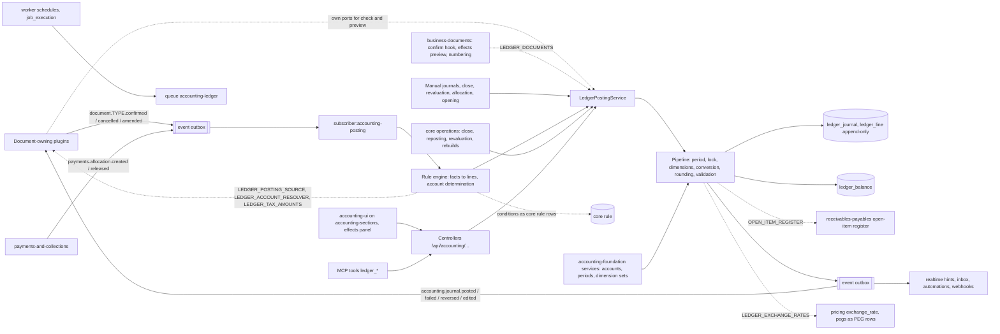

# Implementation Plan: General ledger

> Translates an approved `spec.md` into architecture and tech choices. The plan owns
> implementation details; the spec owns behaviour.

**Feature ID**: `general-ledger`
**Spec**: `./spec.md`
**Tasks**: `./tasks.md`
**Status**: `Draft`
**Last updated**: 2026-11-23

---

## 1. Architecture Summary

Modules added to `packages/plugins/accounting` (scaffold, flags, chart, calendar and dimensions come from
`accounting-foundation`): `ledger/` (journals, lines, balances, posting engine, journal edits), `rules/`,
`manual-journal/`, `open-item/` (a reader of the register, no tables), `lock/`, `close/`, `currency/`, `health/`,
`assist/`. Other plugins never import these modules and never write ledger tables: they publish
`document.<type>.<verb>` events through the event outbox and reach the ledger for checks and previews through their
own optional ports, bound in `apps/api/src/plugin-composition.ts`. §4 and §5 are the posting contract every posting
plugin builds against.

The ledger stores journals, lines and balances only. What is owed is held once, in the open-item register of
`invoicing-receivables-payables` (it works without the ledger); settlements are the `payment_allocation` rows of
`payments-and-collections`. The ledger reads and opens register items through `OPEN_ITEM_REGISTER`, posts the
journals that allocations cause, and checks that each control account equals the register. It builds on existing
kernel pieces: the core `rule` table for posting and account rule conditions, the core operation runtime for long
procedures, `job_execution` for scheduled passes, core tasks for manual close tasks, `exchange_rate` for rates and
pegs, `organization_vendor.contactId` as the customer-supplier link, and `activity_log` for change history.



## 2. Tech Choices

| Concern | Choice | Rationale |
| ------- | ------ | --------- |
| Package | existing plugin `packages/plugins/accounting` (+ `accounting-ui`), same `FEATURE_ACCOUNTING` gate and `isAccountingEnabled` | one ledger, one plugin |
| Immutability | no update or delete path in services; triggers refusing `UPDATE` and `DELETE` on `ledger_journal`, `ledger_line` and `ledger_journal_link` on the three dialects (the `stock_movement` idiom of `packages/plugins/inventory`); the journal trigger admits one change only, `supersededById` from null to a value, which the edit path below writes; generic CRUD routes answer a coded refusal (the `orderLedgerAppendOnly` idiom) | spec FR-24 |
| Editable journals | tenant setting `ledger.allowPostedJournalEdit` (scope `TENANT`, default false) in the platform settings store; when on, `LedgerJournalEditService.edit` writes the edited journal as a new **revision**: a new `ledger_journal` row with the same number, `revision` + 1, new lines, a new place in the hash chain and a `REVISION` link to the previous revision, whose `supersededById` is set; balances move by the difference; the before and after of journal and lines go to `activity_log` with the reason; reads show the current revision and list earlier ones | spec FR-96, FR-97; storage stays append-only and the chain verifiable |
| Transaction | one transaction per journal: head row lock, numbering, journal, lines, open items the journal opens in the register (`OPEN_ITEM_REGISTER.open(manager, …)` for manual and opening lines), balance upserts, outbox append; `post(manager, request)` joins a caller's transaction on either ORM (the signature style of `EventOutboxService.append`) | spec FR-20 |
| Order and chain | `ledger_head` row per organization locked `FOR UPDATE` (PostgreSQL, MySQL; SQLite has one writer) gives sequence and previous hash; SHA-256 over a canonical serialisation of journal and lines | gap-free numbers, hash chain |
| Numbering | gap-free series of `business-document-engine` (`business_document_number`, allocated inside the posting transaction), key `LEDGER_JOURNAL` per organization and fiscal year; core `SequenceService.allocate` runs in its own transaction and has no gap-free mode, so journals never use it directly | no second sequence |
| Idempotency | unique `(organizationId, idempotencyKey)` on journals; a replay returns the stored result; `@Idempotent` on HTTP writes | spec FR-4 |
| Balances | `ledger_balance` upserted with atomic increments in the posting transaction; reports never scan lines for totals | [platform architecture](../../architecture/business-suite.md) §6 budgets |
| Money | `Money`, rounding and currency precision from `packages/core/src/lib/money`; `numeric(20,6)` amounts, `numeric(20,10)` rates | money kernel |
| Rates and pegs | port to `ExchangeRateService` (`findRateAt`, `convert`, `createOne`) of `packages/plugins/pricing/src/lib/exchange-rate`; feeds write that table with their `providerKey`; a peg is an `exchange_rate` row with `providerKey = 'PEG'` that the resolver treats as a fixed relation for inverse and cross rates | existing table, no peg table |
| Open items | the register of `invoicing-receivables-payables` through `OPEN_ITEM_REGISTER`; settlements are `payment_allocation` rows; the ledger posts what allocations cause and checks control accounts against the register; a manual write-off journal's `settles` lines become the register's write-off entries (`writeOff(manager, …)`, cause = the journal) in the posting transaction | one store of what is owed |
| Counterparty | a supplier and a customer are one counterparty when the vendor's `organization_vendor.contactId` names the contact (`packages/core/src/lib/organization-vendor/organization-vendor.entity.ts`) | existing link |
| Rule conditions | core `rule` rows of the new owner types `LEDGER_POSTING_RULE_LINE` and `LEDGER_ACCOUNT_RULE`, evaluated by `evaluateRuleSet` (`packages/core/src/lib/rule/rule.evaluator.ts`) against the facts; validated by `rule.validator.ts` and `rule.pattern-safety.ts` | no condition column, no second expression language |
| Tax accounts | tax amounts take their accounts only from `LEDGER_TAX_AMOUNTS`, answered by the tax engine's `tax_account_mapping` (`tax-engine`); account rules carry no tax keys | one tax-account map |
| Long procedures | core operation runtime (`packages/core/src/lib/operation`, `api/async-operation.ts`): close, year-end, reopen, reposting, catch-up, revaluation and rebuilds are `operation` rows (aggregate `ledger:<organizationId>:<kind>`, so one live run per organization and kind) with steps in slices; per-document differences stay in `ledger_run_item` keyed by `operationId` | resumable, pausable, cancellable runs without a run table |
| Periodic work | `@ScheduledJob` in the worker, `@QueueWorker` in the API, in-process timers without a queue; every pass recorded in `job_execution` | scheduler package |
| Close tasks | manual close tasks are core tasks (`packages/core/src/lib/tasks`): a parent task per period with one subtask per template item (assignee, due date, status, comments, attachments); the checklist holds automated checks only, one of which waits for the tasks | no second task model |
| Findings | `ledger_integrity_finding` is the platform's finance finding store, with a `source`; banking, tax, receivables, payments and assets write through `LEDGER_FINDINGS` | one place to review findings |
| Manual journals | a document type of `business-documents` (`accounting.manual_journal`): numbering, lifecycle, recurrence, change sets, approval hook | [platform architecture](../../architecture/business-suite.md) §3.1 |
| Tests | Jest specs; `*.db.spec.ts` on SQLite; ORM parity specs; property-based tests (generated facts and requests) for rule sets and the pipeline | ledger invariants as tests |

## 3. Data Model

### New or changed entities

All tables extend the tenant and organization base. Amount columns are `numeric(20,6)`; `org…` = organization
currency, `rep…` = reporting currency. "Append-only" = triggers refuse update and delete. No existing table
changes; `exchange_rate` is written through its service; the core `RuleOwnerType` enumeration gains
`LEDGER_POSTING_RULE_LINE` and `LEDGER_ACCOUNT_RULE` (values, no schema change). Every table joins the core tenant
export; `ledger_rate_source` keeps its secret in `IntegrationSetting`, so no column needs `@ExportRedacted`.

| Table | Columns (beyond the base) | Indexes and uniqueness |
| --- | --- | --- |
| `ledger_head` | `lastSequence` bigint, `lastHash` char(64) | unique `(organizationId)` |
| `ledger_journal` (append-only; `supersededById` set once) | `number` varchar(64), `revision` int default 1, `revisionOfId` uuid null (the first revision), `supersededById` uuid null, `sequence` bigint, `ledgerBookId` uuid null, `fiscalYearId`, `fiscalPeriodId`, `postingDate` date, `documentDate` date null, `kind` varchar(24), `origin` varchar(12), `postingArea` varchar(12), `currency` varchar(3), `description` varchar(512) null, `reference` varchar(128) null, `sourceType` varchar(64) null, `sourceId` uuid null, `sourceNumber` varchar(64) null, `sourceVersion` int null, `sourceEventId` uuid null, `idempotencyKey` varchar(160), `reversalOfId` uuid null, `correctionOfId` uuid null, `autoReverseOn` date null, `isOpening` bool, `counterpartOrganizationId` uuid null, `orgTotal`, `lineCount` int, `actorKind` varchar(8), `postedByUserId` uuid null, `ruleId` uuid null, `editReason` varchar(512) null, `previousHash` char(64), `hash` char(64) | unique `(organizationId, idempotencyKey)`, `(organizationId, fiscalYearId, number, revision)`, `(organizationId, sequence)`, `(reversalOfId)`; idx `(organizationId, postingDate)` where `supersededById` is null, `(organizationId, sourceType, sourceId)`, `(organizationId, fiscalPeriodId, kind)`, `(revisionOfId)` |
| `ledger_line` (append-only) | `journalId` fk, `lineNo` int, `accountId` fk restrict, `debit`, `credit`, `currency` varchar(3), `rate` numeric(20,10), `orgDebit`, `orgCredit`, `repDebit` null, `repCredit` null, `repRate` numeric(20,10) null, `partyType` varchar(16) null, `partyId` uuid null, `dimensionSetId` uuid null, `ledgerBookId` uuid null, `fiscalPeriodId`, `postingDate` date, `dueDate` date null, `openItemId` uuid null (the register's `open_item`), `taxLineId` uuid null, `sourceLineId` uuid null, `description` varchar(512) null, `isOpening` bool, `counterpartOrganizationId` uuid null, `ruleLineId` uuid null, `determination` varchar(16) null, `accountRuleId` uuid null | unique `(journalId, lineNo)`; idx `(organizationId, accountId, postingDate)`, `(organizationId, partyType, partyId, postingDate)`, `(organizationId, dimensionSetId, postingDate)`, `(organizationId, fiscalPeriodId, accountId)`, `(organizationId, openItemId)` |
| `ledger_journal_link` (append-only) | `fromJournalId`, `toJournalId`, `kind` varchar(16) (`MIRROR`, `AUTO_REVERSAL`, `EXCHANGE_DIFFERENCE`, `RECLASSIFICATION`, `REVISION`) | unique `(fromJournalId, toJournalId, kind)` |
| `ledger_balance` | `ledgerBookId` null, `accountId` (effective account after merges), `fiscalPeriodId`, `dimensionSetId` null, `currency`, `debit`, `credit`, `orgDebit`, `orgCredit`, `repDebit`, `repCredit`, `lineCount` int | unique `(organizationId, bookKey, accountId, fiscalPeriodId, setKey, currency)` (`bookKey`, `setKey` = null-safe key columns); idx `(organizationId, fiscalPeriodId)` |
| `ledger_closing_balance` | same key as `ledger_balance`, `balance`, `orgBalance`, `repBalance` (cumulative at period end) | unique on the key |
| `ledger_posting_rule` | `organizationId` null = tenant default; `documentType` varchar(64), `version` int, `state` varchar(8) (`DRAFT`, `ACTIVE`, `RETIRED`), `origin` varchar(8) (`SHIPPED`, `CUSTOM`), `validFrom` date, `validUntil` date null, `checksum` char(64) | unique `(tenantId, organizationKey, documentType, version)`; idx `(documentType, state, validFrom)` |
| `ledger_posting_rule_line` | `ruleId` fk cascade, `position` int, `component` varchar(64), `sidePolicy` varchar(8) (`DEBIT`, `CREDIT`, `BY_SIGN`), `role` varchar(64) null, `fixedAccountId` uuid null, `partyPolicy` varchar(8) (`DOCUMENT`, `AMOUNT`, `NONE`), `dimensionPolicy` varchar(8) (`AMOUNT`, `DOCUMENT`, `NONE`), `openItemPolicy` varchar(8) (`FACT`, `NONE`), `mergePolicy` varchar(8) (`MERGE`, `KEEP`), `descriptionTemplate` varchar(255) null; its condition is a set of core `rule` rows (`ownerType = LEDGER_POSTING_RULE_LINE`) | unique `(ruleId, position)` |
| `ledger_account_rule` | `role` varchar(64), `specificity` int (derived from the attributes its rule rows test), `priority` int default 0, `accountId` fk restrict, `validFrom` date null, `validUntil` date null; its conditions are core `rule` rows (`ownerType = LEDGER_ACCOUNT_RULE`) over party, party group, item, item group, warehouse, payment method, expense category, project, currency, counterpart organization | idx `(organizationId, role, specificity, priority)` |
| `ledger_party_account` | `ownerKind` varchar(8) (`PARTY`, `GROUP`), `partyType` varchar(16), `ownerId` uuid, `role` varchar(24) (`RECEIVABLE`, `PAYABLE`, `ADVANCE_RECEIVED`, `ADVANCE_PAID`), `accountId` fk restrict | unique (live) `(organizationId, ownerKind, partyType, ownerId, role)` |
| `ledger_intercompany_pair` | `counterpartOrganizationId`, `dueFromAccountId`, `dueToAccountId`, `mirrorPolicy` varchar(8) (`DRAFT`, `CONFIRM`) | unique (live) `(organizationId, counterpartOrganizationId)` |
| `ledger_posting_exception` | `sourceType`, `sourceId`, `sourceVersion` int, `eventId` uuid, `action` varchar(8) (`POST`, `REVERSE`, `CORRECT`), `code` varchar(48), `findings` text (JSON), `state` varchar(12) (`OPEN`, `RESOLVED`, `SUPERSEDED`), `attempts` int, `lastAttemptAt`, `remedy` text (JSON) null, `resolvedByUserId` uuid null | unique `(organizationId, sourceType, sourceId, sourceVersion, action)`; idx `(organizationId, state)` |
| `manual_journal` | `number` varchar(64) null, `kind` varchar(24), `state` varchar(12) (`DRAFT`, `CONFIRMED`, `CANCELLED`), `postingDate` date, `ledgerBookId` null, `currency`, `description`, `referenceNumber` varchar(64) null, `referenceDate` date null, `autoReverse` bool, `autoReverseOn` date null, `counterpartOrganizationId` null, `templateId` null, `draftedByAgent` bool default false, `journalId` uuid null, `version` int | unique (live) `(organizationId, number)`; idx `(organizationId, state, postingDate)` |
| `manual_journal_line` | `manualJournalId` fk cascade, `lineNo`, `accountId`, `debit`, `credit`, `currency`, `rate` null, `partyType`, `partyId`, `dimensionSetId`, `distribution` text (JSON) null, `dueDate`, `settles` text (JSON) null, `taxRequest` text (JSON) null, `bankAccountId` uuid null, `description` | unique `(manualJournalId, lineNo)` |
| `manual_journal_template`, `manual_journal_template_line` | name, `kind`, description; lines with `accountId`, `side`, `amountKind` varchar(8) (`FIXED`, `PERCENT`, `PROMPT`), `value` numeric(20,6) null, `prompt` varchar(120) null, `dimensionSetId` | unique (live) `(organizationId, name)` |
| `ledger_lock` | `area` varchar(12) (`ALL`, a posting area, or `TAX`: set by `tax-engine` when it files a tax period, through its `TAX_PERIOD_LOCKS` port bound to `LedgerLockService`, covering every journal that carries tax amounts), `throughDate` date, `level` varchar(12) (`RESTRICTED`, `CLOSED`), `origin` varchar(8) (`USER`, `CLOSE`, `GO_LIVE`), `reason` varchar(512), `fiscalPeriodId` null, `setByUserId`, `liftedAt` null, `liftedByUserId` null | idx `(organizationId, area, throughDate)` over live, unlifted rows |
| `ledger_close_checklist` | `fiscalPeriodId`, `state` varchar(8) (`OPEN`, `CLOSED`), `closeTaskId` uuid null (the core task whose subtasks are the period's manual close tasks), `closedAt`, `closedByUserId`, `chainHead` char(64) null, `totals` text (JSON) null | unique `(organizationId, fiscalPeriodId)` |
| `ledger_close_item` (automated checks only) | `checklistId` fk cascade, `checkKey` varchar(64), `title` varchar(255), `status` varchar(8) (`PENDING`, `PASSED`, `FAILED`, `WAIVED`), `blocking` bool, `waivable` bool, `count` int null, `evidence` text (JSON) null, `evaluatedAt`, `waivedByUserId` null, `waiveReason` null | unique `(checklistId, checkKey)`; idx `(organizationId, status)` |
| `ledger_close_template_item` | `title`, `position`, `defaultAssigneeEmployeeId` null, `dueOffsetDays` int (the template the period's core tasks are created from) | idx `(organizationId, position)` |
| `ledger_run_item` | `operationId` uuid (the core operation of the run), `subjectType`, `subjectId`, `status`, `difference` text (JSON), `error`, `journalIds` text (JSON) | unique `(operationId, subjectType, subjectId)`; idx `(operationId, status)` |
| `ledger_integrity_finding` | `source` varchar(32) (`LEDGER`, `BANKING`, `TAX`, `RECEIVABLES`, `PAYMENTS`, `FIXED_ASSETS`, registered sources), `kind` varchar(10) (`INTEGRITY`, `ANOMALY`), `checkKey` varchar(64), `severity` varchar(8), `score` numeric(5,2) null, `state` varchar(10) (`OPEN`, `RESOLVED`, `DISMISSED`), `subjectType`, `subjectId`, `details` text (JSON), `detectedAt`, `resolvedAt` null, `dismissedByUserId` null, `dismissReason` null | unique `(organizationId, source, checkKey, subjectType, subjectId)` while `OPEN`; idx `(organizationId, source, kind, state)` |
| `ledger_rate_source` | `providerKey` varchar(64), `kind` varchar(10) (`REFERENCE`, `CUSTOM`), `config` text (JSON: address template, parameters, response mapping), `secretSettingId` uuid null (an `IntegrationSetting` row), `pairs` text (JSON), `schedule` varchar(32), `isEnabled` bool, `lastRunAt`, `lastStatus` | unique (live) `(organizationId, providerKey)` |

Settings (`accounting.settings.ts`, per organization unless noted): `ledger.roundingToleranceMinor` (5),
`ledger.maxRateAgeDays` (3), `ledger.staleRateAction` (`WARN`), `ledger.maxFuturePostingDays` (0),
`ledger.reportingCurrency` (none), `ledger.separateAdvanceAccounts` (false), `ledger.revaluationMethod`
(`REVERSING`), `ledger.revaluationSchedule` (`NONE`), `ledger.revaluationAutoPost` (false), `ledger.yearEndDimensions`
(`KEEP`), `ledger.healthWindowDays` (60), `ledger.correctionInLockedPeriod` (`EARLIEST_OPEN`),
`ledger.allowPostedJournalEdit` (false, scope `TENANT`), `ledger.refuseUnpostableDocuments` (false: documents of
spec FR-98 are never refused by a posting finding, a future-date limit or a lock; their journals go to the exception
worklist or to the earliest open date).

### Migrations

**Migration timestamps**: `packages/plugins/accounting` `1791000073100` to `1791000073199`.

In `packages/plugins/accounting/src/lib/database/migrations/`, additive, idempotent, three dialects, both ORMs:
`1791000073100-CreateLedgerJournalTables` (head, journal, line, link, balance, closing balance, triggers; the journal trigger
admits only the one-time `supersededById` write), `1791000073110-CreateLedgerRuleTables` (posting rule and lines, account rule,
party account, pair), `1791000073120-CreateManualJournalTables`, `1791000073130-CreateLedgerLockAndCloseTables`,
`1791000073140-CreateLedgerRunItemAndHealthTables` (run item, exception, finding), `1791000073150-CreateLedgerRateSourceTable`. No
backfill: no column is added to an existing table. Default grants are `defaultFor` on the permission contributions
(§9), not a seed. Shipped rule sets are code (contributions, conditions as rule-row templates), copied into
`ledger_posting_rule` and `rule` only when overridden.

### Contracts

`packages/contracts/src/lib/ledger-posting.model.ts` (the posting contract of §4.1) and `ledger.model.ts`
(`ILedgerJournal` with `revision`, `ILedgerJournalRevision`, `ILedgerLine`, `LedgerJournalKind`,
`LedgerJournalOrigin`, `LedgerPostingArea`, `ILedgerBalance`, `ILedgerOpenItemView` (a register item seen from the
ledger: account, posting state), `ILedgerLock`, `LedgerLockLevel`, `ILedgerCloseChecklist`, `ILedgerCloseCheck`,
`ILedgerRunItem`, `ILedgerPostingException`, `IManualJournal`, `ILedgerHealthFinding`, `LedgerFindingSource`,
`ILedgerRateSource`), exported from `index.ts`. `RuleOwnerType` gains `LEDGER_POSTING_RULE_LINE` and
`LEDGER_ACCOUNT_RULE`.

## 4. API Surface

### 4.1 Posting contract (in-process)

```ts
// A document type registers once, at bootstrap, through LedgerDocumentTypeRegistry.register().
interface ILedgerDocumentTypeRegistration {
    documentType: string; owner: string;          // the <type> of document.<type>.<verb>; plugin package name
    postingArea: LedgerPostingArea;               // SALES | PURCHASES | MONEY | STOCK | ASSETS | PAYROLL | JOURNALS
    components: { key: string; description: string; sign: 'POSITIVE' | 'SIGNED' }[];
    roles: { key: string; description: string; fallbackDesignation?: LedgerDesignationRole }[];
    defaultRules: ILedgerPostingRuleTemplate[];   // rule lines over components and roles
    samples: ILedgerPostingFacts[];               // fixtures: balance proof at bootstrap, simulation
    repostable: boolean; allowsLineAccount: boolean;
    existsWithoutLedger: boolean;                 // users could save it before the ledger: never refused by the
                                                  // ledger unless ledger.refuseUnpostableDocuments is on (spec FR-98)
}
// What happened, without accounts. Published by the owner of the document.
interface ILedgerPostingFacts {
    documentType: string; documentId: ID; documentNumber: string; documentVersion: number;
    tenantId: ID; organizationId: ID; ledgerBookId?: ID | null;
    documentDate: string; postingDate: string;    // ISO dates
    currency: CurrencyCode; rate?: DecimalString; rateId?: ID;   // organization currency per unit
    party?: { type: 'CONTACT' | 'VENDOR' | 'EMPLOYEE'; id: ID }; counterpartOrganizationId?: ID;
    dimensionSetId?: ID; description?: string; reference?: string;
    attributes?: Record<string, string | number | boolean>;      // read by rule conditions
    amounts: ILedgerFactAmount[];
}
interface ILedgerFactAmount {
    component: string; amount: DecimalString;     // document currency
    organizationAmount?: DecimalString;           // when the owner fixes it (historical rate)
    lineId?: ID; role?: string; accountId?: ID;   // role override; explicit account where allowed
    keys?: Record<string, ID | string>;           // partyGroupId, itemId, itemGroupId, warehouseId, paymentMethod,
                                                  // expenseCategoryId, projectId, purchaseOrderLineId, ...
                                                  // (tax amounts: accounts from LEDGER_TAX_AMOUNTS only)
    party?: { type: string; id: ID }; dimensionSetId?: ID;
    distribution?: { dimensionSetId: ID; percent?: DecimalString; amount?: DecimalString }[];
    dueDate?: string; taxLineId?: ID; quantity?: DecimalString; description?: string;
    openItemId?: ID;                              // the register item the owner opened (OPEN_ITEM_REGISTER)
}
// Lines with accounts decided. Built by the rule engine from facts, or by procedures of this plugin.
interface ILedgerPostingRequest {
    idempotencyKey: string;                       // '<documentType>:<documentId>:<version>:<POST|REVERSE|CORRECT>'
    tenantId: ID; organizationId: ID; ledgerBookId?: ID | null;
    kind: LedgerJournalKind; origin: 'DOCUMENT' | 'MANUAL' | 'SYSTEM'; postingArea: LedgerPostingArea;
    postingDate: string; documentDate?: string; currency: CurrencyCode; description?: string; reference?: string;
    source?: { documentType: string; documentId: ID; documentNumber?: string; documentVersion?: number; eventId?: ID };
    reversalOfJournalId?: ID; correctionOfJournalId?: ID; autoReverseOn?: string; isOpening?: boolean;
    counterpartOrganizationId?: ID;
    lines: ILedgerPostingLine[];                  // accountId, debit | credit, currency?, rate?, party?, dimensionSetId?,
}                                                 // distribution?, dueDate?, openItemId? | openItem: 'OPEN' (manual and
                                                  // opening lines: opened in the register), taxLineId?, sourceLineId?
interface ILedgerPostingResult {
    preview: boolean; journal?: { id: ID; number: string; postingDate: string; fiscalPeriodId: ID; hash: string };
    lines: ILedgerResolvedLine[];                 // account, both sides in three currencies, set, explanation
    openItems: ILedgerOpenItemEffect[]; warnings: ILedgerPostingFinding[];
}
interface ILedgerPostingCheck { ok: boolean; blocking: ILedgerPostingFinding[]; warnings: ILedgerPostingFinding[];
                                effects: ILedgerPostingResult[]; budget?: IBudgetImpact[] }
interface ILedgerPostingFinding { code: LedgerPostingCode; lineId?: ID; message: string; details?: object }
```

`LedgerPostingCode`: `LEDGER_PERIOD_LOCKED`, `LEDGER_NO_FISCAL_PERIOD`, `LEDGER_FUTURE_DATE`,
`LEDGER_RULE_NOT_FOUND`, `LEDGER_ACCOUNT_UNDETERMINED`, `LEDGER_ACCOUNT_NOT_POSTABLE`, `LEDGER_ACCOUNT_RESTRICTED`,
`LEDGER_SYSTEM_ACCOUNT`, `LEDGER_PARTY_REQUIRED`, `LEDGER_PARTY_ROLE`, `LEDGER_DIMENSION_REQUIRED`,
`LEDGER_DIMENSION_NOT_ALLOWED`, `LEDGER_CURRENCY_NOT_ACCEPTED`, `LEDGER_RATE_MISSING`, `LEDGER_RATE_STALE`,
`LEDGER_BALANCE_SIDE`, `LEDGER_UNBALANCED`, `LEDGER_NOT_LIVE`, `LEDGER_OPEN_ITEM_REGISTER_ABSENT` (a control-account
line while the register is not loaded), `LEDGER_OPEN_ITEM_MISMATCH` (the named register item belongs to another party
or account side), `LEDGER_EDIT_DISABLED`, `LEDGER_EDIT_NOT_ALLOWED` (document or system journal, a line that opened or
settled an open item, a superseded revision); from the budget module: `BUDGET_EXCEEDED`, `BUDGET_APPROVAL_REQUIRED`,
`BUDGET_WARNING`.

| Service method | Caller | Behaviour |
| --- | --- | --- |
| `LedgerPostingService.check(facts)` → `ILedgerPostingCheck` | any plugin through its own port; forms; tools | pure; runs the whole pipeline without writing; `ok: true` with no effects when the organization is not live |
| `.confirming(manager, facts)` → `ILedgerPostingCheck` | the confirm hook of `business-documents`, inside the confirming transaction | `check`, then the participants' reservations (budget control) in that transaction; a blocking finding aborts the confirmation, except that for document types registered with `existsWithoutLedger: true` (invoices, estimates, payments, expenses, incomes and types built on them) the ledger's own findings abort it only while `ledger.refuseUnpostableDocuments` is on, and are returned as warnings otherwise |
| `.preview(facts \| request)` → `ILedgerPostingResult[]` | effects preview, MCP, UI | pure; includes reversal and correction previews (`{ action: 'CANCEL' \| 'AMEND' }`) |
| `.postFacts(facts, action)` | only `subscriber:accounting-posting`, reposting and catch-up | rule engine then `post`; functional refusal becomes a posting exception, never a throw; for an `existsWithoutLedger` type with `ledger.refuseUnpostableDocuments` off, a locked or closed posting date moves to the earliest open date (as `ledger.correctionInLockedPeriod` does for corrections) and a date beyond the future allowance waits as an exception retried daily |
| `.post(manager, request)` → `ILedgerPostingResult` | only modules of this plugin (manual journals, close, revaluation, allocation, opening balance, recognition) | the single writer; not exported through any port |
| `.reverse(journalId, { date?, reason, preview? })`, `.reverseDocument(source, …)` | this plugin; the consumer on `cancelled` | one reversal per journal; date rule of spec FR-26 |
| `LedgerJournalEditService.edit(journalId, { changes, reason, preview? })` | `PUT /journals/:id` only | refused unless `ledger.allowPostedJournalEdit` is on for the tenant and the actor holds `ACCOUNTING_JOURNAL_EDIT_POSTED`; runs the whole pipeline on the new content, then in one transaction: new revision (same number, next sequence and hash), `supersededById` on the previous, `REVISION` link, balance deltas, `activity_log` entry with before, after and reason, `accounting.journal.edited` |
| `LedgerOpenItemService.list`, `.outstanding(source \| party, asOf)`, `.advancesFor(document)`, `.controlCheck(accountId, asOf)` | this plugin's pages, close checks, revaluation | reads the register through `OPEN_ITEM_REGISTER` and adds the ledger view (account, posting state); no store of its own |
| `LedgerLockService.check(organizationId, area, date, actor)` → lock or null | any plugin (date pickers, validations) | the one lock answer |
| `LedgerBalanceService.balance(query)`, `.trialBalance(query)` | `financial-reports`, budgets, dashboards | maintained balances only |

Ports this plugin declares (optional tokens, bound in `apps/api/src/plugin-composition.ts`; unbound = capability
absent, the plugin still boots):

| Port | Answered by | Purpose |
| --- | --- | --- |
| `LEDGER_POSTING_SOURCE` (multi) | each document-owning plugin; this plugin's own adapter for core `income` and stand-alone core `expense` rows | `facts(documentRef, version?)` for drafts (preview), reposting and catch-up, and when an event carries no facts |
| `LEDGER_ACCOUNT_RESOLVER` (multi) | plugins that keep their own role mapping (asset categories, item groups, bank accounts, pay elements) | `resolve({ role, keys, organizationId, date })` → `accountId \| null`; step two of spec FR-8 |
| `LEDGER_TAX_AMOUNTS` | tax plugin (`TaxPostingService`, from its `tax_account_mapping`) | tax amounts per account and dimension of a document; tax lines for manual journals; the only source of tax-role accounts |
| `OPEN_ITEM_REGISTER` | `invoicing-receivables-payables` (consumed) | read items, outstanding amounts and advances; open items for manual and opening control lines; unbound = control-account lines refused |
| `LEDGER_FINDINGS` (provided) | this plugin | `raise({ source, kind, checkKey, severity, subject, details })`, `resolve(...)`: the one finding store that banking, tax, receivables, payments and fixed assets write to (their own tokens, such as `TAX_FINDINGS`, bind to it) |
| `LEDGER_EXCHANGE_RATES` | `ExchangeRateService` (pricing plugin) | read and write rates |
| `LEDGER_DOCUMENTS` | `business-documents` | type registry, numbering series, confirm hook, effects-preview provider registration, recurrence, change sets, draft lookup |
| `LEDGER_APPROVALS` | `workflows` (core approval requests until then) | approvals of manual journals, unlock requests, revaluation proposals |
| `LEDGER_CLOSE_CHECK` (multi) | any plugin | `{ key, title, blocking, waivable, evaluate(organizationId, period) }` → status, count, records |
| `LEDGER_STOCK_VALUE` | `inventory-valuation` | stock value for the periodic adjustment and the stock close check |

Sibling plugins bind their own tokens (for example `FIXED_ASSETS_LEDGER`) to `LedgerPostingService` (`check`,
`preview` only), `LedgerLockService`, `LedgerAccountService` and `LEDGER_FINDINGS`; they read open items from the
register itself. Core `income` and stand-alone core `expense` rows (those not owned by `expenses-and-travel`,
including rows that integrations import) are registered posting types `income` and `expense`: their facts come from
this plugin's adapter, triggered by the core entity events of those records (created: post; changed: correction
pair; deleted: reversal), so the accounting dashboard's figures and the ledger agree. Modules of this plugin
extend the pipeline as participants (`LedgerPipelineParticipant`: `onCheck`, `onConfirming`, `beforeDetermination`,
`afterWrite`, all inside the pipeline's transaction): budget control and recognition schedules use them.

### 4.2 REST

All under `/api/accounting`, guards as in `accounting-foundation` plan §1, cursor pagination, `Idempotency-Key` on
writes that post or start a run; every writing route below accepts `preview` where the spec asks for one.

| Method | Endpoint | Permission | Description | Status |
| ------ | -------- | ---------- | ----------- | ------ |
| `POST` | `/posting/preview` | read access to the document, or `ACCOUNTING_JOURNAL_VIEW` | `{ document: { type, id } }` or `{ request }` → `ILedgerPostingResult[]` | New |
| `GET` | `/journals`, `/journals/:id`, `/journals/:id/explain`, `/journals/:id/revisions` | `ACCOUNTING_JOURNAL_VIEW` | list (source, kind, date, book; current revisions), detail, rule explanation, earlier revisions with their differences | New |
| `POST` | `/journals/:id/reverse` | `ACCOUNTING_JOURNAL_REVERSE` | `{ date?, reason, asDraft? }` | New |
| `PUT` | `/journals/:id` | `ACCOUNTING_JOURNAL_EDIT_POSTED` (and the tenant setting) | `{ changes, reason, preview? }` with `If-Match` revision; new revision of a posted manual journal | New |
| `GET` | `/ledger-lines`, `/balances`, `/balances/trial` | `ACCOUNTING_LEDGER_VIEW` | inquiry with running balance; maintained balances | New |
| CRUD, `POST` | `/manual-journals` (+ `/import`, `/:id/helpers/:helper`), `/journal-templates` | `ACCOUNTING_JOURNAL_VIEW` / `ACCOUNTING_JOURNAL_CREATE`, `ACCOUNTING_JOURNAL_TEMPLATE_EDIT` | drafts (`If-Match`), helpers `difference`, `open-items`, `transfer`, `tax`; templates | New |
| `POST` | `/manual-journals/:id/confirm`, `/cancel` | `ACCOUNTING_JOURNAL_POST` / `ACCOUNTING_JOURNAL_REVERSE` | posts in the request; cancel reverses | New |
| `GET` `POST` `PUT` | `/posting-rules` (+ `/:id/simulate`, `/:id/activate`), `/document-types` | `ACCOUNTING_POSTING_RULE_VIEW` / `_EDIT` | rule sets, simulation, registered types with components, roles and areas | New |
| CRUD | `/account-rules` (conditions as rule rows), `/party-accounts`, `/inter-organization-pairs` | `ACCOUNTING_POSTING_RULE_EDIT`, `ACCOUNTING_PARTY_ACCOUNT_EDIT` | determination data | New |
| `GET` | `/party-roles` | `ACCOUNTING_LEDGER_VIEW` | registered party roles: record type, receivable or payable side | New |
| `GET` | `/open-items/control-check` | `ACCOUNTING_LEDGER_VIEW` | control account balances against the register's open items per party, as of a date; items and allocations themselves are the routes of the register and of `payments-and-collections` | New |
| `GET` `POST` | `/posting-exceptions`, `/posting-exceptions/:id/retry`, `/resolve` | `ACCOUNTING_POSTING_EXCEPTION_RESOLVE` | worklist | New |
| `POST` | `/documents/:type/:id/reclassify` | `ACCOUNTING_DOCUMENT_RECLASSIFY` | accounting-field change set | New |
| `GET` `POST` `DELETE` | `/locks`, `/locks/:id`, `/locks/check`, `/locks/unlock-requests` | `ACCOUNTING_LEDGER_VIEW` / `ACCOUNTING_PERIOD_LOCK` | timeline, set, lift, check, request | New |
| `GET` `PUT` `POST` | `/close/:periodId` (+ `/items/:id`, `/evaluate`), `/close-template` | `ACCOUNTING_CLOSE_PREPARE` (waive: `ACCOUNTING_PERIOD_CLOSE`) | checklist, the period's close task, waivers | New |
| `POST` | `/close/:periodId/close`, `/close/year-end/:fiscalYearId`, `/close/:periodId/reopen` | `ACCOUNTING_PERIOD_CLOSE` / `ACCOUNTING_PERIOD_REOPEN` | starts an operation (`202` with its handle) | New |
| `GET` `POST` | `/runs` (this plugin's operations), `/runs/:operationId/items`, `/reposting`, `/catch-up` | permission of the run kind; `ACCOUNTING_REPOST_RUN` | per-document results; pause, resume and cancel are the core `/operations` routes | New |
| CRUD, `GET` | `/rate-sources` (+ `/fetch`), `/currency-pegs` (`exchange_rate` rows with `providerKey = 'PEG'`), `/rates/resolve` | `ACCOUNTING_RATE_FEED_EDIT`; view for resolve | feeds, pegs, resolution trace | New |
| `POST` | `/revaluations`, `/runs/:operationId/post` | `ACCOUNTING_REVALUATION_RUN` / `_POST` | compute, post | New |
| `GET` `POST` | `/health/findings` (+ `/:id/dismiss`), `/health/divergence`, `/health/rebuild` | `ACCOUNTING_HEALTH_VIEW` / `_REPAIR` | monitor, finder, rebuilds | New |
| `POST` | `/assist/explain-balance`, `/assist/propose-journal` | `ACCOUNTING_LEDGER_VIEW` / `ACCOUNTING_JOURNAL_CREATE` | explanation; draft with effects | New |

GraphQL reads (behind `FEATURE_GRAPHQL`): `ledgerJournals`, `ledgerLines`, `ledgerBalances`. Report-builder datasets:
`accounting.journals`, `.ledger_lines`, `.balances`; open items and allocations are the datasets of the register and
of `payments-and-collections`. Line and balance reads exclude superseded revisions.

**Consumer tokens answered** (bound in `apps/api/src/plugin-composition.ts` to `LedgerPostingService`, `LedgerLockService`, the finding service and the journal gateway; each consumer plan states the shape it calls and its fallback): `ACCOUNTING_LEDGER_POSTING`, `BANKING_FINDINGS`, `BANKING_JOURNAL_GATEWAY`, `LEDGER_EFFECTS_PREVIEW`, `LEDGER_PERIOD_GUARD`, `MANUFACTURING_LEDGER`, `ORGANIZATION_CURRENCY_PEGS`, `ORGANIZATION_LEDGER_TYPES`, `PAYROLL_LEDGER`, `PROJECT_LEDGER_ACTUALS`, `REPORT_FX_RATES`.

## 5. Events, Real-Time and Notifications

Consumed by `subscriber:accounting-posting` (kind subscriber, strict order per document partition). An
infrastructure failure throws (the outbox retries with backoff); a functional refusal never throws: it writes a
`ledger_posting_exception` and emits `accounting.journal.failed`.

| Event | Expected data | Action |
| --- | --- | --- |
| `document.<type>.confirmed` | `{ document: { type, id, number, version, organizationId, postingDate }, posting?: ILedgerPostingFacts }` | post (facts inline, else `LEDGER_POSTING_SOURCE`); skipped when the type is unregistered, the organization is not live or the date precedes go-live |
| `document.<type>.cancelled` | `{ document }` | reverse every unreversed journal of the document (its allocations are released first by `payments-and-collections`, whose release events reverse their own journals) |
| `document.<type>.amended` | `{ document, previousVersion, accountingFieldsChanged?, posting? }` | correction pair when the derived journal differs |
| `document.<type>.closed` | `{ document }` | acknowledged; no ledger effect |
| `payments.allocation.created` / `.released` | `payments-and-collections` (type `payment_allocation` registered with its facts) | realised exchange difference, settlement discount, advance reclassification and netting transfer journals; their reversal on release |
| core `income` and `expense` entity events | core | post, correct or reverse the registered types `income` and `expense` |
| `accounting.account.merged` / `.merge_undone`, `accounting.profile.went_live` | foundation | rebuild `ledger_balance` for the two accounts; create the go-live lock |

Emitted in the write transaction (partition `document:<sourceId>` with a source, else `accounting:<organizationId>`):

| Event | Emitted when | Consumers (push channel, notifications, inbox, integrations, activity log) |
| ----- | ------------ | --------------------------------------------------------------------------- |
| `accounting.journal.posted` `{ journalId, number, kind, origin, postingDate, fiscalPeriodId, ledgerBookId, source?, reversalOfJournalId?, correctionOfJournalId?, accountIds, openItemIds, orgTotal }` | a journal is written | owning plugins (accounting state), tax register, budgets, close checks, realtime hint, webhooks |
| `accounting.journal.failed` `{ source, action, exceptionId, code, findings }` | posting refused after confirmation | owning plugin ("posting failed"), inbox to holders of `ACCOUNTING_POSTING_EXCEPTION_RESOLVE` |
| `accounting.journal.reversed` `{ journalId, reversalJournalId, source? }`, `accounting.posting_exception.resolved` | reversal written; retry or remedy succeeded | owning plugins, close checks, realtime |
| `accounting.journal.edited` `{ journalId, previousRevisionId, revision, reason, accountIds }` | a posted manual journal was edited (setting on) | budgets (actuals), close checks, realtime, webhooks, inbox to accounting administrators |
| `accounting.lock.changed`, `accounting.period.closed` / `.reopened`, `accounting.fiscal_year.closed` / `.reopened` | lock or close change | posting plugins (cached lock answers), inbox to accounting administrators, activity log |
| `accounting.close_check.changed`, `accounting.health.finding_raised` (any `source`), `accounting.anomaly.flagged` | check, monitor or scan result | realtime checklist, inbox, automations |
| `accounting.revaluation.posted`, `accounting.repost_run.finished`, `accounting.rate_feed.failed` | as named (run ends are also the operation's own events) | inbox to the requester or administrators |

Real-time hints through `RealtimeHintsService.appendHint`: `accounting.balance` (account ids),
`accounting.document_state`, `accounting.close`, `accounting.locks`. Inbox items through `INBOX_ITEM_WRITER`.

## 6. UI Surface

- Angular `accounting-ui`, routes on the page location `accounting-sections` (children of `/pages/accounting`):
  `journals` (with revisions and, when the tenant allows it, the edit dialog), `manual-journals` (grid editor,
  helpers, templates, import), `ledger` (running balance, drill-down), `posting-exceptions`, `posting-rules`
  (simulation), `account-rules`, `party-accounts`, `locks` (timeline per area), `close` (checklist, the period's
  close tasks, year-end, runs), `reposting`, `currencies` (rate sources, pegs, revaluation), `health` (findings of
  every source, anomalies, divergence finder), `inter-organization`. Open items have no page here: the register's
  Open items page (`invoicing-receivables-payables`) gains the ledger account and posting state columns when this
  feature is on, and allocation and netting are the workspace of `payments-and-collections`. Saved-view lists;
  `ACCOUNTING.*` keys in 14 locales; menu entries carry feature code and permissions.
- Shared Angular components exported by `accounting-ui`: `ga-accounting-effects-panel` (registered with the document
  form shell of `business-documents`), `ga-posting-state-badge`, `ga-lock-notice`, `ga-balance-chip`.

## 7. MCP Tools, SDKs and Integrations

`packages/mcp-server/src/lib/tools/accounting-ledger.ts`, registered in `register-all-tools.ts`:

| Tool | Input | Output |
| --- | --- | --- |
| `ledger_posting_preview` | document reference or request | journals that would be posted |
| `ledger_journal_list` / `_get` / `_explain` / `_reverse` | filters; id; `date?`, `reason`, `preview` | journals, lines, explanation, reversal |
| `ledger_journal_edit` | id, changes, reason, `preview` | new revision with its differences (refused while the tenant setting is off) |
| `ledger_manual_journal_draft` / `_confirm`, `ledger_journal_propose` | header and lines; id, `preview`; instruction or file reference | draft with effects; journal; proposal (never confirms) |
| `ledger_lines_query`, `ledger_balance_get`, `ledger_trial_balance`, `ledger_balance_explain` | account, party, dimension, dates, book, compare-to | lines, balances, composition and drivers |
| `ledger_control_check` | account, party, as-of | control account against the register's open items |
| `ledger_lock_list` / `_set` / `_check` | area, date, level, reason, `preview` | locks |
| `ledger_close_status` / `_evaluate` / `_period` | period, `preview` | checklist, check results, run |
| `ledger_posting_exception_list` / `_retry`, `ledger_repost_run`, `ledger_revaluation_run` | filters; id; selection or date, `preview` | exceptions, runs with differences |
| `ledger_rate_resolve`, `ledger_integrity_findings`, `ledger_anomaly_scan`, `ledger_divergence_find` | pair and date; filters; range | rate trace, findings |

SDK impact: additive OpenAPI paths; SDKs regenerated after merge. Import: manual journals from CSV or spreadsheet
(profile `accounting.manual_journal` of `data-exchange`). Export: journals and lines as CSV; an audit file (journals
of a period with hashes). Integrations: rate sources (outbound HTTPS, currency codes and dates only); platform
webhooks for every event of §5.

## 8. Background Jobs

| Trigger | When | What it does | Idempotency |
| ------- | ---- | ------------ | ----------- |
| outbox dispatch | on commit, else within a minute | `subscriber:accounting-posting` | delivery record per event and consumer; journal idempotency key |
| `accounting.posting-exception.retry` | nightly; on rule, account, lock and calendar events | re-drives open exceptions | exception unique key; journal key |
| `accounting.journal.auto-reverse` | daily 00:20 | posts due auto-reversals when the date is open | unique `(reversalOfId)` |
| `accounting.close-checks.evaluate` | nightly; debounced after relevant events | evaluates registered checks for open periods (incl. `close.tasks_done` over the period's core tasks) | upsert per `(checklistId, checkKey)` |
| operations `LEDGER_PERIOD_CLOSE`, `LEDGER_YEAR_END_CLOSE`, `LEDGER_REOPEN`, `LEDGER_REPOST`, `LEDGER_CATCH_UP`, `LEDGER_REVALUATION`, `LEDGER_BALANCE_REBUILD`, `LEDGER_CONTROL_CHECK`, `LEDGER_DIVERGENCE` | run start and resume | steps in slices; per-document results in `ledger_run_item` | operation idempotency key and live-aggregate rule, per-item status, journal keys |
| `accounting.rate-feed.fetch`, `accounting.revaluation.scheduled` | hourly tick; daily tick | fetches rates per source schedule; starts due revaluation operations | unique rate per pair, date and source; one operation per organization and date |
| `accounting.health.monitor`, `accounting.anomaly.scan` | daily 03:00; nightly and sampled after posting | invariants; anomaly rules | finding unique key |

The worker hosts schedules only (`AccountingSchedulePlugin`); the API hosts the outbox consumer, the queue workers of
`accounting-ledger` and the registered operation types; without a queue root the API runs timers under a
per-organization lock. Every scheduled pass is a `job_execution` row, failures reach the dead-letter list. Jobs and
operation steps run inside `RequestContext.runWithRequest` with a system actor of the organization.

## 9. Security & Permissions

New keys in `accounting.permissions.ts` (plugin contributions; `defaultFor` `SUPER_ADMIN` and `ADMIN`, except
`ACCOUNTING_JOURNAL_EDIT_POSTED`, which only `SUPER_ADMIN` receives by default): `ACCOUNTING_JOURNAL_VIEW`, `_CREATE`,
`_POST`, `_REVERSE`, `_TEMPLATE_EDIT`, `_EDIT_POSTED`; `ACCOUNTING_LEDGER_VIEW`; `ACCOUNTING_POSTING_RULE_VIEW`,
`_EDIT`; `ACCOUNTING_PARTY_ACCOUNT_EDIT`; `ACCOUNTING_POSTING_EXCEPTION_RESOLVE`; `ACCOUNTING_DOCUMENT_RECLASSIFY`;
`ACCOUNTING_REPOST_RUN`; `ACCOUNTING_PERIOD_LOCK`, `_POST_LOCKED`, `_CLOSE`, `_REOPEN`; `ACCOUNTING_CLOSE_PREPARE`;
`ACCOUNTING_RATE_FEED_EDIT`; `ACCOUNTING_REVALUATION_RUN`, `_POST`; `ACCOUNTING_HEALTH_VIEW`, `_REPAIR`
(twenty-three). Reading and allocating open items use the permissions of the register and of
`payments-and-collections`. Create, post, reverse, edit, lock, close and reopen are separate so duties can be split;
a service account for agents holds `ACCOUNTING_CLOSE_PREPARE`, `ACCOUNTING_JOURNAL_CREATE` and view keys, never post,
edit or close keys. The edit path needs both the tenant setting and the key, never touches a closed or locked date,
and keeps every revision. Rate-source secrets live in `IntegrationSetting` (encrypted) and are never
returned; custom endpoints must be HTTPS and pass the platform's outbound address policy. The preview route checks
read access to the document through `LEDGER_POSTING_SOURCE` first. Text taken from files is treated as data.

## 10. Observability

- Activity log: lock, close, reopen, waiver, rule activation, exception remedy, run start and end, the tenant
  setting's changes, and every journal edit with the full before and after of journal and lines and the reason;
  journals themselves record postings (actor, origin, source, explanation, revision, hash).
- Metrics: posting latency from confirmation, postings per second, open exceptions, check status per period,
  run durations, rate age, findings by kind. Scheduler job execution log and dead-letter list; failures raise
  inbox items.

## 11. Phased Rollout

1. **Phase 1 — Ledger core.** Journals, lines, head and hash chain, balances, posting service and pipeline, locks,
   manual journals with templates, reversal, inquiry, the tenant edit setting with journal revisions. Usable: manual
   bookkeeping.
2. **Phase 2 — Document posting.** Type registry, facts, rule engine, account determination, consumer, check,
   preview, exceptions, control-account lines against the register, allocation journals, party accounts,
   cancellation and amendment corrections, core income and expense as posting types.
3. **Phase 3 — Close and currencies.** Checklist, period and year-end close, reopen, closing balances, rate feeds,
   pegs, reporting currency, realised differences, revaluation, inter-organization journals, reposting, catch-up,
   health monitor, divergence finder.
4. **Phase 4 — Advanced capabilities.** Continuous checks, agent preparation, unlock requests, rule simulation, explain a
   balance, propose a journal, anomaly scan, live balances.
5. **Phase 5 — General availability**: the feature is off by default; after the trial period it may be switched on by default for new tenants only; existing tenants keep their setting until an administrator changes it.

## 12. Constitution Reconciliation

- I Plugin-first: modules of `accounting`; siblings integrate through events and ports only; open items, rules,
  runs, tasks, rates and the counterparty link are existing platform records, not copies.
- II Tenant/organization scoping: every table scoped; mirrors written in the counterpart's scope by a system
  actor; tenant-default rule rows carry a null organization explicitly.
- III Both ORMs, additive migrations: MultiORM entities, MikroORM repositories, tri-dialect migrations and triggers.
- IV Default-off flag; nothing removed: same gates as the foundation; nothing existing changes.
- V Contracts and API first: `ledger-posting.model.ts` and `ledger.model.ts` before any UI.
- VI Permissions, privacy, security: twenty-three keys with contributed default grants, encrypted secrets,
  outbound policy, editing behind a tenant setting and its own key.
- VII Real-time through the event bus: outbox both ways, realtime hints, no private channel.
- VIII i18n and accessibility: `ACCOUNTING.*` keys in 14 locales; keyboard grids and timeline.
- IX Tests: unit, database, ORM parity, property-based, contract tests shared with sibling plugins, e2e.
- X Behaviour-first spec: details live here.
- XI Documentation describes our platform only.

## 13. Risks & Mitigations

| Risk | Likelihood | Impact | Mitigation |
| ---- | ---------- | ------ | ---------- |
| A rule set produces unbalanced or wrong journals | Medium | High | balance proof on samples at bootstrap and activation; property-based tests; simulation; preview and posting share one code path |
| Head row lock limits throughput per organization | Medium | Medium | pipeline computed before the lock; short transactions; batching for bulk runs; measured target 200 postings per second per tenant |
| Contract drift with sibling plugins | Medium | High | shared fixtures and contract tests in `packages/contracts`; facts versioned by `documentVersion`; unknown components refused at registration |
| Confirmed documents left unposted | Low | High | exception worklist, automatic retry, blocking close check, inbox items |
| Balance table diverges from lines | Low | High | same transaction; daily monitor; rebuild tool; closing balances verified |
| Triggers and locking differ across engines (SQLite single writer) | Medium | Medium | one migration helper; a database spec per engine in CI; sliced runs, no long transactions |
| Editing posted journals weakens the audit trail | Low (off by default) | High | tenant setting plus a separate key; manual journals only; closed and locked dates refused; every revision kept, chained and logged with before, after and reason; edits announced to accounting administrators |
| Control accounts and the register disagree | Low | High | lines name register items; daily control check and close check; findings in the shared store |

## 14. References

- Spec: `./spec.md` · Tasks: `./tasks.md` · Foundation: `../accounting-foundation/plan.md` · Siblings:
  `../business-document-engine/plan.md`, `../invoicing-receivables-payables/plan.md` (open-item register),
  `../payments-and-collections/plan.md` (allocations), `../tax-engine/plan.md` (`tax_account_mapping`)
- Patterns and kernel: `packages/core/src/lib/event-outbox` (`EventOutboxService.append`, `EventConsumerRegistry`),
  `packages/plugins/task-automations/src/lib/events/task-automation-event.consumer.ts`,
  `packages/plugins/inventory/src/lib/database/migrations/1791000000161-CreateInventoryTables.ts` (append-only
  triggers), `packages/plugins/order/src/lib/order-ledger.append-only.ts`, `apps/api/src/plugin-composition.ts`,
  `packages/core/src/lib/money`, `idempotency`, `rule` (`rule.evaluator.ts`), `operation`, `api/async-operation.ts`,
  `job-execution`, `tasks`, `activity-log`, `income`, `expense`, `organization-vendor` (`contactId`),
  `packages/scheduler`, `packages/plugins/pricing/src/lib/exchange-rate/exchange-rate.service.ts`
