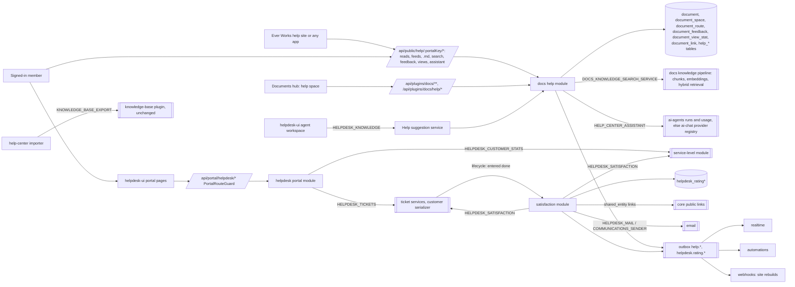

# Implementation Plan: Helpdesk portal and knowledge base

> Translates an approved `spec.md` into architecture and tech choices. The plan owns
> implementation details; the spec owns behaviour.

**Feature ID**: `helpdesk-portal-and-knowledge-base`
**Spec**: `./spec.md`
**Tasks**: `./tasks.md`
**Status**: `Draft`
**Last updated**: 2026-11-23

---

## 1. Architecture Summary

No new API plugin. Help articles have **one home: the Documents hub**. The existing redirect guard
(`apps/gauzy/src/app/pages/feature-documents-redirect.guard.ts`) already sends `/pages/organization/help-center` to
`/pages/documents` when `FEATURE_DOCUMENTS` is on, and the docs plugin already reserves `document.externalSource =
'help-center'` for these articles. So an organization's help centre is its **help space**: one existing space of the Documents hub (the organization space
or a team space) marked as the help space on its `document_space` properties row of `documents-and-wiki`; its
categories are folders, its articles are PAGE documents, and each page carries its own language (`help_node.language`).
Versions, authors, tags, links, shares, the editor, slugs and their former routes, the public flag (`isPublished`),
search-engine fields, freshness, feedback and view statistics are the docs plugin's and `documents-and-wiki`'s; this
plan adds the help audience, help fields, public read API, search tuning and the help-specific advanced modules. Build
order: `drive` → `documents-and-wiki` → this spec.

Two existing plugins grow, each owning its half:

- **`@gauzy/plugin-docs`** (`packages/plugins/docs`) gains a `help/` module (gated by `FEATURE_DOCUMENTS` and
  `FEATURE_HELPDESK_PORTAL`): help spaces and audiences, help fields of pages and folders, the one-time import of the
  existing help-centre articles, the public read API and feeds, search over the docs knowledge pipeline with synonyms
  and further sources, feedback and view counting on the documents' own tables, citations as `document_link` rows, and
  the advanced modules (answer assistant, gaps, variants, community).
- **`@gauzy/plugin-helpdesk`** (from `helpdesk-tickets`, loaded with `GAUZY_HELPDESK_ENABLED`) gains the modules
  `portal/` (customer ticket routes over its own `HELPDESK_TICKETS` facade and customer serializer, follow-up links,
  organisation figures) and `satisfaction/` (ratings, requests, options, rating links), and binds
  `HELPDESK_SATISFACTION`, which its agent workspace and the service-level module already consume.
- **`@gauzy/plugin-knowledge-base`** (the existing help-centre tables and routes) keeps its tables, routes and
  behaviour; it offers a read port `KNOWLEDGE_BASE_EXPORT` (help centres, categories, articles, versions) that the
  import reads, a `knowledge_base.article.changed` event on its writes and a write-back port `KNOWLEDGE_BASE_SYNC`
  (name and content of an imported article), so no plugin imports another and no legacy row is locked.

**Public pages.** The organization's public help site is an Ever Works site (or any other front end) built from the
public read API and feeds of §4: articles as items, categories, tags, search, Markdown twins and `llms.txt` come from
there. With the Ever Works integration enabled, the site's Work calls these routes with its integration token; like
any app it may also read the public feeds and post to the public transaction routes (feedback, view beacon, assistant
question, rating, guest follow-up). Gauzy renders no public help pages, themes or home blocks. It keeps two small
built-in transactional pages (the rating page and the guest follow-up page) and the signed-in help and ticket pages of
the portal.

UI: help pages are edited in the Documents hub (`docs-ui`): a help space shows the help fields on its pages and folders
(audience, excerpt, pins, publish date, release, translation) and tabs for audiences, search, analytics, gaps,
translations and community; nothing new appears on the redirected help-center page. `helpdesk-ui` gains `portal/`
pages (signed-in help and tickets), the two built-in pages and the agent-side article panel; portal branding is edited
on the portal settings page of `customer-and-supplier-portal`.



## 2. Tech Choices

| Concern | Choice | Rationale |
| ------- | ------ | --------- |
| Packages | extend `docs` (+ `docs-ui`) and `helpdesk` (+ `helpdesk-ui`); `knowledge-base` unchanged but for an export port | one home per concept; one staff UI |
| Article model | docs PAGE documents of a help space; categories are folders; help fields in a 1:1 `help_node` row | the Documents hub owns pages |
| Flags | `FEATURE_HELPDESK_PORTAL`, `FEATURE_HELP_CENTER_ASSISTANT`, `FEATURE_HELP_COMMUNITY` as feature contributions; `FEATURE_DOCUMENTS` (existing) required | [platform architecture](../../architecture/business-suite.md) §6 |
| Public pages | none rendered: public read API, feeds and transaction routes for sites; built-in rating and follow-up pages only | public sites are Ever Works sites |
| Search | `DOCS_KNOWLEDGE_SEARCH_SERVICE` (hybrid lexical and vector retrieval with RRF) filtered to help spaces, audience, language and published state; synonyms expanded before the call; field boosts applied on the merged result | one search and embedding pipeline |
| Similarity | the same pipeline's embeddings for related articles, gaps and the assistant; lexical fallback without embeddings | works on every dialect |
| Outside sources | `createSsrfSafeHttpsAgent()` (core `core/util/ssrf-safe-agent.ts`), allow-listed hosts, 5 s timeout, no credentials | one outbound safety rule |
| Feedback and views | `document_feedback` and `document_view_stat` of `documents-and-wiki`; source of a view (search, ticket form, assistant) from `help_search_log` and citations | no second counter store |
| Citations | `document_link` rows (entity `Task`, the ticket's task; `metadata.kinds`, message and agent) | one record ↔ document link |
| Former slugs | `document_route` of `documents-and-wiki` (`isCurrent = false` rows) | one route history |
| Rating and follow-up links | core `shared_entity` links on the ticket's task (`sharedOptions`: purpose, cycle, expiry), read through the customer serializer | one public link model |
| Settings | setting contributions (`help.settings.ts`, `helpdesk.settings.ts`) in `tenant_setting` | one settings store |
| AI | runs of the purposes `help.assistant` and `help.gaps` of `ai-agents-and-assistants` with `ai_usage_entry` and `ai_budget`; else `AiProviderRegistry` of `ai-chat` | one usage ledger and budget |
| HTML | `sanitize-html` with the Inbox allowlist on save and render; Markdown export with `turndown` (MIT) | spec FR-25, FR-30 |
| Guest identity | hashed browser key (random cookie, SHA-256 with a server salt), never stored raw; the `addressHash` of document feedback | privacy |
| Background | `@ScheduledJob` in the worker, `@QueueWorker` in the API, in-process timers without a queue root; the import as a docs import run | task automations layout |

## 3. Data Model

All new tables extend `TenantOrganizationBaseEntity`; JSON is `text` on every dialect. Ids into `document` carry
foreign keys with `CASCADE`; ticket (task), contact, user and file ids carry none.

**Used as they are** (docs plugin and `documents-and-wiki`): `document` (PAGE and FOLDER, `name`, `description` as the
excerpt (at most 300 characters on help pages), `index` as the order inside a category, `contentHtml`/`contentJson`,
tags, `isLocked`, `isArchived`, `externalSource`/`externalId`, `slug`, `isPublished`, `seo`, `verifiedAt` as the last
review, `ownerUserId`), `document_version`, `document_space`, `document_route`, `document_link`, `document_share`,
`document_feedback`, `document_view_stat`, `document_search_stat`, the knowledge chunks and index state.

**Existing tables, additive columns** (defaults keep today's behaviour):

| Table | New columns | Notes |
| --- | --- | --- |
| existing `document` + column | `audience` varchar(12) null (`CUSTOMERS`, `EVERYONE`; null = readers of the space only) | `EVERYONE` is written in step with `isPublished` (the public flag); idx `(tenantId, organizationId, audience)` (a page's space comes from its existing visibility and team, as in the hub) |
| `document_space` (`documents-and-wiki`) + column | `purpose` varchar(8) null (`HELP`) | marks the organization's one help space: unique `(tenantId, organizationId)` where `purpose = 'HELP'` |
| `document_feedback` (`documents-and-wiki`) + column | `reason` varchar(24) null | the not-helpful reason; `rating` uses `YES` and `NO` on help pages |
| `document_view_stat` (`documents-and-wiki`) | audience value `CUSTOMER` beside `MEMBER` and `VISITOR` | signed-in portal members |

**New tables in `docs` (help module):**

| Table | Columns (besides base) | Indexes and uniqueness |
| --- | --- | --- |
| `help_node` (help fields of a page or folder of a help space) | `documentId` FK cascade, `isSystem` bool (General), `audienceCap` varchar(12) null (folders), `pinnedOrder` int null, `language` varchar(8) (the page's language; default the organization's preferred language), `publishAt`, `publishedAt` null, `viewCount` bigint, `helpfulCount`, `notHelpfulCount`, `citationCount` int (cached from feedback, views and links), `translationOfId` uuid null, `confirmedRevision` int null, `isStale` bool default false, `releaseFrom`, `releaseTo` varchar(32) null; `legacySyncedAt` timestamp null (imported articles: the legacy row's version the page last matched) | unique `(documentId)`; idx `(organizationId, pinnedOrder)`, `(translationOfId)` |
| `help_search_log` | `spaceId`, `query` varchar(255), `normalised` varchar(255), `language`, `audience`, `source` (`SITE`, `PORTAL`, `TICKET_FORM`, `ASSISTANT`, `AGENT`), `resultCount` int, `topDocumentId`, `topScore` numeric(6,4), `openedDocumentId` null, `taskId` null (ticket raised within an hour), `visitorHash` | idx `(organizationId, createdAt)`, `(organizationId, normalised, createdAt)`; pruned after 180 days |
| `help_synonym_set` | `language` varchar(8), `kind` (`SYNONYMS`, `IGNORED`), `terms` text | idx `(organizationId, language)` |
| `help_knowledge_gap` | `topicKey` varchar(64), `title`, `signals` text (counts per kind), `volume7`, `volume30` int, `examples` text, `state` (`OPEN`, `ASSIGNED`, `DRAFTED`, `DISMISSED`, `RESOLVED`), `assigneeEmployeeId`, `draftDocumentId`, `resolvedByDocumentId`, `resolvedAt` | unique `(organizationId, topicKey)` |
| `help_assistant_answer` (the domain outcome; usage lives in the AI ledger) | `spaceId`, `userId` null, `visitorHash`, `question`, `answer`, `sources` text, `confidence` numeric(5,4), `language`, `outcome` (`ANSWERED`, `NO_ANSWER`, `HANDED_OVER`), `taskId` null, `feedback` varchar(4) null, `runId` null (`ai_run`) | idx `(organizationId, createdAt)` |
| `help_community_question` | `spaceId`, `authorUserId`, `title` varchar(255), `bodyHtml`, `audience`, `state` (`PENDING`, `PUBLISHED`, `ANSWERED`, `CLOSED`, `HIDDEN`), `acceptedCommentId` null, `reports` text (per question and answer), `convertedDocumentId`, `convertedTaskId` null | idx `(organizationId, state, createdAt)` |

Answers to a community question are core `comment` rows on it (`BaseEntityEnum` gains `HelpCommunityQuestion`; replies,
edits, the author kind of the portal's comment columns; a hidden answer is an inactive comment) and votes are core
`reaction` rows.

**New tables in `helpdesk`:**

| Table | Columns (besides base) | Indexes and uniqueness |
| --- | --- | --- |
| `helpdesk_rating_option` | `labels` text, `band` (`LOW`, `MID`, `HIGH`, `ANY`), `position` int | idx `(organizationId, band)` |
| `helpdesk_rating_request` | `taskId`, `cycle` int, `sharedEntityId` (the rating link), `sentAt`, `expiresAt`, `state` (`SENT`, `RATED`, `EXPIRED`, `CANCELLED`), `messageRef` | unique `(sharedEntityId)`; unique `(taskId, cycle)` |
| `helpdesk_rating` | `taskId`, `cycle` int, `requesterContactId`, `customerContactId`, `assigneeEmployeeId`, `teamId`, `templateId`, `score` smallint (1–5), `optionIds` text, `comment` text, `source` (`EMAIL`, `RATING_PAGE`, `PORTAL`), `ratedAt`, `recoveryTaskId` null | unique `(taskId, cycle)`; idx `(organizationId, ratedAt)`, `(customerContactId, ratedAt)`, `(assigneeEmployeeId, ratedAt)` |

Not tables of this spec: site settings, branding, search weights and sources, guest switches, public email domains and
assistant threshold (setting contributions `help.*`), rating settings (setting contributions `helpdesk.rating*`), the
assistant budget (`ai_budget` of the purposes `help.assistant` and `help.gaps`), article feedback and views
(`document_feedback`, `document_view_stat`), citations (`document_link`), redirects (`document_route`; other old
addresses are redirects of the help site), feed caches (outside feeds are the site's own), community answers
(`comment`, `reaction`).

**Settings** (`help.settings.ts`, scope `ORGANIZATION`): `help.audiences` (`OFF`, `SIGNED_IN`, `PUBLIC`),
`help.portalBranding` and `help.portalBrandingDraft` (JSON; defaults from the
organization's `brandColor` and `imageUrl`), `help.previewTokenHash` (secret), `help.guestVoting` (true),
`help.guestTickets` (false), `help.hideNewRequest`, `help.searchWeights`, `help.searchSources`, `help.publicEmailDomains`,
`help.assistantThreshold` (0.7), `help.translationNotice`. In `helpdesk.settings.ts`: `helpdesk.ratingRequestStatusIds`
(default the done category), `helpdesk.ratingLinkDays` (14), `helpdesk.ratingHoldAutoCloseDays`,
`helpdesk.ratingRecoveryThreshold` (2), `helpdesk.portalAdminsMayInvite`, `helpdesk.portalAdminsMayManage` (true).

**Import of the existing articles.** When `FEATURE_DOCUMENTS` and `FEATURE_HELPDESK_PORTAL` are on for an organization,
a docs import run (`document_import`, the existing runner) reads `KNOWLEDGE_BASE_EXPORT` and writes into the
organization's help space (the organization space is marked when none is; its existing pages and folders get no help
node and keep their rights and behaviour): each help centre as a top-level folder, each category as a folder under it
at the same depth as in the legacy tree (`help_center.parentId`, every level kept), each article as a page with its
versions and the help centre's language
(`knowledge_base.language`) as the page language (`externalSource = 'help-center'`, `externalId` = article id, idempotent through
`UQ_document_external_provenance`), `draft` → unpublished, `privacy` → the page's Documents visibility (private →
`PRIVATE`, else `ORGANIZATION`), every page `audience = null` (readers of the space, as today; never public), project pivots
(`knowledge_base_article_project`) → `document_link` rows to the projects. The import writes nothing to the legacy
rows (`isLocked` and every other column stay as they were) and the legacy routes keep reading and writing: the
knowledge-base plugin publishes `knowledge_base.article.changed` on a legacy write, which the importer applies to the
page as a new version (idempotent per legacy version), and a save of an imported page writes its name and content
back to the legacy row through the port `KNOWLEDGE_BASE_SYNC` (provenance on both sides stops the echo), so an article
stays one article without a lock. Order between the two writers: the legacy row's `updatedAt` is the sync version;
`help_node.legacySyncedAt` holds the version the page last matched (applied from an event or written back). An event
whose version is not later than `legacySyncedAt` is stale and dropped, so a delayed event never sets the page back; a
write-back is a conditional update against the expected version (`updatedAt = legacySyncedAt`) and sets
`legacySyncedAt` to the new version in the same step; when it finds a newer legacy write, it writes nothing and that
write's own event, later than `legacySyncedAt`, becomes the page's next version. The later write to the legacy row
wins, and the other stays in the page's version history.

**Contracts** (`packages/contracts/src/lib/help-center.model.ts` additions for the help module and
`helpdesk-satisfaction.model.ts`): enums (audience, sources, outcomes, states), interfaces, DTOs, events and ports:

```ts
interface IHelpKnowledge {                         // HELPDESK_KNOWLEDGE (consumed by helpdesk-tickets)
    suggest(i: { text: string; audience: HelpAudience; language?: string; limit?: number }): Promise<IArticleHit[]>;
    get(documentId: ID, audience: HelpAudience): Promise<IHelpArticleView | null>;
    cite(i: { documentId: ID; taskId: ID; messageId?: ID; kind: CitationKind; byEmployeeId?: ID }): Promise<void>;
}
interface IHelpdeskSatisfaction {                  // HELPDESK_SATISFACTION (consumed by helpdesk and its SLA module)
    ratingOf(taskId: ID): Promise<IRating | null>;
    ratingsOf(q: { contactId?: ID; customerId?: ID; employeeId?: ID; teamId?: ID; from: Date; to: Date }): Promise<IRatingSummary>;
    since(watermark: Date, limit: number): Promise<IRating[]>;                       // fact building
}
interface IPortalBranding { forOrganization(organizationId: ID, opts?: { draft?: boolean }): Promise<IBranding> }  // PORTAL_BRANDING
interface IKnowledgeBaseExport { centres(orgId: ID): AsyncIterable<IHelpCenterExport> }                           // KNOWLEDGE_BASE_EXPORT
```

**Migration timestamps**: `packages/plugins/docs` `1791000052600` to `1791000052649`; `packages/plugins/helpdesk` `1791000052650` to `1791000052699`.

**Migrations** (docs `database/` and helpdesk `database/`; PostgreSQL, SQLite, MySQL; idempotent; forward-only; both
ORMs; after the `documents-and-wiki` migrations): `1791000052600-AddHelpColumnsToDocuments` (`document.audience`,
`document_space.purpose` with its partial unique key, `document_feedback.reason`), `1791000052610-CreateHelpTables` (help node,
search log, synonym set), `1791000052620-CreateHelpBeyondTables` (gap, assistant answer, community question),
`1791000052630-SeedHelpReportCatalogue` (the report rows of FR-87 in core `report`, keyed `FEATURE_HELPDESK_PORTAL` in
the shared catalogue feature filter of `report-builder-and-dashboards`), `1791000052650-CreateHelpdeskSatisfactionTables` (option, request, rating), `1791000052660-SeedHelpdeskRatingTemplates`
(rating request, recovery note email templates). Permissions and grants are contributions (§9), not a migration.

## 4. API Surface

Staff routes: `TenantPermissionGuard`, `PermissionGuard`, class-validator DTOs, Swagger, cursor paging, `If-Match` on
help fields and settings, `Idempotency-Key` on creating routes. Article content is written through the existing docs
routes (`expectedRevision`), which the help module checks for help spaces. Public routes `@Public()`, throttled,
cacheable 60 s with validators; with the Ever Works integration enabled, the linked Work also calls them with its
integration token (higher rate limits, same audience rules: everyone articles only). Shared caching applies only to
answers whose audience is fixed to `EVERYONE`: a guest request and an integration-token request answer
`Cache-Control: public, max-age=60` with validators and `Vary: Authorization, Cookie`, while any request carrying a
portal session answers `Cache-Control: private, no-store`, whatever audience it resolves to, so a shared cache never
returns a customer-audience answer to a guest (spec FR-27). When an article stops being public (unpublished, archived,
or narrowed to `CUSTOMERS` or agents), the platform answers without it from that moment, and a shared cache may serve
the answer it already holds, which was public when it was given, for at most the remaining 60 s of its `max-age`: this
window is accepted, since the platform does not control outside caches, and it never applies to an article that was
not public.

| Method | Endpoint | Permission | Description | Status |
| ------ | -------- | ---------- | ----------- | ------ |
| `*` | `/help-center`, `/help-center-article`, `/help-center-author`, `/help-center-article-version` | unchanged | existing routes, reading and writing as today; a write to an imported article also reaches its page | Unchanged |
| `*` | `/plugins/docs/documents/**` | existing docs rights; help pages and folders (those with a help node) also `ORG_HELP_CENTER_EDIT`; other pages of the help space keep today's rights | articles and categories as pages and folders | Changed (help checks) |
| `GET` `PUT` | `/plugins/docs/help/nodes/:documentId` | `ORG_HELP_CENTER_EDIT` (audience, pins: `HELP_CENTER_PUBLISH`) | help fields of a page or folder | New |
| `POST` | `/plugins/docs/help/articles/:documentId/{publish,unpublish,archive,restore}`, `/help/articles/bulk` | `HELP_CENTER_PUBLISH` (bulk move: `ORG_HELP_CENTER_EDIT`) | lifecycle, bulk with per-row results (core bulk executor) | New |
| `POST` | `/plugins/docs/help/categories/:documentId/{merge,move-articles}`, `DELETE …/with-summary` (`preview`) | `ORG_HELP_CENTER_EDIT` | category tools | New |
| `GET` | `/plugins/docs/help/articles/:documentId/{stats,feedback,citations,searches}` | `ORG_HELP_CENTER_EDIT` | author figures | New |
| `GET` `PUT` | `/plugins/docs/help/settings`, `/help/branding` (`draft`), `POST /help/branding/{publish,preview-link}` | `HELP_CENTER_SETTINGS_MANAGE` | help setting contributions, portal branding | New |
| CRUD | `/plugins/docs/help/synonyms`, `/help/search-sources`; `POST /help/search/reindex`, `/help/import` | `HELP_CENTER_SETTINGS_MANAGE` | search settings, index rebuild and import as operations | New |
| `GET` `POST` | `/plugins/docs/help/gaps`, `/gaps/:id/{assign,dismiss,draft}` | `HELP_CENTER_ANALYTICS_VIEW` (draft: `ORG_HELP_CENTER_EDIT`) | knowledge gaps | New |
| `GET` `POST` | `/plugins/docs/help/translations?stale=true`, `/help/articles/:documentId/{translations,confirm-translation}`, `/help/releases`, `/releases/:key/start` | `ORG_HELP_CENTER_EDIT` | variants | New |
| `GET` `POST` `PATCH` | `/plugins/docs/help/community/moderation`, `/community/{questions,answers}/:id/{publish,hide,close,convert-article,convert-ticket}` | `HELP_COMMUNITY_MODERATE` | community moderation | New |
| `GET` | `/public/help/:portalKey`, `/categories[/:slug]`, `/articles/:slug`, `/articles/:slug.md`, `/search?q=`, `/feed.json`, `/feed.rss`, `/resolve?slug=` | public (audience from a portal session if any) | the read API and feeds help sites use; former slugs answered with the current address | New |
| `POST` | `/public/help/:portalKey/articles/:slug/{feedback,view}`, `/assistant/ask`, `/assistant/:id/feedback` | public, throttled | votes, view beacon, assistant | New |
| `GET` `POST` | `/public/help/:portalKey/community/questions[/:id]`, `…/answers`, `…/vote`, `…/report` | read public; write portal session | community | New |
| `GET` `POST` | `/portal/helpdesk/tickets` (`scope=mine\|organisation`), `/tickets/form?templateId=`, `POST /tickets`, `GET /tickets/:reference`, `POST /tickets/:reference/{messages,solved,rating}` | portal rights `tickets.*` | customer tickets | New |
| `GET` | `/portal/helpdesk/organisation/figures?period=`, `/portal/help/articles[/:slug]` | `tickets.view_organization` / `help.customer_articles` | customer figures; signed-in help | New |
| `GET` `POST` | `/public/helpdesk/follow-up/:token`, `…/messages` | `shared_entity` link (follow-up) | built-in guest follow-up page and its reply | New |
| `GET` `POST` | `GET /public/helpdesk/ratings/:token?score=n` (the email's star links: the rating page with that score selected, recording nothing), `POST …/score` (records the score from the page's Send) | `shared_entity` link (rating) | built-in rating page; a link opened by a mail scanner records nothing | New |
| CRUD | `/helpdesk/rating-options`, `GET PUT /helpdesk/settings/ratings` | `HELPDESK_RATINGS_MANAGE` | rating options and setting contributions | New |
| `GET` | `/helpdesk/ratings`, `/helpdesk/ratings/export.csv`, `/helpdesk/tickets/:taskId/rating` | `HELPDESK_RATINGS_VIEW` | ratings | New |
| `POST` | `/helpdesk/customers/organisation-access` (`customerIds` or all) | `HELP_CENTER_SETTINGS_MANAGE` | bulk company requests right (core operation) | New |
| `GET` `POST` | `/helpdesk/tickets/:taskId/related-articles`, `/helpdesk/tickets/:taskId/article-draft` | `HELPDESK_TICKET_VIEW` / `ORG_HELP_CENTER_EDIT` | agent side | New |

GraphQL reads: `helpArticles(filter)`, `helpArticle`, `helpdeskRatings(filter)`. Errors: `HELP_ARTICLE_NOT_FOUND` (404
outside audience), `HELP_ARTICLE_CITED` (409 with count), `HELP_SLUG_TAKEN`, `HELP_CATEGORY_SYSTEM`, `HELP_SOURCE_BLOCKED`,
`HELPDESK_RATING_FINAL` (409), `HELPDESK_RATING_LINK_EXPIRED`, `HELP_RATE_LIMITED` (429).

**Consumer tokens answered** (bound in `apps/api/src/plugin-composition.ts` to the help article sources; each consumer plan states the shape it calls and its fallback): `HELP_CENTRE_ARTICLES`.

## 5. Events, Real-Time and Notifications

| Event | Emitted when | Consumers |
| ----- | ------------ | --------- |
| `help.article.published` / `.unpublished` / `.archived` / `.changed` (beside the docs page events) | lifecycle and saves of help pages | search index, translations stale check, gaps resolution, automations, webhooks (a help site rebuilds) |
| `help.feedback.given` `{ documentId, helpful }` | vote | counters, gaps, automation trigger "not-helpful vote" |
| `help.deflection.counted` | "Solved" | reports, ticket facts of the SLA module |
| `help.gap.opened` / `.resolved` | gap job, publication | inbox to the help space managers |
| `help.community.posted` / `.answered` / `.converted` | community | moderation inbox, email to the asker |
| `helpdesk.rating.requested` / `.received` / `.low` | satisfaction | ticket timeline, requester panel, SLA facts, recovery task, automation triggers |
| In: `helpdesk.ticket.status_changed` (done entered, reopened), `helpdesk.message.sent` (article links), `helpdesk.ticket.created` (search log link) | as named | rating requests, citations, search-to-ticket marks |

Real time: portal ticket pages subscribe to `helpdesk.*` hints for the member's tickets through the portal audience;
help page edits refresh open editors through the docs live service. Rating emails through `HELPDESK_MAIL`
(communications when loaded); inbox items through `NOTIFICATION_DISPATCHER` (fallback `INBOX_ITEM_WRITER`).

## 6. UI Surface

- **`docs-ui` (Documents hub)**: a help space shows, on its pages and folders, the help fields (audience, excerpt
  counter, pins, publish date, release range, translation state) and on the space the tabs Audiences, Search
  (synonyms, sources, weights, reindex), Analytics, Gaps, Translations and Community; bulk bar and category tools in the
  tree; stats and citations panel on a page. The help-center page keeps its redirect guard unchanged.
- **`packages/plugins/helpdesk-ui`**: `portal/` pages in `portal-sections` (signed-in Help with customer and everyone
  articles and search, Tickets list with views, new ticket form with suggestions, ticket page with conversation layout
  switch, organisation figures, rating step); the built-in rating page and guest follow-up page in `public-sections`;
  the agent workspace gains the related-articles panel, "insert article" in the composer, "draft an article" on
  resolved tickets and ratings in the requester panel; settings gain Ratings.
- No public help pages: the organization's help site is an Ever Works site over §4's read API.
- i18n keys `HELP_CENTER.*` and `HELPDESK.RATINGS.*` in every locale.

## 7. MCP Tools, SDKs and Integrations

New `packages/mcp-server/src/lib/tools/help-center.ts` (over the docs help module) and additions to `helpdesk.ts`:

| Tool | Input | Output |
| --- | --- | --- |
| `help_articles_search` | text, audience (default the caller's), language | ranked articles |
| `help_article_get` | id or slug | article with audience and status |
| `help_article_draft` | topic, gap or ticket | a draft page in the help space (never published) |
| `help_gaps_list` | period, state | topics with volume |
| `helpdesk_ratings_list` / `helpdesk_ticket_rating` | filters / ticket | ratings |

**Ports offered**: `HELPDESK_KNOWLEDGE` → `HelpSuggestionService` (help pages of the reader's audience through
`DOCS_KNOWLEDGE_SEARCH_SERVICE`, other Documents pages merged for agents); `HELPDESK_SATISFACTION` →
`HelpdeskSatisfactionService`; `PORTAL_BRANDING` → the branding setting contributions with organization fallback;
`KNOWLEDGE_BASE_EXPORT` and `KNOWLEDGE_BASE_SYNC` (knowledge-base plugin) for the import and the two-way carry of
imported articles. **Ports consumed**: core `PORTAL_SESSION`,
`registerPortalAreas` (areas `help` and `tickets`, rights `tickets.view_own`, `tickets.view_organization`,
`tickets.create`, `tickets.reply`, `tickets.rate`, `help.customer_articles`, `help.community_post`, default rights per
membership role), `PORTAL_PROVISIONING`; `HELPDESK_TICKETS` (internal facade), `HELPDESK_CUSTOMER_STATS`;
`HELP_CENTER_ASSISTANT` → ai-agents (purposes `help.assistant`, `help.gaps`), else `AiProviderRegistry`;
`PUBLIC_FORM_DEFENCE` (lead capture) for votes, questions and guest tickets; `registerAutomationTriggers` (article
published, not-helpful vote, rating received, low rating) of `automation-and-notifications`; the record types of
`record-views-and-search` for help pages and ratings (saved views with context `portal`); report rows in the core report
catalogue (§3.18 of the spec, category "Support"), listed only for tenants with `FEATURE_HELPDESK_PORTAL` on through the
shared catalogue feature filter of `report-builder-and-dashboards` (each row keyed `FEATURE_HELPDESK_PORTAL`, since the
"Support" category is shared), so the Reports page of other tenants is unchanged. OpenAPI additive (the public help group documented for site
builders); Kiota SDKs regenerated.

## 8. Background Jobs

| Trigger | When | What it does | Idempotency |
| ------- | ---- | ------------ | ----------- |
| `help.publish-due` | every minute | publishes help pages whose `publishAt` passed | state transition under row lock |
| `help.import` (docs import run) | features switched on, or on demand | carries the existing help-centre articles into help spaces | `UQ_document_external_provenance` |
| `help.index-check` | after migration and nightly | compares indexed and published help pages per space, reindexes missing through the docs knowledge queue | per document revision |
| `help.counters` (queue) | votes and view beacons | writes `document_feedback` and `document_view_stat`, refreshes the cached counters of `help_node` | per document and day bucket |
| `help.gaps` | nightly 02:30 | clusters signals of 30 days into topics, resolves matched topics | `topicKey` per organization |
| `help.translations` | on `help.article.changed` | flags translations whose confirmed revision is older | per translation and revision |
| `helpdesk.rating-requests` (queue) | done entered | creates the request with its rating link and sends it | unique `(taskId, cycle)` |
| `helpdesk.rating-expiry` | hourly | expires requests and their links, releases held auto-close | state transition |
| `help.maintenance` | daily 03:50 | prunes search logs over 180 days and unconfirmed votes | watermark |

## 9. Security & Permissions

Permission contributions with `defaultFor`: in the docs plugin `HELP_CENTER_PUBLISH`, `HELP_CENTER_SETTINGS_MANAGE`,
`HELP_CENTER_ANALYTICS_VIEW`, `HELP_COMMUNITY_MODERATE`; in the helpdesk plugin `HELPDESK_RATINGS_VIEW`,
`HELPDESK_RATINGS_MANAGE` — all for `SUPER_ADMIN` and `ADMIN`; `MANAGER` publish, analytics, moderate and ratings view;
none new for `EMPLOYEE`. Existing `ORG_HELP_CENTER_EDIT` keeps its role grants and also guards writes to help pages and
folders; the other pages of a help space keep the docs rights they have today.

Audiences are applied by one `HelpAudienceFilter` used by every read path (lists, counts, search filters passed to the
retrieval, suggestions, related, assistant retrieval, Markdown, feeds, the read API); a contract test runs every path as
guest, integration token, customer and agent. Customer ticket routes resolve the party from `PORTAL_SESSION` and read only
through `HELPDESK_TICKETS` and its customer serializer. Rating and follow-up links are `shared_entity` rows bound to the
ticket's task, purpose and cycle, expiring with the request. Outside sources are fetched through the core SSRF-safe agent
from allow-listed hosts only. Votes, questions and guest tickets pass `PUBLIC_FORM_DEFENCE` (throttles per browser key
and network address). Content sanitised on write and render.

## 10. Observability

Change history in `activity_log` for publish, unpublish, archive, audience and branding changes, merges and deletions;
metrics `help_search_latency_ms`, `help_zero_result_share`, `help_deflections_total`, `helpdesk_rating_response_rate`;
assistant cost from the AI ledger; channel of each rating recorded.

## 11. Phased Rollout

1. **Phase 1 — Surface what exists**: contracts, columns, help nodes, the import into help spaces, lifecycle and
   audience in the Documents hub, public read API and feeds (categories, article, Markdown, search over the docs
   pipeline), former slugs, default content. Demo: publish an article for everyone and read it through the read API
   as a guest and from an Ever Works site.
2. **Phase 2 — Depth**: settings and portal branding, feedback and views, search weights, synonyms, sources and index
   maintenance, related articles and citations, signed-in help and customer ticket pages with suggestions and
   organisation view, follow-up links, ratings with requests, options and the rating page, customer organisation
   tools, reports, MCP tools.
3. **Phase 3 — Advanced capabilities**: answer assistant, knowledge gaps, translations and release variants, community
   questions, rating recovery.
4. **Phase 4 — General availability**: the feature is off by default; after the trial period it may be switched on by default for new tenants only; existing tenants keep their setting until an administrator changes it.

## 12. Constitution Reconciliation

- I Plugin-first: extends the docs and helpdesk plugins and their UIs; the knowledge-base plugin only offers an export
  port, a change event and a write-back port, its routes and tables unchanged; no new plugin; no core change besides
  additive columns of the docs tables.
- II Tenant/organization scoping: every new table scoped; customer reads scoped by the portal session.
- III Both ORMs, additive migrations: additive columns and new tables, three dialects.
- IV Default-off flag; nothing removed: three tenant features; existing help-centre routes, page and redirect kept.
- V Contracts and API first: contracts, ports and the public read API before pages; OpenAPI additive.
- VI Permissions, privacy, security: six keys as contributions, one audience filter, `shared_entity` links,
  SSRF-safe fetches.
- VII Real-time through the event bus: outbox events and portal audience hints.
- VIII i18n and accessibility: per-language content and strings; keyboard and screen-reader pages.
- IX Tests: unit, audience contract, public route e2e, import idempotency, dialect and ORM parity, UI rendering tests.
- X Behaviour-first spec: the spec names no tables or classes.
- XI Documentation describes our platform only.

## 13. Risks & Mitigations

| Risk | Likelihood | Impact | Mitigation |
| ---- | ---------- | ------ | ---------- |
| An internal article leaks to guests | Low | High | import to agents-only; one audience filter; contract test on every read path and feed |
| An article edited in two places after the import | Medium | Medium | legacy writes carried to the page and page saves written back (provenance stops the echo); ordered by the legacy row's version: a stale event is dropped and a write-back is conditional on the expected version, so the later write wins and the other stays a page version; legacy rows never locked; legacy page redirected to the hub |
| `documents-and-wiki` columns not yet present | Medium | Medium | build order fixed; the help migration checks for them and refuses to run early |
| No embeddings provider | Medium | Medium | the docs pipeline's lexical path; index check job when embeddings turn on |
| Outside source abuse | Low | Medium | allow-list, SSRF-safe agent, timeout, no credentials |
| Rating spam through forwarded links | Low | Low | link bound to ticket and cycle, final once rated |

## 14. References

- Spec: `./spec.md` · Tasks: `./tasks.md`
- Siblings: `../documents-and-wiki/plan.md` (spaces, routes, feedback, view statistics, publication),
  `../helpdesk-tickets/plan.md` (`HELPDESK_TICKETS`, `HELPDESK_KNOWLEDGE`, `HELPDESK_SATISFACTION`, lifecycle),
  `../helpdesk-sla-routing-and-analytics/plan.md` (`HELPDESK_CUSTOMER_STATS`), `../customer-and-supplier-portal/plan.md`
  (`PORTAL_SESSION`, areas, `PORTAL_BRANDING`), `../ai-agents-and-assistants/plan.md`, `../automation-and-notifications/plan.md`
- Code: `packages/plugins/docs/src/lib/{entities,knowledge,import}/`, `packages/plugins/knowledge-base/src/lib/`,
  `apps/gauzy/src/app/pages/feature-documents-redirect.guard.ts`, `packages/core/src/lib/{shared-entity,comment,reaction,reports}/`,
  `packages/core/src/lib/core/util/ssrf-safe-agent.ts`
