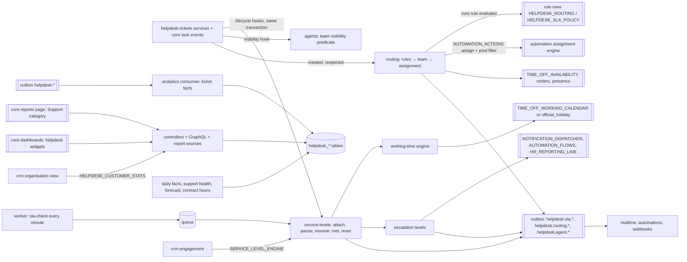

# Implementation Plan: Helpdesk service levels, routing and analytics

> Translates an approved `spec.md` into architecture and tech choices. The plan owns
> implementation details; the spec owns behaviour.

**Feature ID**: `helpdesk-sla-routing-and-analytics`
**Spec**: `./spec.md`
**Tasks**: `./tasks.md`
**Status**: `Draft`
**Last updated**: 2026-11-23

---

## 1. Architecture Summary

No new plugin: four modules of `@gauzy/plugin-helpdesk` (`packages/plugins/helpdesk/src/lib/`), loaded with it under
`GAUZY_HELPDESK_ENABLED` and gated by `FEATURE_HELPDESK`: `agents/` (agent profiles, availability states, team
profiles, visibility), `routing/` (routing rules, assignment, take next, follow-the-sun, time-off hand-over),
`service-levels/` (calendars, policies, clocks, checks, escalation, the record-type-agnostic engine) and `analytics/`
(ticket and daily facts, dashboard widgets, report sources, forecast, support health, contract hours). They implement
the `HelpdeskTicketLifecycle` hooks that `helpdesk-tickets` calls (created, message added, status changed, assigned,
merged, split) and its visibility hook.

A ticket is a core task of the issue type "Ticket" with the extension `helpdesk_ticket` (`helpdesk-tickets`). So a
ticket's id here is its task's id (`taskId`); its status, priority, team (`task_team`), assignee (`task_employee`) and
followers (`entity_subscription`) are the task's; the "waiting" and "done" categories that pause and fulfil clocks are
the `isWaiting` and `isDone` flags of the support project's `task_status` rows; time tracked on a ticket is the time
logs of its task. Status changes made from any task screen reach the clocks through the same lifecycle hooks.

What exists is used, never copied:

- **Agents** are core `Employee` rows (human or `EmployeeKindEnum.AGENT`), **teams** core `OrganizationTeam` with
  `OrganizationTeamEmployee` (membership, `isManager` = lead), **skills** core `Skill` (`skill_employee`), **invites**
  core `InviteService`, **time zone and language** the employee's `user.timeZone` and `user.preferredLanguage`,
  **availability** core `EmployeeAvailability` plus time off and working calendars through `time-off-management`
  (`TIME_OFF_AVAILABILITY`, `TIME_OFF_WORKING_CALENDAR`), rosters of `attendance-and-shifts` and appointment
  availability (`availability_slot`) for agents who also take bookings.
- **Assignment** within a team is the assignment rule engine of `automation-and-notifications` (`assignment_rule` for
  record type `helpdesk.ticket`), reached through its `AUTOMATION_ACTIONS` port; the helpdesk adds an eligibility filter
  through a new additive extension point of that engine, `registerAssignmentPoolFilters` (unregistered = unchanged).
- **Conditions** of routing rules and service level policies are rows of the core `rule` table
  (`packages/core/src/lib/rule/rule.entity.ts`) with two new `RuleOwnerType` values, `HELPDESK_ROUTING` and
  `HELPDESK_SLA_POLICY`, and a rule scope mapping the ticket context (channel, template, priority, customer, contract,
  tags, language, sender domain, subject, body text, custom fields), evaluated by the core rule evaluator.
- **Calendars** read holidays from `time-off-management`'s holiday calendars, else the organization's `official_holiday`
  rows; the default calendar comes from the organization's `timeZone`, `defaultStartTime`, `defaultEndTime` and
  `startWeekOn`; working-time arithmetic is a pure module.
- **Escalation to a manager** uses the reporting line of `hr-core-lifecycle` (`HR_REPORTING_LINE`), else
  `employee_agent_profile.reportsToEmployeeId` for agent employees, else the team lead.
- **Reports** are core `report` rows in a "Support" `report_category`, shown per organization through
  `report_organization` on the existing reports page; their data sources are helpdesk endpoints over maintained facts,
  and the report builder of `report-builder-and-dashboards` may also use them.
- **Dashboard cards** are widgets of the core dashboard widget registry (`packages/ui-core/shared/src/lib/dashboard/widgets/`),
  so the agent home and the manager dashboard render them and managers can place them on their own `dashboard` pages.
- **Settings** are plugin setting contributions in the platform settings store; **permissions** and default grants are
  plugin contributions; **bulk recomputes** (policy impact, routing on demand for a selection) run as core operations.

## 2. Tech Choices

| Concern | Choice | Rationale |
| ------- | ------ | --------- |
| Package | modules of `packages/plugins/helpdesk` (+ `helpdesk-ui`) | one helpdesk plugin ([platform architecture](../../architecture/business-suite.md) §2.4) |
| Working time | pure `service-levels/engine/working-time.ts` on `moment-timezone` (already in core): merge weekly intervals, holidays and exceptions into spans, add or measure working seconds | deterministic, testable with golden cases |
| Conditions | core `rule` rows and evaluator, owner types `HELPDESK_ROUTING`, `HELPDESK_SLA_POLICY` | one rule engine |
| Clocks | due times stored per metric with `nextCheckAt`; no ticking; `…ElapsedSeconds` holds each metric's working time up to its last pause; at a priority, policy or calendar change the elapsed working time is, for a paused metric, that stored value and, for a running one, that stored value plus the working time from its last start or resume (the `at` of the metric's latest `STARTED`, `RESUMED`, `REOPENED` or `RESET` row of `helpdesk_sla_event`) to the change, measured in the calendar as it stands at the change, so the whole running interval counts, also the part after the old due time, and no earlier calendar state is needed: a calendar edit of days still ahead changes only the time left, and an edit of days already counted (a holiday entered for today) applies to the elapsed time as well; the change sets the due time to the change time plus the new target less that elapsed working time (pauses excluded, spec FR-37), and a breach at the change only when nothing is left | constant cost per check |
| Checks | `@ScheduledJob` each minute in the worker → queue job in the API; in-process timer without a queue; advisory lock per organization | task automations layout |
| Assignment | automation assignment rules + `registerAssignmentPoolFilters` | one assignment engine |
| Facts | outbox consumer `subscriber:helpdesk-analytics` maintains `helpdesk_ticket_fact`; daily snapshot per team and agent | dashboards from facts, not scans |
| Reports and cards | core `report` catalogue (category "Support"), core dashboard widget registry | one reports page, one dashboard system |
| Settings | `helpdesk.settings.ts` contributions (organization scope) | one settings store |
| Charts | `chart.js` (already in `ui-core`); year calendar with `@fullcalendar/*` | no new dependency |
| Live | `helpdesk.*` events streamed through the realtime channel; widgets re-read debounced to 5 s | Principle VII |

## 3. Data Model

All tables extend `TenantOrganizationBaseEntity`; JSON is `text`; core ids with foreign keys (`task` with `CASCADE`,
others `SET NULL`), other plugins' ids without. Status and priority ids are `task_status` and `task_priority` ids of
the support project; template ids are `helpdesk_ticket_template` ids.

| Table | Columns (besides base) | Indexes and uniqueness |
| --- | --- | --- |
| `helpdesk_agent` | `employeeId` FK cascade, `channelKinds`, `languages` text (languages served), `maxOpen` int null, `hoursSource` (`ROSTER`, `WORKING_CALENDAR`, `APPOINTMENT_SLOTS`, `OWN`), `ownHours` text, `stateId`, `stateUntil`, `stateSetByUserId`, `lastAssignedAt` | unique `(organizationId, employeeId)`; idx `(organizationId, isActive)` |
| `helpdesk_availability_state` | `name` varchar(40), `color`, `routing` (`ALL`, `URGENT_ONLY`, `NONE`), `expiresAfterMinutes` null, `isDefault`, `position` | unique `(organizationId, name)` |
| `helpdesk_team_profile` | `organizationTeamId` FK cascade, `assignmentRuleId`, `calendarId`, `escalationPolicyId`, `access` (`OWN`, `ALL`), `isFallback`, `followTheSunGroupId`, `followTheSunPosition` int, `returnHome` bool | unique `(organizationTeamId)` |
| `helpdesk_follow_the_sun_group` | `name`, `moveAssigned` bool | idx `(organizationId)` |
| `helpdesk_routing_rule` | `name`, `position` int, `setTeamId`, `setPriorityId`, `setTemplateId`, `addTagIds` text, `assignmentRuleId`, `continueAfter` bool (conditions: core `rule` rows, owner `HELPDESK_ROUTING`, owner id = this row) | idx `(organizationId, isActive, position)` |
| `helpdesk_routing_decision` | `taskId`, `ruleId`, `trigger` (`CREATED`, `REOPENED`, `MANUAL`, `HANDOVER`, `TIME_OFF`, `REBALANCE`), `changes`, `skipped` text, `assignedEmployeeId`, `outcome` varchar(16) | idx `(taskId, createdAt)`, `(organizationId, createdAt)` |
| `helpdesk_service_calendar` | `name`, `timeZoneMode` (`FIXED`, `CUSTOMER`), `timeZone`, `weekly` text (intervals per weekday), `holidaySource` (`TIME_OFF_CALENDAR`, `OFFICIAL_HOLIDAYS`, `NONE`), `holidayCalendarId` null, `holidayCountryCode` varchar(2) null, `exceptions` text, `isAlwaysOpen`, `isDefault` bool | unique `(organizationId, name)` |
| `helpdesk_sla_policy` | `name`, `description`, `position`, `isDefault`, `validFrom`, `validTo` date, `calendarId`, `measureResolution`, `pauseFirstResponse`, `countAiReplies` bool, `pauseStatusIds`, `fulfilStatusIds` text null (null = the waiting and done categories), `newStatusId`, `reopenStatusId`, `warnings` text, `escalationPolicyId`, `version` int (conditions: core `rule` rows, owner `HELPDESK_SLA_POLICY`) | idx `(organizationId, isActive, position)` |
| `helpdesk_sla_target` | `policyId` FK cascade, `priorityId` null (fallback row), `firstResponseMinutes`, `nextReplyMinutes`, `resolutionMinutes` int null | unique `(policyId, priorityId)` |
| `helpdesk_ticket_sla` (1:1 with the ticket's task, or with a record of another registered type, spec FR-48) | `recordType` varchar(64) not null (`Task` for tickets, else the registered type), `recordId` uuid not null (the task id for tickets), `taskId` FK `task` cascade (tickets only; null for other record types), `policyId`, `policyVersion`, `calendarId`, `timeZone`, `targets` text (snapshot), `contractRef` text, `override` text (user, reason), per metric `…State`, `…StartAt`, `…DueAt`, `…MetAt`, `…BreachedAt`, `…ElapsedSeconds` for `firstResponse`, `nextReply`, `resolution`; `pausedSince`, `overallState`, `outsideHours` bool, `warningLevel`, `escalationLevel`, `riskAt`, `cycle` int, `transitionSeq` int default 0 (raised by every clock transition in its transaction), `nextCheckAt` | unique `(tenantId, recordType, recordId)`; unique `(taskId)` (one clock row per ticket; other types leave it null); idx `(tenantId, nextCheckAt)`, `(organizationId, overallState)` |
| `helpdesk_sla_event` | `recordType` varchar(64), `recordId` uuid (as on the clock row), `taskId` null (tickets only), `metric` (`FIRST_RESPONSE`, `NEXT_REPLY`, `RESOLUTION`), `kind` (`STARTED`, `PAUSED`, `RESUMED`, `WARNED`, `BREACHED`, `MET`, `MET_LATE`, `REOPENED`, `RESET`, `POLICY_CHANGED`, `PRIORITY_CHANGED`, `ESCALATED`, `CANCELLED`), `at` (event time), `level` int, `details` text, `dedupeKey` varchar(160) (`<recordType>:<recordId>:<metric>:<kind>:<level>:<cycle>` for the check job's `WARNED`, `BREACHED` and `ESCALATED`, once per level and cycle; every other kind is a transition and adds `:<transitionSeq>`, so a retried transition keeps its key and a second pause in the same cycle gets its own) | unique `(tenantId, dedupeKey)`; idx `(recordType, recordId, at)`, `(taskId, at)` |
| `helpdesk_escalation_policy` | `name`, `levels` text (metric, anchor `WARNING` or `BREACH`, offset minutes, actions) | idx `(organizationId)` |
| `helpdesk_ticket_fact` | `taskId` unique, `createdOn` date, `createdHour`, `createdWeekday` int, `channelKind`, `templateId`, `priorityId`, `teamId`, `assigneeEmployeeId`, `customerContactId`, `requesterContactId`, `statusCategory`, `resolvedAt`, `closedAt`, working-time seconds (`firstResponse`, `agentGapAvg`, `customerGapAvg`, `waiting`, `resolution`, `resolutionNoWait`), `reopenCount`, `statusChanges`, `assigneeChanges`, `agentsInvolved`, `agentMessages`, `customerMessages`, `slaFirstResponse`, `slaResolution` varchar(12), `breaches`, `escalations` int, `rating` numeric(5,2), `trackedSeconds` bigint, `cost` numeric(18,6), `currency`, `tagIds` text, `assistantDrafts`, `assistantAccepted` int, `responderOutcome`, `deflectionArticleId`, `deflectionScore` numeric(5,4) | idx `(organizationId, createdOn)`, `(organizationId, teamId, createdOn)`, `(organizationId, assigneeEmployeeId, resolvedAt)`, `(customerContactId, createdOn)` |
| `helpdesk_daily_fact` | `day` date, `teamId`, `employeeId` null (null = the team's total), `employeeKey` varchar(36) not null (the `employeeId`, or `*` for the team's total; written with it, so the unique key holds on every dialect), `created`, `done`, `met`, `breached`, `openAtEnd`, `overdueAtEnd` int, `ageBands` text | unique `(organizationId, day, teamId, employeeKey)` |
| `helpdesk_support_health` | `customerContactId`, `computedOn` date, `score` numeric(5,2), `band` (`HEALTHY`, `WATCH`, `AT_RISK`), `previousBand`, `signals` text | unique `(customerContactId, computedOn)`; idx `(organizationId, band)` |
| `helpdesk_contract_usage` | `contractRecordType` varchar(64), `contractId`, `period` varchar(7), `hoursIncluded`, `hoursUsed` numeric(10,2), `warned80At`, `warned100At` | unique `(contractRecordType, contractId, period)` |
| `helpdesk_rebalance_proposal` | `teamId`, `taskId`, `fromEmployeeId`, `toEmployeeId`, `reason` text, `status` (`PROPOSED`, `ACCEPTED`, `DISMISSED`, `EXPIRED`), `decidedByUserId` | idx `(teamId, status)` |

Not helpdesk tables: agent time zone and language (`user`), the service settings (`tenant_setting` through the setting
contributions below), routing and policy conditions (`rule`), report definitions (`report`, `report_category`,
`report_organization`), dashboard cards (widget registry, `dashboard_widget`), the agent home layout
(`IUserUiPreferences.helpdesk.home`), holidays (`time-off-management` or `official_holiday`).

**Settings** (`helpdesk.settings.ts`, scope `ORGANIZATION`): `helpdesk.serviceLevelsEnabled` (false),
`helpdesk.restrictByTeam`, `helpdesk.teamlessVisible` (true), `helpdesk.assignWithinTeam`, `helpdesk.neverUnassigned`,
`helpdesk.offlineAfterMinutes`, `helpdesk.resetsAllowed` (false), `helpdesk.splitClockFrom` (`NEW`, `ORIGINAL`),
`helpdesk.defaultTeamId`, `helpdesk.defaultCalendarId`, `helpdesk.supportHealthWeights` (JSON).

**Changes outside the helpdesk tables (additive):**

- `packages/contracts/src/lib/helpdesk-service.model.ts`: enums, interfaces, events, `SERVICE_LEVEL_ENGINE`
  (`IServiceLevelEngine.declare(recordType, { statuses, replyEvents })`, `attach`, `signal(ref, kind, at)`, `state`,
  `preview`), `HELPDESK_CUSTOMER_STATS` (offered: customer figures for the portal and the support health signal for the
  CRM organisation view), and consumed ports `HELPDESK_HOLIDAYS`, `HELPDESK_AVAILABILITY`, `HELPDESK_REPORTING_LINE`,
  `HELPDESK_ASSIGNMENT`, `HELPDESK_CONTRACTS`, `HELPDESK_SATISFACTION`.
- `packages/contracts/src/lib/rule.model.ts`: `RuleOwnerType` gains `HELPDESK_ROUTING` and `HELPDESK_SLA_POLICY`; the
  rule scope for tickets maps their fields for the evaluator.
- Assignment engine of `automation-and-notifications`: `registerAssignmentPoolFilters(recordType, filter)` where
  `filter(ref, candidates, rule) → { ordered, skipped: { userId, reason }[] }`, called before distribution; skip reasons
  join the existing assignment decision rows.
- Core reports: report rows of the "Support" category added by the plugin's report contributions at boot (the pattern of
  `report.seed.ts`, idempotent, by slug) and the "Support" category keyed `FEATURE_HELPDESK` in the shared catalogue feature filter of
  `report-builder-and-dashboards` (nullable `report_category.featureKey`), so core `ReportService.findAllReports`,
  `getMenuItems` and `ReportOrganizationService.bulkCreateOrganizationReport` skip them for tenants without the feature
  (the filter is guarded so that it is safe from any feature); core dashboard widget registry: the helpdesk widgets.
- `IUserUiPreferences.helpdesk.home` (card order and hidden cards) — no schema change.

**Migration timestamps**: `packages/plugins/helpdesk` `1791000052100` to `1791000052199`.

**Migrations** (plugin `database/`, three dialects, idempotent, both ORMs): `1791000052100-CreateHelpdeskAgentAndTeamTables`
(agent, state, team profile, follow-the-sun group, routing rule, routing decision),
`1791000052110-CreateHelpdeskServiceLevelTables` (calendar, policy, target, ticket service level, event, escalation),
`1791000052120-CreateHelpdeskAnalyticsTables` (ticket fact, daily fact, support health, contract usage, rebalance
proposal). No seed migration: permissions are contributions (§9). A setup step per organization on first use creates the
default calendar (from the organization's working hours, week start and time zone; 24×7 when they are empty), the
default states and a default policy (inactive until service levels are switched on).

**Contracts**: `packages/contracts/src/lib/helpdesk-service.model.ts` (new) and the `rule.model.ts` additions, listed above; they reach the SDKs through the OpenAPI document.

## 4. API Surface

Routes under `/api/helpdesk`, `@FeatureFlag(FEATURE_HELPDESK)`, `TenantPermissionGuard`, `@Permissions()`, DTOs,
Swagger, cursor paging. Errors: `HELPDESK_CALENDAR_INVALID`, `HELPDESK_TARGETS_INVALID`, `HELPDESK_POLICY_IN_USE`,
`HELPDESK_RESET_DISABLED`, `HELPDESK_NOT_ASSIGNABLE` (with reasons).

| Method | Endpoint | Permission | Description | Status |
| ------ | -------- | ---------- | ----------- | ------ |
| `GET` `POST` `PATCH` | `/agents[/:id]`, `POST /agents/invite` | `HELPDESK_AGENT_MANAGE` (list: `HELPDESK_TICKET_VIEW`) | agent profiles, invitations through core invites | New |
| `GET` | `/agents/board` | `HELPDESK_TICKET_VIEW` (all teams: `HELPDESK_REPORTS_VIEW`) | states, reasons, load, next working time | New |
| `PUT` | `/agents/me/state`, `/agents/:id/state` | self / lead or `HELPDESK_AGENT_MANAGE` | state with optional duration | New |
| `GET` `POST` `PATCH` `DELETE` | `/availability-states[/:id]`, `/teams[/:teamId]`, `/follow-the-sun-groups[/:id]` | `HELPDESK_AGENT_MANAGE` | configuration | New |
| `GET` `PUT` | `/service-settings` | `HELPDESK_SLA_MANAGE` (reads `HELPDESK_TICKET_VIEW`) | the service setting contributions | New |
| `GET` `POST` `PATCH` `DELETE` | `/routing-rules[/:id]`, `PUT /routing-rules/order` | `HELPDESK_ROUTING_MANAGE` | routing rules with their rule rows | New |
| `POST` | `/tickets/route` (`preview`; a selection runs as a core operation), `/tickets/assign`, `/tickets/take-next`, `/tickets/:taskId/assign` | `HELPDESK_TICKET_EDIT` (route: `HELPDESK_ROUTING_MANAGE`) | routing and assignment | New |
| `GET` | `/tickets/:taskId/routing` | `HELPDESK_TICKET_VIEW` | "why here?" decisions | New |
| `GET` `POST` `PATCH` `DELETE` | `/calendars[/:id]`, `GET /calendars/:id/year?year=` | `HELPDESK_SLA_MANAGE` (reads `_VIEW`) | calendars, year view | New |
| `GET` `POST` `PATCH` `DELETE` | `/sla-policies[/:id]`, `PUT /sla-policies/order`, `POST /sla-policies/:id/impact`, `POST /sla-policies/preview` | `HELPDESK_SLA_MANAGE` | policies with their rule rows, targets, affected count (recompute as a core operation), due-time preview | New |
| `GET` `POST` | `/tickets/:taskId/sla`, `/tickets/:taskId/sla/policy`, `/tickets/:taskId/sla/reset` | `_VIEW` / `HELPDESK_SLA_MANAGE` / `HELPDESK_SLA_RESET` | state, override, reset | New |
| `GET` `POST` `PATCH` `DELETE` | `/escalation-policies[/:id]` | `HELPDESK_SLA_MANAGE` | escalation chains | New |
| `GET` | `/analytics/{home,dashboard,agents,stats,forecast,support-health}`, `/analytics/tickets/:taskId`, `/analytics/reports/:slug`, `/analytics/drill` | `HELPDESK_TICKET_VIEW` scoped by FR-51; `HELPDESK_REPORTS_VIEW`; cost fields `HELPDESK_COST_VIEW` | widget and report sources | New |
| `GET` `POST` | `/rebalance-proposals`, `/rebalance-proposals/:id/decide` | team lead or `HELPDESK_ROUTING_MANAGE` | proposals | New |
| `GET` | `/contracts/:recordType/:id/usage` | `HELPDESK_REPORTS_VIEW` | support hours per period | New |

GraphQL reads: `helpdeskAgents`, `helpdeskTicketSla`, `helpdeskSlaPolicies`, `helpdeskDashboard`. Ports offered
`HELPDESK_CUSTOMER_STATS.forCustomer(customerId, period)` (figures and support health band with reasons) for the portal
and the CRM organisation view; `SERVICE_LEVEL_ENGINE` for other record types.

**Consumer tokens answered** (bound in `apps/api/src/plugin-composition.ts` to service calendars, agent states, the service level engine and customer statistics; each consumer plan states the shape it calls and its fallback): `CRM_AVAILABILITY`, `HELPDESK_CUSTOMER_STATS`, `SERVICE_LEVEL_ENGINE`, `TELEPHONY_AVAILABILITY`, `TELEPHONY_OPEN_HOURS`.

## 5. Events, Real-Time and Notifications

| Event | Emitted when | Consumers |
| ----- | ------------ | --------- |
| `helpdesk.sla.warned` / `.breached` / `.met` / `.paused` / `.resumed` / `.reset` | clock changes (partition `helpdesk:ticket:<taskId>`, or `helpdesk:record:<recordType>:<recordId>` for other record types; payloads carry `recordType` and `recordId`) | realtime badges, automations, webhooks, analytics |
| `helpdesk.escalation.fired` | an escalation level acts | notices, automations, audit |
| `helpdesk.agent.state_changed`, `helpdesk.routing.decided` | state or routing change | agent board live, analytics |
| `helpdesk.support_health.changed`, `helpdesk.contract.hours_warned` | band change; 80 % or 100 % | automations (account owner task), CRM organisation view and timeline, notices |
| In: `helpdesk.ticket.*`, `helpdesk.message.*`, `task.updated` of ticket tasks, `time_off.request.approved`, `time_off.calendar.changed`, `hr.employee.placement_changed` | as named | facts, hand-over offers, calendar recompute, escalation targets |

Clocks change inside the ticket's transaction through the lifecycle hooks; facts follow asynchronously through the
outbox consumer. Notification categories: `helpdesk.sla_warning`, `helpdesk.sla_breach`, `helpdesk.escalation`,
`helpdesk.unassignable`, `helpdesk.time_off_handover`, `helpdesk.contract_hours`, `helpdesk.rebalance`. Automation
triggers declared: warning, breach, escalation, support health band changed, contract hours warned.

## 6. UI Surface

- **Angular `helpdesk-ui`**: `/pages/helpdesk/home` (agent home: helpdesk dashboard widgets, draggable, layout in UI
  preferences), `/pages/helpdesk/dashboard` (manager widgets and `chart.js` charts, filters, drill-down to a ticket view,
  live), `/pages/helpdesk/agents` (board with states, reasons, load); the widgets are registered in the core dashboard
  widget registry, so they can also be placed on any core dashboard. The fourteen reports open from the existing reports
  page (`apps/gauzy/src/app/pages/reports`, category "Support"), each rendering its helpdesk report view. Settings:
  agents and invitations, availability states, teams, routing rules (order by drag, conditions builder over the rule
  rows, preview), follow-the-sun groups, calendars (weekly editor, year view with `@fullcalendar`), service level
  policies (targets table, statuses, warnings, impact dialog, preview), escalation policies, support health weights.
- Ticket page additions: service level badge with countdown, analytics tab, "why here?" popover, support health chip;
  header state switcher; the "due soon" ticket view (a task view sorted by earliest due time).
- Task screens outside the helpdesk show tickets as tasks without service level badges.
- i18n keys `HELPDESK.SLA.*`, `HELPDESK.ROUTING.*`, `HELPDESK.ANALYTICS.*` in every locale; charts with data tables.

## 7. MCP Tools, SDKs and Integrations

`packages/mcp-server/src/lib/tools/helpdesk-service.ts`: `helpdesk_agents_list`, `helpdesk_agent_set_state`,
`helpdesk_routing_explain`, `helpdesk_ticket_sla`, `helpdesk_at_risk_tickets`, `helpdesk_dashboard`,
`helpdesk_report_run`, `helpdesk_sla_policies_list`, `helpdesk_sla_preview` (all read or self-scoped).

Ports consumed (bound in `apps/api/src/plugin-composition.ts`; unbound → capability absent, with the stated
fallback): `HELPDESK_HOLIDAYS` → `TIME_OFF_WORKING_CALENDAR` (fallback: the organization's `official_holiday` rows of the
calendar's country, plus calendar exceptions); `HELPDESK_AVAILABILITY` → `TIME_OFF_AVAILABILITY` plus rosters of
`attendance-and-shifts` (fallback: core time-off requests, `EmployeeAvailability` and `availability_slot`);
`HELPDESK_REPORTING_LINE` → `HR_REPORTING_LINE` (fallback: `employee_agent_profile.reportsToEmployeeId`, then the team
lead); `HELPDESK_ASSIGNMENT` → `AUTOMATION_ACTIONS` (fallback: manual assignment and take next only); `HELPDESK_CONTRACTS`
→ contracts of `crm-leads-and-deals` and service contracts of `maintenance-and-field-service`; `HELPDESK_SATISFACTION` →
ratings of `helpdesk-portal-and-knowledge-base`; `NOTIFICATION_DISPATCHER`; `AUTOMATION_FLOWS` (escalation "start a
flow"); `HELPDESK_ASSISTANT` (hand-over summaries, rebalancing reasons, as runs of `ai-agents-and-assistants`). Presence
(disconnected agents) from the realtime plugin's presence store. OpenAPI additive; SDKs regenerated.

## 8. Background Jobs

| Trigger | When | What it does | Idempotency |
| ------- | ---- | ------------ | ----------- |
| `helpdesk.sla-check` | every minute | clocks (tickets and other record types) with `nextCheckAt ≤ now`: warnings, breaches at due time, escalation levels | `helpdesk_sla_event.dedupeKey` (`<recordType>:<recordId>:<metric>:<kind>:<level>:<cycle>`) |
| `helpdesk.agent-states` | every 5 minutes | expires timed states; offline after disconnection when set | state row version |
| `helpdesk.follow-the-sun` | every 5 minutes | hands over tickets of teams whose service day ended; returns at home start | decision per ticket and day |
| `helpdesk.time-off-handover` | on `time_off.request.approved`, daily 07:00 | offers reassignment of tickets due during the absence | per request |
| `subscriber:helpdesk-analytics` (outbox) | ticket and message events | upserts ticket facts | fact row per ticket |
| `helpdesk.time-facts` | every 15 minutes | tracked seconds and cost per ticket from the time logs of ticket tasks; contract usage | watermark on time log `updatedAt` |
| `helpdesk.daily-facts` | 00:15 per organization time zone | daily snapshot per team and agent (backlog, overdue, age bands) | unique day row (`employeeKey` `*` for the team's total) |
| `helpdesk.forecast` | every 5 minutes | at-risk marks and rebalancing proposals | latest run per team |
| `helpdesk.support-health` | nightly 02:40 | support health per customer with reasons; band change events | unique per customer and day |
| `helpdesk.policy-expiry` | nightly 01:10 | deactivates policies past their end | status check |
| core operations | policy recompute, routing of a selection | recompute due times or route the chosen tickets with progress | operation id |

Schedules in the worker's `HelpdeskSchedulePlugin`; jobs run in the API; no queue → in-process timers under the
plugin's lock; every job processes organizations in batches of 500 tickets.

## 9. Security & Permissions

`helpdesk.plugin.ts` declares, as permission contributions with `defaultFor`, `HELPDESK_AGENT_MANAGE`,
`HELPDESK_ROUTING_MANAGE`, `HELPDESK_SLA_VIEW`, `HELPDESK_SLA_MANAGE`, `HELPDESK_SLA_RESET`, `HELPDESK_REPORTS_VIEW`, `HELPDESK_TICKET_VIEW_ALL`:
all for `SUPER_ADMIN` and `ADMIN`; `MANAGER` all but `HELPDESK_SLA_MANAGE`; none for `EMPLOYEE`. The visibility predicate
(team membership through `task_team` and `organization_team_employee`, assignee through `task_employee`, follower
through `entity_subscription`, teamless setting, all-access teams) is one query fragment used by helpdesk lists, search
filters, counts, direct reads, the realtime audience check and MCP; task screens show a ticket's task part by the support
project's own access. Agent figures pass a scope check (self, led teams, `HELPDESK_REPORTS_VIEW`); cost fields need
`HELPDESK_COST_VIEW`; support health reasons aggregate only the customer's own tickets. Policy, calendar, rule and agent
changes, overrides and resets are written to `activity_log` with before and after values.

## 10. Observability

Clock events per ticket; routing decisions with skip reasons; metrics: check lag, breaches per hour, warnings sent,
escalations by level, unassignable tickets, follow-the-sun handovers, forecast precision (at-risk tickets that
breached), fact lag behind the outbox.

## 11. Phased Rollout

1. **Phase 1 — Agents, teams and routing** (flag off): contracts, tables, settings and permission contributions, agent
   profiles and states, team profiles and visibility, routing rules on core rule rows, manual and bulk assignment, take
   next, assignment through the automation engine with the pool filter, agent board, MCP read tools.
2. **Phase 2 — Service levels and analytics**: calendars, policies and targets, clocks, minute checks, breaches, badges
   and "due soon", per-ticket analytics, facts, dashboard widgets with agent home and manager dashboard, comparisons,
   stats, the Support reports in the core catalogue, invitations, the engine for other record types.
3. **Phase 3 — Advanced capabilities**: next reply, warnings and escalation chains, customer time zone and contracts with
   hours, follow-the-sun, time-off hand-over, capacity from tracked time, forecast and rebalancing, support health,
   cost to serve, live dashboards.
4. **Phase 4 — General availability**: the feature is off by default; after the trial period it may be switched on by default for new tenants only; existing tenants keep their setting until an administrator changes it.

## 12. Constitution Reconciliation

- I Plugin-first: modules of the helpdesk plugin; one additive extension point in the automation assignment engine; two
  rule owner types; report rows and dashboard widgets through the existing core catalogues.
- II Tenant/organization scoping: every table on the tenant-organization base; queries scoped.
- III Both ORMs, additive migrations: three migrations, three dialects, both ORMs.
- IV Default-off flag; nothing removed: `FEATURE_HELPDESK` plus the organization's service level switch.
- V Contracts and API first: contracts, REST, GraphQL reads, report sources, SDK regeneration before UI.
- VI Permissions, privacy, security: six permissions as contributions, one visibility predicate, scoped agent figures and
  costs.
- VII Real-time through the event bus: clock and routing events on the outbox; live badges and widgets.
- VIII i18n and accessibility: keys in every locale; charts with data tables; badges with text.
- IX Tests: golden working-time cases, clock state machine specs, SQLite end to end for checks, ORM parity.
- X Behaviour-first spec: implementation stays here.
- XI Documentation describes our platform only.

## 13. Risks & Mitigations

| Risk | Likelihood | Impact | Mitigation |
| ---- | ---------- | ------ | ---------- |
| Wrong due times across time zones and daylight-saving changes | Medium | High | pure engine, golden cases per zone, preview endpoint, property tests (adding then measuring returns the target) |
| Check job falls behind on large tenants | Low | High | `nextCheckAt` index, batches, lag metric, breaches stamped at due time not check time |
| Status changed from a task screen bypasses the clocks | Medium | High | clocks hang on the lifecycle hooks that run on core `task.updated` for ticket tasks |
| Assignment extension conflicts with the automation engine | Medium | Medium | optional filter, no behaviour change when none is registered, contract tests in both plugins |
| Visibility leaks through a new surface | Low | High | one predicate, e2e per surface with a restricted agent |
| Support health read as a judgement of customers | Medium | Low | reasons shown, editable weights, no automatic action without a flow, named apart from the CRM's own signals |

## 14. References

- Spec: `./spec.md` · Tasks: `./tasks.md` · Related: `../helpdesk-tickets/plan.md`, `../automation-and-notifications/plan.md`,
  `../time-off-management/plan.md`, `../hr-core-lifecycle/plan.md`, `../record-views-and-search/plan.md`
- Code: `packages/core/src/lib/{organization-team,organization-team-employee,skills,employee-availability,availability-slots,official-holiday,invite,rule,reports,dashboard}/`,
  `packages/core/src/lib/organization/organization.entity.ts`, `packages/core/src/lib/time-tracking/time-log/`,
  `packages/core/src/lib/employee-agent-profile/`, `packages/ui-core/shared/src/lib/dashboard/widgets/`,
  `packages/plugins/realtime/src/lib/realtime-presence.store.ts`, `packages/plugins/task-automations/src/lib/{schedule,database}/`,
  `apps/api/src/plugin-composition.ts`
