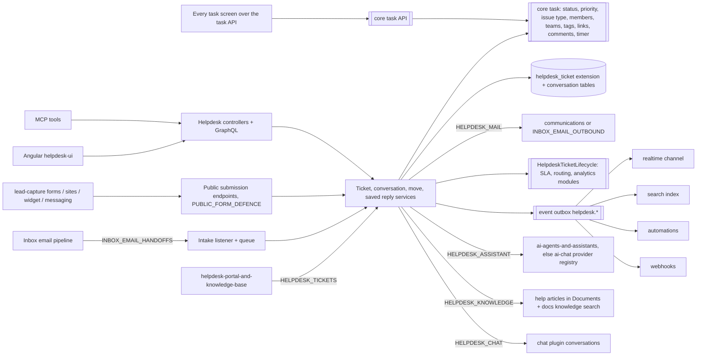

# Implementation Plan: Helpdesk tickets

> Translates an approved `spec.md` into architecture and tech choices. The plan owns
> implementation details; the spec owns behaviour.

**Feature ID**: `helpdesk-tickets`
**Spec**: `./spec.md`
**Tasks**: `./tasks.md`
**Status**: `Draft`
**Last updated**: 2026-11-23

---

## 1. Architecture Summary

A new plugin pair: `@gauzy/plugin-helpdesk` (`packages/plugins/helpdesk`) and `helpdesk-ui` (Angular). The public chat
widget is a framework-free script built from `packages/plugins/helpdesk/widget/`. `apps/api/src/plugins.ts` lists
`HelpdeskPlugin` only when `GAUZY_HELPDESK_ENABLED` is exactly `true` (`isHelpdeskEnabled`, the task automations
idiom); `apps/worker/src/plugins.ts` lists the schedule-only `HelpdeskSchedulePlugin`. Every controller and resolver
carries `@FeatureFlag(FEATURE_HELPDESK)`; assistant routes also `FEATURE_HELPDESK_ASSISTANT`. The same plugin later
hosts the modules of `helpdesk-sla-routing-and-analytics` (agents, routing, service levels, analytics); this plan
defines the ticket core and the lifecycle hooks those modules implement (`HelpdeskTicketLifecycle`: created, message
added, status changed, assigned, merged, split).

**A ticket is a core task.** Its issue type is "Ticket" (`TaskTypeEnum` gains `TICKET = 'ticket'`; the issue type row
of that value is created in each support project) and it lives in a **support project** (`organization_project`, key
`HD` by default, created by the setup assistant). The task carries everything a task already has: title (the subject),
`taskStatusId`, `taskPriorityId`, `taskTypeId`, `members` (the assignee; the helpdesk keeps one), `teams` (the team;
the helpdesk keeps one), `tags`, `parentId` (parent tickets), `projectId`, `number` and `prefix` (the ticket reference
`HD-10234`, with `task_former_reference` answering former references after a move), `resolvedAt`, `description` (the
ticket summary), comments, mentions, reactions, subscribers, linked issues, views, the timer and time logs. The plugin
adds only the customer side in a 1:1 extension table `helpdesk_ticket` (requester, customer, channel, mailbox thread,
service-level and satisfaction state) and the conversation. There is no ticket status, priority, type or link table
and no second task per ticket: every task screen of every client of the task API lists, opens, times and links
tickets as tasks without helpdesk code.

It builds on what exists and copies nothing:

- **Task metadata**: statuses and priorities are `task_status` and `task_priority` rows scoped to the support project
  (copied to a further support project with the existing bulk copy of statuses); `task_status` gains two category flags
  and customer labels (§3). Links are `task_linked_issues` with `TaskRelatedIssuesRelationEnum`; parent tickets use
  `task.parentId`; trash is the task trash; numbering is the task reference of the project (`task-reference.ts`).
- **Email** arrives through the Inbox's hand-off seam (`INBOX_EMAIL_HANDOFFS`, `InboxEmailHandoffs.read`,
  `deliveredSince` for recovery). Replies leave through the `HELPDESK_MAIL` port: bound to the record mail sender of
  `email-and-communications` when loaded, else to an adapter over a new additive Inbox port `INBOX_EMAIL_OUTBOUND`
  (the existing `InboxEmailService.reply` path, widened to HTML, attachments and new messages from a mailbox). Email
  bodies and attachments stay in the Inbox (`inbox_email`, `inbox_email_attachment`); the conversation references them.
- **People and parties** are core `OrganizationContact` (requester and customer; `ContactBuyer` gives the company of a
  person), `Employee` (agents, agent-kind employees for responders), `OrganizationTeam` (teams).
- **Collaboration** is core `Comment` on the task (internal comments; pins as a comment column), `Mention`, `Reaction`,
  `EntitySubscription` (followers), `Tag`; uploads are Documents (`document` + `document_link` of the docs plugin);
  tasks raised from a ticket through `TaskCreateCommand`; related records through the record links of
  `record-views-and-search` (one link table for every record type).
- **Saved replies** are core `email_template` rows of record type `helpdesk.ticket` (the user templates of
  `email-and-communications`, one row per language) with a small satellite for title, scope, folder, actions and use;
  signatures are `communication_signature` rows of the same spec.
- **Lists, board and views** are the core task views (`task_view`, `built-in-views.ts`, `view-filters.ts`) filtered to
  the issue type "Ticket"; palette, timeline shell and presence come from `record-views-and-search` (timeline
  contribution on the task, palette providers, record signal); search from the `search` plugin (`search_document`
  registrations); flows and notices from `automation-and-notifications`.
- **Bulk and background work** uses the core operation runtime (`packages/core/src/lib/api/bulk-executor.service.ts`,
  `api/async-operation.ts`, `operation/`, `job_execution`): bulk actions above 500 tickets answer `202` with an
  operation the client follows.
- **Settings** are plugin setting contributions read through the platform settings store (`tenant_setting`,
  `PluginSettingRegistry`); permissions, default grants and features are plugin contributions (`defaultFor`).
- **AI** binds to `ai-agents-and-assistants`: assistant calls are runs of the purpose `helpdesk.assistant` with their
  `ai_usage_entry` rows and the `ai_budget` of that purpose; an AI responder is an `ai_agent` acting as an agent
  employee, its decisions are `ai_run` rows. Without that spec, the `ai-chat` provider registry serves drafts and no
  responder runs.

## 2. Tech Choices

| Concern | Choice | Rationale |
| ------- | ------ | --------- |
| Package | new `helpdesk`, `helpdesk-ui`; widget script inside the plugin; additive seams in `inbox` and core tasks | Principle I; build on tasks and the Inbox |
| Ticket record | core `task` of issue type "Ticket" + 1:1 extension `helpdesk_ticket` | one record for work, time and views |
| Flags | `FEATURE_HELPDESK`, `FEATURE_HELPDESK_ASSISTANT` declared as feature contributions; deploy switch `GAUZY_HELPDESK_ENABLED` | [platform architecture](../../architecture/business-suite.md) §6 |
| Settings | `helpdesk.settings.ts` setting contributions (organization scope) in `tenant_setting` | one settings store |
| Persistence | MultiORM entities, the shared core migration helpers of `@gauzy/core`, three dialects | Principle III |
| Inbound | hand-off listener → queue `helpdesk-intake` (in-process fallback), dedupe on `(tenantId, inboxEmailId)` | listener must not fail delivery |
| Outbound | `HELPDESK_MAIL` port; outbox row per send, queue `helpdesk-outbound` with back-off | durable, retried |
| HTML | `sanitize-html` (already a dependency of the Inbox) with the Inbox's allowlist, applied on write and render | one sanitizing rule, no cross-plugin import |
| Real time | outbox events declared with `declareStreamedEvents`; audience through `SubscriptionCatalogue.restrictAudience`; presence and typing via the record signal of record views | Principle VII |
| Widget live path | public long-poll (25 s) endpoint as the documented fallback; switches to the realtime channel when it offers guest audiences | no push exists for anonymous visitors |
| Public forms | submissions from `lead-capture-and-enrichment` hosted and embedded forms, sites and the portal; abuse defence through its `PUBLIC_FORM_DEFENCE` | one form renderer and one defence |
| Bulk | core bulk executor and async operations (`202` + operation) | one operation runtime |
| AI | `HELPDESK_ASSISTANT` port (agents spec when bound, else `AiProviderRegistry` of `ai-chat`) | provider keys stay per tenant; one usage ledger |
| Background | `@ScheduledJob` in the worker, `@QueueWorker` in the API, in-process timers without a queue root | task automations layout |

## 3. Data Model

All new tables extend `TenantOrganizationBaseEntity` (soft delete, `isActive`, `isArchived`); JSON is `text` on every
dialect; ids into core carry foreign keys only where core already owns the row (`task`, `organization_contact`,
`employee`, `organization_team`, `organization_project`, `task_status`, `task_priority`), with `CASCADE` from `task`
and `SET NULL` otherwise; other plugins' ids carry none. A ticket's id everywhere is its task's id (`taskId`).

**Migration timestamps**: `packages/plugins/helpdesk` `1791000050100` to `1791000050199`; `packages/core` `1791000050900` to `1791000050999`.

**Existing tables, additive columns** (core migration, defaults keep today's behaviour):

| Table | New columns | Notes |
| --- | --- | --- |
| existing `task_status` + columns | `isWaiting` bool default false, `isClosed` bool default false, `customerLabels` text null (label per language) | categories: new = `isTodo`, in progress = `isInProgress`, waiting = `isWaiting`, done = `isDone`, closed = `isDone` + `isClosed`; task screens ignore the new flags |
| existing `comment` + columns | `isPinned` bool default false, `pinnedAt` null | pins of internal comments (at most 5 per ticket, checked by the service) |
| `TaskTypeEnum` (contracts) | value `TICKET = 'ticket'` | the issue type of tickets |
| `task_view` filters (`view-filters.ts`) | filter field `type` (issue type) and fields contributed for an extension (`registerTaskViewFilterFields`: requester, customer, channel, template, unread) | ticket views are task views |

**New tables in `helpdesk`:**

| Table | Columns (besides base) | Indexes and uniqueness |
| --- | --- | --- |
| `helpdesk_ticket` (1:1 extension of `task`) | `taskId` FK `task` cascade, `templateId`, `channelId`, `source` varchar(16), `requesterContactId`, `requesterEmail` varchar(320), `requesterName` varchar(160), `requesterPhone` varchar(40), `customerContactId`, `ccEmails` text, `language` varchar(8), `createdByUserId`, `mailboxId` null, `threadKey` varchar(255) null (the Inbox thread of the conversation), `mergedIntoTaskId`, `splitFromTaskId` null, `firstAgentReplyAt`, `lastAgentReplyAt`, `lastCustomerMessageAt`, `agentMessages`, `customerMessages` int, `avgAgentReplySeconds` int, `closedAt`, `reopenCount` int, `waitingSince`, `waitingSeconds` bigint, `lastActivityAt`, `resolutionSummary` text, `arrival` text, `approvalState` varchar(16), `sentiment` varchar(16), `serviceLevelState` varchar(12) null (written by the service-level module), `rating` smallint null (last score, written by the satisfaction module), `version` int | unique `(taskId)`; idx `(tenantId, requesterContactId, createdAt)`, `(tenantId, customerContactId, createdAt)`, `(organizationId, lastActivityAt)`, `(tenantId, mailboxId, threadKey)`, `(mergedIntoTaskId)`, `(channelId)` |
| `helpdesk_ticket_template` (the kinds of request) | `name` varchar(80), `labels` text, `icon` varchar(64), `fields` text (key, agent and customer visibility, required per side, customer-editable, placeholder, help), `descriptionTemplate` text, `formLayoutId` null, `defaultPriorityId`, `defaultStatusId`, `defaultTeamId` null, `customerSelectable`, `isDefault` bool, `approvalDefinitionKey` varchar(64) null, `version` int | unique `(organizationId, name)` |
| `helpdesk_channel` | `kind` varchar(16) (`EMAIL`, `WEB_FORM`, `CHAT_WIDGET`, `MESSAGING`, `PHONE`, `API`, `PORTAL`, `CHAT`), `name`, `projectId` (support project), `mailboxId` null, `publicKey` varchar(32) null, `allowedOrigins` text, `defaultTemplateId`, `defaultPriorityId`, `defaultTeamId`, `defaultStatusId`, `defaultLanguage` varchar(8), `brand`, `acknowledgement`, `notices` text, `suppressMailboxItems` bool default false (members keep their Inbox items until an administrator turns it on), `messagingRef` varchar(128) null, `lastReceivedAt`, `lastError` text | unique `(tenantId, mailboxId)` where set; unique `publicKey` |
| `helpdesk_ticket_message` | `taskId` FK cascade, `postedAt`, `direction` (`IN`, `OUT`, `NONE`), `kind` (`CUSTOMER`, `AGENT`, `AUTOMATED`, `NOTICE`, `ACKNOWLEDGEMENT`), `channelKind`, `authorContactId`, `authorEmployeeId`, `authorName`, `inboxEmailId` null, `subject`, `bodyHtml`, `bodyText`, `fromAddress`, `toAddresses`, `ccAddresses`, `bccAddresses` text null (kept for messages that are not Inbox emails, and for email replies only until the Inbox stores them), `searchText` text, `attachments` text (refs: `inboxAttachmentId` or `documentId`, inline, content id), `externalMessageId` varchar(255), `inReplyTo` varchar(255), `deliveryStatus` (`RECEIVED`, `SCHEDULED`, `QUEUED`, `SENT`, `FAILED`, `BOUNCED`, `RECORDED`), `deliveryError` text, `attempts` int, `scheduledAt`, `sentAt`, `savedReplyId`, `suggestionId`, `agentRunId` null, `translatedFrom` varchar(8), `movedFromTaskId`, `originCustomerContactId` uuid null (set by a merge across customers to the source's customer on the moved messages that have none, a value already set being kept through later merges, and set by intake and the portal on a message that reaches a target through a merged source's reference to that source's customer when it differs from the target's; customer-facing reads of a ticket, the portal service, quoted history in replies and the follow-up page take only messages whose value is null or the ticket's `customerContactId`, and the merged source shows its customer the messages moved from it with that customer's value) | idx `(taskId, postedAt)`; unique `(tenantId, inboxEmailId)` where set; idx `(tenantId, externalMessageId)`, `(deliveryStatus, scheduledAt)`, `(savedReplyId, postedAt)` |
| `helpdesk_reply_draft` | `taskId`, `employeeId`, `mode` (`REPLY`, `COMMENT`), `bodyHtml`, `recipients`, `attachments`, `actions` text, `baseItemAt` timestamp, `baseVersion` int, `source` (`AGENT`, `ASSISTANT`), `suggestionId` | unique `(taskId, employeeId, mode)` |
| `helpdesk_ticket_read` | `taskId`, `userId`, `lastSeenAt`, `forcedUnread` bool | unique `(taskId, userId)` |
| `helpdesk_ticket_move` | `kind` (`MERGE`, `SPLIT`), `sourceTaskId`, `targetTaskId`, `moved` text (ids per kind: messages, comments, document links, record links, tags, followers), `previousStatusId`, `byUserId`, `undoUntil`, `undoneAt`, `undoneByUserId` | idx `(sourceTaskId)`, `(targetTaskId)` |
| `helpdesk_saved_reply` (satellite of `email_template`) | `title` varchar(120), `templateName` varchar(120) (the `email_template` rows of record type `helpdesk.ticket`, one per language), `attachments` text (document ids), `actions` text, `folder` varchar(80), `scope` (`PERSONAL`, `TEAM`, `ORGANIZATION`), `ownerEmployeeId`, `teamIds` text, `useCount` int, `lastUsedAt` | idx `(organizationId, scope)`, `(ownerEmployeeId)`; unique `(organizationId, templateName)` |
| `helpdesk_assistant_suggestion` | `taskId`, `kind` (`DRAFT`, `SUMMARY`, `CLASSIFY`, `DUPLICATE`, `TRANSLATE`, `ASSIST_SUMMARY`), `payload`, `sources` text, `confidence` numeric(5,4), `model` varchar(64), `runId` null (the `ai_run` holding usage and cost), `requestedByUserId`, `status` (`PROPOSED`, `ACCEPTED`, `EDITED`, `REJECTED`, `EXPIRED`), `decidedByUserId`, `decidedAt` | idx `(taskId, createdAt)`, `(organizationId, kind, createdAt)` |
| `helpdesk_ai_responder` (helpdesk limits of an agent) | `agentId` (`ai_agent`), `employeeId` (its agent employee), `mode` (`DRAFT_ONLY`, `SEND_WITHIN_LIMITS`), `scope` text (channels, templates, languages, hours), `threshold` numeric(4,3) default 0.8, `maxReplies` int default 2, `forbiddenTopics`, `allowedActions` text, `handoverTeamId`, `handoverMessage` text, `isPaused` bool | unique `(organizationId, agentId)` |
| `helpdesk_assist` | `taskId`, `conversationId`, `openedByEmployeeId`, `participantUserIds` text, `accessUntil`, `status` (`OPEN`, `CLOSED`), `summaryCommentId` | unique `(conversationId)`; idx `(taskId)` |
| `helpdesk_widget_session` | `channelId`, `taskId`, `tokenHash` varchar(64), `name`, `email`, `contactId`, `origin`, `lastSeenAt`, `expiresAt` | unique `(tokenHash)`; idx `(expiresAt)` |
| `helpdesk_channel_event` | `channelId`, `kind` (`REFUSED`, `IGNORED_AUTOMATIC`, `BOUNCE`, `FAILED`), `reason`, `externalRef` | idx `(channelId, createdAt)`; pruned after 30 days |

What is **not** a helpdesk table, and where it lives instead: statuses, priorities and types (task metadata of the
support project; the kind of request is the template), ticket links (`task_linked_issues`: relates to, duplicates,
blocks, is blocked by, clones), related records (record links of `record-views-and-search`), attachments (Inbox
attachments by reference, uploads as Documents linked through `document_link`), pins (`comment.isPinned`), signatures
(`communication_signature`), saved reply bodies (`email_template`), saved reply use per agent and team (counted from
`helpdesk_ticket_message.savedReplyId` and its author), responder runs and AI usage (`ai_run`, `ai_usage_entry`,
`ai_budget`), settings (`tenant_setting`), seen-as-recent (`employee_recent_visit`; `helpdesk_ticket_read` keeps only
the unread mark), change history (`activity_log`).

**Settings** (`helpdesk.settings.ts`, scope `ORGANIZATION`, stored in `tenant_setting`): `helpdesk.supportProjectId`,
`helpdesk.createContacts` (true), `helpdesk.statusAfterReplyId`, `helpdesk.reopenStatusId`, `helpdesk.closedReplyMode`
(`FOLLOW_UP`, `REOPEN`), `helpdesk.reopenWindowDays`, `helpdesk.autoCloseDays` (7), `helpdesk.autoCloseStatusId`,
`helpdesk.autoCloseReminderDays`, `helpdesk.taskDoneStatusId`, `helpdesk.trashPurgeDays` (30; 0 keeps trashed tickets;
ticket tasks only), `helpdesk.organizationSavedReplies`, `helpdesk.reactions`,
`helpdesk.replyLock`, `helpdesk.assistant` (JSON: which proposals run). The monthly assistant budget is the `ai_budget`
of the purpose `helpdesk.assistant`.

**Changes outside the plugin (additive):**

- `packages/contracts/src/lib/helpdesk.model.ts`: enums (status categories, channel kinds, sources, message kinds and
  delivery states, scopes, suggestion kinds and states, responder modes and outcomes), entity interfaces, DTO shapes,
  events, the lifecycle interface and the ports `HELPDESK_TICKETS` (offered), `HELPDESK_MAIL`, `HELPDESK_ASSISTANT`,
  `HELPDESK_KNOWLEDGE`, `HELPDESK_CHAT`, `HELPDESK_MESSAGING`, `HELPDESK_APPROVALS`, `HELPDESK_SATISFACTION` (consumed).
- Core tasks: the `task_status` and `comment` columns above, `TaskTypeEnum.TICKET`, the task view filter field `type`
  and `registerTaskViewFilterFields`; task screens need no other change.
- `packages/contracts/src/lib/inbox-email.model.ts`: `INBOX_EMAIL_OUTBOUND` (`IInboxEmailOutbound.send({ mailboxId,
  replyToEmailId?, to, cc, bcc, subject, html, text, attachments, headers, idempotencyKey })` and `status(emailId)`);
  `IInboxEmailHandoff` gains `automatic` (`AUTO_REPLY`, `BULK`, `DELIVERY_REPORT`, `OUT_OF_OFFICE`, null) derived from
  the allowlisted headers; `IInboxEmailHandoffs` gains optional `claimMailbox(tenantId, mailboxId, { listenerId,
  suppressItems })` and `releaseMailbox(...)`, stored in the mailbox `settings.handoff`.
- `packages/plugins/inbox/src/lib/email/`: the processor skips creating email items when `settings.handoff.suppressItems`
  is true (the message is still stored, threaded and handed off); `InboxEmailService` implements `INBOX_EMAIL_OUTBOUND`
  on its existing send path (HTML body, stored or uploaded attachments, new message from a mailbox).
- `apps/api/src/plugin-composition.ts`: bindings of the consumed ports (§7).

**Migrations** (PostgreSQL, SQLite and MySQL branches; idempotent; forward-only; both ORMs):

1. `1791000050900-AddHelpdeskTaskColumns` (core `database/migrations`) — `task_status.isWaiting`, `isClosed`,
   `customerLabels`; `comment.isPinned`, `pinnedAt`.
2. `1791000050100-CreateHelpdeskConfigurationTables` (plugin) — template, channel.
3. `1791000050110-CreateHelpdeskTicketTables` — ticket extension, message, draft, read, move.
4. `1791000050120-CreateHelpdeskSavedReplyTables` — saved reply satellite.
5. `1791000050130-CreateHelpdeskAssistantTables` — suggestion, responder, assist, widget session, channel event.

No seed migration: permissions and their default grants are contributions (§9); the support project, its issue type
"Ticket", statuses, priorities, default template and channel are created by the setup assistant per organization.

**Contracts**: `packages/contracts/src/lib/helpdesk.model.ts` and the `inbox-email.model.ts` additions, listed above; they reach the SDKs through the OpenAPI document.

## 4. API Surface

All routes under `/api/helpdesk`, `TenantPermissionGuard`, `@Permissions()`, class-validator DTOs, Swagger, cursor
paging, `If-Match` on ticket writes (extension `version`), idempotency keys on creating routes. Task fields change
through the helpdesk routes (which call the task service) or any task route; both raise the same lifecycle hooks
through the core `task.updated` event. Errors: `HELPDESK_REPLY_STALE` (409, with the items since),
`HELPDESK_FIELD_CLOSED` (400, field list), `HELPDESK_MERGE_CYCLE`, `HELPDESK_MERGE_TARGET_MERGED`, `HELPDESK_UNDO_EXPIRED`,
`HELPDESK_PIN_LIMIT`, `HELPDESK_BUDGET_REACHED`, `HELPDESK_CHANNEL_PAUSED`.

| Method | Endpoint | Permission | Description | Status |
| ------ | -------- | ---------- | ----------- | ------ |
| `GET` `POST` | `/tickets` | `HELPDESK_TICKET_VIEW` / `_CREATE` | task query protocol filtered to tickets, with extension fields (visibility applied) / create (task + extension in one transaction) | New |
| `GET` `PATCH` `DELETE` | `/tickets/:taskId`, `GET /tickets/by-reference/:reference` | `_VIEW` / `_EDIT` / `_DELETE` | read, update, move to the task trash | New |
| `POST` `DELETE` | `/tickets/:taskId/restore`, `/tickets/:taskId/purge` | `HELPDESK_TICKET_DELETE` | restore, purge through the task trash | New |
| `GET` | `/tickets/:taskId/conversation` | `_VIEW` | messages (Inbox bodies resolved), `order`, cursor | New |
| `POST` | `/tickets/:taskId/replies` | `_EDIT` | body, recipients, attachments, saved reply, actions, `sendAt`, `recordOnly`, channel, `baseItemAt` | New |
| `DELETE` `POST` | `/messages/:id/schedule`, `/messages/:id/retry` | author or `_EDIT` | cancel scheduled, retry failed | New |
| `GET` `PUT` `DELETE` | `/tickets/:taskId/draft?mode=` | `_VIEW` | own server draft | New |
| `POST` `GET` | `/attachments`, `/attachments/:ref` | `_EDIT` / `_VIEW` | upload as a Document linked to the ticket; download of an Inbox attachment or Document (`nosniff`, sandbox) | New |
| `POST` | `/tickets/:taskId/merge`, `/tickets/:taskId/split`, `/moves/:id/undo` | `HELPDESK_TICKET_MERGE` | `preview` supported | New |
| `POST` `DELETE` | `/tickets/:taskId/pins/:commentId` | `_EDIT` | pin and unpin an internal comment | New |
| `GET` | `/tickets/:taskId/{similar,record-actions,time}` | `_VIEW` (cost: `HELPDESK_COST_VIEW`) | similar and recent, plugin actions, time and cost from the task's time logs | New |
| `POST` | `/tickets/:taskId/{tasks,seen,unread,assist}`, `/assists/:id/close` | `_EDIT` (seen: `_VIEW`) | as named | New |
| `POST` | `/tickets/bulk`, `/tickets/bulk-reply` | `_EDIT` (trash: `_DELETE`) | core bulk executor; above 500 tickets `202` with an operation | New |
| `POST` | `/emails/:inboxEmailId/ticket` | `_CREATE` + Inbox read access | turn an Inbox email into a ticket | New |
| `GET` `PUT` | `/settings` | `HELPDESK_SETTINGS_MANAGE` (reads `_VIEW`) | the helpdesk setting contributions | New |
| `GET` `POST` `PATCH` `DELETE` | `/templates[/:id]`, `/channels[/:id]` | `HELPDESK_SETTINGS_MANAGE` (reads `_VIEW`) | kinds of request and their forms; channels | New |
| `POST` | `/channels/:id/test`, `/setup`; `GET /notices` | `HELPDESK_SETTINGS_MANAGE` | channel check, setup assistant, gap notices | New |
| `GET` `POST` `PATCH` `DELETE` | `/saved-replies[/:id]`, `GET /saved-replies/rank?taskId=` | `_VIEW`; team or organization scope `HELPDESK_SAVED_REPLY_MANAGE` | saved replies (satellite + email templates) | New |
| `POST` | `/tickets/:taskId/assistant/{draft,summary,classify,duplicates,translate}`, `/suggestions/:id/decide` | `HELPDESK_ASSISTANT_USE` | proposals and decisions | New |
| `GET` `POST` `PATCH` | `/ai-responders[/:id]`, `POST …/:id/{pause,resume}`, `/ai-responders/pause-all`, `GET …/:id/runs` | `HELPDESK_AI_RESPONDER_MANAGE` | responder limits; runs read from `ai_run` | New |
| `GET` `POST` | `/public/:key/form`, `/public/:key/tickets` | public, `PUBLIC_FORM_DEFENCE` | form schema; submission (the transaction endpoint sites and forms post to) | New |
| `POST` `GET` | `/public/:key/conversations`, `/public/:key/conversations/:token/messages?after=` | public, session token | widget conversation, long-poll | New |

Statuses and priorities are edited through the existing task status and priority routes for the support project
(`/task-statuses`, `/task-priorities` with `projectId`); links through `/task-linked-issues`; the timer through the core
timer with `taskId`. GraphQL reads in `graphql/`: `helpdeskTickets`, `helpdeskTicket`, `helpdeskConversation`,
`helpdeskSavedReplies`, `helpdeskSettings`. **Port offered** `HELPDESK_TICKETS` (`createForContact`, `listForParty`,
`customerView`, `addCustomerMessage`, `customerFields`), bound for the portal spec; it uses the customer-facing
serializer only.

## 5. Events, Real-Time and Notifications

| Event | Emitted when | Consumers |
| ----- | ------------ | --------- |
| `helpdesk.ticket.created` / `.updated` / `.status_changed` / `.assigned` / `.merged` / `.split` / `.deleted` / `.restored` | ticket changes (partition `helpdesk:ticket:<taskId>`), alongside the core task events | realtime (streamed, audience = ticket readers), search index, automations, SLA and analytics modules, webhooks |
| `helpdesk.message.received` / `.sent` / `.failed` / `.bounced` | conversation changes | realtime, search, SLA module, responder queue, notices |
| `helpdesk.suggestion.decided`, `helpdesk.responder.handed_over` | assistant outcomes | analytics, audit |
| In: `INBOX_EMAIL_HANDOFFS` notice, `inbox_email` delivery changes, `task.updated` and `task.created` of tickets (changes made from any task screen) and of tasks linked to tickets, `workflows.approval.decided` (recordType `helpdesk.ticket`), `comment.created` on ticket tasks | as named | intake, bounce marking, status rules for task-screen changes, task notices, approval outcome, mention fan-out |

Outbox events carry ids only. Audience check registered with `SubscriptionCatalogue.restrictAudience` for every
`helpdesk.*` name (ticket visibility of the receiver). Presence and typing use the record signal of record views with
state `viewing` or `replying`. Notification categories (`registerNotificationCategories`): `helpdesk.assignment`,
`helpdesk.customer_reply`, `helpdesk.reopened`, `helpdesk.mention` (core mention notices), `helpdesk.reaction` (no
email), `helpdesk.queue_new` (default off); fallback without the dispatcher: `INBOX_ITEM_WRITER`, else
`EmployeeNotificationService`.

## 6. UI Surface

- **Angular `packages/plugins/helpdesk-ui`** (lazy, hidden on `404`): menu "Helpdesk"; `/pages/helpdesk` agent workspace
  (the task view sidebar and the task list and board components of the Angular tasks pages, filtered to the issue type
  "Ticket", with the helpdesk columns requester, customer, channel, last message and unread; plain list fallback),
  `/pages/helpdesk/tickets/:reference` (header with inline subject, conversation and comments, composer with reply and
  comment tabs, saved reply picker, chips, collision prompt, sidebar: requester panel, task properties, tags,
  followers, task links, records, linked tasks, time and cost, assistant panel, analytics tab from the SLA module),
  `/pages/helpdesk/search`, `/pages/helpdesk/saved-replies`, `/pages/helpdesk/settings/*` (general, statuses and
  priorities through the existing task settings components scoped to the support project, templates, channels,
  replies and notices, workflow, assistants and responders, time and cost) with unsaved-change guard; setup assistant;
  gap notices. Phone layouts per FR-74 and the installable web app manifest of the Gauzy app.
- The existing task pages open a ticket task with a "Conversation" link to its ticket page; nothing else in them
  changes. Contact and organisation contact pages gain a "Tickets" list; the Inbox email viewer gains "Create ticket".
- **Widget** `packages/plugins/helpdesk/widget/` builds `helpdesk-widget.js`, served at `/api/helpdesk/public/widget.js`
  (no framework, < 40 KB gzipped).
- i18n keys `HELPDESK.*` in every locale of `packages/ui-core/i18n`.

## 7. MCP Tools, SDKs and Integrations

New `packages/mcp-server/src/lib/tools/helpdesk.ts`, registered in `register-all-tools.ts` (the task tools already see
tickets as tasks):

| Tool | Input | Output |
| --- | --- | --- |
| `helpdesk_tickets_list` / `helpdesk_ticket_get` | view or filter / id or reference, `withConversation` | tickets / ticket with messages |
| `helpdesk_ticket_create` / `helpdesk_ticket_update` | fields, `preview` (default true) | planned ticket / result |
| `helpdesk_ticket_reply` | ticket, body, saved reply, `mode` (`draft` default, `send`), `preview` | draft or sent message |
| `helpdesk_ticket_merge` / `helpdesk_ticket_split` | ids or message, `preview` | move plan / result |
| `helpdesk_saved_replies_search`, `helpdesk_ticket_draft_reply`, `helpdesk_ticket_summarise` | text / ticket | replies / suggestion |

**Ports consumed** (bound in `apps/api/src/plugin-composition.ts`; unbound → capability absent): `HELPDESK_MAIL`
(communications record mail, else `INBOX_EMAIL_OUTBOUND` adapter), `HELPDESK_MESSAGING` (text and messaging providers of
`email-and-communications`), `HELPDESK_ASSISTANT` (`ai-agents-and-assistants`, else `AiProviderRegistry`),
`HELPDESK_KNOWLEDGE` (help articles of `helpdesk-portal-and-knowledge-base` over `DOCS_KNOWLEDGE_SEARCH_SERVICE`),
`HELPDESK_CHAT` (chat plugin: private group conversation, message, read for summary), `HELPDESK_APPROVALS`
(`IApprovalGateway`), `HELPDESK_SATISFACTION` (portal ratings), `PUBLIC_FORM_DEFENCE` (`lead-capture-and-enrichment`),
`CUSTOM_FIELD_METADATA`, `CUSTOM_FIELD_VALUE_READER`, `CUSTOM_FIELD_VALUE_WRITER`, `RECORD_VIEWS_SELECTION`, the record
links of `record-views-and-search`. Declarations: the ticket as a kind of task for record views (card additions,
`RECORD_TIMELINE_SOURCES` for conversation and tickets of a contact or linked record) and palette providers of
`record-views-and-search` (absent without it), helpdesk bulk actions on the core bulk executor,
`registerTaskViewFilterFields` (core task views), search definitions `helpdesk-ticket` and `helpdesk-message`,
automation triggers and actions, webhook events through the catalogue. The API channel issues scoped tenant API keys
(`tenant_api_key`) the way chat's incoming webhooks hand out their tokens. OpenAPI additive; Kiota SDKs regenerated
after merge.

## 8. Background Jobs

| Trigger | When | What it does | Idempotency |
| ------- | ---- | ------------ | ----------- |
| `helpdesk.intake` (queue) | hand-off notice | reads the message, filters automatic mail, matches ticket (thread, reference, merged chain), appends or creates; a message appended through the merged chain of a source of another customer gets that source's customer as `originCustomerContactId` | unique `(tenantId, inboxEmailId)` |
| `helpdesk.intake-recovery` | every 5 minutes | `deliveredSince(last watermark − 10 min)` for claimed mailboxes | same key |
| `helpdesk.outbound` (queue) | reply queued or due | sends through `HELPDESK_MAIL`, 3 retries with back-off, marks state, swaps the stored body for the Inbox reference | message id as idempotency key |
| `helpdesk.scheduled-replies` | every minute | queues due scheduled replies | `SCHEDULED → QUEUED` under row lock |
| `helpdesk.auto-close` | hourly | reminders and closes due per organization | per ticket and day |
| `helpdesk.assistant` (queue) | ticket created or customer message | classification and duplicate proposals | one suggestion per message and kind |
| `helpdesk.responder` (queue) | in-scope ticket or message | responder decision as an `ai_run` | run key per responder and message |
| bulk operations | bulk request above 500 tickets | core bulk executor, progress on the operation | operation id |
| `helpdesk.maintenance` | daily 03:20 | expire assist access and widget sessions, prune channel events and old drafts, purge trashed ticket tasks (issue type "Ticket" in support projects only) older than `helpdesk.trashPurgeDays`; the task trash itself and tasks of other issue types are untouched | watermark |

Schedules live in the worker's `HelpdeskSchedulePlugin`; queue jobs run in the API (it hosts the services); without a
queue root, in-process timers under the plugin's advisory lock (`GET_LOCK` on MySQL, in-process on SQLite).

## 9. Security & Permissions

`helpdesk.plugin.ts` declares the permissions as contributions with their default grants (`defaultFor`):
`HELPDESK_TICKET_VIEW`, `HELPDESK_TICKET_CREATE`, `HELPDESK_TICKET_EDIT`, `HELPDESK_TICKET_MERGE`,
`HELPDESK_TICKET_DELETE`, `HELPDESK_SAVED_REPLY_MANAGE`, `HELPDESK_SETTINGS_VIEW`, `HELPDESK_SETTINGS_MANAGE`, `HELPDESK_COST_VIEW`,
`HELPDESK_ASSISTANT_USE`, `HELPDESK_AI_RESPONDER_MANAGE` — all for `SUPER_ADMIN` and `ADMIN`; `MANAGER` all but
settings, cost and responder management; none for `EMPLOYEE` (spec §8). The features are contributions too.

A ticket's task part follows task access: support projects are restricted to their members by the project's own
access, so task screens show a ticket's title, status, people, comments and time only to people who may read that
project's tasks. The customer side (requester, customer, conversation, channel) needs `HELPDESK_TICKET_VIEW`. Until
agent profiles exist (`helpdesk-sla-routing-and-analytics`), every holder of `HELPDESK_TICKET_VIEW` in the organization
reads its tickets; afterwards the team rule of that spec applies to lists, search, counts, direct reads, realtime and
MCP.

Customer-facing output (portal port, widget, public routes, emails) goes through one `CustomerTicketSerializer` that
emits only messages and template fields open to customers, never a task comment; a contract test fails on any comment
or agent-only field. Support projects have no client, so they never appear in a portal's Projects area. Public routes
bind `PUBLIC_FORM_DEFENCE` (per-address and per-network-address throttles, body limit, challenge, origin allowlist);
widget session tokens of 32 random bytes stored hashed. HTML sanitised on write and render; inline images proxied
through the attachment route. Costs need `HELPDESK_COST_VIEW`, granted only to roles that already see pay rates.
Assistant payloads: requester data of the ticket only; other tickets as masked excerpts; prompts go only to the
tenant's configured provider; responders act as their agent employee in a `RequestContext` with the responder's limits.

## 10. Observability

Change history in `activity_log` (field changes, merges, splits, undo, purges, responder actions); `helpdesk_channel_event`;
AI usage in `ai_usage_entry`; metrics: intake lag, duplicate deliveries, send failures and bounces, collision prompts,
assistant latency, cost and acceptance, responder outcomes.

## 11. Phased Rollout

1. **Phase 1 — Tickets over email** (flag off): contracts, task columns, entities, migrations, settings contributions,
   setup of the support project with its statuses, priorities and issue type, tickets, conversation, comments, email
   channel (intake, outbound port, Inbox seams), acknowledgements, status rules, saved replies (basic), agent workspace
   with the shipped task views and ticket page, MCP read tools.
2. **Phase 2 — Depth**: templates and field rules, web form and API channels, portal port, notices, scheduled and recorded
   replies, placeholders, actions and bulk reply, merge, split, task links, linked tasks, pins, reactions, bulk actions,
   search, shortcuts, seen tracking, live updates and presence, auto-close, setup assistant and notices, phone layouts,
   events, automation triggers and actions, MCP write tools.
3. **Phase 3 — Advanced capabilities**: time and cost, assistant, AI responders, collision prompt and reply lock, assists,
   related records and actions, approval templates, parent tickets, undo, chat widget, messaging channel, one conversation.
4. **Phase 4 — General availability**: the feature is off by default; after the trial period it may be switched on by default for new tenants only; existing tenants keep their setting until an administrator changes it.

## 12. Constitution Reconciliation

- I Plugin-first: new plugin pair; core tasks gain an issue type value, two status flags, comment pins and a view filter
  hook; Inbox seams additive.
- II Tenant/organization scoping: every table on the tenant-organization base; queries filter tenant and organization.
- III Both ORMs, additive migrations: one core and four plugin migrations, three dialects, both ORMs.
- IV Default-off flag; nothing removed: deploy switch plus tenant features; mailboxes unchanged until a channel claims
  them; tasks of other issue types unchanged.
- V Contracts and API first: contracts, REST, GraphQL reads, public routes, SDK regeneration before UI.
- VI Permissions, privacy, security: ten permissions as contributions, customer serializer, defended public routes,
  masked AI payloads.
- VII Real-time through the event bus: outbox events streamed with audience checks; presence as platform signals.
- VIII i18n and accessibility: `HELPDESK.*` keys in every locale; keyboard workspace; live region for new messages.
- IX Tests: unit, SQLite end-to-end for intake, reply, merge and split, ORM parity, rendering tests.
- X Behaviour-first spec: implementation stays here.
- XI Documentation describes our platform only.

## 13. Risks & Mitigations

| Risk | Likelihood | Impact | Mitigation |
| ---- | ---------- | ------ | ---------- |
| Mail loops with auto-responders | Medium | High | automatic-mail classification, acknowledgement rate per address, own-mailbox filter |
| Internal comments leaking to customers | Low | High | one customer serializer that never reads task comments, contract tests on every customer surface |
| A ticket changed from a task screen skips the status rules | Medium | Medium | the lifecycle runs on core `task.updated` for ticket tasks, whichever screen wrote it |
| Lost inbound mail between delivery and intake | Low | High | listener enqueues only; recovery sweep over `deliveredSince`; unique key |
| Merge or split corrupting history | Low | High | single transaction, move log, undo window, property tests on round trips |
| AI drafts quoting another customer | Medium | High | masking before the prompt, sources restricted to readable tickets, never auto-sent unless a responder within limits |
| Inbox seams conflict with mail changes | Medium | Medium | seams are optional methods and fields; `email-and-communications` binds `HELPDESK_MAIL` when it is installed |

## 14. References

- Spec: `./spec.md` · Tasks: `./tasks.md` · Related: `../helpdesk-sla-routing-and-analytics/plan.md`,
  `../record-views-and-search/plan.md`, `../automation-and-notifications/plan.md`, `../custom-fields-and-forms/plan.md`,
  `../ai-agents-and-assistants/plan.md`, `../email-and-communications/plan.md`
- Code: `packages/core/src/lib/tasks/{task.entity.ts,task-reference.ts,statuses,priorities,issue-type,linked-issue,views,former-reference}/`,
  `packages/core/src/lib/{comment,reaction,tags,organization-contact,contact-buyer,time-tracking,api,operation,employee-recent-visit}/`,
  `packages/plugins/inbox/src/lib/email/{handoff,inbound,emails,mailboxes}/`, `packages/contracts/src/lib/inbox-email.model.ts`,
  `packages/plugins/task-automations/src/lib/{database,schedule}/`, `packages/plugins/realtime/src/lib/`,
  `packages/core/src/lib/graphql/subscriptions/subscription-catalogue.ts`, `packages/plugin/src/lib/plugin-contributions.ts`,
  `packages/plugins/docs/src/lib/{entities/document-link.entity.ts,knowledge}/`, `apps/api/src/plugin-composition.ts`
