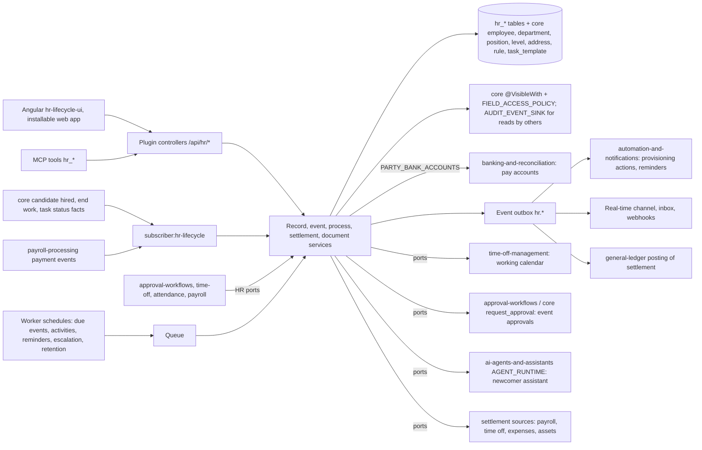

# Implementation Plan: HR core and employee lifecycle

> Translates an approved `spec.md` into architecture and tech choices. The plan owns
> implementation details; the spec owns behaviour.

**Feature ID**: `hr-core-lifecycle`
**Spec**: `./spec.md`
**Tasks**: `./tasks.md`
**Status**: `Draft`
**Last updated**: 2026-11-23

---

## 1. Architecture Summary

Core keeps the employee and its structure and gains only nullable columns that several plugins read (employee number,
employment status, reporting line, primary department, level reference; department tree; position and level
details). Everything else is the new plugin `@gauzy/plugin-hr-lifecycle` (`packages/plugins/hr-lifecycle`): branches,
HR profile, personal data, groups, approvers, HR events, onboarding and separation processes, exit interviews,
grievances, settlements, documents and signatures, scenarios. It offers ports to other plugins (reporting line,
approver resolution, active-employee check, directory, employee rule context, signatures) and consumes theirs (working
calendar, automation actions, approvals, assistant, print, payroll hand-off, settlement sources, bank details). Its
screens are the Gauzy web app (installable on phones for self-service and document photos).

**Built on what exists.** Names, sign-in email and time zone stay on `user`; phones are `employee_phone` rows (`type`
`PERSONAL`); postal addresses of employees and branches are rows of the core address book (`address`, `address_role`);
employee bank details are rows of the one encrypted store of `banking-and-reconciliation` (`party_bank_account`,
party type `EMPLOYEE`, through `PARTY_BANK_ACCOUNTS`); integration identifiers stay in `integration_map`; files are Docs
documents linked through `document_link` (the employee Documents tab today); education and previous employment are
copied from `candidate_education` / `candidate_experience` on hire; equipment to hand over and return comes from
`fixed-assets` custody, else core `equipment_sharing`. Conditions (group rules, template applicability, required
documents) are core `rule` rows; onboarding and separation templates are core task templates
(`packages/core/src/lib/task-template/`, shared with `project-costing-and-billing`); sensitive fields carry core
`@VisibleWith` with default field rules and reads by others go to `AUDIT_EVENT_SINK` (`access-control-and-security`);
dated reminders are rows of the generic reminder table and notices de-duplicate through the notification dispatcher;
settings are in the platform settings store and permissions are plugin contributions; HR event approvals fall back to
core `request_approval` on the existing Approvals page; core `ManagedEmployeeService` gains the reporting line as a
source, used by the HR routes and, only where the organization turns on `hr.reportingLineInManagerScope`, by the
existing employee lists and time screens; the existing employee rate-change request is also recorded as a pay-change
HR event; bulk work is core operations and every pass a `job_execution` row.



## 2. Tech Choices

| Concern | Choice | Rationale |
| ------- | ------ | --------- |
| Package | `packages/plugins/hr-lifecycle` (new), `hr-lifecycle-ui` (new Angular); no React package | Principle I; HR is a Gauzy web app feature |
| Core changes | nullable columns on `employee`, `organization_department`, `organization_position`, `employee_level`, `employee_phone` (`hrGroup`); additive enum values (address owner types and roles, rule owner types, an approval type); two optional core ports (`MANAGED_EMPLOYEE_SOURCES`, `EMPLOYEE_RATE_CHANGE_HANDLER`); core DTOs and route contracts untouched (a department delete moves its sub-departments up, which exist only once this feature is used) | the employee stays in core; other plugins read the columns |
| Flag | tenant feature `FEATURE_HR_LIFECYCLE` in `hr-lifecycle.features.ts`, `@FeatureFlag` + `FeatureFlagGuard` on every controller and resolver (pattern `subscription.features.ts`) | default off |
| Permissions and settings | `hr-lifecycle.permissions.ts` contributions with `defaultFor` (pattern `subscription.permissions.ts`); `hr-lifecycle.settings.ts` setting contributions stored in `tenant_setting` at `ORGANIZATION` scope (the organization level of `organization-setup`) | no seed migration, no settings table |
| Persistence | MultiORM entities on `TenantOrganizationBaseEntity`; the shared core migration helpers of `@gauzy/core`; tri-dialect migrations | Principle III |
| Sensitive data | fields carry core `@VisibleWith(<group key>)` (`api/visible-with.decorator.ts`, applied by `field-visibility.service.ts` on REST, GraphQL, exports and MCP) plus default `access_field_rule` rows (`MASKED`, `isSensitive`) contributed to `access-control-and-security` through `FIELD_ACCESS_POLICY`; each read of a sensitive group by someone other than the employee is one `AUDIT_EVENT_SINK` event (category sensitive-read, record = employee, field group, surface); identity numbers encrypted with core `EncryptionService` (AES-256-GCM) with `last4` columns; bank numbers live in `party_bank_account` | one masking path and one access log for the platform |
| Conditions | core `rule` rows with new `RuleOwnerType` values `EMPLOYEE_GROUP`, `LIFECYCLE_TEMPLATE`, `HR_DOCUMENT_TYPE`, evaluated by `rule.evaluator.ts` against the employee context `HR_EMPLOYEE_RULE_CONTEXT` (department, branch, position, level, employment type, tenure, kind, country), which other features' owner types use too | no condition column |
| Cross-plugin | injection tokens in `@gauzy/contracts`, bound in `apps/api/src/plugin-composition.ts`, all optional | no import of another plugin's internals |
| Background work | `@ScheduledJob` + `@QueueWorker` (`@gauzy/scheduler`); schedule-only plugin in the worker, consumers in the API; in-process timers without a queue; advisory lock per job; passes recorded as core `job_execution` rows, bulk events and scenario application as core operations | pattern of task automations; one run ledger |
| Events | `EventOutboxService.append` in the writing transaction; consumer `subscriber:hr-lifecycle` in `EventConsumerRegistry` | at-least-once, deduplicated |
| Reminders and notices | dated reminders (document expiry, probation, contract end, retirement, interviews, signatures) scheduled as rows of the generic reminder table through `REMINDERS` (`sourceKey` `hr:<occasion>:<record>:<offset>`, rescheduled when the date changes); daily notices (birthdays, anniversaries, team summary) through `NOTIFICATION_DISPATCHER` with `dedupeKey`; without `automation-and-notifications` the `hr.reminders` job sends both through `INBOX_ITEM_WRITER` with the key as the item's `externalId` | no reminder log of our own |
| Tasks of processes | core tasks in a per-organization project "Onboarding and separation" created on first use, dated by the core task-template module | people work where they already work; one template engine |
| Org chart | materialised manager path (`hrPath`) on `employee_hr_profile`, lazy subtree endpoint, client virtual tree | no size ceiling |
| Reports | report definitions registered with `report-builder-and-dashboards`; HR analytics from a monthly `hr_headcount_snapshot` | no raw scans for trends |

## 3. Data Model

### Changed core entities (additive, all nullable)

| Table | New columns (type) | Indexes |
| --- | --- | --- |
| `employee` | `employeeNumber` varchar(64), `employmentStatus` varchar(16) (`ACTIVE`/`NOTICE`/`SUSPENDED`/`ENDED`; null = derived as today), `reportsToEmployeeId` uuid fk `employee` set null, `primaryDepartmentId` uuid fk `organization_department` set null, `employeeLevelId` uuid fk `employee_level` set null | unique `(organizationId, employeeNumber)` where not null; idx `(organizationId, reportsToEmployeeId)`, `(organizationId, employmentStatus)` |
| `organization_department` | `parentId` uuid fk self set null, `code` varchar(32), `headEmployeeId` uuid fk `employee` set null, `costCentreId` uuid (no fk: `accounting`), `path` varchar(1024) | unique `(organizationId, code)` where not null; idx `(organizationId, parentId)`, `(path)` |
| `organization_position` | `code` varchar(32), `description` text, `organizationDepartmentId` uuid fk set null, `plannedHeadcount` int | unique `(organizationId, code)` where not null |
| `employee_level` | `rank` int, `description` text | idx `(organizationId, rank)` |

`employee.employeeLevel` (label) and `employeeLevelId` are kept in sync by the plugin's service and by a backfill
migration matching labels per organization. Core entity classes gain the properties with `MultiORMColumn` /
`MultiORMManyToOne`; core DTO whitelists do not, so core routes ignore them.

Other additive core changes (no new table):

| Where | Change |
| --- | --- |
| `contracts/address.model.ts`, `address-role/address-role.enums.ts` | `AddressOwnerType.EMPLOYEE`, `BRANCH`; `AddressRoleEnum.CURRENT`, `PERMANENT`; `address.service.ts` refuses owner type `EMPLOYEE` on the generic address routes, so employee addresses are read and written only through the HR routes |
| `contracts/rule.model.ts` | `RuleOwnerType.EMPLOYEE_GROUP`, `LIFECYCLE_TEMPLATE`, `HR_DOCUMENT_TYPE` |
| `contracts/approval-policy.model.ts`, `request-approval/` | `ApprovalPolicyTypesStringEnum.HR_EVENT`; its gate (`HR_EVENTS_EDIT` or being named on the request) registered in `linked-document-decision.gate.ts`; settler registered with `registerRequestApprovalSettler` (the core settler registry of `approval-workflows`) |
| `employee/managed-employee.service.ts` | optional multi-provider `MANAGED_EMPLOYEE_SOURCES` (`employeeIdsManagedBy(userId, { purpose })`); the HR binding adds the caller's direct and indirect reports to HR reads always, and to employee lists and time screens only while the organization setting `hr.reportingLineInManagerScope` is on (off by default: those screens keep today's scope of teams and projects managed) |
| `employee/rate-change-request/rate-change-request.service.ts` | optional `EMPLOYEE_RATE_CHANGE_HANDLER`; bound, the request is also recorded as an HR event of kind `PAY_CHANGE` awaiting approval (the administrators' notification is kept) |
| `employee-phone/` | personal phones written through the HR routes are rows with `type = 'PERSONAL'` (existing column) and the additive nullable column `hrGroup` = `PERSONAL`; only rows with `hrGroup` set are masked and anonymised, so existing rows, whatever their `type`, keep their visibility |
| `organization-department/organization-department.service.ts` | on delete, sub-departments (`parentId`) move to the deleted department's parent or become roots; deletion with members works as today |

### New plugin entities (`TenantOrganizationBaseEntity`: tenant, organization, soft delete, timestamps)

```ts
@MultiORMEntity('hr_event', { mikroOrmRepository: () => MikroOrmHrEventRepository })
export class HrEvent extends TenantOrganizationBaseEntity implements IHrEvent { /* columns below */ }
```

| Table | Columns (type) | Indexes and uniqueness |
| --- | --- | --- |
| `organization_branch` | `name` varchar(255), `code` varchar(32), `timeZone` varchar(64), `isActive`; its postal address, country, subdivision (`provinceCode`) and coordinates are an `address` row (owner type `BRANCH`) | unique `(organizationId, code)` where not null |
| `employee_hr_profile` | `employeeId` fk unique, `branchId` fk null, `probationEndDate`, `confirmationDate`, `contractEndDate`, `retirementDate` date, `noticePeriodDays` int, `payMethod` varchar(16) (`BANK_TRANSFER`/`CASH`/`CHEQUE`), `hrMailPreference` varchar(16), `birthdayShared` bool, `dailySummary` bool, `hrPath` varchar(2048), `version` int | idx `(organizationId, branchId)`, `(hrPath)`, `(probationEndDate)`, `(contractEndDate)` |
| `employee_personal_detail` (only what has no home today) | `employeeId` fk unique, `salutation`, `legalFirstName`, `legalMiddleName`, `legalLastName`, `preferredName` varchar(120), `birthDate` date, `gender` varchar(32), `maritalStatus` varchar(24), `nationalities` json, `bloodGroup` varchar(8), `personalEmail` varchar(255) | idx `(organizationId, birthDate)` |
| `employee_emergency_contact`, `employee_education`, `employee_previous_employment` | `employeeId` fk, `position` int, plus name/relation/phones/email; institution/qualification/field/from/to and `candidateEducationId` null; employer/role/from/to/reason and `candidateExperienceId` null (the candidate rows copied on hire, never twice) | idx `(employeeId)` |
| `employee_external_id` (identifiers no integration maps) | `employeeId` fk, `system` varchar(32) (`ATTENDANCE_DEVICE`, `BADGE` (hashed), `PAYROLL_PROVIDER`, `GOVERNMENT`, `OTHER`), `value` varchar(255) | unique `(tenantId, system, value)` |
| `employee_group`, `employee_group_member` | group: `name`, `kind` (`STATIC`/`RULE`), conditions as core `rule` rows (owner type `EMPLOYEE_GROUP`); member: `groupId`, `employeeId`, `source` (`MANUAL`/`RULE`) | unique `(groupId, employeeId)` |
| `hr_approver` | `kind` varchar(24), `employeeId` null, `organizationDepartmentId` null, `approverEmployeeId` fk, `position` int | unique `(kind, employeeId)` where employee set; unique `(kind, organizationDepartmentId, approverEmployeeId)` |
| `hr_position_skill`, `employee_skill_rating` | `organizationPositionId`, `skillId`, `minProficiency` int; `employeeId`, `skillId`, `proficiency` int, `evaluatedOn` date, `evaluatorId`, `source` varchar(16) | unique `(organizationPositionId, skillId)`; idx `(employeeId, skillId, evaluatedOn)` |
| `hr_event`, `hr_event_change` | event: `employeeId`, `kind` varchar(24) (incl. `PAY_CHANGE`), `effectiveDate` date, `reason` text, `status` (`DRAFT`/`AWAITING_APPROVAL`/`SCHEDULED`/`APPLIED`/`CANCELLED`/`REFUSED`), `appliedAt`, `approvalRequestId` (workflow instance or core `request_approval`), `targetOrganizationId`, `targetEmployeeId`, `payRateChange` json, `batchId`, `scenarioId`, `recordedById`, `version`; change: `eventId` fk cascade, `property` varchar(40), `oldValue`, `newValue` varchar(255) | idx `(organizationId, status, effectiveDate)`, `(employeeId, effectiveDate)`; unique `(eventId, property)` |
| `lifecycle_template_activity` (HR facts of a core template task) | `taskTemplateTaskId` fk unique cascade (core `task_template_task` of a template of kind `HR_ONBOARDING` or `HR_SEPARATION`; title, description, offset, duration, weight and order live there; applicability as core `rule` rows of owner type `LIFECYCLE_TEMPLATE` on the template), `kind` varchar(24), `ownerType` varchar(16), `ownerEmployeeId`, `ownerRoleId`, `offsetAnchor` (`START`/`LAST_DAY`), `requiredBeforeEmployee` bool, `notify` bool, `actionConfig` json | — |
| `lifecycle_process`, `lifecycle_activity` | process: `kind`, `taskTemplateId`, `employeeId`, `candidateId`, `ownerEmployeeId`, `status` (`PLANNED`/`IN_PROGRESS`/`DONE`/`CANCELLED`), `startDate`, `lastDay`, `progress` int, `projectId`, `separationId`, `liveKey` varchar(80) null, `version`; activity: `processId`, `position`, `title`, `kind`, owner columns, `startDate`, `dueDate`, `weight`, `requiredBeforeEmployee`, `status` (`OPEN`/`DONE`/`FAILED`/`CANCELLED`), `taskId`, `result` json, `failureReason`, `runKey` varchar(120), `doneById`, `actorType` | unique `(tenantId, liveKey)` (set only while live: `<kind>:<employee or candidate>`); unique `(runKey)`; idx `(organizationId, status, dueDate)` |
| `separation` | `employeeId`, `kind` varchar(24), `reason` text, `noticeDate`, `requestedLastDay`, `lastWorkingDay`, `endOfWorkDate` date, `status`, `timeOffEncashed` bool, `exitInterviewDate`, `nextEmployer`, `feedback` text, `processId`, `version` | idx `(organizationId, status, endOfWorkDate)` |
| `hr_questionnaire_version` | `kind` varchar(16) (`EXIT`), `version` int, `definition` text (a question-set definition of `custom-fields-and-forms`, contracts `question-set.model.ts`: key, labels, type, required, options or rating scale; the same format recruitment, performance and lead-capture questionnaires use), `publishedAt`, `publishedById` | unique `(organizationId, kind, version)` |
| `exit_interview` | `separationId` fk, `scheduledAt`, `interviewerIds` json, `questionnaireVersionId`, `answers` json (keyed by the definition's field keys), `questionnaireSentAt`, `summary`, `outcome` varchar(16), `status` (`TO_SCHEDULE`/`SCHEDULED`/`HELD`/`CANCELLED`), `liveKey` | unique `(tenantId, liveKey)` |
| `onboarding_question` | `processId`, `askedById`, `question`, `answer` text, `sources` json, `status` (`ANSWERED`/`ROUTED`/`CLOSED`), `inboxItemId` | idx `(organizationId, status)` |
| `grievance_type`, `grievance` | type: `name`, `description`, `targetDays`; grievance: `number`, `raisedByEmployeeId`, `typeId`, `subjectType`, `subjectId`, `subjectRecordType`, `description`, `confidentiality`, `investigatorEmployeeId`, `status` (`OPEN`/`INVESTIGATING`/`RESOLVED`/`DISMISSED`/`WITHDRAWN`), `dueAt`, `escalatedAt`, `resolutionNote`, `resolvedOn`, `responsibleEmployeeId`, `resolverEmployeeId`, `version` | unique `(organizationId, number)`; idx `(organizationId, status, dueAt)` |
| `final_settlement`, `final_settlement_line` | settlement: `separationId` unique, `employeeId`, `currency`, `payableTotal`, `receivableTotal`, `netTotal` numeric(20,6), `status` (`DRAFT`/`CONFIRMED`/`PAID`/`CANCELLED`), `sourcesConsulted` json, `confirmedById`, `confirmedAt`, `paymentRef`, `journalRef`, `version`; line: `settlementId`, `direction` (`PAYABLE`/`RECEIVABLE`/`ASSET`), `sourceKey` varchar(40), `sourceType`, `sourceId`, `description`, `originalAmount`, `amount` numeric(20,6), `changeReason`, `isSettled`, `assetResolution`, `recoveryCost` | unique `(settlementId, sourceKey, sourceId)` |
| `hr_document_type`, `employee_document` | type: `name`, `category`, `requires` json, `reminderDays`, `selfUpload`, `requiredWithinDays` (who needs it: core `rule` rows of owner type `HR_DOCUMENT_TYPE`); document (HR facts only): `employeeId`, `typeId`, `documentLinkId` (Docs `document_link` of the file to the employee; core file storage `fileId` when the Docs plugin is absent), `numberEnc`, `numberLast4`, `issuer`, `issuedOn`, `expiresOn`, `status` (`UPLOADED`/`VERIFIED`/`REJECTED`), `verifiedById`, `rejectionReason`, `version` | idx `(organizationId, expiresOn)`, `(employeeId, typeId)` |
| `signature_request`, `signature_signer` (the platform's signing evidence, record-agnostic) | request: `recordType`, `recordId` (an employee document, a contract, a recruitment offer, …), `fileId`, `title`, `message`, `status`, `fingerprint` varchar(128), `signedFileId`; signer: `requestId`, `signerType` (`EMPLOYEE`/`CANDIDATE`/`EXTERNAL`), `employeeId` null, `signerRef` null, `name`, `email`, `tokenHash` (external signers), `order`, `status`, `signedAt`, `method`, `consentText`, `client` json, `ipHash` | unique `(requestId, signerType, employeeId, signerRef)` |
| `employment_contract` | `employeeId`, `employmentTypeId` (core `organization_employment_type`, the employee's existing employment types), `startDate`, `endDate`, `renewalTerms`, `signatureRequestId`, `status`, `version` | idx `(employeeId, startDate)` |
| `reorg_scenario` | `name`, `ownerUserId`, `sharedWith` json, `moves` json, `status` (`DRAFT`/`APPLIED`/`DISCARDED`), `appliedOn` date, `batchId` | idx `(organizationId, ownerUserId)` |
| `hr_headcount_snapshot` | `monthEnd` date, `dimensions` json, `headcount`, `joiners`, `leavers`, `voluntaryLeavers` int | unique `(organizationId, monthEnd)` |

Kept elsewhere, not in plugin tables:

- **Names**: the display name stays `user.firstName` / `lastName`; the legal name parts here are what HR documents,
  letters, contracts and settlements print. They default from `user` when first recorded; later edits of either do not
  change the other.
- **Phones and addresses**: personal phones are `employee_phone` rows (`type = 'PERSONAL'`, `hrGroup = 'PERSONAL'`;
  rows that existed before keep their visibility); current and permanent
  addresses are `address` rows (owner type `EMPLOYEE`, roles `CURRENT`, `PERMANENT`), read and written only through
  the HR personal-data routes under `HR_PERSONAL_DATA_*`; the work address stays the employee's `contact`.
- **Pay accounts**: `party_bank_account` rows (`partyType = EMPLOYEE`) through `PARTY_BANK_ACCOUNTS`; banking encrypts,
  masks, blanks them in exports without `BANK_ACCOUNT_NUMBERS_EXPORT`, logs every full read and holds a changed number
  `PENDING` until a second person verifies it; this plugin keeps the screen, the `HR_BANK_DETAILS_*` permissions and
  `employee_hr_profile.payMethod`.
- **Identifiers**: identifiers of connected integrations stay in `integration_map` (entity employee); the lookup
  `GET /hr/employees/by-external-id` reads both.
- **Groups and teams**: an employee group is an audience (reminders, approver lists, policy rules) and never joins
  boards, time or task assignment, which is why groups are not `organization_team` rows.
- **Skill scale**: proficiency is 1 to 5 platform-wide (`SkillProficiency` in contracts); a rating on a scale with points
  `min..max` is mapped to `round(1 + 4 × (p − min) / (max − min))`, and course targets use the same 1 to 5.
- **Access log**: reads of sensitive groups are `access_audit_event` rows (through `AUDIT_EVENT_SINK`); the employee's
  "who read my data" page and `HR_ACCESS_LOG_VIEW` read them filtered by the employee.
- **Settings** (`hr-lifecycle.settings.ts`): `hr.numberingMode`, `hr.sequenceId`, `hr.retirementAge` (60),
  `hr.retirementOverrides`, `hr.spanMin` / `hr.spanMax`, `hr.chartVisibleToAll`, `hr.crossOrganizationReporting`,
  `hr.selfEditableFields`, `hr.birthdaySharing`, `hr.reminderOffsets`, `hr.retention` (none by default: nothing is
  anonymised; 7 years after end of work suggested), `hr.suspendedKeepsSignIn`, `hr.employeesSeeAccessLog`,
  `hr.eventKindsRequiringApproval`, `hr.refuseInactiveDates` (false: the HR-dependent features warn instead of refusing),
  `hr.reportingLineInManagerScope` (false).

### Migrations

**Migration timestamps**: `packages/plugins/hr-lifecycle` `1791000095100` to `1791000095199`; `packages/core` `1791000095900` to `1791000095999`.

- Core (`packages/core/src/lib/database/migrations/`): `1791000095900-AddEmployeeHrStructureColumns` (the four tables
  above and `employee_phone.hrGroup`), `1791000095910-BackfillEmployeeLevelReference` (idempotent label match); enum
  values need none. The task-template tables come from `project-costing-and-billing`'s core migration
  `1791000094900-CreateTaskTemplateTables`.
- Plugin (`packages/plugins/hr-lifecycle/src/lib/database/migrations/`): `1791000095100-CreateHrRecordTables` (branch, profile, personal, contacts, education, employment, external ids,
  groups, approvers, skills), `1791000095110-CreateHrEventTables`, `1791000095120-CreateHrLifecycleTables` (template activity details,
  processes, activities, separation, questionnaire versions, exit interview, questions),
  `1791000095130-CreateHrGrievanceAndSettlementTables`, `1791000095140-CreateHrDocumentTables` (types, documents, signatures, contracts),
  `1791000095150-CreateHrChartTables` (scenarios, snapshots). Permissions, role grants, feature and settings are contributions;
  no seed migration.
- Additive and idempotent per dialect with the plugin helpers; partial unique indexes become nullable `liveKey`
  columns with plain unique indexes on MySQL and SQLite; SQLite tables are created whole. No backfill of `NOT NULL`.

### Contracts

`packages/contracts/src/lib/hr-lifecycle.model.ts`: entity interfaces, enums (`EmploymentStatusEnum`,
`HrEventKindEnum`, `LifecycleKindEnum`, `LifecycleActivityKindEnum`, `SeparationKindEnum`, `GrievanceStatusEnum`,
`SensitiveFieldGroupEnum`, `HrApproverKindEnum`, `SignerTypeEnum`, `SkillProficiency`), DTO shapes, preview shapes,
event payloads, and the port interfaces `IHrReportingLine`, `IHrApproverResolver`, `IHrActiveEmployeeCheck`,
`IHrDirectory`, `IHrEmployeeRuleContext`, `IHrSignatures`, `IFinalSettlementSource`, `IHrOverviewBlockSource`.
`IEmployee`, `IOrganizationDepartment`, `IOrganizationPosition` and `IEmployeeLevel` gain the optional fields; the
address, rule and approval enums gain the values above.

## 4. API Surface

All routes under `/api/hr`, guarded by `TenantPermissionGuard`, `PermissionGuard`, `FeatureFlagGuard`; lists use cursor
pagination; creating and confirming routes take `Idempotency-Key`; updates take `version`; responses pass through core
field visibility (`@VisibleWith` keys of the sensitive groups) and reads of sensitive groups by others write one
audit event each.

| Method | Endpoint | Permission | Description (request → response) | Status |
| ------ | -------- | ---------- | -------------------------------- | ------ |
| `GET/PUT` | `/hr/settings` | `HR_RECORDS_VIEW` / `HR_SETTINGS_EDIT` | the `hr.*` keys of the settings store | New |
| `GET` | `/hr/employees`, `/hr/employees/:id` | `HR_RECORDS_VIEW` | `IHrEmployeeRecord` (fields without the group key removed) | New |
| `PUT` | `/hr/employees/:id/placement`, `/hr/employees/:id/profile` | `HR_RECORDS_EDIT` | `HrPlacementDTO`, `HrProfileDTO`; a placement change is written as an applied `CORRECTION` event | New |
| `GET/PUT` | `/hr/employees/:id/personal`, `/addresses`, `/phones`, `/emergency-contacts`, `/education`, `/previous-employment` | `HR_PERSONAL_DATA_VIEW` / `_EDIT` | group DTOs; addresses are core `address` rows (owner `EMPLOYEE`), phones `employee_phone` rows | New |
| `GET/POST/PUT` | `/hr/employees/:id/pay-accounts`, `POST …/:accountId/confirm` | `HR_BANK_DETAILS_VIEW` / `_EDIT` | the employee's `party_bank_account` rows through `PARTY_BANK_ACCOUNTS` (masked; confirm = banking's second-person verification) | New |
| `GET/PUT` | `/hr/employees/:id/external-ids`; `GET /hr/employees/by-external-id` | `HR_RECORDS_EDIT` / `HR_RECORDS_VIEW` | system and value; the lookup also reads `integration_map` | New |
| `GET` | `/hr/employees/:id/history`, `/overview`, `/connections`, `/access-log` | `HR_RECORDS_VIEW` (access log: `HR_ACCESS_LOG_VIEW`) | timeline, blocks, counts, sensitive reads from the access audit | New |
| `GET/PUT` | `/hr/me`, `/hr/me/preferences`, `/hr/me/access-log`; `POST /hr/me/resignation` | `HR_SELF_SERVICE` | own record and self-editable fields | New |
| `GET` | `/hr/reporting-line/:employeeId/chain?depth=`, `/reports?scope=` | `HR_RECORDS_VIEW` or self | chain, direct or all reports | New |
| `GET/PUT` | `/hr/approvers`, `GET /hr/approvers/resolve?employeeId=&kind=` | `HR_RECORDS_VIEW` / `HR_RECORDS_EDIT` | lists; resolved approver with the rule used | New |
| `GET/POST/PUT/DELETE` | `/hr/branches`, `/hr/employee-groups` (+ `/:id/members`) | `HR_RECORDS_VIEW` / `HR_SETTINGS_EDIT` | `BranchDTO` (with its `address` row), `EmployeeGroupDTO` (rule groups' conditions as `rule` rows) | New |
| `GET/PUT` | `/hr/departments/tree`, `/hr/departments/:id/structure`, `/hr/positions/:id/details`, `/hr/positions/:id/required-skills`, `/hr/levels/:id/rank` | `HR_RECORDS_VIEW` / `HR_SETTINGS_EDIT` | writes the core columns | New |
| `GET/POST/PUT` | `/hr/events`, `/hr/events/:id`; `POST …/:id/confirm`, `…/:id/cancel`, `/hr/events/bulk` | `HR_EVENTS_EDIT` | `HrEventDTO` (`preview`) → `IHrEvent`, bulk per-row results | New |
| `GET/POST/PUT/DELETE` | `/hr/lifecycle-templates`; `GET /hr/lifecycle-templates/match` | `HR_LIFECYCLE_MANAGE` | core task templates of kind `HR_ONBOARDING` / `HR_SEPARATION` with their HR activity details and applicability rules | New |
| `GET/POST` | `/hr/processes`, `/hr/processes/:id`; `POST …/activities`, `PUT …/activities/:aid` (done, cancel, retry), `POST …/complete`, `…/cancel`, `…/create-employee` | `HR_LIFECYCLE_MANAGE` (owners update their own activities) | `StartProcessDTO` → `ILifecycleProcess` | New |
| `GET/POST/PUT` | `/hr/separations`, `/hr/separations/:id`; `POST …/complete` (`newManagers`), `…/cancel` | `HR_LIFECYCLE_MANAGE` | `SeparationDTO` | New |
| `GET/POST/PUT` | `/hr/exit-interviews`; `GET/POST /hr/questionnaires/exit` (versions); `POST /hr/exit-interviews/questionnaires/send`; `GET/PUT /hr/me/exit-questionnaire` | `HR_LIFECYCLE_MANAGE` / `HR_SELF_SERVICE` | per-leaver results; answers keyed by the definition version's fields | New |
| `POST/GET` | `/hr/onboarding-assistant/ask`, `/hr/onboarding-questions` | person in onboarding / `HR_LIFECYCLE_MANAGE` | answer with sources or routed | New |
| `GET/POST/PUT` | `/hr/grievance-types`, `/hr/grievances`, `/hr/grievances/:id`; `POST …/assign`, `…/transition` | `HR_SETTINGS_EDIT`, `HR_SELF_SERVICE` (own), `HR_GRIEVANCES_INVESTIGATE` | `GrievanceDTO` | New |
| `POST/GET/PUT` | `/hr/settlements`, `/hr/settlements/:id`, `…/lines/:lineId`, `…/refresh`; `POST …/confirm`; `GET …/print` | `HR_SETTLEMENTS_EDIT` / `HR_SETTLEMENTS_CONFIRM` | lines from sources; confirm with `preview` | New |
| `GET/POST/PUT/DELETE` | `/hr/document-types`, `/hr/employees/:id/documents`, `/hr/documents/:id` (+ `/verify`, `/reject`), `GET /hr/documents/missing` | `HR_DOCUMENTS_MANAGE` (own upload: `HR_SELF_SERVICE`) | document DTOs | New |
| `POST/GET` | `/hr/signature-requests`, `/:id`, `/:id/sign` (signer), `/:id/cancel`; `GET/POST /public/hr/sign/:token` (outside signer, signed token with purpose and expiry, throttled) | `HR_DOCUMENTS_MANAGE` or the `HR_SIGNATURES` port / signer | evidence in response; any record type | New |
| `GET/POST/PUT` | `/hr/contracts`; `POST /hr/letters` | `ORG_CONTRACT_EDIT` / `HR_DOCUMENTS_MANAGE` | contract DTO (type = an employment type); PDF via print service | New |
| `GET/PUT` | `/hr/employees/:id/skill-ratings`; `GET /hr/skill-gaps` | `HR_RECORDS_VIEW` / `HR_RECORDS_EDIT` | ratings, gaps | New |
| `GET` | `/hr/org-chart?rootId=&depth=`, `/hr/org-chart/search`, `/hr/org-chart/export` | `HR_ORG_CHART_VIEW` or setting | lazy subtree with spans, vacancies, badges | New |
| `GET/POST/PUT` | `/hr/reorg-scenarios`, `/:id`; `POST …/compare`, `…/apply` (`effectiveDate`, `preview`) | `HR_REORG_PLAN` | deltas; batch of events | New |
| `GET` | `/hr/analytics/{workforce,exits,attrition,absence,spans,digital-workforce}` | `HR_REPORTS_VIEW` | report data sources | New |
| `*` | `/employee/*`, `/organization-department/*`, `/organization-position/*`, `/employee-level/*`, `/employee/rate-change-request` | as today | unchanged contracts; with the feature on, a rate-change request is also a `PAY_CHANGE` HR event, a deleted department's sub-departments move up, and manager scopes include reports only while `hr.reportingLineInManagerScope` is on | Unchanged contract |

Errors: `400` with stable codes (`HR_REPORTING_CYCLE`, `HR_ACTIVE_REPORTS`, `HR_LATER_EVENT_CHANGED`,
`HR_REQUIRED_ACTIVITIES_OPEN`, `HR_SETTLEMENT_UNSETTLED`, `HR_AGENT_NOT_ALLOWED`), `403`, `404` (other organization,
flag off), `409` (`ENTITY_VERSION_CONFLICT`, live process exists). Swagger decorators on every route.

**Consumer tokens answered** (bound in `apps/api/src/plugin-composition.ts` to the HR directory, active-employee check, approver resolver, reporting line, skill ratings and onboarding start; each consumer plan states the shape it calls and its fallback): `LEARNING_SKILL_RATINGS`, `PAYROLL_ACTIVE_EMPLOYEE`, `PAYROLL_HR_DIRECTORY`, `PERFORMANCE_SKILL_RATINGS`, `RECRUITMENT_ONBOARDING`, `WORKFLOW_HR_APPROVERS`, `WORKFLOW_REPORTING_LINE`.

## 5. Events, Real-Time and Notifications

| Event | Emitted when | Consumers |
| ----- | ------------ | --------- |
| `hr.employee.hired`, `hr.employee.placement_changed` | employee created from onboarding; placement or reporting line changed | automations, time-off assignment rules, chart real-time, webhooks |
| `hr.event.applied` / `.cancelled` | HR event applied or cancelled | history, time off, payroll, real-time |
| `hr.process.started` / `.completed`, `hr.activity.due` / `.failed` | process lifecycle; automated activity due or failed | automation engine (provisioning actions), inbox |
| `hr.separation.started` / `.completed` | separation recorded / ended work | time off (encashment offer), fixed assets (return list), access revocation |
| `hr.document.expiring`, `hr.document.signed`, `hr.grievance.raised` / `.resolved` | as named | inbox, email, automations |
| `document.final_settlement.confirmed` / `.cancelled` | settlement confirmed or cancelled | `general-ledger` posting rule; payment: through a `payroll-processing` settlement run when payroll is on, else through `payments-and-collections`, never both |
| `hr.employee.pay_change.applied` | a `PAY_CHANGE` or promotion pay revision applied | `payroll-setup` assignment proposal (the consumer of applied pay events) |
| consumed: core `CandidateHiredEvent`, end-work facts, task status changes | hire; work ended; task done | onboarding start offer, copy of candidate education and experience, process sync, activity completion |
| consumed: `payroll.settlement.paid`, `payments.payment_order.executed`, `accounting.journal.posted` | payment or journal done | settlement status |
| consumed: `workflows.approval.decided` (record type `hr.event`), the settler of core request approvals (type `HR_EVENT`) | approvals | event applied, scheduled or refused |

Real-time: record-change hints for employees, chart nodes, processes and grievances on the platform channel. Notices
through `NOTIFICATION_DISPATCHER` with `dedupeKey` (activities due, signature requests, routed questions, grievance
assignment, probation reviews, daily notices) and dated reminders through `REMINDERS`, as in §2; without
`automation-and-notifications`, `INBOX_ITEM_WRITER` with the same keys. Emails through the email-template system;
chat delivery through the notification preferences of `automation-and-notifications` when loaded.

## 6. UI Surface

- **Core UI (first, T56)**: named slots `DEPARTMENTS_PAGE_PANELS`, `POSITIONS_PAGE_PANELS` and
  `EMPLOYEE_LEVELS_PAGE_PANELS` placed on the existing pages `apps/gauzy/src/app/pages/{departments,positions,employee-levels}`
  (row detail and page header area), added to `PAGE_EXTENSION_SLOTS`.
- Angular plugin `packages/plugins/hr-lifecycle-ui` registered in `apps/gauzy/src/plugin-ui.config.ts`, menu group "HR"
  hidden without the feature or permission. Routes: `/pages/hr/dashboard`, `/pages/hr/org-chart` (+ `/scenarios/:id`),
  `/pages/hr/onboarding`, `/pages/hr/separations`, `/pages/hr/processes/:id`, `/pages/hr/events`, `/pages/hr/grievances`,
  `/pages/hr/settlements/:id`, `/pages/hr/documents` (compliance, signatures), `/pages/hr/reports`, `/pages/hr/settings`
  (branches, groups, approvers, templates, document and grievance types, exit questionnaire, reminders, privacy),
  `/pages/hr/me` (my HR record, documents, onboarding, resignation, grievances, who read my data).
- The existing employee page (`apps/gauzy/src/app/pages/employees/edit-employee`) gets tabs "HR record", "Personal",
  "History", "Overview" through the `EMPLOYEE_EDIT_TABS` tabset (`employee-edit-page`); existing tabs unchanged; pay
  accounts are a section of "Personal" over banking's store. Departments, positions and levels keep their existing
  pages, which show the "Structure" panel (tree with parent and head, code, cost centre; position description, planned
  headcount and required skills; level rank) through the slots above; HR settings link to them.
- Phones: the self-service pages (`/pages/hr/me`, resignation, document upload with the camera, signing) render at
  phone width in the installable Gauzy web app.
- An outside signer (for example a candidate signing an offer) signs on `/share/hr/sign/:token` in `public-layout-ui`,
  built like the existing estimate answer page.
- Every list is a saved-view list; forms honour custom fields; i18n keys `HR_LIFECYCLE.*` in every locale of
  `packages/ui-core/i18n`; chart nodes keyboard-navigable with labels.

## 7. MCP Tools, SDKs and Integrations

`packages/mcp-server/src/lib/tools/hr-lifecycle.ts` (registered in `register-all-tools.ts`); outputs pass core field
visibility, and sensitive reads write audit events with surface `MCP`:

| Tool | Input | Output |
| --- | --- | --- |
| `hr_employee_get`, `hr_employee_search` | id or filters | HR record, masked per caller |
| `hr_org_chart`, `hr_reporting_chain` | root or employee, depth | subtree with spans and vacancies; chain |
| `hr_event_record` | employee, kind, changes, date, `preview` (default true) | changes and conflicts, or event |
| `hr_onboarding_start`, `hr_separation_start` | person, template, dates, `preview` | planned activities and dates, or process |
| `hr_process_status` | process or person | activities, progress, failures |
| `hr_settlement_preview`, `hr_settlement_confirm` | separation; `preview` | lines and totals; confirmation |
| `hr_documents_expiring`, `hr_skill_gaps` | range; position or team | documents; gaps |
| `hr_reorg_simulate` | moves | spans, headcount and cost deltas |
| `hr_analytics` | metric, period, grouping | series |

Report definitions registered: the four reports of spec §3.14, dashboard charts and cards, HR analytics. Print
templates: settlement statement, HR letters. Import templates: employees with HR fields, reporting lines, documents.
OpenAPI grows additively; Kiota SDKs regenerated after merge.

Ports (tokens in contracts; optional; bound in `apps/api/src/plugin-composition.ts`):

| Port | Direction | Bound to | Fallback when unbound |
| --- | --- | --- | --- |
| `HR_REPORTING_LINE`, `HR_APPROVER_RESOLVER`, `HR_ACTIVE_EMPLOYEE_CHECK`, `HR_DIRECTORY` | provided | HR services; the active-employee check answers `{ active, refuse }`, `refuse` true only while `hr.refuseInactiveDates` is on (otherwise consumers warn and accept) | consumers' own fallbacks |
| `HR_EMPLOYEE_RULE_CONTEXT` | provided | employee context for `rule.evaluator.ts` (department, branch, position, level, employment type, tenure, kind, country), used by the rule owner types of time off, expenses and other features | those features evaluate on core employee fields only (no branch or country) |
| `HR_SIGNATURES` | provided | signature requests for any record type with employee or outside signers (bound also as `RECRUITMENT_SIGNATURES` for offer acceptance) | callers keep their own acceptance record |
| `RECRUITMENT_HEADCOUNT` | provided | writes a headcount plan's planned positions into `organization_position.plannedHeadcount`, so chart vacancies and the plan agree | — |
| `LEARNING_COMPLETIONS` | consumed | `learning-management` completions and certificates, read in place by the skills view and the compliance list (learning reminds of its own certificate expiries; no HR reminder for them) | no trainings listed |
| `MANAGED_EMPLOYEE_SOURCES` (core), `EMPLOYEE_RATE_CHANGE_HANDLER` (core) | provided | reports of the reporting line; `PAY_CHANGE` events | core as today |
| `PARTY_BANK_ACCOUNTS` | consumed | `banking-and-reconciliation` | pay accounts not offered (payment method only) |
| `FIELD_ACCESS_POLICY`, `AUDIT_EVENT_SINK` | consumed (core slots) | `access-control-and-security` (default field rules contributed) | `@VisibleWith` alone; no access log |
| `HR_APPROVALS` | consumed | `WorkflowApprovalGateway` | a core `request_approval` of type `HR_EVENT` to the resolved approver (FR-25) for the kinds in `hr.eventKindsRequiringApproval`, decided on the existing Approvals page |
| `REMINDERS`, `NOTIFICATION_DISPATCHER` | consumed | `automation-and-notifications` | `INBOX_ITEM_WRITER` with the de-duplication key |
| `HR_ASSISTANT` | consumed | `AGENT_RUNTIME.complete` of `ai-agents-and-assistants` (purpose `hr.onboarding-answer`, document passages only; runs and usage recorded there) | AI provider registry of `ai-chat`; without either, the assistant is hidden |
| `HR_WORKING_CALENDAR`, `HR_AUTOMATION_ACTIONS`, `HR_PRINT`, `HR_PAYROLL_HANDOFF`, `HR_SETTLEMENT_SOURCE` (multi), `HR_CUSTODY` | consumed | time off, automation actions, print templates, payroll, settlement sources, `fixed-assets` custody | Saturday and Sunday off with official holidays; no automated activities; built-in templates; payments hand-off; sources listed as not consulted; core `equipment_sharing` holdings |

## 8. Background Jobs

| Trigger | When | What it does | Idempotency |
| ------- | ---- | ------------ | ----------- |
| `hr.events.apply-due` | hourly | applies scheduled events whose date reached in the organization's time zone | event status + version; advisory lock per organization |
| `hr.activities.run-due` | every 15 min | publishes `hr.activity.due` for automated activities; marks results | `runKey` unique per activity and attempt |
| `hr.separations.end-work` | hourly | ends work and revokes access on the end-of-work date | separation status |
| `hr.reminders` | daily per organization | keeps the `REMINDERS` rows of dated occasions in step with their dates; sends birthdays, anniversaries and daily summaries through the dispatcher | reminder `sourceKey`; dispatcher `dedupeKey` `hr:<occasion>:<employee>:<date>` |
| `hr.grievances.escalate` | hourly | escalates overdue grievances | `escalatedAt` |
| `hr.groups.recompute` | on placement events + nightly | rule-based group members from the `rule` rows | upsert `(groupId, employeeId)` |
| `hr.snapshot` | monthly + on demand | `hr_headcount_snapshot` | upsert `(organizationId, monthEnd)` |
| `hr.retention` | monthly, only for organizations that set `hr.retention` | anonymises expired personal groups this feature recorded (incl. `EMPLOYEE` address rows and phone rows with `hrGroup`) after notifying HR | per employee and group marker |

The worker loads `HrLifecycleSchedulePlugin` (schedules only); the API loads `HrLifecyclePlugin`. Without a queue the
API runs the sweeps on in-process timers under the same locks. Every pass is a core `job_execution` row; bulk events
and scenario application are core operations (`HR_EVENTS_BULK`, `HR_SCENARIO_APPLY`, one step per employee, results
kept on the events by `batchId`).

## 9. Security & Permissions

- New keys (contributed): `HR_RECORDS_VIEW`, `HR_RECORDS_EDIT`, `HR_PERSONAL_DATA_VIEW`, `HR_PERSONAL_DATA_EDIT`,
  `HR_BANK_DETAILS_VIEW`, `HR_BANK_DETAILS_EDIT`, `HR_EVENTS_EDIT`, `HR_LIFECYCLE_MANAGE`, `HR_DOCUMENTS_MANAGE`,
  `HR_GRIEVANCES_INVESTIGATE`, `HR_SETTLEMENTS_EDIT`, `HR_SETTLEMENTS_CONFIRM` (group `ADMINISTRATION`),
  `HR_ORG_CHART_VIEW`, `HR_REORG_PLAN`, `HR_REPORTS_VIEW`, `HR_SETTINGS_EDIT`, `HR_ACCESS_LOG_VIEW`, `HR_SELF_SERVICE`.
  The existing `ORG_CONTRACT_EDIT` guards contracts.
- Default grants through the contributions' `defaultFor`: super admin and admin all; manager `HR_RECORDS_VIEW`,
  `HR_ORG_CHART_VIEW`, `HR_REPORTS_VIEW`, `HR_SELF_SERVICE` (HR reads limited to their reports through the reporting
  line, the scope `ManagedEmployeeService` answers for HR purposes); employee `HR_SELF_SERVICE`. The "HR manager" role template holds
  every key except `HR_ACCESS_LOG_VIEW`.
- Sensitive groups: each sensitive field carries `@VisibleWith` of its group key, so core field visibility removes it
  on REST, nulls it on GraphQL and leaves it out of exports and MCP output for callers without the key; the employee
  reads their own groups through `/hr/me`; default field rules (`MASKED`, `isSensitive`) are contributed to
  `access-control-and-security`; one `AUDIT_EVENT_SINK` event per employee and group read by someone else, exports one
  per group contained. Identity numbers encrypted with keys from the platform encryption configuration; numbers never
  logged; bank numbers only in banking's store.
- Separation of duties: editing a settlement and confirming it are separate keys; HR events needing approval go
  through `approval-workflows`, else through a core request approval; nobody approves their own event.
- Agents act with the caller's permissions; mutating MCP tools default to `preview: true`; agent actions marked in
  history (`actorType`). The newcomer assistant receives document passages only, never sensitive groups.
- Inputs validated with class-validator; free text sanitised; files through the platform file storage.

## 10. Observability

- HR history per employee, process records, `job_execution` rows of every pass, sensitive reads in the access audit,
  `activity_log` entries for settings, templates and record changes.
- Metrics: events applied, activities failed, reminders sent, settlement confirmations, chart response times.
- Structured logs for refused events and failed automated actions; Sentry breadcrumbs on job batches.

## 11. Phased Rollout

1. **Phase 1 — Record and structure** (flag off): contracts, core columns, plugin scaffold, HR record pages with
   field visibility, encryption and access audit, department tree, positions, levels, branches, groups, approvers and
   resolution, reporting line and chart, HR events, documents and types, import, read MCP tools, ports for other
   plugins.
2. **Phase 2 — Lifecycle depth**: onboarding and separation templates and processes with tasks, exit interviews and
   questionnaires, grievances, final settlement, contracts, letters, reminders, overview, reports and dashboard.
3. **Phase 3 — Advanced capabilities**: automated provisioning and revocation, newcomer assistant, probation review, spans,
   vacancies and scenarios, signatures, HR analytics and digital workforce, mutating MCP tools.
4. **Phase 4 — General availability**: the feature is off by default; after the trial period it may be switched on by default for new tenants only; existing tenants keep their setting until an administrator changes it.

## 12. Constitution Reconciliation

- I Plugin-first: `hr-lifecycle`, `-ui`; core gains nullable shared columns, enum values and two optional ports.
- II Tenant/organization scoping: every table on the tenant-organization base; cross-organization transfer checks the tenant.
- III Both ORMs, additive migrations: MultiORM entities and MikroORM repositories; create and add-column migrations only.
- IV Default-off flag; nothing removed: `FEATURE_HR_LIFECYCLE`; core routes, "End work", invites and hire path unchanged.
- V Contracts and API first: `hr-lifecycle.model.ts` and REST before UI; additive OpenAPI.
- VI Permissions, privacy, security: eighteen keys, sensitive groups behind `@VisibleWith` and encrypted where they
  identify, reads in the platform access audit.
- VII Real-time through the event bus: outbox events and record-change hints; no private channel.
- VIII i18n and accessibility: `HR_LIFECYCLE.*` keys in every locale; accessible chart and forms.
- IX Tests: guards, event apply and cancel, gates, masking, encryption, jobs, migrations per dialect.
- X Behaviour-first spec: implementation lives here.
- XI Documentation describes our platform only.

## 13. Risks & Mitigations

| Risk | Likelihood | Impact | Mitigation |
| ---- | ---------- | ------ | ---------- |
| Sensitive data leaks through a new surface | Medium | High | `@VisibleWith` on the fields themselves, so every surface (REST, GraphQL, export writer, MCP output) applies core field visibility; contract tests per surface |
| Level label and reference drift | Medium | Low | one service writes both; nightly check reports mismatches |
| Scheduled events conflict with direct edits | Medium | Medium | direct edits are `CORRECTION` events in the same history; applying a scheduled event re-reads the record; version checks |
| Automated actions depend on plugins not loaded | High | Low | only offered actions of loaded plugins; failure leaves the activity open with reason |
| Large charts slow | Medium | Medium | materialised path, lazy subtrees, cached counts |
| Settlement sources change their contracts | Medium | Medium | `IFinalSettlementSource` in contracts; sources consulted listed on the statement |

## 14. References

- Spec: `./spec.md` · Tasks: `./tasks.md`
- [platform architecture](../../architecture/business-suite.md) §2.5, §3.6, §3.9, §3.11, §3.12, §6
- Code: `packages/core/src/lib/employee` (`employee.entity.ts`, `employee.subscriber.ts`, `former-employees.ts`,
  `managed-employee.service.ts`, `rate-change-request/`), `organization-department`, `organization-position`,
  `employee-level`, `employee-agent-profile`, `employee-phone`, `address`, `address-role`, `rule` (`rule.evaluator.ts`),
  `integration-map`, `candidate-education`, `candidate-experience`, `equipment-sharing`, `request-approval`
  (`linked-document-decision.gate.ts`), `api/visible-with.decorator.ts`, `api/field-visibility.service.ts`,
  `job-execution`, `operation`, `packages/plugins/docs/src/lib/entities/document-link.entity.ts`,
  `candidate/commands/handlers/candidate.hired.handler.ts`, `common/encryption/encryption.service.ts`, `sequence`,
  `event-outbox`, `packages/scheduler`, `packages/plugins/subscription` (features and permissions pattern),
  `packages/plugins/task-automations` (schedule split), `packages/plugins/inbox/src/lib/database/migration-helpers.ts`,
  `apps/api/src/plugin-composition.ts`, `packages/mcp-server/src/lib/tools/employees.ts`
