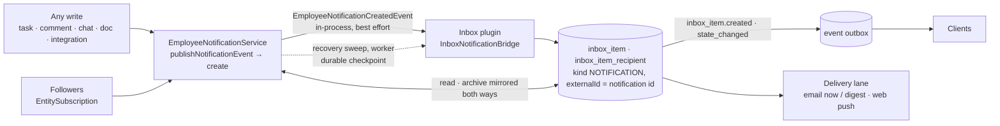

# Implementation Plan: Inbox

> Translates an approved `spec.md` into architecture and tech choices. The plan owns
> implementation details; the spec owns behaviour.

**Feature ID**: `inbox`
**Spec**: `./spec.md`
**Tasks**: `./tasks.md`
**Status**: `In Progress`
**Last updated**: 2026-11-08 (aligned with ever-gauzy #11682, #11707, #11713, #11721; §10.1 and §10.3 resolved)

---

## 1. Architecture Summary

Two feeds become one: the platform's `EmployeeNotification` keeps its API (the bell in Ever Teams reads it),
and every notification is filed as an inbox item the moment it exists, so the Inbox lists notifications,
decisions and email together with one read state. Followers of a record are finally told (the
`EntitySubscription` rows existed, nothing consumed them). Delivery beyond in-app (email, digest, push) is a
separate lane that reads the preferences shape defined here.

## 2. Tech Choices

| Concern | Choice | Rationale |
| ------- | ------ | --------- |
| Where notifications are filed | `packages/plugins/inbox/src/lib/notifications/inbox-notification.bridge.ts` (`InboxNotificationCreatedHandler` → `InboxNotificationBridge.fileNotification` → `InboxService.upsertExternal`, idempotent on the notification id) on `EmployeeNotificationCreatedEvent` (new, published on the in-process CQRS bus by `EmployeeNotificationService.create` once the row is saved) | the Inbox already has the writer seam and recipient model; the notification API stays untouched. The live filing is best effort; a recovery sweep makes it durable (§10.1) |
| Read-state mirroring | bridge registered as the `GAUZY` source handler (`onStateChange`) for inbox → notification; `EmployeeNotificationUpdatedEvent` (edit, mark-all-read) for notification → inbox; both write rows directly, to every notification row an entry stands for (its own and the folded twins, `metadata.twinNotificationIds`) | no echo, no loop |
| Recovery of lost filings | `InboxNotificationSweepService` (`notifications/inbox-notification-sweep.service.ts`), every five minutes on the `inbox-maintenance` queue (`InboxMaintenanceModule`, behind `isSchedulerQueueRootEnabled`; the worker hosts the Inbox whenever `GAUZY_INBOX_ENABLED` is on); checkpoint row in `inbox_sweep_checkpoint` (migration `1791000006540`) | the same mechanism as the delivery sweep; no change to core's notification write path |
| Follower fan-out | `packages/core/src/lib/entity-subscription/fan-out/` (`FollowerFanOutService`, `CommentEvent` handler, `TaskEvent` subscriber), flag `GAUZY_NOTIFICATION_FANOUT_ENABLED` exact `true` | reuses the notification event: every receiver gets the row and the Inbox entry, and the per-type switches decide only e-mail and push (Known limitations 2, resolved); off by default, and the Docs follower entries depend on it too |
| New kinds | `EmployeeNotificationTypeEnum.TASK_UPDATE` (stored 8) + `NotificationActionTypeEnum.Updated`; `InboxItemKindEnum.NOTIFICATION`; `InboxTabEnum.DONE` | additive enums, varchar columns |
| Done state | `inbox_item_recipient.doneAt` (migration `1791000005200`, tri-dialect, idempotent) | spec FR-6 |
| Preferences | `IEmployeeNotificationPreferences` on the existing `preferences` JSON column of the notification setting | no migration; delivery lane reads it |
| Push over the channel | `inbox_item.state_changed` next to `inbox_item.created` (addressed, content-free) | counts and lists refetch live |

## 3. Data Model

- `inbox_item_recipient.doneAt TIMESTAMP NULL` (new).
- `inbox_sweep_checkpoint` (new, migration `1791000006540`, tri-dialect, idempotent): `id` (the sweep's name),
  `cursorAt` + `cursorId` (the last notification settled, in reading order), `heldId` + `heldAttempts` (the
  notification being retried). One row per installation, not tenant data (never exported).
- `inbox_item.metadata.twinNotificationIds` (JSON, no schema change): the mentions folded into the entry.
- Contracts: `IInboxRecipientStateInput.isDone`, `IInboxItemRecipient.doneAt`, `IInboxItemWithState.recipient.{isDone,doneAt}`,
  `IInboxRecipientStateField` + `isDone`, `INBOX_NOTIFICATION_EXTERNAL_SOURCE`, `IEmployeeNotificationPreferences`,
  `EmployeeNotificationTypeEnum.TASK_UPDATE`, `NotificationActionTypeEnum.Updated`, `InboxItemKindEnum.NOTIFICATION`, `InboxTabEnum.DONE`.

## 4. API Surface

| Method | Endpoint | Change |
| ------ | -------- | ------ |
| `PATCH` | `/api/inbox/items/:id/state` | accepts `isDone` |
| `GET` | `/api/inbox/items?tab=done` | the Done tab; open tabs exclude done items |
| GraphQL | `markInboxItem(input: { isDone })`, `InboxItemRecipientState { isDone, doneAt }` | gated schema |
| existing | `/api/employee-notification*`, `/api/inbox/items*` | unchanged |

Delivery lane (G10): `GET/PUT /api/employee-notification-setting` already carries `preferences`; push subscriptions, digest job and email sending are that lane's.

## 5. Events

| Event | Bus | Emitted when | Consumers |
| ----- | --- | ------------ | --------- |
| `EmployeeNotificationCreatedEvent` | CQRS | a notification row exists | inbox bridge (file item); realtime hints |
| `EmployeeNotificationUpdatedEvent` | CQRS | read/archive edited or mark-all-read | inbox bridge (mirror) |
| `CommentEvent` (created) | CQRS | comment created | follower fan-out |
| `TaskEvent` (updated, followed field stated) | RxJS | task updated | follower fan-out |
| `inbox_item.state_changed` | outbox | recipient state changed / mark-all-read | subscribers (addressed) |

## 6. UI Surface

- Angular `inbox-ui`: Done tab, done action, NOTIFICATION kind rendering (follow-up PR in this lane).
- Ever Teams: `inbox` spec (page over `/inbox/items`, fallback to `/employee-notification`).

## 7. Phased Rollout

1. PR 1 (ever-co/ever-gauzy#11682): bridge, mirror, fan-out (flag), done, state event, preferences shape.
2. PR 2: Angular inbox-ui done tab + notification rendering; counts split.
3. G10: email immediate/digest + web push honouring the preferences.

## 8. Constitution Reconciliation

I plugin (inbox) + core shared pieces · II scoped · III one additive tri-dialect migration · IV flags (`GAUZY_INBOX_ENABLED`, `GAUZY_NOTIFICATION_FANOUT_ENABLED`), nothing removed · V contracts first · VI own entries only, direct writes guarded by tenant/user · VII outbox events · VIII (UI PR) · IX specs · X spec unchanged · XI vendor-neutral.

## 9. Risks

| Risk | Mitigation |
| ---- | ---------- |
| Duplicate entries (mention + comment for the same follower) | kinds differ; the Inbox dedupes per external id; the FR-4 rule (one MENTION entry per receiver, record and kind within ten minutes) is in the bridge (`hasRecentTwin`, ever-gauzy #11707) |
| Fan-out volume on bulk task updates | flag off by default; per-task notifications only for followed fields; bulk action lane coalesces |
| `shouldCreateEmployeeNotification` throws on unknown types | `TASK_UPDATE` case added; new kinds must add theirs |

## 10. Known limitations / follow-ups

What the merged code did not do at first, and how each item stands; each names the code location.

1. **Filing is not durable.** *(Resolved 2026-11-08: the recovery sweep below.)*
   `EmployeeNotificationService.create` saves the row, then publishes
   `EmployeeNotificationCreatedEvent` on the in-process CQRS bus; `InboxNotificationBridge.fileNotification`
   files the item and logs (never rethrows) a failure. A process that stops between the two, or a
   failed filing, leaves a notification with no Inbox entry, and nothing files it later: no outbox
   row, no sweep. The spec's "no lost entries" (§4 Reliability) is not met. Follow-up (T16): either an
   outbox row written in the notification's own transaction, or a recovery sweep in the inbox worker with
   a durable checkpoint and **no age cutoff** (it resumes from the last notification it settled, however
   long the worker was down) that files the `employee_notification` rows with no item of
   `externalSource = INBOX_NOTIFICATION_EXTERNAL_SOURCE` and `externalId = <id>` (the upsert is already
   idempotent). The sweep must skip the rows folded into an existing entry by the mention rule, which
   needs the many-to-one record of item 3 first; otherwise it would file every folded twin as a
   duplicate entry.

   **Resolution.** `InboxNotificationSweepService` runs every five minutes on the worker
   (`InboxMaintenanceModule`: `@ScheduledJob` on the `inbox-maintenance` queue, the delivery sweep's
   mechanism, under a named lock across the workers; nothing is loaded with the Inbox off). It reads
   `employee_notification` by `(createdAt, id)` from its checkpoint (`inbox_sweep_checkpoint`, compared in the
   database at the column's precision), with no age limit, leaving the last five minutes to the live filing,
   and files each notification through `InboxNotificationBridge.settleNotification` — the live filing's own
   path: a notification whose item is complete (its receiver's recipient row exists), or that is recorded on
   its twin's, is left alone; an item a failed write left without its recipient row is completed; a mention is
   checked and filed under the same twin lock, so the two never make two entries of one notification. The
   twin window is measured around the notification's own creation, and a recovered entry (item and recipient
   row) is dated as its notification, so a late filing folds as the live one would have — two lost mentions of
   one record included — sorts where it belongs, and the delivery lane decides it like any entry of that age
   (one older than the lane's one-day intake window is not emailed). The first place is written by the
   migration that creates the table, when the Inbox is switched on: where the Inbox started filing (its oldest
   notification entry), or that moment; the sweep reads from ten minutes before it. A notification whose
   filing fails holds the checkpoint and is retried; after five sweeps, or at once when the Inbox refuses it
   (a `400`), it is given up with an error in the log. Recovered entries take the notification's read and
   archive state.
2. **The per-type switches still decide whether an entry exists.** *(Resolved 2026-11-10, T17, owner decision "always on everywhere": the row and the entry are always saved; the switches decide only e-mail and push, through the delivery rules' `kindSwitchOf`. The bell now lists kinds a receiver had switched off. The text below is what it was.)* `shouldCreateEmployeeNotification`
   (core `employee-notification.service.ts`) returns early when the receiver switched the type off
   (`comment`, `mention`, `message`, `assignment`, `invitation`, `payment`, `preferences.taskUpdate`), so
   no row is saved and the bridge has nothing to file. The spec's "in-app (always on)" (FR-10) is not
   met for those receivers. Follow-up (T17, a product decision): save the notification row whatever the
   legacy switches say, so the entry and the row always exist together (FR-15 keeps both feeds equal), and
   let the switches decide only e-mail and push, i.e. migrate them into the `preferences` channels with
   in-app forced on. The bell then lists kinds a receiver had switched off, which is what FR-10's
   "in-app (always on)" means.
3. **A deduplicated mention's second row is not mirrored.** *(Resolved 2026-11-08.)*
   When `hasRecentTwin` finds a twin, the
   second `EmployeeNotification` row is saved but not filed; `onStateChange` mirrors the Inbox item's
   read / archive state to `item.externalId` only, so the second row stays unread in the
   notification API while the Inbox shows the mention read (FR-15). Follow-up (T18): record the twin's id
   on the filed item (for example `metadata.twinNotificationIds`, the many-to-one mapping) and mirror every
   state change both ways through it: an Inbox read / unread / archive / unarchive reaches every row the
   entry stands for, and a change of any of those rows through the notification API reaches the entry
   (marking the twin read once, at folding, would not follow a later unread or archive). The recovery sweep
   of item 1 reads the same record to leave folded twins alone.

   **Resolution.** A fold appends the mention's id to the entry's `metadata.twinNotificationIds` (existing
   JSON metadata, no migration; written under the twin lock) and gives the mention's row the entry's current
   read / archive state, so both lists agree from the start. `onStateChange` (Inbox → notification, also
   mark-all-read) writes every row the entry stands for (`notificationIdsOf`). `mirrorNotificationState`
   (notification API → Inbox) finds the entries a changed row was folded into (the receiver's entries on the
   record within ten minutes of it, the only place a fold can be) as well as the entries filed for it, updates
   their recipient rows, and writes the same state onto the entries' other rows. Both directions read the
   entry's list afresh under its twin lock, so a state change and a fold are serialised (a fold lands either
   before, and is in the list, or after, and copies the state already written). Folds made before the record
   existed are recorded by the recovery sweep when it reaches them, and a recorded fold whose state copy was
   lost (a stop between the two writes) takes the entry's state again then.
