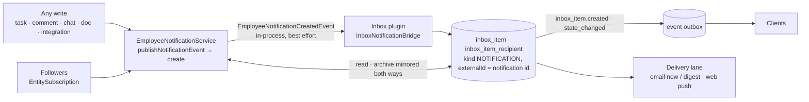

# Implementation Plan: Inbox

> Translates an approved `spec.md` into architecture and tech choices. The plan owns
> implementation details; the spec owns behaviour.

**Feature ID**: `inbox`
**Spec**: `./spec.md`
**Tasks**: `./tasks.md`
**Status**: `In Progress`
**Last updated**: 2026-11-08 (aligned with ever-gauzy #11682, #11707, #11713, #11721)

---

## 1. Architecture Summary

Two feeds become one: the platform's `EmployeeNotification` keeps its API (the bell in Ever Teams reads it),
and every notification is filed as an inbox item the moment it exists, so the Inbox lists notifications,
decisions and email together with one read state. Followers of a record are finally told (the
`EntitySubscription` rows existed, nothing consumed them). Delivery beyond in-app (email, digest, push) is a
separate lane that reads the preferences shape defined here.

## 2. Tech Choices

| Concern | Choice | Rationale |
| ------- | ------ | --------- |
| Where notifications are filed | `packages/plugins/inbox/src/lib/notifications/inbox-notification.bridge.ts` (`InboxNotificationCreatedHandler` → `InboxNotificationBridge.fileNotification` → `InboxService.upsertExternal`, idempotent on the notification id) on `EmployeeNotificationCreatedEvent` (new, published on the in-process CQRS bus by `EmployeeNotificationService.create` once the row is saved) | the Inbox already has the writer seam and recipient model; the notification API stays untouched. Best effort, not durable: see Known limitations 1 |
| Read-state mirroring | bridge registered as the `GAUZY` source handler (`onStateChange`) for inbox → notification; `EmployeeNotificationUpdatedEvent` (edit, mark-all-read) for notification → inbox; both write rows directly | no echo, no loop |
| Follower fan-out | `packages/core/src/lib/entity-subscription/fan-out/` (`FollowerFanOutService`, `CommentEvent` handler, `TaskEvent` subscriber), flag `GAUZY_NOTIFICATION_FANOUT_ENABLED` exact `true` | reuses the notification event, so the per-type switches apply (a `comment: false` receiver gets no row and therefore no Inbox entry, see Known limitations 2); off by default, and the Docs follower entries depend on it too |
| New kinds | `EmployeeNotificationTypeEnum.TASK_UPDATE` (stored 8) + `NotificationActionTypeEnum.Updated`; `InboxItemKindEnum.NOTIFICATION`; `InboxTabEnum.DONE` | additive enums, varchar columns |
| Done state | `inbox_item_recipient.doneAt` (migration `1791000005200`, tri-dialect, idempotent) | spec FR-6 |
| Preferences | `IEmployeeNotificationPreferences` on the existing `preferences` JSON column of the notification setting | no migration; delivery lane reads it |
| Push over the channel | `inbox_item.state_changed` next to `inbox_item.created` (addressed, content-free) | counts and lists refetch live |

## 3. Data Model

- `inbox_item_recipient.doneAt TIMESTAMP NULL` (new). No other schema change.
- Contracts: `IInboxRecipientStateInput.isDone`, `IInboxItemRecipient.doneAt`, `IInboxItemWithState.recipient.{isDone,doneAt}`,
  `IInboxRecipientStateField` + `isDone`, `INBOX_NOTIFICATION_EXTERNAL_SOURCE`, `IEmployeeNotificationPreferences`,
  `EmployeeNotificationTypeEnum.TASK_UPDATE`, `NotificationActionTypeEnum.Updated`, `InboxItemKindEnum.NOTIFICATION`, `InboxTabEnum.DONE`.

## 4. API Surface

| Method | Endpoint | Change |
| ------ | -------- | ------ |
| `PATCH` | `/api/inbox/items/:id/state` | accepts `isDone` |
| `GET` | `/api/inbox/items?tab=done` | the Done tab; open tabs exclude done items |
| GraphQL | `markInboxItem(input: { isDone })`, `InboxItemRecipientState { isDone, doneAt }` | gated schema |
| existing | `/api/employee-notification*`, `/api/inbox/items*` | unchanged |

Delivery lane (G10): `GET/PUT /api/employee-notification-setting` already carries `preferences`; push subscriptions, digest job and email sending are that lane's.

## 5. Events

| Event | Bus | Emitted when | Consumers |
| ----- | --- | ------------ | --------- |
| `EmployeeNotificationCreatedEvent` | CQRS | a notification row exists | inbox bridge (file item); realtime hints |
| `EmployeeNotificationUpdatedEvent` | CQRS | read/archive edited or mark-all-read | inbox bridge (mirror) |
| `CommentEvent` (created) | CQRS | comment created | follower fan-out |
| `TaskEvent` (updated, followed field stated) | RxJS | task updated | follower fan-out |
| `inbox_item.state_changed` | outbox | recipient state changed / mark-all-read | subscribers (addressed) |

## 6. UI Surface

- Angular `inbox-ui`: Done tab, done action, NOTIFICATION kind rendering (follow-up PR in this lane).
- Ever Teams: `inbox` spec (page over `/inbox/items`, fallback to `/employee-notification`).

## 7. Phased Rollout

1. PR 1 (ever-co/ever-gauzy#11682): bridge, mirror, fan-out (flag), done, state event, preferences shape.
2. PR 2: Angular inbox-ui done tab + notification rendering; counts split.
3. G10: email immediate/digest + web push honouring the preferences.

## 8. Constitution Reconciliation

I plugin (inbox) + core shared pieces · II scoped · III one additive tri-dialect migration · IV flags (`GAUZY_INBOX_ENABLED`, `GAUZY_NOTIFICATION_FANOUT_ENABLED`), nothing removed · V contracts first · VI own entries only, direct writes guarded by tenant/user · VII outbox events · VIII (UI PR) · IX specs · X spec unchanged · XI vendor-neutral.

## 9. Risks

| Risk | Mitigation |
| ---- | ---------- |
| Duplicate entries (mention + comment for the same follower) | kinds differ; the Inbox dedupes per external id; the FR-4 rule (one MENTION entry per receiver, record and kind within ten minutes) is in the bridge (`hasRecentTwin`, ever-gauzy #11707) |
| Fan-out volume on bulk task updates | flag off by default; per-task notifications only for followed fields; bulk action lane coalesces |
| `shouldCreateEmployeeNotification` throws on unknown types | `TASK_UPDATE` case added; new kinds must add theirs |

## 10. Known limitations / follow-ups

What the merged code does not do yet; each item names the code location.

1. **Filing is not durable.** `EmployeeNotificationService.create` saves the row, then publishes
   `EmployeeNotificationCreatedEvent` on the in-process CQRS bus; `InboxNotificationBridge.fileNotification`
   files the item and logs (never rethrows) a failure. A process that stops between the two, or a
   failed filing, leaves a notification with no Inbox entry, and nothing files it later: no outbox
   row, no sweep. The spec's "no lost entries" (§4 Reliability) is not met. Follow-up (T16): either an
   outbox row written in the notification's own transaction, or a recovery sweep in the inbox worker with
   a durable checkpoint and **no age cutoff** (it resumes from the last notification it settled, however
   long the worker was down) that files the `employee_notification` rows with no item of
   `externalSource = INBOX_NOTIFICATION_EXTERNAL_SOURCE` and `externalId = <id>` (the upsert is already
   idempotent). The sweep must skip the rows folded into an existing entry by the mention rule, which
   needs the many-to-one record of item 3 first; otherwise it would file every folded twin as a
   duplicate entry.
2. **The per-type switches still decide whether an entry exists.** `shouldCreateEmployeeNotification`
   (core `employee-notification.service.ts`) returns early when the receiver switched the type off
   (`comment`, `mention`, `message`, `assignment`, `invitation`, `payment`, `preferences.taskUpdate`), so
   no row is saved and the bridge has nothing to file. The spec's "in-app (always on)" (FR-10) is not
   met for those receivers. Follow-up (T17, a product decision): save the notification row whatever the
   legacy switches say, so the entry and the row always exist together (FR-15 keeps both feeds equal), and
   let the switches decide only e-mail and push, i.e. migrate them into the `preferences` channels with
   in-app forced on. The bell then lists kinds a receiver had switched off, which is what FR-10's
   "in-app (always on)" means.
3. **A deduplicated mention's second row is not mirrored.** When `hasRecentTwin` finds a twin, the
   second `EmployeeNotification` row is saved but not filed; `onStateChange` mirrors the Inbox item's
   read / archive state to `item.externalId` only, so the second row stays unread in the
   notification API while the Inbox shows the mention read (FR-15). Follow-up (T18): record the twin's id
   on the filed item (for example `metadata.twinNotificationIds`, the many-to-one mapping) and mirror to
   every id, or mark the twin read when it is folded; the recovery sweep of item 1 reads the same record
   to leave folded twins alone.
