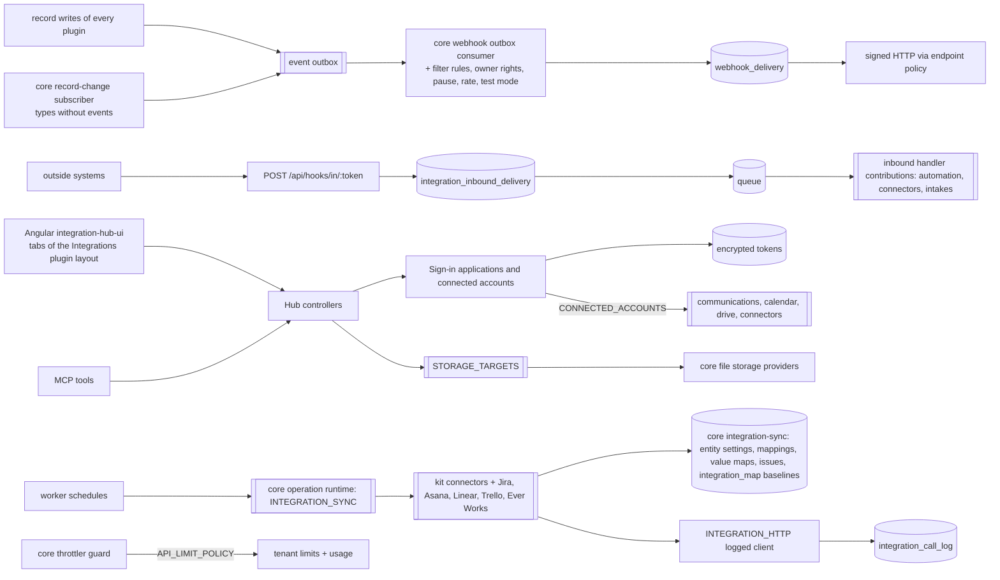

# Implementation Plan: Integration hub

> Translates an approved `spec.md` into architecture and tech choices. The plan owns
> implementation details; the spec owns behaviour.

**Feature ID**: `integration-hub`
**Spec**: `./spec.md`
**Tasks**: `./tasks.md`
**Status**: `Draft`
**Last updated**: 2026-11-23

---

## 1. Architecture Summary

The hub generalises what the platform already does for integrations. Three things exist: the core webhook engine
(`packages/core/src/lib/webhook/`: subscriptions, signed deliveries, retry worker, circuit breaker, redelivery, secret
rotation, endpoint policy; API only), the core integration framework (`integration`, `integration_tenant`,
`integration_setting`, `integration_entity_setting` with its tied rows, `integration_map`), and four issue-tracker
integrations that each carry the same sync engine (`packages/plugins/integration-{jira,asana,linear,trello}`: sync
runs, conflicts, project, team or board mappings, per-record baselines, webhook receivers, sign-in state), next to
Ever Works' engine (`integration-ever-works/src/lib/sync/`). The hub lifts that common pattern into shared records and
puts screens on them:

- **Core** gains the shared sync records (`packages/core/src/lib/integration-sync/`): the existing
  `integration_entity_setting` becomes the sync job (its `sync` switch stays the one on and off), a mapping, a value-map
  and an issue table lifted from the four plugins' mapping and conflict tables, a baseline on `integration_map`, and runs
  as operations of the core operation runtime (`packages/core/src/lib/operation/`). They live in core so the existing
  integrations write them whether or not the hub plugin is loaded; the four plugins and Ever Works report into them and
  keep their routes and response shapes.
- **`packages/plugins/integration-hub`** (API) and **`integration-hub-ui`** (Angular) add screens and depth on core
  `webhook`, the event catalogue on `SubscriptionCatalogue`, inbound endpoints, the call log, sign-in applications and
  connected accounts, the sync runner for kit connectors, storage targets, API limits and health.
- **`packages/connector-kit`** (`@gauzy/connector-kit`): manifest schema, connector base, logged HTTP client contract,
  contract test suite, and the single-use sign-in state store, webhook verification and dedupe helpers lifted from the
  Jira plugin (`jira-oauth-state.service.ts`, `jira-webhook.verification.ts`, `jira-webhook-dedupe.service.ts`).
  Connector manifests, event types and inbound handlers are `@gauzy/plugin` contributions, so a plugin declares them
  where it declares its settings and permissions.

Other features use the hub's ports for outside calls (automation's webhook step, mail and calendar sign-in, audit
streaming, backup and export targets).

## 2. Tech Choices

| Concern | Choice | Rationale |
| ------- | ------ | --------- |
| Package | `integration-hub` plugin pair (API, Angular), `packages/connector-kit`, core `integration-sync`; additive columns on core `webhook_subscription`, `webhook_delivery`, `integration`, `integration_entity_setting`, `integration_map` | Principle I; core keeps the shared modules the existing integrations use |
| Webhooks | core `WebhookSubscriptionService`, `WebhookDeliveryService`, `webhook-outbox.consumer.ts`, `webhook-retry.worker.ts`, `webhook-signature.ts`, `webhook-endpoint-policy.ts` extended through optional hooks (`WEBHOOK_DELIVERY_POLICY`); the outbound webhooks of `integration-zapier` (`zapier_webhook_subscription`, `zapier-webhook.service.ts`) and `integration-make-com` (`webhook.service.ts`, the address in its settings) keep their tables, payloads, headers, retries and failure handling, and are read into the Webhooks tab and the call log through `HUB_WEBHOOK_SOURCES` (spec FR-71) | one screen over every outbound webhook; no delivery changes for integrations that exist |
| Event catalogue | `SubscriptionCatalogue.declare` (`graphql/subscriptions/subscription-catalogue.ts`) extended with metadata (description, schema, sample, version, permission), fed by `declareStreamedEvents` and the `eventTypes` contribution; FR-22 through `restrictAudience` at delivery time | the list the webhook consumer already reads |
| Webhook filters | rows of core `rule` with owner type `WEBHOOK_SUBSCRIPTION` and scope `EVENT` (the payload), evaluated by `rule.evaluator.ts` | no condition column, no second rule engine |
| Record events | core `event-outbox/record-change.subscriber.ts` (TypeORM and MikroORM subscribers) for registered record types that declare no events; active when `RECORD_CHANGE_EVENTS_POLICY` is bound and the tenant has the feature, or when an outbox consumer is registered for the type (chat and discussions membership sync) | FR-14 without touching each service |
| Inbound | hub endpoints: public route with per-endpoint token, raw-body capture as the Inbox does (`inbound-raw-body.middleware.ts`), queue `integration-inbound`; the receivers that exist keep their routes (addresses registered at the outside services) and become call-log sources (§4) | answer fast, process in background |
| Connected accounts | authorization code with PKCE; single-use state in the kit's cache store (Redis `GETDEL` or the cache manager, 10 minutes, as `*-oauth-state.service.ts` do), verifier kept encrypted in the cached value; tokens in `@IsSecret` columns; app client secrets in `integration_setting` of an `integration_tenant` per app | no state table; one state store for every sign-in |
| Connectors | `connectors` contribution kind of `@gauzy/plugin` (one manifest per connector, collected by `plugin-contribution.registry.ts`); `integration.provider` is the connector key, `docUrl` and `version` are reused, manifest categories map to `integration_type` rows; payment adapters declare theirs too; a manifest may name the tenant feature its connector needs (`featureKey`), and the connector catalogue, the gallery and the core integration list routes it reads leave out rows whose feature is off for the tenant (rows without one are listed as today), whether or not the hub is on | one declaration place, one catalogue |
| Sync | core `integration-sync`: jobs are `integration_entity_setting` rows; runs are `operation` rows of type `INTEGRATION_SYNC` with aggregate `integration_tenant` (`UQ_operation_aggregate_live` keeps one live run per connection; cursor in `state`, counts in `result`); mappings, value maps, issues and baselines lifted from the four plugins | one model for kit and existing connectors |
| Outbound HTTP | `INTEGRATION_HTTP` client: endpoint policy, timeouts, retry on 429 with the server's retry time, redaction, call log | one place that logs and limits |
| Limits | optional `API_LIMIT_POLICY` seam in core `throttler-behind-proxy.guard.ts`; counters in the existing throttler storage (Redis or memory), hourly aggregates in a table; tenant limits are settings, empty by default (the policy then refuses nothing and the existing guard counts as today) | env limits stay the ceiling and stay the only limit until a tenant sets its own |
| Settings | `integration-hub.settings.ts` contributions in the platform settings store: delivery retention (empty by default: no delivery is removed), inbound and call-log retention (30 days), dead-letter days, tenant API limits (empty), `integration-hub.galleryOpensCatalogue` (false), `integration-hub.pauseFailingSyncs` (false), geocoding adapter | no settings table |
| Storage | `STORAGE_TARGETS` over core `FileStorage` providers; the tenant setting read through `tenant-storage-settings.ts` as the files target; screens on the existing File storage settings page | no new storage code, one screen |
| Background work | `@ScheduledJob` ticks in the worker (`IntegrationHubSchedulePlugin`, recorded in `job_execution`); sync and contract-suite runs on the operation runtime; `@QueueWorker` for inbound in the API; in-process timers without a queue root | house split, one run ledger |
| Feature gate | `integration-hub-enabled.ts` (exact `true`), `FEATURE_INTEGRATION_HUB` contributed by `integration-hub.features.ts`, `FeatureFlagGuard` + `@FeatureFlag` on every hub controller; existing webhook controllers gain hub-only routes behind the same flag | [platform architecture](../../architecture/business-suite.md) §6 |

## 3. Data Model

New tables extend `TenantOrganizationBaseEntity` (soft delete, `isActive`, `isArchived`); MultiORM decorators with
MikroORM repositories; JSON as `text`; timestamps typed by design type; no foreign keys into other plugins.

### 3.1 Plugin tables (`integration-hub`)

| Table | Columns (besides base) | Indexes and uniqueness |
| --- | --- | --- |
| `integration_inbound_endpoint` | `name` varchar(120), `tokenHash` varchar(64), `previousTokenHash` varchar(64) null, `previousValidUntil` null, `handlerKey` varchar(64), `handlerRef` text, `signatureScheme` varchar(16) (`HMAC_SHA256`, `TOKEN_ONLY`), `secret` varchar(255) `@IsSecret` null, `previousSecret` null, `allowedSources` text, `maxBodyBytes` int default 1048576, `deliveryKeyHeader` varchar(64) null, `isTestMode` bool, `lastReceivedAt`, `receivedCount` int, `ownerUserId` | unique `tokenHash`; idx `(organizationId, isActive)` |
| `integration_inbound_delivery` | `endpointId` FK cascade, `deliveryKey` varchar(200), `receivedAt`, `sourceAddress` varchar(64), `headers` text, `body` longtext, `sizeBytes` int, `verdict` varchar(16) (`ACCEPTED`, `BAD_SIGNATURE`, `TOO_LARGE`, `SOURCE_REFUSED`, `DUPLICATE`), `status` varchar(12) (`QUEUED`, `PROCESSED`, `FAILED`, `REFUSED`), `attemptCount`, `handlerResult` text, `error` varchar(1000) | unique `(endpointId, deliveryKey)`; idx `(endpointId, receivedAt)`, `(status, createdAt)` |
| `integration_call_log` | `direction` varchar(4), `kind` varchar(16) (`CONNECTOR_CALL`, `OAUTH`, `STORAGE`), `provider` varchar(64) (the `integration.provider` key), `integrationTenantId`, `connectedAccountId` uuid null, `method` varchar(8), `url` varchar(1024), `statusCode` int null, `durationMs` int, `requestHeaders`, `requestBody`, `responseHeaders`, `responseBody` text (≤ 16 KB each, redacted), `error` varchar(1000), `recordType` varchar(64), `recordId`, `correlationId` uuid | idx `(tenantId, createdAt)`, `(provider, createdAt)`, `(recordType, recordId)` |
| `integration_oauth_app` | `key` varchar(64), `name` varchar(120), `authorizeUrl`, `tokenUrl`, `revokeUrl`, `discoveryUrl` varchar(1024) null, `scopes` text, `extraParams` text, `clientId` varchar(255), `integrationTenantId` uuid (client secret), `usesPkce` bool default true, `audience` varchar(12) (`USER`, `ORGANIZATION`, `BOTH`), `declaredBy` varchar(64) null | unique `(tenantId, key)` |
| `integration_connected_account` | `connectedAppId`, `ownerType` varchar(12), `ownerUserId` uuid null, `externalAccountId` varchar(255), `externalLabel` varchar(320), `scopesGranted` text, `accessToken`, `refreshToken` text `@IsSecret`, `expiresAt`, `status` varchar(10) (`ACTIVE`, `EXPIRED`, `REVOKED`, `ERROR`), `consents` text (feature keys), `lastRefreshedAt`, `lastUsedAt`, `lastError`, `healthScore` int null | unique `(connectedAppId, ownerType, ownerUserId, externalAccountId)`; idx `(status, expiresAt)` |
| `integration_storage_target` | `name`, `providerKind` varchar(16) (file storage provider keys), `purposes` text, `defaultFor` text, `config` text, `integrationTenantId` (secrets), `pathPrefix` varchar(255), `retentionDays` int null, `verifiedAt`, `lastWriteAt`, `lastError` | idx `(tenantId, isActive)` |
| `integration_storage_write` | `targetId`, `purpose`, `objectKey` varchar(1024), `sizeBytes` bigint, `sha256` varchar(64), `status` varchar(8), `error`, `expiresAt` | idx `(targetId, createdAt)`, `(status, expiresAt)` |
| `integration_api_usage` | `hour` varchar(13), `clientKind` varchar(16), `clientId` uuid null, `routeGroup` varchar(64), `statusClass` varchar(3), `requests` int, `limitHits` int | unique `(tenantId, hour, clientKind, clientId, routeGroup, statusClass)` |
| `integration_health_snapshot` | `subjectType` varchar(16) (`CONNECTION`, `SUBSCRIPTION`, `ENDPOINT`, `ACCOUNT`), `subjectId`, `day` varchar(10), `successRate` numeric(5,4), `p95Ms` int, `failures` int, `score` int, `causes` text | unique `(subjectType, subjectId, day)` |

### 3.2 Shared sync records (core `integration-sync`)

| Table | Columns | Indexes and uniqueness |
| --- | --- | --- |
| existing `integration_entity_setting` + columns (the sync job) | `direction` varchar(4) null (`IN`, `OUT`, `BOTH`), `schedule` text null, `nextRunAt` null, `conflictRule` varchar(16) null (`PLATFORM_WINS`, `REMOTE_WINS`, `NEWEST_WINS`, `ASK`), `fieldMap` text null, `pausedAt` null (set automatically after 10 failed runs only for kit connectors' jobs, and for the existing integrations' jobs only while `integration-hub.pauseFailingSyncs` is on for the tenant), `consecutiveFailures` int default 0, `lastOperationId` uuid null; the existing `sync` stays the on and off | idx `(sync, pausedAt, nextRunAt)` |
| `integration_sync_mapping` (lifted from `integration_jira_project_mapping`, `integration_asana_project_mapping`, `integration_linear_team_mapping`, `integration_trello_board_mapping`) | `integrationId` (connection), `entitySettingId` uuid null, `externalScopeKind` varchar(16) (`PROJECT`, `TEAM`, `BOARD`, …), `externalScopeId` varchar(64), `externalScopeKey` varchar(32) null, `externalScopeName` varchar(255) null, `recordType` varchar(64), `recordId` uuid, `direction` varchar(16), `scopeOptions` text null (for example the issue types taken), `syncEnabled` bool, `lastImportedAt`, `cursor` varchar(255) null, `lastError` text null | unique `(integrationId, externalScopeKind, externalScopeId)`; idx `(recordType, recordId)` |
| `integration_sync_value_map` (lifted from the mappings' `statusMap`) | `integrationId`, `mappingId` uuid null (scope-specific when set), `kind` varchar(32) (`STATUS`, `TYPE`, `PRIORITY`, … and the kinds other connectors add), `externalValue` varchar(255), `externalLabel` varchar(255) null, `platformValue` varchar(255), `direction` varchar(4) | unique `(integrationId, mappingId, kind, externalValue, direction)` |
| `integration_sync_issue` (lifted from the four `integration_<x>_sync_conflict` tables, plus failed writes) | `integrationId`, `mappingId` null, `operationId` uuid null (the run), `entity`, `recordType`, `recordId`, `sourceId` varchar(255), `field` varchar(64) null, `kind` varchar(10) (`ERROR`, `CONFLICT`), `message` varchar(1000) null, `syncedValue`, `platformValue`, `externalValue` text (≤ 8 KB each), `platformPatch` text null, `status` varchar(10) (`OPEN`, `RETRIED`, `RESOLVED`, `IGNORED`), `resolution` varchar(16) null, `resolvedAt`, `resolvedByUserId` | idx `(integrationId, status)`, `(recordType, recordId)` |
| existing `integration_map` + columns (the baseline) | `syncedFields` text null (last synced values, lifted from `integration_{jira,linear}_issue_baseline`, `integration_asana_task_baseline`, `integration_trello_card_baseline`), `syncedAt` null | existing keys |

**Runs** are core `operation` rows of type `INTEGRATION_SYNC` (input: trigger `SCHEDULE`, `MANUAL`, `EVENT`, `RESYNC`
or `REPORTED`, entity setting, mapping, full; state: cursor; result: counts per entity and outcome; `lastError`), with
`aggregateType` `integration_tenant` and the connection's id. Contract-suite runs are operations of type
`INTEGRATION_CONTRACT_SUITE` with each check's result in `result`. No run table: the runtime's lease, resume and
one-live-operation-per-aggregate rule are what FR-46 needs, and the scheduler's ticks are already in `job_execution`.

### 3.3 Core changes (additive)

- `webhook_subscription`: `isTestMode` bool default false, `disabledReason` varchar(32) null (`OWNER_PAUSED`,
  `FAILURE_THRESHOLD`) and `disabledByUserId` uuid null (pausing is the existing disable with the owner's reason; no
  second stopped state), `ownerUserId` uuid null, `ownerScoped` bool default false (spec FR-22: existing subscriptions
  and those created through the existing routes keep today's delivery scope), `maxPerMinute` int null, `payloadMode`
  varchar(8) null (`IDS`, `SNAPSHOT`), `integrationTenantId` uuid null (subscriptions an integration manages);
  conditions are `rule` rows; the existing `apiVersion` pins the payload version, and a subscription without one is
  pinned to version 1, today's payloads.
- `webhook_delivery`: `replayOfDeliveryId` uuid null, `replayedByUserId` uuid null, `isTest` bool default false,
  `requestHeaders` text null, `payloadVersion` varchar(16) null; idx `(subscriptionId, status, createdAt)`.
- `integration`: `source` varchar(12) null (`BUILT_IN`, `PLUGIN`), `capabilities` text null; `provider` (the unique
  `IntegrationEnum` key of `default-integration.ts`) is the connector key, `docUrl` and `version` are reused.
- Contracts: `RuleOwnerType.WEBHOOK_SUBSCRIPTION`, `RuleScope.EVENT`; `@gauzy/plugin` contribution kinds `connectors`,
  `eventTypes`, `inboundHandlers`.
- New core files: `integration-sync/` (entities of §3.2, `IntegrationSyncService` behind `INTEGRATION_SYNC_RUNS`, the
  `INTEGRATION_SYNC` operation definition), `event-outbox/record-change.subscriber.ts` and `RECORD_CHANGE_EVENTS_POLICY`;
  optional `API_LIMIT_POLICY` in `throttler/throttler-behind-proxy.guard.ts`; optional `WEBHOOK_DELIVERY_POLICY`
  (filter rules, owner rights, pause, rate, test mode) consulted by `webhook-outbox.consumer.ts`.

### 3.4 Migrations

**Migration timestamps**: `packages/plugins/integration-hub` `1791000034100` to `1791000034199`; `packages/core` `1791000034200` to `1791000034219`; `packages/plugins/integration-jira` `1791000034220` to `1791000034229`; `packages/plugins/integration-asana` `1791000034230` to `1791000034239`; `packages/plugins/integration-linear` `1791000034240` to `1791000034249`; `packages/plugins/integration-trello` `1791000034250` to `1791000034259`; `packages/plugins/integration-ever-works` `1791000034260` to `1791000034269`.

Written with the shared core migration helpers (`@gauzy/core`, `database/migration-helpers.ts` beside
`check-constraint.helper.ts`, lifted from the task-automations copy by `procurement`, its T4), no plugin copy; three dialects; idempotent,
forward-only; registered for both ORMs; hub plugin migrations listed only with `GAUZY_INTEGRATION_HUB_ENABLED`:

1. `1791000034100-CreateIntegrationHubInboundAndLogTables` — inbound endpoint, inbound delivery, call log.
2. `1791000034110-CreateIntegrationHubConnectedAccountTables` — sign-in application, connected account.
3. `1791000034130-CreateIntegrationHubStorageUsageHealthTables` — storage target, write, API usage, health.
4. Core `1791000034200-AddHubColumnsToWebhookAndIntegration` — nullable columns of §3.2 and §3.3; no backfill.
5. Core `1791000034210-CreateIntegrationSyncRecords` — mapping, value map, issue.
6. Copy migrations, one per connector plugin: `1791000034220-CopyJiraSyncRecords` (`integration-jira`),
   `1791000034230-CopyAsanaSyncRecords` (`integration-asana`), `1791000034240-CopyLinearSyncRecords`
   (`integration-linear`), `1791000034250-CopyTrelloSyncRecords` (`integration-trello`),
   `1791000034260-CopyEverWorksSyncRecords` (`integration-ever-works`): mappings, status maps, conflicts, baselines and runs (as terminal `operation` rows) into the shared records,
   idempotent by source row id. The old tables stay readable and are no longer written. `integration-zapier` and
   `integration-make-com` keep their own webhook rows; nothing of them is copied or moved.

Permissions, the feature and the settings are contributions (§9), not seeded by a migration.

### 3.5 Contracts

`packages/contracts/src/lib/integration-hub.model.ts`: enums above, `IEventType`, `IInboundEndpoint`,
`IInboundDelivery`, `ICallLogEntry`, `IOAuthApp`, `IConnectedAccount`, `IStorageTarget`, `IApiLimits`, `IApiUsage`,
`IHealthScore`, ports. `integration-sync.model.ts`: `ISyncJob` (the entity setting), `ISyncRun` (the operation view),
`ISyncMapping`, `ISyncValueMap`, `ISyncIssue`. `webhook.model.ts`, `integration.model.ts` and `rule.model.ts` gain the
optional fields and values. `@gauzy/connector-kit` exports `IConnectorManifest` (key = `provider`, version, optional `featureKey`, categories,
sign-in, entities with directions, settings schema, events in and out, field mappings, rate hints), `ConnectorBase`,
`IConnectorContext` (logged HTTP, connected account, integration map, issue reporter), `runContractSuite(manifest,
sandbox)`, `OAuthStateStore`, `verifyHmacSignature`, `DeliveryDedupe`.

## 4. API Surface

All hub routes: `TenantPermissionGuard`, `PermissionGuard`, `@FeatureFlag(FEATURE_INTEGRATION_HUB)`, DTOs, Swagger,
cursor pagination, `Idempotency-Key` on creating routes, `preview=true` on bulk replay.

| Method | Endpoint | Permission | Description | Status |
| ------ | -------- | ---------- | ----------- | ------ |
| `GET` | `/api/integration-hub/api-catalogue`, `/openapi/:group`, `/record-types`, `/sdks`, `/mcp` | `INTEGRATION_HUB_VIEW` | catalogue, group documents, record type paths, SDKs, MCP info | New |
| `GET` `PUT` | `/api/integration-hub/limits`; `GET /api/integration-hub/usage` | view / `INTEGRATION_API_LIMITS_MANAGE` | tenant limits (settings); usage series | New |
| `GET` | `/api/integration-hub/events`, `/events/:name` | `WEBHOOKS_VIEW` | event catalogue with schema, versions, sample | New |
| `*` | `/api/webhooks/subscriptions/**`, `/api/webhooks/deliveries/**` | existing `WEBHOOKS_*` | unchanged routes; DTOs accept the additive fields and filter rules | Changed (additive) |
| `POST` | `/api/webhooks/subscriptions/:id/{disable,enable}` | `WEBHOOKS_EDIT` | existing routes; `disable` takes an optional reason (pause), `enable` offers dead letters (resume) | Changed (additive) |
| `POST` | `/api/webhooks/subscriptions/:id/test` | `WEBHOOKS_EDIT` | test event | New |
| `POST` | `/api/webhooks/deliveries/replay` | `WEBHOOK_DELIVERIES_RETRY` | `{ filter, preview }` → count or replay batch; single replays stay `/:id/redeliver` | New |
| `GET` `POST` | `/api/webhooks/deliveries/:id/inspect`, `/api/webhooks/signatures/verify` | `WEBHOOKS_VIEW` | request as sent; verify pasted body and header | New |
| CRUD + `POST` | `/api/integration-hub/inbound-endpoints`, `/:id/rotate`, `GET /:id/deliveries`, `POST /:id/deliveries/:deliveryId/reprocess` | `INTEGRATION_INBOUND_ENDPOINT_MANAGE` | endpoints, their log and reprocessing | New |
| `POST` | `/api/hooks/in/:token` | public: token, signature, allow-list, throttled | inbound call → `202` | New |
| `GET` | `/api/integration-hub/requests`, `/requests/:source/:id`, `/requests/export` | `INTEGRATION_LOG_VIEW` | merged call log | New |
| CRUD | `/api/integration-hub/oauth-apps` | `INTEGRATION_OAUTH_APP_MANAGE` | outside sign-in applications | New |
| `GET` `POST` `DELETE` | `/api/integration-hub/connected-accounts` (`mine`, `organization`), `/authorize`, `/:id/refresh`, `/:id/consents`, `/:id` | `INTEGRATION_CONNECTED_ACCOUNT_CONNECT` (own); organization: `INTEGRATION_OAUTH_APP_MANAGE` | connect, refresh, consents, revoke | New |
| `GET` | `/api/integration-hub/oauth/callback` | public with signed single-use state | finish a grant | New |
| `GET` `POST` | `/api/integration-hub/connectors`, `/:provider`, `/:provider/health-check`, `/:provider/contract-runs` | view; check: `INTEGRATION_CONNECTOR_MANAGE` | catalogue over `integration` rows and manifests, health checks (operations) | New |
| CRUD + `POST` | `/api/integration-hub/sync-jobs`, `/:id/{run,pause,resume}`, `GET /:id/runs` | `INTEGRATION_SYNC_MANAGE` | jobs over `integration_entity_setting` through `IntegrationEntitySettingService` (its existing routes keep working); runs from `operation` | New |
| `GET` `POST` | `/api/integration-hub/sync-issues`, `/:id/{retry,resolve,ignore}`, `/bulk` | `INTEGRATION_SYNC_MANAGE` | issues of every connector, per row results | New |
| `GET` `POST` | `/api/integration-hub/records/:recordType/:recordId/references`, `/resync` | view / edit of the record | outside references; resync | New |
| `*` | `/api/integration/{jira,asana,linear,trello}/:integrationId/{runs,conflicts,mappings}/**` and the Ever Works sync routes | existing | same paths and response shapes, read from the shared records | Changed (storage only) |
| CRUD + `POST` | `/api/integration-hub/storage-targets`, `/:id/verify`, `GET /:id/writes` | `INTEGRATION_STORAGE_TARGET_MANAGE` | targets | New |
| `GET` | `/api/integration-hub/health` | `INTEGRATION_HUB_VIEW` | scores with causes | New |
| `POST` | `/api/integration-hub/drafts/from-text`, `/explain/:source/:id` | matching manage permission; `INTEGRATION_LOG_VIEW` | assistant draft (not saved); explanation | New |
| `GET` `PUT` | `/api/integration-hub/geocoding` | `INTEGRATION_CONNECTOR_MANAGE` | geocoding adapter per tenant (setting) | New |

GraphQL reads `integrationEvents`, `webhookDeliveries`, `connectedAccounts`, `syncRuns`, `syncIssues` in `graphql/`.

**Ports offered** (bound in `apps/api/src/plugin-composition.ts`): `AUTOMATION_WEBHOOKS` (`HubOutboundService.call`:
signed, endpoint policy, timeout, logged), `CONNECTED_ACCOUNTS` (`list(owner, appKey)`, `authorizeUrl(appKey, consents,
returnPath)`, `accessToken(accountId, consumerKey)`), `ACCESS_AUDIT_STREAM` (target or subscription), `STORAGE_TARGETS`
(`resolve(purpose)`, `write(purpose, stream, meta)`) for `platform-administration`, `data-import-export` and
`report-builder-and-dashboards`, `INTEGRATION_HTTP` (logged client for connectors and `payment-gateways` adapters),
`INTEGRATION_HEALTH` (`report(subject, day, figures)` for `payment-gateways` provider accounts),
`RECORD_CHANGE_EVENTS_POLICY`, `API_LIMIT_POLICY`, `WEBHOOK_DELIVERY_POLICY`, `GEOCODING_ADAPTERS`, `FILE_PICKER_SOURCES`,
`HUB_WEBHOOK_SOURCES` (multi, read-only: the Zapier and Make.com subscriptions and their deliveries, answered by those
plugins from their own tables),
`INTEGRATION_LOG_SOURCES` (multi: core webhook deliveries, hub inbound deliveries, the existing receivers —
`jira-webhook.controller.ts` with `jira-webhook-dedupe.service.ts`, `asana-webhook.controller.ts`,
`linear-webhook.controller.ts`, `trello-webhook.controller.ts`, `integration-github` (`webhook-signature.ts`),
`ever-works-webhook.controller.ts` with `ever_works_inbound_event`, chat incoming webhooks (`chat/src/lib/webhooks/*`),
the Inbox generic webhook provider, `payment_webhook_event` — and hub requests). Core binds `INTEGRATION_SYNC_RUNS`
(`start`, `progress`, `issue`, `finish`) to `IntegrationSyncService`, so kit connectors, the four issue trackers, Ever
Works and `IntegrationTenantSyncService` completion report through it without the hub.

**Ports consumed** (optional): `INTEGRATION_ASSISTANT` (`ai-agents-and-assistants`, else `AiProviderRegistry`),
`NOTIFICATION_DISPATCHER` (health and expiry notices; fallback employee notification), core record type registry,
`ACCESS_PROCESSORS` (each connector and subscription declares regions and fields).

**Consumer tokens answered** (bound in `apps/api/src/plugin-composition.ts` to hub webhook subscriptions, inbound endpoint handlers and the linked Works of `integration-ever-works`; each consumer plan states the shape it calls and its fallback): `CUSTOM_FIELDS_WEBHOOKS`, `INBOUND_ENDPOINT_HANDLERS`, `INTEGRATION_EVER_WORKS_LINKS`, `MARKETPLACE_WEBHOOK_SUBSCRIPTIONS`, `WORKFLOW_WEBHOOKS`.

## 5. Events, Real-Time and Notifications

| Event | Emitted when | Consumers |
| ----- | ------------ | --------- |
| `<record_type>.created` / `.updated` / `.deleted` (core subscriber) | a registered type without own events changes | webhooks, automations, real-time |
| `employee.created` / `.updated`, `organization_team_employee.created` / `.deleted`, `organization_project_employee.created` / `.deleted` (core subscriber) | an employee is created, changed or deactivated; a team or project member is added or removed | membership sync of `chat-messaging` and `discussions` |
| `integration_hub.subscription.paused` / `.disabled` | owner disable with a reason, or threshold | inbox notice to owner, audit |
| `integration_hub.delivery.dead` | first dead delivery per subscription per hour | owner notice, health |
| `integration_hub.connected_account.expiring` / `.expired` / `.revoked` | refresh sweep, refusal, removal | owner notice, consumers stop use |
| `integration_sync.run.completed` / `.failed`, `integration_sync.issue.opened` (core `integration-sync`) | any connector's run or issue | real-time on the connection page, owner notice on failure |
| `integration_hub.storage_write.failed` | a target write fails | administrators notice |
| existing `integration_tenant.synced` | unchanged | GraphQL subscription |

Real-time record types `webhook_delivery`, `operation` (sync runs), `integration_inbound_delivery`. API clients reach
the real-time channel with REST credentials through an additive authenticator in `packages/plugins/realtime` (tenant
key pair, personal token, application token), filtered by the same permissions as webhooks.

## 6. UI Surface

One place: the existing top-level **Integrations** menu entry (`base-nav-menu.component.ts`, `/pages/integrations`).

- **List page** `/pages/integrations` (`components/integration-list`): each connection gains its connection state, last
  run, open issues and health score.
- **Gallery**: the existing Built in tab of `/pages/integrations/plugins` (`components/plugin-builtin`, on
  `IntegrationFiltersBase` and `IntegrationsStoreService`) is the connector catalogue, extended with category,
  capabilities, sign-in kind, connection state, settings form from the manifest schema and health check; it lists the
  Ever Platform connection (`ever-connect-ui`) and payment adapters. The older gallery route `/pages/integrations/new`
  keeps opening the existing gallery; a guard (pattern of `pages/feature-documents-redirect.guard.ts`) sends it to the
  Built in tab only while `FEATURE_INTEGRATION_HUB` is on and the organization setting
  `integration-hub.galleryOpensCatalogue` is on (off by default).
- **Hub tabs**: `PluginLayoutComponent` (`packages/desktop-ui-lib/src/lib/settings/plugins/component/plugin-layout/`)
  gains a tab-registration seam (`PLUGIN_LAYOUT_TABS` multi-provider: title key, route, icon, permission, feature) that
  replaces the hard-coded list of `updateTabs()` (Built in, Marketplace and Installed register through it unchanged).
  `integration-hub-ui` registers **Webhooks** (subscriptions with event picker from the catalogue, filter builder over
  the shared rule builder, test, deliveries with inspector, dead letters, bulk replay), **Inbound**, **Sync** (jobs,
  runs, issues with side-by-side values, for every connector), **Call log**, **API** (catalogue, record types, SDKs,
  MCP, usage chart, limits) and **Health**, with child routes of `web-plugin.routes.ts`; `commerce-connectors` registers
  its tab the same way.
- **Integration pages** of each plugin (`integration-*-ui`, registered on `integrations-sections`) stay the
  connection's own settings pages; their run and conflict lists read the shared records through their routes.
- **File storage** settings page (`apps/gauzy/src/app/pages/settings/file-storage/`) gains a "Targets and purposes"
  section: extra targets, verification, default per purpose, retention and last write; its existing form is the files
  target.
- Settings → Connected accounts (personal and organization), with consents per feature.
- Embeddable `packages/ui-core/shared/src/lib/integrations/ngx-record-integrations` (outside references, last sync,
  resync), placed by the record sidebar of `record-views-and-search`; file picker dialog for attachment fields.
- i18n keys `INTEGRATION_HUB.*` in every locale; keyboard operable filter builder and tables.

## 7. MCP Tools, SDKs and Integrations

New `packages/mcp-server/src/lib/tools/integration-hub.ts`:

| Tool | Input | Output |
| --- | --- | --- |
| `integration_events_list` | filter | event types with schema summary |
| `webhook_subscriptions_list` / `webhook_subscription_save` | filter / subscription, `preview` | subscriptions / planned or saved subscription |
| `webhook_deliveries_list` / `webhook_deliveries_replay` | filter / filter, `preview` (default true) | deliveries / count or batch |
| `inbound_endpoints_list` / `inbound_endpoint_save` | filter / endpoint | endpoints (address shown once on create) |
| `connectors_list` / `connector_health_check` | filter / key | connectors / check results |
| `sync_jobs_list` / `sync_job_run` / `sync_issues_list` | connection / job / filter | jobs / run / issues |
| `integration_requests_list` / `api_usage_get` | filter / period | log entries / usage |
| `integration_draft_from_text` / `integration_explain` | text / log entry | draft (never saved) / explanation |

Build check: the MCP route check `tools/scripts/mcp-tool-route-check.mjs` of `ai-agents-and-assistants` (its T50):
every route an MCP tool calls exists in the generated OpenAPI document (FR-8); run in CI. OpenAPI additive; Kiota SDKs regenerated. Report definitions of spec FR-70 on datasets
`webhook_deliveries`, `inbound_deliveries`, `sync_runs` (operations of type `INTEGRATION_SYNC`), `api_usage`,
`connected_accounts`, `integration_health`. Shipped on the kit: `packages/plugins/integration-address-book` (standard
contacts protocol, two-way), a file source for the standard web-file protocol (`FILE_PICKER_SOURCES`), and the
deployment's existing address lookup (`packages/ui-core/shared/src/lib/forms/location/location-form.component.ts`) as
the first `GEOCODING_ADAPTERS` entry.

## 8. Background Jobs

| Trigger | When | What it does | Idempotency |
| ------- | ---- | ------------ | ----------- |
| core `subscriber:webhooks` (extended) | outbox dispatch | filter rules, owner rights (subscriptions with `ownerScoped` only), pause, test mode, rate spacing via `WEBHOOK_DELIVERY_POLICY` | unique `(subscriptionId, eventId)` |
| queue `integration-inbound` | accepted call | run the endpoint's handler, record the result | `(endpointId, deliveryKey)` |
| `integration-hub.token-refresh` | every 5 minutes | refresh accounts expiring within 10 minutes; mark refusals expired | per account lease |
| `integration-sync.tick` (core) | every minute | starts an `INTEGRATION_SYNC` operation for each due entity setting | `UQ_operation_aggregate_live` per connection |
| operation runtime | operation started | runs the connector from its cursor; writes issues, value maps and baselines | cursor, `integration_map`, operation lease |
| `integration-hub.usage.flush` | every 5 minutes | counters to `integration_api_usage`; 80 % and 100 % notices | upsert on the unique key |
| `integration-hub.health.daily` | 03:00 | scores, expiry warnings at 14 and 3 days | unique `(subjectType, subjectId, day)` |
| `integration-hub.storage.verify` | daily | test write per target; retention deletes | per target per day |
| `integration-hub.retention` | nightly | inbound deliveries and call log past retention; webhook deliveries only where the tenant set a delivery retention (none by default); counts kept | idempotent delete |

Every tick is recorded in `job_execution`. The worker loads `IntegrationHubSchedulePlugin`; the API hosts queue
consumers (they need the connectors and ports). Without a queue root the API runs sweeps and queues in-process under a
lock.

## 9. Security & Permissions

- New keys declared as contributions in `integration-hub.permissions.ts` with `defaultFor` (super admin and admin all;
  manager `INTEGRATION_HUB_VIEW` and `INTEGRATION_SYNC_MANAGE`; employee `INTEGRATION_CONNECTED_ACCOUNT_CONNECT`):
  `INTEGRATION_HUB_VIEW`, `INTEGRATION_CONNECTOR_MANAGE`, `INTEGRATION_SYNC_MANAGE`, `INTEGRATION_LOG_VIEW`,
  `INTEGRATION_OAUTH_APP_MANAGE`, `INTEGRATION_CONNECTED_ACCOUNT_CONNECT`, `INTEGRATION_INBOUND_ENDPOINT_MANAGE`,
  `INTEGRATION_STORAGE_TARGET_MANAGE`, `INTEGRATION_API_LIMITS_MANAGE`. `WEBHOOKS_*` and `WEBHOOK_DELIVERIES_RETRY`
  (single and bulk replay) stay; `FEATURE_APP_INTEGRATION`, `INTEGRATION_ADD` and `INTEGRATION_EDIT` keep gating the menu
  and the gallery. `FEATURE_INTEGRATION_HUB` is a feature contribution (default off).
- Subscriptions with `ownerScoped` deliver only events whose permission the owner holds, for organizations the owner
  reads (FR-22), checked by the catalogue's `restrictAudience` at delivery time; the others keep today's scope.
- Secrets: webhook and endpoint secrets and tokens in `@IsSecret` encrypted columns with `@ExportRedacted`; app client
  secrets and target credentials in `integration_setting`; nothing returned; endpoint addresses shown once.
- Inbound: token hashed, constant-time comparison, signature over raw bytes, size limit before parsing, allow-list,
  replay key; throttled per endpoint.
- Outbound: core endpoint policy on every call (no private networks, redirects re-checked); logs redact credentials,
  tokens and card or bank fields (the card-data field list of the payment plugin is reused).
- OAuth: PKCE, state single use within 10 minutes in the kit's state store, redirect path allow-listed to the
  deployment's front ends.

## 10. Observability

Activity-log entries for subscription, endpoint, sign-in application and account, sync job, target and limit changes, and for
replays. Metrics: dispatch lag, attempts and failures per subscription, dead counts, inbound verdicts, refresh failures,
sync durations and issues, limit hits, storage write failures. Health snapshots double as history.

## 11. Phased Rollout

1. **Phase 1 — Contracts, entities, migrations** (flags off), including the core shared sync records and the core
   record-change events.
2. **Phase 2 — Surface what exists**: webhook screens on core subscriptions and deliveries (event picker, filters, test,
   pause, inspector), event catalogue from declared events, API catalogue (groups, record types, SDKs, MCP info, route
   check), the Built in gallery as connector catalogue with the tab seam and the `/new` redirect, call log merging
   existing logs, storage targets on the File storage page, usage view, MCP tools. Demo: subscribe to "invoice paid" on
   screen and inspect a delivery.
3. **Phase 3 — Depth**: inbound endpoints, sign-in applications and connected accounts,
   sync jobs, runs and issues with the four issue-tracker integrations and Ever Works moved onto the shared records,
   resync, tenant limits, storage targets for exports, backups, reports and audit, real-time for API clients, geocoding
   and file picker, address-book connector, reports.
4. **Phase 4 — Advanced capabilities**: bulk replay and dead-letter list, test mode, connector kit with contract suite and
   health check, health scores and expiry warnings, assistant drafts and explanations, the automation-platform webhooks
   listed beside core subscriptions.
5. **Phase 5 — General availability**: the feature is off by default; after the trial period it may be switched on by default for new tenants only; existing tenants keep their setting until an administrator changes it.

## 12. Constitution Reconciliation

- I Plugin-first: new hub plugin pair and `connector-kit`; core webhook, integration, outbox and throttler gain optional
  seams; the shared sync records sit in core beside the integration framework they extend.
- II Tenant/organization scoping: every table on the tenant-organization base; public routes resolve scope by token.
- III Both ORMs, additive migrations: MultiORM entities, nullable columns, three dialects, both ORMs' subscribers; copy
  migrations keep the old tables.
- IV Default-off flag; nothing removed: deploy switch and tenant feature; webhook routes, gallery, integration pages,
  their routes and env throttling stay.
- V Contracts and API first: contracts and ports in Phase 1, REST and GraphQL before screens, idempotency keys.
- VI Permissions, privacy, security: nine keys, owner-rights dispatch, encrypted secrets, endpoint policy, redaction.
- VII Real-time through the event bus: outbox events; API clients on the platform channel.
- VIII i18n and accessibility: keys in every locale, keyboard operable builders.
- IX Tests: consumer and replay specs, inbound fuzz cases, OAuth flow fakes, contract suite on a sample connector,
  route-shape snapshots of the moved integrations, both ORMs.
- X Behaviour-first spec: implementation lives here only.
- XI Documentation describes our platform only.

## 13. Risks & Mitigations

| Risk | Likelihood | Impact | Mitigation |
| ---- | ---------- | ---------- | ---------- |
| Record-change subscriber slows writes | Medium | Medium | only registered types without events, one outbox append in the same transaction, tenant feature cache |
| Events leak data to subscribers | Low | High | owner permission and organization checks at dispatch, ids-only default, snapshot only on request |
| Replay floods an endpoint | Medium | Medium | preview count, subscription rate spacing, original order, pause |
| Token theft | Low | High | encrypted at rest, never returned, consent per feature, revoke at the service |
| Moving the four integrations breaks their screens | Medium | High | routes keep paths and shapes (snapshot tests before and after the copy), idempotent copy by source id, old tables kept |
| Limits block legitimate desktop trackers | Medium | High | no tenant limit until an administrator sets one; per-client counting; time-tracking routes in their own route group, suggested higher when limits are set |

## 14. References

- Spec: `./spec.md` · Tasks: `./tasks.md` · Siblings: `../automation-and-notifications/plan.md`,
  `../access-control-and-security/plan.md`, `../email-and-communications/plan.md`, `../payment-gateways/plan.md`
- Code: `packages/core/src/lib/webhook/*`, `event-outbox/`, `integration*/`, `operation/`, `job-execution/`, `rule/`,
  `api/`, `api-call-log/`, `throttler/`, `core/file-storage/`, `graphql/subscriptions/`; `packages/plugin/src/lib/plugin-contributions.ts`;
  `packages/plugins/integration-{jira,asana,linear,trello,ever-works,github,zapier,make-com}`, `packages/plugins/realtime`;
  `packages/mcp-server/src/lib/tools/`; `apps/gauzy/src/app/pages/integrations`, `apps/gauzy/src/app/pages/settings/file-storage`,
  `packages/desktop-ui-lib/src/lib/settings/plugins/component/plugin-layout`
