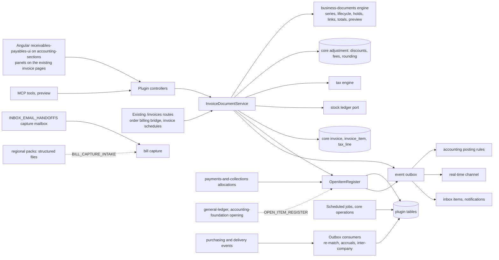

# Implementation Plan: Invoicing, receivables and payables

> Translates an approved `spec.md` into architecture and tech choices. The plan owns
> implementation details; the spec owns behaviour.

**Feature ID**: `invoicing-receivables-payables`
**Spec**: `./spec.md`
**Tasks**: `./tasks.md`
**Status**: `Draft`
**Last updated**: 2026-11-23

---

## 1. Architecture Summary

A new plugin `@gauzy/plugin-receivables-payables` (`packages/plugins/receivables-payables`) turns the core `invoice`
into a business document. It adds no second invoice table: `Invoice` and `InvoiceItem` stay the record, the plugin owns
one-to-one detail tables, the **open-item register**, matching, capture, accruals and the billing worklist. Numbering,
lifecycle, holds, links, roll-ups, totals, tolerances, bulk creation and the effects preview come from the business
document engine; discounts, fees and rounding are rows of the core `adjustment` ledger; taxes from the tax engine;
stock from the stock ledger; journals from `accounting`, which consumes our events. The plugin loads only when
`GAUZY_RECEIVABLES_PAYABLES_ENABLED` is exactly `true`; every controller is guarded by `FEATURE_RECEIVABLES_PAYABLES`.

The **open-item register** is the platform's one store of what is owed and works without the ledger: `general-ledger`
reads it and ties its control-account lines to it, `payments-and-collections` settles against it through its
`payment_allocation` rows (the one settlement fact), opening open items of `accounting-foundation`'s worksheet and the
opening documents of FR-8 are opened in it, and the existing amount-due columns (`invoice.alreadyPaid`, `amountDue`,
`paid`) are mirrored from it. Other existing pieces it builds on: `order_line_invoice` for order lines,
`invoice_item.expenseId`, `time_log.invoiceItemId` and `invoice_item.purchaseOrderLineId` as billed-once links,
`purchase_order_line.receivedQuantity` / `billedQuantity`, `invoice.sentTo` and the Received invoices pages for
inter-company documents, `organization_contact.creditLimit` / `creditUsed` for credit control, the
`INBOX_EMAIL_HANDOFFS` seam for captured email, and the core operation runtime for long runs.

## 2. Tech Choices

| Concern | Choice | Rationale |
| ------- | ------ | --------- |
| Package | new `packages/plugins/receivables-payables` and `receivables-payables-ui` | Principle I |
| Record | core `Invoice` / `InvoiceItem` extended with 11 nullable columns; everything else in plugin tables keyed by `invoiceId` / `invoiceItemId` | no parallel invoice model; core stays small |
| Money | `Money` and decimal-string helpers of core `money`; `numeric(20,6)` amounts, `numeric(20,10)` rates | exact decimals |
| Totals | the document engine's totals row (`business_document_totals`: net, discount, tax, charges, rounding, grand total, amount due, organization-currency total), with the core `invoice.totalValue`, `tax`, `tax2` mirrored as today; line net amounts on the engine's document line, taxes as core `tax_line` rows; no total columns in this plugin | one store of document totals |
| Discounts, fees, rounding | core `adjustment` rows with the new owner types `INVOICE` and `INVOICE_LINE` (types `MANUAL` or `PROMOTION` for discounts and coupons, `FEE`, `ROUNDING`; a header discount spread is one `INVOICE_LINE` row per line, `referenceType = 'INVOICE'`); reasons from `adjustment_reason` | the single money-adjustment ledger |
| Numbering | document engine series on core `SequenceService` (`allocate`), keys `INVOICE_RECEIVABLE`, `CREDIT_NOTE_RECEIVABLE`, `DEBIT_NOTE_RECEIVABLE`, `INVOICE_PAYABLE`, `CREDIT_NOTE_PAYABLE`, `DEBIT_NOTE_PAYABLE` | [platform architecture](../../architecture/business-suite.md) §3.1 |
| Instalments | `PaymentTermService.schedule` (existing derivation) snapshotted into `open_item` at confirmation | one answer to "how much is due" |
| Billed once | order lines through `order_line_invoice` (`INVOICE` / `CREDIT`, invoiced and credited quantities; kept by the order plugin's `OrderInvoicingService`), time through `time_log.invoiceItemId` (`invoice-item-billed-time.ts`), expenses through `invoice_item.expenseId` and `expense.status`, purchase lines through `invoice_item.purchaseOrderLineId`, other document sources (deliveries, estimates, receipts, subscription cycles through their order, deposit invoices of an order) through the engine's links and `BILLED` / `CREDITED` roll-ups; `billing_claim` only for sources that are no document and have no link (milestones, registered non-document sources) | build on what exists |
| Bills from purchasing | existing `PurchaseOrderLineService` (`toBillQuantity`, `assertNotOverbilled`, `assertBillVendorMatches`, `recomputeBilledQuantity`); accrual quantities read from `purchase_order_line.receivedQuantity` / `billedQuantity` | build on what exists |
| Holds | the engine's `hold` / `release` actions (`isOnHold`, `holdReason`, history row); the detail keeps only the governed reason code and the planned release date | one hold model |
| Inter-company | the existing `invoice.sentTo` (the receiving organization) and the Received invoices and estimates pages (`apps/gauzy/src/app/pages/invoices/invoices-received`, toggles `FEATURE_INVOICE_RECEIVED`, `FEATURE_ESTIMATE_RECEIVED`): the mirror bill is created in the receiving organization and listed on those pages beside the received invoice, which stays listed as today | build the payable side on the existing path; nothing the pages list today disappears |
| Credit control | limit from `organization_contact.creditLimit`; exposure extends the existing `creditUsed` reconciliation; decisions are rows of the one credit-decision record of `sales-order-management` (`sales_credit_decision`, which carries `invoiceId` beside `orderId`), written through its `SALES_PARTY_GUARD` port | one credit-decision table for orders and invoices |
| Multi-currency | a document in another currency than the organization's needs the existing `FEATURE_MULTI_CURRENCY` (`packages/core/src/lib/feature/commerce-feature-catalogue.ts`), switched on at first enablement for every tenant that already holds such invoices, so no one loses access | honour the existing code as pricing and the ledger do |
| Ageing | buckets computed when read from the open items' due dates with the organization's bucket scheme (`ageing_bucket_scheme` of `financial-reports`; default 1–30, 31–60, 61–90, over 90 days without it); the register keeps outstanding, overdue and not-due amounts only | one ageing computation |
| Long work | core operation runtime (`packages/core/src/lib/operation`, `api/async-operation.ts`): the open-item backfill and bulk builds are `operation` rows with steps, answered `202` with the handle | resumable, observable |
| Periodic work | `@ScheduledJob` + `@QueueWorker` (`@gauzy/scheduler`), every pass a `job_execution` row, in-process fallback without a queue root | house idiom |
| Capture | AI provider registry of the `ai-chat` plugin (organization's credentials), file storage of core; email through a hand-off listener on the `INBOX_EMAIL_HANDOFFS` seam (`packages/contracts/src/lib/inbox-email.model.ts`) for the organization's capture mailbox | no new provider or mail code |
| Push | event outbox → real-time plugin hints | Principle VII |

Ports consumed (interfaces in `@gauzy/contracts`, injected `@Optional()` where the owner may be switched off):
`BUSINESS_DOCUMENT_ENGINE` (required), `TAX_CALCULATOR` (tax engine; absent → legacy percentages), `LEDGER_PERIOD_GUARD`
and `LEDGER_EFFECTS_PREVIEW` (`accounting`; absent → no period check, empty preview), `LEDGER_FINDINGS` (`accounting`;
absent → integrity differences only logged and exposed), `STOCK_MOVEMENT_WRITER` (stock ledger; absent → direct stock
setting unavailable), `OPEN_ITEM_ALLOCATOR` (`payment` plugin; absent → no advances or "settled now"),
`SALES_PARTY_GUARD` (`sales-order-management`; absent → credit policy "warn" only), the order plugin's
`OrderInvoicingService` (`packages/plugins/order/src/lib/order-invoicing`, which keeps `order_line_invoice`; this plugin
answers its `ORDER_INVOICING` port through `INVOICE_DOCUMENT_WRITER`), `AGEING_BUCKET_SCHEME` (`financial-reports`;
absent → default buckets),
`APPROVAL_REQUESTS` (workflows; absent → permission only), `PRICING_COUPONS`, `ITEM_PARTY_RESTRICTIONS`.

Ports provided: `OPEN_ITEM_REGISTER` (`open`, `settle`, `release`, `credit`, `writeOff`, `reschedule`, `find`; the only
writer of `open_item`; `open` and `settle` accept the caller's transaction manager), `CREDIT_EXPOSURE_READER`,
`BILLABLE_SOURCE_REGISTRY` (`register(sourceType, reader)`), `BILL_CAPTURE_INTAKE` (files a supplier document as a
capture: used by the email hand-off, the API and the structured files of `regional-compliance-packs`),
`INVOICE_DOCUMENT_WRITER` (used by the order plugin's `order-invoicing.adapter.ts` and by `invoice-schedule` when the
feature is on, so that both create documents through the same service).

## 3. Data Model

### New or changed entities

**Core `invoice` (additive, nullable; `packages/core/src/lib/invoice/invoice.entity.ts`)**

| Column | Type | Notes |
| ------ | ---- | ----- |
| `documentKind` | varchar(16) | `INVOICE`, `CREDIT_NOTE`, `DEBIT_NOTE`; null reads `INVOICE` |
| `direction` | varchar(12) | `RECEIVABLE`, `PAYABLE`; null reads from `vendorId` |
| `documentNumber` | varchar(64) | printed series number; unique (`tenantId`, `organizationId`, `direction`, `documentKind`, `documentNumber`) where not null |
| `lifecycleState` | varchar(16) | `DRAFT`, `CONFIRMED`, `CANCELLED`; null = document created before this feature (state read from `status`) |
| `settlementStatus` | varchar(16) | `UNPAID`, `PARTIALLY_PAID`, `FULLY_PAID`, `OVERPAID` |
| `originalInvoiceId` | uuid | note → original; FK `invoice` SET NULL; indexed |
| `confirmedAt`, `cancelledAt` | timestamp | |
| `organizationCurrency`, `exchangeRate` | varchar(3), numeric(20,10) | rate: one document unit in organization currency |
| `nextDueDate` | timestamp | earliest unpaid instalment; index (`organizationId`, `direction`, `nextDueDate`) where `amountDue` > 0 |

The existing `amountDue`, `alreadyPaid` and `paid` columns are the document's outstanding and paid amounts; for a
document in the register they are written only by the register (sum of its open items), and a document without open
items keeps today's updates from recorded payments; the amount payable is the engine totals' `amountDue` (total less tax
withheld at source). `status` and `dueDate` keep being written by a status mapper (`DRAFT`, `SENT`, `VIEWED`,
`PARTIALLY_PAID`, `FULLY_PAID`, `OVERPAID`, `VOID`), so existing clients read what they read today.

**Plugin tables** (all extend `TenantOrganizationBaseEntity`: tenant, organization, timestamps, soft delete; MultiORM
decorators; amounts `numeric(20,6)`; JSON as text on every dialect)

| Table | Columns | Indexes, uniqueness |
| ----- | ------- | ------------------- |
| `invoice_document_detail` | `invoiceId`; `exchangeRateDate`, `exchangeRateSource` (`TABLE`, `MANUAL`, `SUPPLIER_DATE`); `discountClass` (`TRADE`, `SETTLEMENT`); `supplierInvoiceNumber`, `supplierInvoiceDate`; `customerReference`, `customerReferenceDate`; `billingAddressId`, `shippingAddressId`, `dispatchAddressId`, `contactPersonId`; `partySnapshot`, `organizationSnapshot` (JSON); `deliveryTermsCode`, `deliveryTermsPlace`; `billingPeriodStart`, `billingPeriodEnd`; `recurrenceSourceType`, `recurrenceSourceId`, `subscriptionId`; `isOpening`, `movesStock`; `counterpartInvoiceId` (the mirror document; the counterpart organization is `invoice.sentTo`); `creditCheckState`, `creditDecisionId` (a `sales_credit_decision` row); `matchState`; `holdReasonCode`, `holdReleaseOn` (date; the hold itself is the engine's); `postingState` (`NONE`, `PENDING`, `POSTED`, `FAILED`), `postingError`; `isCredited`, `isDisputed`, `isFinanced`; `creditReasonId` (core `adjustment_reason`); `salesAttribution` (JSON); `captureId`; `version` | unique `invoiceId` (FK cascade); (`organizationId`, `supplierInvoiceNumber`); (`counterpartInvoiceId`); (`holdReleaseOn`) where not null |
| `invoice_item_detail` | `invoiceItemId`, `invoiceId`, `lineNumber`; `productVariantId`, `unitId`; `taxCategoryId`, `withholdingApplies`; `servicePeriodStart`, `servicePeriodEnd`, `recogniseOverPeriod`; `stockLocationId`, `rejectedStockLocationId`, `rejectedQuantity`; `isDropShipped`; `bundleParentItemDetailId`; `assetCategoryId`, `assetId`; `isLandedCostCharge`, `landedCostClaimedAmount`; `expenseCategoryId`; `dimensionSetId` (resolved through `AnalyticDimensionSetService.resolve`; null without accounting); `accrualClearedAmount`, `priceDifference`; `commissionable`; `accountHint` (sources, credited lines and credited quantities are engine links and roll-ups; net and tax amounts are the engine line and `tax_line`; discounts are `adjustment` rows) | unique `invoiceItemId` (FK cascade); (`invoiceId`, `lineNumber`) |
| `open_item` | `direction`; `partyType` (`CONTACT`, `VENDOR`, `EMPLOYEE`, registered types), `partyId`; `nature` (`CHARGE`, `CREDIT`); `sourceType` (`INVOICE_INSTALMENT`, `CREDIT_NOTE`, `PAYMENT`, `OPENING`, `MANUAL_JOURNAL`, registered types), `sourceId`, `invoiceId`, `sequence`; `documentDate`, `dueDate`; `currency`, `originalAmount`, `outstandingAmount`, `exchangeRate`, `organizationCurrencyAmount`; `discountType`, `discountValue`, `discountUntil`; `preferredPaymentMethod`; `earmarkType`, `earmarkId` (an advance earmarked for an order); `state` (`OPEN`, `PARTIALLY_SETTLED`, `SETTLED`, `CANCELLED`); `isOverdue`, `isOnHold`, `isDisputed`; `settledAt`; `projectId`, `dimensionSetId`; `version` | unique (`invoiceId`, `sequence`) where `invoiceId` not null; unique (`sourceType`, `sourceId`, `sequence`); (`organizationId`, `direction`, `partyType`, `partyId`, `state`); (`organizationId`, `direction`, `dueDate`) where outstanding > 0 |
| `open_item_entry` (append-only) | `openItemId`, `entryType` (`OPENED`, `SETTLED`, `RELEASED`, `CREDITED`, `WRITTEN_OFF`, `RESCHEDULED`, `CANCELLED`), `amount` (signed), `effectiveDate`, `causeType`, `causeId` (a settlement's cause is its `payment_allocation` row), `outstandingAfter`, `dueDateAfter`, `actorId`, `actorType`, `note` | (`openItemId`, `createdAt`); (`organizationId`, `effectiveDate`); unique (`openItemId`, `causeType`, `causeId`, `entryType`) |
| `party_open_balance` | `direction`, `partyType`, `partyId`, `currency`; `outstanding`, `overdue`, `notDue`, `credits`; `oldestDueDate`; `organizationCurrencyOutstanding` (ageing buckets are computed when read) | unique (`tenantId`, `organizationId`, `direction`, `partyType`, `partyId`, `currency`) |
| `bill_match_result` | `invoiceId`, `invoiceItemId`, `purchaseOrderLineId`, `policy` (`TWO_WAY`, `THREE_WAY`); `orderedQuantity`, `receivedQuantity`, `previouslyBilledQuantity`, `billedQuantity`, `orderPrice`, `billPrice`; `quantityVariance`, `priceVariance`, `amountVariance`; `outcome` (`MATCHED`, `WITHIN_TOLERANCE`, `EXCEPTION`, `OVERRIDDEN`, `REJECTED`); `exceptionCode`; `resolution`, `resolutionReason`, `resolvedById`, `resolvedAt`, `approvalRequestId`; `matchedAt` | unique `invoiceItemId`; (`organizationId`, `outcome`); (`purchaseOrderLineId`) |
| `bill_capture` (the one intake register of incoming supplier invoices) | `fileId`, `fileName`, `mimeType`, `checksum`; `source` (`UPLOAD`, `EMAIL`, `API`, `STRUCTURED`), `senderEmail`; `operationId` (a multi-file upload or network batch, null for one file); `state` (`RECEIVED`, `EXTRACTING`, `PROPOSED`, `ACCEPTED`, `DISCARDED`, `FAILED`, `REFUSED`); `proposal` (JSON: value, confidence, page and box per field; for structured files the parsed document); `refusalCode`; `vendorId`, `invoiceId`; `error`, `extractedAt`, `reviewedById` | unique (`organizationId`, `checksum`); (`organizationId`, `state`); (`operationId`) |
| `bill_capture_hint` | `vendorId`, `key` (`EXPENSE_CATEGORY`, `TAX_CATEGORY`, `PROJECT`, `LINE_TEXT`), `value` (JSON), `uses` | unique (`vendorId`, `key`) |
| `unbilled_accrual` (money facts only) | `direction`, `sourceType` (`GOODS_RECEIPT_LINE`, `DELIVERY_LINE`, registered types), `sourceDocumentId`, `sourceLineId`, `purchaseOrderLineId` null; `partyType`, `partyId`; `itemKind` (`STOCK`, `SERVICE`, `ASSET`), `productVariantId`; `recognisedOn`; `unitPrice`, `currency`, `amount`, `clearedAmount`, `priceDifference`; `state` (`OPEN`, `PARTIALLY_CLEARED`, `CLEARED`, `CLOSED_UNBILLED`), `closeReason`; `projectId`, `dimensionSetId` (received and billed quantities are read from `purchase_order_line.receivedQuantity` / `billedQuantity`, delivered and billed quantities from the engine's roll-ups of the delivery line) | unique (`sourceType`, `sourceLineId`); (`organizationId`, `direction`, `state`, `recognisedOn`) |
| `billing_claim` (sources without a link) | `sourceType` (`MILESTONE`, registered non-document sources), `sourceId`, `invoiceId`, `invoiceItemId`, `quantity`, `amount`, `state` (`CLAIMED`, `BILLED`, `RELEASED`) | (`sourceType`, `sourceId`, `state`); (`invoiceId`); unique (`sourceType`, `sourceId`, `invoiceItemId`) |

No hold table (the engine's hold and release actions, with the reason code and release date on the detail), no credit
review table (rows of `sales_credit_decision`, owned by `sales-order-management`, with `invoiceId`, review state,
exposure snapshot, condition, approved exposure and expiry), no total columns (§2). Settings are not a table:
`receivables-payables.settings.ts` declares the keys of spec FR-82 (scope `ORGANIZATION`) in the platform settings
store, as the `payment` plugin does; the stricter keys `documents.lockConfirmed`, `amounts.refuseNegative`,
`parties.strictCheck`, `dates.refuseDueBeforeDocument` and `matching.blockOnException` default to `false`, and the
duplicate supplier number policy defaults to "warn", so an organization that sets nothing works as today. Every table joins the core tenant export; captured files are referenced by id
and follow the file storage's own export rules.

### Migrations

**Migration timestamps**: `packages/plugins/receivables-payables` `1791000075100` to `1791000075199`; `packages/core` `1791000075900` to `1791000075999`.

- Core `packages/core/src/lib/database/migrations/1791000075900-AlterInvoiceForFinanceDocuments.ts`: the invoice columns and indexes above; no backfill (null = created before this feature).
- Plugin `packages/plugins/receivables-payables/src/lib/database/migrations/1791000075110-CreateReceivablesPayablesTables.ts`: the ten tables; the shared core migration helpers of `@gauzy/core`; idempotent (`hasTable`, `createIndexIfMissing`), PostgreSQL, MySQL and SQLite branches.
- Plugin `1791000075120-SeedInvoiceDocumentTypesAndSeries.ts` (same folder): registers the six document types and their series per
  organization; the invoice series starts at the organization's highest existing invoice number plus one. The types
  over documents that exist today on core `invoice` (customer invoices, invoices from suppliers, and estimates wherever
  they are registered as quotations) register with `preexisting: true` (`business-document-engine` FR-113), so the
  engine's added locks, deletion refusals, number permission and tolerances stay off for them unless the organization
  turns a type policy on.
- All registered for both ORMs. The feature and its permissions are plugin contributions (`defaultFor` grants, §9), not
  seeds. Existing invoices get open items by the resumable operation of §8, not by a migration.

### Contracts

`packages/contracts/src/lib/receivables-payables.model.ts`: the enums above, `IInvoiceDocument` (invoice + detail +
instalments + links + totals of the engine + adjustments), `IOpenItem`, `IOpenItemEntry`, `IPartyOpenBalance` (with
buckets computed for the requested scheme), `IBillMatchResult`, `IBillCapture`, `IUnbilledAccrual`,
`IBillingWorklistEntry`, `IInvoiceDocumentEffectsPreview`, the event payloads of §5 and the port interfaces of §2.
`IInvoice` gains the optional core fields; `AdjustmentOwnerType` gains `INVOICE` and `INVOICE_LINE`. Permission values
and the feature code are plugin contributions, not new members of the core enums. Nothing existing is renamed.

## 4. API Surface

All routes: `TenantPermissionGuard`, `PermissionGuard`, `FeatureFlagGuard(FEATURE_RECEIVABLES_PAYABLES)`; cursor
pagination; `Idempotency-Key` on every `POST` that creates or changes state; `If-Match` with the document version.

| Method | Endpoint | Permission | Description |
| ------ | -------- | ---------- | ----------- |
| `GET` | `/api/invoice-documents`, `/:id` | `INVOICES_VIEW` or `BILLS_VIEW` by direction | list (filters: direction, kind, states, party, dates, amounts, project, tag) and read → `IInvoiceDocument` |
| `POST` `PUT` | `/api/invoice-documents`, `/:id` | `INVOICES_EDIT` or `BILLS_EDIT` | create or change a draft (`InvoiceDocumentDraftDTO`); server totals returned |
| `POST` | `/api/invoice-documents/:id/preview` | view | totals, instalments, credit check, match outcome, stock and ledger effects → `IInvoiceDocumentEffectsPreview` |
| `POST` | `/api/invoice-documents/:id/confirm` | `INVOICE_DOCUMENTS_CONFIRM` or `BILLS_CONFIRM` | body: instalment plan, advances to apply, `settledNow`; `409` on version conflict; `422` with rule codes |
| `POST` | `/api/invoice-documents/:id/cancel`, `/amend` | `INVOICE_DOCUMENTS_CANCEL` or `BILLS_CANCEL` | reason; amend returns the new linked draft |
| `PATCH` | `/api/invoice-documents/:id/change-set` | edit | tags, notes, references of a confirmed document |
| `POST` | `/api/invoice-documents/:id/credit-note`, `/debit-note` | `CREDIT_NOTES_CREATE` | lines, reason, `releaseTime`; standalone: `POST /api/invoice-documents/credit-note` (`CREDIT_NOTES_CREATE_STANDALONE`) |
| `POST` | `/api/invoice-documents/from-sources` | edit (+ `INVOICE_DOCUMENTS_OVERBILL`) | body: source lines of orders, deliveries, estimates, purchase orders, receipts, registered sources |
| `POST` | `/api/invoice-documents/:id/deposit` | `INVOICES_EDIT` | deposit invoice for an order |
| `GET` | `/api/open-items`, `/api/open-items/:id/entries` | `OPEN_ITEMS_VIEW` | filters: direction, party, state, due range, overdue, hold; `asOf` |
| `POST` | `/api/open-items/reschedule` | `OPEN_ITEMS_RESCHEDULE` | invoice id, new plan, reason |
| `GET` | `/api/open-items/:id/settlement-quote?date=` | `OPEN_ITEMS_VIEW` | discount available and net amount |
| `GET` | `/api/open-balances`, `/api/open-balances/ageing` | `OPEN_ITEMS_VIEW` | per party; buckets of the organization's scheme (or `schemeId`) computed from due dates; `asOf`; group by party group, currency |
| `POST` | `/api/invoice-documents/:id/hold`, `/hold/release`; `PUT` `/hold` | `DOCUMENT_HOLDS_MANAGE` | the engine's hold and release actions plus reason code and `releaseOn` |
| `GET` | `/api/bill-match/exceptions`, `/:id/facts` | `BILL_MATCH_VIEW` | queue and the facts behind one exception |
| `POST` | `/api/bill-match/exceptions/:id/resolve` | `BILL_MATCH_OVERRIDE` | `ACCEPT`, `SEND_FOR_APPROVAL`, `ASK_BUYER`, `REJECT_LINE` + reason |
| `POST` `GET` | `/api/bill-captures` (multipart), `/:id`; `POST` `/:id/accept`, `/:id/discard` | `BILL_CAPTURES_MANAGE` | upload, proposal, turn into a draft bill |
| `GET` | `/api/credit-exposure/:contactId` | `OPEN_ITEMS_VIEW` | exposure with breakdown, against `organization_contact.creditLimit` |
| `POST` `GET` | `/api/credit-reviews`; `POST` `/:id/decide`, `/:id/withdraw` | `CREDIT_REVIEWS_REQUEST`; `CREDIT_REVIEWS_DECIDE` | request and decision of an invoice review, stored as a `sales_credit_decision` row through `SALES_PARTY_GUARD` |
| `GET` | `/api/billing-worklist`, `/api/billing-worklist/:contactId` | `BILLING_WORKLIST_VIEW` | unbilled work by customer and by source |
| `POST` | `/api/billing-worklist/build`, `/build-bulk` | `BILLING_WORKLIST_BUILD` | `preview` flag; bulk answers `202` with an operation whose steps are the customers (`GET /api/operations/:id` for per-customer results) |
| `POST` | `/api/bill-captures/:id/record-as-bill`; `POST` `/api/invoices/:id/record-as-bill` | `BILLS_EDIT` | payable draft from a capture, or from an invoice received through `sentTo` before this feature |
| `GET` | `/api/unbilled-accruals` | `ACCRUALS_VIEW` | `asOf`, direction, party, item kind |
| `GET` `PUT` | `/api/receivables-payables/settings` | view; `RECEIVABLES_PAYABLES_SETTINGS_EDIT` | organization policies |

The core `/invoices` routes are unchanged. `InvoiceService` gains one guard, active only with the feature on and the
organization's `documents.lockConfirmed` setting on (default off): an update that changes amounts, party, currency or
dates of a row whose `lifecycleState` is `CONFIRMED` answers `409 INVOICE_DOCUMENT_CONFIRMED` naming the action to
use. With the lock off such an update is accepted as today and handed to the plugin's amend path (change set,
re-derived unpaid open items, `.amended` event). GraphQL: read-only `invoiceDocument`, `openItems`,
`partyOpenBalance` beside the existing invoice resolver. Confirming or settling a document creates no core `income`
row and replaces none: income records stay for revenue recorded without an invoice, and the ledger posts both kinds.

**Consumer tokens answered** (bound in `apps/api/src/plugin-composition.ts` to the open-item register, bill capture, bill and billed-time services; each consumer plan states the shape it calls and its fallback): `BANKING_OPEN_ITEMS`, `PORTAL_BILLS`, `PRINT_TIME_SOURCE`, `PURCHASING_BILLS`, `SUBCONTRACTING_BILLS`.

## 5. Events, Real-Time and Notifications

Published through `EventOutboxService.append` in the writing transaction; partition `invoice:<id>` for documents,
`party:<type>:<id>` for open items and balances.

| Event | Emitted when | Consumers |
| ----- | ------------ | --------- |
| `document.customer_invoice.confirmed`, `.cancelled`, `.amended` (same three for `customer_credit_note`, `customer_debit_note`, `supplier_bill`, `supplier_credit_note`, `supplier_debit_note`) | lifecycle change | `accounting` posting rules (journal or reversal), real-time, document flow, `fixed-assets`, `budgets-and-revenue-schedules`, `stock-ledger-and-valuation` (landed cost), webhooks |
| `receivables_payables.open_item.changed` | any open-item entry | `payment` plugin, dunning, real-time, credit exposure cache |
| `receivables_payables.balance.changed` | a party balance row changed | real-time (lists, party page, ageing card) |
| `receivables_payables.accrual.recognised`, `.cleared`, `.closed` | accrual register writes | `accounting` posting rules |
| `receivables_payables.bill_match.exception_raised`, `.exception_resolved` | match outcome changes | inbox item for buyer and payables clerk, real-time |
| `receivables_payables.credit_review.requested`, `.decided`, `.expired` | review lifecycle | inbox item for approvers and requester, real-time |
| `receivables_payables.hold.placed`, `.released` | hold lifecycle | `payment` plugin, real-time |
| `receivables_payables.bill_capture.proposed` | extraction finished | inbox item for the uploader, real-time |

**What a posting rule receives** (`IInvoiceDocumentEvent`, also the body of the effects preview):

| Part | Fields |
| ---- | ------ |
| Amounts | `documentCurrency`, `organizationCurrency`, `exchangeRate`; `subtotal`, `discounts[]` (`amount`, `class`), `roundingAdjustment`, `withheldTaxTotal`, `total`, `amountPayable`, each in both currencies; per line `netAmount`, `allocatedHeaderDiscount`, `quantity`, `taxLines[]` (`taxRateId`, `taxCategoryId`, `amount`, `isReverseCharge`, `isWithheld`, `postingKey`), `accrualClearedAmount`, `priceDifference` |
| Parties | `partyType`, `partyId`, `organizationId`, `counterpartOrganizationId` (inter-company) |
| Account hints | `direction`, `documentKind`, `isOpening`, `isInterCompany`, `discountClass`, `originalInvoiceId` (a note reverses the original's accounts); per line `productId`, `productVariantId`, item group and kind, `expenseCategoryId`, `assetCategoryId` or `assetId`, `recogniseOverPeriod` with its period, `isLandedCostCharge`, `movesStock` with `stockLocationId`, `accountHint` |
| Dimensions | per line `projectId`, `taskId`, `employeeId`, `dimensionSetId`; header `organizationContactId`, tags |
| Settlement | `openItems[]` (`id`, `sequence`, `dueDate`, `amount`), `documentDate`, `documentNumber`, links to source lines |

Accrual events carry `amount` and `quantity` in both currencies, party, `direction`, `itemKind`, item, group, source
document and line, dimensions and, when clearing, `invoiceId`, `clearedAmount`, `priceDifference`. A `.cancelled` event
carries `reversalOf` (the confirmation's event id). The posting result comes back as `accounting.journal.posted` /
`accounting.journal.failed` (matched by `source`), which sets `postingState`. Discounts, fees and rounding in the
payload are read from the document's `adjustment` rows, totals from the engine's totals row.

Consumed: `document.goods_receipt.confirmed`, `document.delivery.confirmed` and their cancellations (accruals,
re-match), `document.purchase_order.amended` (re-match), `payments.allocation.created` / `.released` (applied through
`OPEN_ITEM_REGISTER`), `accounting.journal.posted` / `.failed`, time approval and milestone events of
`project-costing-and-billing`, subscription cycle events (worklist). Consumer keys
`subscriber:receivables-payables:<name>`; each is idempotent on the delivery record.

Real time: the real-time plugin's catalogue gains the record types `invoice`, `open_item`, `party_open_balance`,
`bill_match_exception`, `sales_credit_decision` (invoice reviews), `billing_worklist`. Email: documents use the existing invoice email path.

## 6. UI Surface

- **Angular** `packages/plugins/receivables-payables-ui` (registered with `@gauzy/plugin-ui`, lazy, hidden when the
  feature is off; routes on the page location `accounting-sections`, children of `/pages/accounting`): Credit and
  debit notes, Open items, Billing worklist, Bill exceptions, Bill captures, Credit reviews, Unbilled accruals;
  Settings → Receivables and payables. Bills extend the existing Received invoices page
  (`apps/gauzy/src/app/pages/invoices/invoices-received`), which keeps its route, its toggle and every invoice it lists
  today: with the feature on it also lists the organization's payable documents (recorded bills and inter-company
  mirrors) and offers "Record as bill" on every invoice received through `sentTo`. The
  existing invoice add, edit and view pages (`apps/gauzy/src/app/pages/invoices`) get extension panels from the
  plugin: confirm bar with preview, instalments, advances, holds, document flow, state badges. The "Invoices
  Recurring" route shows the schedules of `invoice-schedule` when the feature is on (the stub stays otherwise). The
  worklist, open balance card, credit review panel and exception queue are Angular components of this package. Lists
  are saved-view lists and forms honour custom fields; the existing invoice and estimate lists keep their columns,
  filters and actions. The public invoice page (`public-layout-ui`) keeps working and shows instalments and amount
  due. Today's invoice PDF (`generate-invoice-pdf.ts`) stays a template, and stays an organization's template until it
  picks one of the new ones.
- i18n keys `RECEIVABLES_PAYABLES.*` in every locale of `packages/ui-core/i18n`; keyboard operable tables and dialogs.

## 7. MCP Tools, SDKs and Integrations

`packages/mcp-server/src/lib/tools/receivables-payables.ts` (the 14 existing invoice tools stay):

| Tool | Input → output |
| ---- | -------------- |
| `invoice_document_save`, `invoice_document_get`, `invoice_documents_list` | draft or filters → `IInvoiceDocument` |
| `invoice_document_confirm`, `invoice_document_cancel` | id, plan, `preview` → effects preview or the confirmed document |
| `credit_note_create`, `debit_note_create` | original id, lines, reason, `preview` → note |
| `invoice_document_from_sources`, `bill_from_purchase` | source lines, `preview` → draft |
| `billing_worklist_get`, `billing_worklist_build` | customer or filters, `preview` → entries or drafts and result log |
| `open_items_list`, `open_balance_get`, `ageing_get`, `open_item_reschedule` | filters, `asOf` → items, balances |
| `document_hold_place`, `document_hold_release` | id, reason, date → hold |
| `bill_match_exceptions_list`, `bill_match_exception_explain`, `bill_match_exception_resolve` | id, resolution, `preview` → facts or result |
| `bill_capture_upload`, `bill_capture_accept` | file reference → proposal or draft bill |
| `credit_exposure_get`, `credit_review_request`, `credit_review_decide` | customer, document → exposure or review |
| `unbilled_accruals_list` | `asOf`, filters → accrual entries |

SDK: additive OpenAPI; regenerate the SDKs after merge. Import and export: `data-import-export` templates
`customer_invoices`, `supplier_bills`, `opening_open_items` (mapped create, error file); lists export through saved
views. Report definitions (spec §7 table) registered with the report builder on datasets `invoice_documents`,
`open_items`, `party_open_balances`, `bill_match_results`, `unbilled_accruals`, `credit_reviews` (invoice rows of
`sales_credit_decision`), `billing_worklist`. Structured electronic invoices arrive from `regional-compliance-packs`
(which parses and transports them) through `BILL_CAPTURE_INTAKE` as captures with `source = STRUCTURED`, one row per
file and the upload or network batch as an operation; that plugin keeps no inbound register of its own. Receipts of
employees' expense claims stay in `expenses-and-travel`'s receipt capture; both use the same `ai-chat` extraction path.

## 8. Background Jobs

The API loads `ReceivablesPayablesPlugin` (everything, including queue consumers); the worker loads
`ReceivablesPayablesSchedulePlugin` (queue `receivables-payables-maintenance` and the scheduled jobs that enqueue).
Without a queue root the API runs the same sweeps on in-process timers under a database lock.

| Trigger | When | What it does | Idempotency |
| ------- | ---- | ------------ | ----------- |
| `receivables-payables.overdue-sweep` | hourly | sets `isOverdue` and the not-due and overdue balances per organization time zone, mirrors flags, emits changes | state compare; one entry per item and due date |
| `receivables-payables.hold-release`, `.credit-review-expiry` | hourly | engine `release` for holds whose `holdReleaseOn` is due; expires this plugin's `sales_credit_decision` rows | state compare |
| `receivables-payables.worklist-threshold` | daily | inbox notice when unbilled work passes amount or age | once per customer and crossing |
| queue `bill-capture-extract` | on upload | extraction through the AI provider, proposal | `checksum`, capture state |
| operation `RECEIVABLES_BULK_BUILD` | on request | one step per customer through the engine's bulk creation | operation idempotency key + customer |
| operation `RECEIVABLES_OPEN_ITEM_BACKFILL` | feature turned on | cursor over invoices, 500 per step | unique (`invoiceId`, `sequence`) |
| outbox consumers `rematch`, `accruals`, `intercompany`, `allocations`, `posting-result`, `worklist` | on events | see §5 | delivery record + unique keys |

## 9. Security & Permissions

New permission values, contributed in `receivables-payables.permissions.ts` with `defaultFor` grants (no seed
migration; the permission reload adds missing grants to existing tenants): `INVOICE_DOCUMENTS_CONFIRM`, `INVOICE_DOCUMENTS_CANCEL`, `INVOICE_DOCUMENTS_OVERBILL`,
`BILLS_VIEW`, `BILLS_EDIT`, `BILLS_CONFIRM`, `BILLS_CANCEL`, `CREDIT_NOTES_CREATE`, `CREDIT_NOTES_CREATE_STANDALONE`,
`OPEN_ITEMS_VIEW`, `OPEN_ITEMS_RESCHEDULE`, `DOCUMENT_HOLDS_MANAGE`, `BILL_MATCH_VIEW`, `BILL_MATCH_OVERRIDE`,
`BILL_CAPTURES_MANAGE`, `CREDIT_REVIEWS_REQUEST`, `CREDIT_REVIEWS_DECIDE`, `OPENING_INVOICES_CREATE`,
`INTERCOMPANY_INVOICES_CREATE`, `BILLING_WORKLIST_VIEW`, `BILLING_WORKLIST_BUILD`, `ACCRUALS_VIEW`,
`RECEIVABLES_PAYABLES_SETTINGS_EDIT`.

| Role | Default grants (`defaultFor`) |
| ---- | ------------------------------- |
| `SUPER_ADMIN`, `ADMIN` | all |
| `MANAGER` | `BILLS_VIEW`, `OPEN_ITEMS_VIEW`, `BILL_MATCH_VIEW`, `BILLING_WORKLIST_VIEW`, `BILLING_WORKLIST_BUILD`, `CREDIT_REVIEWS_REQUEST`, `ACCRUALS_VIEW` |
| `DATA_ENTRY` | `BILLS_VIEW`, `BILLS_EDIT`, `BILL_CAPTURES_MANAGE` |
| `VIEWER` | `BILLS_VIEW`, `OPEN_ITEMS_VIEW` |

Confirm, cancel, override, hold and review decisions are separate keys, so drafting and approving can be split.
Inter-company counterparts and background work run inside `RequestContext.runWithRequest` with a system actor of the
target organization. Capture: files are stored in the platform file storage; content is sent to the organization's
configured AI provider only when `receivablesPayables.captureEnabled` is on; inbound capture email arrives through a
hand-off listener registered on the `INBOX_EMAIL_HANDOFFS` seam for the organization's capture mailbox (its
`mailboxSettings`). DTOs use class-validator; free text is sanitised; uploads are limited to PDF and
images, 20 MB, virus-scanned where the deployment has a scanner. Agent actions carry `actorType = Agent` and the acting
user in the history and audit trail.

## 10. Observability

Activity-log entries for every lifecycle change, open-item entry, hold, exception resolution, credit decision and
setting change (before and after). Metrics: confirmations per minute and latency, open-item register conflicts, match
outcomes by cause, capture latency and field accuracy (accepted without change), backfill progress, posting failures.
Integrity check (daily, logged and exposed at `GET /api/open-balances/integrity`): `invoice.amountDue` = sum of its open
items; `party_open_balance` = sum of open items; settled amounts = active `payment_allocation` rows plus credits and
write-offs; with `accounting` on, open items per party = receivable or payable control account balance (differences
raised in the shared finding store through `LEDGER_FINDINGS`, source `RECEIVABLES`).

## 11. Phased Rollout

1. **Phase 1 — Contracts, entities, migrations** (flags off, no behaviour change).
2. **Phase 2 — Documents and open items**: server totals, confirm, cancel, amend, series, instalments, balances, credit
   and debit notes, bills by API, holds, events, status mirror, backfill job. Usable through API.
3. **Phase 3 — UI**: bills, notes, open items, confirm bar and panels on the invoice pages, lists, print templates,
   public page. Demo: issue an invoice with instalments, credit one line, record a bill.
4. **Phase 4 — MCP tools, SDK, reports, docs.**
5. **Phase 5 — Sources and controls**: create-from for orders, deliveries, purchase orders and receipts; matching and
   exception queue; credit control and reviews; advances and "settled now"; inter-company; accruals; direct stock.
6. **Phase 6 — Advanced capabilities**: billing worklist and bulk build, bill capture, live ageing with "as of".
7. **Phase 7 — General availability**: the feature is off by default; after the trial period it may be switched on by default for new tenants only; existing tenants keep their setting until an administrator changes it.
   Invoices of existing tenants behave as today (spec FR-83).

## 12. Constitution Reconciliation

- I Plugin-first: plugin pair; core receives only columns on the entity it owns, two `AdjustmentOwnerType` values and
  one guarded check; totals, holds, links, credit decisions, ageing schemes and long runs are existing or sibling
  pieces this plugin builds on.
- II Tenant/organization scoping: every table on the tenant-organization base; services extend `TenantAwareCrudService`;
  the inter-company writer switches organization only through a system actor.
- III Both ORMs, additive migrations: MultiORM entities with MikroORM repositories; nullable columns and new tables.
- IV Default-off flag; nothing removed: deployment switch plus tenant feature; legacy tax fields, status values, routes
  and reminders stay.
- V Contracts and API first: contracts first (Phase 1), REST before UI, idempotency keys, additive OpenAPI.
- VI Permissions, privacy, security: 23 keys with contributed default grants, system actors, capture data flow stated.
- VII Real-time through the event bus: outbox events, real-time catalogue entries, no private channel.
- VIII i18n and accessibility: keys in every locale; print templates per language.
- IX Tests: unit specs per service, property tests (totals, instalment sums, open-item conservation), dialect specs for
  migrations, e2e for confirm, credit, match, review.
- X Behaviour-first spec: implementation lives here only.
- XI Documentation describes our platform only.

## 13. Risks & Mitigations

| Risk | Likelihood | Impact | Mitigation |
| ---- | ---------- | ------ | ---------- |
| Two answers to "amount due" (existing columns vs open items) | Medium | High | one writer (the register) mirrors into the existing columns; daily integrity check |
| Contracts of other engines change | High | Medium | ports as interfaces in contracts; adapter layer per port; optional injection with defined fallbacks |
| Numbering change surprises existing organizations | Medium | Medium | series seeded from the current highest number; numeric number kept |
| Capture proposes wrong data | Medium | Medium | never auto-confirm; confidence marks; duplicate checks still apply |
| Inter-company mirror loops or duplicates | Low | High | unique `counterpartInvoiceId`; mirror only from the receivable side; consumer idempotent |
| Lock contention on party balances under bulk confirms | Medium | Medium | one row per party and currency updated by delta; partition by party in the outbox |
| Backfill on large tenants | Medium | Medium | cursor batches, off-peak throttle, resumable; invoices stay editable throughout, and a step re-reads an invoice changed meanwhile |

## 14. References

- Spec: `./spec.md` · Tasks: `./tasks.md`
- Engines: `../business-document-engine/plan.md` (totals, holds, links), `../general-ledger/plan.md`,
  `../tax-engine/plan.md`, `../payments-and-collections/plan.md` (allocations), `../sales-order-management/plan.md`
  (`sales_credit_decision`), `../financial-reports/plan.md` (`ageing_bucket_scheme`)
- Code: `packages/core/src/lib/invoice` (`sentTo`, `amountDue`, `alreadyPaid`, `paid`), `invoice-item`, `payment-term`,
  `sequence`, `event-outbox`, `adjustment`, `operation`, `organization-contact` (`creditLimit`, `creditUsed`);
  `apps/gauzy/src/app/pages/invoices/invoices-received`; `packages/contracts/src/lib/inbox-email.model.ts`
  (`INBOX_EMAIL_HANDOFFS`); `packages/plugins/order/src/lib/order-invoicing`, `order-line-invoice`;
  `packages/plugins/purchasing/src/lib/purchase-order-line`; `packages/plugins/task-automations` (plugin, schedule and
  migration idioms)
