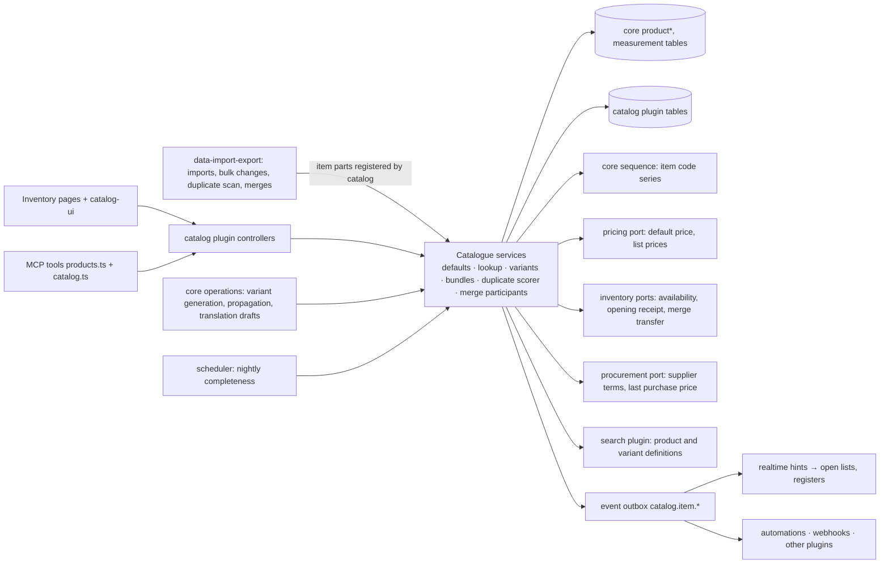

# Implementation Plan: Item catalogue

> Translates an approved `spec.md` into architecture and tech choices. The plan owns
> implementation details; the spec owns behaviour.

**Feature ID**: `item-catalogue`
**Spec**: `./spec.md`
**Tasks**: `./tasks.md`
**Status**: `Draft`
**Last updated**: 2026-11-23

---

## 1. Architecture Summary

The item tables stay where they are: `product`, `product_variant`, `product_variant_setting`, `product_category`,
`product_option_group`, `product_option` and the translation tables in core, `unit` and `unit_category` in core
`measurement`. The `catalog` plugin (`packages/plugins/catalog`) already extends them through the kernel migration
set and owns publication, collections, relations and variant media; it receives every new catalogue table of this
spec. A new Angular plugin `packages/plugins/catalog-ui` adds the master pages and contributes sections to the
existing Inventory item form and view (`apps/gauzy/src/app/pages/inventory`).

Ports follow `apps/api/src/plugin-composition.ts`: the catalog plugin declares `CATALOG_PRICE_WRITER`,
`CATALOG_STOCK_AVAILABILITY`, `CATALOG_STOCK_LEDGER`, `CATALOG_SUPPLIER_TERMS` and `CATALOG_ASSISTANT` tokens;
composition binds them to `ProductPriceService` (pricing), `StockAvailabilityService`
(`packages/plugins/inventory/src/lib/stock-availability`: quantity minus reserved minus safety stock per location),
`StockLedgerService` (inventory; opening receipts and merge transfers only), `VendorProductTermService` (purchasing)
and the catalogue assistant of `ai-agents-and-assistants` (fallback: the `ai-chat` `AiProviderRegistry`). A
deployment without one of those plugins leaves the port unbound and the feature that needs it answers with a notice
instead of failing.

**Built on what exists, one model per concept.**

- **Bulk edit, duplicate scan and merge** are the platform's, from `data-import-export`: the catalogue registers the
  item parts of the core record type registry (import creator and match keys code and barcode, duplicate rules with
  the catalogue's scorer, a `rename` part for code changes, an item `mergeGuard`) and its merge participants through
  `registerMergeParticipants` (`PluginContributions.dataExchange`). A bulk edit is a `data-import-export` bulk change
  with target `Product`, written through the existing product bulk path (`core/src/lib/product/product.bulk.ts`,
  `BulkExecutorService`), with its per-row results and undo; duplicates are `data_duplicate_candidate` rows; a merge
  is a `data_merge` with its journal and undo. The catalogue keeps only the scorer and the item rules.
- **Long work** (variant generation above 50, propagation of renamed values and template fields, translation drafts)
  runs as core operations (`packages/core/src/lib/operation/`, `@AcceptedOperation`, `202` and `/api/operations`),
  with per-row outcomes in the operation's result; no job table.
- **Item search** is a facade over the `search` plugin's `product` and `product-variant` definitions
  (`packages/plugins/search/src/lib/definitions/product*.definition.ts`), which gain the fields normalised name, old
  codes, barcodes, manufacturer parts, supplier codes and customer codes, and the definition option "one wrong
  character in terms of five or more characters"; with `FEATURE_SEARCH` off a database provider ranks the same fields
  over `product.normalizedName` and `item_code_alias`.
- **Attribute values of list attributes** are the variant's options: `product_option_group.attributeId` and
  `product_option.attributeValueId` link the existing option model to attributes, and the pivot
  `product_variant_options_product_option` says which value a variant has. `item_variant_attribute` holds only range
  and text values.
- **Barcodes**: `item_barcode` is the store; `product_variant.barcode` (read by existing DTOs, GraphQL and MCP tools)
  becomes a copy of the primary barcode written only by `ItemBarcodeService`. While `FEATURE_ITEM_MASTER` is on, a
  `barcode` sent to the existing variant DTOs is routed to that service (it sets the primary, as type `INTERNAL`
  without a check-digit test; a value already taken stays on the column and joins the drift list instead of being
  refused); while it is off, the column behaves as today.
- **Kits**: an item has either a catalogue kit (`item_bundle` kind `KIT`: a one-level structure assembled or taken
  apart by the repack and disassembly documents of `warehouse-and-stock-movements`, never made in production) or a
  manufacturing structure of `manufacturing-bom-and-routing`, never both: the kit check reads `MANUFACTURING_USAGE`
  and refuses a kit on an item with a released structure, and that plugin refuses a structure on an item with an
  active kit and counts kit components in where-used. Sales bundles (kind `BUNDLE`) are this spec's alone.
- **Legacy variant price**: with `FEATURE_ITEM_MASTER` and `FEATURE_PRICING` both on, the price fields of the Inventory variant form
  (`edit-inventory-item-variant`) write the variant's price on the default selling list through
  `CATALOG_PRICE_WRITER` and set the variant's `product_variant_setting.priceOnList`; the existing
  `product_variant_price` row is kept and stays the resolution's last fallback (`product-price.service.ts`), never
  written by that form again for that variant. While `FEATURE_PRICING` is on, a variant with `priceOnList` set keeps
  having its form price written on the default list after `FEATURE_ITEM_MASTER` is switched off, so an edited price is
  the one the resolution reads; with `FEATURE_PRICING` off, and for a variant whose price the form never wrote on the
  list, the form writes the legacy row as today. One form never writes both.
- **Supplier prices, packs and lead times** are the supplier terms of `procurement` (`vendor_product_term`), read
  through `CATALOG_SUPPLIER_TERMS`; the default supplier of an item is its preferred term (`isPreferred`); the default
  selling and buying lists are the list chain of `pricing-and-promotions`. The precedence is written once in the
  pricing plan (§3 "Supplier prices").
- **Reports** are report-builder definitions declared through `registerReportDefinitions`; no report route.
- **Existing parts kept as they are**: `product_type` and the `manage-product-types` page stay a free classification
  beside the new kinds; the merchant stores (`merchant`, `manage-merchants`, MCP `merchants.ts`) are not part of the
  item master; the Inventory warehouse screen's direct quantity edit
  (`WarehouseProductService.updateWarehouseProductQuantity`) is not used here: the item page reads balances from
  `StockAvailabilityService` and writes opening quantities through the ledger, and that screen's edit belongs to
  `warehouse-and-stock-movements`; the lookup and resolved-defaults reads sit beside the existing cross-plugin reads
  `CatalogItemService` and `ProductVariantSaleService` in `catalog-item/`; `FEATURE_BULK_API` and `FEATURE_DATA_EXPORT`
  are not read by this spec (bulk edits and exports are `data-import-export`'s); the `FEATURE_CATALOG` entry of
  `commerce-feature-catalogue.ts` links to `pages/inventory`, where items live.

## 2. Tech Choices

| Concern | Choice | Rationale |
| ------- | ------ | --------- |
| Package | existing `packages/plugins/catalog`; new `packages/plugins/catalog-ui` | Principle I; no parallel item model |
| Core columns | kernel migration in `packages/core/src/lib/database/migrations/` | the catalogue's existing rule: core tables are extended by the kernel set |
| Persistence | MultiORM entities, tri-dialect migrations written with the shared core migration helpers (`@gauzy/core`, `database/migration-helpers.ts` beside `check-constraint.helper.ts`) | Principle III; no plugin copy |
| Settings | plugin settings (`catalog.settings.ts`) in the platform settings store, including the organization-level item defaults and the stricter rules, each default off so existing items behave as today: `catalog.uniqueCodes`, `catalog.protectReferencedItems`, `catalog.lockMovedItems`, `catalog.templatesOffDocuments`, `catalog.lockTradedCodes`, `catalog.nameFromCode`, `catalog.cleanDescriptions`; `catalog.inheritedFields` defaults to none | the pattern of `promotion.settings.ts`; no settings table |
| Permissions | contributions in `catalog.permissions.ts` with `defaultFor` | the permission reload grants existing tenants; no seed migration |
| Background work | core operations (`OperationRegistry` types, `@AcceptedOperation`) on queue `catalog-maintenance`; `@gauzy/scheduler` `@ScheduledJob` for the nightly completeness refresh | one run ledger |
| Bulk edit, duplicates, merge | `data-import-export` bulk changes, duplicate candidates and merges with the item parts this plugin registers | one framework |
| Batch writes | the platform bulk contract (`core/src/lib/api/bulk.ts`, `BulkExecutor`) | one partial-success contract |
| Push | event outbox → real-time hints (`realtime` plugin) | Principle VII |
| History | core activity log (`ActivityLogService.logActivity`) with before and after values | one history per record |
| Search | `search` plugin definitions `product` and `product-variant` with the new fields; database provider over normalised columns and aliases when `FEATURE_SEARCH` is off | one index; works on SQLite |
| Availability | `StockAvailabilityService` through `CATALOG_STOCK_AVAILABILITY` | the inventory plugin's one availability read |
| AI | `CATALOG_ASSISTANT` bound to `ai-agents-and-assistants` (purpose `catalog.translation-draft`, declared with `registerAssistantPurposes`); fallback `ai-chat` `AiProviderRegistry` | no provider code in the catalogue |
| UI | Angular `catalog-ui` + plugin locations on Inventory pages | existing screens are extended, not replaced |

## 3. Data Model

### Changed core tables (kernel migration `1791000022900-ExtendItemMasterColumns`)

| Table | New columns (all nullable or defaulted) |
|---|---|
| `product` | `brandId` uuid; `endOfLifeAt` timestamp; `warrantyDays` int; `shelfLifeDays` int; `minOrderQuantity`, `orderMultiple` numeric(20,6); `leadTimeDays`, `leadTimeBufferDays` int; `maxDiscountPercent`, `overDeliveryAllowancePercent`, `overBillingAllowancePercent` numeric(9,6); `deferredRevenueMonths`, `deferredExpenseMonths` int; `withholdingCategoryId` uuid; `variantBasis` varchar(16) (`ATTRIBUTE`, `MANUFACTURER`); `hasVariants` boolean default false; `normalizedName` varchar(255); `plainSummary` text. Index `(organizationId, normalizedName)` where `deletedAt IS NULL`; index `(organizationId, brandId)` |
| `product_variant_setting` | booleans default false: `isService`, `isFixedAsset`, `isCustomerProvided`, `isSubcontracted`, `usedInManufacturing`, `isDropShip`, `allowsAlternatives`, `isCommissionEligible`, `isBundle`, `isKit`, `priceOnList` (set when the variant form writes the variant's price on the default selling list) |
| `product_variant` | `localFields` text (JSON list of fields that no longer inherit); existing `barcode` becomes the copy of the primary `item_barcode` |
| `product_option_group` | `attributeId` uuid; `product_option`: `attributeValueId` uuid (the option is the list value of a variant) |
| `unit` | `isActive` boolean default true; `commonCode` varchar(8) |

New core table `unit_conversion` (core `measurement`, same migration): `TenantOrganizationBaseEntity` + `productId`
uuid null, `variantId` uuid null, `unitId` uuid not null, `factor` numeric(24,12) not null (stock units per one
`unitId`), `isWholeNumber` boolean null (overrides the unit's decimals), `scopeKey` varchar(48) not null (`variant:<variantId>`,
else `product:<productId>`, else `*` for an organization-wide conversion; written with the two ids, so the key holds
on every dialect). Unique `(organizationId, scopeKey, unitId)` where `deletedAt IS NULL`; check `factor > 0`.

### New catalog plugin tables (migration `1791000022110-CreateItemMasterTables`)

Every table extends `TenantOrganizationBaseEntity` (tenant, organization, timestamps, `deletedAt` soft delete).

| Table | Columns | Keys and indexes |
|---|---|---|
| `brand` (+ `brand_translation`: `referenceId`, `languageCode`, `name`, `description`) | `code` varchar(64), `name` varchar(255), `description` text, `website` varchar(512), `logoId` uuid (FK `image_asset`, set null), `isActive` boolean | unique `(organizationId, code)` live |
| `manufacturer` | `shortName` varchar(64), `fullName` varchar(255), `website` varchar(512), `countryCode` varchar(2), `logoId` uuid, `isActive` | unique `(organizationId, shortName)` live |
| `item_manufacturer_part` | `variantId` uuid FK cascade, `manufacturerId` uuid FK restrict, `partNumber` varchar(128), `isDefault` boolean | unique `(organizationId, manufacturerId, partNumber)` live; unique `(variantId)` where `isDefault` |
| `item_barcode` | `variantId` uuid FK cascade, `code` varchar(64), `type` varchar(16), `unitId` uuid null, `isPrimary` boolean | unique `(organizationId, code)` live; unique `(variantId)` where `isPrimary`; the primary is copied into `product_variant.barcode` by `ItemBarcodeService` only |
| `item_attribute` (+ `item_attribute_translation`) | `code` varchar(64), `name` varchar(255), `kind` varchar(16) (`LIST`, `RANGE`, `TEXT`), `rangeMin`, `rangeMax`, `rangeStep` numeric(20,6), `position` int | unique `(organizationId, code)` live |
| `item_attribute_value` (+ translation) | `attributeId` FK cascade, `value` varchar(255), `abbreviation` varchar(32), `position` int | unique `(attributeId, value)`, `(attributeId, abbreviation)` live |
| `item_variant_attribute` (range and text attributes only; list values are the variant's options) | `variantId` FK cascade, `attributeId` FK restrict, `numericValue` numeric(20,6) null, `textValue` varchar(255) null | unique `(variantId, attributeId)`; check exactly one value |
| `item_customer_code` | `productId` FK cascade, `variantId` null, `contactId` uuid null, `contactGroupId` uuid null, `ownerKey` varchar(48) not null (`contact:<contactId>` or `group:<contactGroupId>`, written with them), `code` varchar(128), `description` varchar(512) | check exactly one of contact or group; unique `(organizationId, ownerKey, code)` live, so one customer and one group each hold a code once; index `(organizationId, code)` |
| `item_code_alias` | `productId` FK cascade, `code` varchar(128), `retiredAt` timestamp | unique `(organizationId, productId, code)` (items that shared a code while `catalog.uniqueCodes` is off each keep it as an old code); index `(organizationId, code)` |
| `item_bundle` | `productId` FK cascade, `kind` varchar(8) (`BUNDLE`, `KIT`), `name` varchar(120), `isActive` boolean, `version` int | unique `(productId, kind)` where `isActive` and live |
| `item_bundle_component` | `bundleId` FK cascade, `variantId` FK restrict, `quantity` numeric(20,6), `unitId` uuid, `priceShare` numeric(9,6) null, `description` varchar(255), `position` int | index `(variantId)` (where-used) |
| `item_default` (brand and group levels only) | `ownerType` varchar(16) (`BRAND`, `GROUP`), `ownerId` uuid not null, `field` varchar(64), `value` varchar(255) | unique `(organizationId, ownerType, ownerId, field)` live |
| `item_completeness` | `productId` FK cascade, `channelId` uuid null, `languageCode` varchar(8), `score` numeric(5,4), `missing` text (JSON), `computedAt` | unique `(productId, channelId, languageCode)` |
| `item_translation_draft` | `entityType` varchar(32), `entityId` uuid, `languageCode` varchar(8), `field` varchar(32), `value` text, `status` varchar(12) (`DRAFT`, `APPROVED`, `REJECTED`), `createdById` | unique `(entityType, entityId, languageCode, field)` where `status = 'DRAFT'` |

No duplicate, bulk job or merge table: duplicate candidates, bulk change rows and merges are the records of
`data-import-export` (`data_duplicate_candidate`, `data_import_run` / `data_import_row`, `data_merge` /
`data_merge_journal`); long runs are core operations.

### One owner per default field

`item_default` holds brand and group values; item values are the item's own columns; organization values are keys of
`catalog.settings.ts`. Resolution reads, per field, item → brand → nearest group and its ancestors → organization.

| Field | Item level | Brand and group level | Organization level |
| --- | --- | --- | --- |
| Stock location | — (stock levels per location belong to `warehouse-and-stock-movements`) | `item_default` | setting |
| Supplier | the preferred supplier term (`vendor_product_term.isPreferred`, `procurement`) | `item_default` (items without a preferred term) | — |
| Sales unit, purchase unit | `product_variant.salesUnitId`, `purchaseUnitId` | `item_default` | setting |
| Tax category | `product_variant.taxCategoryId` (rates: `tax-engine`) | `item_default` | setting |
| Minimum order quantity, order multiple | `product.minOrderQuantity`, `orderMultiple` | `item_default` | setting |
| Lead time | the supplier term's lead time, then `organization_vendor.leadTimeDays`, then `product.leadTimeDays` | `item_default` | setting |
| Selling and buying list | — | — | the list chain and default lists of `pricing-and-promotions`, shown read-only |

`product_relation` (catalog, migration `1791000022120-ExtendProductRelation`): enum value `ALTERNATIVE`;
`isBidirectional` boolean default false; `ratio` numeric(20,6) null; `position` int default 0.

Foreign keys to tables of other packages (contact, contact group, unit, image asset) are added by this migration
because their targets are kernel tables; `withholdingCategoryId` gets its constraint from the tax set, as the
variant's `taxCategoryId` does today. No backfill is needed: every new column is nullable or defaulted; the
primary barcode is copied from `product_variant.barcode` into `item_barcode` by `1791000022130-BackfillItemBarcodes`
(idempotent). A legacy barcode shared by two variants is copied for the oldest variant only; the others keep their
column value and appear in the barcode drift list of the Barcodes page (holders of `PRODUCTS_EDIT`) until a manager
resolves them. Permissions are contributions, so no seed migration.

### Migrations

**Migration timestamps**: `packages/plugins/catalog` `1791000022100` to `1791000022199`; `packages/core` `1791000022900` to `1791000022999`.

The core kernel migration of the changed core tables and the catalog plugin migrations named above (new tables, the product relation value, the barcode backfill and the data step that switches the catalogue on for active tenants), in `packages/plugins/catalog/src/lib/database/migrations/` through the shared core migration helpers; PostgreSQL, MySQL and SQLite branches, additive and forward-only, registered for both ORMs.

### Contracts

`packages/contracts/src/lib/item-catalogue.model.ts`: `ItemKind`, `ItemBarcodeType`, `ItemAttributeKind`,
`ItemBundleKind`, `ItemDefaultOwnerType`, `ItemDefaultField`, `IItemResolvedDefault { field, value, source,
sourceId, sourceName }`, `IItemLookupResult { variantId, unitId, quantity, matchedBy, candidates? }` (`candidates` when several items match at the same step), `IItemAvailability`,
`IVariantGenerationPreview`, `IItemDuplicateEvidence` (the scorer's answer), `IItemCompleteness`, plus the new entity
interfaces; additive fields on `IProduct`, `IProductVariantSetting`, `IUnit`. Bulk change, duplicate candidate and
merge shapes are those of `data-exchange.model.ts`.

## 4. API Surface

All new routes carry `@UseGuards(TenantPermissionGuard, PermissionGuard, FeatureFlagGuard)` and
`@FeatureFlag(FEATURE_CATALOG, FEATURE_ITEM_MASTER)`; the nine existing catalogue controllers get
`@FeatureFlag(FEATURE_CATALOG)`, and the data step `1791000022140-EnableCatalogForActiveTenants` switches
`FEATURE_CATALOG` on for every tenant holding publication, collection, relation or variant media rows, so none loses a
route. The core `/products`, `/product-variants` and Inventory routes keep their permissions
(`ORG_INVENTORY_VIEW`, `ORG_INVENTORY_PRODUCT_EDIT`). Writes accept `If-Match` versions; creating routes accept
idempotency keys (`@Idempotent`).

| Method | Endpoint | Permission | Contract | Status |
| ------ | -------- | ---------- | -------- | ------ |
| CRUD | `/brands`, `/manufacturers`, `/item-attributes`, `/item-attributes/:id/values` | `PRODUCTS_VIEW` / `PRODUCTS_EDIT` / `PRODUCTS_DELETE` | entity DTOs | New |
| CRUD | `/item-barcodes`, `/item-manufacturer-parts`, `/item-customer-codes` | same | entity DTOs | New |
| CRUD | `/item-bundles` (components nested) | same | `IItemBundle` | New |
| GET | `/item-bundles/:id/availability?warehouseId=` | `PRODUCTS_VIEW` | `IItemAvailability[]` | New |
| CRUD | `/unit-conversions` | by the row's scope: organization-wide (`scopeKey = *`) `UNITS_EDIT`; item or variant (`product:` or `variant:` scope) `PRODUCTS_EDIT` or `UNITS_EDIT` (read `UNITS_VIEW` or `PRODUCTS_VIEW`) | `IUnitConversion` | New (core) |
| POST | `/units/convert` | `UNITS_VIEW` | adds `productId`, `variantId`, `stockQuantity`, `documentFamily` | Changed, additive |
| GET/PUT | `/item-defaults?ownerType=&ownerId=` (brand or group) | `PRODUCTS_VIEW` / `CATALOG_SETTINGS_EDIT` | `IItemDefault[]` | New |
| POST | `/item-defaults/resolve` | `PRODUCTS_VIEW` | `{ productIds, fields }` → `IItemResolvedDefault[]` | New |
| GET | `/item-lookup?code=&contactId=&includeInactive=` | `PRODUCTS_VIEW` | `IItemLookupResult`; items past end of life, archived or disabled only with `includeInactive=true`; when several items match at the first step that finds any (codes and old codes need not be unique while `catalog.uniqueCodes` is off), all of them in `candidates` and none chosen | New |
| GET | `/items/search?q=&limit=&includeInactive=` | `PRODUCTS_VIEW` | ranked items; facade over the `search` plugin, database provider when it is off; items past end of life, archived or disabled only with `includeInactive=true` | New |
| POST | `/items/duplicate-check` | `PRODUCTS_VIEW` | item fields → candidates with `IItemDuplicateEvidence` (the scorer the duplicate rules also call) | New |
| GET | `/items/:id/availability`, `/items/:id/connections`, `/items/:id/completeness` | `PRODUCTS_VIEW` | | New |
| POST | `/items/:id/variants/preview`, `/items/:id/variants/generate` | `PRODUCTS_EDIT` | preview; created rows, or `202` with the operation above 50 | New |
| PUT | `/items/:id/code` | `PRODUCTS_EDIT`; also `PRODUCTS_MERGE` when transactions exist and `catalog.lockTradedCodes` is on | `{ code }` | New |
| POST | `/item-translation-drafts` (generate, `202` operation); PUT `/item-translation-drafts/:id/approve`, `/reject` | `PRODUCTS_EDIT` | | New |
| POST | `/item-labels/print` | `PRODUCTS_VIEW` | print request to the print engine | New |
| GET/PUT | `/catalog/settings` | `PRODUCTS_VIEW` / `CATALOG_SETTINGS_EDIT` | settings object, including the organization-level defaults | New |
| * | `/api/data-exchange/bulk-changes`, `/duplicate-candidates`, `/merges` (owned by `data-import-export`) | its permissions plus `PRODUCTS_EDIT`; merges also `PRODUCTS_MERGE` through the item merge guard | target `Product` | Used |

The existing `/products` and `/product-variants` DTOs accept the new columns (optional, validated). Errors: `400`
with a rule code (`ITEM_KIND_RULE`, `ITEM_UNIT_LOCKED`, `BARCODE_CHECK_DIGIT`, `BARCODE_TAKEN`, `BUNDLE_CYCLE`,
`KIT_HAS_STRUCTURE`, `VARIANT_LIMIT`, `MERGE_GUARD` from the item merge guard), `404` across organizations, `409` on
version conflict. GraphQL: read fields for brands, barcodes, bundles and resolved defaults in the catalog schema
extension. Reports have no route: they are report definitions served by the report builder.

**Consumer tokens answered** (bound in `apps/api/src/plugin-composition.ts` to the item, unit and conversion services; each consumer plan states the shape it calls and its fallback): `DOCUMENT_UNITS`, `MANUFACTURING_CATALOG`.

## 5. Events, Real-Time and Notifications

| Event | Emitted when | Consumers |
| ----- | ------------ | --------- |
| `catalog.item.created` / `.updated` / `.archived` | item or variant written (one per request, ids and changed field names) | real-time hints (lists, item page, registers), automations, webhooks, completeness refresh, search re-index |
| `catalog.item.merged` | the item merge participant ran inside a `data-import-export` merge (beside its `record.merged`) | pricing, stock and order plugins re-point caches; webhooks |
| `catalog.bundle.changed` | bundle version activated or components changed | registers, carts |
| `catalog.barcode.changed` | barcode added, removed or made primary | registers (offline packs) |

Events are appended to the outbox in the transaction of the write (`EventOutboxService.append`), partition
`catalog:<productId>`, and declared with the subscription catalogue (`declareStreamedEvents`) like the order events.
The end of a bulk change, a duplicate scan or a merge is notified by `data-import-export`; the end of a generation or
a translation draft run is the core `operation.completed`, posted to the requester's Inbox.

## 6. UI Surface

- Inventory item form (`edit-inventory-item`): new plugin locations `inventory-item-form-sections` and
  `inventory-item-view-panels`; `catalog-ui` contributes sections Kinds, Units and conversions, Barcodes, Attributes
  and variants (generator with preview), Alternatives and relations, Manufacturers and codes, Bundle or kit,
  Buying and commercial, Defaults (each value with its source), Media, Translations, Publication, History.
- `catalog-ui` pages (`/pages/catalog/…`, menu Inventory → Catalogue): brands, manufacturers, attributes, units and
  conversions, collections, completeness, settings; each list is a saved-view list when `record-views-and-search` is
  loaded. Item groups stay on the existing categories page (`manage-product-categories`), which gains tree moves,
  image, translations and order while `FEATURE_ITEM_MASTER` is on; item types stay on `manage-product-types`. The
  sections contributed to the Inventory item form and view also show only while `FEATURE_ITEM_MASTER` is on; with it
  off both pages are as today.
- Bulk edit from the item list opens the `data-import-export` bulk change dialog with target `Product` (selection →
  fields → preview grid → apply → result → undo); duplicates and merges open its duplicate and merge screens filtered
  to items; reports open in the report builder.
- Menu entries and routes hidden unless `FEATURE_CATALOG` and `FEATURE_ITEM_MASTER` are on and the user holds the
  permission; i18n keys in every locale of `packages/ui-core/i18n/`.
- The register of `point-of-sale-and-loyalty` reads the same API.

## 7. MCP Tools, SDKs and Integrations

The existing tools of `packages/mcp-server/src/lib/tools/products.ts` are extended rather than duplicated:
`create_product` and `update_product` accept `preview: true` and the new fields and answer with the item as it would
be saved, its resolved defaults and the duplicates it collides with; `get_product` adds the resolved defaults with
their sources. New file `catalog.ts` holds only the actions `products.ts` lacks:

| Tool | Input | Output |
|---|---|---|
| `search_items` | `query`, `limit`, filters | ranked items with code, name, unit, status |
| `lookup_item_code` | `code`, `contactId?` | variant, unit, quantity, matched by; the candidates when several items match |
| `generate_item_variants` | `itemId`, attribute values, `preview` | variant codes, created or refused rows |
| `bulk_edit_items` | filter or ids, field values, `preview` | a `data-import-export` bulk change of target `Product`: per-row before and after, run id |
| `list_item_duplicates` | `status?` | `data-import-export` duplicate candidates of type `Product` with score and evidence |
| `draft_item_translations` | `itemIds`, `languageCode` | draft ids (never approves) |

OpenAPI regenerated; SDK regeneration noted for the release. Imports: the product bulk endpoint gains the new
fields; mapped imports are `data-import-export`'s, through the item import part.

## 8. Background Jobs

| Trigger | When | What it does | Idempotency |
| ------- | ---- | ------------ | ----------- |
| operation `CATALOG_VARIANT_GENERATE` (queue `catalog-maintenance`) | generation of more than 50 | creates variants in steps of 50, per-row outcome in the operation result | one step per slice; unique variant code |
| operation `CATALOG_PROPAGATE` | attribute value renamed, template field changed | updates inheriting variants | one step per slice; values compared before write |
| `catalog.completeness.refresh` (scheduled nightly + on `catalog.item.*`) | | recomputes scores | upsert by key |
| operation `CATALOG_TRANSLATION_DRAFTS` | drafts requested | asks `CATALOG_ASSISTANT` for the selected texts | one draft per entity, language and field |
| item duplicate rules in the `data-exchange.duplicates` scan | nightly per organization (owned by `data-import-export`) | the catalogue's scorer blocks by normalised name prefix, barcode, part, supplier code and scores pairs | unique pair; dismissed pairs skipped |

Bulk changes and merges run as `data-import-export` operations (`data-exchange.import`, `data-exchange.merge`); the
catalogue's merge participant moves its references and asks the stock ledger to transfer balances inside that run.
Worker (`apps/worker/src/plugins.ts`) loads `CatalogSchedulePlugin` (the completeness schedule only); the API hosts the
operation handlers; without a queue root the operation runtime runs them in process.

## 9. Security & Permissions

- New permissions as contributions in `catalog.permissions.ts`: `PRODUCTS_MERGE`, `CATALOG_SETTINGS_EDIT`;
  `defaultFor: ['SUPER_ADMIN', 'ADMIN']`; existing tenants receive them through the permission reload.
  `FEATURE_ITEM_MASTER` added to `CATALOG_FEATURES` (`defaultEnabled: false`, `dependsOn: ['FEATURE_CATALOG']`).
- A bulk edit needs the bulk-change permission of `data-import-export` and `PRODUCTS_EDIT`; a merge needs its merge
  permission, and the item merge guard also requires `PRODUCTS_MERGE`.
- Rich descriptions are cleaned with the platform sanitizer (`core/html-sanitizer`) on save while
  `catalog.cleanDescriptions` is on (default off: stored as sent, as today); the plain-text summary is always derived
  from the cleaned text; uploads limited by type and size; barcode and code inputs trimmed and length-checked.
- AI drafts: only the selected texts leave the platform, to the organization's configured provider through
  `CATALOG_ASSISTANT`; listed in the user docs as data leaving the platform.
- Code changes write activity-log rows with before and after values; bulk changes and merges keep their per-row
  before values and journal in `data-import-export`, and each changed item gets its activity-log row.

## 10. Observability

Activity log per item; operation results and `data-import-export` row results kept 30 days; metrics
`catalog_lookup_ms`, `catalog_duplicate_score_ms`; warnings for unbound ports.

## 11. Phased Rollout

1. **Phase 1 — Surface what exists** (behind `FEATURE_ITEM_MASTER`): guards on the existing catalogue controllers;
   `catalog-ui` with collections, publication, relations, variant media and units pages, the categories page
   extended; Inventory sections for the variant columns that are API-only (barcode, weight, customs, units); MCP read
   tools; report definitions "Variant details" and "Item price list rates".
2. **Phase 2 — Depth**: kinds and rules, brands, defaults with resolution, item conversions, barcodes table and
   lookup, attributes and generator, alternatives, manufacturers, customer codes, bundles and kits, commercial and
   buying attributes, opening quantity, code change and the item merge parts, label printing, remaining reports.
3. **Phase 3 — Advanced capabilities**: item duplicate rules and the duplicate check, bulk edit through
   `data-import-export`, completeness, AI translation drafts, MCP writing tools with preview, real-time pushes.
4. **Phase 4 — General availability**: the feature is off by default; after the trial period it may be switched on by default for new tenants only; existing tenants keep their setting until an administrator changes it.

## 12. Constitution Reconciliation

- I Plugin-first: tables in `catalog`; UI in `catalog-ui`; core changes are columns on core item tables and one
  shared conversion table in core `measurement`, which several plugins read.
- II Tenant/organization scoping: every table extends the tenant-organization base; services use the tenant-aware
  CRUD service; lookups filter by the caller's organization.
- III Both ORMs, additive migrations: new tables and nullable columns, tri-dialect, registered for both ORMs.
- IV Default-off flag; nothing removed: `FEATURE_ITEM_MASTER` off; existing routes, option groups, relations and the
  legacy variant price kept.
- V Contracts and API first: contracts in `item-catalogue.model.ts`; Swagger on every route.
- VI Permissions, privacy, security: §9.
- VII Real-time through the event bus: §5.
- VIII i18n and accessibility: keys in every locale; keyboard operable forms and grids.
- IX Tests: unit specs per service, e2e where the catalog suite exists, migration test on SQLite.
- X Behaviour-first spec: implementation lives here.
- XI Documentation describes our platform only.

## 13. Risks & Mitigations

| Risk | Likelihood | Impact | Mitigation |
| ---- | ---------- | ------ | ---------- |
| Guard on catalogue routes hides an API a tenant used with the code off | Low | Medium | data step switching the code on for tenants with catalogue data; release note |
| Legacy `product_variant.barcode` and `item_barcode` drift | Medium | Medium | only `ItemBarcodeService` writes the column while the feature is on; a nightly check fills the drift list |
| Variant generation floods the tables | Low | Medium | 1,000 limit; preview first |
| Merge moves references other plugins cache | Medium | Medium | `catalog.item.merged` event; the merge journal and undo of `data-import-export`; the source stays archived with a link, never deleted |
| Plugin locations on the Inventory form not yet supported by `@gauzy/plugin-ui` | Medium | Low | add the location in phase 1; fall back to tabs rendered by the page |

## 14. References

- Spec: `./spec.md` · Tasks: `./tasks.md`
- Code: `packages/core/src/lib/product*`, `packages/core/src/lib/measurement`, `packages/plugins/catalog`,
  `packages/core/src/lib/operation`, `packages/plugins/inventory/src/lib/stock-availability`,
  `packages/plugins/search/src/lib/definitions`, `packages/mcp-server/src/lib/tools/products.ts`,
  `apps/api/src/plugin-composition.ts`
- Plans: `../data-import-export/plan.md` (bulk changes, duplicates, merges), `../pricing-and-promotions/plan.md`
  (supplier price precedence), `../manufacturing-bom-and-routing/plan.md` (kits)
