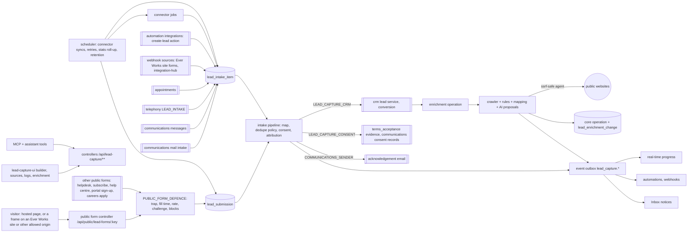

# Implementation Plan: Lead capture and enrichment

> Translates an approved `spec.md` into architecture and tech choices. The plan owns
> implementation details; the spec owns behaviour.

**Feature ID**: `lead-capture-and-enrichment`
**Spec**: `./spec.md`
**Tasks**: `./tasks.md`
**Status**: `Draft`
**Last updated**: 2026-11-23

---

## 1. Architecture Summary

A new plugin `@gauzy/plugin-lead-capture` (`packages/plugins/lead-capture`), listed in `apps/api/src/plugins.ts` and
`apps/worker/src/plugins.ts` only when `GAUZY_LEAD_CAPTURE_ENABLED` is exactly `true`, contributes `FEATURE_LEAD_CAPTURE`
(default off) and puts `@FeatureFlag(FEATURE_LEAD_CAPTURE)` plus a `FEATURE_CRM` check on every controller. It owns
forms, submissions, intake sources and items, enrichment rules, mappings, runs and changes, and the capture settings.
It never writes leads: every path ends in **one intake pipeline** that calls the CRM through the port
`LEAD_CAPTURE_CRM`, bound to an adapter exported by `@gauzy/plugin-crm` (create lead with a duplicate policy, convert to
deal, fill empty fields, add a timeline link). Connectors to ad platforms extend the existing integration framework
(core `integration`, `integration_tenant`, encrypted `integration_setting`, `integration_map` for external ids) and,
when loaded, the connector kit, connected accounts and inbound endpoints of `integration-hub`; the existing automation
integrations (`packages/plugins/integration-{zapier,make-com,activepieces}`) gain a "create lead" action into the same
pipeline. Angular builder and pages live in `packages/plugins/lead-capture-ui`; the hosted form
page is a built-in transactional page (like the public estimate answer page), served by the API so that each form sets
its own framing policy, and runs a framework-free script bundle from `packages/plugins/lead-capture-form`.

Public sites are Ever Works sites, not Gauzy pages. Their main public surface for this feature is the embedded form
(frame or visitor bundle) whose allowed origins include the hostnames of the Ever Works Works linked to the organization
through `integration-ever-works`; a site template's own contact or newsletter form posts to a webhook intake source with
the integration's token. This plugin owns the shared public-form defence (`PUBLIC_FORM_DEFENCE`) that the public forms
of new features bind; an existing public route binds it only when its per-form setting is switched on (default off). Settings and permissions are contributions, consent proof is core `terms_acceptance`, and
enrichment runs are operations of the core runtime.

## 2. Tech Choices

| Concern | Choice | Rationale |
| --- | --- | --- |
| Package | new `packages/plugins/lead-capture` (`forms/`, `public/`, `submissions/`, `abuse/`, `intake/`, `connectors/`, `enrichment/`, `analytics/`, `settings/`, `schedule/`, `database/`), `lead-capture-ui`, `lead-capture-form` (visitor bundle) | Principle I |
| Leads | port `LEAD_CAPTURE_CRM` → `CrmLeadIntakeAdapter` of the crm plugin; the port takes the caller's transaction, and the intake pipeline writes the lead (with its duplicate check and outbox events) and completes the item (`outcome`, the lead or deal id) in that one transaction, so a stop before commit leaves neither and a rerun creates the lead once, and a committed item is never run again; the lead's `intake` also records the submission's `reference` | one lead write path, duplicate rule of `crm-leads-and-deals`; no second lead for one submission |
| Form rules | conditions stored in the rule-kernel shape and evaluated by the isomorphic evaluator of `packages/utils/src/lib/formula/` (from `custom-fields-and-forms`) in builder, visitor bundle and server | same verdict everywhere |
| Hosted page | a built-in transactional page: API-rendered HTML (`public/lead-form-page.controller.ts`) with per-form `Content-Security-Policy: frame-ancestors` and the visitor bundle (< 150 KB); `public-layout-ui` route `form/:key` links to it; throttling as the public estimate route (`public-share/invoice/public-invoice.controller.ts`) | dynamic framing policy per form; no page builder |
| Ever Works sites | allowed origins of a form may be taken from the Works linked through `integration-ever-works` (their hostnames, refreshed when the link changes); an Ever Works site calls the public submit route like any site, or posts its template's own form server-side to a webhook intake source with the integration token | sites are rendered by Ever Works; Gauzy keeps forms, intake and events |
| Abuse defence | core `packages/core/src/lib/public-form-defence/`, built by this spec independently of its plugin and flag, exported as `PublicFormDefenceModule` and offered as port `PUBLIC_FORM_DEFENCE` (no table, no route of its own: trap field, signed render token with issue time, throttles per address and per form on the platform cache, proof-of-work (SHA-256 prefix) returned by the caller's own submit route after signals, block lists from the caller's policy); provided by core whether or not this plugin is loaded (the lead form spam log stays in `abuse/`), and bound by `helpdesk-tickets` (web form, widget), `marketing-campaigns` (subscribe), `helpdesk-portal-and-knowledge-base` (feedback, community), `customer-and-supplier-portal` (sign-up) and `recruitment` (apply). Existing public routes (appointment booking, team join requests, sign-up, `public-share/*`) keep their current throttling; each gains an organization setting `publicFormDefence.<form>` (default off, in the settings store) that binds the defence when switched on | one defence offered to every public form; existing forms unchanged until switched on; no outside challenge service |
| Mail intake | `registerMailIntakes` of `email-and-communications`; fallback an `INBOX_EMAIL_HANDOFFS` listener on mailboxes flagged for leads | existing seams |
| Webhooks | an `inboundHandlers` contribution (`lead_capture.webhook`) of `integration-hub`; fallback `/api/public/lead-intake/:token` with HMAC over the raw body checked by core `verifyWebhookSignature` (`packages/core/src/lib/webhook/webhook-signature.ts`) and the token-hash and sealed-secret helpers of the chat webhooks (`packages/plugins/chat/src/lib/webhooks/chat-webhook-token.ts`, `chat-webhook-secret-box.ts`), lifted to `packages/core/src/lib/core/util/` so chat, automations and this feature share one inbound-hook helper; the signing secret lives in encrypted `integration_setting` of the source's `integration_tenant` | hub owns transport; one inbound-hook pattern, one secret store |
| Connectors | first the "create lead" action of the existing automation integrations (`integration-zapier`, `integration-make-com`, `integration-activepieces`) posting to `LEAD_INTAKE`, which reaches most form and ad tools; `ILeadSourceConnector` over the core integration framework only for platforms they cannot reach; a `connectors` contribution (connector manifest) when the hub's connector kit is loaded; `integration_map` (entity `LEAD`) for external ids | build on the existing framework and integrations |
| Consent | each ticked consent box is an append-only `terms_acceptance` row (`TermsAcceptanceService.record`: document `lead_form:<formId>:<boxKey>`, version = form version, SHA-256 of the exact text shown, locale, hashed address, user agent, method `FORM`) written once the lead exists; a marketing box also sets `organization_contact.acceptsMarketing`; the consent records of `email-and-communications` reference the evidence id | one evidence store; consent kept in one place |
| Attribution | the pipeline sets the lead's `acquiredChannel` (source code) and `campaignId` (the campaign whose code the tags carry) through the CRM, keeps the raw tags on the submission, and hands each touch to `marketing-campaigns`, the one attribution writer, when it is loaded | campaign reference, never free text |
| Enrichment runs | each run is an operation of the core runtime (`packages/core/src/lib/operation/`, type `LEAD_ENRICHMENT`, aggregate = the record, so one live run per record; steps = find pages, read, extract, map, write; retry, timing and failure on the operation); undo is a child operation; only the per-field changes are stored by the plugin | one runtime for long work |
| Settings | organization-scoped contributions in `lead-capture.settings.ts` (spam defaults, auto-reply limit, call and booking intake, default duplicate policy, log retention, auto-enrich per type, crawl groups and AI switches; JSON ones as `json`) in the platform settings store | no settings table |
| Permissions | contributions in `lead-capture.permissions.ts` with `defaultFor` (§9) | no seed migration |
| File import | the source's "Import file" opens the import of `data-import-export` with the lead target and the source's saved mapping (the mapping this plugin declares there) | one import path |
| Crawler | `createSsrfSafeHttpsAgent()` (core `core/util/ssrf-safe-agent.ts`) plus an address check and pinned lookup per redirect, using the chat plugin's egress guard (`chat/src/lib/egress/`, not imported); a tag-aware text extractor `enrichment/html-text.ts` (no script execution); robots rules in `enrichment/robots.ts` | guard cannot be bypassed |
| Patterns | rule patterns checked by core `rule/rule.pattern-safety.ts` at save and run with a step budget | no catastrophic backtracking |
| Names | `packages/utils/src/lib/extract-name-from-email.ts` and a display-name splitter in `intake/name-split.ts` | reuse |
| AI | `LEAD_CAPTURE_TEXT_GENERATION` bound to the crm plugin's `CRM_TEXT_GENERATION` adapter, which runs on the agent runtime of `ai-agents-and-assistants` (purpose `lead_capture.extract`; usage and budgets recorded there) and falls back to `ai-chat`; unbound = rules only | works without a provider; no AI usage store here |
| Jobs | `@ScheduledJob` + `@QueueWorker` (`@gauzy/scheduler`), schedules in `LeadCaptureSchedulePlugin`; in-process timer under an advisory lock without a queue | task-automations pattern |

## 3. Data Model

All tables extend `TenantOrganizationBaseEntity`; JSON is `text`; ids into other plugins carry no foreign key.

| Table | Columns (besides base) | Keys and indexes |
| --- | --- | --- |
| `lead_form` | `name` varchar(120); `description` text; `targetType` varchar(8) (`LEAD`, `DEAL`); `pipelineId`, `stageId`, `sourceItemId`, `ownerTeamId`, `publishedVersionId`, `autoReplyTemplateId` uuid; `status` varchar(12) (`DRAFT`, `PUBLISHED`, `UNPUBLISHED`, `ARCHIVED`); `publicKey` varchar(32); `language` varchar(10); `draftDefinition` text; `settings` text (end mode, message, redirect, submit label, columns, conversational, progressive, partials, duplicate policy, file field); `allowedOrigins`, `redirectAllowList` text; `linkedWorkIds` text (Ever Works Works whose hostnames are allowed origins); `version` int | unique `publicKey`; (`organizationId`,`status`) |
| `lead_form_version` | `formId` FK cascade; `number` int; `definition` text (sections and questions in the question-set format of `custom-fields-and-forms` (`question-set.model.ts`), each question mapped to a lead or contact field, plus rules, hidden values and consent boxes with texts per language); `publishedAt` timestamp; `publishedByUserId` uuid | unique (`formId`,`number`) |
| `lead_submission` | `formId`, `formVersionId`, `leadId`, `dealId`, `matchedRecordId` uuid; `status` varchar(10) (`RECEIVED`, `ACCEPTED`, `REFUSED`, `SPAM`, `TEST`, `PARTIAL`, `FAILED`); `outcome` varchar(12) (`CREATED`, `UPDATED`, `LINKED`, `CONVERTED`); `reference` varchar(16); `answers`, `attribution` (raw tags as received), `consents` (box keys with ticked state and the `terms_acceptance` id of each ticked box), `spamSignals` text; `visitorTokenHash`, `addressHash` varchar(64); `address` varchar(64) null (spam log only); `userAgent` varchar(255); `error` text; `receivedAt`, `processedAt`, `purgeAfter` timestamp | unique (`tenantId`,`reference`); (`formId`,`receivedAt`), (`organizationId`,`status`,`receivedAt`), (`purgeAfter`) |
| `lead_form_daily_stat` | `formId`, `formVersionId`; `day` date; `views` (form loads through the hosted page or the embed), `starts`, `submissions`, `spam`, `completionSecondsMedian` int; `fieldDropOff` text (last field reached, sent by the form script); page views of site pages are Ever Works's and are not stored here | unique (`formId`,`formVersionId`,`day`) |
| `lead_intake_source` | `kind` varchar(12) (`MAIL`, `MESSAGE`, `CALL`, `BOOKING`, `WEBHOOK`, `AUTOMATION`, `FILE`, `CONNECTOR`); `name` varchar(120); `provider` varchar(64) (the hub's connector key); `integrationTenantId` (holds the encrypted signing secret in its `integration_setting`), `connectedAccountId`, `inboundEndpointId`, `sourceItemId`, `ownerUserId` uuid; `config`, `mapping` text; `schedule` varchar(8) (`5M`, `10M`, `15M`, `1H`, `1D`, `MANUAL`); `watermark`, `nextRunAt`, `lastSuccessAt` timestamp; `overlapMinutes` int default 5; `duplicatePolicy` varchar(16); `state` varchar(12) (`ACTIVE`, `PAUSED`, `RECONNECT`, `FAILING`); `consecutiveFailures` int; `lastError` varchar(1000); `tokenHash` varchar(64) null | (`organizationId`,`kind`,`state`), (`state`,`nextRunAt`); unique `tokenHash` |
| `lead_intake_item` | `sourceId` FK cascade; `externalId` varchar(255); `outcome` varchar(10) (`PENDING`, `CREATED`, `UPDATED`, `DUPLICATE`, `SKIPPED`, `FAILED`); `payload` text (secrets removed); `error` varchar(2000); `traceId` varchar(64); `attempts` int; `nextAttemptAt`, `processedAt`, `purgeAfter` timestamp; `leadId` uuid | unique (`sourceId`,`externalId`); (`sourceId`,`outcome`,`createdAt`), (`outcome`,`nextAttemptAt`), (`purgeAfter`) |
| `lead_enrichment_rule` | `kind` varchar(8) (`INDUSTRY`, `SOCIAL`); `target` varchar(120); `patterns` text (type `KEYWORD` or `PATTERN`, value, scope `TITLE`, `HEADINGS`, `TEXT`, `SOURCE`, `ADDRESS`, weight); `position` int | (`organizationId`,`kind`,`isActive`) |
| `lead_enrichment_mapping` | `recordType` varchar(12) (`LEAD`, `DEAL`, `ORGANISATION`); `key` varchar(32) (`COMPANY_NAME`, `DESCRIPTION`, `LOGO`, `INDUSTRY`, `EMAIL`, `PHONE`, `ADDRESS`, `EMPLOYEE_BAND`, `SOCIAL_<network>`); `fieldPath` varchar(128); `policy` varchar(16) (`WHEN_EMPTY`, `ON_NEW_VALUE`, `WHEN_DEFAULT`); `createMissing` bool | unique (`organizationId`,`recordType`,`key`) |
| `lead_enrichment_change` | `operationId` uuid (the run: a core `operation` of type `LEAD_ENRICHMENT` whose input holds trigger and requester and whose result holds domain, pages read, fields changed and kept, confidence); `recordType`, `recordId`; `fieldPath` varchar(128); `oldValue`, `newValue`, `evidence` text; `source` varchar(1024); `confidence` numeric(5,4); `state` varchar(12) (`APPLIED`, `PROPOSED`, `KEPT_EDIT`, `UNDONE`, `SUPERSEDED`); `editedAt` timestamp null. An edit is detected by the write, not by the value: the plugin's entity subscriber on leads, deals and organisations sets an `APPLIED` change to `KEPT_EDIT` with `editedAt` whenever a later write other than its own run touches its field, even one that restores the enriched value, so undo (FR-49) restores `APPLIED` changes only and the overwrite warning (FR-50) reads the same mark. Domain data the runtime does not hold: field marks, single-field undo and the history tab read it | (`operationId`), (`recordType`,`recordId`,`fieldPath`,`state`) |

Capture settings are keys of `lead-capture.settings.ts` (settings store, organization scope): `leadCapture.spam` (`json`:
fill time, rates, challenge threshold, blocked domains and addresses), `autoReplyPerHour` (1), `callIntake` (false),
`callMinSeconds` (30), `bookingIntake` (false), `defaultDuplicatePolicy` (`LINK_SUGGESTION`), `logRetentionDays` (90),
`autoEnrich` (`json`, per record type), `crawl` (`json`: the budget, politeness, focus and scope groups of spec FR-51),
`aiExtraction`, `signatureEnrichment` (false), `minConfidence` (0.7).

### Migrations

**Migration timestamps**: `packages/plugins/lead-capture` `1791000053100` to `1791000053199`.

Plugin migrations with the shared core migration helpers of `@gauzy/core`; PostgreSQL, MySQL and
SQLite branches; idempotent, forward-only, registered for both ORMs and listed only with `GAUZY_LEAD_CAPTURE_ENABLED`:

- `1791000053100-CreateLeadFormTables` — form, form version, submission, daily stat.
- `1791000053110-CreateLeadIntakeTables` — intake source, intake item.
- `1791000053120-CreateLeadEnrichmentTables` — rule, mapping, change.
- `1791000053130-SeedLeadCaptureReportCatalogue` — the report rows of spec FR-67 in core `report`, in the "Sales"
  category keyed `FEATURE_LEAD_CAPTURE` in the shared catalogue feature filter of `report-builder-and-dashboards`.

Permissions and settings are contributions, not rows. Default rules (common industries, social networks) and mappings
are seeded per organization by
`LeadCaptureBootstrapService.ensureSeeded`, idempotent on the unique keys. Additive contract values: `IntegrationEntity.LEAD`
for `integration_map`; the lead source list item "Web form", "Email", "Messaging", "Phone", "Booking", "Ads" is
seeded through the CRM list service.

### Contracts

`packages/contracts/src/lib/lead-capture.model.ts`: form target and status, field kinds, form definition schema
(sections, fields, rules, hidden values, consent boxes), submission and outcome, duplicate policy, intake source kinds and
states, `ILeadIntakeRequest` (channel, fields, attribution, consent, external reference), `ILeadSourceConnector`
(`discover`, `questions`, `fetch(since, cursor)`, `subscribe?`, `verifyPush?`, `defaultMapping`), enrichment rule,
mapping, run view (over the operation), change, policies; `IPublicFormDefence` (`issueRenderToken`, `check(request,
policy) → accept | challenge | block with reason`, `verifyChallenge`); port tokens `LEAD_CAPTURE_CRM`,
`LEAD_CAPTURE_CONSENT`, `LEAD_CAPTURE_TEXT_GENERATION`, offered `LEAD_INTAKE` and `PUBLIC_FORM_DEFENCE`.

## 4. API Surface

Authenticated routes: `TenantPermissionGuard`, `PermissionGuard`, `@FeatureFlag(FEATURE_LEAD_CAPTURE)` and the
`FEATURE_CRM` check, Swagger, class-validator DTOs, cursor pagination, `Idempotency-Key` on creating routes.

| Method | Endpoint | Permission | Description | Status |
| --- | --- | --- | --- | --- |
| `GET`, `POST`, `PATCH`, `DELETE` | `/lead-capture/forms[/:id]` | `LEAD_FORMS_VIEW` / `LEAD_FORMS_MANAGE` | forms; draft definition with `If-Match` | New |
| `POST` | `/lead-capture/forms/:id/publish` · `/unpublish` | `LEAD_FORMS_PUBLISH` | publish validation (required target fields, origins, redirect) | New |
| `POST` | `/lead-capture/forms/:id/test` | `LEAD_FORMS_MANAGE` | test submission, writes nothing | New |
| `GET` | `/lead-capture/forms/:id/versions` · `/embed` · `/analytics?from=&to=` | `LEAD_FORMS_VIEW` | versions, share link and embed code, statistics | New |
| `GET` | `/lead-capture/submissions?formId=&status=` · `/:id` | `LEAD_INTAKE_LOG_VIEW` | submissions, spam log, partials | New |
| `POST` | `/lead-capture/submissions/:id/release` | `LEAD_INTAKE_MANAGE` | spam to lead | New |
| `GET`, `POST`, `PATCH`, `DELETE` | `/lead-capture/sources[/:id]`, `POST …/:id/{pause,resume,sync,test}` | `LEAD_INTAKE_MANAGE` (reads `LEAD_INTAKE_LOG_VIEW`) | intake sources, mapping, schedule | New |
| `GET` | `/lead-capture/connectors` · `/lead-capture/sources/:id/discover` | `LEAD_INTAKE_MANAGE` | loaded connectors; pages, forms, questions | New |
| `POST` | `/lead-capture/sources/:id/import` | `LEAD_INTAKE_MANAGE` | starts a `data-import-export` import with the lead target and the source's saved mapping | New |
| `GET`, `POST` | `/lead-capture/items?sourceId=&outcome=` · `/lead-capture/items/retry` | `LEAD_INTAKE_LOG_VIEW` / `LEAD_INTAKE_MANAGE` | sync log; retry one or many | New |
| `POST` | `/lead-capture/intake/from-call/:callId` · `/from-message/:communicationId` | `ORG_CONTACT_ADD` | manual lead from a call or a message | New |
| `POST` | `/lead-capture/enrich/:recordType/:id` (`preview`) | `LEAD_ENRICH_RUN` + edit of the record | queue a run; preview returns proposed changes | New |
| `GET`, `POST` | `/lead-capture/enrichment-runs?recordType=&recordId=` · `/:id/retry` · `/:id/undo` · `/changes/:changeId/undo` | `LEAD_ENRICH_RUN` | runs (operations of type `LEAD_ENRICHMENT` with their changes; progress also at `GET /api/operations/:id`), retry, undo (run or field) | New |
| `GET` | `/lead-capture/enrichment/marks/:recordType/:id` | view of the record | enriched-field marks | New |
| `GET`, `POST`, `PATCH`, `DELETE` | `/lead-capture/enrichment-rules[/:id]` · `/enrichment-mappings[/:id]` | `LEAD_ENRICH_SETTINGS` | rules (pattern safety on save), mappings | New |
| `GET`, `PUT` | `/lead-capture/settings` | `LEAD_INTAKE_MANAGE` (crawl and AI: `LEAD_ENRICH_SETTINGS`) | capture settings (keys of the settings store) | New |
| `GET` | `/lead-capture/forms/:id/origins/works` | `LEAD_FORMS_MANAGE` | hostnames of the Ever Works Works linked to the organization, to add as allowed origins | New |
| `GET` | `/public/lead-forms/:key/page` · `/definition` | public | hosted page (built-in transactional page) with framing policy; published definition | New |
| `POST` | `/public/lead-forms/:key/view` · `/start` · `/submit` · `/partial` | public, `PUBLIC_FORM_DEFENCE` | counters, submission (answers `429` with a challenge when the defence asks for one), partial answers | New |
| `POST` | `/public/lead-intake/:token` | public: token and signature, throttled | webhook intake without `integration-hub` (also the target of an Ever Works site's own forms) | New |

Errors: `LEAD_FORM_REQUIRED_FIELDS_MISSING` (fields named), `LEAD_FORM_ORIGIN_INVALID`, `LEAD_FORM_REDIRECT_REFUSED`,
`LEAD_FORM_NOT_AVAILABLE` (public, 410), `LEAD_SUBMISSION_INVALID` (fields named), `LEAD_SUBMISSION_LIMITED` (429),
`LEAD_SOURCE_RECONNECT`, `LEAD_ENRICH_ADDRESS_REFUSED`, `LEAD_ENRICH_RUNNING`, `LEAD_ENRICH_UNDO_NOT_LATEST`,
`LEAD_PATTERN_UNSAFE`. GraphQL reads `leadForms`, `leadIntakeSources`, `leadEnrichmentRuns`.

## 5. Events, Real-Time and Notifications

| Event (outbox, partition `LEAD_CAPTURE:<formId or sourceId>`) | Emitted when | Consumers |
| --- | --- | --- |
| `lead_capture.form.published` · `unpublished` | form lifecycle | audit, automations |
| `lead_capture.submission.accepted` · `refused` · `blocked` | submission outcome | automations, webhooks, Inbox (refused to form owner), analytics |
| `lead_capture.item.failed` · `lead_capture.source.attention` | failure; 5 failures or reconnect | Inbox to the source owner (once per spell), automations |
| `lead_capture.enrichment.done` · `failed` · `undone` | run end | real-time (record page), timeline entry, automations, webhooks |

Consumed: `crm.lead.created` (auto-enrich), `crm.lead.converted`, `communications.message.received` (messaging intake,
signature enrichment), `telephony.call.ended` (automatic call intake), appointment created with guest emails, the
operation events of enrichment runs, Ever Works link changes of `integration-ever-works` (refresh allowed origins).
Real-time: run progress `lead_capture.enrichment.progress` (ephemeral
signal per step) and log changes on the platform channel. Timeline: a `RECORD_TIMELINE_SOURCES` entry for submissions
and enrichment runs on CRM records. Notification category `lead_capture.alert`.

## 6. UI Surface

- **`lead-capture-ui`** (routes under `/pages/crm/capture`, menu under CRM with the flag and permissions): Forms (list
  with status and counts; builder with sections and columns, field palette from the target's public fields and public
  custom fields, field panel with rules, hidden values, consent boxes per language, languages, end step, conversational
  and progressive switches, live preview at phone and desktop widths, test submit, publish dialog listing blockers,
  share and embed panel with "allow my Ever Works sites", versions), Analytics (funnel, drop-off per field, speed to
  lead), Submissions and spam log, Sources (mail rules shortcut, messaging accounts, webhook, automation integrations,
  file import through the import page, connectors with discovery and mapping, schedule, state, sync now), Sync log
  (filters, payload view, retry), Enrichment settings (rules with pattern check, mappings, crawl limits, AI and signature
  switches).
- **CRM record pages** (`crm-ui`): "Enrich" action with live step progress, enriched-field marks with source, time,
  confidence and single-field undo, Enrichment history tab, merge suggestion card from intake.
- **Hosted page** (built-in transactional page, no page builder): API-rendered shell plus `lead-capture-form` bundle
  (accessible markup, right to left, visitor language, conversational mode); `public-layout-ui` route `form/:key` points
  to it. The main public surface is the same bundle embedded on Ever Works sites and other allowed origins.
- Report definitions of spec FR-67 are listed as core `report` rows of the "Sales" category on the existing Reports page,
  each row keyed `FEATURE_LEAD_CAPTURE` in the shared catalogue feature filter of `report-builder-and-dashboards` (the
  category is shared with CRM), so a tenant with the feature off lists exactly today's reports.
- i18n keys `LEAD_CAPTURE.*` in every locale of `packages/ui-core/i18n/`; form texts per language are data.

## 7. MCP Tools, SDKs and Integrations

- `packages/mcp-server/src/lib/tools/lead-capture.ts`: `lead_forms_list`, `lead_form_analytics`, `lead_form_test_submit`,
  `lead_sources_list`, `lead_source_health`, `lead_intake_items_list`, `lead_intake_items_retry`, `lead_enrich_record`
  (preview), `lead_enrichment_runs_list`, `lead_enrichment_undo`; registered with `AiChatToolRegistry` when `ai-chat` is
  loaded.
- Ports consumed and fallbacks: `LEAD_CAPTURE_CRM` (required; the plugin refuses to start its routes without the crm
  plugin), `LEAD_CAPTURE_CONSENT` → communications consent service, which references the `terms_acceptance` evidence
  this plugin writes (absent: the evidence rows and `acceptsMarketing` alone; communications links them when turned on),
  `INTEGRATION_EVER_WORKS_LINKS` → linked Works and their hostnames of `integration-ever-works`, and the page views of a
  linked site's page that holds a form, read for form analytics (absent: origins typed by hand, no page views), `COMMUNICATIONS_SENDER` (absent: core `EmailSendService`
  with the `lead-capture-acknowledgement` template), `registerMailIntakes` (absent: `INBOX_EMAIL_HANDOFFS` listener),
  `INBOUND_ENDPOINT_HANDLERS`, `CONNECTED_ACCOUNTS`, `INTEGRATION_SYNC_RUNS` of `integration-hub` (absent: own token
  route, typed credentials in `integration_setting`, own log only), `LEAD_CAPTURE_TEXT_GENERATION`.
- Offered: `LEAD_INTAKE` (`intake(ILeadIntakeRequest) → { submissionOrItemId, outcome, leadId }`) used by `telephony`,
  appointment handling, webhook sources and the "create lead" actions added to `integration-zapier`,
  `integration-make-com` and `integration-activepieces` (each plugin's action endpoint maps its payload to the request
  and becomes an `AUTOMATION` intake source; the action answers `404` and is not listed while `FEATURE_LEAD_CAPTURE` is
  off); `PUBLIC_FORM_DEFENCE` for the public forms of new features and, by setting, existing ones (§2);
  connector registry `registerLeadSourceConnectors` for connector plugins `packages/plugins/lead-source-<key>`, built
  only for platforms the automation integrations cannot reach; report definitions of spec FR-67; import mapping
  declared to `data-import-export`. OpenAPI regenerated (the public form and intake routes in their own group, so Ever
  Works templates and other sites use a generated client); SDKs at release.

## 8. Background Jobs

| Trigger | When | What it does | Idempotency |
| --- | --- | --- | --- |
| queue `lead-capture-intake` | each received submission or item | pipeline: map, consent, attribution, duplicate policy, CRM call, acknowledgement | `lead_submission.reference`, (`sourceId`,`externalId`); the CRM call and the item's completion commit in one transaction (plan §2 Leads), and the acknowledgement runs after commit, marked on the item; state compare-and-set |
| `lead-capture.connector-sync` (scheduler → queue) | every minute: sources with `nextRunAt ≤ now`; "sync now" | fetch since `watermark − overlap`, page by page; advance watermark after each committed page | external id uniqueness; watermark only forward |
| `lead-capture.retry` | every minute | items with `outcome = FAILED` and `nextAttemptAt ≤ now` (back-off 1, 5, 15, 60, 240 minutes) | attempts counter; outcome compare-and-set |
| enrichment operation (core runtime, type `LEAD_ENRICHMENT`) | run requested | crawl, extract, score, map, write per policy, record changes; one run per record at a time | one live operation per aggregate (the record); idempotency key per request; steps resumed by the runtime |
| `lead-capture.stats` | every 5 minutes | roll view, start and submission counters into daily stats | upsert by (`formId`,`formVersionId`,`day`) |
| `lead-capture.retention` | nightly 02:20 | delete spam, partials and log items past `purgeAfter`; counts kept in stats | conditional delete |

The worker loads `LeadCaptureSchedulePlugin` (schedules only); the API consumes the queues. Without a queue root the API
runs them on the in-process timer under the plugin lock (PostgreSQL advisory lock, MySQL `GET_LOCK`, in-process guard
on SQLite).

## 9. Security & Permissions

- New keys contributed in `lead-capture.permissions.ts` with `defaultFor`: `LEAD_FORMS_VIEW`, `LEAD_INTAKE_LOG_VIEW`,
  `LEAD_ENRICH_RUN` (super admin, admin, manager, employee); `LEAD_FORMS_MANAGE`, `LEAD_FORMS_PUBLISH`,
  `LEAD_INTAKE_MANAGE` (super admin, admin, manager); `LEAD_ENRICH_SETTINGS` (super admin, admin); existing tenants get
  them from the permission reload. Reused: `ORG_CONTACT_ADD`, `EDIT_SALES_PIPELINES`, `INTEGRATION_*` for integration
  rows.
- Public routes: form key random (128 bits); render token signed with issue time; 64 KB body limit; throttles of spec
  FR-17; answers sanitised and validated server-side; only published versions served; redirect targets on the form's
  list and `https`; framing by `frame-ancestors` from validated origins (no wildcards except a leading sub-domain).
- Webhook intake: token hashed, constant-time compare, HMAC-SHA256 over raw bytes (core `verifyWebhookSignature`),
  secret sealed in `integration_setting`, rotation with overlap; payload stored with secrets removed.
- Consent evidence: `terms_acceptance` rows are append-only with a fingerprint checked on read (database trigger on
  PostgreSQL).
- Crawler: `createSsrfSafeHttpsAgent()`, address check before connect and on every redirect, no credentials sent, size
  and time caps, robots rules honoured, plain-text extraction only (no script execution).
- Patterns: `rule.pattern-safety.ts` at save; evaluation with a step budget.
- Personal data: submissions, partials, consents and intake payloads are registered personal data handlers (export and
  erasure) keyed by email and phone; network addresses hashed except in the 30-day spam log.

## 10. Observability

Activity log for form publishes, source and mapping changes, spam releases, retries, enrichment runs and undos.
Metrics: submissions per minute and outcome, blocked by reason, pipeline latency, connector sync duration and items,
failures per source, retries, enrichment run duration, pages read, refusals by guard, undo share. Errors to the
platform logger with form, source, run and organization ids.

## 11. Phased Rollout

1. **Phase 1 — Forms** (flags off by default): contracts, the shared public form defence in core, tables, builder, versions, publish with origins (Ever Works
   hostnames included), hosted and embedded page, server validation, attribution, the intake pipeline into the CRM,
   acknowledgement, test submit, submissions list, MCP read tools.
2. **Phase 2 — Intake and enrichment depth**: mail, message, call and booking intake; webhook source (Ever Works site
   forms); "create lead" actions of the automation integrations; file import through `data-import-export`; connector
   contract and sync log with manual retry; website enrichment with rules, mappings, policies, run log, retry, undo,
   crawl limits, propagation, marks; report definitions.
3. **Phase 3 — Advanced capabilities**: the spam log with release over the shared defence; consent evidence per box; duplicate policies
   with merge suggestions; conversational and progressive forms, partials; automatic retries and source alerts; single-field
   undo, AI proposals, signature enrichment; form analytics and speed to lead.
4. **Phase 4 — General availability**: the feature is off by default; after the trial period it may be switched on by default for new tenants only; existing tenants keep their setting until an administrator changes it.

## 12. Constitution Reconciliation

- I Plugin-first: new `lead-capture`, `lead-capture-ui` and visitor bundle; leads through the crm plugin's port.
- II Tenant/organization scoping: base entity on every table; public routes resolve tenant and organization from the
  form key or source token only.
- III Both ORMs, additive migrations: MultiORM entities, three migrations, three dialects; one additive enum value;
  settings, permissions, consent evidence and runs in the platform's existing stores.
- IV Default-off flag; nothing removed: deploy flag and tenant feature off; contact import and existing integrations
  untouched.
- V Contracts and API first: contracts, REST and public routes before UI; one intake contract offered.
- VI Permissions, privacy, security: seven keys as contributions; one public-form defence for the platform; signatures;
  internal-address guard; personal data handlers.
- VII Real-time through the event bus: outbox events; enrichment progress as platform signals.
- VIII i18n and accessibility: builder keys in every locale; forms per language, accessible, right to left.
- IX Tests: unit specs per pure module (rules, name split, automated sender check, origin validation, scoring, policies,
  undo), e2e per controller, public route fuzz, fixture website for the crawler.
- X Behaviour-first spec: the spec names no table or class.
- XI Documentation describes our platform only.

## 13. Risks & Mitigations

| Risk | Likelihood | Impact | Mitigation |
| --- | --- | --- | --- |
| Public forms abused for spam or load | High | Medium | layered defence, spam log, per-form and per-address limits, alerts on spikes |
| Crawler reaches internal services | Low | High | guard on every connect and redirect, no bypass setting, tests with private-address fixtures |
| Ad platform terms and interfaces change | Medium | Medium | connectors as separate plugins with their own versions; sync log shows failures at once |
| Wrong data written by enrichment | Medium | Medium | "only while empty" default, confidence, marks, single-field and run undo |
| Duplicate leads from parallel channels | Medium | Low | duplicate policy at intake, external ids, CRM duplicate check |
| Dependent plugins (communications, hub, Ever Works integration) absent | High | Low | each behind a port with the fallback of §7 |
| Another feature's public form binds the defence while this plugin's routes are off | Medium | Low | the defence module has no table or route and is provided by composition on its own |

## 14. References

- Spec: `./spec.md` · Tasks: `./tasks.md`
- Code: `packages/core/src/lib/integration/` (`integration.entity.ts`), `integration-tenant/`, `integration-setting/`,
  `integration-map/integration-map.entity.ts`, `packages/contracts/src/lib/integration.model.ts` (`IntegrationEntity`),
  `packages/plugins/inbox/src/lib/email/handoff/inbox-email-handoffs.ts`, `inbound/inbound-raw-body.middleware.ts`,
  `packages/core/src/lib/core/util/ssrf-safe-agent.ts`, `packages/core/src/lib/rule/rule.pattern-safety.ts`,
  `packages/utils/src/lib/extract-name-from-email.ts`, `packages/core/src/lib/employee-appointment/`,
  `packages/core/src/lib/public-share/invoice/public-invoice.controller.ts`, `packages/plugins/chat/src/lib/egress/`,
  `packages/plugins/chat/src/lib/webhooks/` (token and secret helpers), `packages/core/src/lib/webhook/webhook-signature.ts`,
  `packages/core/src/lib/terms-acceptance/`, `packages/core/src/lib/operation/`,
  `packages/plugins/integration-zapier/`, `packages/plugins/integration-make-com/`,
  `packages/plugins/integration-activepieces/`, `packages/plugins/integration-ever-works/`,
  `packages/plugins/search/src/lib/search.settings.ts` (settings contributions),
  `packages/plugins/task-automations/src/lib/{schedule,database}/`, `apps/api/src/plugin-composition.ts`
- Specs: `../crm-leads-and-deals/plan.md`, `../crm-engagement/plan.md`, `../custom-fields-and-forms/plan.md`,
  `email-and-communications`, `integration-hub`, `ai-agents-and-assistants`
