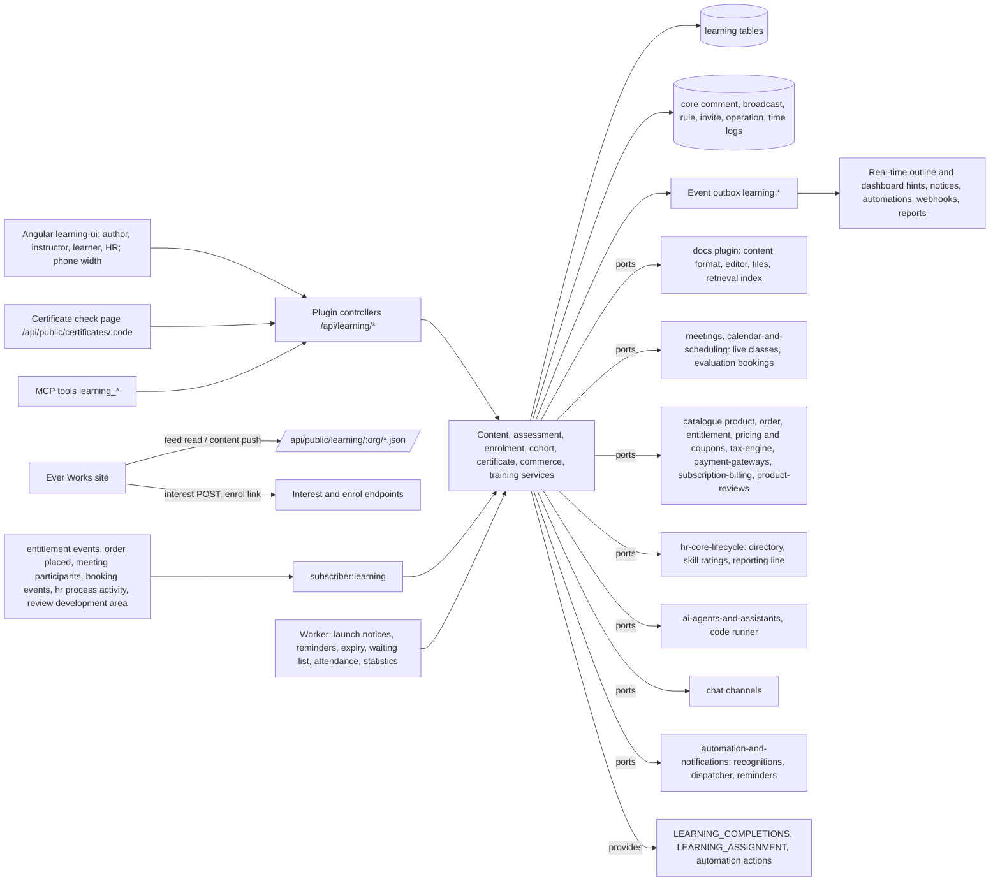

# Implementation Plan: Learning management

> Translates an approved `spec.md` into architecture and tech choices. The plan owns
> implementation details; the spec owns behaviour.

**Feature ID**: `learning-management`
**Spec**: `./spec.md`
**Tasks**: `./tasks.md`
**Status**: `Draft`
**Last updated**: 2026-11-23

---

## 1. Architecture Summary

Nothing exists for learning today, so the work is a new plugin `@gauzy/plugin-learning` (`packages/plugins/learning`)
with `learning-ui` (Angular). Learner, instructor and quiz pages are pages of the Gauzy web app laid out for phone width;
the app installs on phones, which gives quiz monitoring its camera access. The plugin owns courses, versions, chapters,
lessons, packages, assessments, enrolments and progress, paths, cohorts, live class records, certificates, badges,
evaluations' results, HR training and the assistant drafts. The content model knows only **learners** (`learner` rows
pointing at an employee, a contact person or a user), never employees directly, so staff, customers and portal learners
take the same courses.

**Built on what exists (no second store).** Lesson bodies use the content format and editor of the Docs plugin and are
indexed through the Docs retrieval pipeline; lesson and course discussions are core comments. A paid course, cohort,
path or certification is a catalogue `product`; buying it is an order of the `order` plugin paid through
`payment-gateways` and invoiced through the order's invoice route, and the right it grants is an `entitlement` row that
enrolments follow; reviews of sold items are `product-reviews`. Cohort announcements are core broadcasts; evaluation
bookings are bookings of `calendar-and-scheduling` with evaluators' hours as availability slots; badge awards also write
recognition entries. Assignment rules are core `rule` rows; settings, permissions, invitations, notices, reminders,
bulk and long work and AI runs use the platform's stores (§2). Public catalogue, course and certified-learner pages are
rendered by Ever Works from Gauzy's public feeds; Gauzy keeps the feeds, the interest and enrol endpoints and the
built-in certificate check page.



## 2. Tech Choices

| Concern | Choice | Rationale |
| ------- | ------ | --------- |
| Package | `packages/plugins/learning` (new), `learning-ui` (Angular); learner pages laid out for phone width | Principle I; one client |
| Flag | tenant feature `FEATURE_LEARNING` in `learning.features.ts` (`defaultEnabled: false`), `@FeatureFlag` + `FeatureFlagGuard` on every controller | default off |
| Permissions | `learning.permissions.ts` contributions with `defaultFor` (§9); learning roles as role templates; people invited through core `invite` | no seed migration; one invitation path |
| Settings | organization-scoped keys of `learning.settings.ts` in the platform settings store (§3.1) | no settings table |
| Persistence | MultiORM entities on `TenantOrganizationBaseEntity`; the shared core migration helpers of `@gauzy/core` | Principle III |
| Content | lesson body in the Docs plugin's page content format (`document.contentJson`), edited with the Docs editor; learning nodes (quiz, assignment, exercise, live class reference, video with question points) registered as node types of that editor; HTML rendered through the Docs renderer and sanitised with the platform sanitiser (`public-share/public-html-sanitizer.ts`) on write; embeds from a per-organization host allow-list | one content format to render and sanitise |
| Why lessons are not Docs pages | a lesson belongs to a course version (copied on publish with a stable `key`) and its access follows enrolment, which document shares do not express; `learning_lesson` stays the frame (key, position, rules) around Docs-format content | stated split |
| Retrieval | lessons registered as a source of the Docs retrieval and embedding pipeline (`document_chunk`, `search` plugin); the tutor and the assistant read passages from it | one index |
| Versions | chapters and lessons belong to a `course_version`; publishing copies the draft into a new version keeping each lesson's `key`; progress refers to `lessonKey` | edits never disturb learners |
| Packages | the interoperable e-learning package standard (SCORM 1.2 and 2004): zip validated (paths, size, extension allow-list), unpacked to the file storage under a per-package prefix, played in a sandboxed frame with a run-time adapter in the player; state stored on `lesson_progress` | common authoring tools export it |
| Public pages | Ever Works renders the catalogue, course pages and the certified directory from JSON feeds (`/api/public/learning/:org/*`, `:org` = `organization.profile_link`), and with the Ever Works integration on, publish events push the public fields to the linked Work; Gauzy serves the interest endpoint, the enrol link into the learning portal and the built-in certificate check page | public sites are Ever Works sites |
| Commerce | `LEARNING_COMMERCE`: the item's catalogue `product` carries `metadata.entitlement` (kind `TERM` or `SEAT`, quantity, term); checkout places an order of the `order` plugin with prices and coupons of `pricing-and-promotions` and tax of `tax-engine`, paid through the hosted payment of `payment-gateways`, invoiced through `POST /orders/:id/invoice`; the `entitlement` plugin grants the right; `learning_enrolment.entitlementId` follows `entitlement.*` events (pending, active, suspended, expired, revoked) | one purchase path, one access-right model |
| Reviews | sold items: `product_review` of `product-reviews` (one moderation queue, one rating per product); internal courses not sold: `learning_course_review` | one review store per product |
| Announcements | core `broadcast` (`entity` `LearningCohort`, category `ANNOUNCEMENT`, `ENTITY_MEMBERS`); core `BroadcastService` membership check gains a resolver per entity type (additive; existing types unchanged), registered by this plugin for cohorts (members by user, so portal learners read them) | one announcement store |
| Evaluations | `LEARNING_CALENDAR` → an evaluation booking type of `calendar-and-scheduling` per course (hosts = the course's evaluators, window ending at the cohort's evaluation end); evaluators' weekly hours are core `availability_slots`, their absences time off; fallback: core `employee_appointment` with its signed link | no second slot ledger |
| Recognition | a badge award also writes a `recognition_entry` through `LEARNING_RECOGNITIONS` (`automation-and-notifications`) | one recognition feed |
| Discussions | core `comment` threads on the record types `LearningLesson` and `LearningCourse` (comment access policy: enrolled learners and course staff; mentions through core mentions); hiding a post is a comment moderation action | notes on a record are comments |
| Record conditions | assignment rule criteria as core `rule` rows (`ownerType = LEARNING_ASSIGNMENT_RULE`) over the employee context of `hr-core-lifecycle` (fallback: core employee columns) | one rule kernel |
| Skill proficiency | `learning_course_skill.targetProficiency` on the 1–5 proficiency scale of `hr-core-lifecycle` | one proficiency scale |
| Files | `LEARNING_FILES` port over the documents hub with range streaming; fallback core file storage | `drive` owns storage |
| Concurrency | seats, attempts and slots by unique keys and `SELECT … FOR UPDATE` where the dialect has it, else unique-key retries | one winner on every dialect |
| Long and bulk work | core bulk executor (`api/bulk-executor.service.ts`) for bulk enrolment and bulk certificate issue (per-row results, preview); core operations for course import and export; sweeps on `@ScheduledJob` recorded in `job_execution` | one run ledger |
| Notices and reminders | `NOTIFICATION_DISPATCHER.notify({ …, dedupeKey })`; date reminders (due dates, cohort start, unpaid checkouts, certificate expiry) as `reminder` rows through `REMINDERS` of `automation-and-notifications` | no notice table |
| AI | `LEARNING_ASSISTANT` on the agent runtime of `ai-agents-and-assistants` (purposes `learning.draft`, `learning.tutor`; run, model, usage and budget recorded there; fallback the `ai-chat` provider registry) | no run or usage table here |
| Events | `EventOutboxService.append` in the writing transaction; consumer `subscriber:learning` | at-least-once, deduplicated |
| Reports | `registerReportDatasets` / `registerReportDefinitions`, dashboard template `learning.overview` | report builder contract |

## 3. Data Model

All tables extend `TenantOrganizationBaseEntity`; JSON is `text` on SQLite and MySQL; money is `numeric(20,6)` with
`char(3)` currency.

```ts
@MultiORMEntity('learning_enrolment', { mikroOrmRepository: () => MikroOrmEnrolmentRepository })
export class Enrolment extends TenantOrganizationBaseEntity implements ILearningEnrolment { /* columns below */ }
```

| Table | Columns (type) | Indexes and uniqueness |
| --- | --- | --- |
| `learner` | `kind` (`EMPLOYEE`/`CONTACT`/`USER`), `employeeId`, `contactId`, `userId` uuid null, `refKey` varchar(80) (`<kind>:<id>`), `displayName`, `email`, `profile` json, `directoryOptIn` bool, `streakCurrent`, `streakLongest` int, `lastActiveOn` date | unique `(organizationId, refKey)`; idx `(userId)`, `(employeeId)` |
| `learning_category` | `name`, `slug`, `position` | unique `(organizationId, slug)` |
| `learning_course` | `slug` varchar(160), `status` (`DRAFT`/`IN_REVIEW`/`PUBLISHED`/`ARCHIVED`), `isComingSoon`, `isFeatured`, `sequential` bool, `visibility` (`MEMBERS`/`PORTAL`/`PUBLIC`), `enrolmentMode`, `categoryId`, `language`, `level`, `durationMinutes`, `coverFileId`, `coverCard`, `introVideo` json, `currentVersionId`, `draftVersionId`, `certificateMode` (`NONE`/`COMPLETION`/`EVALUATION`), `certificateTemplateKey`, `certificateValidityDays`, `completionRules` json, `ratingAverage` numeric(3,2), `ratingCount`, `enrolmentCount` int, `version` | unique `(organizationId, slug)`; idx `(organizationId, status, visibility)` |
| `learning_course_version` | `courseId` fk, `number` int, `title`, `summary`, `description` text, `tags` json, `publishedAt`, `publishedByUserId`, `reviewNote` | unique `(courseId, number)` |
| `learning_course_staff` | `courseId` fk cascade, `userId`, `role` (`AUTHOR`/`INSTRUCTOR`/`MENTOR`/`EVALUATOR`) | unique `(courseId, userId, role)` |
| `learning_chapter`, `learning_lesson` | chapter: `versionId` fk cascade, `key` uuid, `title`, `position`, `kind` (`CONTENT`/`PACKAGE`), `packageId` null; lesson: `versionId`, `chapterId` fk cascade, `key` uuid, `title`, `position`, `content` json (Docs page content format with learning node types), `isPreview`, `instructorNotes` text, `instructorContent` json (same format), `estimatedMinutes`, `rules` json null | unique `(versionId, key)`; idx `(chapterId, position)` |
| `learning_package` | `courseId`, `sourceFileId`, `storagePrefix`, `manifest` json, `launchPath`, `standard` varchar(16), `status` (`VALID`/`INVALID`), `problems` json | idx `(courseId)` |
| `learning_course_interest` | `courseId`, `email`, `learnerId` null, `notifiedAt`, `attempts` int | unique `(courseId, email)` |
| `learning_question` | `kind` varchar(16), `text`, `options` json, `accepted` json, `tolerance` numeric, `explanation`, `marks` numeric(6,2) default 1, `tags` json, `difficulty` smallint, `authorUserId`, `number` varchar(32), `isActive`, `version` | unique `(organizationId, number)`; idx `(organizationId, kind, difficulty)` |
| `learning_quiz` | `courseId`, `title`, `items` json, `draws` json, `passPercent`, `durationMinutes`, `maxAttempts` int, `shuffle`, `showAnswers`, `showHistory` bool, `opensAt`, `closesAt`, `negativeMarks` numeric, `monitoring` json, `isInstructorOnly`, `version` | idx `(courseId)` |
| `learning_quiz_attempt` | `quizId`, `learnerId`, `enrolmentId`, `number` int, `attemptKey` varchar(120) (`<quiz>:<learner>:<number>`), `questionSet` json, `answers` json, `startedAt`, `submittedAt`, `score`, `percentage`, `passed`, `gradingStatus` (`AUTO`/`PENDING`/`GRADED`), `submitReason`, `monitoringLog` json | unique `(tenantId, attemptKey)`; idx `(quizId, learnerId)`, `(gradingStatus)` |
| `learning_assignment`, `learning_submission` | assignment: `courseId`, `title`, `prompt`, `answerKind`, `modelAnswer`, `opensAt`, `closesAt`, `isGraded`, `rubric` json, `isInstructorOnly`; submission: `assignmentId`, `learnerId`, `answer` json, `submittedAt`, `outcome` (`PENDING`/`PASS`/`FAIL`/`NOT_GRADED`/`NOT_APPLICABLE`), `rubricScores` json, `comment`, `gradedByUserId`, `gradedAt`, `version` | unique `(assignmentId, learnerId)`; idx `(outcome)` |
| `learning_exercise`, `learning_exercise_run` | exercise: `courseId`, `title`, `prompt`, `language`, `starterCode`, `tests` json; run: `exerciseId`, `learnerId`, `code` text, `results` json, `status`, `runnerRef` | idx `(exerciseId, learnerId)` |
| `learning_placement` | `assessmentKind`, `assessmentId`, `lessonKey` null, `cohortSessionId` null | unique `(assessmentKind, assessmentId, lessonKey, cohortSessionId)` |
| `learning_path`, `learning_path_course` | path: `name`, `description`, `enforceOrder`, `isPublished`; course: `pathId`, `courseId`, `position` | unique `(pathId, courseId)` |
| `learning_assignment_rule` | `name`, `targetKind`, `targetId`, `trigger` (`ONBOARDING`/`DEVELOPMENT_AREA`/`POSITION`/`GROUP`/`SKILL_GAP`/`CERTIFICATE_EXPIRY`), `dueInDays`, `isActive`; criteria are core `rule` rows (`ownerType = LEARNING_ASSIGNMENT_RULE`, `ownerId` = the rule) | idx `(organizationId, trigger, isActive)` |
| `learning_enrolment` | `learnerId`, `targetKind` (`COURSE`/`COHORT`/`PATH`), `courseId`, `cohortId`, `pathId` null, `courseVersionId`, `role` (`LEARNER`/`MENTOR`), `status` (`PENDING_APPROVAL`/`PENDING_PAYMENT`/`ACTIVE`/`COMPLETED`/`WITHDRAWN`/`REVOKED`), `source` varchar(16) (`SELF`/`STAFF`/`RULE`/`PURCHASE`/`BULK`/`IMPORT`), `sourceRef`, `entitlementId` uuid null (the `entitlement` granted by the order line of a paid item), `orderId` uuid null, `progress` numeric(5,2), `currentLessonKey`, `startedAt`, `completedAt`, `dueDate`, `liveKey` varchar(120), `version` | unique `(tenantId, liveKey)`; idx `(learnerId, status)`, `(courseId, status)`, `(dueDate)`, `(entitlementId)` |
| `learning_lesson_progress` | `enrolmentId` fk cascade, `lessonKey`, `status` (`PARTIAL`/`COMPLETE`), `secondsSpent` int, `videoRanges` json, `packageState` json, `completedAt` | unique `(enrolmentId, lessonKey)` |
| `learning_activity_day`, `learning_note` | day: `learnerId`, `day` date, `seconds`, `lessons` int; note: `learnerId`, `courseId`, `lessonKey`, `anchor` json, `colour` varchar(8), `text` (a learner's private highlight, never shared) | unique `(learnerId, day)`; idx `(learnerId, lessonKey)` |
| `learning_cohort` | `title`, `slug`, `seats` int, `startDate`, `endDate`, `dailyStart`, `dailyEnd` varchar(5), `timeZone`, `mode` (`ONLINE`/`IN_PERSON`/`BLENDED`), `location`, `categoryId`, `isPublished`, `enrolmentMode`, `descriptionHtml` text, `evaluationEndDate`, `seatsTaken` int, `chatChannelId`, `version` | unique `(organizationId, slug)`; idx `(organizationId, startDate)` |
| `learning_cohort_course`, `learning_cohort_staff` | `cohortId`, `courseId`; `cohortId`, `userId`, `role` | unique per pair |
| `learning_cohort_session`, `learning_timetable_template` | session: `cohortId`, `kind` (`LESSON`/`LIVE_CLASS`/`ASSESSMENT`/`MILESTONE`), `refKey`, `title`, `startsAt`, `endsAt`, `colour`, `checkInCodeHash`; template: `name`, `entries` json | idx `(cohortId, startsAt)` |
| `learning_waiting_entry` | `cohortId`, `learnerId`, `position` int, `offeredAt`, `offerExpiresAt`, `status` | unique `(cohortId, learnerId)` |
| `learning_live_class` | `cohortId`, `hostUserId`, `startsAt`, `durationMinutes`, `meetingRef`, `calendarRef` varchar(120), `invitations` json, `recordingRef`, `transcriptRef`, `attendeeCount` | idx `(cohortId, startsAt)` |
| `learning_attendance` | `liveClassId`, `cohortSessionId`, `trainingSessionId` null, `learnerId`, `joinedAt`, `leftAt`, `seconds`, `source` (`MEETING`/`MANUAL`/`CODE`), `status` (`PRESENT`/`ABSENT`/`LATE`), `attendanceKey` | unique `(tenantId, attendanceKey)` |
| `learning_cohort_feedback` | `cohortId`, `learnerId`, `contentRating`, `instructorRating`, `valueRating` smallint, `comment` | unique `(cohortId, learnerId)` |
| `learning_certificate` | `learnerId`, `courseId`, `cohortId`, `pathId` null, `number`, `verificationCode` varchar(24), `issuedAt`, `expiresAt`, `status` (`VALID`/`REVOKED`), `revokedAt`, `revokeReason`, `outputId`, `certKey` varchar(120) | unique `(verificationCode)`, `(tenantId, certKey)`; idx `(expiresAt)` |
| `learning_evaluation` | `courseId`, `cohortId`, `learnerId`, `evaluatorUserId`, `bookingRef` uuid (calendar booking, or the core appointment of the fallback), `startsAt`, `endsAt` (copied from the booking for lists), `status` (`UPCOMING`/`DONE`/`CANCELLED`), `result` (`PENDING`/`IN_PROGRESS`/`PASSED`/`FAILED`), `rating`, `summary`, `meetingRef`, `liveKey` | unique `(tenantId, liveKey)` (`<course>:<learner>` while upcoming); idx `(bookingRef)` |
| `learning_badge`, `learning_badge_award` | badge: `name`, `description`, `imageFileId`, `awardOn` varchar(16) (`COURSE_COMPLETED`/`PATH_COMPLETED`/`QUIZ_SCORE`/`STREAK`/`MANUAL`), `targetId` uuid null, `threshold` numeric null, `isActive`; award: `badgeId`, `learnerId`, `awardedAt`, `source`, `sourceRef`, `recognitionEntryId` uuid null | unique `(badgeId, learnerId)` |
| `learning_course_review`, `learning_mentor_request` | review (courses not sold as a product): `courseId`, `learnerId`, `rating`, `text`; mentor: `courseId`, `learnerId`, `mentorUserId`, `status` | review unique `(courseId, learnerId)` |
| `training_programme`, `training_session`, `training_attendee`, `training_feedback` | programme: `name`, `status`, `trainerEmployeeId`, `trainerName`, `organizationVendorId`, `description`, `courseIds` json; session: `programmeId`, `kind`, `level`, `location`, `startsAt`, `endsAt`, `trainerEmployeeId`, `trainerName`, `organizationVendorId`, `introduction`, `certificateOn`, `cost`, `currency`, `status`, `resultsRecordedAt`, `version`; attendee: `sessionId`, `learnerId`, `isMandatory`, `status`, `hours` numeric(6,2), `grade`, `comment`; feedback: `attendeeId` unique, `contentRating`, `trainerRating`, `valueRating` smallint, `comment` | attendee unique `(sessionId, learnerId)`; idx `(organizationId, startsAt)` |
| `learning_item_link` | `targetKind` (`COURSE`/`COHORT`/`PATH`/`CERTIFICATION`), `targetId`, `productId` (core `product`, its `metadata.entitlement` set from this link), `refundRule`, `reminderDays` int, `reminderOn` bool | unique `(targetKind, targetId)` |
| `learning_course_skill` | `courseId`, `skillId` (core `skill`), `targetProficiency` smallint (1–5, the proficiency scale of `hr-core-lifecycle`) | unique `(courseId, skillId)` |
| `learning_assistant_draft` | `courseId`, `lessonKeys` json, `kind` (`QUIZ`/`SUMMARY`/`GLOSSARY`), `items` json (with source passages), `status` (`DRAFT`/`APPROVED`/`REJECTED`), `approvedByUserId`, `aiRunId` uuid null (the run of `ai-agents-and-assistants`, holding provider, model and usage) | idx `(courseId, status)` |

Purchases have no table here: the order (with its payment and invoice) and the `entitlement` are the record, and a
recorded payment outside the gateway is an order transaction entered by a user with `LEARNING_COMMERCE_MANAGE`
followed by the order's own `POST /orders/:id/complete`, which puts the right in force. Cohort announcements are core
`broadcast` rows; lesson and course discussions are core `comment` rows; evaluators' hours are core availability slots.

### 3.1 Settings (`learning.settings.ts`, organization scope, settings store)

`learning.areaName`, `learning.guestBrowsing` (false), `learning.selfSignUp` (false), `learning.learnerRoleId`,
`learning.completionRules` (json: defaults of FR-20), `learning.embedHosts` (string[]), `learning.cameraMonitoring`
(false), `learning.trackLearningTime` (false), `learning.learningProjectId`, `learning.assistantEnabled` (false). The
public site's branding, menus and search-engine metadata belong to the Ever Works site.

### Migrations

**Migration timestamps**: `packages/plugins/learning` `1791000028100` to `1791000028199`.

- Plugin (`packages/plugins/learning/src/lib/database/migrations/`): `1791000028100-CreateLearningSetupTables` (learners, categories), `1791000028110-CreateLearningContentTables` (courses,
  versions, staff, chapters, lessons, packages, interest), `1791000028120-CreateLearningAssessmentTables` (questions, quizzes,
  attempts, assignments, submissions, exercises, runs, placements), `1791000028130-CreateLearningProgressTables` (paths, rules,
  enrolments, progress, activity, notes), `1791000028140-CreateLearningCohortTables` (cohorts, staff, sessions, templates,
  waiting list, live classes, attendance, feedback), `1791000028150-CreateLearningCertificateTables` (certificates, evaluations,
  badges, reviews, mentors), `1791000028160-CreateTrainingTables`, `1791000028170-CreateLearningCommerceTables` (item links, course
  skills, assistant drafts).
- Additive and idempotent per dialect; nullable key columns with plain unique indexes replace partial indexes on MySQL
  and SQLite; SQLite tables are created whole. No core table changes.

### Contracts

`packages/contracts/src/lib/learning.model.ts`: interfaces, enums (`LearnerKindEnum`, `CourseStatusEnum`,
`CourseVisibilityEnum`, `LearningNodeKindEnum`, `QuestionKindEnum`, `AttemptGradingEnum`, `SubmissionOutcomeEnum`,
`EnrolmentStatusEnum`, `EnrolmentSourceEnum`, `CohortModeEnum`, `CertificateStatusEnum`, `TrainingSessionKindEnum`,
`AttendeeStatusEnum`, `BadgeAwardOnEnum`), the learning node types of the content format, public feed shapes, event
payloads and ports `ILearningFiles`, `ILearningContentIndex`, `ILearningMeetings`, `ILearningCalendar`,
`ILearningCommerce`, `ILearningAssistant`, `ILearningCodeRunner`, `ILearningChat`, `ILearningSkillRatings`,
`ILearningRecognitions`, and the provided `ILearningCompletions`, `ILearningAssignment`. `RuleOwnerType.LEARNING_ASSIGNMENT_RULE`
in `rule.model.ts`.

## 4. API Surface

Routes under `/api/learning` with `TenantPermissionGuard`, `PermissionGuard`, `FeatureFlagGuard`; cursor pagination;
`Idempotency-Key` on enrolments, submissions, checkouts and certificate issue; `version` on updates; Swagger decorators.

| Method | Endpoint | Permission | Description (request → response) | Status |
| ------ | -------- | ---------- | -------------------------------- | ------ |
| `GET/PUT` | `/learning/settings`, `/learning/roles` | `LEARNING_SETTINGS_EDIT` | the `learning.*` keys of the settings store; role templates; invitations through core `invite` | New |
| `GET/POST/PUT/DELETE` | `/learning/categories`, `/learning/badges`, `/learning/timetable-templates` | `LEARNING_COURSE_MANAGE` / `LEARNING_COHORT_MANAGE` | masters | New |
| `GET/POST/PUT` | `/learning/courses`, `/:id`; `POST /:id/{submit,publish,return,archive,duplicate}`; `GET /:id/versions` | `LEARNING_COURSE_AUTHOR` (own) / `LEARNING_COURSE_REVIEW` / `LEARNING_COURSE_MANAGE` | course and draft version; publish warnings | New |
| `GET/PUT` | `/learning/courses/:id/outline`; `POST /outline/{chapters,lessons,move}`; `PUT /lessons/:key` | `LEARNING_COURSE_AUTHOR` | outline with autosave (`version`) | New |
| `POST` | `/learning/courses/:id/packages`, `/learning/courses/:id/export` (`202`), `/learning/courses/import` (`202`) | `LEARNING_COURSE_AUTHOR` / `LEARNING_COURSE_MANAGE` | package check; archive and import as core operations | New |
| `GET/POST/PUT` | `/learning/questions`, `/learning/quizzes`, `/learning/assignments`, `/learning/exercises`, `/learning/placements` | `LEARNING_COURSE_AUTHOR` | assessments | New |
| `GET` | `/learning/catalogue`, `/learning/courses/:slug/view`, `/learning/lessons/:key`, `/learning/lessons/:key/files/:fileId` | `LEARNING_LEARN` (preview lessons: visitors per visibility) | catalogue, learner view, permission-checked file stream | New |
| `POST` | `/learning/lessons/:key/progress`, `/learning/lessons/:key/notes`, `/learning/quizzes/:id/attempts` (+ `/:n/submit`, `/:n/events`), `/learning/assignments/:id/submission`, `/learning/exercises/:id/runs` | `LEARNING_LEARN` (enrolled) | progress, private notes, attempts with monitoring events, submissions, runs | New |
| `POST/PUT` | `/learning/attempts/:id/grade`, `/learning/submissions/:id/grade` | `LEARNING_INSTRUCT` (staff of the course) | grades; `preview` for agents | New |
| `GET/POST` | `/learning/enrolments`, `/learning/me/enrolments`; `POST /enrolments/bulk` (`preview`), `/enrolments/:id/{approve,withdraw}` | `LEARNING_LEARN` (self) / `LEARNING_ENROL_OTHERS` | enrolments; per-row results of the bulk executor | New |
| `GET/POST/PUT` | `/learning/paths`, `/learning/assignment-rules` | `LEARNING_COURSE_MANAGE` | paths; rules with criteria as rule rows | New |
| `GET/POST/PUT` | `/learning/cohorts`, `/:id`; `/:id/{sessions,live-classes,announcements,attendance,waiting-list,feedback,dashboard}` | `LEARNING_COHORT_MANAGE` / cohort staff / members (feedback) | cohorts and their parts; announcements are core broadcasts | New |
| `GET/POST/PUT` | `/learning/certificates`, `POST /certificates/bulk` (`preview`), `/:id/revoke`; `/learning/evaluations` (booking link, results) | `LEARNING_CERTIFICATE_MANAGE` / `LEARNING_EVALUATE` / learner (booking) | certificates, evaluations | New |
| `GET/POST` | `/learning/reviews` (courses not sold), `/learning/mentor-requests`, `/learning/me/profile` | `LEARNING_LEARN` | community; sold items are reviewed through `product-reviews` | New |
| `GET/POST/PUT` | `/learning/item-links`; `POST /learning/checkout` (`preview`), `POST /learning/orders/:id/record-payment` | `LEARNING_COMMERCE_MANAGE` / learner (checkout) | prices; order and hosted payment session; recorded payment completing the order | New |
| `GET/POST/PUT` | `/learning/training/programmes`, `/learning/training/sessions`, `/:id/{attendees,results,feedback}` | `LEARNING_TRAINING_MANAGE` / attendee (feedback) | HR training | New |
| `POST/GET` | `/learning/assistant/drafts`, `/:id/{approve,reject}`; `POST /learning/tutor/ask` | `LEARNING_COURSE_AUTHOR` / `LEARNING_LEARN` (enrolled) | drafts with sources; tutor answer with links | New |
| `GET` | `/learning/skills/gaps`, `/learning/compliance`, `/learning/analytics/{progress,activity,results,compliance,sessions,revenue,statistics}` | `LEARNING_REPORTS_VIEW` (own team for managers) | gaps, compliance, datasets | New |
| `GET` | `/api/public/learning/:org/catalogue.json`, `/:org/courses/:slug.json`, `/:org/certified.json` | public | feeds of published public courses, cohorts and paths and of opted-in certified learners, for an Ever Works site | New |
| `POST` `GET` | `/api/public/learning/:org/courses/:slug/interest`, `/:org/courses/:slug/enrol` | public (throttled, `PUBLIC_FORM_DEFENCE` on interest) | interest registration; enrol link into the learning portal (sign-in or sign-up, then enrolment or checkout) | New |
| `GET` | `/api/public/certificates/:code` | public | built-in certificate check page | New |

Errors: `400` with stable codes (`LEARNING_COURSE_NOT_PUBLISHED`, `LEARNING_LESSON_LOCKED`, `LEARNING_ATTEMPTS_EXHAUSTED`,
`LEARNING_WINDOW_CLOSED`, `LEARNING_PACKAGE_INVALID`, `LEARNING_SEAT_TAKEN`, `LEARNING_PAYMENT_REQUIRED`,
`LEARNING_SELF_GRADING`), `403`, `404` (other organization, flag off), `409`; evaluation slot conflicts are answered by
the booking pages of `calendar-and-scheduling`.

**Consumer tokens answered** (bound in `apps/api/src/plugin-composition.ts` to this plan's commerce adapter over the catalogue, order, entitlement, pricing, tax, checkout and plan services; each consumer plan states the shape it calls and its fallback): `LEARNING_COMMERCE`.

## 5. Events, Real-Time and Notifications

| Event | Emitted when | Consumers |
| ----- | ------------ | --------- |
| `learning.course.published`, `learning.cohort.published` | publish | interest notices, feed cache, content push to the linked Ever Works Work, notices per channel choice |
| `learning.enrolment.created` / `.completed` / `.revoked` | enrolment changes | path progress, certificates, `hr-lifecycle` activity completion, performance development areas |
| `learning.lesson.completed`, `learning.attempt.submitted` / `.graded`, `learning.submission.graded` | progress and grading | outline hints, badges, notices |
| `learning.certificate.issued` / `.expiring` / `.revoked` | certificate lifecycle | email, compliance, re-enrolment rules, automations |
| `learning.cohort.started`, `learning.live_class.ended`, `learning.training_session.completed` | as named | attendance import, feedback requests |
| consumed: `order.placed` and `entitlement.created` / `.renewed` / `.suspended` / `.expired` / `.revoked` for learning products, meeting participants ready (`meetings`), booking confirmed and cancelled for evaluation bookings (`calendar-and-scheduling`), `hr.activity.due` with a learning action, `performance.review.acknowledged` (development area assignment) | as named | enrolment status, attendance, evaluations, rule-based assignment |

Real-time: hints `record:LearningEnrolment:<id>` for the learner's outline and `learning-cohort:<id>` for dashboards.
Inbox items through `INBOX_ITEM_WRITER` (grading queue, mentor requests, approvals, due dates). Notification
categories (`registerNotificationCategories`): `learning.grading`, `learning.mention`, `learning.publish`,
`learning.reminder`, `learning.certificate`, sent through `NOTIFICATION_DISPATCHER` with de-duplication keys
(`<category>:<record>:<occasion>:<recipient>`). Date reminders (due dates, cohort start, live classes, unpaid checkouts,
evaluations, certificate expiry) are `reminder` rows scheduled through `REMINDERS` when the date is set (source key
`learning:<record>:<occasion>`) and moved or cancelled with it; one reminder per certificate. Cohort announcements are
core broadcasts delivered in app and by email through the dispatcher. Automation (`registerAutomationActions`):
`learning.enrol`, `learning.award_badge`; triggers (`registerAutomationTriggers`): course completed, certificate expiring.

## 6. UI Surface

- Angular plugin `packages/plugins/learning-ui` registered in `apps/gauzy/src/plugin-ui.config.ts` through the
  `page-sections` page location; menu group "Learning" hidden without the feature or permission. Routes under
  `/pages/learning`: `home`, `catalogue`, `courses/:slug` (learner view and lesson player), `my`, `author` (courses,
  outline editor with the Docs editor, question bank, quizzes, assignments), `review-queue`, `grading`, `cohorts` (+
  `/:id` timetable, dashboard, attendance, waiting list), `paths`, `certificates`, `evaluations`, `badges`, `training`
  (programmes, sessions, results), `compliance`, `skills`, `commerce`, `reports`, `settings`.
- Lesson player: content rendered through the Docs renderer with the learning nodes, video player with ranges and
  in-video questions, package frame with the run-time adapter, quiz player with monitoring hooks; keyboard operable,
  captions when present; discussions are the core comment thread of the lesson.
- Learner pages (home, catalogue, course view, lesson and quiz players, cohort page, training sessions) are laid out for
  phone width; the installed Gauzy web app gives camera access to monitored quizzes when the learner consents.
- Employee profile gets a "Learning" tab through `PageTabRegistryService` (`employee-edit-page`), shown only while
  `FEATURE_LEARNING` is on, so the profile page is unchanged with the feature off; portal learners land on
  `/pages/learning/home` with a role-limited menu.
- Public: the certificate check page is the only page Gauzy renders; catalogue, course pages and the certified
  directory are an Ever Works site over the feeds.
- Lists are saved views; forms honour custom fields; i18n keys `LEARNING.*` in every locale.

## 7. MCP Tools, SDKs and Integrations

`packages/mcp-server/src/lib/tools/learning.ts` (registered in `register-all-tools.ts`):

| Tool | Input | Output |
| --- | --- | --- |
| `learning_catalogue_search`, `learning_course_get` | text, category; course | courses; outline with stats |
| `learning_progress_get` | learner or enrolment | progress, current lesson, due dates |
| `learning_enrol` | learners, target, due date, `preview` (default true) | per-row outcome, or enrolments |
| `learning_draft_assessment` | course, lessons, kind | draft items with source passages |
| `learning_grade` | attempt or submission, grade, `preview` | effect on lesson and certificate, or grade |
| `learning_certificates_issue` | cohort or learners, `preview` | who would receive one, or certificates |
| `learning_compliance_gaps` | organization, department, position | people missing or losing certificates |

Report datasets: `learning.enrolments`, `learning.lesson_progress`, `learning.attempts`, `learning.submissions`,
`learning.certificates`, `learning.training_sessions`, `learning.sales` (provider over learning orders and
entitlements), `learning.activity` (provider); definitions for spec §3.12 and dashboard template `learning.overview`.
Print templates: certificate (two layouts), training attendance sheet. Import profiles (`registerImportProfiles`):
learners, enrolments, questions, training records.

Ports consumed (bound in `plugin-composition.ts`, all optional with fallbacks): `LEARNING_FILES` (documents hub; core
file storage), `LEARNING_CONTENT_INDEX` (Docs retrieval and embedding pipeline; unbound: the tutor and drafts are
unavailable), `LEARNING_MEETINGS` (`meetings`; typed link), `LEARNING_CALENDAR` (`calendar-and-scheduling`: events,
invitations, evaluation booking types and links; fallback: email with an iCalendar file and core appointments with
signed links), `LEARNING_COMMERCE` (catalogue `product`, `order`, `entitlement`, price resolution and coupons of
`pricing-and-promotions`, `tax-engine`, hosted checkout of `payment-gateways`, plans of `subscription-billing`,
`product-reviews`; without it paid items cannot be sold), `LEARNING_CHAT`, `LEARNING_ASSISTANT` (agent runtime; fallback
`ai-chat` provider registry), `LEARNING_RECOGNITIONS` (`automation-and-notifications` recognition entries; unbound:
badges only), `LEARNING_CODE_RUNNER` (provider plugins; none = exercises hidden), `LEARNING_PRINT`, `HR_DIRECTORY`,
`HR_REPORTING_LINE`, `LEARNING_SKILL_RATINGS` (proposal to `hr-lifecycle`), `RECRUITMENT_OPENINGS`,
`NOTIFICATION_DISPATCHER`, `REMINDERS`, `PUBLIC_FORM_DEFENCE`. Provided: `LEARNING_COMPLETIONS` (`hr-lifecycle` skills
view and compliance list: completions, hours and certificates with expiry, read in place), `LEARNING_ASSIGNMENT`
(bound as `PERFORMANCE_LEARNING` and used by the onboarding action). Learning time (FR-78) is written as manual time logs
with a reason on the organization's learning project through core time log services as the system actor. OpenAPI
grows additively; SDKs regenerated after merge.

## 8. Background Jobs

| Trigger | When | What it does | Idempotency |
| ------- | ---- | ------------ | ----------- |
| `learning.interest.notify` | on publish + hourly retry | emails interested people once | `notifiedAt` per row |
| `learning.certificates.expiry` | daily | re-enrolment rules and compliance status (the expiry notice is the certificate's reminder row) | `certKey` + occasion |
| `learning.waiting-list` | every 15 min | offers freed seats, expires unanswered offers | entry status + version |
| `learning.attendance.import` | on live class end + hourly retry | reads participants from `LEARNING_MEETINGS` | `attendanceKey` |
| `learning.evaluations.close` | hourly | closes evaluations whose booking has passed | evaluation status |
| `learning.stats` | hourly | rating averages, enrolment counts, streaks, activity days | upsert |
| `learning.exports.purge` | daily | deletes course archives older than 7 days | file id |
| queues `learning-packages`, `learning-assistant`, `learning-runner` | uploads, drafts, runs | package check and unpack; assistant drafts on the agent runtime; isolated code runs | job id per request |
| operations `LEARNING_COURSE_EXPORT`, `LEARNING_COURSE_IMPORT` | export or import requested | archive build or import with a report | one live operation per course |

The worker loads `LearningSchedulePlugin` (schedules only, recorded in `job_execution`); the API loads `LearningPlugin`;
without a queue the API runs sweeps on timers under advisory locks and package checks inline with a size cap.

## 9. Security & Permissions

- New keys, contributed in `learning.permissions.ts`: `LEARNING_COURSE_AUTHOR`, `LEARNING_COURSE_REVIEW`,
  `LEARNING_COURSE_MANAGE`, `LEARNING_COHORT_MANAGE`, `LEARNING_INSTRUCT`, `LEARNING_EVALUATE`, `LEARNING_ENROL_OTHERS`,
  `LEARNING_TRAINING_MANAGE`, `LEARNING_CERTIFICATE_MANAGE`, `LEARNING_COMMERCE_MANAGE`, `LEARNING_REPORTS_VIEW`,
  `LEARNING_SETTINGS_EDIT`, `LEARNING_LEARN`.
- Default roles (`defaultFor`): super admin and admin all; manager `LEARNING_ENROL_OTHERS`, `LEARNING_REPORTS_VIEW`
  (own teams), `LEARNING_LEARN`; employee `LEARNING_LEARN`. Role templates: reviewer, course author, instructor,
  evaluator, learner; a tenant "Learner" role (custom role) holds `LEARNING_LEARN` for portal learners until portal user
  types exist. People are invited through core `invite`.
- Lesson access: enrolment (or preview flag and visibility); for paid items, an active entitlement; instructor-only
  content stripped server-side; files streamed through a permission-checked route with short-lived signed links.
- Content: node schema validation, HTML sanitised, embed host allow-list; packages validated (path traversal,
  extension allow-list, size cap) and played in a sandboxed frame from a cookieless path with a strict content policy.
- Monitoring: camera snapshots only with organization setting and learner consent, kept 30 days; no face analysis.
- Code runner: isolated provider with time, memory and network limits; hidden expected outputs never leave the server.
- Public feeds and the check page show only published public items and certificate facts (name, course, dates,
  status); the certified feed lists only learners who opted in.
- Assistant: drafts from selected published or draft lessons of the course only; tutor from published content; no
  learner data in prompts; runs logged on the agent runtime.

## 10. Observability

- Grade, certificate and enrolment histories; job and operation runs with counts and failures; package check reports;
  order and entitlement references on enrolments.
- Metrics: active learners, lesson completions per hour, attempt scoring latency, seat and slot conflicts, failed
  invitations, runner and assistant failures.
- Structured logs for refused packages and imports; Sentry breadcrumbs on entitlement events.

## 11. Phased Rollout

1. **Phase 1 — Content and learning** (flag off): contracts, plugin scaffold, permission and settings contributions,
   learners, categories, courses with versions, outline editor on the Docs editor, lesson content, video, files,
   preview, sequential mode, completion rules, enrolment and progress, discussions as comments, catalogue, learner
   home, read MCP tools.
2. **Phase 2 — Depth**: question bank, quizzes, attempts, monitoring, assignments, exercises, placements, paths,
   cohorts with timetables, live classes, attendance, announcements as broadcasts, feedback, certificates, evaluations
   through bookings, badges and recognitions, training programmes and sessions, community, notifications, commerce
   through orders and entitlements, public feeds, reports, import and export, packages.
3. **Phase 3 — Advanced capabilities**: assistant drafts and tutor over the Docs retrieval index, rule-based assignment
   and compliance renewal, skills graph and proposals, verification pages, waiting lists and in-person check-in, rubrics
   and extra question kinds, learning time as tracked time, subscriptions, mutating MCP tools.
4. **Phase 4 — General availability**: the feature is off by default; after the trial period it may be switched on by default for new tenants only; existing tenants keep their setting until an administrator changes it.
   No sample course or welcome email reaches a tenant that did not switch the feature on.

## 12. Constitution Reconciliation

- I Plugin-first: `learning` and `-ui`; no core table changes; core broadcasts gain a membership resolver per entity
  type, and the rule kernel one owner type.
- II Tenant/organization scoping: every table on the tenant-organization base; public feeds resolve one organization.
- III Both ORMs, additive migrations: MultiORM entities; create-table migrations only.
- IV Default-off flag; nothing removed: `FEATURE_LEARNING`.
- V Contracts and API first: `learning.model.ts` and REST before UI; additive OpenAPI.
- VI Permissions, privacy, security: thirteen keys, sanitised content, package and runner isolation, consented monitoring.
- VII Real-time through the event bus: outbox events and record hints on the platform channel.
- VIII i18n and accessibility: `LEARNING.*` keys in every locale; accessible players and quizzes.
- IX Tests: completion rules, version publish, concurrency of seats, attempts and bookings, scoring, entitlements, packages.
- X Behaviour-first spec: implementation lives here.
- XI Documentation describes our platform only.

## 13. Risks & Mitigations

| Risk | Likelihood | Impact | Mitigation |
| ---- | ---------- | ------ | ---------- |
| Malicious packages or embeds | Medium | High | validation, sandboxed frame, cookieless origin path, strict content policy, allow-list |
| Video storage and bandwidth | High | Medium | `drive` quotas, range streaming, links from allowed hosts, size caps per organization |
| Concurrency on seats, attempts, bookings | Medium | Medium | unique keys, row locks where available, booking recheck in the calendar, retry tests on SQLite |
| Commerce plugins not loaded | High | Low | free courses unaffected; selling hidden without the commerce port |
| Access drifting from the right purchased | Low | High | enrolment status follows entitlement events only; reconcile on entitlement read |
| Versioning confuses learners | Low | Medium | stable lesson keys, release notes on publish, progress mapping tests |
| Scope size | High | Medium | phases each demoable; HR training usable before commerce |

## 14. References

- Spec: `./spec.md` · Tasks: `./tasks.md`
- [platform architecture](../../architecture/business-suite.md) §2.5, §2.8, §3.7, §3.8, §3.9, §3.10, §3.11, §3.12, §6
- Plans: `../calendar-and-scheduling/plan.md` (bookings), `../automation-and-notifications/plan.md` (recognition,
  dispatcher, reminders), `../lead-capture-and-enrichment/plan.md` (`PUBLIC_FORM_DEFENCE`)
- Code: `packages/core/src/lib/skills`, `employee`, `contact`, `organization-vendor`, `product`, `tags`, `comment`,
  `broadcast/broadcast.service.ts`, `invite`, `rule`, `availability-slots`, `employee-appointment`,
  `public-share/public-html-sanitizer.ts`, `email-send/email-template-render.service.ts`, `event-outbox`,
  `packages/scheduler`, `packages/plugins/docs` (documents hub, content format, retrieval), `packages/plugins/order`,
  `packages/plugins/entitlement` (`events/entitlement-order-line-policy.adapter.ts`), `packages/plugins/product-reviews`,
  `packages/plugins/payment`, `packages/plugins/inbox/src/lib/database/migration-helpers.ts`,
  `apps/api/src/plugin-composition.ts`, `apps/gauzy/src/app/pages/pages.routes.ts` (`page-sections`)
