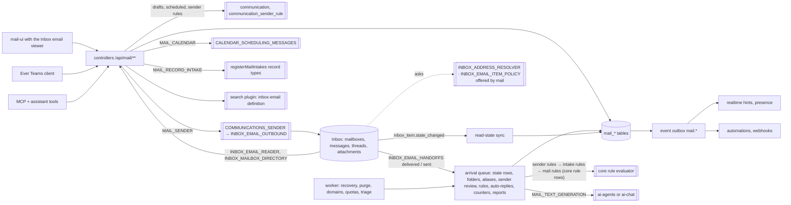

# Implementation Plan: Mail

> Translates an approved `spec.md` into architecture and tech choices. The plan owns
> implementation details; the spec owns behaviour.

**Feature ID**: `mail`
**Spec**: `./spec.md`
**Tasks**: `./tasks.md`
**Status**: `Draft`
**Last updated**: 2026-11-23

---

## 1. Architecture Summary

A new plugin pair: `@gauzy/plugin-mail` (`packages/plugins/mail`), listed in `apps/api/src/plugins.ts` and
`apps/worker/src/plugins.ts` only when `GAUZY_MAIL_ENABLED` is exactly `true` and the Inbox email plugin is loaded,
contributing `FEATURE_MAIL` (default off, `@FeatureFlag` on every controller and resolver); and `mail-ui` (Angular client
and settings), which renders messages with the Inbox's existing viewer (`inbox-ui/src/lib/components/inbox-email-viewer`,
sandboxed frame) extended with the proxied remote-content rule, so one renderer serves the Inbox and the client. Ever
Teams reaches mail only through the API; its screens are its client spec's. **Messages stay where they are**:
`inbox_mailbox`, `inbox_email`, `inbox_email_thread` and `inbox_email_attachment` of `packages/plugins/inbox` are the only
message store; this plugin adds client state beside them (folders, per-mailbox message state, read marks of messages
without an Inbox entry, label links, conversation state, draft fields, rules, aliases, lists, domain records and
reports, triage) keyed by their ids, without foreign keys into the Inbox. It reads and writes messages only through
additive Inbox ports, sends through `COMMUNICATIONS_SENDER` of `email-and-communications` (which uses the Inbox's
`INBOX_EMAIL_OUTBOUND` for mailbox identities), and learns of new mail through the existing hand-off seam
`INBOX_EMAIL_HANDOFFS` with its `deliveredSince` recovery.

What the Inbox and the platform already hold is read there, not copied: domain proofs are the Inbox's (`inbox_mailbox`
`domain`, `domainStatus`, `domainVerificationToken`, TXT record at `_gauzy-inbox.<domain>`); read and snooze state of a
message with an Inbox entry is its `inbox_item_recipient` row (`isRead`, `readAt`, `snoozedUntil`); the mailbox allow list
is the Inbox's `senderAllowlist`; drafts and scheduled sends are `communication` rows (`DRAFT`, `SCHEDULED`) and sender
decisions `communication_sender_rule` rows of `email-and-communications`; rule conditions are core `rule` rows evaluated
by the core rule evaluator, which communications' intake rules share; organization labels are core tags of the tag type
`Mail`; reminders are `reminder` rows of `automation-and-notifications`; personal choices are
`User.uiPreferences.mail`; organization settings are keys of `mail.settings.ts`; imports and exports are data-exchange
runs; long bulk work runs on the core operation runtime.

## 2. Tech Choices

| Concern | Choice | Rationale |
| --- | --- | --- |
| Package | `packages/plugins/mail` (`client/`, `folders/`, `state/`, `labels/`, `drafts/`, `send/`, `identities/`, `aliases/`, `lists/`, `search/`, `rules/`, `auto-reply/`, `sender-review/`, `junk/`, `remote-content/`, `shared/`, `domains/`, `reports/`, `quota/`, `transfer/`, `triage/`, `intake/`, `schedule/`, `database/`), `mail-ui` | Principle I; one plugin UI |
| Reading | the Inbox's `inbox-email-viewer` component (sandboxed frame), extended with the remote-content proxy and "show images" consent, used by both `inbox-ui` and `mail-ui`; the consent is shown only for tenants with `FEATURE_MAIL` on, so the Inbox viewer of other tenants is exactly today's | one renderer, one remote-content rule |
| Read and snooze state | `inbox_item_recipient` of the message's `EMAIL` item through `INBOX_ITEM_STATE` for every message that has one (one item per message, a recipient row per mailbox member); `mail_read_mark` only for messages without an Inbox entry (sent copies, messages held by sender review or `INBOX_EMAIL_ITEM_POLICY`); snooze is personal and always the Inbox's | one read state, one snooze |
| Domains | the Inbox's proofs: the domain list is the organization's mailbox domains with their `domainStatus`; verifying through the additive `INBOX_DOMAINS` seam checks `_gauzy-inbox.<domain>` once and marks every mailbox of that domain, with one token per organization and domain; a domain another tenant verified is refused; mail keeps only its own data per domain (sending records check, reports mailbox) | one proof store; a verified domain stays verified |
| Drafts and scheduling | a draft is a `communication` in `DRAFT` (recipients, subject, bodies, attachments, identity), a scheduled message one in `SCHEDULED` with its `notBefore`; mail keeps only client fields (mode, replied or forwarded message, shared and suggested flags) keyed by `communicationId`; without `email-and-communications` the composer keeps an unsent draft in the browser only | one draft store for one outgoing email |
| Arrival order | one arrival queue applies, in order: the sender rules of `email-and-communications` (allow, block, quarantine), its intake rules (create or link a record), then mail rules; conditions of mail rules are core `rule` rows (owner type `MAIL_RULE`), evaluated by `packages/core/src/lib/rule/rule.evaluator.ts` over a message view, the same evaluator communications' intake rules use | three rule kinds, one order, one evaluator |
| Assignment | `MAIL_THREAD_STATE` is the only assignee store of mailbox conversations; the communications mailbox view's assign action consumes it | one assignment model |
| Sender review | decisions are `communication_sender_rule` rows of the mailbox (`ALLOW`, or `QUARANTINE` filed to "Declined senders"); the same view lists the mailbox's existing `senderAllowlist` from the Inbox; without `email-and-communications` there is no review queue and the allow list stays the sender filter | one list of sender decisions per mailbox |
| Labels | organization labels are core `tag` rows of the tag type `Mail` (name, colour); a mailbox's own labels are such tags scoped by `mail_label_scope`; `mail_message_label` joins message states to tags | one label model across records |
| Reminders | "remind me if no reply" and "needs an answer" are `reminder` rows (`recordType = InboxEmailThread`) fired by the platform's reminder sweep and cancelled by mail when a reply arrives | one reminder table |
| Personal choices | `User.uiPreferences.mail`: reading pane, density, conversations, grouping, shortcuts, mark-read delay, signature placement, default identities, muted folders, unified mailboxes, unanswered reminders | no preference table |
| Settings | `mail.settings.ts` (scope `ORGANIZATION`): triage, automatic triage, automatic summaries, excluded mailboxes, sender review allowed, default quota, trash retention (none by default: nothing is purged; `mail_folder.retentionDays` stays null until a manager sets it), outside forward limit, auto-reply interval, needs-answer days; beside the Inbox's own `inbox_organization_setting`, which keeps its keys | platform settings store; no second organization row |
| Import and export | message files and mailbox archives registered as data-exchange formats; mail supplies the readers (writing through `INBOX_EMAIL_IMPORTER`) and writers; runs, dry runs and download links are the engine's | one transfer ledger |
| Bulk work | bulk actions above 200 messages and rule apply runs are core operations (`packages/core/src/lib/operation/`, `api/bulk-executor.service.ts`) with progress | no run table |
| Message store | Inbox tables only; additive Inbox ports (§7) for reads, imports, deletions, address resolution and item policy | one storage model, no plugin internals imported |
| Lists | `mail_message_state` carries the sort and filter keys (mailbox, folder, received time, direction, sender, size, attachments, star); display fields fetched for a page through `INBOX_EMAIL_READER.getMany`; the unread filter reads the Inbox recipient state | keyset pages without cross-plugin joins |
| Counters | `mail_folder_counter` per folder and member, adjusted on arrival, read, move and delete, rebuilt nightly | unread badges without counting |
| Sending | `COMMUNICATIONS_SENDER` with the mailbox identity (undo, schedule, queue, delivery states, links); fallback `INBOX_EMAIL_OUTBOUND` | spec FR-34, FR-39 |
| Search | a `search` plugin definition `inbox-email.definition.ts` (subject, parties, body text, attachment names) with a mailbox-access predicate, indexed and searched only for tenants with `FEATURE_MAIL` on (other tenants' index and results stay as today); state filters intersected in the plugin; the database provider as fallback | existing search registry |
| Rules | conditions as core `rule` rows and the core evaluator; actions evaluated by `rules/actions.ts` over a message view; applied in the arrival queue after sender and intake rules | testable, rules with any number of conditions, no second engine |
| Remote content | signed proxy route fetching through `createSsrfSafeHttpsAgent()` with size and time caps, tracking parameters stripped, 24 h cache | privacy and safe egress |
| Reports | parsers for aggregate authentication reports (DMARC, RFC 7489) and secure-transport reports (TLS-RPT, RFC 8460) in compressed attachments | standard formats |
| Archives | streaming readers and writers of message files (RFC 5322) and mailbox archives (RFC 4155) | import and export |
| Presence | `RealtimePresenceStore` keys `mail-thread:<threadId>` with viewing or replying | collision marks without tables |
| Jobs | `@ScheduledJob` + `@QueueWorker`; schedules in `MailSchedulePlugin`; in-process timers under the plugin lock without a queue | task-automations pattern |

## 3. Data Model

All tables extend `TenantOrganizationBaseEntity`; JSON is `text` (MySQL `longtext` for bodies); ids into the Inbox and
other plugins carry no foreign key. **The Inbox tables are unchanged.**

| Table | Columns (besides base) | Keys and indexes |
| --- | --- | --- |
| `mail_folder` | `mailboxId`, `parentId` uuid; `name` varchar(120); `role` varchar(12) (`INBOX`, `SENT`, `DRAFTS`, `SCHEDULED`, `ARCHIVE`, `JUNK`, `TRASH`, `REVIEW`, `DECLINED`); `color` varchar(16); `position` int; `remoteName` varchar(512); `retentionDays` int | unique (`mailboxId`,`parentId`,`name`), unique (`mailboxId`,`role`) |
| `mail_message_state` | `mailboxId`, `emailId`, `threadId`, `folderId` uuid; `direction` varchar(3); `receivedAt` timestamp; `senderAddress` varchar(320); `hasAttachments`, `isStarred`, `onHold` bool; `sizeBytes` int; `aliasAddress` varchar(320); `junkFeedback` varchar(8); `trashedAt` timestamp; `version` int | unique (`mailboxId`,`emailId`); (`mailboxId`,`folderId`,`receivedAt`), (`mailboxId`,`threadId`), (`tenantId`,`emailId`), (`trashedAt`) |
| `mail_read_mark` | `emailId`, `userId` uuid; `readAt` timestamp (only messages without an Inbox entry: sent copies, messages held by sender review or the item policy) | unique (`emailId`,`userId`) |
| `mail_folder_counter` | `folderId`, `userId` uuid; `unread`, `total` int | unique (`folderId`,`userId`) |
| `mail_label_scope` · `mail_message_label` | scope: `tagId` (core `tag` of type `Mail`); `mailboxId` uuid (the mailbox a personal label belongs to; organization labels have no row) · join: `stateId` FK cascade; `tagId` | scope unique (`tagId`); join unique (`stateId`,`tagId`), (`tagId`) |
| `mail_thread_state` | `mailboxId`, `threadId`, `assigneeUserId` uuid; `state` varchar(8) (`OPEN`, `WAITING`, `CLOSED`); `needsAnswerSince`, `lastInboundAt`, `lastOutboundAt`, `firstAnsweredAt`, `closedAt` timestamp; `isMuted` bool; `version` int (snooze is the Inbox's per person; reminders are `reminder` rows) | unique (`mailboxId`,`threadId`); (`mailboxId`,`state`,`assigneeUserId`) |
| `mail_draft` | `communicationId` uuid (the `communication` in `DRAFT` or `SCHEDULED` holding recipients, subject, bodies, attachments, identity and send time); `mailboxId`, `authorUserId`, `threadId`, `replyToEmailId`, `forwardOfEmailId` uuid; `mode` varchar(10) (`NEW`, `REPLY`, `REPLY_ALL`, `FORWARD`); `isShared`, `isSuggested` bool; `version` int | unique (`communicationId`); (`authorUserId`,`updatedAt`), (`mailboxId`,`threadId`) |
| `mail_rule` | `mailboxId`, `ownerUserId`, `confirmedByUserId` uuid; `name` varchar(120); `position` int; `match` varchar(3) (`ALL`, `ANY`; conditions are core `rule` rows with owner type `MAIL_RULE` and this rule's id); `actions` text; `stopAfter`, `isActive` bool; `hits` int; `lastHitAt` timestamp | (`mailboxId`,`isActive`,`position`) |
| `mail_auto_reply` · `mail_auto_reply_sent` | reply: `mailboxId`, `userId` uuid; `startsAt`, `endsAt` timestamp; `subject` varchar(500); `html` text; `audience` varchar(10) (`EVERYONE`, `CONTACTS`); `intervalDays` int default 4; `isActive` bool · sent: `autoReplyId` FK cascade; `address` varchar(320); `lastSentAt` timestamp | reply unique (`mailboxId`,`userId`); sent unique (`autoReplyId`,`address`) |
| `mail_alias` | `mailboxId` uuid; `address` varchar(320); `canSendAs`, `isActive` bool | unique `address` (claimed in the Inbox address namespace) |
| `mail_list` · `mail_list_member` | list: `address` varchar(320); `name` varchar(120); `postingPolicy` varchar(12) (`MEMBERS`, `ORGANIZATION`, `ANYONE`); `managerUserIds` text; `isActive` bool · member: `listId` FK cascade; `kind` varchar(8) (`USER`, `MAILBOX`, `ADDRESS`); `userId`, `mailboxId` uuid; `address` varchar(320) | list unique `address`; member unique (`listId`,`kind`,`userId`,`mailboxId`,`address`) |
| `mail_remote_content_allow` | `userId` uuid; `sender` varchar(320) | unique (`userId`,`sender`) |
| `mail_domain` | `domain` varchar(253) (a domain of the organization's mailboxes; its proof and state are the Inbox's); `records` text (sending records to publish and their last check); `reportsMailboxId` uuid; `lastCheckedAt` timestamp | unique (`tenantId`,`organizationId`,`domain`) |
| `mail_domain_report` · `mail_domain_report_row` | report: `domainId` FK; `kind` varchar(10) (`AUTH`, `TRANSPORT`); `reporter` varchar(255); `reportId` varchar(255); `periodStart`, `periodEnd` timestamp; `policy`, `totals` text; `emailId` uuid · row: `reportId` FK cascade; `source` varchar(64); `count` int; `result` text | report unique (`domainId`,`kind`,`reporter`,`reportId`), (`domainId`,`periodStart`); row (`reportId`) |
| `mail_mailbox_usage` | `mailboxId` uuid; `bytes` bigint; `messages` int; `quotaBytes` bigint; `warnedAt80`, `warnedAt95` timestamp | unique (`mailboxId`) |
| `mail_correspondent` | `userId` uuid; `address` varchar(320); `name` varchar(200); `count` int; `lastUsedAt` timestamp | unique (`userId`,`address`) |
| `mail_triage` · `mail_sender_bias` | triage: `emailId` uuid; `priority` varchar(10) (`ANSWER`, `IMPORTANT`, `NORMAL`, `LOW`); `kind` varchar(12) (`PERSON`, `NOTIFICATION`, `NEWSLETTER`, `RECEIPT`); `reasons`, `suggestedDraftIds` text; `model` varchar(64); `aiRunId` uuid null (the run of `ai-agents-and-assistants` where loaded); `correctedByUserId` uuid · bias: `userId` uuid; `sender` varchar(320); `bias` smallint | triage unique (`emailId`); bias unique (`userId`,`sender`) |

Not mail tables: domain proofs (`inbox_mailbox`), read and snooze state of messages with an Inbox entry
(`inbox_item_recipient`), the allow list (`inbox_mailbox.senderAllowlist`), sender decisions
(`communication_sender_rule`), draft content and scheduled sends (`communication`), rule conditions (core `rule`), labels
(core `tag`), reminders (`reminder`), transfers (data-exchange runs), rule and bulk runs (core operations),
saved searches (saved views of `record-views-and-search`: core `task_view` rows of the record type `MailMessage`
through `RECORD_VIEWS_SAVED_VIEWS`; without that feature, a list in `User.uiPreferences.mail`), preferences
(`User.uiPreferences.mail`), settings (platform settings store).

Mail keeps its own automation tables only for what those stores cannot hold: `mail_rule` holds a rule's order, match
mode, actions, stop flag, outside-forward confirmation and hit counters, while its conditions are core `rule` rows;
`mail_auto_reply` and `mail_auto_reply_sent` hold the dated answer and the once-per-sender log that its interval
needs; `mail_remote_content_allow` is a person's list of senders whose remote content is shown, which is neither a
mailbox allow list nor a sender rule.

### Migrations

**Migration timestamps**: `packages/plugins/mail` `1791000065100` to `1791000065199`.

Plugin migrations with the shared core migration helpers of `@gauzy/core`; PostgreSQL, MySQL and SQLite;
idempotent, forward-only, registered for both ORMs, listed only with `GAUZY_MAIL_ENABLED`:
`1791000065100-CreateMailClientTables` (folder, message state, read mark, counter, label scope, message label, thread
state, draft, correspondent), `1791000065110-CreateMailAutomationTables` (rule order and actions, auto reply, auto reply
sent, remote content allow), `1791000065120-CreateMailAddressTables` (alias, list, list member, domain, domain report,
report row, usage), `1791000065130-CreateMailTriageTables` (triage, sender bias). Permissions and `FEATURE_MAIL` are
plugin contributions (§9), not seeds. Existing messages get state rows from the enable handler per tenant in batches of
5,000 through `deliveredSince` and `INBOX_EMAIL_READER` (idempotent on (`mailboxId`,`emailId`)); system folders are
created per mailbox on first use; the tag type `Mail` is created per organization on first use.

### Contracts

`packages/contracts/src/lib/mail.model.ts`: enums above, folder, message view (state + Inbox display fields),
conversation, label (a `Mail` tag with its scope), draft fields over a communication, rule (action union; conditions as
core rule rows with `RuleOwnerType.MAIL_RULE`), auto-reply, alias, list, sender decision view, domain (Inbox proof plus
mail data), domain report, triage, `IMailUiPreferences` (added to `IUserUiPreferences`); ports `MAIL_SENDER`,
`MAIL_CALENDAR`, `MAIL_RECORD_INTAKE`, `MAIL_TEXT_GENERATION`, `MAIL_ATTACHMENT_TEXT`, `MAIL_DELETION_GUARDS` (multi),
offered `MAIL_THREAD_STATE`. `inbox-email.model.ts` gains the additive Inbox ports of §7 and optional `sent` on
`IInboxEmailHandoffListener`; `BaseEntityEnum` gains `InboxEmailThread` for internal comments and reminders.

## 4. API Surface

Authenticated routes: `TenantPermissionGuard`, `PermissionGuard`, `@FeatureFlag(FEATURE_MAIL)`, Swagger, DTOs, cursor
pagination, `Idempotency-Key` on creating routes; mailbox access through `INBOX_MAILBOX_DIRECTORY` on every call.

| Method | Endpoint | Permission | Description | Status |
| --- | --- | --- | --- | --- |
| `GET` | `/mail/mailboxes` · `/mail/mailboxes/:id/folders` | `MAIL_USE` + access | my mailboxes, folders, counts, claims | New |
| `POST` `PATCH` `DELETE` | `/mail/mailboxes/:id/folders[/:folderId]` | mailbox manager or owner | folders | New |
| `GET` | `/mail/messages?mailboxId=&folderId=&labelId=&view=&after=` · `/mail/conversations/:threadId?mailboxId=` | access | lists (inbox, all inboxes, important, shared views); conversation with deduplicated copies | New |
| `POST` | `/mail/messages/actions` (`ids` or `query`, action, target) | access (move, label: per mailbox rights) | read, star, label, move, archive, junk, delete, restore; a core operation with progress above 200 | New |
| `POST` | `/mail/conversations/:threadId/{snooze,mute,assign,state,remind}` · `GET/POST …/comments` | access | snooze writes the caller's Inbox recipient rows; remind creates a platform reminder; mute, assignment and state on the thread state; internal comments | New |
| `POST` | `/mail/mailboxes/:id/{empty-trash,empty-junk}` | mailbox manager or owner | permanent deletion after confirmation token | New |
| `GET` `POST` `PATCH` `DELETE` | `/mail/drafts[/:id]` · `POST /mail/drafts/:id/send` | author | drafts as communications in `DRAFT` with mail's client fields, send through `MAIL_SENDER` | New |
| `GET` | `/mail/identities` · `/mail/recipients?q=` | `MAIL_USE` | identities the caller may use; suggestions | New |
| `GET` `POST` `PATCH` `DELETE` | `/mail/labels[/:id]` | owner; organization labels `INBOX_MAILBOX_MANAGE` | labels as core tags of type `Mail` (personal ones scoped to the mailbox) | New |
| `GET` `POST` `PATCH` `DELETE` | `/mail/mailboxes/:id/aliases[/:aliasId]` · `/mail/lists[/:id]` (+ members) | `INBOX_MAILBOX_MANAGE` · `MAIL_LISTS_MANAGE` | aliases; distribution addresses | New |
| `GET` `POST` `PATCH` `DELETE` | `/mail/mailboxes/:id/rules[/:ruleId]`, `POST …/:ruleId/{preview,apply}` | owner or mailbox manager | rules (conditions saved as core rule rows); preview and apply as core operations | New |
| `GET` `PUT` | `/mail/mailboxes/:id/auto-reply/me` · `/mail/mailboxes/:id/sender-review` (+ decisions) | owner | auto-reply; sender review queue; decisions written as sender rules of the mailbox, listed with the Inbox allow list | New |
| `GET` | `/mail/search?q=&…` · `GET POST DELETE /mail/saved-searches` | `MAIL_USE` | search; saved searches (over saved views of the record type `MailMessage`, else `uiPreferences.mail`) | New |
| `GET` | `/mail/messages/:emailId/{source,archive}` · `/mail/remote-content?u=&sig=` | access | message file, attachments archive; proxied remote content | New |
| `POST` | `/mail/messages/:emailId/attachments/:aid/save` · `/mail/messages/:emailId/contact` | access + target rights | save to `drive` or record (writes the attachment's existing `savedDocumentId`); save sender as contact | New |
| `GET` `POST` | `/mail/messages/:emailId/invitation` · `…/invitation/answer` | access | invitation banner data; answer through the calendar | New |
| `POST` | `/mail/conversations/:threadId/records` (`preview`) | access + record create rights | record from a conversation | New |
| `GET` `POST` `PATCH` | `/mail/domains[/:id]`, `POST …/:id/verify`, `GET …/:id/records?format=`, `GET …/:id/reports` | `MAIL_DOMAINS_MANAGE` | the organization's mailbox domains with the Inbox's proof state; verify through `INBOX_DOMAINS`; records; reports | New |
| `GET` `PUT` | `/mail/mailboxes/:id/quota` · `/mail/overview` | `INBOX_MAILBOX_MANAGE` · `MAIL_REPORTS_VIEW` | quota and use; administrator overview | New |
| `POST` `GET` | the data-exchange run routes with mail's message file and mailbox archive formats | mailbox manager or owner | import and export | Existing (platform) |
| `GET` `PUT` | `/api/user/ui-preferences` (core, key `mail`) · `/mail/settings` · `/mail/mailboxes/:id/access-info` | self · `MAIL_SETTINGS_MANAGE` · access | preferences; the `mail.*` keys of the platform settings store; how programs reach a mailbox | Existing · New |
| `POST` `GET` | `/mail/triage/:emailId/correct` · `/mail/conversations/:threadId/summary` · `…/suggested-replies` | access | triage correction, summary, suggested drafts | New |
| `*` | `/inbox/**` | unchanged | existing behaviour | Unchanged |

Errors: `MAIL_MAILBOX_CLAIMED` (claimer named), `MAIL_IDENTITY_NOT_ALLOWED`, `MAIL_ADDRESS_TAKEN`, `MAIL_DOMAIN_UNVERIFIED`,
`MAIL_RULE_INVALID`, `MAIL_FORWARD_UNCONFIRMED`, `MAIL_REMOTE_REFUSED`, `MAIL_SERVER_REFUSED` (reason), `MAIL_VERSION_CONFLICT`,
`MAIL_REPLIED_MEANWHILE`. GraphQL reads `mailMailboxes`, `mailMessages`, `mailConversation`, `mailDrafts`.

## 5. Events, Real-Time and Notifications

| Event (outbox, partition `MAIL:<mailboxId>`) | Emitted when | Consumers |
| --- | --- | --- |
| `mail.message.filed` · `moved` · `labelled` | arrival placement, moves, labels | realtime hints to mailbox members, automations, webhooks |
| `mail.conversation.assigned` · `state_changed` | shared work | assignee notices, automations, reports |
| `reminder.due` for `InboxEmailThread` (consumed through the reminder sweep) | a no-reply or needs-answer reminder fires | the conversation returns to the top of the inbox marked "no reply yet" |
| `mail.rule.applied` · `mail.auto_reply.sent` · `mail.sender.reviewed` | automation results | rule hits, logs, automations |
| `mail.domain.state_changed` · `mail.domain.report_received` · `mail.domain.alert` | domains | domain managers' notices, reports |

Realtime: `mail.changed` hints (mailbox, folder and thread ids, counts) to members of the mailbox; presence keys for
collisions. Notification categories: `mail.new` (per mailbox and folder, mutable), `mail.assignment`, `mail.domain`;
reminders are the platform's reminder notifications. Consumed: Inbox hand-off `delivered` and `sent`,
`inbox_item.state_changed` (counters; read, archive and snooze are read from the Inbox itself), communications
`message.sent|failed|delivered` (delivery states, drafts closed), `calendar.answer.changed`.

## 6. UI Surface

- **`mail-ui`** (Angular, menu "Mail" under the feature): `/pages/mail` (mailbox and folder tree with counts, all inboxes,
  Important, saved searches, shared views unassigned, mine, waiting, closed; list; reading pane right, bottom or off;
  conversation view with copies folded; invitation banner; sender review queue), docked composer service and `/pages/mail/compose`,
  `/pages/mail/search`, Settings → Mail (organization switches from the platform settings store, retention, quotas,
  domains with the Inbox's proof state, records and reports, distribution addresses, overview), mailbox settings added to
  Settings → Inbox → Mailboxes (folders, aliases, rules with preview, auto-reply, sender review beside the existing allow
  list, quota), My mail settings (preferences in `uiPreferences.mail`, default identities and signature placement, remote
  content allow list, personal keys link). Components: `mail-list`, `conversation-view` (messages rendered by the Inbox's
  `inbox-email-viewer`), `composer`, `invitation-banner`, `sender-review-queue`, `collision-badge`. Keyboard shortcuts
  with a help overlay; phone-width layout.
- **`inbox-ui`** (additive): "Open in Mail" on email items when the feature is on; `inbox-email-viewer` gains the
  remote-content proxy and the "show images" consent, used by both clients and shown only when the feature is on;
  nothing else changes.
- i18n keys `MAIL.*` in every locale; auto-reply and reminder texts through the email template system.
- Ever Teams (the Ever Teams spec `workspace-collaboration-clients`): mail screens over the same routes and signals.
- Shared mailboxes and distribution addresses differ: a team or organization mailbox (`inbox_mailbox.ownerType`) stores
  mail its members read and answer together, and the shared views (unassigned, mine, waiting, closed) work on it; a
  distribution address stores nothing and delivers each message to its members' own mailboxes.

## 7. MCP Tools, SDKs and Integrations

- `packages/mcp-server/src/lib/tools/collaboration/mail.ts` behind `GAUZY_MCP_TOOLS_MAIL` (default off) with read and
  write scopes in `collaboration/scopes.ts`: `mail_mailboxes_list`, `mail_search`, `mail_conversation_get`,
  `mail_messages_label`, `mail_messages_move`, `mail_conversation_snooze`, `mail_conversation_summarise`,
  `mail_reply_draft` (saves a draft only), `mail_record_propose` (preview), `mail_rules_list`; also registered with
  `AiChatToolRegistry`.
- **Additive Inbox seams** (in `packages/plugins/inbox`, optional, nothing changes without them): offered by the Inbox:
  `INBOX_EMAIL_READER` (`getMany`, `thread`, `attachments`, `rawStream` with access checks), `INBOX_MAILBOX_DIRECTORY`
  (`mine`, `access`, `members`, `claim` from `settings.handoff`), `INBOX_ITEM_STATE` (read, archive, snooze per person),
  `INBOX_EMAIL_IMPORTER` (store a raw message into a mailbox with sanitizing and threading, no hand-off),
  `INBOX_EMAIL_DELETION` (raw, attachments and rows of chosen messages), `INBOX_DOMAINS` (the organization's mailbox
  domains with their proof state; start and check a proof once per organization and domain, marking every mailbox of
  that domain; refuse a domain another tenant verified); consumed by the Inbox and offered by this plugin:
  `INBOX_ADDRESS_RESOLVER` (aliases and lists for the inbound recipient filter), `INBOX_EMAIL_ITEM_POLICY` (whether a message
  makes attention entries: FR-5, sender review, mute); `IInboxEmailHandoffListener.sent` for outbound messages; members on
  employee mailboxes for delegates.
- **Ports consumed** (optional, with fallbacks): `MAIL_SENDER` → `COMMUNICATIONS_SENDER` with a mailbox identity and the
  replied message (absent: `INBOX_EMAIL_OUTBOUND`); `MAIL_CALENDAR` → `CALENDAR_SCHEDULING_MESSAGES`,
  `CALENDAR_AVAILABILITY` (absent: the attached event file is offered as a download); `MAIL_RECORD_INTAKE` →
  `registerMailIntakes` declarations and the communications create-record route (absent: tasks only, through core);
  `MAIL_TEXT_GENERATION` → `ai-agents-and-assistants`, else `ai-chat` (absent: no triage, summaries or suggestions);
  summaries and reply drafts through the communications assistant routes when loaded; `MAIL_ATTACHMENT_TEXT` → the
  documents hub extraction (absent: bodies only); `MAIL_DELETION_GUARDS` (communications record links, helpdesk ticket
  messages); sender rules, drafts and scheduled sends of `email-and-communications`; `RECORD_REMINDERS` of
  `automation-and-notifications`; `RECORD_VIEWS_SAVED_VIEWS` of `record-views-and-search` (absent: saved searches in
  `uiPreferences.mail`); core `rule` and `tag`; the data-exchange engine; `drive` files; `CONNECTED_ACCOUNTS` only
  through communications; contact sync through the address-book connector of `integration-hub`; key scopes `mail:read`
  and `mail:send` registered with `access-control-and-security`.
- **Offered**: `MAIL_THREAD_STATE` (assignee and state of a mailbox conversation) for the communications mailbox view's
  assign action; a `search` definition; report definitions of spec FR-98 on datasets `mail.mailboxes`,
  `mail.domain_reports`, `mail.outbox`, `mail.shared_work`, `mail.rules`. Connected mailboxes: folder, move, flag and
  delete capabilities requested from `email-provider-imap` as optional additive capabilities.
- OpenAPI regenerated; SDKs at release.

## 8. Background Jobs

| Trigger | When | What it does | Idempotency |
| --- | --- | --- | --- |
| queue `mail-arrivals` | each hand-off (`delivered`, `sent`) | state row, folder, alias mark, list fan-out, then in order sender rules, intake rules and mail rules, auto-reply, counters, usage, reports parsing, triage request, push | unique (`mailboxId`,`emailId`); rule hits once per state row |
| `mail.recovery` | every 5 minutes | read `deliveredSince` per tenant from the last cursor | state row unique key |
| core operations (bulk executor) | bulk actions, rule apply runs | apply in batches of 500 with progress and cancel | per state row version |
| reminder sweep of `automation-and-notifications` (not a mail job) | every minute | fires no-reply and needs-answer reminders on conversations | its claim and status |
| `mail.needs-answer` | hourly | creates a platform reminder for unanswered messages after the working days set, cancels it on reply | one reminder per conversation and person |
| `mail.purge` | nightly 03:20 | Trash and Junk past retention through `INBOX_EMAIL_DELETION`, only in folders whose `retentionDays` a manager set, skipping guarded messages | conditional delete by `trashedAt` |
| `mail.domains` | daily 04:00 | re-check records, report alerts for unknown or failing sources | per domain and day |
| `mail.quota` · `mail.counters` | nightly | usage and warnings; counter rebuild | per mailbox |
| queue `mail-triage` | arrival with triage on | ranking, kind, summary of long threads, suggested drafts | unique (`emailId`) |
| data-exchange runs (engine of `data-import-export`) | on request | import through mail's reader into `INBOX_EMAIL_IMPORTER`, export through mail's writer; links expire with the run | message identity per mailbox; the run state |
| queue `mail-server-sync` | moves, flags, deletions on connected mailboxes | apply on the server through the provider, undo on refusal | state `version` |

The worker loads `MailSchedulePlugin` (schedules); the API consumes the queues. Without a queue root the API runs them
on in-process timers under the plugin lock.

## 9. Security & Permissions

- New keys in `mail.permissions.ts` as plugin contributions with `defaultFor`: `MAIL_USE` (super admin, admin, manager,
  employee); `MAIL_LISTS_MANAGE` (super admin, admin, manager); `MAIL_DOMAINS_MANAGE`, `MAIL_REPORTS_VIEW`,
  `MAIL_SETTINGS_MANAGE` (super admin, admin). Reused: `INBOX_VIEW`, `INBOX_MAILBOX_MANAGE`, `INBOX_MAILBOX_READ_ALL`
  and the mailbox member roles (reader, manager) for everything inside a mailbox.
- Every read, search hit, export, MCP call and realtime hint passes `INBOX_MAILBOX_DIRECTORY.access`; claimed mailboxes
  are read-only (FR-4); outside-forwarding rules need a manager's confirmation and are rate-limited.
- Bodies rendered only from the Inbox's sanitised HTML in a sandboxed frame; message sources and attachments only as
  downloads with `nosniff`; remote content only through the signed proxy (URL, user and message in the signature).
- Rules, auto-replies and lists never answer automatic senders, lists or auto-replies (Inbox `automatic` marks).
- Personal data handlers: draft fields, read marks, correspondents, triage (export; erasure removes them; messages,
  drafts' content, sender rules and runs follow their owners' handlers).

## 10. Observability

Activity log for mailbox, folder, label, alias, list, rule, auto-reply, sender review, domain and quota changes and for
permanent deletions. Metrics: arrival-to-filed lag, rule run time and hits, auto-replies sent and suppressed, sender review
queue size, search latency, draft save latency, counter drift corrected, server-sync refusals, triage latency and
correction rate, domain report volume and failure shares. Errors with tenant, mailbox and message ids, never bodies.

## 11. Phased Rollout

1. **Phase 1 — Surface what exists** (flags off by default): contracts, tables, Inbox reader and directory seams, state
   backfill, system folders, counters, client list and conversations over existing mailboxes, reply and forward,
   read-state sync with the attention inbox, claimed mailboxes, all inboxes, basic search, MCP read tools.
2. **Phase 2 — The full client**: drafts and composer with identities, aliases, signatures and attachments, labels and
   custom folders, bulk actions, snooze and mute, attachment tools, remote content proxy, rules, auto-replies, sender review,
   junk, contacts, invitation banner, shared mailbox assignment, states and comments, lists, connected server sync.
3. **Phase 3 — Administration and data**: domains with records and reports, quotas, overview, import and export, access
   information, personal key scopes, report definitions.
4. **Phase 4 — Advanced capabilities**: triage, summaries, suggested replies, reminders, records from conversations, collision
   marks and the send-time check, MCP write tools.
5. **Phase 5 — General availability**: the feature is off by default; after the trial period it may be switched on by default for new tenants only; existing tenants keep their setting until an administrator changes it.

## 12. Constitution Reconciliation

- I Plugin-first: new `mail`, `mail-ui`; the Inbox gains optional seams and shares its email viewer; no plugin internals imported.
- II Tenant/organization scoping: base entity on every table; mailbox access through the Inbox directory on every call.
- III Both ORMs, additive migrations: four plugin migrations, three dialects; Inbox tables unchanged; permissions as contributions.
- IV Default-off flag; nothing removed: deploy flag and `FEATURE_MAIL` off; Inbox routes and attention inbox unchanged.
- V Contracts and API first: contracts and seams first; REST, GraphQL reads, MCP over the same routes.
- VI Permissions, privacy, security: five keys plus mailbox roles; sandboxed rendering; signed proxy; confirmed forwards.
- VII Real-time through the event bus: outbox events, mailbox hints and presence on the platform channel.
- VIII i18n and accessibility: keys in every locale; keyboard client with shortcuts and announcements.
- IX Tests: unit specs for the rule evaluator, sender review, auto-reply guard, deduplication, counters, report parsers and
  archive readers; e2e for client flows, claimed mailboxes and sending with and without communications.
- X Behaviour-first spec: the spec names no table or class.
- XI Documentation describes our platform only.

## 13. Risks & Mitigations

| Risk | Likelihood | Impact | Mitigation |
| --- | --- | --- | --- |
| State rows drift from Inbox messages | Medium | Medium | hand-off plus `deliveredSince` recovery, nightly counter rebuild, backfill idempotent |
| Two assignment models with communications | Medium | Medium | `MAIL_THREAD_STATE` is the one assignee store; the communications mailbox view consumes it and keeps none of its own |
| Three rule kinds on one arrival | Medium | Medium | one arrival queue in a fixed order (sender, intake, mail rules) with one condition evaluator |
| Sending contract lacks mailbox threading | Medium | High | additive request fields on `COMMUNICATIONS_SENDER` (mailbox, replied message), coordinated in T1; fallback path |
| Rule or auto-reply loops | Low | High | automatic-sender marks, once-per-sender windows, forward caps, stop actions |
| Search load on large tenants | Medium | Medium | search plugin index with access predicate; state filters on indexed columns |
| Breaking helpdesk channel mailboxes | Low | High | claims honoured read-only; no rules or replies on claimed mailboxes; e2e test with a bound channel |

## 14. References

- Spec: `./spec.md` · Tasks: `./tasks.md` · Specs: `../email-and-communications/plan.md`, `../helpdesk-tickets/plan.md`,
  `../calendar-and-scheduling/plan.md`, [`docs/specs/features/inbox/plan.md`](../inbox/plan.md)
- Code: `packages/plugins/inbox/` (`EMAIL.md`, `src/lib/email/entities/inbox-mailbox.entity.ts` (domain proof, allow list),
  `src/lib/email/inbound/inbox-email.processor.ts` (one `EMAIL` item per message), `src/lib/email/handoff/inbox-email-handoffs.ts`,
  `src/lib/email/emails/inbox-email.service.ts`, `src/lib/email/inbound/inbox-email.processor.ts`, `src/lib/realtime/inbox-realtime.ts`),
  `packages/plugins/inbox-ui/` (incl. `components/inbox-email-viewer`), `packages/contracts/src/lib/inbox-email.model.ts`,
  `packages/core/src/lib/{rule,tags,tag-type,operation,user}/`, `packages/plugins/search/src/lib/{definitions,registry}/`,
  `packages/mcp-server/src/lib/tools/collaboration/`, `core/util/ssrf-safe-agent.ts`, `apps/api/src/plugin-composition.ts`
