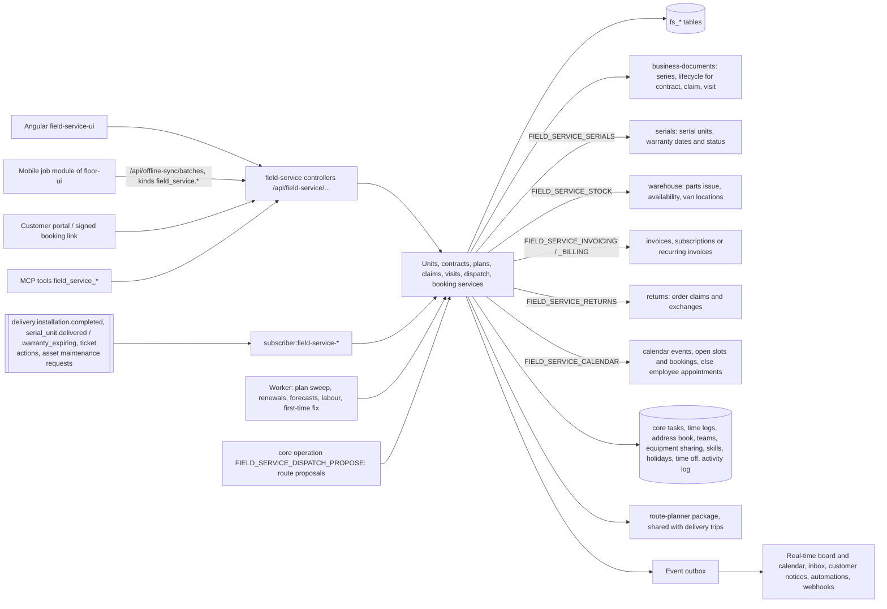

# Implementation Plan: Maintenance and field service

> Translates an approved `spec.md` into architecture and tech choices. The plan owns
> implementation details; the spec owns behaviour.

**Feature ID**: `maintenance-and-field-service`
**Spec**: `./spec.md`
**Tasks**: `./tasks.md`
**Status**: `Draft`
**Last updated**: 2026-11-23

---

## 1. Architecture Summary

A new plugin `@gauzy/plugin-field-service` (`packages/plugins/field-service`) owns the installed base, sites, meters,
service contracts, maintenance plans, warranty claims, visits, technician profiles, dispatch and the field-service rules
of booking; `field-service-ui` holds the Angular pages (installed base, contracts, plans, claims, dispatch board,
reports) and the technician's mobile job screen, an installable module of the floor app (`floor-ui`, owned by
`warehouse-and-stock-movements`) that works offline through the core offline-sync module. The plugin writes no stock,
invoice, serial, calendar, return or ticket row itself: each is reached through a port bound in
`apps/api/src/plugin-composition.ts`, with a fallback that keeps the feature usable when the owner is off. Core modules
are reused as they are: `organization-contact` (customers), the address book (`address`, `address_role`: site
addresses and positions), `organization_team` (service areas), `employee` and `skills`, `official-holiday` and
`time-off-request` (working days), `availability-slots` (working hours), `tasks` and `time-tracking` (labour, under the
labour attribution rule of `shop-floor-and-work-orders`), `employee-appointment` and `event_type` (calendar fallback,
booking rules), `equipment-sharing` (tool reservations), `activity_log` (history), `comment` (notes), the recurrence
module (`packages/core/src/lib/recurrence/`), the operation runtime (solver runs) and plugin contributions
(permissions, role bundle templates, settings).



The visit request contract (`IFieldServiceVisitRequest { requesterType, requesterId, contactId, siteId?, unitIds,
kind, priority, window?, notes }`) is provided as `FIELD_SERVICE_VISIT_REQUESTS` for helpdesk tickets, fixed-asset
maintenance occurrences and delivery installations; the requester is told of scheduling and completion by events.

## 2. Tech Choices

| Concern | Choice | Rationale |
| ------- | ------ | --------- |
| Package | `packages/plugins/field-service` (new), `field-service-ui` (new) | Principle I; equipment stays in core |
| Flag | tenant feature `FEATURE_FIELD_SERVICE` in `field-service.features.ts` (`defaultEnabled: false`), `@FeatureFlag` + `FeatureFlagGuard` on every controller and resolver | default off |
| Persistence | MultiORM entities on `TenantOrganizationBaseEntity`; the shared core migration helpers of `@gauzy/core`; tables prefixed `fs_` | Principle III |
| Recurrence | calendar rules (every N days or weeks on weekdays, monthly by day or nth weekday, yearly), counts, holiday shift through the core recurrence module (`packages/core/src/lib/recurrence/`, lifted from `invoice-schedule.rules.ts` and extended by the calendar feature); `engine/meter-rule.ts` adds only the meter rule, "whichever first" and spreading | one recurrence implementation |
| Coverage | `engine/coverage.ts`: warranty and contract on a date, pure; warranty dates and status of a serial-tracked unit are the serial unit's (`serial_unit.warrantyStartsAt/EndsAt/warrantyStatus`, read through `FIELD_SERVICE_SERIALS`, kept by the serials feature's one warranty job); only units without a serial unit keep their own dates, evaluated on read | one owner of warranty dates, one warranty job |
| Sites and positions | a site's address is a core `address` of the customer (`ownerType` `CONTACT`, `ownerId` = the customer) with the new address role `SERVICE_SITE`; latitude and longitude live on that address only | one address book |
| Service areas | a service area is an `organization_team`: technicians are its members, a site names the team that serves it, dispatch proposals run per team; core `region` (a commerce region: currency, tax, payment and fulfilment providers) is not used | dispatch not coupled to tax and currency setup |
| Dispatch solver | the shared route planner package `@gauzy/route-planner` (`packages/route-planner`: the `RoutePlanner` contract and registry, a built-in planner for several routes with time windows, locked stops and capacities by insertion heuristic plus local search, deterministic seed, time budget, travel-time providers with a straight-line fallback), also used by `delivery-and-shipping` for trips; field service adds its constraints (skills, parts in van or nearest warehouse, technician hours and time off, fixed visits) as a constraint set; a run is core operation `FIELD_SERVICE_DISPATCH_PROPOSE` (aggregate = the proposal) | one routing engine for trips and dispatch |
| Forecast | `engine/forecast.ts`: robust linear trend on cumulative meters (at least three readings), confidence from residuals; anomaly rules for jumps, flat lines and gauge limits | explainable |
| Money | core `money`; prices from price lists through `FIELD_SERVICE_PRICING` | one money kernel |
| Events | `EventOutboxService.append` in the write transaction; consumers `subscriber:field-service-*` | at-least-once |
| Offline | the core offline-sync module (`packages/core/src/lib/offline-sync/`: `offline_operation`, `offline_exception`, `IdempotencyService`), operation kinds `field_service.visit.state`, `.purpose`, `.check`, `.reading`, `.part`, `.signature`, `.note` contributed through `OFFLINE_OPERATION_KINDS` (owner type `field_service.visit`); assignment conflicts: dispatcher wins the assignment, the technician's work record is kept | one offline mechanism |
| Labour | the labour attribution rule of `shop-floor-and-work-orders`: each technician on a visit gets a work task and a travel task (core tasks); the mobile screen starts the travel timer on "on the way" and switches to the work task on "on site"; travel and work minutes are the logs of each task, valued at their stored `payRateValue`, billed at `employee.billRateValue`; state changes never produce minutes | one time source; a log counts once |
| Booking | a visit kind's booking rules are a core `event_type` (hosts = qualified technicians through the calendar's `calendar_booking_host`, `minNoticeMinutes`, `maxDaysAhead`, `cancelCutoffHours`); open slots and bookings come from the calendar booking engine through `FIELD_SERVICE_CALENDAR` (`openSlots`, `calendar_booking`); field service filters slots by skills, service area and parts; needs the calendar feature | one booking engine |
| History and notes | unit and visit changes in core `activity_log`; the unit timeline is a `RECORD_TIMELINE_SOURCES` entry of `record-views-and-search` merging the activity log with linked contracts, claims, visits, readings and parts; notes are core `comment` rows; contract ending notices are `reminder` rows through the `REMINDERS` port | no own event, note or reminder table |
| Claim outcomes | a replacement or refund creates an `order_claim` (`REPLACE`, `REFUND`) or an `order_exchange` on the order that delivered the unit through `FIELD_SERVICE_RETURNS` (returns plugin), so stock and refunds run there | one return path |
| AI | the technician brief and the report draft bind to `ai-agents-and-assistants` through `FIELD_SERVICE_AI` (purposes `field_service.brief`, `field_service.report_draft`; runs, usage and budgets recorded there); a plain summary without it | no AI table here |
| Permissions, settings | permission contributions with `defaultFor`, the two role bundles as `roleBundleTemplates` of `PluginContributions`; setting contributions (`field-service.settings.ts`: lead days, response hours by priority, notifications, report sending, first-fix days, claim approval threshold, overbooking) in the platform settings store | no seed migration, no settings table |
| Reports | report definitions; profitability and first-time fix from snapshot tables | no raw scans |

## 3. Data Model

### New or changed entities

No existing table changes; core gains one enum value, the address role `SERVICE_SITE` (`AddressRoleEnum`). Serial units
keep warranty dates and status and read a unit's contract end from this plugin's contracts (`serials-and-batches`);
deliveries already record installations.

```ts
@MultiORMEntity('fs_visit', { mikroOrmRepository: () => MikroOrmServiceVisitRepository })
export class ServiceVisit extends TenantOrganizationBaseEntity implements IServiceVisit { /* below */ }
```

| Table | Columns (type) | Indexes and uniqueness |
| --- | --- | --- |
| `fs_site` | `contactId` uuid, `name`, `addressId` uuid (core `address` of the customer with role `SERVICE_SITE`; position on the address), `serviceTeamId` uuid null (`organization_team`, the service area), `accessNotes` text, `openingHours` json, `contacts` json | idx `(organizationId, contactId)`, `(serviceTeamId)` |
| `fs_installed_unit` | `contactId`, `siteId` fk, `variantId`, `productId` uuid null, `serialUnitId` uuid null, `name`, `installedOn` date, `warrantyStartsOn`, `warrantyEndsOn` date null and `warrantySource` (`UNIT`/`MANUAL`) only when `serialUnitId` is null (a serial-tracked unit reads its serial unit's dates and status), `warrantyChangeReason` text, `contactPersonId` uuid null, `parentUnitId` fk null, `status` (`ACTIVE`/`INACTIVE`/`REPLACED`/`SCRAPPED`), `replacedById` fk null, `deliveryId`, `installationId` uuid null, `notDeliveredToCustomer` bool, `version` | unique `(serialUnitId)` where not null; check: warranty columns null when `serialUnitId` is set; idx `(organizationId, contactId, siteId)`, `(variantId)` |
| `fs_unit_meter` | `unitId` fk, `name`, `unitOfMeasureId` uuid null, `kind` (`CUMULATIVE`/`GAUGE`), `minValue`, `maxValue` null, `deviceKeyHash` char(64) null | unique `(unitId, name)` |
| `fs_meter_reading` | `meterId` fk, `readAt` timestamp, `value` numeric(20,6), `source` (`VISIT`/`CUSTOMER`/`IMPORT`/`DEVICE`), `isReset` bool, `visitId` null, `anomaly` varchar(24) null | unique `(meterId, readAt)`; idx `(meterId, readAt)` |
| `fs_service_contract` | `number` null, `contactId`, `startsOn`, `endsOn` date, `status` (`DRAFT`/`ACTIVE`/`EXPIRED`/`CANCELLED`), `scope` (`ALL_UNITS`/`SITES`/`LISTED`), `siteIds` json, `terms` json (labour, parts, travel: `INCLUDED`/`DISCOUNT` with percent/`CHARGED`), `responseHours` int null, `visitsPerPeriod` int, `periodMonths` int, `price` numeric(20,6), `currency`, `billingKind` (`SUBSCRIPTION`/`RECURRING_INVOICE`/`NONE`), `billingRef` uuid null, `renewal` (`NONE`/`PROPOSE`/`AUTOMATIC`), `noticeDays` int default 30, `renewedFromId` fk null, `orderLineId` uuid null, `ownerId`, `version` | unique `(organizationId, number)` where not null; idx `(organizationId, status, endsOn)` |
| `fs_contract_unit` | `contractId` fk, `unitId` fk | unique `(contractId, unitId)`; idx `(unitId)` |
| `fs_contract_period` | `contractId`, `periodStart`, `periodEnd`, `visitsIncluded`, `visitsUsed` int, `invoiceId` uuid null, `responseMet`, `responseMissed` int | unique `(contractId, periodStart)` |
| `fs_checklist_template` | `name`, `steps` json (key, text, required, photo required, and for a reading step the meter name and unit of measure it records on the visited unit), `isArchived`; no acceptance rules: a reading's limits are the meter's `minValue` / `maxValue`, inspections with acceptance rules are quality management's | unique `(organizationId, name)` |
| `fs_maintenance_plan` | `number` null, `contactId`, `contractId` null, `orderId` uuid null, `status` (`DRAFT`/`ACTIVE`/`ENDED`/`CANCELLED`), `leadDays` int null | idx `(organizationId, status)` |
| `fs_plan_line` | `planId` fk, `unitId` fk null, `variantId`, `serialUnitIds` json, `startsOn`, `endsOn`, `recurrence` json (the core recurrence rule format), `visitCount` int, `meterId` null, `meterEvery` numeric null, `technicianId` uuid null, `teamId` uuid null, `checklistTemplateId` null, `durationMinutes` int, `skillIds` json, `partsKit` json (defaults from the item's catalogue `SPARE_PART` relations), `orderLineId` uuid null | unique `(orderLineId)` where not null |
| `fs_planned_visit` | `lineId` fk, `sequence` int, `plannedOn` date, `actualOn` date null, `completion` (`PENDING`/`PARTLY_DONE`/`DONE`), `visitId` null, `manuallyScheduled` bool, `isForecast` bool, `forecastFrom` json null | unique `(lineId, sequence)`; idx `(organizationId, plannedOn, completion)` |
| `fs_warranty_claim` | `number` null, `complaintOn` date, `contactId`, `contactPersonId` null, `unitId` fk null, `serialUnitId` null, `variantId`, `faultCode` varchar(64) null, `description` text, `siteId`, `priority`, `coverage` (`WARRANTY`/`CONTRACT`/`BOTH`/`NONE`), `warrantyEndsOn`, `contractId`, `contractEndsOn` null, `status` (`OPEN`/`IN_PROGRESS`/`RESOLVED`/`CLOSED`/`CANCELLED`), `resolvedOn`, `resolvedById`, `resolution` text, `resolutionKind` (`REPAIRED`/`REPLACED`/`REFUNDED`) null, `orderClaimId`, `orderExchangeId` uuid null (returns plugin records on the delivering order), `ticketId` uuid null, `approvalRequestId` null, `costParts`, `costLabour`, `costTravel` numeric(20,6), `recoveryClaimId` null (supplier recovery), `version` | unique `(organizationId, number)` where not null; idx `(organizationId, status)`, `(unitId)` |
| `fs_visit` | `number` null, `contactId`, `siteId`, `kind` (`MAINTENANCE`/`BREAKDOWN`/`INSTALLATION_FOLLOW_UP`/`INSPECTION`/`OTHER`), `source` (`PLAN`/`CLAIM`/`TICKET`/`CONTRACT`/`ASSET_MAINTENANCE`/`BOOKING`/`MANUAL`), `sourceType` varchar(48), `sourceId` uuid null, `priority`, `windowStart`, `windowEnd` null, `scheduledStart`, `scheduledEnd` null, `state` (`REQUESTED`/`SCHEDULED`/`DISPATCHED`/`ON_THE_WAY`/`ON_SITE`/`PAUSED`/`COMPLETED`/`PARTLY_COMPLETED`/`NO_ACCESS`/`CANCELLED`), `responseDueAt` null, `durationMinutes`, `skillIds` json, `checklistTemplateId` null, `claimId` fk null, `plannedVisitId` fk null, `contractId` null, `followUpOfId` fk null, `noAccessPhotoId` null, `signatureFileId` null, `signedByName`, `rating` int null, `reportFileId` null, `invoiceId` uuid null, `calendarBookingId` uuid null (the calendar booking whose signed link the customer uses), `fixedByDispatcher` bool, `firstTimeFix` bool null, `version` | unique `(organizationId, number)` where not null; idx `(organizationId, state, scheduledStart)`, `(siteId)`, `(claimId)`, `(contactId, scheduledStart)` |
| `fs_visit_technician` | `visitId` fk, `employeeId`, `isLead` bool, `workTaskId`, `travelTaskId` uuid null (core tasks of this technician on this visit, never shared), `calendarRef` varchar(128) null, `appointmentId` uuid null | unique `(visitId, employeeId)`; idx `(employeeId)`, `(workTaskId)`, `(travelTaskId)` |
| `fs_visit_purpose` | `visitId` fk, `unitId` null, `serialUnitId` null, `purpose` text, `workDone` text, `findings` text, `completion` (`DONE`/`PARTLY_DONE`/`NOT_DONE`) null, `technicianId` | idx `(visitId)`, `(unitId)` |
| `fs_visit_check` | `visitId` fk, `stepKey`, `result` (`DONE`/`NOT_APPLICABLE`/`FAILED`) null, `meterReadingId` uuid null (the reading the step recorded), `photoIds` json, `note` | unique `(visitId, stepKey)` |
| `fs_visit_part` | `visitId` fk, `purposeId` null, `variantId`, `quantity`, `fromLocationId`, `movementId` uuid null, `serialUnitId` null, `removedSerialUnitId` null, `returnLocationId` null, `returnMovementId` null, `chargeable` bool, `unitPrice` numeric(20,6) null, `status` (`USED`/`REQUESTED`) | idx `(visitId)` |
| `fs_visit_labour` | `visitId`, `employeeId`, `travelMinutes` (logs of the travel task), `workMinutes` int (logs of the work task), `cost` (at each log's stored pay rate), `billable` numeric(20,6) (at the technician's billing rate), `chargeable` bool, `refreshedAt` | unique `(visitId, employeeId)` |
| `fs_visit_position` | `visitId`, `employeeId`, `at` timestamp, `latitude`, `longitude` numeric(10,7), `accuracyMeters` int (only between "on the way" and completion, with consent; purged after 30 days; state changes themselves are `activity_log` entries) | idx `(visitId, at)`, `(at)` |
| `fs_technician_profile` | `employeeId`, `teamIds` json (service areas), `homeAddressId` null (core `address`), `vanLocationId` uuid null, `maxVisitsPerDay` int, `isActive` | unique `(organizationId, employeeId)` |
| `fs_dispatch_proposal` | `forDate` date, `teamId` uuid null (service area), `operationId` uuid (the core operation that computes it), `status` (`READY`/`ACCEPTED`/`DISCARDED`), `input` json, `result` json (per technician order, travel, idle, unplaced with reasons), `requestedById`, `acceptedById` | idx `(organizationId, forDate)`, `(operationId)` |
| `fs_profitability_snapshot` | `periodStart`, `contractId`, `contactId`, `variantId`, `revenue`, `partsCost`, `labourCost`, `travelCost` numeric(20,6), `visits` int | idx `(organizationId, periodStart)` |

**Kept apart, with the reason:**

- `fs_unit_meter` / `fs_meter_reading` and fixed assets' `asset_usage_reading`: field-service meters are cumulative or
  gauge readings of a customer's installed unit, asset readings are period usage totals that feed depreciation; a
  reading taken on a visit that services an organization asset is recorded once, as an asset reading with source
  `VISIT` and the visit id (the boundary `fixed-assets` states).
- `fs_maintenance_plan` / `fs_plan_line` / `fs_planned_visit` and fixed assets' maintenance plans: these plan customer
  units with contracts, sales order lines, meter rules and parts kits; fixed assets plans the organization's own
  assets and sends external work here as visits (source `ASSET_MAINTENANCE`); both use the one core recurrence module.

**Reused, not created:** unit timeline and history (`activity_log`, record timeline), notes (`comment`), settings
(platform settings store), offline log (core offline-sync), addresses and positions (`address`, `address_role`),
service areas (`organization_team`), warranty dates of serial-tracked units (`serial_unit`), booking rules and slots
(`event_type`, calendar bookings), claim outcomes (`order_claim`, `order_exchange`), solver runs (core `operation`),
travel and work time (core `task`, `time_log`), contract notices (`reminder`), AI runs (`ai-agents-and-assistants`),
parts kits (catalogue `SPARE_PART` relations), and the item flags `product_variant_setting.isEquipment` /
`canBeRented`, which put equipment items first when a unit is recorded.

### Migrations

**Migration timestamps**: `packages/plugins/field-service` `1791000093100` to `1791000093199`.

- In `packages/plugins/field-service/src/lib/database/migrations/`: `1791000093100-CreateFieldServiceBaseTables`
  (sites, units, meters, readings), `1791000093110-CreateFieldServiceContractTables` (contracts, units, periods),
  `1791000093120-CreateFieldServicePlanTables` (checklists, plans, lines, planned visits),
  `1791000093130-CreateFieldServiceVisitTables` (claims, visits, technicians, purposes, checks, parts, labour, positions),
  `1791000093140-CreateFieldServiceDispatchTables` (profiles, proposals, snapshots).
  Permissions, default grants and the two role bundle templates are plugin contributions, not a migration.
- Additive, idempotent, per dialect with the plugin helpers; partial unique indexes over a generated "live" column on
  MySQL; SQLite tables created whole. No backfill.

### Contracts

`packages/contracts/src/lib/field-service.model.ts`: interfaces, enums (`InstalledUnitStatus`, `CoverageKind`,
`ServiceContractStatus`, `ContractTerm`, `RecurrenceKind`, `PlannedVisitCompletion`, `WarrantyClaimStatus`,
`ServiceVisitKind`, `ServiceVisitSource`, `ServiceVisitState`, `VisitPurposeCompletion`, `WarrantyClaimResolution`), the
visit request contract, the payloads of the offline operation kinds, dispatch proposal and booking filter shapes, event
payloads. `AddressRoleEnum` gains `SERVICE_SITE`.

## 4. API Surface

All routes under `/api/field-service`, guarded by `TenantPermissionGuard`, `PermissionGuard`, `FeatureFlagGuard`;
cursor pagination; `Idempotency-Key` on creating, completing and invoicing routes; `version` on updates.

| Method | Endpoint | Permission | Description (request → response) | Status |
| ------ | -------- | ---------- | -------------------------------- | ------ |
| `GET/POST/PUT` | `/field-service/sites`, `/field-service/units` (+ `/:id/replace`) | `FIELD_SERVICE_VIEW` / `FIELD_SERVICE_INSTALLED_BASE_EDIT` | site and unit DTOs; a site's address is written through the core address book (`SERVICE_SITE` role); the unit timeline is served by the record timeline of `record-views-and-search` | New |
| `GET` | `/field-service/units/:id/coverage?on=` | `FIELD_SERVICE_VIEW` | `ICoverage` | New |
| `GET/POST/PUT` | `/field-service/units/:id/meters`, `/field-service/meters/:id/readings` | `FIELD_SERVICE_VIEW` / `FIELD_SERVICE_INSTALLED_BASE_EDIT` | meters, readings | New |
| `POST` | `/field-service/devices/readings` | device key (HMAC) | `{ meterKey, readAt, value }` (rate limited) | New |
| `GET/POST/PUT` | `/field-service/contracts` (+ `/:id/activate`, `/cancel`, `/renew`, `/periods`) | `FIELD_SERVICE_VIEW` / `FIELD_SERVICE_CONTRACTS_EDIT` | contract DTOs; activation with `preview` (coverage, plan proposal) | New |
| `POST` | `/field-service/contracts/from-order-line` | `FIELD_SERVICE_CONTRACTS_EDIT` | `{ orderLineId }` → draft | New |
| `GET/POST/PUT` | `/field-service/checklists`, `/field-service/plans` (+ `/:id/lines`, `/:id/generate` with `preview`, `/:id/activate`, `/from-order`) | `FIELD_SERVICE_VIEW` / `FIELD_SERVICE_PLANS_EDIT` | plans, generation diff | New |
| `POST` | `/field-service/planned-visits/:id/visit` | `FIELD_SERVICE_PLANS_EDIT` | prefilled visit | New |
| `GET/POST/PUT` | `/field-service/claims` (+ `/:id/status`, `/:id/visit`, `/:id/approve`, `/:id/recovery`, `/:id/resolve`) | `FIELD_SERVICE_VIEW` / `FIELD_SERVICE_CLAIMS_EDIT` / `FIELD_SERVICE_CLAIMS_APPROVE` | claims; resolve by replacement or refund files an `order_claim` or `order_exchange` on the delivering order through `FIELD_SERVICE_RETURNS` | New |
| `GET/POST/PUT` | `/field-service/visits` (+ `/:id`, `/:id/state`, `/:id/purposes`, `/:id/checks`, `/:id/parts`, `/:id/signature`, `/:id/complete` with `preview`, `/:id/follow-up`, `/:id/tools`) | `FIELD_SERVICE_VIEW` / `FIELD_SERVICE_VISITS_EDIT` (assigned technician for own visit actions) | visit actions | New |
| `POST` | `/field-service/visit-requests` | requester's permission (internal port) | `IFieldServiceVisitRequest` → visit | New |
| `GET` | `/field-service/me/visits?date=`, `/field-service/me/visits/:id`, `/field-service/me/offline-pack` | assigned technician | mobile job reads with unit history and brief; the day's pack (no costs) for the floor app | New |
| `POST` | `/api/offline-sync/batches` (core) | assigned technician (each `field_service.*` kind checks the assignment) | ordered offline batch → per-operation result; conflicts as `offline_exception` rows resolved through `/api/offline-sync/exceptions` by `FIELD_SERVICE_DISPATCH` | Existing elsewhere |
| `GET/PUT` | `/field-service/technicians` | `FIELD_SERVICE_VIEW` / `FIELD_SERVICE_SETTINGS_EDIT` | profiles | New |
| `GET` | `/field-service/board?from=&to=&teamId=` | `FIELD_SERVICE_DISPATCH` | technicians, visits, time off, travel, queue; the technician calendar views (day, week, agenda) when the calendar feature is off | New |
| `POST` | `/field-service/visits/:id/assign` (+ `/check`) | `FIELD_SERVICE_DISPATCH` | `{ technicianIds, start, end, version }` → findings or assignment | New |
| `POST/GET` | `/field-service/dispatch-proposals`, `/:id`, `POST /:id/accept`, `/discard` | `FIELD_SERVICE_DISPATCH` | request answers `202` with the core operation handle; proposal lifecycle | New |
| `GET` | `/field-service/booking/slots?visitId=` or `?kind=&siteId=`; `POST /field-service/booking` | portal contact or the calendar booking's signed link | open slots of the visit kind's event type from the calendar booking engine, filtered by skills, service area and parts; book, move, cancel as calendar bookings under the event type's rules | New |
| `POST` | `/field-service/portal/requests` | portal contact | breakdown request for own unit | New |
| `GET/PUT` | `/field-service/settings` | `FIELD_SERVICE_SETTINGS_EDIT` | the plugin's setting keys in the platform settings store | New |
| `GET` | `/field-service/visits/:id/brief`, `POST /field-service/visits/:id/report-draft` | assigned technician / `FIELD_SERVICE_VISITS_EDIT` | assistant through `FIELD_SERVICE_AI` (`ai-agents-and-assistants`) | New |
| `GET` | `/field-service/forecasts`, `/field-service/dashboard` | `FIELD_SERVICE_VIEW` | forecasts, dashboard cards | New |

Errors: `400` (`FS_PLAN_DATES`, `FS_PLAN_COUNT`, `FS_NO_WORKING_DAY`, `FS_SERIAL_ITEM_MISMATCH`, `FS_READING_DECREASE`,
`FS_REQUIRED_STEP_OPEN`, `FS_NO_PURPOSE`), `403`, `404` (flag off, other organization or customer), `409` (version,
assignment overlap, claim with open visit, coverage overlap on activation), `422` (stock refused, booking rule).

**Ports declared** (in `src/lib/ports/`, bound in `apps/api/src/plugin-composition.ts`, each with a fallback):
`FIELD_SERVICE_SERIALS` (serial units, their warranty dates and status), `_STOCK`, `_INVOICING`, `_BILLING`,
`_CALENDAR` (bound to the calendar's `CalendarPortAdapter`: events, `openSlots`, bookings; appointments fallback),
`_RETURNS` (returns plugin: order claims and exchanges), `_DOCUMENTS`, `_APPROVALS`, `_COMMUNICATIONS`, `_AI`
(`ai-agents-and-assistants`), `_PRICING`, `_PORTAL`. **Answered**: `FIELD_SERVICE_VISIT_REQUESTS` (tickets, asset
maintenance, installations), `FIXED_ASSETS_FIELD_SERVICE`, and the serials feature's read of a serial unit's covering
contract and its end. Travel times come from the travel-time providers of `@gauzy/route-planner`.

## 5. Events, Real-Time and Notifications

| Event | Emitted when | Consumers |
| ----- | ------------ | --------- |
| `field_service.unit.created`, `.replaced` | unit created / replaced | timeline, automations |
| `field_service.contract.activated`, `.ending`, `.expired`, `.renewed` | as named | serial unit pages (contract end read from the contract), billing, inbox to owner |
| `field_service.claim.opened`, `.resolved` | as named | helpdesk ticket state, automations; a replacement or refund resolution goes to the returns plugin as an order claim or exchange |
| `field_service.visit.scheduled`, `.dispatched`, `.on_the_way`, `.started`, `.completed`, `.no_access`, `.cancelled` | state changes | board and calendar push, calendar events, customer notices, requester (ticket, asset maintenance, installation), plan and claim write-back |
| `field_service.reading.anomaly`, `field_service.forecast.due` | reading rules / forecast | inbox to plan owner, proposed visit |
| `document.service_contract.*`, `document.warranty_claim.*`, `document.service_visit.*` | lifecycle (document engine) | history, reports |
| consumed: `delivery.installation.completed`, `serial_unit.delivered`, `serial_unit.warranty_expiring` | installation, delivery, warranty job | installed base, coverage, renewal hints |
| consumed: time logs of the visit's work and travel tasks (events where published, else hourly read) | time tracked | labour |
| consumed: `calendar.booking.created` / `.rescheduled` / `.cancelled` of a visit kind's event type | customer booking | visit scheduled, moved or cancelled |
| consumed: `offline_exception` of a `field_service.*` kind | offline conflict | dispatcher inbox |

Inbox items through `InboxItemWriter`: visits assigned to a technician, claims awaiting approval, anomalies and
forecasts, parts requests. Contract ending notices are `reminder` rows scheduled through the `REMINDERS` port at
activation. Customer email and text through the communications feature and email templates. Real-time hints for board,
calendar layer, visit page and unit page; visits are a layer of the calendar feature (`registerCalendarLayers`).

## 6. UI Surface

- Angular plugin `packages/plugins/field-service-ui`, registered in `apps/gauzy/src/plugin-ui.config.ts`, menu group
  "Field service", hidden without the feature or `FIELD_SERVICE_VIEW`. Routes: `/pages/field-service` (dashboard),
  `/units` (saved-view list, map) and `/units/:id` (coverage, the record timeline, meters with forecast chart,
  contracts, claims, visits, comments), `/sites`, `/contracts` (+ `/:id`), `/plans` (+ generation preview diff),
  `/claims`, `/visits` (+ `/:id` with checklist, parts, labour, signature, report), `/dispatch` (board: technician rows
  by day or week, queue, map, assignment findings, proposal review; keyboard list alternative to drag and drop; its
  technician view with day, week and agenda serves as the technician calendar when the calendar feature is off),
  `/checklists`, `/technicians`, `/reports`, `/settings`. With the calendar feature on, the technician calendar is the
  calendar's own view with the visits layer; no second calendar page.
- Contributed panels through plugin UI slots: "Installed units" and "Service" tabs on the customer (organisation
  contact) page; "Create claim / visit" action and state chip on helpdesk tickets; "Request visit" on fixed-asset
  maintenance occurrences; unit link on serial unit pages; booking page in the customer portal. A visit's tool
  reservations link to the existing Equipment pages (`/pages/equipment`) rather than listing tools again.
- **Mobile job module of the floor app** (screens in `field-service-ui`, registered with the module registry of
  `floor-ui`, installable from the Gauzy web app; one service worker and one device queue): my visits for the day, visit
  detail with unit history and brief, state changes (starting the travel or work timer), checklist, readings, parts,
  photos, signature and notes, all queued offline as `field_service.*` operation kinds.
- i18n keys `FIELD_SERVICE.*` in every locale.

## 7. MCP Tools, SDKs and Integrations

- `packages/mcp-server/src/lib/tools/field-service.ts`:

| Tool | Input | Output |
| --- | --- | --- |
| `field_service_units_search` | customer, site, item, serial, coverage | units |
| `field_service_coverage` | unit or serial, date | coverage with ends |
| `field_service_claim_create` | unit, fault, ticket | claim |
| `field_service_visit_create` | request contract | visit |
| `field_service_board` | date, service area | technicians and visits |
| `field_service_dispatch_propose` | date, service area, `preview` (default true) | proposal or accepted assignment |
| `field_service_reading_record` | meter, value | reading, anomaly, forecast |
| `field_service_visit_complete` | visit, purposes, parts, `preview` (default true) | effects (stock, invoice draft, claim) or completed visit |
| `field_service_contracts_ending` | days | contracts |
| `field_service_first_time_fix` | period, grouping | rates |

- Report definitions for spec §3.12 and dashboard cards. Print templates: visit report, contract, claim, maintenance
  schedule. Import templates: installed base, contracts, plans. OpenAPI additive; SDKs regenerated.

## 8. Background Jobs

| Trigger | When | What it does | Idempotency |
| ------- | ---- | ------------ | ----------- |
| `field-service.plans.sweep` | daily 02:00 (organization time zone) | creates visits for planned dates within lead time; marks overdue planned visits | `(plannedVisitId)` → one visit |
| `field-service.contracts.sweep` | daily | renewal drafts, automatic renewals, expiry, period rollover (ending notices are `reminder` rows scheduled at activation) | marker per contract and date |
| `field-service.labour.refresh` | hourly for open visits; at completion | reads the time logs of each technician's work and travel tasks into `fs_visit_labour` at their stored pay rate | upsert `(visitId, employeeId)`; recomputed, never summed |
| `field-service.positions.purge` | daily | deletes `fs_visit_position` rows older than 30 days | conditional delete |
| `field-service.forecast` | after each reading + nightly | meter forecasts, proposed visits, anomaly flags | `(lineId, sequence)` of forecast visit |
| `field-service.first-fix` | daily | sets `firstTimeFix` on visits completed N days ago | null-only update |
| `field-service.profitability` | daily + month end | profitability snapshot | replace rows of the period |
| `field-service.notices` | consumer | customer messages per settings | `(visitId, event)` dedup |
| core operation `FIELD_SERVICE_DISPATCH_PROPOSE` | on request; re-proposal on overrun or urgent breakdown | `@gauzy/route-planner` run with field-service constraints and a 20 s budget; result stored on the proposal | aggregate = the proposal; one live per team and day |
| consumer `subscriber:field-service-sources` | installation, delivery and warranty events | units and coverage | unique serial unit |

`FieldServiceSchedulePlugin` (worker) holds schedules; `FieldServicePlugin` (API) holds routes, outbox consumers and the
operation executor. Without a queue root the API runs sweeps on in-process timers and solves with a 10 s budget.

## 9. Security & Permissions

- New keys (contributed, group `GENERAL`): `FIELD_SERVICE_VIEW`, `FIELD_SERVICE_INSTALLED_BASE_EDIT`,
  `FIELD_SERVICE_CONTRACTS_EDIT`, `FIELD_SERVICE_PLANS_EDIT`, `FIELD_SERVICE_CLAIMS_EDIT`, `FIELD_SERVICE_CLAIMS_APPROVE`,
  `FIELD_SERVICE_VISITS_EDIT`, `FIELD_SERVICE_DISPATCH`, `FIELD_SERVICE_SETTINGS_EDIT`, `FIELD_SERVICE_REPORTS_VIEW`.
- Declared as permission contributions whose `defaultFor` grants all to super admin and admin; the role bundles
  "Field service technician" (`VIEW`, own visit actions through assignment checks, readings) and "Field service
  manager" (all except `SETTINGS_EDIT`) are `roleBundleTemplates` a tenant installs on demand; no seed migration.
- Technicians act on their own visits only (assignment check), not by a broad key. Customers through portal sign-in or
  the calendar booking's signed, expiring link, limited to their own units and visits.
- Positions stored only between "on the way" and completion and only with the technician's consent; kept 30 days.
- Device readings: per-meter key (hashed), HMAC signature, rate limit; signatures and photos through the file service.
- Agents act with the caller's permissions; dispatch, completion and invoice drafting default to `preview: true`.

## 10. Observability

- Unit timeline (record timeline over `activity_log` and linked records); document history for contracts, claims and
  visits; `activity_log` entries on coverage edits, assignments, state changes and completions.
- Metrics: visits per state, response targets met, solver duration and unplaced visits, offline batch conflicts,
  forecast error.

## 11. Phased Rollout

1. **Phase 1 — Installed base and visits** (flag off): contracts, the route planner package (contract, registry,
   travel-time providers), sites, units from installations and deliveries,
   coverage, claims, visits with purposes, checklists, parts and labour, visit report, dispatch board, technician
   calendar view, mobile job module.
2. **Phase 2 — Contracts and plans**: service contracts with billing and renewal; maintenance plans with
   calendar and meter recurrences, generation, sales-order fill, plan sweep; claim approval; invoicing of chargeable
   lines; tool reservations; ticket and asset visit requests; reports; MCP tools.
3. **Phase 3 — Advanced capabilities**: meter forecasts and anomalies; route-optimised proposals; customer self-booking and
   portal requests; first-time fix; technician brief and report drafts; supplier recovery claims; profitability.
4. **Phase 4 — General availability**: the feature is off by default; after the trial period it may be switched on by default for new tenants only; existing tenants keep their setting until an administrator changes it.

## 12. Constitution Reconciliation

- I Plugin-first: `field-service` and `field-service-ui`; owners reached by ports; core reused unchanged except one
  address role value.
- II Tenant/organization scoping: all tables on the tenant-organization base; customer access limited to own records.
- III Both ORMs, additive migrations: MultiORM entities, create-only migrations per dialect.
- IV Default-off flag; nothing removed: `FEATURE_FIELD_SERVICE`; equipment, sharing, appointments unchanged.
- V Contracts and API first: `field-service.model.ts` and REST before UI and the mobile job module; additive OpenAPI.
- VI Permissions, privacy, security: ten keys, assignment checks, consented positions, signed device and booking access.
- VII Real-time through the event bus: outbox events drive board, calendars and notices.
- VIII i18n and accessibility: `FIELD_SERVICE.*` keys; list alternative to drag and drop; map table.
- IX Tests: property tests for recurrence and coverage; solver golden cases; offline merge; per-dialect migrations; e2e.
- X Behaviour-first spec: implementation lives here.
- XI Documentation describes our platform only.

## 13. Risks & Mitigations

| Risk | Likelihood | Impact | Mitigation |
| ---- | ---------- | ------ | ---------- |
| Overlap with fixed-asset maintenance | Medium | Medium | customer-owned units only; asset occurrences request visits through the request contract |
| Solver too slow or poor on large days | Medium | Medium | budget and service-area split, fixed visits respected, unplaced reasons shown, manual board always available |
| Coverage disagreement with serial units | Low | Medium | one coverage engine; warranty dates of serial-tracked units read from the serial unit, never copied; contract end read from the contract |
| A time log counted twice | Low | Medium | separate work and travel tasks per technician and visit, never shared; labour by task only |
| Offline conflicts on assignments | Medium | Low | dispatcher wins assignment, technician wins work record, both logged |
| Calendar feature absent | Medium | Low | fallback to employee appointments |
| Position data sensitivity | Low | High | consent, window-limited capture, 30-day retention |

## 14. References

- Spec: `./spec.md` · Tasks: `./tasks.md`
- [platform architecture](../../architecture/business-suite.md) §3.1, §3.5, §3.9, §3.10, §3.11, §3.12, §6
- Related plans: `../serials-and-batches/plan.md` (serial unit warranty dates and status, `serial_unit.*` events),
  `../delivery-and-shipping/plan.md` (`delivery_installation`, `delivery.installation.completed`, the route planner),
  `../fixed-assets/plan.md` (maintenance occurrences, usage readings), `../helpdesk-tickets/plan.md` (ticket actions),
  `../warehouse-and-stock-movements/plan.md` (locations, stock documents, offline sync, floor app),
  `../subscription-billing/plan.md`, `../calendar-and-scheduling/plan.md` (events, slots, bookings, layers),
  `../shop-floor-and-work-orders/plan.md` (labour attribution rule), `../ai-agents-and-assistants/plan.md`,
  `../automation-and-notifications/plan.md` (reminders), `../record-views-and-search/plan.md` (record timeline)
- Code: `packages/core/src/lib/equipment`, `equipment-sharing`, `employee-appointment`, `event-types`,
  `availability-slots`, `skills`, `official-holiday`, `time-off-request`, `tasks`, `time-tracking`, `address`,
  `address-role`, `organization-team`, `organization-contact`, `activity-log`, `comment`, `recurrence`, `operation`,
  `offline-sync`, `event-outbox`; `packages/plugins/returns/src/lib/order-claim`, `order-exchange`;
  `packages/plugins/catalog/src/lib/catalog.types.ts` (`SPARE_PART`); `packages/plugins/public-layout-ui`;
  `packages/scheduler`; `apps/api/src/plugin-composition.ts`
