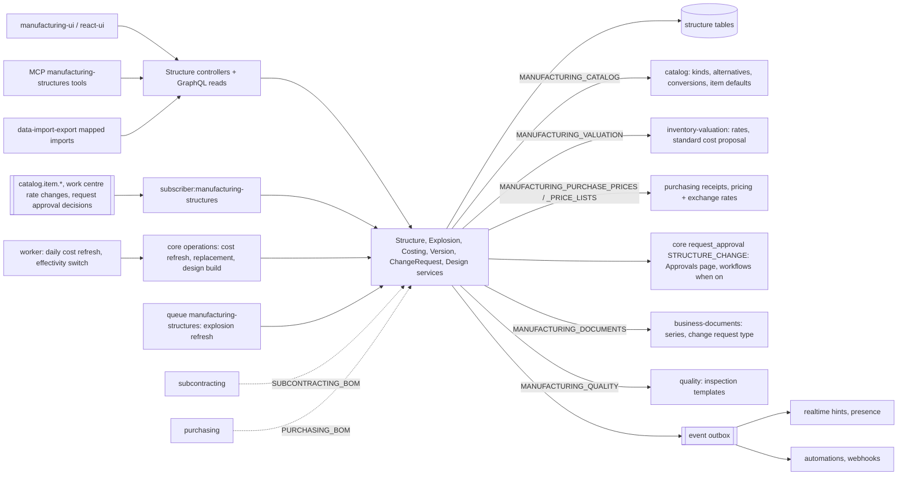

# Implementation Plan: Bills of materials and routings

> Translates an approved `spec.md` into architecture and tech choices. The plan owns
> implementation details; the spec owns behaviour.

**Feature ID**: `manufacturing-bom-and-routing`
**Spec**: `./spec.md`
**Tasks**: `./tasks.md`
**Status**: `Draft`
**Last updated**: 2026-11-23

---

## 1. Architecture Summary

This spec creates the new plugin `@gauzy/plugin-manufacturing` (`packages/plugins/manufacturing`) with its UI plugins
`manufacturing-ui` (Angular) and `manufacturing-react-ui` (React through `@gauzy/ui-react`), and fills its first module,
`structure/`. Two related features add modules to the same plugin: `shop-floor/` (`shop-floor-and-work-orders`) and
`planning/` (`production-planning`, behind its own feature code). The plugin is listed in `apps/api/src/plugins.ts`,
always loaded, and gated per tenant by `FEATURE_MANUFACTURING` on every controller, resolver, menu entry and MCP tool.

The structure module owns bills of materials, operations, routings, explosions, costing, versions with effectivity,
change requests and designs. It writes no stock, value or ledger table. Everything outside the plugin is
reached through optional ports declared in `manufacturing.types.ts` and bound in `apps/api/src/plugin-composition.ts`;
the plugin answers the ports other plugins already declared for it (`SUBCONTRACTING_BOM`, `PURCHASING_BOM`). It builds on
what the platform has: change requests are decided as core approval requests (`request_approval`, type
`STRUCTURE_CHANGE`) on the existing Approvals page; cost refreshes, replacements and design builds run on the core
operation runtime (`packages/core/src/lib/operation/`); permissions with their default grants and the settings are plugin
contributions; the cost price is core `product_variant_price.unitCost` and the last purchase price the latest
`goods_receipt_line.unitCost`.

## 2. Tech Choices

| Concern | Choice | Rationale |
| ------- | ------ | --------- |
| Package | new `packages/plugins/manufacturing`, `manufacturing-ui`, `manufacturing-react-ui` | Principle I; the three manufacturing specs share one plugin |
| Gate | `FEATURE_MANUFACTURING` in `manufacturing.features.ts` (`defaultEnabled: false`, `dependsOn: FEATURE_CATALOG`) checked by `FeatureFlagGuard` | [platform architecture](../../architecture/business-suite.md) §6 |
| Persistence | MultiORM entities on `TenantOrganizationBaseEntity`; plugin migrations through the shared core migration helpers of `@gauzy/core` | Principle III |
| Quantities, money | `numeric(20,6)` quantities and amounts with `currency`; rates `numeric(20,10)`; JSON as `text` | money kernel, one code path for both ORMs |
| Single default | a `bill_of_materials_default` row unique per (organization, variant), locked `FOR UPDATE` on release | portable uniqueness without partial indexes |
| Explosion | materialised `bill_of_materials_explosion` rows per structure, recomputed on save and by a dirty-parent job | where-used at any level by index |
| Numbering | business document engine series (`MANUFACTURING_DOCUMENTS`); fallback core `SequenceService` | [platform architecture](../../architecture/business-suite.md) §3.1 |
| Approvals | a change request files a core `request_approval` (`requestType` `STRUCTURE_CHANGE`, a new value of `ApprovalPolicyTypesStringEnum`; `requestId` = the change request) through `RequestApprovalService`, the purchase-order idiom of `purchasing/src/lib/purchase-approval/purchase-approval.service.ts`; approvers come from its approval policy, the decision reaches the change request through the plugin's settler on the core settler registry of `approval-workflows` (`registerRequestApprovalSettler`), and `approval-workflows` routes it through `REQUEST_APPROVAL_ROUTER` when on | one approval record, shown on the existing Approvals page |
| Background work | long runs are core operations registered with `OperationRegistry` (`MANUFACTURING_COST_REFRESH` with the organization as aggregate, so `UQ_operation_aggregate_live` allows one at a time; `MANUFACTURING_STRUCTURE_REPLACE`; `MANUFACTURING_DESIGN_BUILD`), per-structure outcomes through `api/bulk-executor.service.ts`, progress, cancel and retry at `/api/operations`; schedules with `@ScheduledJob` (worker, `ManufacturingSchedulePlugin`); explosion refresh on `@QueueWorker` queue `manufacturing-structures`; in-process timers under a database lock without a queue root | one runtime for long work; no job tables |
| Permissions, settings | `manufacturing.permissions.ts` as permission contributions with `defaultFor` (`packages/plugin/src/lib/plugin-contributions.ts`); `manufacturing.settings.ts` setting contributions stored in the platform settings store at organization scope | no seed migration, no settings table |
| Cost sources | valuation rate through `MANUFACTURING_VALUATION`, fallback core `product_variant_price.unitCost` (the variant's cost price); last purchase price = the latest `goods_receipt_line.unitCost` (actual landed cost per unit), never the quoted `vendor_product_term.unitCost`; buying price lists through `ProductPriceService` and `ExchangeRateService` | named sources, one figure each |
| Push | outbox realtime hints declared with `declareStreamedEvents`; presence through the realtime plugin's presence store | Principle VII |
| Design files | own parser for the STEP part-structure section (ISO 10303-21 is text); `@gltf-transform/core` (MIT) for glTF node trees; `three` (MIT) for the viewer; delimited and spreadsheet lists through the platform import parser | geometry is displayed, never converted |

## 3. Data Model

### New entities (structure module)

All tables extend `TenantOrganizationBaseEntity` (tenant, organization, timestamps, soft delete, `isActive`,
`isArchived`). Ids into other plugins carry no foreign key; ids inside the plugin do. `lockVersion` int backs `If-Match`.

| Table | Columns (besides base) | Indexes and uniqueness |
| --- | --- | --- |
| `manufacturing_operation` | `code` varchar(64), `name` varchar(255), `defaultWorkCentreId`, `defaultWorkCentreGroupId` uuid null, `description` text, `instructions` text (sanitised HTML), `instructionFileIds` text, `isCorrective` bool, `inspectionTemplateId` uuid null, `cardBatchSize` numeric null, `totalMinutes` numeric | unique (`organizationId`, `code`) live |
| `manufacturing_operation_step` | `operationId` FK cascade, `name`, `minutes` numeric, `position` int | (`operationId`, `position`) |
| `routing` | `code`, `name`, `description` text, `lockVersion` | unique (`organizationId`, `code`) live |
| `routing_operation` | `routingId` FK cascade, `operationId` FK restrict, `sequence` int, `workCentreId`, `workCentreGroupId` uuid null, `setupMinutes`, `runMinutes`, `batchSize` numeric, `runBasis` varchar(8) (`UNIT`, `BATCH`), `isFixedTime` bool, `position` int | (`routingId`, `position`) |
| `bill_of_materials` | `number` varchar(64), `productId`, `variantId` uuid, `isTemplate` bool, `version` int, `status` varchar(12) (`DRAFT`, `RELEASED`, `RETIRED`), `effectiveFrom` date null, `effectiveUntil` date null, `quantity` numeric, `unitId`, `stockQuantity` numeric, `currency` varchar(3), `rateBasis` varchar(16) (`VALUATION`, `LAST_PURCHASE`, `PRICE_LIST`), `priceListId` uuid null, `withOperations` bool, `routingId` FK null, `flatOperatingCost` numeric null, `issueMode` varchar(12) (`WORK_ORDER`, `OPERATION`), `consumptionBasis` varchar(12) null (`STRUCTURE`, `ISSUED`), `isPhantom`, `usesStepOutputs`, `isPercentFormula` bool, `processLossPercent`, `processLossQuantity` numeric null, `inspectionRequired` bool, `inspectionTemplateId` uuid null, `defaultSourceWarehouseId`, `defaultTargetWarehouseId` uuid null, `projectId` uuid null, `description` text, `isPublished` bool, `publicImageId` uuid null, `publicDescription` text, `publicShowComponents`, `publicShowOperations` bool, `componentCost`, `operatingCost`, `secondaryCredit`, `totalCost`, `unitCost`, `orgTotalCost`, `orgUnitCost` numeric, `costRate` numeric(20,10), `costedAt` timestamp, `costBasisFacts` text, `costStale` bool, `previousVersionId` FK null, `changeRequestId` FK null, `designId` uuid null, `explosionHash` varchar(64), `lockVersion` | unique (`organizationId`, `number`) live; unique (`organizationId`, `variantId`, `version`) live; (`organizationId`, `variantId`, `status`, `effectiveFrom`) |
| `bill_of_materials_default` | `variantId` uuid, `billOfMaterialsId` FK restrict, `effectiveFrom` date null, `setById` uuid | unique (`organizationId`, `variantId`) |
| `bill_of_materials_line` | `billOfMaterialsId` FK cascade, `position` int, `variantId` uuid, `quantity`, `stockQuantity` numeric, `unitId`, `percent` numeric null, `isBalance` bool, `sourceWarehouseId` uuid null, `subStructureId` FK null (`bill_of_materials`), `keepAsStocked`, `isCustomerSupplied`, `isSubcontractorSupplied`, `isNotIssued`, `allowsSubstitutes` bool, `structureOperationId` FK null, `rate`, `amount`, `orgAmount` numeric null, `rateSource` varchar(16), `note` text | (`billOfMaterialsId`, `position`); (`variantId`); (`subStructureId`) |
| `bill_of_materials_substitute` | `lineId` FK cascade, `variantId` uuid, `ratio` numeric, `priority` int | unique (`lineId`, `variantId`) |
| `bill_of_materials_line_rule` | `lineId` FK cascade, `attributeId` uuid, `mode` varchar(12) (`SAME_VALUE`, `VALUE_MAP`), `valueMap` text | unique (`lineId`, `attributeId`) |
| `bill_of_materials_output` | `billOfMaterialsId` FK cascade, `kind` varchar(12) (`CO_PRODUCT`, `BY_PRODUCT`, `SCRAP`, `EXTRA`), `variantId`, `quantity`, `unitId`, `processLossPercent` numeric, `valuation` varchar(16) (`ITEM_RATE`, `STATED`, `COMPONENT_SHARE`), `statedCost`, `sharePercent`, `cost` numeric null, `structureOperationId` FK null | unique (`billOfMaterialsId`, `variantId`, `kind`); (`variantId`) |
| `bill_of_materials_operation` | `billOfMaterialsId` FK cascade, `sequence` int, `position` int, `operationId` FK restrict, `workCentreId`, `workCentreGroupId` uuid null, `setupMinutes`, `runMinutes`, `batchSize` numeric, `runBasis`, `isFixedTime`, `hourlyRate`, `labourRate`, `machineRate`, `overheadRate`, `cost` numeric null, `materialSource` varchar(20) (`ISSUED_TO_ORDER`, `ISSUED_PER_CARD`, `CONSUME_AT_SOURCE`, `BACKFLUSH_FROM_WIP`) null, `wipWarehouseId`, `outputWarehouseId`, `sourceWarehouseId` uuid null, `isSubcontracted`, `inspectionRequired` bool, `inspectionTemplateId` uuid null, `cardBatchSize` numeric null, `stepOutputVariantId` uuid null, `stepOutputQuantity` numeric null, `stepOutputStructureId` FK null, `stepMaterialStructureId` FK null, `isFinalStep` bool, `weightPerPiece` numeric null | (`billOfMaterialsId`, `position`) |
| `bill_of_materials_explosion` | `billOfMaterialsId` FK cascade, `path` varchar(1024), `level` int, `variantId`, `sourceLineId` uuid, `fromStructureId` uuid, `quantityPerUnit`, `quantity` numeric, `unitId`, `keepAsStocked`, `viaPhantom`, `isLeaf` bool, `rate`, `amount` numeric null | unique (`billOfMaterialsId`, `path`); (`organizationId`, `variantId`); (`fromStructureId`) |
| `structure_change_request` | `number`, `status` varchar(12) (`DRAFT`, `SUBMITTED`, `APPROVED`, `REJECTED`, `RELEASED`, `CANCELLED`), `reason` text, `proposedEffectiveFrom` date, `requestApprovalId` uuid null (core `request_approval`; who decided, when and why are read there), `comparison`, `costSimulation`, `impact` text, `releasedAt`, `lockVersion` | unique (`organizationId`, `number`); (`organizationId`, `status`); (`requestApprovalId`) |
| `structure_change_request_line` | `requestId` FK cascade, `action` varchar(12) (`RELEASE`, `REPLACE`, `RETIRE`), `billOfMaterialsId` FK, `previousStructureId` FK null, `replaceWithId` FK null | (`requestId`) |
| `product_design` | `number`, `name`, `revision` int, `previousRevisionId` FK null, `status` varchar(12) (`DRAFT`, `CONFIRMED`, `BUILDING`, `BUILT`, `FAILED`, `REPLACED`, `CANCELLED`), `fileId` uuid null, `fileFormat` varchar(12), `importedAt`, `buildAsReleased` bool, `buildReport` text, `lockVersion` | unique (`organizationId`, `number`, `revision`) |
| `product_design_node` | `designId` FK cascade, `parentNodeId` FK null, `path` varchar(1024), `kind` varchar(8) (`ASSEMBLY`, `PART`), `variantId` uuid null, `newItem` text, `quantity`, `unitId`, `rate`, `isPhantom`, `fromFile` bool, `fileKey` varchar(255), `modelFileId` uuid null, `placement` text, `instruction` text, `operationRef` uuid null, `billOfMaterialsId` uuid null, `outcome` varchar(12), `error` text | unique (`designId`, `path`) |
| `product_design_operation` | `designId` FK cascade, `sequence`, `operationId` uuid null, `workCentreGroupId` uuid null, `minutes`, `outputNodeId` FK null, `materialNodeIds` text | (`designId`, `sequence`) |
| `product_design_change` | `designId` FK cascade, `fromRevision` int, `changes` text | (`designId`) |

Work centres and groups are tables of the shop floor module (`shop-floor-and-work-orders` plan §3); structure operations
reference them by id through the optional reader `MANUFACTURING_WORK_CENTRES` (lookup, active check, rates of
`WorkCentreRateService`) that the shop floor module binds; unbound, operations carry no work centre and no work centre
rate.

**Reused, not created:**

- **Kits.** An item has either a catalogue kit (`item_bundle` kind `KIT` of `item-catalogue`: components delivered
  together, never made) or a bill of materials, never both, so components are listed once. Creating a structure for an
  item with an active kit is refused (read through `MANUFACTURING_CATALOG`), and the catalogue's kit check reads
  `MANUFACTURING_USAGE` to refuse a kit on an item with a released structure; kit components count in where-used.
- **Catalogue relations.** `product_relation` types `SPARE_PART` and `ACCESSORY` (`plugins/catalog/src/lib/catalog.types.ts`)
  stay commercial links; they are never read as components.
- **Approvals.** No decision columns or decide route here: the change request points at its core `request_approval`.
- **Runs.** No job or job-item table: the cost refresh, replacement and design build are core operations (`operation`,
  `operation_step`); a design build's per-node result stays on `product_design_node.outcome`.
- **Work instructions.** `instructions` holds the short text; files are file-storage ids; longer, versioned work
  instructions are docs-plugin documents linked to the operation through `document_link`.

### Migrations

**Migration timestamps**: `packages/plugins/manufacturing` `1791000089100` to `1791000089199`.

In `packages/plugins/manufacturing/src/lib/database/migrations/`, listed in `manufacturing-migrations.ts` (both ORMs),
written with the shared core migration helpers of `@gauzy/core`, PostgreSQL, SQLite and MySQL branches, idempotent, additive and
forward-only:

1. `1791000089100-CreateManufacturingStructureTables` — operations, operation-steps, routings, bills of materials,
   default, lines, substitutes, line rules, outputs, structure operations, explosion.
2. `1791000089110-CreateManufacturingChangeAndDesignTables` — change requests and lines, designs, nodes, design operations, changes.

No backfill: nothing exists before. Default role grants are permission contributions (`defaultFor`), not a migration.
The item default record is written through `MANUFACTURING_CATALOG` (`item_default` field `defaultBillOfMaterials` of
the item-catalogue plan), never by migration. The contracts package adds `STRUCTURE_CHANGE` to
`ApprovalPolicyTypesStringEnum` (a value; `requestType` is a varchar, no schema change).

### Contracts

`packages/contracts/src/lib/manufacturing-structure.model.ts` (new): enums of the tables above, `IBillOfMaterials`,
`IBillOfMaterialsLine`, `IBillOfMaterialsOutput`, `IBillOfMaterialsOperation`, `IManufacturingOperation`, `IRouting`,
`IStructureExplosionRow`, `IStructureRuleCheck` (rule, state, fix), `IStructureCostBreakdown`, `IStructureComparison`,
`IStructureCostSimulation`, `IStructureImpact`, `IStructureChangeRequest`, `IProductDesign(+Node)`,
`IWhereUsedRow`, the operation payloads of the three operation types, and the port shapes of §4. Exported from
`index.ts`; additive.

## 4. API Surface

All routes: `TenantPermissionGuard`, `PermissionGuard`, `FeatureFlagGuard` with `@FeatureFlag(FEATURE_MANUFACTURING)`;
cursor pagination; `If-Match` on writes; `Idempotency-Key` on create, release, cost and job routes. Prefix
`/api/manufacturing`.

| Method | Endpoint | Permission | Description (request → response) | Status |
| ------ | -------- | ---------- | ----------- | ------ |
| `GET` `POST` `PUT` `DELETE` | `/bills-of-materials[/:id]` | `MANUFACTURING_STRUCTURES_VIEW` / `_EDIT` (delete drafts only) | `BillOfMaterialsDTO` → `IBillOfMaterials` | New |
| `POST` | `/bills-of-materials/:id/validate` | `_VIEW` | → `IStructureRuleCheck[]` (the live checklist) | New |
| `POST` | `/bills-of-materials/:id/release` · `/retire` · `/make-default` · `/new-version` | `_RELEASE` / `_RELEASE` / `_RELEASE` / `_EDIT` | lifecycle; refusals coded | New |
| `GET` | `/bills-of-materials/:id/explosion?quantity=&date=` · `/tree` | `_VIEW` | `IStructureExplosionRow[]`, tree nodes | New |
| `POST` | `/bills-of-materials/:id/cost` | `MANUFACTURING_STRUCTURES_COST` | `{ propagate, refreshRates }` → breakdown | New |
| `POST` | `/bills-of-materials/cost-refresh` | `MANUFACTURING_STRUCTURES_COST` | `{ refreshRates }` → `202` with the core operation handle; progress, failures per structure, cancel and retry at `/api/operations/:id` | New |
| `GET` | `/bills-of-materials/:id/cost-breakdown` | `MANUFACTURING_COSTS_VIEW` | `IStructureCostBreakdown` | New |
| `GET` | `/bills-of-materials/compare?left=&right=` | `_VIEW` | `IStructureComparison` | New |
| `POST` | `/bills-of-materials/:id/variants/preview` · `/variants/generate` | `_EDIT` | template generation | New |
| `PUT` | `/bills-of-materials/:id/publication` | `_RELEASE` | public view settings | New |
| `GET` | `/where-used?variantId=&kinds=` · `/search-by-items?variantIds=&subAssemblies=` | `_VIEW` | `IWhereUsedRow[]` | New |
| `GET` `POST` `PUT` | `/operations[/:id]` · `/routings[/:id]` (+ `/activate`, `/deactivate`) | `_VIEW` / `_EDIT` | masters | New |
| `GET` `POST` `PUT` | `/change-requests[/:id]` (+ `/submit`, `/cancel`, `/simulate`) | `_EDIT` | `IStructureChangeRequest`; submit files the `STRUCTURE_CHANGE` approval request, decided on the existing `/request-approval` routes and Approvals page | New |
| `POST` | `/replacements` | `_RELEASE` | `{ fromId, toId, preview }` → parents, or `202` with the core operation handle | New |
| `GET` `POST` `PUT` | `/designs[/:id]` (+ `/file`, `/confirm`, `/revise`, `/build`) | `MANUFACTURING_DESIGNS_EDIT` (read `_VIEW`); `buildAsReleased` also `MANUFACTURING_STRUCTURES_RELEASE` | designs; build answers `202` with the core operation handle; with change control on, `buildAsReleased` builds drafts and files one `structure_change_request` for them (spec FR-36, FR-52) | New |
| `GET` | `/reports/:key` | `_VIEW` (+ `MANUFACTURING_COSTS_VIEW` for cost columns) | report rows, cursor paged | New |
| `GET` `PUT` | `/settings/structures` | `_VIEW` / `MANUFACTURING_SETTINGS_EDIT` | the plugin's setting keys in the platform settings store | New |
| `GET` | `/public/:organizationId/structures/:variantId` | `@Public()`; only published views | public read feed for sites built with Ever Works: read-only view without costs | New |

Errors (`ApiException` codes): `STRUCTURE_CYCLE`, `STRUCTURE_COMPONENT_REFUSED`, `STRUCTURE_PERCENT_TOTAL`,
`STRUCTURE_SECONDARY_COST`, `STRUCTURE_RELEASED_READ_ONLY`, `STRUCTURE_IN_USE`, `STRUCTURE_EFFECTIVE_OVERLAP`,
`STRUCTURE_TEMPLATE_NOT_USABLE`, `STRUCTURE_ITEM_IS_KIT`, `DESIGN_LOCKED`, `DESIGN_REPLACED`; a second cost refresh is
refused by the operation runtime's live-aggregate rule with the running operation's handle. GraphQL reads
`billsOfMaterials`, `billOfMaterials`, `structureExplosion`, `whereUsed` in the plugin's schema extension behind
`FEATURE_GRAPHQL`.

**Ports declared** (optional tokens in `manufacturing.types.ts`, bound in `apps/api/src/plugin-composition.ts`):

| Port | Answered by | Purpose; without it |
| --- | --- | --- |
| `MANUFACTURING_CATALOG` | catalog item services | kinds and settings, alternatives with ratio, unit conversion, item defaults read and write, missing-item creation, whether an item has an active kit; required |
| `MANUFACTURING_VALUATION` | `inventory-valuation` | valuation rate per variant at a date, standard cost proposal; fallback core `product_variant_price.unitCost` |
| `MANUFACTURING_PURCHASE_PRICES` | purchasing goods receipt lines | last purchase price = latest `goods_receipt_line.unitCost` of the variant at or before the costing date; basis hidden when unbound |
| `MANUFACTURING_PRICE_LISTS` | `ProductPriceService`, `ExchangeRateService` (pricing) | buying price list price and rate; basis hidden when unbound |
| `MANUFACTURING_DOCUMENTS` | `business-documents` | series and the `manufacturing.structure_change` type; fallback core `SequenceService` |
| `MANUFACTURING_QUALITY` | `quality` | inspection template lookup; requirement stored but not enforced when unbound |
| `MANUFACTURING_USAGE` (multi) | subcontracting, order, catalog bundles | where-used rows and impact of their records |
| `MANUFACTURING_WORK_CENTRES` | shop floor `WorkCentreRateService` (`shop-floor-and-work-orders`) | work centre and group lookup, active check, rates; operations carry no work centre and no work centre rate when unbound |

**Ports answered** (bound by composition to `StructurePortService`): `SUBCONTRACTING_BOM` (default structure,
explosion, secondary outputs), `PURCHASING_BOM` (explosion for requisition fill), and the in-plugin
`StructureReader` used by the shop floor and planning modules (effective structure at a date, explosion, operations).

## 5. Events, Real-Time and Notifications

| Event | Emitted when | Consumers |
| ----- | ------------ | --------- |
| `manufacturing.structure.created` / `.updated` / `.released` / `.retired` / `.default_changed` | structure lifecycle (outbox, partition `structure:<variantId>`) | realtime hints, explosion of parents, planning low-level codes, automations, webhooks |
| `manufacturing.structure.cost_updated` | cost update or refresh per structure | open screens, standard cost proposal, planning cost |
| `manufacturing.change_request.submitted` / `.decided` / `.released` | change requests | approval inbox, requester inbox item, automations |
| `manufacturing.design.built` / `.failed` | design build operation | inbox item to the requester |
| core operation events of `MANUFACTURING_COST_REFRESH`, `_STRUCTURE_REPLACE`, `_DESIGN_BUILD` | runtime state changes | inbox item to the requester, the platform's operations list |
| `document.structure_change.confirmed` / `.cancelled` | through the document engine when bound | audit, document flow |
| In: `catalog.item.updated` / `.archived` / `.merged` | catalogue | `subscriber:manufacturing-structures` flags lines of disabled items, re-points merged items, marks costs stale |
| In: `manufacturing.work_centre.rate_changed` | shop floor module | marks operating cost stale on structures using it |
| In: decision of a `STRUCTURE_CHANGE` request approval | core request approval (direct or through workflows) | releases the request's versions or returns them to draft |

Realtime hints `manufacturing.structure.*` declared through `declareStreamedEvents`; presence on record key
`bill_of_materials:<id>` through the realtime presence store. Inbox items through `INBOX_ITEM_WRITER`.

## 6. UI Surface

- **Angular `packages/plugins/manufacturing-ui`** (lazy, `@gauzy/plugin-ui`, registered in `apps/gauzy/src/plugin-ui.config.ts`;
  menu "Manufacturing" shown only with `FEATURE_MANUFACTURING` and a view permission): `/pages/manufacturing/structures`
  (saved-view list), `/structures/:id` (editor with Components, Operations, Outputs, Cost, Versions and Where used tabs; rule
  checklist side panel; presence avatars), `/structures/:id/tree`, `/structures/compare`, `/operations`, `/routings`,
  `/change-requests[/:id]`, `/designs[/:id]`, `/reports`, `/settings/structures`. Forms honour custom fields. Change
  requests are decided on the existing Approvals page; cost refreshes, replacements and design builds show in the
  platform's operations list (no jobs page).
- **Item page**: a "Made from" panel and a "Used in" panel through the catalogue's `inventory-item-view-panels` location.
- **React `packages/plugins/manufacturing-react-ui`**: `StructureTree`, `StructureDiff` (side by side and tree with text
  markers), `DesignViewer` (glTF parts with placement), shared with the Angular pages through the `@gauzy/ui-react` bridge.
- i18n keys `MANUFACTURING.STRUCTURES.*` in every locale of `packages/ui-core/i18n/`; React strings via `useTranslation()`.

## 7. MCP Tools, SDKs and Integrations

New file `packages/mcp-server/src/lib/tools/manufacturing-structures.ts`, registered in `register-all-tools.ts`:

| Tool | Input | Output |
| --- | --- | --- |
| `manufacturing_list_structures` / `manufacturing_get_structure` | filters / id | structures, lines, operations (costs only with the cost key) |
| `manufacturing_explain_structure` | id, quantity | levels, quantities and cost drivers in plain language |
| `manufacturing_where_used` | item or variant | rows of FR-60 |
| `manufacturing_can_we_make` | structure, quantity, location | per component required, available, missing, last purchase price |
| `manufacturing_compare_structures` | two ids | added, removed, changed |
| `manufacturing_simulate_change` | draft version or change request | new unit costs of the item and its parents, impact |
| `manufacturing_draft_structure` | text, parts-list file id or design id, `preview` (default true) | matched items, items to create, rule issues, or the saved draft |

OpenAPI additive; SDKs regenerated after merge. Mapped imports and exports of structures, operations and routings are
registered with `data-import-export`; print templates (structure, routing sheet) with `print-and-pdf-designer`; report
definitions of FR-62 with `report-builder-and-dashboards` (the `/reports/:key` route serves them until then).

## 8. Background Jobs

| Trigger | When | What it does | Idempotency |
| ------- | ---- | ------------ | ----------- |
| core operation `MANUFACTURING_COST_REFRESH` | on demand; daily 02:30 organization time when the setting is on (skipped while one is live) | one step per low-level code, batches of 200 through `BulkExecutor` with a per-structure result | live-aggregate rule (one per organization); step checkpoint, retry resumes at the failed step |
| `structure.explosion-refresh` (queue `manufacturing-structures`) | on release, default change, sub-structure change | recompute explosions of dirty parents bottom-up | hash per structure; unchanged hash writes nothing |
| `structure.effectivity-switch` | daily 00:05 organization time | moves `bill_of_materials_default` to versions effective today | conditional update on `effectiveFrom` |
| core operation `MANUFACTURING_STRUCTURE_REPLACE` | on request | replace in each parent (new versions under change control) | per-parent result; live-aggregate rule on the replaced structure |
| `design.import` / core operation `MANUFACTURING_DESIGN_BUILD` | on file upload / confirm | parse the file into nodes; build structures and items | node `outcome` per path |
| Outbox consumer `subscriber:manufacturing-structures` | events of §5 | stale flags, re-pointing, change request decisions | delivery record per event |

Schedules live in `ManufacturingSchedulePlugin` loaded by `apps/worker/src/plugins.ts`; queue workers and operation
executors run in the API; without a queue root the API runs the same passes on in-process timers under a database lock.
Run history is the core operations list; nothing here prunes it.

## 9. Security & Permissions

New values in `manufacturing.permissions.ts`: `MANUFACTURING_STRUCTURES_VIEW`, `MANUFACTURING_STRUCTURES_EDIT`,
`MANUFACTURING_STRUCTURES_RELEASE`, `MANUFACTURING_STRUCTURES_COST`, `MANUFACTURING_COSTS_VIEW`,
`MANUFACTURING_DESIGNS_VIEW`, `MANUFACTURING_DESIGNS_EDIT`, `MANUFACTURING_SETTINGS_EDIT`, declared as permission contributions whose `defaultFor`
grants all to `SUPER_ADMIN` and `ADMIN` and `_VIEW`, `_EDIT`, `MANUFACTURING_COSTS_VIEW` and `MANUFACTURING_DESIGNS_EDIT`
to `MANAGER` (no seed migration; the permission reload adds them for existing tenants). Who may decide a structure
change is the `STRUCTURE_CHANGE` approval policy (or workflow). A response mapper removes rates,
amounts and costs without `MANUFACTURING_COSTS_VIEW` (REST, GraphQL, reports, MCP). Instructions and notes are sanitised
HTML; design files pass `core/src/lib/core/file-storage/helpers/upload-security.ts` and a 200 MB limit; the public route
returns only published views and is rate limited by the platform throttler. Agents act in the caller's request context
and are marked in the audit trail.

## 10. Observability

Activity-log entries for release, retirement, default change, effectivity switch, replacement, change-request decision
and publication, with before and after. Metrics `manufacturing_structure_save_ms`, `manufacturing_explosion_ms`,
`manufacturing_cost_refresh_duration_seconds`, `manufacturing_structures_cost_stale`; run progress in the core
operations list.

## 11. Phased Rollout

1. **Phase 1 — Plugin and core structures**: plugin scaffold, flag, permissions, contracts, structure tables, structures
   with components, secondary outputs, process loss, defaults, multi-level explosion, cycle check, tree, component costing,
   where-used, Angular list and editor, read MCP tools. Usable: describe what each item is made of and what it costs.
2. **Phase 2 — Depth**: operations and routings (work centres through `MANUFACTURING_WORK_CENTRES`), operating
   cost, step outputs, material source settings, percentage formulation, substitutes, templates and variant generation,
   designs and file import, replacement and bulk cost refresh jobs, reports, print, imports, publication.
3. **Phase 3 — Advanced capabilities**: rule checklist, effectivity and change requests with comparison, cost simulation and
   impact, standard cost proposal, regeneration of variants with differences, agent drafting and explanation, presence.
4. **Phase 4 — General availability**: the feature is off by default; after the trial period it may be switched on by default for new tenants only; existing tenants keep their setting until an administrator changes it.

## 12. Constitution Reconciliation

- I Plugin-first: new plugin triple; other plugins reached through ports; core used through its approval request,
  operation runtime and contributions; one additive enum value (`STRUCTURE_CHANGE`).
- II Tenant/organization scoping: tenant-organization base on every table; consumers set scope from the envelope.
- III Both ORMs, additive migrations: two additive migrations, three dialects, both ORMs; SQLite migration spec.
- IV Default-off flag; nothing removed: `FEATURE_MANUFACTURING` off; no existing route, column or screen changes.
- V Contracts and API first: contracts and REST before screens; OpenAPI additive.
- VI Permissions, privacy, security: seven keys; costs stripped by mapper; sanitised input; checked uploads.
- VII Real-time through the event bus: outbox events, realtime hints and presence only.
- VIII i18n and accessibility: keys in every locale; keyboard tree and diff with text markers.
- IX Tests: unit specs for explosion, cycle, percentages, costing and comparison; SQLite DB specs; e2e per route.
- X Behaviour-first spec: implementation lives here.
- XI Documentation describes our platform only.

## 13. Risks & Mitigations

| Risk | Likelihood | Impact | Mitigation |
| ---- | ---------- | ------ | ---------- |
| Explosion rows drift from structures | Medium | Medium | hash per structure; dirty-parent job; nightly check rebuilds mismatches |
| Cost refresh slow on deep trees | Medium | Medium | low-level codes, batches, resumable cursor; stale flag instead of synchronous propagation |
| Two releases race on one variant | Low | High | default row locked; effective-date overlap checked in the same transaction |
| Design file parsing of untrusted input | Medium | High | text parser with size and depth limits, no geometry conversion, upload checks, background job |
| Work centres arrive after structures | High | Low | phase 1 needs no operations; operations read work centres through the optional `MANUFACTURING_WORK_CENTRES` reader and are saved without one while it is unbound |

## 14. References

- Spec: `./spec.md` · Tasks: `./tasks.md`
- Code: `apps/api/src/plugins.ts`, `apps/api/src/plugin-composition.ts`, `apps/worker/src/plugins.ts`,
  `apps/gauzy/src/plugin-ui.config.ts`, `packages/plugins/inventory/src/lib/inventory.plugin.ts`,
  `packages/plugins/inventory/src/lib/inventory.features.ts`, `packages/plugins/task-automations/src/lib/database/migration-helpers.ts`,
  `packages/core/src/lib/graphql/subscriptions/plugin-subscription.ts`, `packages/plugins/realtime/src/lib/realtime-presence.store.ts`,
  `packages/core/src/lib/operation/`, `packages/core/src/lib/api/bulk-executor.service.ts`,
  `packages/core/src/lib/request-approval/`, `packages/plugins/purchasing/src/lib/purchase-approval/purchase-approval.service.ts`,
  `packages/core/src/lib/product-variant-price/`, `packages/plugins/purchasing/src/lib/goods-receipt-line/`,
  `packages/plugins/catalog/src/lib/catalog.types.ts`, `packages/plugin/src/lib/plugin-contributions.ts`
- Related plans: `../item-catalogue/plan.md`, `../shop-floor-and-work-orders/plan.md`, `../production-planning/plan.md`,
  `../subcontracting/plan.md`, `../procurement/plan.md`, `../stock-ledger-and-valuation/plan.md`
