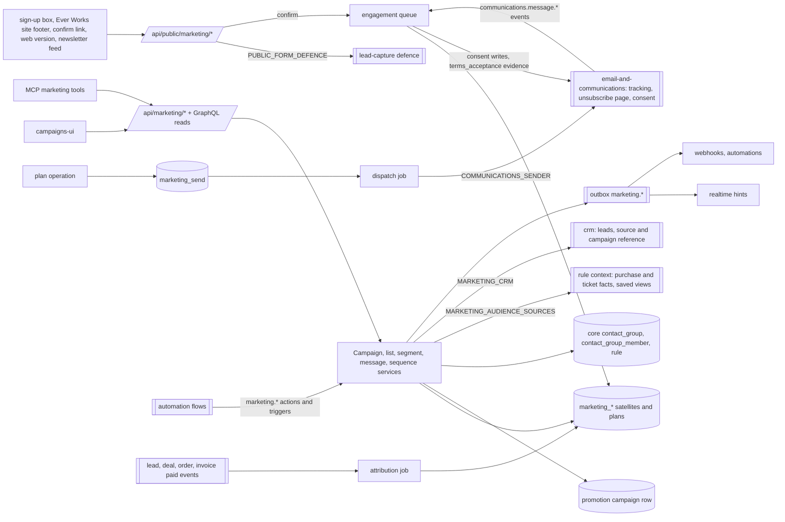

# Implementation Plan: Marketing campaigns

> Translates an approved `spec.md` into architecture and tech choices. The plan owns
> implementation details; the spec owns behaviour.

**Feature ID**: `marketing-campaigns`
**Spec**: `./spec.md`
**Tasks**: `./tasks.md`
**Status**: `Draft`
**Last updated**: 2026-11-23

---

## 1. Architecture Summary

A new plugin pair: `@gauzy/plugin-campaigns` (`packages/plugins/campaigns`) and `campaigns-ui` (Angular: the one
Campaigns menu entry, Marketing pages, editors, results, the confirmation and web version pages, and the newsletter
preferences area mounted in the portal). `apps/api/src/plugins.ts` lists `CampaignsPlugin` only when
`GAUZY_CAMPAIGNS_ENABLED` is exactly `true`; `apps/worker/src/plugins.ts` lists `CampaignsSchedulePlugin`. Every
controller carries `@FeatureFlag(FEATURE_CAMPAIGNS)`; routes live under `/api/marketing`.

One record per concept, built on what exists:

- **Campaign**: the promotion plugin's `campaign` row (`packages/plugins/promotion/src/lib/campaign/campaign.entity.ts`)
  is the one campaign identity: its `identifier` is the campaign code, with name, description, status and window. The
  promotion plugin owns the row and its `/campaigns` routes; this plugin adds a 1:1 satellite `marketing_campaign` keyed
  by `campaignId` for the marketing-only fields and writes the row through the promotion plugin's `CampaignService`.
  Promotions, coupons and the discount ceiling (`campaign_budget`) stay the promotion plugin's; the marketing budget is
  planned spend against recorded costs, a different figure, kept in the satellite.
- **Segments and lists** are core contact groups (`contact_group`, `contact_group_member`,
  `packages/core/src/lib/contact-group*/`): a dynamic segment is a `RULE_BASED` group whose conditions are core `rule`
  rows of owner type `CUSTOMER_SEGMENT`, a snapshot is a `STATIC` group whose members are written at freeze, a list is a
  `STATIC` group whose subscribed members with a contact are its members; small satellites keep only what a group does
  not hold.
- **Tracking, unsubscribe and consent proof** are those of `email-and-communications` (tracking image, click redirect,
  unsubscribe and preference page with one-click header, suppression, consent records) and core `terms_acceptance`
  (append-only evidence of the text a person accepted); this plugin keeps per-message and per-campaign aggregates.
- **Public surface**: the subscribe endpoint and sign-up box (the contract any site uses, Ever Works sites included,
  guarded by `PUBLIC_FORM_DEFENCE` of `lead-capture-and-enrichment`), and two built-in pages, the subscription
  confirmation and a message's web version; published newsletters are a public JSON and RSS feed that an Ever Works blog
  or any site shows. No page builder, no index page.
- **Settings and permissions** are contributions (`campaigns.settings.ts`, `campaigns.permissions.ts`).

The plugin plans and measures; it does not transport:

- **Sending** goes through `COMMUNICATIONS_SENDER` of `email-and-communications` (purpose `MARKETING`, the message's
  identity, one request per recipient with `idempotencyKey = sendId`); suppressions, consents, identities, templates,
  quiet hours, warm-up and delivery events are theirs.
- **People** are core `OrganizationContact` rows (people, companies, leads) with the CRM columns of `crm-leads-and-deals`
  (source in `acquiredChannel`, campaign reference, stage, score); "do not contact" and consent come from the consent
  records of `email-and-communications`; audiences also read core contact groups and saved views of
  `record-views-and-search`.
- **Sequences** are flows of `automation-and-notifications`: the plugin registers campaign actions and triggers and a
  flow template `marketing.sequence`; no second flow engine.
- **Numbering** through core `SequenceService`; **reports** through the report definition registry.



## 2. Tech Choices

| Concern | Choice | Rationale |
| ------- | ------ | --------- |
| Package | new `campaigns`, `campaigns-ui` (the portal area is an Angular component mounted through the portal's `portal-sections` child routes) | Principle I; one plugin UI |
| Campaign identity | promotion `campaign` row + `marketing_campaign` satellite; the marketing lifecycle (planned, active, paused, completed, archived) lives in the satellite's `state`, so the row's `status`, window and `isArchived`, which decide whether its promotions apply at checkout, change only through the promotion routes or, when the caller also holds `PROMOTIONS_EDIT` and ticks "apply to promotions", in the same transaction as the satellite; a campaign created in marketing starts as a `DRAFT` row; the identifier is stored as typed and compared case-insensitively for attribution | one campaign record, one menu entry; promotions keep their own controls and permissions |
| Lists | `STATIC` contact group + `marketing_list` satellite; per-address subscription state in `marketing_list_member` (an address may subscribe before it is a contact: pending sign-ups and states the group does not hold); a confirmed subscriber's contact is a `contact_group_member` of the list's group and leaves it on withdrawal | members show in the contact's groups |
| Consent proof | every grant is a `terms_acceptance` row (`TermsAcceptanceService.record`: document `marketing.list:<listId>`, version = hash of the consent text, locale, hashed address, user agent, method `FORM`, `DOUBLE_OPT_IN`, `IMPORT`, `STAFF`, `PORTAL` or `LEAD_FORM`) referenced by the consent record of `email-and-communications`; withdrawals are consent records; marketing keeps only the list (`marketing_list_member.consentId`) and message (`marketing_send.consentId`) references | one evidence row per consent event |
| Public pages | built-in pages for the subscription confirmation and the web version of one message; newsletters as a feed (`feed.json`, `feed.xml`); unsubscribe and preferences are the communications pages, which list the person's marketing lists through `MARKETING_LISTS` | pages of sites are Ever Works' |
| Settings | organization-scoped contributions in `campaigns.settings.ts` (`marketing.defaultIdentityId`, `ownDomains`, `consentRules` (`json`), `requireApproval`, `tracking` (`json`), `repermissionMonths` (24), `attributionModel` (`LAST_TOUCH`), `attributionWindowDays` (30), `displayBy`) in the platform settings store; the assistant's model, tone and budget are purposes of `ai-agents-and-assistants` | no settings table; AI budgets in one place |
| Permissions | contributions in `campaigns.permissions.ts` with `defaultFor` (§9) | no seed migration |
| Flags | `FEATURE_CAMPAIGNS`, `FEATURE_CAMPAIGNS_ASSISTANT` in `campaigns.features.ts`; deploy switch `GAUZY_CAMPAIGNS_ENABLED` | [platform architecture](../../architecture/business-suite.md) §6 |
| Rendering | platform Handlebars in an isolated instance (strict, known helpers only, step budget) for tokens; `marked` (MIT) for Markdown; blocks rendered to table-based HTML with inline styles; `sanitize-html` on rich text and blocks, raw HTML kept as written but scripts and event attributes removed | one template language; safe output |
| Planning | a core operation per message (`packages/core/src/lib/operation/`, aggregate = the message, so one live plan; progress and resume by the runtime) writes recipients once per message as `marketing_send` rows in batches of 5,000 | idempotent resume (spec FR-39) |
| Dispatch | due rows leased with `FOR UPDATE SKIP LOCKED` on PostgreSQL and MySQL 8, a lease column on SQLite. `marketing_send` stays a plugin table because each of up to 500,000 recipients per message has its own due time (local time, best hour), hold-out, variant and skip reason and is leased within an hourly cap; the runtime's steps run in fixed order and cannot be leased by due time | one hand-over per recipient |
| Tracking | the tracking image, click redirect and per-recipient tokens of `email-and-communications`; the plugin registers each message's links and reads `communications.message.*` open, click, unsubscribe, bounce and complaint events into aggregates keyed by `communicationId` | one pixel, one redirect, one unsubscribe page |
| Automatic opens | classified when aggregating: an open from a known image-proxy network class or within 2 s of delivery | approximate opens stated |
| Segments | `RULE_BASED` contact groups whose `rule` rows (`CUSTOMER_SEGMENT`, scope `CUSTOMER`) are compiled to SQL over `organization_contact` by the segment strategy this plugin implements for contact groups, with context mappings (orders, tickets, lists, engagement) contributed by fact providers; the core evaluator answers "is this person in it" with the same rows | one condition language, one segment store |
| Significance | two-proportion test at 95 % for opens and clicks, minimum sample per variant; revenue by mean difference with bootstrap interval | spec FR-66 |
| Link check | server-side `HEAD` then `GET`, 5 s timeout, public addresses only | spec FR-33 |
| Background | `@ScheduledJob` in the worker, `@QueueWorker` in the API, in-process timers without a queue root | task automations layout |

## 3. Data Model

All tables extend `TenantOrganizationBaseEntity`; JSON is `text` on every dialect; ids into core (`organization_contact`,
`user`, `organization_project`, `expense`) carry foreign keys with `SET NULL`; other plugins' ids carry none.

| Table | Columns (besides base) | Indexes and uniqueness |
| --- | --- | --- |
| `marketing_campaign` | marketing satellite of the promotion `campaign` row (which holds code `identifier`, name, description, status and window): `campaignId` (unique, the `campaign` row), `number` varchar(32), `objective` varchar(16), `ownerUserId`, `marketingBudget` numeric(20,6), `currency` varchar(3), `projectId` null, `sequenceFlowId` null, `holdoutPercent` numeric(5,2) null, `state` varchar(12) (`PLANNED`, `ACTIVE`, `PAUSED`, `COMPLETED`, `ARCHIVED`), `completedAt` null, `archivedAt` null, `version` int | unique `(campaignId)`, `(organizationId, number)` |
| `marketing_campaign_cost` | `campaignId` (the `campaign` row), `kind` (`SPEND`, `TIME`, `OTHER`), `description`, `amount` numeric(20,6), `currency`, `amountBase` numeric(20,6), `incurredOn` date, `expenseId` null, `source` (`MANUAL`, `EXPENSE`, `TIME_LOGS`) | idx `(campaignId, incurredOn)` |
| `marketing_list` | satellite of a `STATIC` contact group (which holds name, code and description): `contactGroupId` (unique), `labels` text (names per language), `publicKey` varchar(16), `isPublic` bool, `doubleOptIn` bool default true, `confirmationTemplateId`, `welcomeTemplateId` null, `redirectUrl` varchar(500), `consentText` text, `counts` text (per state) | unique `(publicKey)`, `(contactGroupId)` |
| `marketing_list_member` | subscription state per address: `listId` FK, `contactId` null (set at confirmation), `email` varchar(320), `emailKey` varchar(320), `phone` varchar(32) null, `state` (`PENDING`, `SUBSCRIBED`, `UNSUBSCRIBED`, `BOUNCED`, `COMPLAINED`), `source` (`FORM`, `IMPORT`, `STAFF`, `PORTAL`, `API`, `LEAD_FORM`), `confirmTokenHash` varchar(64) null, `confirmExpiresAt`, `subscribedAt`, `unsubscribedAt`, `consentId` null, `language`. Needed because a pending sign-up may have no contact yet and the group holds no subscription state; `SUBSCRIBED` with a contact ⇔ a `contact_group_member` row, kept in step in the same transaction | unique `(listId, emailKey)` where not deleted; idx `(listId, state)`, `(contactId)` |
| `marketing_segment` | satellite of a contact group (`RULE_BASED` for dynamic, `STATIC` for a snapshot whose members are `contact_group_member` rows written at freeze): `contactGroupId` (unique), `sources` text (lists, groups, saved views), `exclusions` text, `lastCount` int, `lastCountedAt`, `frozenAt` null; conditions are `rule` rows of the group | unique `(contactGroupId)` |
| `marketing_message` | `campaignId` null, `kind` (`NEWSLETTER`, `CAMPAIGN`, `SEQUENCE_STEP`, `REPERMISSION`), `channel` (`EMAIL`, `TEXT`), `name`, `subject` varchar(255), `previewText` varchar(255), `identityId`, `replyTo` varchar(320), `contentFormat` (`RICH_TEXT`, `MARKDOWN`, `HTML`, `BLOCKS`), `content` text, `renderedHtml` text, `textBody` text, `centered` bool, `attachmentFileIds` text, `templateId` null, `audience` text, `schedule` text (mode `NOW`, `AT`, `LOCAL_TIME`, `OPTIMISED`; at; window hours), `scheduledAt` null, `throttlePerHour` int null, `tracking` text, `webSlug` varchar(160) null, `webPublishedAt` null, `status` (`DRAFT`, `IN_REVIEW`, `APPROVED`, `SCHEDULED`, `SENDING`, `PAUSED`, `SENT`, `CANCELLED`, `FAILED`), `approvalRef` null, `sentAt`, `counters` text, `experimentId` null, `version` int | unique `(organizationId, webSlug)` where set; idx `(organizationId, status, scheduledAt)`, `(campaignId)` |
| `marketing_experiment` | `messageId` FK, `variants` text (key, subject, preview, identity, content), `testPercent` numeric(5,2), `measure` (`OPEN`, `CLICK`, `CONVERSION`, `REVENUE`), `decideAt`, `minSample` int, `state` (`TESTING`, `DECIDED`, `NO_WINNER`, `CANCELLED`), `winnerKey`, `results` text, `decidedAt` | unique `(messageId)` |
| `marketing_send` | the plan of one recipient (see Dispatch in §2): `messageId` FK, `variantKey` varchar(8) null, `contactId`, `address` varchar(320) null, `number` varchar(32) null, `timeZone` varchar(64), `dueAt`, `state` (`PLANNED`, `HELD_OUT`, `SKIPPED`, `LEASED`, `HANDED_OVER`, then `DELIVERED`, `BOUNCED`, `FAILED`, `COMPLAINED` copied from communications events), `skipReason` varchar(16), `leaseUntil` null, `consentId` null, `basis` varchar(20), `communicationId` null; engagement aggregates from communications events: `openedAt`, `opens` int, `clickedAt`, `clicks` int, `unsubscribedAt`, `convertedAt` | unique `(messageId, contactId)`; idx `(state, dueAt)`, `(contactId, createdAt)`, `(communicationId)` |
| `marketing_link` | `messageId` FK, `position` int, `url` text, `label` varchar(255), `clicks`, `uniqueClicks` int (aggregates of the communications click events, for the click map) | idx `(messageId)` |
| `marketing_enrolment` | `campaignId` FK, `contactId`, `listId` null, `startsOn` date, `senderUserId`, `state` (`SCHEDULED`, `IN_PROGRESS`, `COMPLETED`, `UNSUBSCRIBED`, `CANCELLED`), `flowRunId` null, `endsOn`, `lastStepKey`, `lastStepAt` | unique `(campaignId, contactId)` where state is scheduled or in progress; idx `(state, startsOn)` |
| `marketing_party_stats` | `contactId` unique per organization, `timeZone`, `hourHistogram` text (168 buckets), `bestHour` smallint null, `lastOpenedAt`, `lastClickedAt`, `sends30`, `opens30`, `clicks30` int | unique `(organizationId, contactId)` |
| `marketing_touch` | the one attribution record of the platform: `campaignId` (the `campaign` row), `messageId` null, `contactId`, `kind` (`SENT`, `OPEN`, `CLICK`, `FORM`, `WEB_VIEW`, `CONVERSION`, `ATTRIBUTION`), `occurredAt`; the first touch is cached on the contact as `acquiredChannel` and `campaignId` through `MARKETING_CRM`, only where they are empty (a typed value is kept) | idx `(contactId, occurredAt)`, `(campaignId, occurredAt)` |
| `marketing_attribution` | `campaignId`, `documentType` (`LEAD`, `DEAL`, `QUOTATION`, `ORDER`, `INVOICE_PAYMENT`), `documentId`, `contactId`, `model` varchar(16), `share` numeric(7,6), `amount`, `amountBase` numeric(20,6), `currency`, `occurredAt` | unique `(campaignId, documentType, documentId, model)` |
| `marketing_video` | `title`, `url` varchar(500), `adapterKey` varchar(48) null, `externalId` varchar(128) null, `publishedOn`, `durationSeconds` int, `description`, `imageFileId` null, `refreshEvery` (`HOURLY`, `SIX_HOURS`, `DAILY`, `OFF`), `views`, `likes`, `dislikes`, `comments` bigint, `lastRefreshedAt`, `lastError`, `campaignIds` text | unique `(organizationId, adapterKey, externalId)` where set |
| `marketing_video_stat` | `videoId` FK, `day` date, `views`, `likes`, `dislikes`, `comments` bigint | unique `(videoId, day)` |

**Contracts** (`packages/contracts/src/lib/marketing-campaigns.model.ts`): enums above, entity interfaces, DTOs, events,
and the ports `MARKETING_SENDER`, `MARKETING_SUPPRESSION`, `MARKETING_CONSENT`, `MARKETING_TRACKING` (link
registration and tracking events of communications), `MARKETING_IDENTITIES`, `MARKETING_TEMPLATES`, `MARKETING_CRM`,
`MARKETING_AUDIENCE_SOURCES` (multi), `MARKETING_APPROVALS`, `MARKETING_ASSISTANT`, `MARKETING_DOCUMENT_FLOW`,
`MARKETING_TIME_COST`, `PUBLIC_FORM_DEFENCE` (consumed), `MARKETING_LISTS` and `registerVideoMetricsAdapters`
(offered):

```ts
interface IAudienceSource {                    // MARKETING_AUDIENCE_SOURCES: context mappings of rule scope CUSTOMER
    key: string; fields: ISegmentFieldSpec[];  // rule attributes, e.g. 'orders.count_in_period', 'tickets.open'
    predicate(field: string, op: string, value: unknown, alias: string): { sql: string; params: unknown[] };
    context(contactId: ID): Promise<Record<string, unknown>>;   // the same facts for the core evaluator
}
interface IVideoMetricsAdapter { key: string; matches(url: string): string | null;    // returns the external id
    fetch(ids: string[], account: IAdapterAccount): Promise<Record<string, IVideoMetrics>> }
interface IMarketingLists {
    subscribe(i: { listId: ID; contactId: ID; consentId?: ID; source: string }): Promise<void>;
    // the preference page of email-and-communications: `link` is what it resolved from its verified public token
    listsOf(link: { contactId: ID; tokenId: ID }): Promise<{ listId: ID; name: string; description?: string; state: string }[]>;
    leave(link: { contactId: ID; tokenId: ID }, i: { listIds: ID[]; source: string }): Promise<void>;   // consent withdrawal per list
}
```

**Migration timestamps**: `packages/plugins/campaigns` `1791000052700` to `1791000052799`.

**Migrations** (plugin `database/`, helpers copied from task automations; PostgreSQL, SQLite, MySQL; idempotent;
forward-only; both ORMs): `1791000052700-CreateMarketingCampaignTables` (campaign satellite, cost, list satellite,
list member, segment satellite), `1791000052710-CreateMarketingMessageTables` (message, experiment, send, link,
enrolment, party stats), `1791000052720-CreateMarketingAttributionTables` (touch, attribution, video, video stat),
`1791000052730-SeedMarketingReportCatalogue` (the report rows of spec FR-83 in core `report`, in a "Marketing" category
keyed `FEATURE_CAMPAIGNS` in the shared catalogue feature filter of `report-builder-and-dashboards`). Satellites reference the promotion `campaign` and core `contact_group` rows by id; no existing column changes.
Permissions and settings are contributions, not rows. Marketing templates (confirmation, welcome, re-permission) are
installed per organization through `MARKETING_TEMPLATES` at first settings save.

## 4. API Surface

Staff routes under `/api/marketing` (`TenantPermissionGuard`, `PermissionGuard`, `@Permissions`, class-validator DTOs,
Swagger, cursor paging, `If-Match` on campaigns, segments and messages, `Idempotency-Key` on schedule, send, enrol,
subscribe and import). Public routes under `/api/public/marketing` (`@Public()`, throttled).

| Method | Endpoint | Permission | Description | Status |
| ------ | -------- | ---------- | ----------- | ------ |
| `GET` `PUT` | `/marketing/settings` | `MARKETING_SETTINGS_MANAGE` | settings (keys of the settings store) | New |
| CRUD, `POST` | `/marketing/campaigns`, `/:id/{activate,pause,complete,archive,duplicate}`, `/:id/costs`, `GET /:id/{results,attribution,members,promotions}` | `MARKETING_CAMPAIGNS_VIEW` / `_EDIT` | campaigns: the promotion `campaign` row (written through its service) with its marketing satellite; `:id` is the `campaign` id, so the existing `/campaigns` routes and these address one record | New |
| CRUD, `POST` | `/marketing/lists`, `/lists/:id/members` (add, import with consent source), `/lists/:id/members/:mid` (state) | `MARKETING_LISTS_MANAGE` | lists (contact group plus satellite) | New |
| CRUD, `POST` | `/marketing/segments`, `/segments/preview`, `/segments/:id/{count,freeze}`, `GET /segments/fields` | `MARKETING_AUDIENCES_EDIT` | segments (contact group, `rule` rows, satellite) | New |
| CRUD | `/marketing/messages`, `POST /:id/{test,check,render,publish-web,submit-approval,approve}` | `MARKETING_MESSAGES_EDIT` / `_APPROVE` | messages | New |
| `POST` | `/marketing/messages/:id/{plan-preview,schedule,send-now,send-to-new,pause,resume,cancel}` | `MARKETING_MESSAGES_SEND` | sending | New |
| `GET` | `/marketing/messages/:id/{results,links,recipients,recipients.csv}` | `MARKETING_CAMPAIGNS_VIEW` / `MARKETING_REPORTS_VIEW` | results | New |
| CRUD | `/marketing/messages/:id/experiment` | `MARKETING_MESSAGES_EDIT` | experiments | New |
| `GET` `PUT` `POST` | `/marketing/campaigns/:id/sequence`, `POST /campaigns/:id/enrolments` (`preview`), `GET /enrolments`, `POST /enrolments/:id/end` | `MARKETING_CAMPAIGNS_EDIT` | sequences | New |
| `GET` `POST` | `/marketing/contacts/:id/consent`, `/consent.zip` | `MARKETING_CONSENT_VIEW` / `_MANAGE` | consent history (communications consent records with their `terms_acceptance` evidence), record a consent, proof file | New |
| `GET` `POST` | `/marketing/repermission/candidates`, `/repermission/messages` | `MARKETING_MESSAGES_EDIT` | re-permission | New |
| CRUD, `POST` | `/marketing/videos`, `/videos/:id/refresh` | `MARKETING_CAMPAIGNS_EDIT` | videos | New |
| `POST` | `/marketing/assistant/{draft,segment}` | `MARKETING_MESSAGES_EDIT` / `MARKETING_AUDIENCES_EDIT` | assistant drafts | New |
| `POST` | `/public/marketing/lists/:publicKey/subscribe`; `GET /public/marketing/lists/:publicKey/box.js` | public, `PUBLIC_FORM_DEFENCE` (10/h per network address) | subscribe (the endpoint the sign-up box, Ever Works site footers and any site call), sign-up box | New |
| `GET` | `/public/marketing/confirm/:token` | signed token | confirm subscription (built-in page) | New |
| `GET` | `/public/marketing/newsletters/:orgKey/feed.json`, `/feed.xml` | public | published newsletters as a JSON and RSS feed (title, date, summary, web version address) | New |
| `GET` | `/public/marketing/newsletters/:orgKey/:slug` | public | web version of one message (built-in page) | New |

Unsubscribe, one-click unsubscribe, the preference page, the tracking image and the click redirect are the public
routes of `email-and-communications` (`/api/public/communications/unsubscribe/:token`, `/preferences/:token` and its
tracking routes); this plugin adds none.
| `GET` `PUT` | `/portal/marketing/subscriptions` | portal session (`@PortalRoute`) | newsletter preferences | New |

GraphQL reads: `marketingCampaigns`, `marketingCampaign`, `marketingMessages`, `marketingLists`, `marketingSegments`.
Errors: `MARKETING_ALREADY_SENT` (409), `MARKETING_NOT_APPROVED`, `MARKETING_SCHEDULE_PAST`, `MARKETING_TOKEN_UNKNOWN`,
`MARKETING_ENROLMENT_REFUSED` (per row reasons), `MARKETING_COMMUNICATIONS_REQUIRED`, `MARKETING_RATE_LIMITED` (429).

## 5. Events, Real-Time and Notifications

| Event | Emitted when | Consumers |
| ----- | ------------ | --------- |
| `marketing.campaign.created` / `.status_changed` | campaign lifecycle | realtime, webhooks |
| `marketing.list.subscribed` / `.confirmed` / `.unsubscribed` | list membership | automation triggers, consent proof, CRM timeline |
| `marketing.message.scheduled` / `.sending` / `.sent` / `.paused` / `.failed` | message lifecycle | realtime counters, author notice, webhooks |
| `marketing.engagement.opened` / `.clicked` / `.unsubscribed` / `.converted` (correlation `contact:<id>:message:<id>`) | re-published from the communications tracking events with the campaign and message, and conversions | automation waits and triggers, party stats, attribution, timeline |
| `marketing.enrolment.started` / `.ended` | sequences | automation trigger, timeline |
| `marketing.experiment.decided` | experiment | message dispatch of the winner, author notice |
| In: `communications.message.delivered` / `.bounced` / `.failed` / `.complained` and its open, click and unsubscribe tracking events, `communications.suppression.added`, `communications.consent.*`, `crm.lead.created`, `crm.deal.won`, `order.quotation.accepted`, `order.confirmed`, `payments.allocation.created` (an invoice paid), `time_tracking.time_log.changed` | as named | send states, list cleaning, conversions, attribution, time cost |

Realtime through `RealtimeHintsService.appendHint` on `marketing:message:<id>` and `marketing:campaign:<id>` with
counters every 2 s while sending; the person's timeline through a `RECORD_TIMELINE_SOURCES` entry; author notices
through `NOTIFICATION_DISPATCHER`.

## 6. UI Surface

- **Angular `packages/plugins/campaigns-ui`** (lazy; shown with the feature and permissions): one **Campaigns** menu
  entry, `/pages/marketing/campaigns` (saved-view list of the campaign records, campaign page with tabs overview,
  messages, sequence, members, costs, results, attribution, and promotions and coupons of the promotion plugin), so
  marketing and promotions never show two campaign lists; `/pages/marketing/messages/:id` (editor with rich text,
  Markdown, HTML and blocks modes, tokens picker, audience builder with live counts and skip reasons, schedule,
  experiment, test, checks, previews, approval, live sending panel, results with click map), `/pages/marketing/lists`
  and `/pages/marketing/segments` (both over contact groups; condition builder over `rule` rows, sample,
  sentence-to-segment), `/pages/marketing/videos`, `/pages/marketing/settings`; a "Marketing" tab on contact and person
  pages (lists, enrolments, messages, consent history) through `PageTabRegistryService`; built-in public pages in
  `public-sections`: the web version of a message and the confirmation result. The newsletter preferences area of the
  portal is an Angular component of this plugin mounted through the portal's `portal-sections` child routes. i18n
  `MARKETING.*` in every locale.

## 7. MCP Tools, SDKs and Integrations

`packages/mcp-server/src/lib/tools/marketing.ts`:

| Tool | Input | Output |
| --- | --- | --- |
| `marketing_campaigns_list` / `marketing_campaign_get` | filters / id or code | campaigns with results |
| `marketing_segment_preview` | conditions or sentence | count, sample, skip reasons |
| `marketing_message_draft` | brief, campaign | draft message (never sent) |
| `marketing_send_preview` / `marketing_send_schedule` | message, time / `confirmPlanId` from the preview | recipients and skips / scheduled |
| `marketing_results` | message or campaign | figures |
| `marketing_consent_history` | contact | consents, proofs, messages |

**Ports consumed** (bound in `apps/api/src/plugin-composition.ts`; unbound → capability absent): `MARKETING_SENDER` →
`COMMUNICATIONS_SENDER` (required for sending); `MARKETING_SUPPRESSION`, `MARKETING_CONSENT` (consent records,
"do not contact" included, with `terms_acceptance` evidence), `MARKETING_TRACKING`, `MARKETING_IDENTITIES`,
`MARKETING_TEMPLATES` → communications services; `MARKETING_CRM` → crm lead creation and the first-touch cache on the
contact (`acquiredChannel`, `campaignId`, written only while empty; fallback: core contact columns written directly under
the same rule); `MARKETING_AUDIENCE_SOURCES` →
order plugin purchase facts, crm stage and score, helpdesk open tickets, `RECORD_VIEWS_SELECTION`;
`PUBLIC_FORM_DEFENCE` → `lead-capture-and-enrichment`; promotion `CampaignService` (campaign rows, always loaded);
`MARKETING_APPROVALS` → workflows gateway (fallback permission); `MARKETING_ASSISTANT` → agent runtime of
`ai-agents-and-assistants` (usage and budgets recorded there), else `AiProviderRegistry`; `MARKETING_DOCUMENT_FLOW` →
business-documents links (fallback order and invoice ids on events); `MARKETING_TIME_COST` → project-costing roll-up
(fallback core time logs times stored rates); `AUTOMATION_FLOWS`, `registerAutomationTriggers`,
`registerAutomationActions` (`marketing.send_message`, `marketing.sequence_step`, `marketing.enrol`,
`marketing.end_enrolment`, `marketing.list_add`, `marketing.list_remove`); `registerPortalAreas` (newsletters);
`registerRoleBundleTemplates` ("Marketer"); `CUSTOM_FIELD_METADATA`, `CUSTOM_FIELD_VALUE_READER`. **Offered**:
`MARKETING_LISTS` (lead-capture forms through `subscribe`; the communications preference page lists a person's lists with
`listsOf` and leaves chosen lists with `leave`, both authorized only by the contact and token that page resolved from its verified
public token; leaving all marketing stays communications' unsubscribe),
`registerVideoMetricsAdapters` (video-site connectors of `integration-hub` register here, credentials in
`IntegrationSetting`); report definitions of spec FR-83 listed as core `report` rows of a "Marketing" category whose
`featureKey` is `FEATURE_CAMPAIGNS` (the shared catalogue feature filter of `report-builder-and-dashboards`,
guarded so that it is safe from any feature), so the report list and menu of a tenant with
the flag off are unchanged. Import
templates for list members with a consent source column (`data-import-export`). OpenAPI additive, the public subscribe,
confirm and feed routes in their own group so Ever Works templates use a generated client (a Gauzy newsletter adapter
in the template posts the site footer's form to the subscribe endpoint); Kiota SDKs regenerated.

## 8. Background Jobs

| Trigger | When | What it does | Idempotency |
| ------- | ---- | ------------ | ----------- |
| `marketing.plan` (core operation, aggregate = the message) | schedule or send now | resolves audience, skips, holdout, experiment split, due time per recipient (local time, best hour) in batches as steps | unique `(messageId, contactId)`; one live plan per message; resumed by the runtime |
| `marketing.dispatch` | every minute | leases due sends within the hourly cap, renders, hands over through `MARKETING_SENDER` | `idempotencyKey = sendId`; `HANDED_OVER` never leased again |
| `marketing.engagement` (queue) | communications delivery and tracking events | aggregates on sends and links, touches, list cleaning, party stats (suppression on all-marketing withdrawals is done by communications' unsubscribe) | delivery record per event |
| `marketing.experiments` | every 5 minutes | decides due experiments, plans the winner | state transition under row lock |
| `marketing.attribution` (queue + nightly) | document events | touches to attribution rows per model | unique `(campaignId, documentType, documentId, model)` |
| `marketing.segments-watch` | every 15 minutes | segment entries for flows that start on them | per segment and contact |
| `marketing.send-time` | nightly | best hour per contact from 180 days of events | per contact |
| `marketing.videos` | hourly | refreshes due videos through adapters, daily stats | `(videoId, day)` |
| `marketing.repermission` | daily | lists consents older than the period | per consent |
| `marketing.rollups` | nightly 04:10 | aggregates touches older than two years, prunes unconfirmed members after 30 days | watermark |

Schedules in the worker's `CampaignsSchedulePlugin`; queue jobs in the API; without a queue root, in-process timers
under the plugin's advisory lock. Sequences wait through automation waits (`UNTIL` and `EVENT` with the engagement
correlation key); `marketing.sequence_step` reads the campaign's current steps at each wake, so steps added later are
honoured (spec FR-49).

## 9. Security & Permissions

`campaigns.permissions.ts` contributions: `MARKETING_CAMPAIGNS_VIEW`, `MARKETING_CAMPAIGNS_EDIT`,
`MARKETING_LISTS_MANAGE`, `MARKETING_AUDIENCES_EDIT`, `MARKETING_MESSAGES_EDIT`, `MARKETING_MESSAGES_SEND`,
`MARKETING_MESSAGES_APPROVE`, `MARKETING_CONSENT_VIEW`, `MARKETING_CONSENT_MANAGE`, `MARKETING_REPORTS_VIEW`,
`MARKETING_SETTINGS_MANAGE`, with `defaultFor`: all to `SUPER_ADMIN` and `ADMIN`; `MANAGER` all but settings and
consent management; none to `EMPLOYEE`; existing tenants get them from the permission reload. Campaign writes also
need the promotion plugin's edit permission whenever they change promotions or the row's status, window or archive
state; marketing permissions alone never switch a promotion on or off.

Every send passes the rules of spec FR-42 in the plan job and again at dispatch (a suppression added in between wins).
Confirmation tokens are HMAC-signed with the server secret and bound to the member; recipient, unsubscribe and tracking
tokens are those of communications, whose click redirect goes only to the links this plugin registered for the same
message. Raw HTML loses scripts, forms and
event attributes; rich text and blocks are sanitised. Network addresses are stored as salted hashes. Link checks and
video adapters reach only public addresses. Tracking is skipped for recipients that are employees. Contact data reaches
the AI provider only as segment field names and counts, never as personal values.

## 10. Observability

Audit entries for campaign, list, segment and message changes, approvals, schedules, sends, pauses and consent
records; metrics `marketing_plan_seconds`, `marketing_handover_rate`, `marketing_skips_total{reason}`,
`marketing_bounce_rate`, `marketing_complaint_rate`, `marketing_redirect_ms`; Sentry breadcrumbs on adapter failures.

## 11. Phased Rollout

1. **Phase 1 — Foundations**: contracts, entities, migrations, settings, campaigns on the campaign record with codes,
   costs and attribution writing, lists over contact groups with double opt-in, public subscribe and confirm,
   unsubscribe through the communications page. Demo: subscribe from a box, confirm, see the person on the list and in
   the contact's groups.
2. **Phase 2 — Depth**: segments, messages with editor, tokens, tests, checks, web versions and the newsletter feed,
   approval, planning and dispatch through communications, text campaigns, tracking aggregates, results, sequences as
   flows, videos, reports, MCP tools, portal preferences.
3. **Phase 3 — Advanced capabilities**: send-time optimisation, experiments and holdout, revenue attribution and time cost,
   consent proofs per message and proof file, assistant.
4. **Phase 4 — General availability**: the feature is off by default; after the trial period it may be switched on by default for new tenants only; existing tenants keep their setting until an administrator changes it.

## 12. Constitution Reconciliation

- I Plugin-first: new plugin pair; transport, tracking, consent, flows, people, campaigns and groups come from their
  owners.
- II Tenant/organization scoping: every table scoped; public routes resolve the organization from list, token or key.
- III Both ORMs, additive migrations: three plugin migrations on three dialects; satellites beside existing tables, no
  existing column changed.
- IV Default-off flag; nothing removed: deploy switch and tenant features; promotion campaigns keep working as today and
  gain marketing fields only while the feature is on.
- V Contracts and API first: contracts, REST, public routes and MCP before pages.
- VI Permissions, privacy, security: eleven keys as contributions, consent and suppression checked twice, signed links,
  hashed addresses, append-only consent evidence.
- VII Real-time through the event bus: outbox events and realtime hints for counters.
- VIII i18n and accessibility: `MARKETING.*` keys, per-language lists, messages and pages; keyboard editors.
- IX Tests: unit, planning and dispatch idempotency, tracking e2e, dialect and ORM parity, UI rendering tests.
- X Behaviour-first spec: the spec names no tables or classes.
- XI Documentation describes our platform only.

## 13. Risks & Mitigations

| Risk | Likelihood | Impact | Mitigation |
| ---- | ---------- | ------ | ---------- |
| Double sends after a crash | Medium | High | one send row per recipient, lease, idempotency key into communications |
| Sending to people who withdrew | Low | High | rules at plan and at dispatch; suppression wins; contract test |
| Open figures inflated by image proxies | High | Low | automatic opens flagged, shown as approximate, clicks preferred as measures |
| Event volume | Medium | Medium | queued writes, daily aggregation, indexes per message and contact |
| Communications not loaded | Medium | Medium | sending disabled with the reason; planning and results stay |

## 14. References

- Spec: `./spec.md` · Tasks: `./tasks.md`
- Siblings: `../email-and-communications/plan.md` (`COMMUNICATIONS_SENDER`, suppression, consent), `../crm-leads-and-deals/plan.md`
  (attribution columns), `../automation-and-notifications/plan.md` (flows, waits, registries), `../lead-capture-and-enrichment/plan.md`,
  `../report-builder-and-dashboards/plan.md` (registration contract), `../customer-and-supplier-portal/plan.md` (areas)
- Code: `packages/plugins/promotion/src/lib/campaign/` (`campaign.entity.ts`, `campaign.service.ts`),
  `packages/plugins/promotion/src/lib/campaign-budget/`, `packages/core/src/lib/organization-contact/organization-contact.entity.ts`
  (`acceptsMarketing`, `acquiredChannel`), `packages/core/src/lib/contact-group/`, `packages/core/src/lib/contact-group-member/`,
  `packages/core/src/lib/rule/`, `packages/contracts/src/lib/rule.model.ts` (`CUSTOMER_SEGMENT`),
  `packages/core/src/lib/terms-acceptance/`, `packages/core/src/lib/operation/`, `packages/core/src/lib/sequence/`,
  `apps/api/src/plugin-composition.ts`
