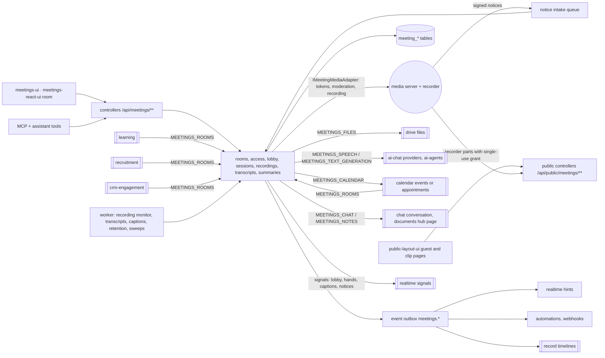

# Implementation Plan: Meetings

> Translates an approved `spec.md` into architecture and tech choices. The plan owns
> implementation details; the spec owns behaviour.

**Feature ID**: `meetings`
**Spec**: `./spec.md`
**Tasks**: `./tasks.md`
**Status**: `Draft`
**Last updated**: 2026-11-23

---

## 1. Architecture Summary

A new plugin triple: `@gauzy/plugin-meetings` (`packages/plugins/meetings`), listed in `apps/api/src/plugins.ts` and
`apps/worker/src/plugins.ts` only when `GAUZY_MEETINGS_ENABLED` is exactly `true`, contributing `FEATURE_MEETINGS`
(default off, `@FeatureFlag` on every controller and resolver); `meetings-ui` (Angular pages and settings) and
`meetings-react-ui` (the room, device check, lobby, recording notice, join button; hosted in Angular through
`@gauzy/ui-react`). Media servers are reached only through `IMeetingMediaAdapter` plugins: `meetings-media-livekit` and
`meetings-media-jitsi`, for the two media servers Ever Teams already uses in its web client, bring their server side
(token signing, notices, recording, moderation) into Gauzy plugins with a browser client module each, beside Ever Teams'
own server side, which stays; a simulated adapter in the plugin serves tests and demonstrations. The platform signs
every join token it issues; Ever Teams may use these routes as its own spec decides, and its own token routes keep
working in every case (FR-2). Rooms, sessions, attendance, recordings,
transcripts, summaries and clips are this plugin's tables; events, files, notes and chat conversations stay with their
owners and are reached through ports. What the platform already holds is not stored again: polls are core polls hosted
by a session; personal choices (devices aside, which stay in the browser) live in `User.uiPreferences.meetings`;
organization switches and limits are keys of `meetings.settings.ts` in the platform settings store; retention periods
and legal holds are the platform's retention policies and hold register (`access-control-and-security`); clip links are
core `shared_entity` links; tracked-time offers are the calendar's, fed with attendance; a scheduled meeting's agenda
text stays the appointment's `agenda` as people wrote it: it seeds the agenda items and its edits update them, and items
added in the meeting are appended to it without removing or reformatting anything written there.

## 2. Tech Choices

| Concern | Choice | Rationale |
| --- | --- | --- |
| Package | `packages/plugins/meetings` (`adapters/`, `accounts/`, `rooms/`, `access/`, `lobby/`, `sessions/`, `controls/`, `polls/`, `agenda/`, `recordings/`, `transcripts/`, `summaries/`, `library/`, `links/`, `schedule/`, `public/`, `database/`), `meetings-ui`, `meetings-react-ui`; adapters `meetings-media-<key>` | Principle I |
| Media | `IMeetingMediaAdapter` (server) + `IMeetingMediaClient` (browser module) with declared capabilities; `registerMeetingMediaAdapters` | no media code in the core plugin |
| Credentials | deployment default from settings (below) and optional per-organization accounts in core `integration_tenant` + encrypted `integration_setting` | Principle VI |
| Room names | one pure function per adapter, identical to the names Ever Teams computes today, shared tests | FR-3 compatibility |
| Polls | core `poll`, `poll_option`, `poll_vote` (introduced by `discussions`) with `entity = MeetingSession` and a `@PollHostAccessPolicy()` for sessions (participants vote, hosts create and close); the core module and its migration are [`discussions`](../discussions/spec.md) T42 | one poll module for every host |
| Personal choices | `User.uiPreferences.meetings` (sounds, background, start muted, camera off, caption language) through `PUT /user/ui-preferences`; device ids stay in the browser, per device | no preference table |
| Settings | `meetings.settings.ts` (`PluginSettingContribution`, scope `ORGANIZATION`): guests, recording, automatic recording, captions, transcripts, summaries, keep captions, consent acknowledgement and text, participant, duration and recording limits, recording margin, join opening, default media account, speech provider, translation languages | platform settings store |
| Retention and holds | kinds `meetings.recording`, `meetings.transcript` and `meetings.clip` declared through `RETENTION_SOURCES` (default keep: nothing is deleted until the organization sets a period) with meetings' purge handler; holds are hold register rows (`privacy_legal_hold`, record type `MeetingRecording`) read through `MEETINGS_LEGAL_HOLDS`; `retentionUntil` stays the computed date on the row | one retention and hold model |
| Clip links | a core `shared_entity` row for a clip with the link audience (hashed token, expiry, revocation and view count of the `shared_entity` extension of `access-control-and-security`); the public clip route resolves it | one public link model |
| Tracked time | the calendar's tracked-time offer (`calendar_time_offer`, one per person and occurrence or session) through `CALENDAR_TIME_OFFERS`; meetings feeds attended minutes on session end | one offer per meeting |
| Agenda | `meeting_agenda_item` seeded from the appointment's `agenda` text (written by the appointment form and Ever Teams' schedule dialog) and updated on its edits; items added in the meeting are appended to the text, which is never rewritten or reformatted | existing clients keep showing the agenda as written |
| Notices | public notice route with raw body, adapter signature check, stored then processed (inbox raw-body middleware idiom) | idempotent attendance |
| Recording upload | single-use grant (random, hashed, bound to one recording and a deadline), parts with SHA-256 checks, resumable; or adapter-delivered file fetched through `createSsrfSafeHttpsAgent()` | recorder isolation |
| Speech and text | `MEETINGS_SPEECH` → `ai-chat` `transcribe`, with two optional additive provider methods `transcribeSegments` (timed segments) and `transcribeStream` (live); `MEETINGS_TEXT_GENERATION` → `ai-agents-and-assistants`, else `ai-chat` | existing provider registry, self-hosted speech servers work |
| Real time | outbox events for durable changes; `RealtimeSignalsService` for lobby, hands, captions and notices; guests in the lobby get a guest-scoped subscription, polling every 3 s as the documented fallback | Principle VII |
| Jobs | `@ScheduledJob` + `@QueueWorker`; captions worker in the worker app holding adapter audio streams | long-lived streams off the API |

Deployment settings (`.env.sample`, read through `@gauzy/config`): `GAUZY_MEETINGS_MEDIA_ADAPTER` (`livekit` or `jitsi`),
`GAUZY_MEETINGS_LIVEKIT_URL`, `GAUZY_MEETINGS_LIVEKIT_API_KEY`, `GAUZY_MEETINGS_LIVEKIT_API_SECRET`,
`GAUZY_MEETINGS_JITSI_DOMAIN`, `GAUZY_MEETINGS_JITSI_APP_ID`, `GAUZY_MEETINGS_JITSI_APP_SECRET`; each falls back to the
name Ever Teams reads (`NEXT_PUBLIC_MEET_TYPE`, `NEXT_PUBLIC_LIVEKIT_URL`, `LIVEKIT_API_KEY`, `LIVEKIT_API_SECRET`,
`NEXT_PUBLIC_MEET_DOMAIN`, `MEET_JWT_APP_ID`, `MEET_JWT_APP_SECRET`) so one deployment configures both clients.

## 3. Data Model

All tables extend `TenantOrganizationBaseEntity`; JSON is `text`; ids into other plugins carry no foreign key.

| Table | Columns (besides base) | Keys and indexes |
| --- | --- | --- |
| `meeting_media_account` | `adapterKey` varchar(32); `name` varchar(120); `serverUrl` varchar(1024); `integrationTenantId` uuid; `isDefault` bool; `state` varchar(10) (`ACTIVE`, `ERROR`, `DISABLED`); `capabilities` text; `lastVerifiedAt` timestamp; `noticeTokenHash` varchar(64) | unique (`organizationId`,`name`); unique `noticeTokenHash` |
| `meeting_room` | `roomKey` varchar(120); `title` varchar(200); `kind` varchar(10) (`INSTANT`, `SCHEDULED`, `PERSISTENT`, `TEAM`, `RECORD`, `CHAT`); `ownerUserId`, `organizationTeamId`, `calendarEventId`, `conversationId`, `mediaAccountId` uuid; `teamKey` varchar(80); `entry` varchar(12) (`ORGANIZATION`, `INVITED`, `HOSTS_ONLY`); `guestsAllowed`, `isLocked`, `e2ee` bool; `settings` text; `adapterKey` varchar(32); `mediaRoomName` varchar(255); `state` varchar(8) (`ACTIVE`, `CLOSED`); `closedAt`, `lastSessionAt` timestamp; `version` int | unique (`tenantId`,`roomKey`), (`tenantId`,`mediaRoomName`), (`tenantId`,`teamKey`), (`tenantId`,`conversationId`) (one room per chat conversation; nulls distinct); (`calendarEventId`), (`organizationId`,`kind`,`state`) |
| `meeting_room_member` | `roomId` FK cascade; `userId`, `employeeId` uuid; `role` varchar(10) (`OWNER`, `HOST`, `CO_HOST`, `MEMBER`) | unique (`roomId`,`userId`) |
| `meeting_ban` | `roomId` FK cascade; `subjectKey` varchar(330) (user id or normalised address); `bannedByUserId` uuid; `reason` varchar(500) | unique (`roomId`,`subjectKey`) |
| `meeting_session` | `roomId` FK; `calendarEventId` uuid; `occurrenceStartAt`, `startedAt`, `endedAt` timestamp; `startedByUserId`, `notesDocumentId`, `conversationId`, `callMessageId` uuid (the chat call card); `audioOnly` bool default false (a chat quick call); `liveKey` uuid null (= `roomId` while live); `peakParticipants`, `participantSeconds` int; `state` varchar(6) (`LIVE`, `ENDED`); `endReason` varchar(8) (`EMPTY`, `HOST`, `LIMIT`, `ADAPTER`); `mediaSessionRef` varchar(255) | unique (`roomId`,`mediaSessionRef`), (`liveKey`) (one live session per room); (`roomId`,`startedAt`), (`organizationId`,`startedAt`) |
| `meeting_participant` | `sessionId` FK cascade; `userId`, `employeeId`, `guestPassId`, `admittedByUserId` uuid; `displayName` varchar(200); `role` varchar(10); `identityKey` varchar(120); `firstJoinedAt`, `lastLeftAt` timestamp; `attendedSeconds` int; `segments` text; `devices` smallint; `connectionKey` varchar(120) | unique (`sessionId`,`identityKey`); (`employeeId`,`firstJoinedAt`) |
| `meeting_guest_pass` | `roomId` FK cascade; `name` varchar(200); `address` varchar(320); `kind` varchar(8) (`INVITED`, `PUBLIC`); `calendarGuestId` uuid; `tokenHash` varchar(64); `expiresAt` timestamp; `state` varchar(10) (`ISSUED`, `WAITING`, `ADMITTED`, `REJECTED`, `EXPIRED`) | unique `tokenHash`; (`roomId`,`state`) |
| `meeting_lobby_entry` | `roomId` FK; `sessionId`, `userId`, `guestPassId`, `decidedByUserId` uuid; `requestedAt`, `decidedAt`, `retryAfter` timestamp; `state` varchar(10) (`WAITING`, `ADMITTED`, `REJECTED`, `LEFT`) | (`roomId`,`state`,`requestedAt`) |
| `meeting_recording` | `sessionId` FK; `part` smallint; `state` varchar(12) (`QUEUED`, `RECORDING`, `PROCESSING`, `AVAILABLE`, `INCOMPLETE`, `FAILED`, `DISCARDED`); `startedByUserId`, `stoppedByUserId`, `fileId` uuid; `queuedAt`, `startedAt`, `endedAt`, `grantExpiresAt` timestamp; `retentionUntil` timestamp (computed from the retention policy of its kind); `durationSeconds` int; `gaps` text; `sizeBytes` bigint; `checksum` varchar(64); `adapterRef` varchar(255); `grantHash` varchar(64); `failureReason` varchar(500) | unique `grantHash`; (`sessionId`), (`state`,`queuedAt`), (`retentionUntil`) |
| `meeting_recording_part` | `recordingId` FK cascade; `partNumber` int; `sizeBytes` bigint; `checksum` varchar(64); `storageKey` varchar(512); `receivedAt` timestamp | unique (`recordingId`,`partNumber`) |
| `meeting_transcript` | `sessionId`, `recordingId` uuid; `source` varchar(10) (`RECORDING`, `CAPTIONS`); `language` varchar(10); `state` varchar(8) (`QUEUED`, `RUNNING`, `READY`, `FAILED`); `providerKey` varchar(64); `retentionUntil` timestamp | unique (`sessionId`,`source`,`recordingId`); (`retentionUntil`) |
| `meeting_transcript_segment` | `transcriptId` FK cascade; `seq` int; `startMs`, `endMs` int; `participantId` uuid; `speakerLabel` varchar(120); `text`, `correctedText` text; `correctedByUserId` uuid; `correctedAt` timestamp | unique (`transcriptId`,`seq`); (`transcriptId`,`startMs`) |
| `meeting_summary` | `sessionId`, `transcriptId`, `approvedByUserId` uuid; `state` varchar(10) (`PROPOSED`, `APPROVED`, `DISCARDED`); `summary`, `decisions`, `actionItems`, `writtenTo` text; `approvedAt` timestamp; `version` int | (`sessionId`) |
| `meeting_agenda_item` | `roomId` FK; `calendarEventId`, `ownerUserId` uuid; `occurrenceStartAt` timestamp; `title` varchar(300); `minutes` smallint; `position` int; `isDone` bool; `source` varchar(8) (`PERSON`, `PROPOSED`, `CARRIED`, `AGENDA_TEXT`); `sourceRef` text; `version` int | (`roomId`,`occurrenceStartAt`,`position`) |
| `meeting_clip` | `recordingId` FK cascade; `startMs`, `endMs` int; `title` varchar(200); `createdByUserId` uuid; `audience` varchar(12) (`ROOM`, `ORGANIZATION`, `LINK`); `sharedEntityId` uuid null (the link's core `shared_entity` row); `requiresSignIn` bool | (`recordingId`); (`sharedEntityId`) |
| `meeting_diagnostic` · `meeting_notice` | diagnostic: `sessionId`, `participantId`, `createdByUserId` uuid; `figures`, `note` text; `client` varchar(255) · notice: `adapterKey` varchar(32); `mediaAccountId` uuid; `noticeId` varchar(255); `kind` varchar(32); `payload` text; `processedAt` timestamp | notice unique (`adapterKey`,`noticeId`); diagnostic (`organizationId`,`createdAt`) |

Record links: a room's links to records are record links of `record-views-and-search` (core `resource_link` with a record target): `entity = MeetingRoom`, the record as target, `linkedBy` `PERSON` or `SYSTEM` (source record, calendar event).

Not meeting tables: polls (core `poll`), personal choices (`User.uiPreferences.meetings`), organization settings (platform
settings store), retention periods and holds (`privacy_retention_policy`, `privacy_legal_hold`), clip links
(`shared_entity`), tracked-time offers (`calendar_time_offer`).

### Migrations

**Migration timestamps**: `packages/plugins/meetings` `1791000062100` to `1791000062199`.

Plugin migrations with the shared core migration helpers of `@gauzy/core`; PostgreSQL, MySQL and SQLite;
idempotent, forward-only, registered for both ORMs, listed only with `GAUZY_MEETINGS_ENABLED`:
`1791000062100-CreateMeetingRoomTables` (media account, room, member, ban),
`1791000062110-CreateMeetingSessionTables` (session, participant, guest pass, lobby, agenda, diagnostic, notice),
`1791000062120-CreateMeetingRecordingTables` (recording, part, clip), `1791000062130-CreateMeetingTranscriptTables`
(transcript, segment, summary). Permissions and `FEATURE_MEETINGS` are plugin contributions (§9), not seeds. The core poll
migration is `1791000064390` of [`discussions`](../discussions/spec.md) T42. Rooms for links that Ever Teams
created are created on their first join through the platform (no backfill).

### Contracts

`packages/contracts/src/lib/meetings.model.ts`: enums above, room, member, session, participant, guest pass, recording,
transcript, segment, summary, agenda item, clip, `IMeetingsUiPreferences` (added to `IUserUiPreferences`); `IMeetingMediaAdapter` (`key`, `capabilities`, `configSchema`,
`verify(account)`, `mediaRoomName(tenantId, roomKey)`, `issueToken(account, { room, identity, name, role, ttlSeconds,
publish, share, moderator })`, `verifyNotice(req, account)`, `parseNotice(req) → INotice[]`, `mute?`, `remove?`,
`endRoom?`, `startRecording?(room, grant, layout)`, `stopRecording?`, `openAudioStream?`); `IMeetingMediaClient`
(`connect`, devices and tracks, `share`, `sendData`, events, `stats`, `effects?`, `e2ee?`); ports `MEETINGS_ROOMS`,
consumed `MEETINGS_CALENDAR`, `MEETINGS_FILES`, `MEETINGS_NOTES`, `MEETINGS_CHAT`, `MEETINGS_SPEECH`,
`MEETINGS_TEXT_GENERATION`, `MEETINGS_RECORD_NOTES`, `MEETINGS_LEGAL_HOLDS`, `CALENDAR_TIME_OFFERS`; registry
`registerMeetingAgendaSources`. The `ai-chat` provider
definition gains the optional `transcribeSegments` and `transcribeStream` (additive).

## 4. API Surface

Authenticated routes: `TenantPermissionGuard`, `PermissionGuard`, `@FeatureFlag(FEATURE_MEETINGS)`, Swagger, DTOs,
cursor pagination, `Idempotency-Key` on creating routes; room access checked by `MeetingAccessService`.

| Method | Endpoint | Permission | Description | Status |
| --- | --- | --- | --- | --- |
| `GET` | `/meetings/status` | `MEETINGS_VIEW` | capabilities (FR-4) | New |
| `GET` `POST` `PATCH` | `/meetings/media-accounts[/:id]`, `POST …/:id/verify` | `MEETINGS_SETTINGS_MANAGE` | media accounts, secrets write-only | New |
| `GET` `POST` `PATCH` | `/meetings/rooms[/:id]`, `GET /meetings/rooms/by-key/:roomKey`, `POST …/:id/{close,reopen}` | `MEETINGS_HOST` (persistent, team: `MEETINGS_ROOMS_MANAGE`); changes: owner or host | rooms and settings | New |
| `PUT` `POST` `DELETE` | `/meetings/rooms/:id/members`, `/meetings/rooms/:id/bans[/:banId]` | owner or host | roles, bans | New |
| `POST` `GET` | `/meetings/rooms/:id/join` · `/meetings/rooms/:id/presence` | `MEETINGS_VIEW` + room access | token or lobby entry; who is in | New |
| `GET` `POST` | `/meetings/rooms/:id/lobby`, `/meetings/lobby/:entryId/{admit,reject}` | host | lobby | New |
| `POST` | `/meetings/sessions/:id/{mute-all,lower-hands,lock,unlock,end}`, `/meetings/sessions/:id/participants/:pid/{mute,stop-video,stop-share,remove,promote}` | host | host controls | New |
| `GET` | `/meetings/sessions?roomId=&recordType=&recordId=` · `/meetings/sessions/:id` · `…/:id/attendance` | session participant, room member, linked-record reader | sessions, attendance | New |
| `POST` | `/meetings/sessions/:id/polls` · votes and close through core `/api/polls/:id/{vote,close}` | host · participant (session host policy) | a core poll hosted by the session | New |
| `GET` `PUT` `POST` | `/meetings/rooms/:id/agenda?occurrence=`, `…/agenda/propose` | room member | agenda, proposals | New |
| `POST` | `/meetings/sessions/:id/notes` | participant | create or open the linked notes page | New |
| `POST` | `/meetings/sessions/:id/recordings` (`preview` = preflight) · `/meetings/recordings/:id/{stop,cancel,hold,release}` | `MEETINGS_RECORD` + host · hold: `MEETINGS_SETTINGS_MANAGE` | start, stop, queue cancel; hold and release write hold register rows (`MeetingRecording`) | New |
| `GET` | `/meetings/recordings?…` · `/meetings/recordings/:id` · `…/:id/stream` | FR-49 readers | library; detail; short-lived stream address, audited | New |
| `GET` `PATCH` | `/meetings/recordings/:id/transcript`, `/meetings/transcripts/:id/segments/:seq`, `…/download?format=` | FR-49 readers | transcript, corrections, text or captions file | New |
| `GET` | `/meetings/search?q=` | `MEETINGS_VIEW` | search inside readable transcripts | New |
| `POST` | `/meetings/sessions/:id/summary` · `/meetings/summaries/:id/{approve,discard}` | host | proposal; approval with edits writes | New |
| `POST` `DELETE` | `/meetings/recordings/:id/clips` · `/meetings/clips/:id` | FR-49 readers · clip creator | clips; a link audience creates, and revocation ends, the clip's `shared_entity` link | New |
| `GET` `POST` `DELETE` | `/meetings/rooms/:id/links[/:linkId]` · `GET /meetings/records/:type/:id/sessions` | host + record read | meetings on records | New |
| `POST` | `/meetings/schedule` | `MEETINGS_HOST` | room with calendar event or appointment (tracked-time offers are answered on the calendar's offer route) | New |
| `GET` `PUT` | `/meetings/settings` · `/api/user/ui-preferences` (core, key `meetings`) | `MEETINGS_SETTINGS_MANAGE` · self | the `meetings.*` keys of the platform settings store; personal choices | New · Existing |
| `POST` `GET` | `/meetings/sessions/:id/diagnostics` · `/meetings/diagnostics` | participant · `MEETINGS_SETTINGS_MANAGE` | problem reports | New |
| `GET` `POST` | `/public/meetings/rooms/:roomKey`, `…/guest-join`, `/public/meetings/lobby/:ticket` | public: guests allowed, pass token, throttled | guest page, lobby | New |
| `POST` `PUT` `GET` | `/public/meetings/notices/:accountKey/:token` · `/public/meetings/recordings/:id/parts/:n` · `/public/meetings/clips/:token` | adapter signature · single-use grant · the clip's `shared_entity` token | notices, recorder upload, clips | New |

Errors: `MEETINGS_NO_MEDIA_SERVER`, `MEETINGS_ROOM_FULL`, `MEETINGS_ROOM_CLOSED`, `MEETINGS_ROOM_LOCKED`,
`MEETINGS_BANNED`, `MEETINGS_GUESTS_OFF`, `MEETINGS_ADAPTER_UNSUPPORTED` (capability named), `MEETINGS_RECORDING_OFF`,
`MEETINGS_ENCRYPTED`, `MEETINGS_STORAGE_FULL`. GraphQL reads `meetingRooms`, `meetingSessions`, `meetingRecordings`.

**Consumer tokens answered** (bound in `apps/api/src/plugin-composition.ts` to `MEETINGS_ROOMS`; each consumer plan states the shape it calls and its fallback): `PERFORMANCE_MEETINGS`, `RECRUITMENT_MEETINGS`.

## 5. Events, Real-Time and Notifications

| Event (outbox, partition `MEETINGS:<roomId>`) | Emitted when | Consumers |
| --- | --- | --- |
| `meetings.room.created` · `closed` | room life | automations, webhooks, calendar (closed occurrence) |
| `meetings.session.started` · `ended` | live period | timelines, learning attendance, the calendar's tracked-time offers (attendance), chat call cards, reports |
| `meetings.participant.joined` · `left` | attendance | hosts' people list, learning, automations |
| `meetings.recording.started` · `available` · `incomplete` · `failed` · `deleted` | recording states | host and owner notices, transcripts, timelines |
| `meetings.transcript.ready` · `meetings.summary.approved` | results | summaries, `crm-engagement` transcripts, notices to participants |

Signals through `RealtimeSignalsService` to targeted users: `meetings.lobby.request`, `meetings.lobby.decision`,
`meetings.hand`, `meetings.caption` (when the adapter has no data channel), `meetings.recording.notice`,
`meetings.limit.warning`. Notification categories: `meetings.recording`, `meetings.summary`, `meetings.lobby`.
Consumed: `calendar.event.changed|cancelled` (room follows), `calendar.answer.changed` (invited participants),
chat conversation call ended (room end), `drive` quota changes.

## 6. UI Surface

- **`meetings-ui`** (Angular, menu "Meetings" under the feature): `/pages/meetings` (start, join by link or name,
  upcoming, live rooms, my rooms, recent sessions), `/pages/meetings/r/:roomKey` (device check, lobby and room, full
  screen), `/pages/meetings/rooms` (persistent and team rooms), `/pages/meetings/sessions/:id` (attendance, player,
  transcript with search and corrections, summary review with sources, notes link, polls, agenda),
  `/pages/meetings/library` (recordings, search inside transcripts, clips), Settings → Meetings (media accounts,
  switches, limits and consent text from the platform settings store, retention from the platform retention policies,
  problem reports). Polls in the room and on the session page use the core poll card; personal choices are read from
  `uiPreferences.meetings`.
- **`meetings-react-ui`**: `MeetingRoom` (layouts, controls, participants panel with host controls, chat, reactions, hands,
  polls, captions with language choice, effects, statistics, person-hours meter), `DeviceCheck`, `Lobby`,
  `RecordingNotice`, `JoinButton` (used by calendar events and record pages); each adapter's browser module drives media;
  a frame-based adapter shows its server's room inside a frame and our controls only where its client allows.
- **`public-layout-ui`**: `/share/meet/:roomKey` (guest device check, name, lobby, room) and `/share/meet/clip/:token`.
- i18n keys `MEETINGS.*` in every locale; email templates `meeting-recording-available`, `meeting-summary` in every
  language; React texts through `useTranslation()`.
- Ever Teams (the Ever Teams spec `workspace-collaboration-clients`): meetings screens over the same routes and signals. Its schedule
  dialog keeps writing `/employee-appointment` (agenda text, invitees, outside addresses), which this plugin reads into
  agenda items without rewriting the text, and its `.ics` builder stays in its client; moving its screens onto
  `/meetings/schedule` is its client spec's choice.

## 7. MCP Tools, SDKs and Integrations

- `packages/mcp-server/src/lib/tools/meetings.ts`: `meetings_rooms_list`, `meetings_room_create` (preview),
  `meetings_schedule` (preview; through the calendar), `meetings_sessions_list`, `meetings_attendance_get`,
  `meetings_transcripts_search`, `meetings_transcript_get`, `meetings_summary_propose` (stores a proposal only),
  `meetings_followups_propose`; registered with `AiChatToolRegistry`.
- **Port offered** `MEETINGS_ROOMS` (`createRoom({ for: event | record | conversation | team })`, `joinLink`,
  `attendance(session | event occurrence)`, `transcript(session)`, `endFor(conversation)`), bound in
  `apps/api/src/plugin-composition.ts` to `CALENDAR_CONFERENCING`, `LEARNING_MEETINGS`, `RECRUITMENT_MEETINGS`,
  `CRM_TRANSCRIPTS` (beside telephony) and the chat calls of `chat-administration-and-clients` (one `CHAT` room per
  conversation, one live session per room, `audioOnly` quick calls, the call card's message id kept on the session); a
  `RECORD_TIMELINE_SOURCES` entry; a global search source over transcript segments; `registerMeetingMediaAdapters`.
  Today's candidate interviews (core `candidate-interview`) are a registered record type (`CandidateInterview`): a room
  can be created for an interview and its join link set on it, before and beside `recruitment`.
- **Ports consumed** (optional, with fallbacks): `MEETINGS_CALENDAR` → `CALENDAR_EVENTS`, `CALENDAR_AVAILABILITY`
  (absent: core employee appointment with `inviteeEmployeeIds`); `MEETINGS_FILES` → `drive` (absent: documents hub files,
  else core file storage); `MEETINGS_NOTES` → documents hub page with live editing when on (absent: no shared notes);
  `MEETINGS_CHAT` → chat conversation (absent: media data channel only); `MEETINGS_SPEECH` and
  `MEETINGS_TEXT_GENERATION` (absent: no captions, transcripts or summaries); `MEETINGS_RECORD_NOTES` → notes of
  `record-views-and-search` (absent: a comment on the record); `registerMeetingAgendaSources` (crm deals, helpdesk
  tickets; core tasks built in); `NOTIFICATION_DISPATCHER`; `RECORD_ACCESS_FILTER`; `MEETINGS_LEGAL_HOLDS` → hold register of `access-control-and-security` (absent: no holds);
  `RETENTION_SOURCES` declarations; `CALENDAR_TIME_OFFERS` → calendar (absent: no tracked-time offer); `CORE_POLLS`;
  core task service.
- Adapter plugins pass a shared contract suite. Formats: captions download as WebVTT, transcripts as text. OpenAPI
  regenerated; SDKs at release; report definitions of spec FR-73 on datasets `meetings.recordings`,
  `meetings.sessions`, `meetings.participants`, `meetings.summaries`, `meetings.diagnostics`.

## 8. Background Jobs

| Trigger | When | What it does | Idempotency |
| --- | --- | --- | --- |
| queue `meetings-notices` | each stored notice | sessions, attendance segments, recording states | unique (`adapterKey`,`noticeId`) |
| `meetings.sessions-sweep` | every minute | end sessions empty for 5 minutes or past the limit; warnings | session state compare-and-set |
| queue `meetings-recordings` | start request, recorder free | grant, start, queue order, finalize parts into one file in `drive`, checksum | recording state; part unique key |
| `meetings.recording-monitor` | every 30 s | parts stalled over 2 minutes become a gap, then failure | gap list append by window |
| queue `meetings-transcripts` | recording available | per-speaker or chunked transcription, segments, then summary proposal | (`sessionId`,`source`,`recordingId`) |
| captions worker | while captions are on | adapter audio stream → streaming speech → caption signals, translation, kept captions | segment `seq` |
| meetings retention handler (called by the retention runner of `access-control-and-security`, or by `meetings.retention` nightly 02:50 where it is not loaded, with the declared default keep) | nightly | delete recordings, clips, transcripts past the organization's retention period, where one is set, without a hold in the register; recompute `retentionUntil` when a policy changes | conditional state update; a `job_execution` row per run |
| `meetings.agenda-proposals` | daily 07:00 and on link change | proposals for meetings in the next 48 hours | `source = PROPOSED` replace per occurrence |
| `meetings.guest-expiry` · attendance to the calendar | hourly · session end | expire passes · hand attended minutes per employee to `CALENDAR_TIME_OFFERS` | state · the calendar's one offer per person and occurrence or session |

The worker loads `MeetingsSchedulePlugin` (schedules and the captions worker); the API consumes queues. Without a queue
root the API runs them on in-process timers under the plugin lock; captions then need the worker and are not offered.

## 9. Security & Permissions

- New keys in `meetings.permissions.ts` as plugin contributions with `defaultFor`: `MEETINGS_VIEW` (every default role),
  `MEETINGS_HOST`, `MEETINGS_RECORD` (super admin, admin, manager, employee), `MEETINGS_ROOMS_MANAGE` (super admin, admin,
  manager), `MEETINGS_RECORDINGS_VIEW_ALL`, `MEETINGS_SETTINGS_MANAGE` (super admin, admin).
- Tokens: issued server-side per room, identity and role, ≤ 1 hour (guests ≤ 2 hours), never for banned subjects, a
  locked room or a full room; media room names include the tenant; tokens and guest proofs never logged.
- Notices: per-account token hashed, adapter signature over the raw body, stored before processing. Recorder grants:
  random, hashed, single recording, deadline, size cap, parts checked; nothing else is accepted on the upload route.
- Recording readers per spec FR-49 through `MeetingAccessService` (+ `RECORD_ACCESS_FILTER` for linked records); stream
  addresses short-lived and signed; listens, downloads, clip creation and views audited.
- Media credentials encrypted in `integration_setting`; audio and text leave only to the media server and the chosen AI
  provider (FR-69); encrypted rooms send nothing to recorders or providers.
- Personal data handlers: participants, guest passes, transcripts (speaker attribution), diagnostics (export; erasure
  removes names from segments and anonymises attendance).

## 10. Observability

Activity log for room, role, ban, settings and account changes, recording starts and stops, listens, downloads, clips,
corrections and summary decisions. Metrics: token latency, lobby wait, sessions live, reconnections, notice lag,
recording queue length and wait, recording gaps and failures, transcription minutes, caption delay, summary approval
rate, problem reports per adapter. Errors with tenant, room and session ids, never with tokens or grants.

## 11. Phased Rollout

1. **Phase 1 — Rooms and joining** (flags off by default): contracts, tables, adapter contract, the two shipped adapters
   and the simulated one, media accounts, rooms with access and roles, tokens with compatible names, device check, lobby,
   guests, notices and attendance, meetings page and room with audio, video, screen share and layouts, MCP read tools.
2. **Phase 2 — In the room and on records**: host controls, chat link, reactions, hands, polls, effects, statistics and
   reports of problems, sounds, limits and second device, scheduling through the calendar with the appointment
   fallback, record links and timelines, `MEETINGS_ROOMS` for other features.
3. **Phase 3 — Recording**: grants and uploads, preflight, notices, gaps, `drive` storage, readers, retention and holds,
   library, recording report.
4. **Phase 4 — Captions and transcripts**: transcription pipeline, captions, corrections, search, downloads.
5. **Phase 5 — Advanced capabilities**: recording queue, agenda proposals, summaries with approval and write-back, translated
   captions, clips, tracked time offers, person-hours meter, MCP proposals.
6. **Phase 6 — General availability**, once one shipped adapter is in production: the feature is off by default; after the trial period it may be switched on by default for new tenants only; existing tenants keep their setting until an administrator changes it.

## 12. Constitution Reconciliation

- I Plugin-first: new `meetings`, `meetings-ui`, `meetings-react-ui`; media adapters as plugins.
- II Tenant/organization scoping: base entity on every table; tenant in media room names; public routes resolve the
  tenant from hashed tokens only.
- III Both ORMs, additive migrations: MultiORM entities, four migrations, three dialects; permissions as contributions; the provider methods are optional.
- IV Default-off flag; nothing removed: deploy flag and `FEATURE_MEETINGS` off; Ever Teams token routes and appointment
  scheduling untouched.
- V Contracts and API first: contracts, adapter and room contracts before UI; REST, GraphQL reads, MCP over the same routes.
- VI Permissions, privacy, security: six keys; single-room tokens; single-use recorder grants; verified notices;
  audited listens; retention and holds.
- VII Real-time through the event bus: outbox events and platform signals; media only through the media server.
- VIII i18n and accessibility: keys and templates in every locale; keyboard controls, captions, announcements.
- IX Tests: unit specs per pure module (room names, access decisions, attendance segments, gap detection, ranking of
  agenda sources), adapter contract suite, e2e with the simulated adapter, upload and retention tests.
- X Behaviour-first spec: the spec names no table or class.
- XI Documentation describes our platform only.

## 13. Risks & Mitigations

| Risk | Likelihood | Impact | Mitigation |
| --- | --- | --- | --- |
| Two adapters with unequal capabilities | High | Medium | declared capabilities, controls hidden or client-asked, contract suite per adapter |
| Room name drift breaks existing links | Medium | High | one tested naming function per adapter matching today's client |
| Recording loss on recorder failure | Medium | High | checked parts, gap detection, partial results kept, queue survives restarts |
| Privacy breach through recordings or clips | Low | High | reader rules, audited listens, expiring clip links, retention, consent notice |
| Speech provider cost and latency | Medium | Medium | organization switches off by default, per-speaker chunks, self-hosted speech servers supported |
| Self-hosted media server unreachable for notices | Medium | Medium | notice address shown on the account page, verification sends a test notice |

## 14. References

- Spec: `./spec.md` · Tasks: `./tasks.md` · Specs: `../calendar-and-scheduling/plan.md`, `../learning-management/plan.md`,
  `../recruitment/plan.md`, `../crm-engagement/plan.md`, `../telephony/plan.md`, `../discussions/plan.md` (core polls),
  `../access-control-and-security/plan.md` (retention, holds, public links)
- Code: `packages/core/src/lib/employee-appointment/`, `packages/core/src/lib/integration-setting/`,
  `packages/core/src/lib/shared-entity/`, `packages/core/src/lib/candidate-interview/`,
  `core/util/ssrf-safe-agent.ts`, `packages/plugins/ai-chat/src/lib/provider.types.ts`, `packages/plugins/realtime/`,
  `packages/plugins/docs/`, `packages/plugins/inbox/src/lib/email/inbound/inbound-raw-body.middleware.ts`,
  `apps/api/src/plugin-composition.ts`; Ever Teams `apps/web/app/api/livekit/route.ts`,
  `apps/web/app/api/auth/meet/jwt/route.ts`, `apps/web/core/components/integration/{livekit,meet}/`
